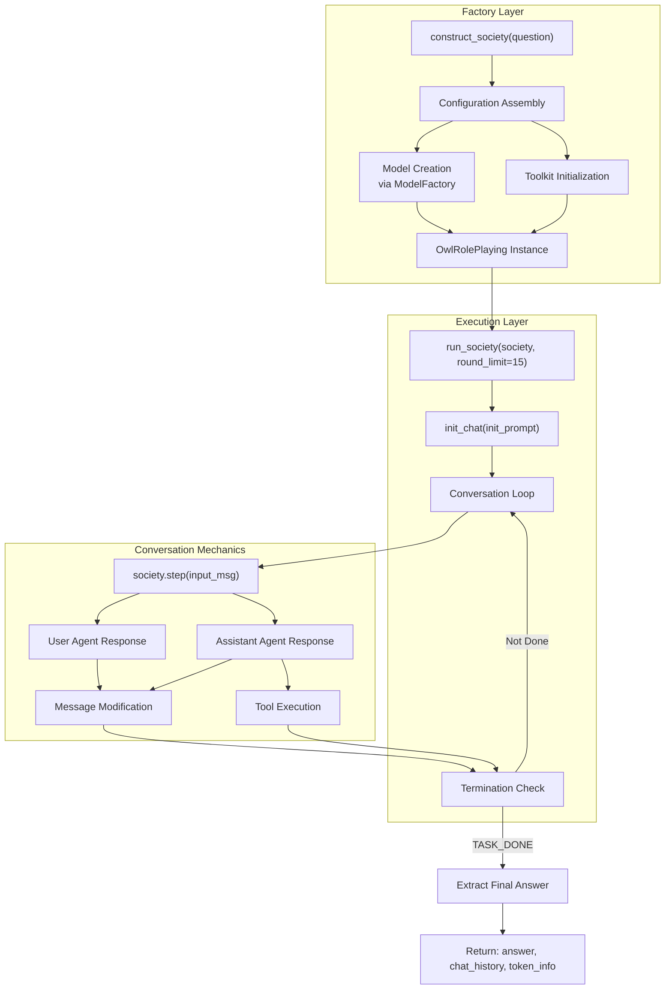
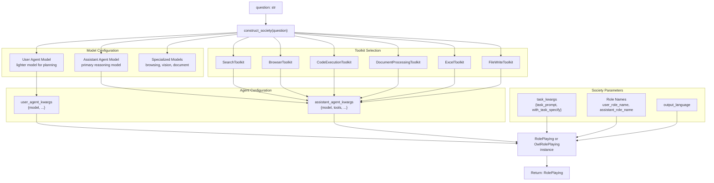
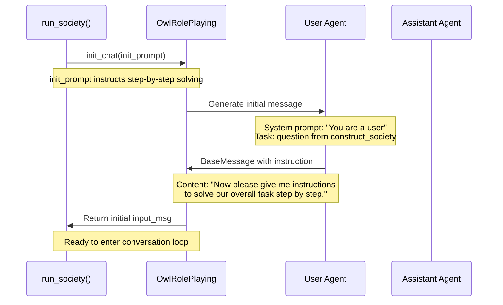
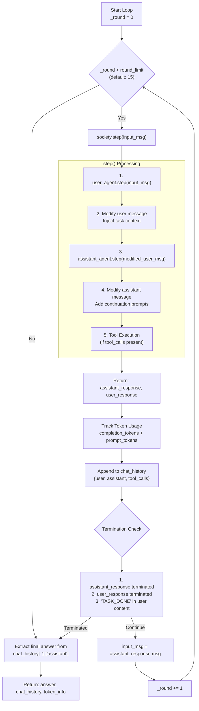
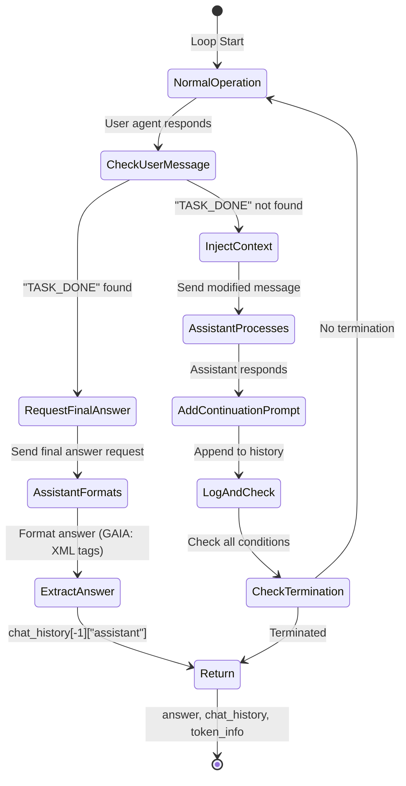
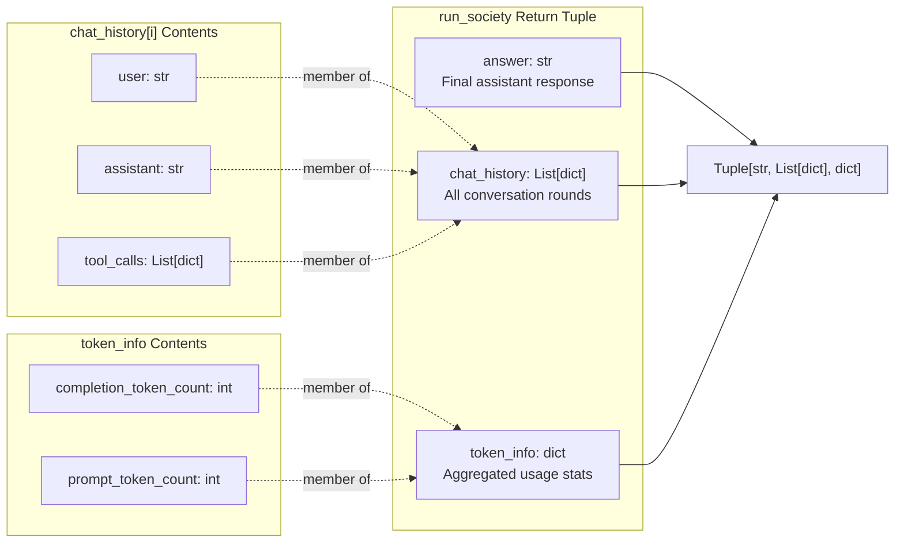
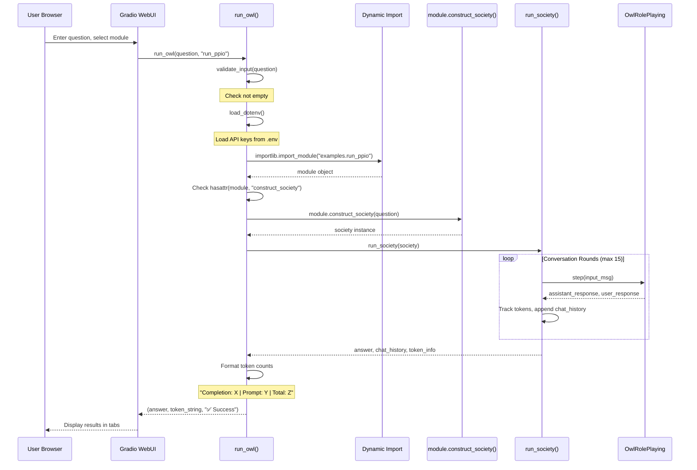

<!-- source: DeepWiki mcp.deepwiki.com · repo camel-ai/owl · page 2.2 Execution Pipeline · fetched 2026-10-29 -->

# Execution Pipeline

<details>
<summary>Relevant source files</summary>

The following files were used as context for generating this wiki page:

- [examples/run_ppio.py](examples/run_ppio.py)
- [owl/.env_template](owl/.env_template)
- [owl/utils/enhanced_role_playing.py](owl/utils/enhanced_role_playing.py)
- [owl/webapp.py](owl/webapp.py)
- [owl/webapp_backup.py](owl/webapp_backup.py)
- [owl/webapp_zh.py](owl/webapp_zh.py)
- [pyproject.toml](pyproject.toml)
- [requirements.txt](requirements.txt)
- [uv.lock](uv.lock)

</details>


## Purpose and Scope

This document describes the execution pipeline that orchestrates multi-agent task solving in OWL. The pipeline handles the complete lifecycle from task initialization through iterative agent collaboration to final answer extraction. For information about the underlying agent architecture and message handling, see [Core Framework & Agent System](#2.1). For details on model configuration and platform integration, see [Model Factory System](#2.3).

The execution pipeline consists of three primary components:
1. **Factory Pattern** - `construct_society()` functions that instantiate configured agent societies
2. **Execution Functions** - `run_society()` and `arun_society()` that manage the conversation loop
3. **Termination Detection** - Logic that identifies task completion via `TASK_DONE` markers

---

## Pipeline Architecture Overview



**Sources:** [owl/utils/enhanced_role_playing.py:442-504](), [owl/webapp.py:318-436]()

---

## The construct_society Factory Pattern

Every example module implements a `construct_society(question: str) -> RolePlaying` function that serves as the entry point for task execution. This factory pattern separates configuration from execution and enables the web interface and CLI to dynamically load different configurations.

### Factory Function Structure



**Sources:** [examples/run_ppio.py:45-99]()

### Factory Implementation Pattern

All `construct_society` functions follow this structure:

| Step | Purpose | Code Location |
|------|---------|---------------|
| 1. Create Models | Instantiate LLM instances for each agent role | [examples/run_ppio.py:56-67]() |
| 2. Initialize Toolkits | Configure function tools available to the assistant | [examples/run_ppio.py:70-77]() |
| 3. Assemble Agent Kwargs | Package model and tools into agent configuration dictionaries | [examples/run_ppio.py:80-81]() |
| 4. Configure Task | Define task prompt and specify parameters | [examples/run_ppio.py:84-87]() |
| 5. Instantiate Society | Create `RolePlaying` or `OwlRolePlaying` instance | [examples/run_ppio.py:90-97]() |

**Example from run_ppio.py:**

```python
# Step 1: Create models
models = {
    "user": ModelFactory.create(
        model_platform=ModelPlatformType.PPIO,
        model_type=ModelType.PPIO_DEEPSEEK_V3_COMMUNITY,
        model_config_dict={"temperature": 0},
    ),
    "assistant": ModelFactory.create(...)
}

# Step 2: Initialize toolkits
tools = [
    *CodeExecutionToolkit(sandbox="subprocess", verbose=True).get_tools(),
    SearchToolkit().search_duckduckgo,
    *ExcelToolkit().get_tools(),
]

# Step 3-5: Assemble and return
society = RolePlaying(
    task_prompt=question,
    user_agent_kwargs={"model": models["user"]},
    assistant_agent_kwargs={"model": models["assistant"], "tools": tools},
)
```

**Sources:** [examples/run_ppio.py:45-99]()

---

## Initialization Phase

Once the society is constructed, execution begins with the `run_society()` function calling `society.init_chat()` to start the conversation.



### Initialization Code Flow

1. **run_society invocation** - [owl/utils/enhanced_role_playing.py:442-453]()
   ```python
   def run_society(society: OwlRolePlaying, round_limit: int = 15):
       chat_history = []
       init_prompt = """
       Now please give me instructions to solve over overall task step by step.
       """
       input_msg = society.init_chat(init_prompt)
   ```

2. **System Message Construction** - The `OwlRolePlaying` class defines elaborate system prompts in `_construct_gaia_sys_msgs()` [owl/utils/enhanced_role_playing.py:143-214]():
   - **User System Prompt**: Instructs the user agent to break down tasks step-by-step, never solve in one step, and use `<TASK_DONE>` when complete
   - **Assistant System Prompt**: Provides reasoning tips, emphasizes tool usage, and requires structured responses with "Solution:" prefix

**Sources:** [owl/utils/enhanced_role_playing.py:442-453](), [owl/utils/enhanced_role_playing.py:143-214]()

---

## Conversation Loop Mechanics

The conversation loop is the core of the execution pipeline, iterating between user and assistant agents until task completion or round limit.

### Loop Structure



**Sources:** [owl/utils/enhanced_role_playing.py:454-497]()

### Message Modification Pattern

The `step()` method in `OwlRolePlaying` implements a sophisticated message modification strategy to inject context and maintain task focus.

#### User Message Modification

When the user agent responds (before sending to assistant), the message is modified at [owl/utils/enhanced_role_playing.py:231-246]():

```python
modified_user_msg = deepcopy(user_msg)

if "TASK_DONE" not in user_msg.content:
    modified_user_msg.content += f"""\n
    Here are auxiliary information about the overall task:
    <auxiliary_information>
    {self.task_prompt}
    </auxiliary_information>
    If there are available tools and you want to call them, 
    never say 'I will ...', but first call the tool and reply 
    based on tool call's result.
    """
else:
    # Task is done, request final answer formatting
    modified_user_msg.content += f"""\n
    Now please make a final answer of the original task based on 
    our conversation: <task>{self.task_prompt}</task>
    """
```

#### Assistant Message Modification

After the assistant responds (before sending back to user), the message is modified at [owl/utils/enhanced_role_playing.py:263-270]():

```python
modified_assistant_msg = deepcopy(assistant_msg)
if "TASK_DONE" not in user_msg.content:
    modified_assistant_msg.content += f"""\n
    Provide me with the next instruction based on my response 
    and our current task: <task>{self.task_prompt}</task>
    Before producing the final answer, check whether I have 
    rechecked using different toolkit. If I have written codes, 
    remind me to run the codes.
    If you think our task is done, reply with `TASK_DONE`.
    """
```

**Purpose of Modifications:**
1. **Context Injection**: Ensures both agents always have access to the original task prompt
2. **Tool Usage Enforcement**: Discourages the assistant from planning without executing
3. **Verification Reminders**: Prompts the user agent to request result verification
4. **Termination Guidance**: Reminds the user agent to signal completion with `TASK_DONE`

**Sources:** [owl/utils/enhanced_role_playing.py:216-284]()

---

## Task Completion Detection

The pipeline supports three termination mechanisms that trigger different behaviors:

### Termination Conditions Table

| Condition | Trigger Location | Behavior | Code Reference |
|-----------|-----------------|----------|----------------|
| **TASK_DONE Detection** | User agent message contains `"TASK_DONE"` | Extract final answer from assistant's last response | [owl/utils/enhanced_role_playing.py:489-494]() |
| **Agent Termination Flag** | `assistant_response.terminated` or `user_response.terminated` | Exit loop immediately | [owl/utils/enhanced_role_playing.py:489-494]() |
| **Round Limit Exceeded** | `_round >= round_limit` | Exit loop and return last response | [owl/utils/enhanced_role_playing.py:454]() |

### TASK_DONE Flow Diagram



### GAIA-Specific Termination

The `OwlGAIARolePlaying` subclass extends termination handling to enforce answer formatting for benchmark evaluation at [owl/utils/enhanced_role_playing.py:385-401]():

```python
# When TASK_DONE is detected, special formatting instructions are added
modified_user_msg.content += f"""\n
Now please make a final answer of the original task...
Your response should include the following content:
- `analysis`: enclosed by <analysis> </analysis>
- `final_answer`: enclosed by <final_answer> </final_answer>

Hints about final answer format:
- If you are asked for a number, don't use comma or units
- If you are asked for a string, don't use articles or abbreviations
- If you are asked for a comma separated list, apply above rules
"""
```

This ensures the final answer can be correctly parsed by the scoring system (see [Scoring & Metrics](#7.3)).

**Sources:** [owl/utils/enhanced_role_playing.py:355-439](), [owl/utils/enhanced_role_playing.py:489-494]()

---

## Token Tracking and Return Values

The execution pipeline tracks token usage throughout the conversation and returns structured data.

### Token Accumulation

At each conversation round, token counts are extracted from agent responses and accumulated [owl/utils/enhanced_role_playing.py:456-463]():

```python
overall_completion_token_count = 0
overall_prompt_token_count = 0

# Inside loop
if assistant_response.info.get("usage") and user_response.info.get("usage"):
    overall_completion_token_count += assistant_response.info["usage"].get(
        "completion_tokens", 0
    ) + user_response.info["usage"].get("completion_tokens", 0)
    overall_prompt_token_count += assistant_response.info["usage"].get(
        "prompt_tokens", 0
    ) + user_response.info["usage"].get("prompt_tokens", 0)
```

### Chat History Structure

Each conversation round is logged as a dictionary [owl/utils/enhanced_role_playing.py:466-481]():

```python
tool_call_records: List[dict] = []
if assistant_response.info.get("tool_calls"):
    for tool_call in assistant_response.info["tool_calls"]:
        tool_call_records.append(tool_call.as_dict())

_data = {
    "user": user_response.msg.content if user_response.msg else "",
    "assistant": assistant_response.msg.content if assistant_response.msg else "",
    "tool_calls": tool_call_records,
}
chat_history.append(_data)
```

### Return Value Structure



**Return Value Usage:**
- **Web Interface**: Displays answer, token counts, and chat history in separate tabs [owl/webapp.py:411-428]()
- **Benchmark System**: Extracts final answer for scoring [owl/utils/enhanced_role_playing.py:498]()
- **Logging**: Records full conversation for debugging and analysis

**Sources:** [owl/utils/enhanced_role_playing.py:498-503](), [owl/webapp.py:411-428]()

---

## Asynchronous Execution

The pipeline provides an async variant `arun_society()` with identical logic but using async/await patterns.

### Async Implementation Differences

| Aspect | Synchronous | Asynchronous | Code Reference |
|--------|-------------|--------------|----------------|
| **Function Definition** | `def run_society(...)` | `async def arun_society(...)` | [owl/utils/enhanced_role_playing.py:507-510]() |
| **Step Invocation** | `society.step(input_msg)` | `await society.astep(input_msg)` | [owl/utils/enhanced_role_playing.py:520]() |
| **Agent Step** | `user_agent.step(...)` | `await user_agent.astep(...)` | [owl/utils/enhanced_role_playing.py:289]() |
| **Use Case** | CLI, web interface (blocking) | Concurrent task processing | - |

The async version follows the same conversation loop, message modification, and termination logic as the synchronous version. The primary difference is the ability to process multiple tasks concurrently or integrate with async frameworks.

**Additional Termination Condition in Async:**
The async version includes Chinese language support for task completion at [owl/utils/enhanced_role_playing.py:555-561]():

```python
if (
    assistant_response.terminated
    or user_response.terminated
    or "TASK_DONE" in user_response.msg.content
    or "任务已完成" in user_response.msg.content  # Chinese: "Task completed"
):
    break
```

**Sources:** [owl/utils/enhanced_role_playing.py:507-571]()

---

## Integration with Web Interface

The web application demonstrates how the execution pipeline integrates with user interfaces.

### Web Interface Execution Flow



### Error Handling in Web Interface

The `run_owl()` function implements comprehensive error handling at [owl/webapp.py:329-419]():

1. **Input Validation**: Returns error if question is empty [owl/webapp.py:330-336]()
2. **Module Import Errors**: Catches `ImportError` for missing modules [owl/webapp.py:360-365]()
3. **Interface Check**: Verifies `construct_society` function exists [owl/webapp.py:377-385]()
4. **Construction Errors**: Catches exceptions during society instantiation [owl/webapp.py:388-398]()
5. **Execution Errors**: Handles runtime failures in `run_society()` [owl/webapp.py:401-411]()

Each error returns a tuple with error message, "0" tokens, and formatted status string that the UI displays.

**Sources:** [owl/webapp.py:318-436](), [owl/webapp_zh.py:317-419]()

---

## Pipeline Configuration Examples

Different example modules demonstrate various pipeline configurations:

### Minimal Configuration
From `run_mini.py` (not shown in files but referenced in documentation):
- Single model for both agents
- Basic toolkits only (Search, FileWrite, CodeExecution)
- Default round limit

### Full Configuration  
From `run.py` pattern:
- Specialized models (user, assistant, browsing, planning, image, video)
- Comprehensive toolkit suite
- Custom round limits
- Output language specification

### GAIA Benchmark Configuration
Using `OwlGAIARolePlaying`:
- Enhanced system prompts with task-specific instructions
- Strict answer formatting requirements
- File path injection for task files
- Extended round limits (20-30 rounds typical)

**Configuration Pattern Table:**

| Component | Mini Config | Standard Config | GAIA Config |
|-----------|-------------|-----------------|-------------|
| **User Model** | GPT-4o-mini | GPT-4o | Claude-3.5-sonnet |
| **Assistant Model** | GPT-4o-mini | GPT-4o | GPT-4o |
| **Specialized Models** | None | Browsing, Vision | Browsing, Planning, Vision |
| **Toolkits** | 3-5 | 8-12 | 12-15 |
| **Round Limit** | 15 | 15 | 20-30 |
| **Society Class** | `RolePlaying` | `OwlRolePlaying` | `OwlGAIARolePlaying` |

**Sources:** [owl/utils/enhanced_role_playing.py:31-66](), [owl/utils/enhanced_role_playing.py:355-439]()

---

## Summary

The execution pipeline in OWL follows a clear separation of concerns:

1. **Configuration Phase**: `construct_society()` factories assemble models, tools, and agent parameters
2. **Initialization Phase**: `init_chat()` starts the conversation with structured prompts
3. **Execution Phase**: `run_society()` orchestrates iterative agent collaboration with message modification
4. **Termination Phase**: Multiple conditions trigger loop exit and answer extraction
5. **Return Phase**: Structured data (answer, history, tokens) flows back to callers

This architecture enables:
- **Modularity**: Different configurations via factory functions
- **Flexibility**: Easy addition of new toolkits and models
- **Observability**: Complete conversation logging and token tracking
- **Reliability**: Multiple termination mechanisms prevent infinite loops
- **Reusability**: Same pipeline serves CLI, web UI, and benchmarks

The pipeline's design makes it straightforward to create new task-solving configurations by implementing a single `construct_society()` function following the established pattern.

**Sources:** [owl/utils/enhanced_role_playing.py:1-572](), [owl/webapp.py:318-436](), [examples/run_ppio.py:45-121]()

---

