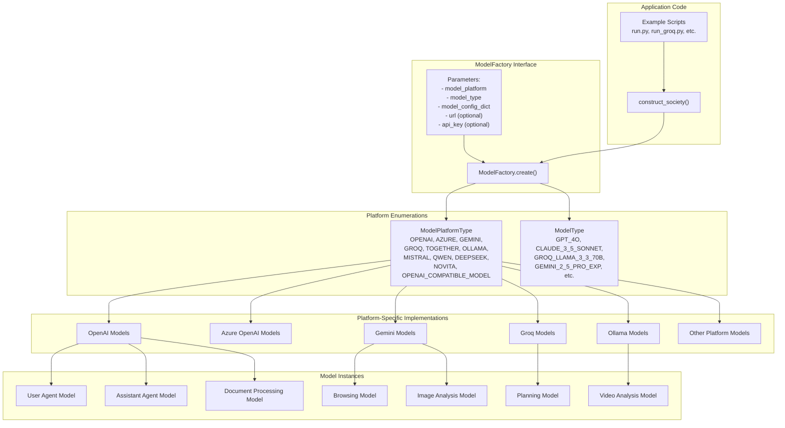
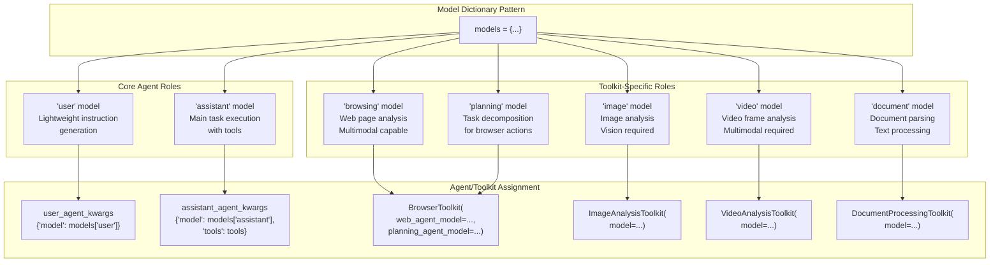
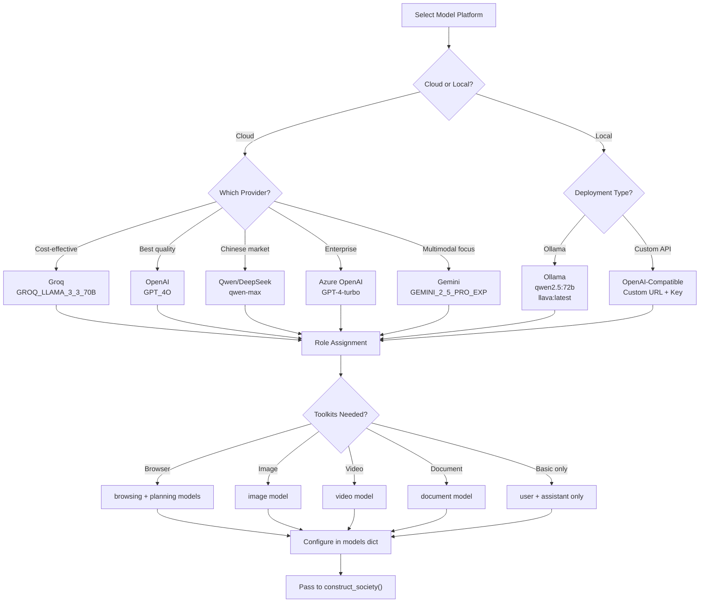

<!-- source: DeepWiki mcp.deepwiki.com · repo camel-ai/owl · page 2.3 Model Factory System · fetched 2026-10-29 -->

# Model Factory System

<details>
<summary>Relevant source files</summary>

The following files were used as context for generating this wiki page:

- [examples/run.py](examples/run.py)
- [examples/run_azure_openai.py](examples/run_azure_openai.py)
- [examples/run_gemini.py](examples/run_gemini.py)
- [examples/run_groq.py](examples/run_groq.py)
- [examples/run_mini.py](examples/run_mini.py)
- [examples/run_mistral.py](examples/run_mistral.py)
- [examples/run_novita_ai.py](examples/run_novita_ai.py)
- [examples/run_ollama.py](examples/run_ollama.py)
- [examples/run_openai_compatible_model.py](examples/run_openai_compatible_model.py)
- [examples/run_together_ai.py](examples/run_together_ai.py)

</details>


The Model Factory System provides a unified interface for creating and configuring language models across multiple LLM platforms. It implements the factory design pattern to abstract platform-specific initialization details and enables role-based model specialization for different agent types in the OWL multi-agent system.

For information about how these models are used within agents, see [Core Framework & Agent System](#2.1). For toolkit model requirements, see [Toolkit Architecture](#5.1). For platform-specific configuration details, see [Model Integration](#6).

## Factory Pattern Architecture

The `ModelFactory.create()` method serves as the central creation point for all model instances in OWL. This factory pattern decouples model instantiation from model usage, allowing the system to support multiple platforms through a consistent interface.



**Sources:** [examples/run.py:52-88](), [examples/run_groq.py:63-99](), [examples/run_gemini.py:50-86](), [examples/run_azure_openai.py:52-65]()

### Basic Factory Usage

The standard pattern for creating a model instance:

```python
from camel.models import ModelFactory
from camel.types import ModelPlatformType, ModelType

model = ModelFactory.create(
    model_platform=ModelPlatformType.OPENAI,
    model_type=ModelType.GPT_4O,
    model_config_dict={"temperature": 0}
)
```

**Sources:** [examples/run.py:53-57](), [examples/run_mini.py:53-57]()

## Platform and Type Enumerations

### ModelPlatformType Enumeration

The `ModelPlatformType` enum defines supported LLM platforms. Each platform requires specific authentication and configuration:

| Platform | Enum Value | Authentication | Notes |
|----------|-----------|----------------|-------|
| OpenAI | `ModelPlatformType.OPENAI` | `OPENAI_API_KEY` | Default platform |
| Azure OpenAI | `ModelPlatformType.AZURE` | `AZURE_OPENAI_API_KEY`, `AZURE_OPENAI_ENDPOINT` | Enterprise deployment |
| Google Gemini | `ModelPlatformType.GEMINI` | `GOOGLE_API_KEY` | Multimodal support |
| Anthropic Claude | `ModelPlatformType.ANTHROPIC` | `ANTHROPIC_API_KEY` | Not shown in examples |
| Groq | `ModelPlatformType.GROQ` | `GROQ_API_KEY` | High-speed inference |
| Together AI | `ModelPlatformType.TOGETHER` | `TOGETHER_API_KEY` | Multiple model families |
| Ollama | `ModelPlatformType.OLLAMA` | None (local) | Self-hosted models |
| Mistral | `ModelPlatformType.MISTRAL` | `MISTRAL_API_KEY` | European provider |
| Qwen | `ModelPlatformType.QWEN` | `QWEN_API_KEY` | Alibaba models |
| DeepSeek | `ModelPlatformType.DEEPSEEK` | `DEEPSEEK_API_KEY` | Chinese provider |
| Novita | `ModelPlatformType.NOVITA` | `NOVITA_API_KEY` | Alternative provider |
| OpenAI-Compatible | `ModelPlatformType.OPENAI_COMPATIBLE_MODEL` | Custom `api_key` | Generic interface |

**Sources:** [examples/run.py:54](), [examples/run_azure_openai.py:54](), [examples/run_groq.py:65](), [examples/run_ollama.py:57](), [examples/run_mistral.py:111](), [examples/run_openai_compatible_model.py:55]()

### ModelType Enumeration

The `ModelType` enum provides type-safe model identifiers for each platform:

```mermaid
graph TB
    subgraph "OpenAI Models"
        GPT4O["ModelType.GPT_4O"]
        GPT4_TURBO["ModelType.GPT_4_TURBO"]
    end
    
    subgraph "Groq Models"
        GROQ_LLAMA_70B["ModelType.GROQ_LLAMA_3_3_70B"]
        GROQ_LLAMA_8B["ModelType.GROQ_LLAMA_3_1_8B"]
        GROQ_MIXTRAL["ModelType.GROQ_MIXTRAL_8_7B"]
    end
    
    subgraph "Gemini Models"
        GEMINI_PRO["ModelType.GEMINI_2_5_PRO_EXP"]
    end
    
    subgraph "Together AI Models"
        TOGETHER_LLAMA["ModelType.TOGETHER_LLAMA_4_MAVERICK"]
    end
    
    subgraph "Novita Models"
        NOVITA_LLAMA["ModelType.NOVITA_LLAMA_4_SCOUT_17B"]
    end
    
    subgraph "Mistral Models"
        MISTRAL_LARGE["ModelType.MISTRAL_LARGE"]
        MISTRAL_MEDIUM["ModelType.MISTRAL_MEDIUM_3"]
    end
    
    subgraph "Custom/Ollama Models"
        CustomString["String literals<br/>'qwen2.5:72b'<br/>'llava:latest'<br/>'qwen-max'"]
    end
    
    ModelFactory["ModelFactory.create()"]
    
    GPT4O --> ModelFactory
    GROQ_LLAMA_70B --> ModelFactory
    GEMINI_PRO --> ModelFactory
    TOGETHER_LLAMA --> ModelFactory
    MISTRAL_LARGE --> ModelFactory
    CustomString --> ModelFactory
```



**Sources:** [examples/run.py:55,60](), [examples/run_groq.py:66,72](), [examples/run_gemini.py:53](), [examples/run_together_ai.py:52](), [examples/run_mistral.py:112,117](), [examples/run_ollama.py:58,64]()

### Platform-Specific Model Selection Patterns

Different platforms have different model selection approaches:

**Enum-based (OpenAI, Groq, Gemini):**
```python
model_type=ModelType.GPT_4O
model_type=ModelType.GROQ_LLAMA_3_3_70B
model_type=ModelType.GEMINI_2_5_PRO_EXP
```

**String-based (Ollama, OpenAI-Compatible):**
```python
model_type="qwen2.5:72b"
model_type="llava:latest"
model_type="qwen-max"
```

**Environment-based (Azure):**
```python
model_type=os.getenv("AZURE_OPENAI_MODEL_TYPE")
```

**Sources:** [examples/run.py:55](), [examples/run_ollama.py:58](), [examples/run_openai_compatible_model.py:56](), [examples/run_azure_openai.py:55]()

## Role-Based Model Specialization

OWL creates different model instances for specialized roles rather than using a single model for all purposes. This allows optimization of cost, capability, and performance for each task type.



**Sources:** [examples/run.py:52-88](), [examples/run_groq.py:63-99](), [examples/run_mini.py:52-73]()

### Standard Role Configuration

The typical pattern creates a dictionary of specialized models:

```python
models = {
    "user": ModelFactory.create(...),
    "assistant": ModelFactory.create(...),
    "browsing": ModelFactory.create(...),
    "planning": ModelFactory.create(...),
    "image": ModelFactory.create(...),
    "video": ModelFactory.create(...),
    "document": ModelFactory.create(...),
}
```

**Sources:** [examples/run.py:52-88](), [examples/run_novita_ai.py:49-80]()

### Role Assignment Patterns

**Core Agents:**
```python
user_agent_kwargs = {"model": models["user"]}
assistant_agent_kwargs = {
    "model": models["assistant"],
    "tools": tools
}
```

**Sources:** [examples/run.py:109-111](), [examples/run_mini.py:89-90]()

**Toolkits:**
```python
BrowserToolkit(
    headless=False,
    web_agent_model=models["browsing"],
    planning_agent_model=models["planning"],
).get_tools()

ImageAnalysisToolkit(model=models["image"]).get_tools()
VideoAnalysisToolkit(model=models["video"]).get_tools()
DocumentProcessingToolkit(model=models["document"]).get_tools()
```

**Sources:** [examples/run.py:92-106](), [examples/run_groq.py:103-117]()

### Role Specialization Strategies

Different platforms optimize role assignments differently:

**Groq (Tool Capability Focus):**
- Tool-intensive roles (assistant, browsing, planning, video, image): `GROQ_LLAMA_3_3_70B`
- Document processing: `GROQ_MIXTRAL_8_7B`
- Simple user role: `GROQ_LLAMA_3_1_8B`

**Sources:** [examples/run_groq.py:15-27](), [examples/run_groq.py:64-98]()

**Ollama (Local Resource Optimization):**
- Text reasoning (user, assistant, planning): `qwen2.5:72b`
- Vision tasks (browsing, image): `llava:latest`

**Sources:** [examples/run_ollama.py:56-85]()

**OpenAI-Compatible (Multimodal Specialization):**
- Text tasks: `qwen-max`
- Vision tasks (browsing, image): `qwen-vl-max`

**Sources:** [examples/run_openai_compatible_model.py:54-88]()

### Minimal Role Configuration

For simpler use cases, only core roles are required:

```python
models = {
    "user": ModelFactory.create(...),
    "assistant": ModelFactory.create(...),
    "browsing": ModelFactory.create(...),
    "planning": ModelFactory.create(...),
}
```

**Sources:** [examples/run_mini.py:52-73]()

## Configuration System

### Model Configuration Dictionary

The `model_config_dict` parameter controls model behavior:

| Parameter | Purpose | Typical Values | Usage |
|-----------|---------|----------------|-------|
| `temperature` | Response randomness | `0` (deterministic), `0.4` (balanced), `0.8` (creative) | Used in all examples |
| `max_tokens` | Maximum output length | `1000000`, `128000`, `4096` | Platform-dependent limits |
| `top_p` | Nucleus sampling | `0.0` to `1.0` | Optional |

```python
model_config_dict={
    "temperature": 0,
    "max_tokens": 4096
}
```

**Sources:** [examples/run.py:56](), [examples/run_ollama.py:60](), [examples/run_azure_openai.py:56]()

### Platform-Specific Parameters

**Azure OpenAI:**
Uses `ChatGPTConfig` for structured configuration:
```python
model_config_dict=ChatGPTConfig(
    temperature=0.4,
    max_tokens=4096
).as_dict()
```

**Sources:** [examples/run_azure_openai.py:56]()

**Ollama:**
Requires explicit URL for local deployment:
```python
ModelFactory.create(
    model_platform=ModelPlatformType.OLLAMA,
    model_type="qwen2.5:72b",
    url="http://localhost:11434/v1",
    model_config_dict={"temperature": 0.8, "max_tokens": 1000000}
)
```

**Sources:** [examples/run_ollama.py:56-61]()

**OpenAI-Compatible:**
Requires both custom URL and API key:
```python
ModelFactory.create(
    model_platform=ModelPlatformType.OPENAI_COMPATIBLE_MODEL,
    model_type="qwen-max",
    api_key=os.getenv("QWEN_API_KEY"),
    url="https://dashscope.aliyuncs.com/compatible-mode/v1",
    model_config_dict={"temperature": 0.4, "max_tokens": 128000}
)
```

**Sources:** [examples/run_openai_compatible_model.py:54-59]()

## Usage Patterns

### Standard Synchronous Pattern

```python
def construct_society(question: str) -> RolePlaying:
    models = {
        "user": ModelFactory.create(...),
        "assistant": ModelFactory.create(...),
        # ... other roles
    }
    
    tools = [
        *BrowserToolkit(
            web_agent_model=models["browsing"],
            planning_agent_model=models["planning"],
        ).get_tools(),
        # ... other toolkits
    ]
    
    user_agent_kwargs = {"model": models["user"]}
    assistant_agent_kwargs = {"model": models["assistant"], "tools": tools}
    
    task_kwargs = {
        "task_prompt": question,
        "with_task_specify": False,
    }
    
    society = RolePlaying(
        **task_kwargs,
        user_role_name="user",
        user_agent_kwargs=user_agent_kwargs,
        assistant_role_name="assistant",
        assistant_agent_kwargs=assistant_agent_kwargs,
    )
    
    return society
```

**Sources:** [examples/run.py:41-128](), [examples/run_mini.py:40-107]()

### Asynchronous Pattern

```python
async def construct_society(
    question: str,
    tools: List[FunctionTool],
) -> RolePlaying:
    models = {
        "user": ModelFactory.create(
            model_platform=ModelPlatformType.MISTRAL,
            model_type=ModelType.MISTRAL_MEDIUM_3,
            model_config_dict={"temperature": 0},
        ),
        "assistant": ModelFactory.create(
            model_platform=ModelPlatformType.MISTRAL,
            model_type=ModelType.MISTRAL_LARGE,
            model_config_dict={"temperature": 0},
        ),
    }
    
    # ... configure agents and society
    return society
```

**Sources:** [examples/run_mistral.py:99-140]()

### Model Reuse Pattern

When the same model configuration is used for multiple roles:

```python
base_model_config = {
    "model_platform": ModelPlatformType.AZURE,
    "model_type": os.getenv("AZURE_OPENAI_MODEL_TYPE"),
    "model_config_dict": ChatGPTConfig(temperature=0.4, max_tokens=4096).as_dict(),
}

models = {
    "user": ModelFactory.create(**base_model_config),
    "assistant": ModelFactory.create(**base_model_config),
    "browsing": ModelFactory.create(**base_model_config),
    "planning": ModelFactory.create(**base_model_config),
    "image": ModelFactory.create(**base_model_config),
}
```

**Sources:** [examples/run_azure_openai.py:53-65]()

## Model Selection Decision Tree



**Sources:** [examples/run.py:52-88](), [examples/run_groq.py:15-27](), [examples/run_mini.py:52-73](), [examples/run_ollama.py:54-86](), [examples/run_openai_compatible_model.py:52-89]()

---

