<!-- source: DeepWiki mcp.deepwiki.com · repo camel-ai/owl · page 2.4 Utility Modules · fetched 2026-10-29 -->

# Utility Modules

<details>
<summary>Relevant source files</summary>

The following files were used as context for generating this wiki page:

- [owl/utils/__init__.py](owl/utils/__init__.py)
- [owl/utils/enhanced_role_playing.py](owl/utils/enhanced_role_playing.py)
- [pyproject.toml](pyproject.toml)
- [requirements.txt](requirements.txt)
- [uv.lock](uv.lock)

</details>


The utility modules provide essential infrastructure and support functions that enable the OWL multi-agent framework to operate effectively. These modules handle core functionality including society orchestration, logging management, environment configuration, input validation, and benchmarking capabilities.

For information about the Agent Society Framework and role-playing mechanics, see [Agent Society Framework](#2.1). For toolkit integration details, see [Toolkits](#5).

## Core Society Orchestration

The central utility functions for running multi-agent societies are provided through the enhanced role playing module. These functions serve as the primary interface between user interfaces and the underlying CAMEL framework.

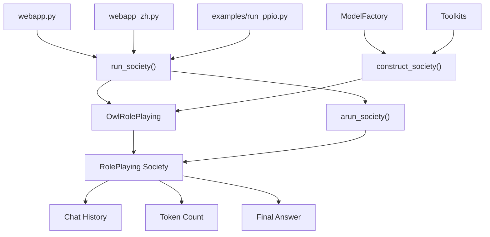

**Society Execution Functions**

The `run_society` and `arun_society` functions serve as the primary orchestration layer for executing multi-agent conversations:

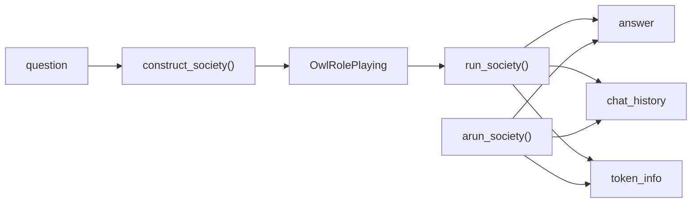

Sources: [owl/utils/__init__.py:15-21](), [owl/webapp.py:15](), [owl/webapp_zh.py:15](), [examples/run_ppio.py:34]()

## Logging Infrastructure

The OWL framework implements a comprehensive logging system that captures agent interactions, system events, and debugging information across multiple output channels.

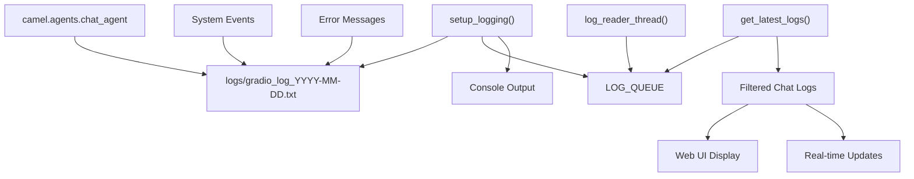

**Log Processing Pipeline**

The logging system processes agent conversations and extracts meaningful dialogue for display:

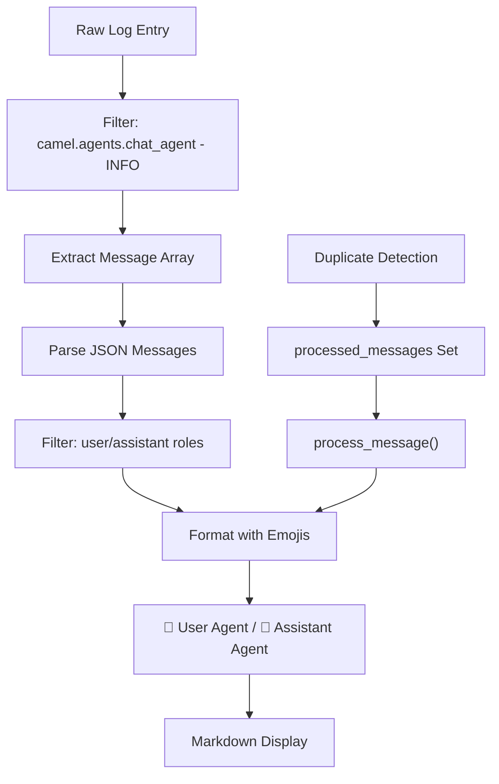

Sources: [owl/webapp.py:32-100](), [owl/webapp_zh.py:32-241](), [owl/webapp.py:156-241]()

## Environment Management System

The framework provides comprehensive environment variable management for API keys, model configurations, and service credentials.

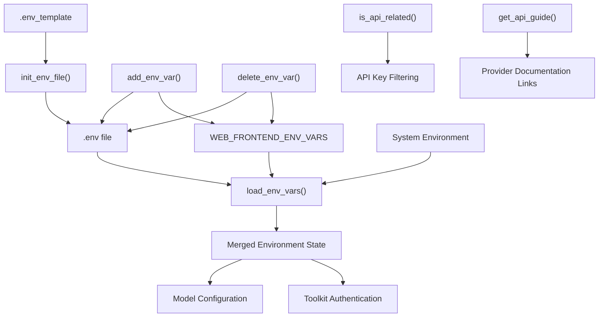

**Environment Variable Priority System**

The system implements a three-tier priority hierarchy for environment variable resolution:

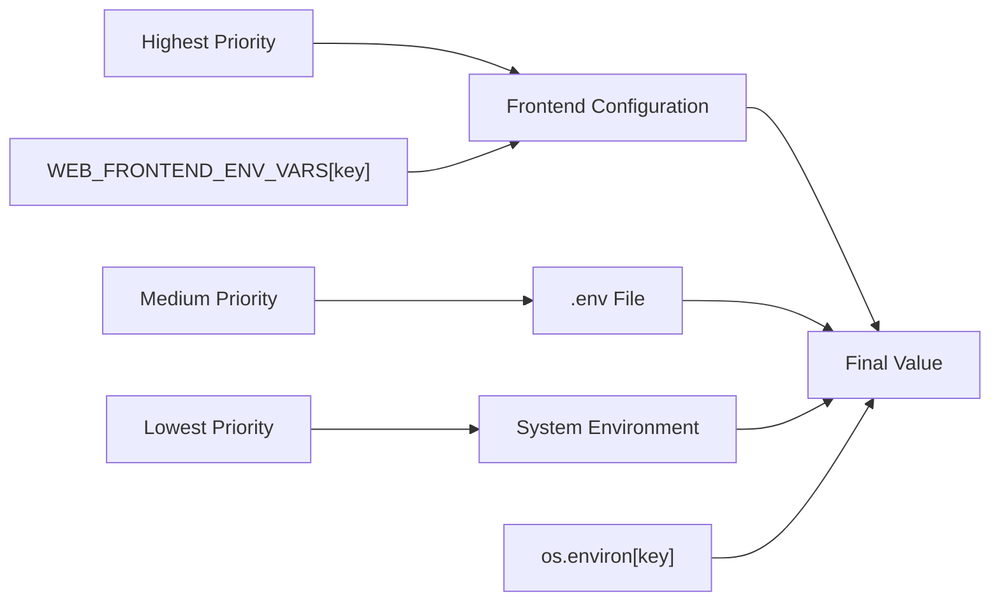

Sources: [owl/webapp.py:447-779](), [owl/webapp_zh.py:431-756](), [owl/.env_template:1-51]()

## Input Validation and Processing

The utility modules include robust input validation and processing functions to ensure safe and reliable operation.

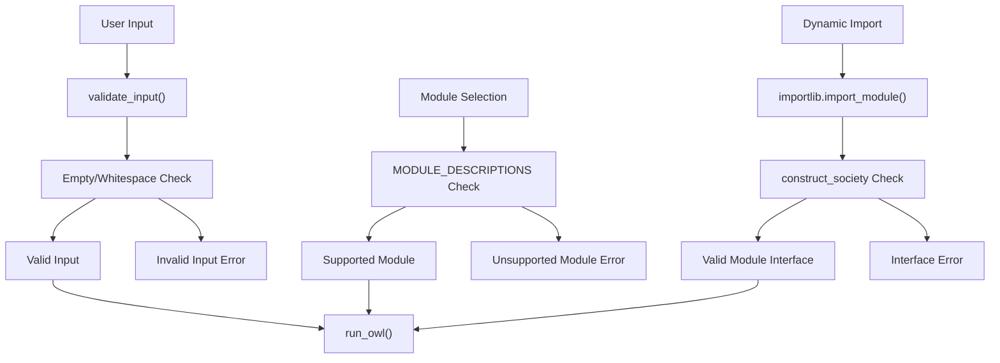

**Module Loading Pipeline**

The system dynamically loads example modules using a standardized interface:

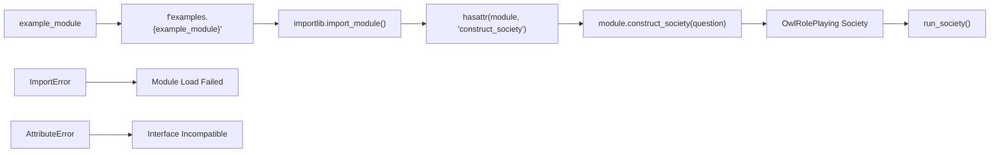

Sources: [owl/webapp.py:302-442](), [owl/webapp_zh.py:302-425](), [owl/webapp.py:243-260]()

## Pattern Extraction and Common Utilities

The common utilities module provides pattern matching and data extraction functions used throughout the framework.

```mermaid
graph TD
    A["extract_pattern()"] --> B["Regular Expression Processing"]
    B --> C["Text Pattern Matching"]
    C --> D["Structured Data Extraction"]
    
    E["Log Processing"] --> A
    F["Response Parsing"] --> A
    G["Content Filtering"] --> A
    
    H["Message Array Extraction"] --> I["re.search()"]
    I --> J["JSON Parsing"]  
    J --> K["Structured Messages"]
    
    L["User Pattern"] --> M["r\"\\{'role': 'user', 'content': '(.*?)'\\}\""]
    N["Assistant Pattern"] --> O["r\"\\{'role': 'assistant', 'content': '(.*?)'\\}\""]
```

Sources: [owl/utils/__init__.py:15](), [owl/webapp.py:188-226](), [owl/webapp_zh.py:188-226]()

## Benchmarking Infrastructure

The framework includes specialized utilities for benchmarking and performance evaluation, particularly for GAIA (General AI Assistant) benchmark integration.

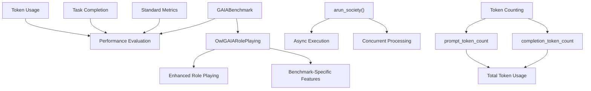

**Benchmark Integration Flow**

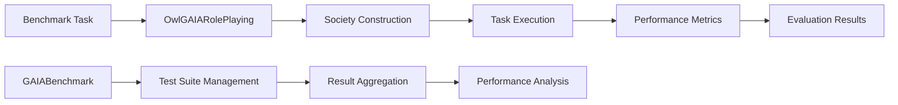

Sources: [owl/utils/__init__.py:17-18,22](), [owl/webapp.py:414-430](), [owl/webapp_zh.py:399-415]()

## Token Management and Monitoring

The utility modules provide comprehensive token usage tracking and monitoring capabilities across all model interactions.

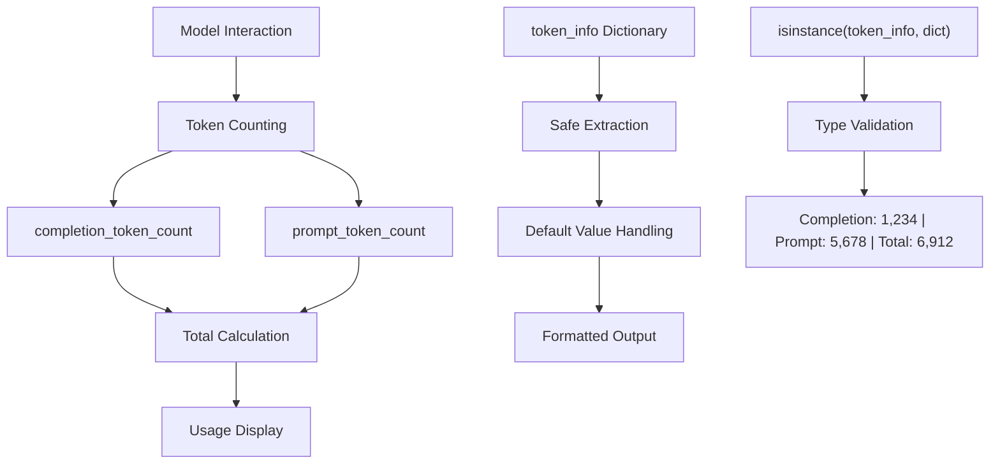

Sources: [owl/webapp.py:414-430](), [owl/webapp_zh.py:399-415](), [examples/run_ppio.py:113]()

---

