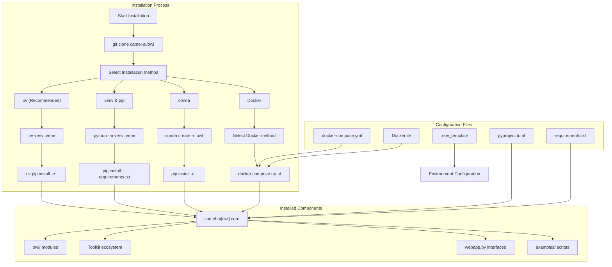
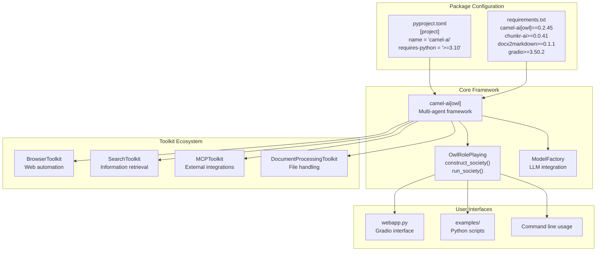
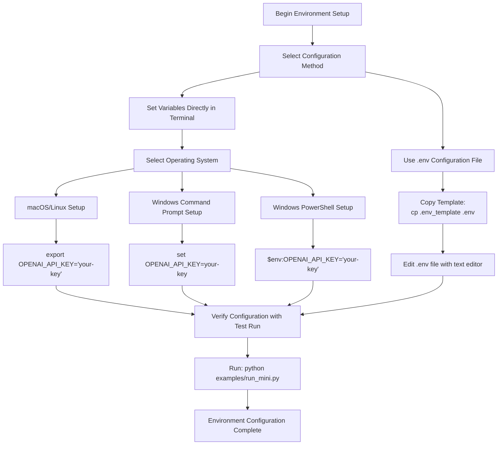
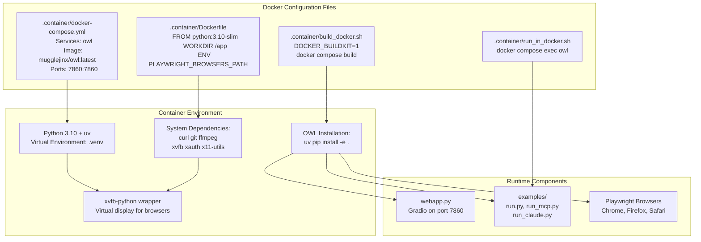
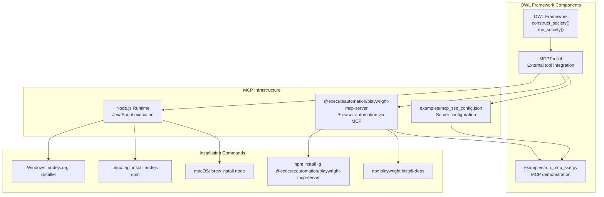
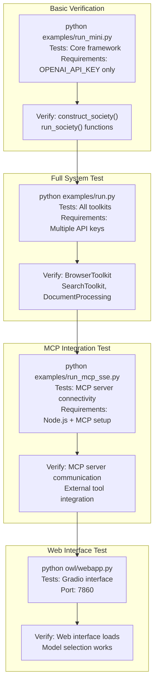

<!-- source: DeepWiki mcp.deepwiki.com · repo camel-ai/owl · page 3 Installation & Setup · fetched 2026-10-29 -->

# Installation & Setup

<details>
<summary>Relevant source files</summary>

The following files were used as context for generating this wiki page:

- [.gitignore](.gitignore)
- [README.md](README.md)
- [README_ja.md](README_ja.md)
- [README_zh.md](README_zh.md)
- [owl/assets/owl-favicon.ico](owl/assets/owl-favicon.ico)

</details>


This page provides comprehensive instructions for installing and configuring the OWL (Optimized Workforce Learning) framework for multi-agent collaboration and task automation. OWL is built on the CAMEL-AI framework and requires specific setup procedures to enable its multi-agent orchestration capabilities. For information about the system architecture, see [Architecture](#2).

## Prerequisites

### Python Version Requirements

OWL requires Python 3.10, 3.11, or 3.12. The version constraint is defined in the project configuration:

```bash
# Check if Python is installed
python --version

# If not installed, download and install from https://www.python.org/downloads/
# For macOS users with Homebrew:
brew install python@3.10

# For Ubuntu/Debian:
sudo apt update
sudo apt install python3.10 python3.10-venv python3-pip
```

### System Requirements

OWL requires specific system capabilities for its multi-agent operations:

| Component | Requirement | Purpose |
|-----------|-------------|---------|
| Memory | 8GB minimum, 16GB+ recommended | Browser automation and model operations |
| Disk Space | 2GB basic, 5GB+ with Docker | Package dependencies and container images |
| Network | Stable internet connection | API access and model communication |
| Browser Support | Chrome/Chromium compatible | BrowserToolkit automation |

Sources: [README.md:148-162](), [pyproject.toml:10-31]()

## Installation Architecture Context

Understanding how installation fits into the OWL system architecture helps with proper configuration and troubleshooting.

### Installation Flow and System Integration



### Installation Method Comparison

| Method | Configuration File | Package Manager | Environment Isolation | Best For |
|--------|-------------------|-----------------|----------------------|----------|
| uv | [pyproject.toml:10-31]() | uv | Virtual environment | Development (recommended) |
| venv & pip | [requirements.txt:1-7]() | pip | Virtual environment | Standard Python workflows |
| conda | [pyproject.toml:10-31]() | conda + pip | Conda environment | Data science environments |
| Docker | [.container/docker-compose.yml:1-45]() | Docker | Container isolation | Production deployment |

Sources: [README.md:164-287](), [pyproject.toml:10-31](), [requirements.txt:1-7](), [.container/docker-compose.yml:1-45]()

## Core Installation Components

The OWL installation process configures several key system components that enable multi-agent functionality.

### Component Installation Architecture



Sources: [pyproject.toml:10-31](), [requirements.txt:1-7](), [README.md:164-236]()

## Installation with uv (Recommended)

The `uv` package installer provides faster dependency resolution and is the recommended installation method. It uses the [pyproject.toml:10-31]() configuration for dependency management:

```bash
# Clone github repo
git clone https://github.com/camel-ai/owl.git

# Change directory into project directory
cd owl

# Install uv if you don't have it already
pip install uv

# Create a virtual environment and install dependencies
uv venv .venv --python=3.10

# Activate the virtual environment
# For macOS/Linux
source .venv/bin/activate
# For Windows
.venv\Scripts\activate

# Install CAMEL with all dependencies (reads pyproject.toml)
uv pip install -e .
```

This method installs the core `camel-ai[owl]` package and all required dependencies defined in the project configuration.

Sources: [README.md:169-192](), [pyproject.toml:10-31]()

## Installation with venv and pip

Traditional Python virtual environment approach using [requirements.txt:1-7]():

```bash
# Clone github repo
git clone https://github.com/camel-ai/owl.git

# Change directory into project directory
cd owl

# Create a virtual environment
# For Python 3.10 (also works with 3.11, 3.12)
python3.10 -m venv .venv

# Activate the virtual environment
# For macOS/Linux
source .venv/bin/activate
# For Windows
.venv\Scripts\activate

# Install from requirements.txt (includes camel-ai[owl]==0.2.45)
pip install -r requirements.txt --use-pep517
```

The `requirements.txt` file specifies exact versions for reproducible builds, including the core `camel-ai[owl]` package and supporting libraries like `gradio` for web interfaces and `chunkr-ai` for document processing.

Sources: [README.md:194-215](), [requirements.txt:1-7]()

## Installation with conda

For users who prefer conda environments:

```bash
# Clone github repo
git clone https://github.com/camel-ai/owl.git

# Change directory into project directory
cd owl

# Create a conda environment
conda create -n owl python=3.10

# Activate the conda environment
conda activate owl

# Option 1: Install as a package (recommended)
pip install -e .

# Option 2: Install from requirements.txt
pip install -r requirements.txt --use-pep517
```

Sources: [README.md:217-236]()

## Environment Configuration

After installing OWL, you need to configure the environment variables for API access.

### Environment Setup Process



Sources: [README.md:287-333]()

### Setting Environment Variables Directly

You can set environment variables directly in your terminal:

- **macOS/Linux (Bash/Zsh)**:
  ```bash
  export OPENAI_API_KEY="your-openai-api-key-here"
  # Add other required API keys as needed
  ```

- **Windows (Command Prompt)**:
  ```batch
  set OPENAI_API_KEY=your-openai-api-key-here
  ```

- **Windows (PowerShell)**:
  ```powershell
  $env:OPENAI_API_KEY = "your-openai-api-key-here"
  ```

> **Note**: Environment variables set directly in the terminal will only persist for the current session.

Sources: [README.md:293-309]()

### Using a `.env` File (Recommended)

Using a `.env` file allows for more persistent configuration:

1. **Copy and Rename the Template**:
   ```bash
   # For macOS/Linux
   cd owl
   cp .env_template .env
   
   # For Windows
   cd owl
   copy .env_template .env
   ```

2. **Configure Your API Keys**:
   Open the `.env` file in your preferred text editor and insert your API keys in the corresponding fields.

> **Note**: For the minimal example (`examples/run_mini.py`), you only need to configure the LLM API key (e.g., `OPENAI_API_KEY`).

Sources: [README.md:311-333]()

### Required API Keys

The following table lists the API keys that may be needed depending on your usage:

| API Key | Environment Variable | Purpose | Required? |
|---------|---------------------|---------|-----------|
| OpenAI API | OPENAI_API_KEY | Access to GPT models | Yes |
| Azure OpenAI | AZURE_OPENAI_API_KEY, AZURE_OPENAI_ENDPOINT | Azure OpenAI models | Optional |
| Google Search | GOOGLE_API_KEY, GOOGLE_CSE_ID | Web searching | Optional |
| DuckDuckGo | (No key needed) | Web searching | N/A |
| Bocha Search | BOCHA_API_KEY | Web searching | Optional |
| Baidu Search | BAIDU_COOKIE | Web searching | Optional |

Sources: [README.md:287-333]()

## Docker Deployment Overview

OWL provides a complete Docker-based deployment solution with pre-configured environments. The Docker setup is managed through several key files in the `.container/` directory.

### Docker Infrastructure Components



### Docker Deployment Methods

| Method | Command | Configuration File | Use Case |
|--------|---------|-------------------|----------|
| Pre-built Image | `docker compose up -d` | [.container/docker-compose.yml:4]() | Quick deployment |
| Local Build | `docker compose up -d --build` | [.container/docker-compose.yml:8-10]() | Custom modifications |
| Build Script | `.container/build_docker.sh` | [.container/build_docker.sh:121]() | Automated building |
| Run Script | `.container/run_in_docker.sh` | Shell automation | Quick testing |

Sources: [README.md:239-287](), [.container/docker-compose.yml:1-45](), [.container/Dockerfile:1-59](), [.container/build_docker.sh:1-150]()

### Using Pre-built Image (Recommended)

The fastest method uses the pre-built image specified in [.container/docker-compose.yml:4]():

```bash
# This downloads the mugglejinx/owl:latest image from Docker Hub
docker compose up -d

# Run OWL inside the container with virtual display support
docker compose exec owl bash
cd .. && source .venv/bin/activate
playwright install-deps
xvfb-python examples/run.py
```

The container includes `xvfb-python` wrapper script for running browser automation in headless environments, configured in [.container/Dockerfile:44-45]().

Sources: [README.md:241-253](), [.container/docker-compose.yml:4](), [.container/Dockerfile:44-45]()

### Building Image Locally

For customized Docker setups, modify [.container/docker-compose.yml:6-10]():

```bash
# 1. Edit .container/docker-compose.yml
# 2. Comment out line 4: "image: mugglejinx/owl:latest"
# 3. Uncomment lines 8-10: build configuration
# 4. Then run:
docker compose up -d --build

# Run OWL inside the container
docker compose exec owl bash
cd .. && source .venv/bin/activate
playwright install-deps
xvfb-python examples/run.py
```

The build process uses the [.container/Dockerfile:1-59]() which configures the Python environment, system dependencies, and OWL installation.

Sources: [README.md:255-272](), [.container/docker-compose.yml:6-10](), [.container/Dockerfile:1-59]()

### Using Convenience Scripts

The `.container/` directory provides automation scripts for Docker operations:

```bash
# Navigate to container directory
cd .container

# Make the script executable and build the Docker image
chmod +x build_docker.sh
./build_docker.sh

# Run OWL with your question using the convenience script
./run_in_docker.sh "your question"
```

The [.container/build_docker.sh:1-150]() script handles Docker BuildKit configuration, cache management, and cross-platform compatibility. It sets `DOCKER_BUILDKIT=1` and uses build arguments for optimization.

Sources: [README.md:274-284](), [.container/build_docker.sh:1-150]()

### Docker Options Comparison

| Option | Command | Notes |
|--------|---------|-------|
| Pre-built Image | `docker compose up -d` | Fastest, pulls from Docker Hub |
| Local Build | `docker compose up -d --build` | Customizable, requires editing docker-compose.yml |
| Convenience Scripts | `.container/run_in_docker.sh` | Simplest for quick testing |

Sources: [README.md:239-287]()

## MCP (Model Context Protocol) Setup

The Model Context Protocol enables OWL to interact with external tools and services. To use MCP features, additional setup is required.

### MCP Integration Architecture



Sources: [README.md:435-443](), [examples/run_mcp_sse.py:1-122](), [examples/mcp_sse_config.json:1-7]()

### Install Node.js

First, install Node.js which is required for MCP functionality:

#### Windows

Download the official installer from [Node.js](https://nodejs.org/en) and check "Add to PATH" option during installation.

#### Linux
```bash
sudo apt update
sudo apt install nodejs npm -y
```

#### Mac
```bash
brew install node
```

### Install Playwright MCP Server

After installing Node.js, install the Playwright MCP server:

```bash
npm install -g @executeautomation/playwright-mcp-server
npx playwright install-deps
```

Sources: [README.md:435-443]()

### MCP Desktop Commander Setup

If using MCP Desktop Commander within Docker, run:

```bash
npx -y @wonderwhy-er/desktop-commander setup --force-file-protocol
```

Sources: [README.md:333-343]()

## Installation Verification

After completing the installation, verify your setup by running example scripts that test different components of the OWL system.

### Verification Test Flow



### Verification Commands

| Test Level | Command | Purpose | Required APIs |
|------------|---------|---------|---------------|
| Basic | `python examples/run_mini.py` | Core framework functionality | OPENAI_API_KEY |
| Full | `python examples/run.py` | Complete toolkit integration | Multiple API keys |
| MCP | `python examples/run_mcp_sse.py` | External tool connectivity | Node.js + MCP setup |
| Web UI | `python owl/webapp.py` | Web interface functionality | API keys for selected models |

Sources: [README.md:345-372](), [examples/run_mcp_sse.py:82-121]()

## Troubleshooting Common Issues

Installation and configuration issues can often be resolved by checking specific components and files.

### Troubleshooting Decision Tree

```mermaid
flowchart TD
    Problem["Installation/Runtime Issue"] --> CheckPython["Check Python Version
    python --version
    Required: 3.10-3.12"]
    
    CheckPython --> PythonOK{Python Version OK?}
    PythonOK -->|No| InstallPython["Install correct Python version
    Update pyproject.toml constraints"]
    PythonOK -->|Yes| CheckEnv["Check Environment Variables
    cat .env or echo $OPENAI_API_KEY"]
    
    CheckEnv --> EnvOK{API Keys Set?}
    EnvOK -->|No| ConfigureEnv["Configure .env file
    Copy from .env_template"]
    EnvOK -->|Yes| CheckDeps["Check Dependencies
    pip list | grep camel-ai"]
    
    CheckDeps --> DepsOK{Dependencies OK?}
    DepsOK -->|No| ReinstallDeps["Reinstall dependencies
    pip install -r requirements.txt"]
    DepsOK -->|Yes| CheckDocker["Check Docker (if using)
    docker ps, docker logs"]
    
    CheckDocker --> DockerOK{Docker Running?}
    DockerOK -->|No| FixDocker["Fix Docker issues
    Check docker-compose.yml"]
    DockerOK -->|Yes| CheckMCP["Check MCP Setup (if using)
    node --version, npm list -g"]
    
    CheckMCP --> MCPOk{MCP OK?}
    MCPOk -->|No| FixMCP["Install Node.js and MCP server
    npm install -g @executeautomation/playwright-mcp-server"]
    MCPOk -->|Yes| CheckLogs["Check Application Logs
    Look for specific error messages"]
    
    InstallPython --> CheckEnv
    ConfigureEnv --> CheckDeps
    ReinstallDeps --> CheckDocker
    FixDocker --> CheckMCP
    FixMCP --> CheckLogs
```



### Common Error Patterns and Solutions

| Error Pattern | Likely Cause | Solution | Related Files |
|---------------|--------------|----------|---------------|
| `ModuleNotFoundError: camel` | Missing core dependency | `pip install -r requirements.txt` | [requirements.txt:1]() |
| `python: command not found` | Python not installed/configured | Install Python 3.10-3.12 | [pyproject.toml:23]() |
| `OPENAI_API_KEY not found` | Missing environment variables | Configure `.env` file | [.env_template]() |
| `Docker container not found` | Docker service not running | `docker compose up -d` | [.container/docker-compose.yml:1]() |
| `playwright install failed` | Missing system dependencies | Run in Docker or install deps | [.container/Dockerfile:17-21]() |
| `Node.js not found` | MCP dependencies missing | Install Node.js and MCP server | [README.md:435-443]() |

### Diagnostic Commands

```bash
# Check Python and package versions
python --version
pip show camel-ai

# Verify environment configuration
cat owl/.env
python -c "import os; print(os.getenv('OPENAI_API_KEY', 'NOT SET'))"

# Test basic imports
python -c "from owl.utils import construct_society, run_society; print('Import successful')"

# Check Docker status (if using Docker)
docker ps
docker compose logs owl

# Verify MCP setup (if using MCP)
node --version
npm list -g @executeautomation/playwright-mcp-server
```

Sources: [README.md:633-646](), [pyproject.toml:23](), [.container/docker-compose.yml:1-45](), [.container/Dockerfile:17-21]()

## System Requirements

OWL is designed to run on modern systems with the following specifications:

- **OS Compatibility**: Windows 10+, macOS 10.15+, or Linux (Ubuntu 20.04+ recommended)
- **RAM**: 8GB minimum, 16GB+ recommended for browser automation
- **Disk Space**: 2GB for basic installation, 5GB+ when using Docker
- **Processor**: Multi-core CPU recommended for parallel processing
- **Internet Connection**: Required for API access and package downloads

Sources: [README.md:148-162](), [pyproject.toml:10-31]()

## Core Dependencies

OWL relies on several key dependencies managed through its package requirements:

| Dependency | Version | Purpose |
|------------|---------|---------|
| camel-ai[owl] | 0.2.45 | Core framework functionality |
| chunkr-ai | >=0.0.41 | Document processing capabilities |
| docx2markdown | >=0.1.1 | Document conversion utilities |
| gradio | >=3.50.2 | Web interface components |
| mcp-simple-arxiv | 0.2.2 | ArXiv integration via MCP |
| mcp-server-fetch | 2025.1.17 | MCP server functionality |

Sources: [requirements.txt:1-7](), [pyproject.toml:23-31]()

---

