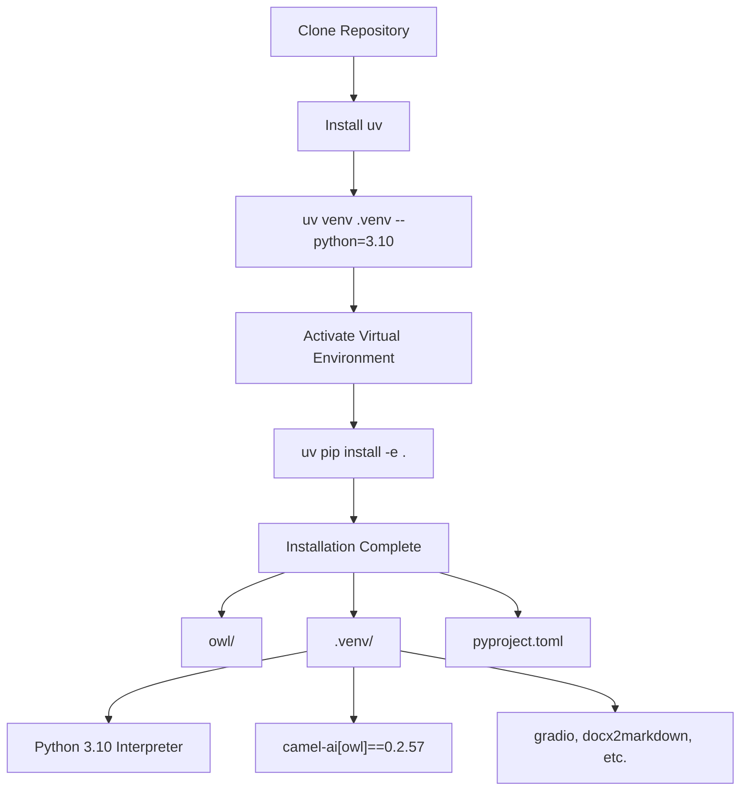
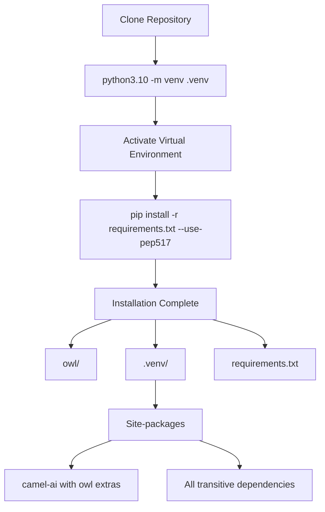
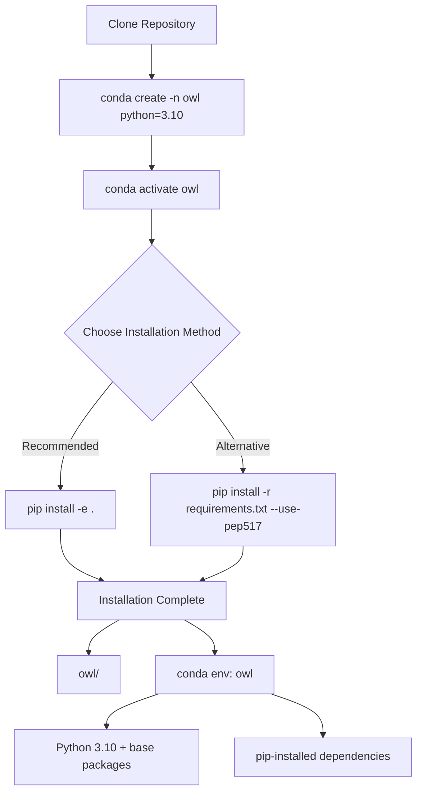
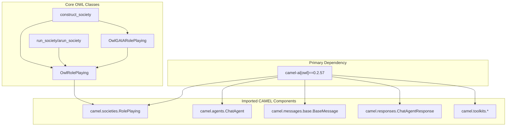
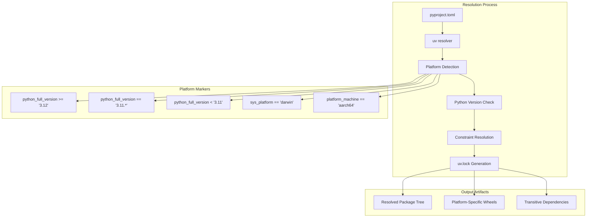

<!-- source: DeepWiki mcp.deepwiki.com · repo camel-ai/owl · page 3.1 Local Installation · fetched 2026-10-29 -->

# Local Installation

<details>
<summary>Relevant source files</summary>

The following files were used as context for generating this wiki page:

- [.gitignore](.gitignore)
- [README.md](README.md)
- [README_ja.md](README_ja.md)
- [README_zh.md](README_zh.md)
- [owl/assets/owl-favicon.ico](owl/assets/owl-favicon.ico)
- [owl/utils/enhanced_role_playing.py](owl/utils/enhanced_role_playing.py)
- [pyproject.toml](pyproject.toml)
- [requirements.txt](requirements.txt)
- [uv.lock](uv.lock)

</details>


This document provides comprehensive instructions for installing OWL locally on your machine using three supported methods: uv (recommended), venv with pip, or conda. For containerized deployment, see [Docker Deployment](#3.2). For configuring API keys and environment variables after installation, see [Environment Configuration](#3.3).

## Overview

OWL supports multiple installation approaches to accommodate different development workflows and preferences. All methods require cloning the GitHub repository and installing Python dependencies. The framework relies on the CAMEL-AI framework as its foundation, along with specialized packages for document processing, web interfaces, and external service integrations.
</thinking>

## Prerequisites

### Python Version Requirements

OWL requires Python 3.10, 3.11, or 3.12. Python 3.13 and newer versions are not supported.

| Python Version | Support Status | Notes |
|---------------|----------------|-------|
| 3.10 | ✅ Fully Supported | Recommended for maximum compatibility |
| 3.11 | ✅ Fully Supported | Good balance of features and stability |
| 3.12 | ✅ Fully Supported | Latest supported version |
| 3.13+ | ❌ Not Supported | Dependency conflicts |

**Checking Your Python Version**

```bash
# Check if Python is installed and verify version
python --version
# or
python3 --version
```

Sources: [README.md:201-216](), [pyproject.toml:10]()

### System Requirements

Before installation, ensure you have:

- **Git**: For cloning the repository
- **pip**: Python package installer (usually included with Python)
- **Internet connection**: For downloading dependencies
- **Disk space**: Approximately 2-3 GB for full installation with dependencies

Sources: [README.md:196-220]()

## Installation Methods

### Method 1: Using uv (Recommended)

The `uv` package manager provides the fastest and most reliable installation experience. It creates isolated virtual environments and resolves dependencies efficiently.



**Installation Workflow with uv**
Sources: [README.md:222-245]()

**Step-by-Step Instructions**

```bash
# 1. Clone the repository
git clone https://github.com/camel-ai/owl.git
cd owl

# 2. Install uv (if not already installed)
pip install uv

# 3. Create virtual environment with Python 3.10
uv venv .venv --python=3.10

# 4. Activate the virtual environment
# On macOS/Linux:
source .venv/bin/activate
# On Windows:
.venv\Scripts\activate

# 5. Install OWL and all dependencies
uv pip install -e .

# 6. Verify installation (optional)
python -c "import camel; print(camel.__version__)"
```

The `-e` flag installs OWL in "editable" mode, allowing you to modify the source code without reinstalling.

Sources: [README.md:222-245](), [pyproject.toml:23-32]()

### Method 2: Using venv and pip

The standard Python virtual environment approach works with any Python installation.



**Installation Workflow with venv and pip**
Sources: [README.md:247-268]()

**Step-by-Step Instructions**

```bash
# 1. Clone the repository
git clone https://github.com/camel-ai/owl.git
cd owl

# 2. Create virtual environment
python3.10 -m venv .venv
# Can also use python3.11 or python3.12

# 3. Activate the virtual environment
# On macOS/Linux:
source .venv/bin/activate
# On Windows:
.venv\Scripts\activate

# 4. Install dependencies from requirements.txt
pip install -r requirements.txt --use-pep517

# The --use-pep517 flag ensures compatibility with modern Python packaging standards
```

Sources: [README.md:247-268](), [requirements.txt:1-7]()

### Method 3: Using conda

Conda provides environment management and works well for data science workflows.



**Installation Workflow with conda**
Sources: [README.md:270-290]()

**Step-by-Step Instructions**

```bash
# 1. Clone the repository
git clone https://github.com/camel-ai/owl.git
cd owl

# 2. Create conda environment with Python 3.10
conda create -n owl python=3.10

# 3. Activate conda environment
conda activate owl

# 4. Install OWL (choose one option)

# Option A: Install as editable package (recommended)
pip install -e .

# Option B: Install from requirements.txt
pip install -r requirements.txt --use-pep517

# 5. Deactivate when done
conda deactivate
```

**Important Note**: Even with conda, dependencies are installed using pip. Conda only manages the Python interpreter and base environment.

Sources: [README.md:270-290]()

## Understanding OWL's Dependencies

After installation, OWL includes several categories of dependencies:

### Core Framework Dependencies



**Dependency Structure and Code Integration**
Sources: [owl/utils/enhanced_role_playing.py:19-23](), [owl/utils/enhanced_role_playing.py:31](), [requirements.txt:1]()

| Dependency Category | Key Packages | Purpose |
|---------------------|--------------|---------|
| **Core Framework** | `camel-ai[owl]==0.2.57` | Multi-agent orchestration, toolkit ecosystem |
| **Web Interface** | `gradio>=3.50.2` | Web UI for `webapp.py`, `webapp_zh.py`, `webapp_jp.py` |
| **Document Processing** | `docx2markdown>=0.1.1`, `firecrawl>=2.5.3` | Document parsing and web scraping |
| **MCP Integration** | `mcp-simple-arxiv==0.2.2`, `mcp-server-fetch==2025.1.17` | Model Context Protocol servers |
| **Data Handling** | `xmltodict>=0.14.2` | XML parsing for various toolkits |
| **Model Support** | `mistralai>=1.7.0` | Additional model platform support |

Sources: [requirements.txt:1-7](), [pyproject.toml:23-32]()

### Transitive Dependencies

The `camel-ai[owl]` package brings in extensive transitive dependencies:

- **HTTP Clients**: `httpx`, `aiohttp`, `requests` for API calls
- **Async Infrastructure**: `anyio`, `aiosignal` for async execution
- **Model Platforms**: `anthropic`, `openai`, `google-generativeai`
- **Document Processing**: `beautifulsoup4`, `lxml`, `pypdf`, `python-docx`
- **Media Processing**: `pillow`, `opencv-python`, `av` for image/video/audio
- **Browser Automation**: `playwright` for BrowserToolkit
- **Code Execution**: `e2b-code-interpreter` for CodeExecutionToolkit

The complete dependency tree includes over 200 packages. The `uv.lock` file contains the full resolved dependency graph with platform-specific wheel URLs.

Sources: [uv.lock:16-100](), [pyproject.toml:24]()

## Dependency Resolution System



**Dependency Resolution and Platform Support**
Sources: [uv.lock:3-14](), [pyproject.toml:10]()

## Python Version Compatibility

The OWL framework maintains strict Python version requirements defined in the project configuration:

- **Minimum Version**: Python 3.10
- **Maximum Version**: Python 3.13 (exclusive)
- **Recommended**: Python 3.11 or 3.12

The `uv.lock` file contains platform-specific resolution markers that ensure compatibility across different operating systems and architectures including macOS (Intel/ARM), Linux (x86_64/aarch64), and Windows.

Sources: [pyproject.toml:10](), [uv.lock:4-13]()

## Build System Configuration

The project uses a modern Python build system with the following configuration:

| Component | Value | Purpose |
|-----------|-------|---------|
| Build Backend | `hatchling.build` | Modern Python packaging |
| Package Discovery | `["owl"]` | Identifies source packages |
| License | `Apache-2.0` | Open source licensing |

Additional development tools are configured including:

- **MyPy**: Type checking with relaxed configuration for research code
- **Codespell**: Spell checking with project-specific ignore patterns

Sources: [pyproject.toml:1-4](), [pyproject.toml:39-41](), [pyproject.toml:42-71]()

## Transitive Dependencies

The locked dependency tree includes over 200 transitive dependencies covering:

### Core Infrastructure
- HTTP clients (`httpx`, `aiohttp`)
- Async frameworks (`anyio`, `aiosignal`)
- Authentication (`cryptography`, `certifi`)

### AI/ML Ecosystem
- Model interfaces (`anthropic`, `openai`)
- Data processing (`numpy`, `pandas`)
- Document handling (`pillow`, `beautifulsoup4`)

### Development Tools
- Testing frameworks
- Code quality tools
- Documentation generation

The complete dependency resolution is managed through the UV package manager which provides reproducible, platform-specific installations.

Sources: [uv.lock:16-794]()

---

