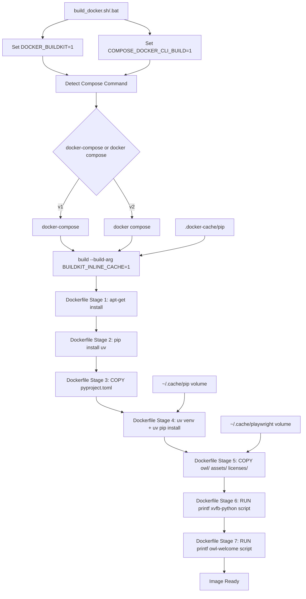
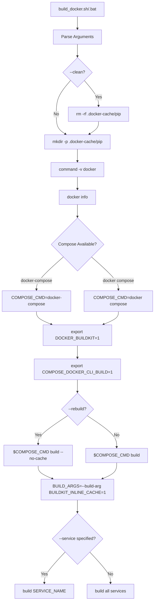
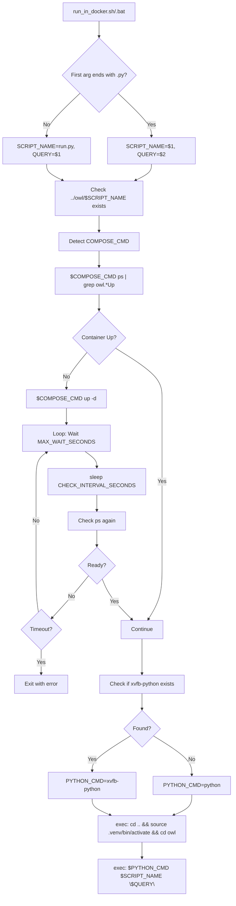

<!-- source: DeepWiki mcp.deepwiki.com · repo camel-ai/owl · page 3.2 Docker Deployment · fetched 2026-10-29 -->

# Docker Deployment

<details>
<summary>Relevant source files</summary>

The following files were used as context for generating this wiki page:

- [.container/.dockerignore](.container/.dockerignore)
- [.container/DOCKER_README.md](.container/DOCKER_README.md)
- [.container/Dockerfile](.container/Dockerfile)
- [.container/build_docker.bat](.container/build_docker.bat)
- [.container/build_docker.sh](.container/build_docker.sh)
- [.container/check_docker.bat](.container/check_docker.bat)
- [.container/check_docker.sh](.container/check_docker.sh)
- [.container/docker-compose.yml](.container/docker-compose.yml)
- [.container/run_in_docker.bat](.container/run_in_docker.bat)
- [.container/run_in_docker.sh](.container/run_in_docker.sh)
- [examples/__init__.py](examples/__init__.py)

</details>


This document covers the Docker-based deployment infrastructure for the OWL multi-agent framework. It explains the containerization architecture, build processes, runtime configuration, and cross-platform deployment scripts. For general installation instructions, see [Dependencies](#3.1). For environment configuration details, see [Environment Configuration](#3.3).

## Overview

OWL provides Docker containerization to isolate execution environments and handle dependencies including Playwright browser automation, Xvfb virtual display, and Python package management via `uv`. The deployment infrastructure consists of:

- **Pre-built images**: Available at `mugglejinx/owl:latest` on Docker Hub
- **Local build system**: Multi-platform build scripts with BuildKit optimization
- **Volume mounts**: Configuration (`.env`), examples, data, and caches
- **Execution wrappers**: Shell scripts for running OWL tasks in containers

Sources: [.container/docker-compose.yml:3-4](), [.container/Dockerfile:1-59]()

## Docker Architecture

### Container File Structure

```mermaid
graph TB
    subgraph "Host: .container/"
        dockerfile[".container/Dockerfile"]
        compose[".container/docker-compose.yml"]
        buildsh["build_docker.sh"]
        buildbat["build_docker.bat"]
        runsh["run_in_docker.sh"]
        runbat["run_in_docker.bat"]
        checksh["check_docker.sh"]
        checkbat["check_docker.bat"]
    end
    
    subgraph "Container: /app/"
        pyproject["/app/pyproject.toml"]
        venv["/app/.venv/"]
        owl_dir["/app/owl/"]
        examples_dir["/app/examples/"]
        assets["/app/assets/"]
        licenses["/app/licenses/"]
    end
    
    subgraph "Container: /usr/local/bin/"
        xvfb_python["/usr/local/bin/xvfb-python"]
        owl_welcome["/usr/local/bin/owl-welcome"]
    end
    
    subgraph "Volume Mounts"
        env_mount["../owl/.env → /app/owl/.env"]
        examples_mount["../examples → /app/examples"]
        data_mount["./data → /app/owl/data"]
        pip_cache["~/.cache/pip → /root/.pip/cache"]
        playwright_cache["~/.cache/playwright → /root/.cache/ms-playwright"]
    end
    
    dockerfile --> pyproject
    dockerfile --> venv
    dockerfile --> owl_dir
    dockerfile --> xvfb_python
    dockerfile --> owl_welcome
    
    compose --> env_mount
    compose --> examples_mount
    compose --> data_mount
    compose --> pip_cache
    compose --> playwright_cache
    
    buildsh --> compose
    buildbat --> compose
    runsh --> compose
    runbat --> compose
```



**Container Base**: `python:3.10-slim` with system packages: `xvfb`, `xauth`, `x11-utils`, `ffmpeg`, `libsm6`, `libxext6`, `build-essential`, `python3-dev`, `vim` [.container/Dockerfile:1](), [.container/Dockerfile:17-21]()

**Package Manager**: `uv` installed via pip, creates virtual environment at `/app/.venv` [.container/Dockerfile:24](), [.container/Dockerfile:33-35]()

**Work Directory**: `/app/owl` set as final working directory [.container/Dockerfile:52]()

Sources: [.container/Dockerfile:1-59](), [.container/docker-compose.yml:12-21](), [.container/docker-compose.yml:2-10]()

### Build Process



**Build Command Detection**: Scripts check for `docker-compose` command first [.container/build_docker.sh:99-109](), fall back to `docker compose` [.container/build_docker.sh:102-104]()

**BuildKit Flags**: `DOCKER_BUILDKIT=1` enables parallel layer builds [.container/build_docker.sh:12](), `BUILDKIT_INLINE_CACHE=1` enables layer caching [.container/build_docker.sh:5]()

**Parallel Builds**: Unix script detects CPU cores and uses `--parallel` flag if cores > 2 [.container/build_docker.sh:111-118]()

Sources: [.container/build_docker.sh:11-13](), [.container/build_docker.sh:99-109](), [.container/build_docker.bat:8-12](), [.container/Dockerfile:16-49]()

## Build Configuration

### Dockerfile Configuration

| Layer | Instruction | Line | Purpose |
|-------|-------------|------|---------|
| Base | `FROM python:3.10-slim` | 1 | Debian-based Python runtime |
| Env | `ENV PYTHONDONTWRITEBYTECODE=1` | 4 | Disable `.pyc` generation |
| Env | `ENV PYTHONUNBUFFERED=1` | 5 | Stream output immediately |
| Env | `ENV PIP_INDEX_URL=https://pypi.tuna.tsinghua.edu.cn/simple` | 7 | Chinese mirror for pip |
| Env | `ENV PLAYWRIGHT_DOWNLOAD_HOST=https://npmmirror.com/mirrors/playwright` | 8 | Chinese mirror for Playwright |
| Env | `ENV PLAYWRIGHT_BROWSERS_PATH=/root/.cache/ms-playwright` | 9 | Browser cache location |
| Env | `ENV PATH="/app/.venv/bin:$PATH"` | 11 | Prepend venv to PATH |
| System | `apt-get install xvfb xauth x11-utils` | 18 | X11 virtual framebuffer |
| System | `apt-get install ffmpeg libsm6 libxext6` | 18 | Video/image processing |
| Python | `pip install uv` | 24 | Fast package installer |
| Venv | `uv venv .venv --python=3.10` | 33 | Create virtual environment |
| Deps | `uv pip install -e .` | 35 | Install OWL from pyproject.toml |
| Script | `printf '#!/bin/bash\nxvfb-run...'` | 44 | Create xvfb-python wrapper |
| Script | `printf '#!/bin/bash\necho...'` | 48 | Create owl-welcome script |

**Mirror Configuration**: Uses Tsinghua University mirror for pip packages [.container/Dockerfile:7]() and npmmirror for Playwright browsers [.container/Dockerfile:8]() to accelerate downloads in China.

**Virtual Environment PATH**: Prepends `/app/.venv/bin` to `PATH` so installed packages are available without activation [.container/Dockerfile:11]()

Sources: [.container/Dockerfile:1-11](), [.container/Dockerfile:17-21](), [.container/Dockerfile:24](), [.container/Dockerfile:33-35](), [.container/Dockerfile:44-49]()

### Docker Compose Configuration

| Section | Key | Value | Line | Purpose |
|---------|-----|-------|------|---------|
| Service | `image` | `mugglejinx/owl:latest` | 4 | Pre-built image from Docker Hub |
| Service | `build.context` | `..` (commented) | 9 | Local build from project root |
| Service | `build.dockerfile` | `.container/Dockerfile` | 10 | Dockerfile location |
| Volume | Bind | `../owl/.env:/app/owl/.env` | 14 | Mount `.env` for API keys |
| Volume | Bind | `../examples:/app/examples` | 16 | Mount examples directory |
| Volume | Bind | `./data:/app/owl/data` | 18 | Mount data directory |
| Volume | Bind | `~/.cache/pip:/root/.pip/cache` | 20 | Cache pip downloads |
| Volume | Bind | `~/.cache/playwright:/root/.cache/ms-playwright` | 21 | Cache Playwright browsers |
| Env | `OPENAI_API_KEY` | `${OPENAI_API_KEY}` | 23 | Pass through from host |
| Env | `DISPLAY` | `:99` | 24 | X11 display for Xvfb |
| Env | `GRADIO_SERVER_NAME` | `0.0.0.0` | 28 | Bind web UI to all interfaces |
| Env | `GRADIO_SERVER_PORT` | `7860` | 29 | Web UI port |
| Port | Mapping | `7860:7860` | 32 | Expose Gradio web interface |
| Resource | `shm_size` | `2gb` | 35 | Shared memory for browser |
| Resource | `memory` | `4G` | 40 | Memory limit |

**Image Selection**: Default uses pre-built `mugglejinx/owl:latest` [.container/docker-compose.yml:4](). Uncomment `build` section [.container/docker-compose.yml:8-10]() to build locally.

**Cache Strategy**: Mounts host cache directories to avoid re-downloading dependencies across container rebuilds [.container/docker-compose.yml:20-21]()

Sources: [.container/docker-compose.yml:1-45]()

## Runtime Environment

### Container Scripts

#### /usr/local/bin/xvfb-python

Created by `printf` command at [.container/Dockerfile:44-45]():

```bash
#!/bin/bash
xvfb-run --auto-servernum --server-args="-screen 0 1280x960x24" python "$@"
```

**Flags**:
- `--auto-servernum`: Automatically selects available X server display number
- `--server-args="-screen 0 1280x960x24"`: Creates virtual screen at 1280x960 resolution, 24-bit color depth

**Usage**: Wrapper for any Python script requiring X11 display (e.g., Playwright browser automation)

#### /usr/local/bin/owl-welcome

Created by `printf` command at [.container/Dockerfile:48-49]():

```bash
#!/bin/bash
echo "Welcome to the OWL Project Docker environment!"
echo "Welcome to OWL Project Docker environment!"
echo ""
echo "Available scripts:"
ls -1 *.py | grep -v "__" | sed "s/^/- /"
echo ""
echo "Run examples:"
echo "  xvfb-python run.py                     # Run default script"
echo "  xvfb-python run_deepseek_example.py      # Run DeepSeek example"
echo ""
echo "Or use custom query:"
echo "  xvfb-python run.py \"Your question\""
echo ""
```

**Purpose**: Interactive shell greeting when entering container via `docker-compose exec owl bash`

Sources: [.container/Dockerfile:44-49](), [.container/Dockerfile:58-59]()

### Runtime Environment Variables

| Variable | Set In | Value | Purpose |
|----------|--------|-------|---------|
| `PYTHONDONTWRITEBYTECODE` | Dockerfile | `1` | Disable `.pyc` file creation |
| `PYTHONUNBUFFERED` | Dockerfile | `1` | Output streams unbuffered |
| `PIP_NO_CACHE_DIR` | Dockerfile | `0` | Enable pip caching |
| `DEBIAN_FRONTEND` | Dockerfile | `noninteractive` | No apt prompts |
| `PATH` | Dockerfile | `/app/.venv/bin:$PATH` | Virtual env in PATH |
| `OPENAI_API_KEY` | docker-compose.yml | `${OPENAI_API_KEY}` | From host environment |
| `DISPLAY` | docker-compose.yml | `:99` | X11 display for Xvfb |
| `GRADIO_SERVER_NAME` | docker-compose.yml | `0.0.0.0` | Bind Gradio to all IPs |
| `GRADIO_SERVER_PORT` | docker-compose.yml | `7860` | Gradio web UI port |
| `PYTHONPATH` | docker-compose.yml | `.` | Module search path |
| `TERM` | docker-compose.yml | `xterm-256color` | Terminal color support |

**Variable Precedence**: Dockerfile ENV < docker-compose.yml environment < host `.env` file (mounted as volume)

Sources: [.container/Dockerfile:4-11](), [.container/docker-compose.yml:22-30]()

## Cross-Platform Management Scripts

### Build Scripts



#### build_docker.sh (Unix/Linux/macOS)

| Function | Lines | Implementation |
|----------|-------|----------------|
| OS Detection | 48-49 | `uname -s` → OS_TYPE |
| Docker Check | 52-56 | `command -v docker` |
| Docker Status | 59-63 | `docker info` |
| Compose Detection | 99-109 | Check `docker-compose` then `docker compose` |
| CPU Detection | 111-118 | `grep -c ^processor /proc/cpuinfo` or `sysctl -n hw.ncpu` |
| Parallel Flag | 113-118 | Add `--parallel` if CPU_CORES > 2 |
| Cache Clean | 75-78 | `rm -rf "$CACHE_DIR"` if `--clean` |
| Build Time Tag | 84-85 | `date +"%Y%m%d_%H%M%S"` |
| Build Command | 121-139 | `eval $BUILD_CMD` with platform-specific handling |

#### build_docker.bat (Windows)

| Function | Lines | Implementation |
|----------|-------|----------------|
| Encoding | 2 | `chcp 65001` for Unicode support |
| Argument Parse | 25-60 | Loop with `if "%~1"=="--flag"` |
| Docker Check | 64-72 | `where docker` |
| Docker Status | 76-84 | `docker info` |
| Compose Detection | 99-116 | Check `docker-compose` then `docker compose` |
| Cache Clean | 123-127 | `rmdir /s /q "%CACHE_DIR%"` if `CLEAN_CACHE=1` |
| Build Time Tag | 139-146 | `wmic OS Get localdatetime` |
| Build Command | 153-171 | `%COMPOSE_CMD% build` with conditional `--no-cache` |

**Command Line Arguments**:
- `--clean`: Remove `.docker-cache/pip` before build [.container/build_docker.sh:18-19]()
- `--rebuild`: Pass `--no-cache` to Docker [.container/build_docker.sh:22-23]()
- `--service <name>`: Build specific service only [.container/build_docker.sh:26-28]()
- `--help`: Display usage information [.container/build_docker.sh:30-37]()

Sources: [.container/build_docker.sh:3-150](), [.container/build_docker.bat:1-186]()

### Execution Scripts



#### run_in_docker.sh (Unix/Linux/macOS)

| Function | Lines | Implementation |
|----------|-------|----------------|
| Arg Detection | 23-36 | Check if `$1` ends with `.py` |
| Script Validation | 39-48 | Test `-f "../owl/$SCRIPT_NAME"` |
| Service Detection | 54-60 | Parse `docker-compose.yml` for service name |
| Compose Command | 63-70 | Check `docker-compose` then `docker compose` |
| Container Check | 73-74 | `$COMPOSE_CMD ps \| grep "$SERVICE_NAME.*Up"` |
| Startup Wait | 82-93 | Loop with `sleep $CHECK_INTERVAL_SECONDS` |
| Command Check | 104-114 | `$COMPOSE_CMD exec -T $SERVICE_NAME which $PYTHON_CMD` |
| Execution | 122-127 | `bash -c "cd .. && source .venv/bin/activate && cd owl && ..."` |

#### run_in_docker.bat (Windows)

| Function | Lines | Implementation |
|----------|-------|----------------|
| Arg Detection | 31-44 | Check if `!SCRIPT_NAME:~-3!==.py` |
| Script Validation | 48-55 | Test `if not exist "..\owl\!SCRIPT_NAME!"` |
| Service Detection | 90-103 | Parse with `findstr /r "^  [a-zA-Z0-9_-]*:"` |
| Compose Command | 64-85 | Check `docker compose version` then `docker-compose` |
| Container Check | 107-108 | `%COMPOSE_CMD% ps \| findstr "!SERVICE_NAME!.*Up"` |
| Startup Wait | 119-140 | Loop with `timeout /t !CHECK_INTERVAL_SECONDS!` |
| Command Check | 146-162 | `%COMPOSE_CMD% exec -T !SERVICE_NAME! which !PYTHON_CMD!` |
| Execution | 171 | `bash -c "cd .. && source .venv/bin/activate && cd owl && ..."` |

**Configuration Variables**:
- `SERVICE_NAME="owl"`: Default service name from docker-compose.yml [.container/run_in_docker.sh:4]()
- `PYTHON_CMD="xvfb-python"`: Wrapper script, falls back to `python` [.container/run_in_docker.sh:5]()
- `MAX_WAIT_SECONDS=60`: Container startup timeout [.container/run_in_docker.sh:6]()
- `CHECK_INTERVAL_SECONDS=2`: Poll interval for container status [.container/run_in_docker.sh:7]()

**Usage Examples**:
```bash
# Default run.py with query
./run_in_docker.sh "Summarize the latest AI news"

# Specific script with query
./run_in_docker.sh run_deepseek_example.py "Explain transformers"

# Windows equivalent
run_in_docker.bat run_qwen_mini_zh.py "解释人工智能"
```

Sources: [.container/run_in_docker.sh:1-135](), [.container/run_in_docker.bat:1-181]()

### Validation Scripts

#### check_docker.sh (Unix/Linux/macOS)

| Check | Lines | Command | Action on Failure |
|-------|-------|---------|-------------------|
| OS Detection | 4-5 | `uname -s` | Display OS type |
| Docker Install | 8-30 | `command -v docker` | Show platform-specific install URL |
| Docker Running | 54-67 | `docker info` | Prompt to start Docker service/Desktop |
| Compose Install | 35-51 | `command -v docker-compose` | Note: Desktop includes Compose |
| Disk Space | 72-73 | `df -h .` | Display available space |
| .env File | 76-83 | `[ -f "../owl/.env" ]` | Show `cp` command for template |

#### check_docker.bat (Windows)

| Check | Lines | Command | Action on Failure |
|-------|-------|---------|-------------------|
| Docker Install | 8-20 | `where docker` | Show Docker Desktop download URL |
| Compose Install | 27-50 | `where docker-compose` or `docker compose version` | Note: Desktop includes Compose |
| Docker Running | 54-62 | `docker info` | Prompt to start Docker Desktop |
| .env File | 69-80 | `if not exist "..\owl\.env"` | Show `copy` command for template |

**Output**: Bilingual Chinese/English messages for all checks [.container/check_docker.sh:3-92](), [.container/check_docker.bat:2-88]()

**Exit Codes**: Non-zero exit on any failure to prevent proceeding with build

Sources: [.container/check_docker.sh:1-92](), [.container/check_docker.bat:1-88]()

## Health Check

The Dockerfile defines a health check at [.container/Dockerfile:55-56]():

```dockerfile
HEALTHCHECK --interval=30s --timeout=10s --start-period=5s --retries=3 \
    CMD python -c "import sys; sys.exit(0 if __import__('os').path.exists('/app/owl') else 1)"
```

**Parameters**:
- `--interval=30s`: Check every 30 seconds
- `--timeout=10s`: Consider check failed if takes > 10 seconds
- `--start-period=5s`: Grace period before first check
- `--retries=3`: Mark unhealthy after 3 consecutive failures

**Check Logic**: Verifies `/app/owl` directory exists (indicates successful COPY from Dockerfile layer)

Sources: [.container/Dockerfile:55-56]()

## Resource Management

### Memory and CPU Limits

The Docker Compose configuration includes resource constraints to ensure stable operation:

```yaml
deploy:
  resources:
    limits:
      memory: 4G
```

The configuration also allocates shared memory for browser operations:

```yaml
shm_size: 2gb
```

### Volume Persistence

The Docker setup uses both bind mounts and named volumes for data persistence:

- **Bind Mounts**: Direct host-to-container file sharing for development
- **Named Volumes**: Docker-managed storage for caches and temporary data

Sources: [.container/docker-compose.yml:35-45]()

---

