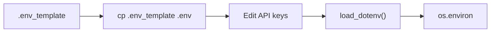
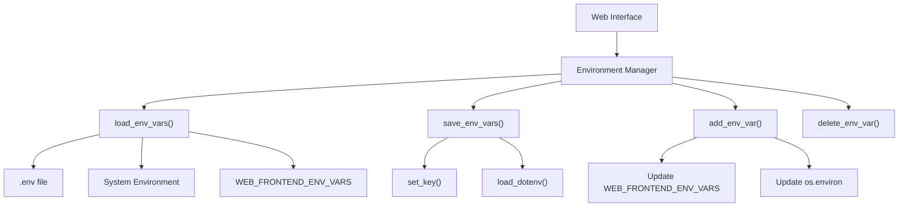
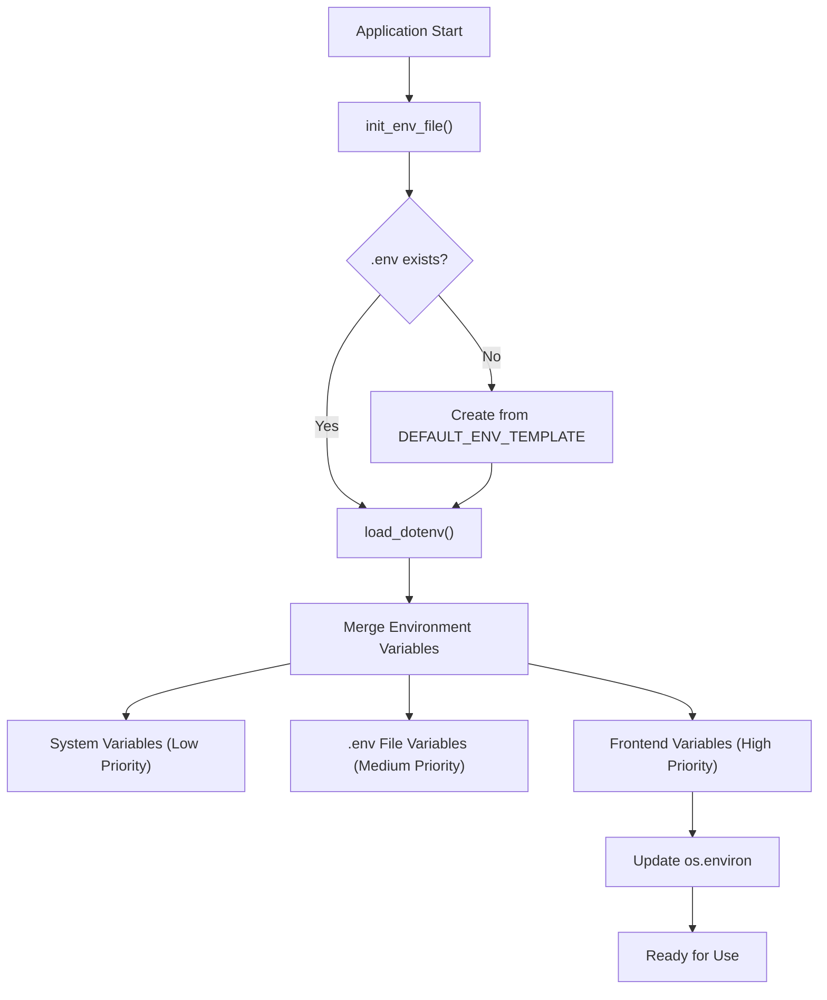
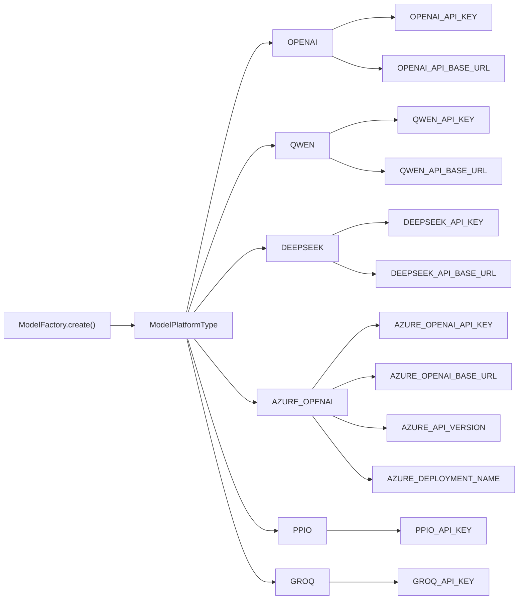
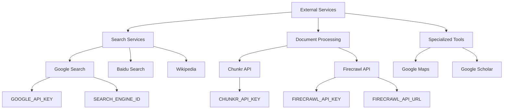
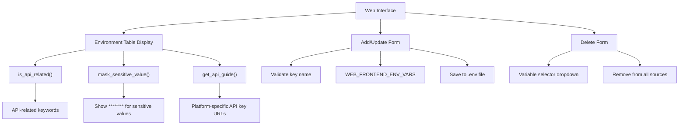

<!-- source: DeepWiki mcp.deepwiki.com · repo camel-ai/owl · page 3.3 Environment Configuration · fetched 2026-10-29 -->

# Environment Configuration

<details>
<summary>Relevant source files</summary>

The following files were used as context for generating this wiki page:

- [.gitignore](.gitignore)
- [README.md](README.md)
- [README_ja.md](README_ja.md)
- [README_zh.md](README_zh.md)
- [examples/run_ppio.py](examples/run_ppio.py)
- [owl/.env_template](owl/.env_template)
- [owl/assets/owl-favicon.ico](owl/assets/owl-favicon.ico)
- [owl/webapp.py](owl/webapp.py)
- [owl/webapp_backup.py](owl/webapp_backup.py)
- [owl/webapp_zh.py](owl/webapp_zh.py)

</details>


This document covers the setup and management of environment variables required for the OWL multi-agent framework. Environment configuration is essential for connecting OWL to various LLM platforms, search engines, and external services. For information about Docker-based environment setup, see [Docker Deployment](#3.2). For dependency management, see [Dependencies](#3.1).

## Purpose and Scope

Environment configuration in OWL manages API keys, service endpoints, and platform-specific settings required for:
- LLM model platforms (OpenAI, Qwen, DeepSeek, etc.)
- Search and external services (Google Search, Chunkr, Firecrawl)
- Tool-specific configurations
- Web interface management

## Environment Variable Structure

### Environment Variable Categories

```mermaid
graph TB
    EnvVars["Environment Variables"]
    
    EnvVars --> ModelAPIs["Model Platform APIs"]
    EnvVars --> ServiceAPIs["Service APIs"]
    EnvVars --> ToolConfigs["Tool Configurations"]
    
    ModelAPIs --> OpenAI["OPENAI_API_KEY"]
    ModelAPIs --> Qwen["QWEN_API_KEY"]
    ModelAPIs --> DeepSeek["DEEPSEEK_API_KEY"]
    ModelAPIs --> Azure["AZURE_OPENAI_API_KEY"]
    ModelAPIs --> Gemini["GEMINI_API_KEY"]
    ModelAPIs --> PPIO["PPIO_API_KEY"]
    ModelAPIs --> Groq["GROQ_API_KEY"]
    ModelAPIs --> Novita["NOVITA_API_KEY"]
    
    ServiceAPIs --> Google["GOOGLE_API_KEY"]
    ServiceAPIs --> SearchEngine["SEARCH_ENGINE_ID"]
    ServiceAPIs --> Chunkr["CHUNKR_API_KEY"]
    ServiceAPIs --> Firecrawl["FIRECRAWL_API_KEY"]
    
    ToolConfigs --> BaseURL["API_BASE_URL configs"]
    ToolConfigs --> Versions["API_VERSION configs"]
```



**Environment Variable Template Structure**
Sources: [owl/.env_template:1-51]()

### Template Structure Analysis

The `.env_template` file organizes environment variables into logical sections:

| Category | Variables | Purpose |
|----------|-----------|---------|
| **Model APIs** | `OPENAI_API_KEY`, `QWEN_API_KEY`, `DEEPSEEK_API_KEY` | LLM platform authentication |
| **Azure Configuration** | `AZURE_OPENAI_BASE_URL`, `AZURE_API_VERSION`, `AZURE_DEPLOYMENT_NAME` | Azure OpenAI service setup |
| **Service APIs** | `GOOGLE_API_KEY`, `SEARCH_ENGINE_ID`, `CHUNKR_API_KEY` | External service integration |
| **Optional Services** | `FIRECRAWL_API_KEY`, `GROQ_API_KEY`, `NOVITA_API_KEY` | Additional tool platforms |

Sources: [owl/.env_template:1-51]()

## Configuration Methods

### Method 1: .env File Configuration

The primary configuration method uses a `.env` file in the owl directory:



**Setup Process:**
1. Copy template: `cp owl/.env_template owl/.env`
2. Edit `.env` file with actual API keys
3. System automatically loads variables via `load_dotenv()`

Sources: [README.md:350-370](), [owl/.env_template:1-51]()

### Method 2: Direct Environment Variables

Set variables directly in terminal session:

**Linux/macOS:**
```bash
export OPENAI_API_KEY="your-api-key-here"
```

**Windows Command Prompt:**
```cmd
set OPENAI_API_KEY=your-api-key-here
```

**Windows PowerShell:**
```powershell
$env:OPENAI_API_KEY = "your-api-key-here"
```

Sources: [README.md:332-347]()

### Method 3: Web Interface Management



**Web Interface Features:**
- Real-time environment variable editing
- Sensitive value masking for security
- API key validation and guides
- Priority management (Frontend > .env > System)

Sources: [owl/webapp.py:458-586](), [owl/webapp_zh.py:441-568]()

## Environment Loading System

### Loading Priority and Flow



**Environment Variable Priority:**
1. **Frontend Configuration** (Highest) - Set via web interface
2. **.env File** (Medium) - Persistent local configuration
3. **System Environment** (Lowest) - OS-level variables

Sources: [owl/webapp.py:458-502](), [owl/webapp_zh.py:441-484]()

### Variable Management Functions

The system provides comprehensive environment variable management:

| Function | Purpose | File Location |
|----------|---------|---------------|
| `init_env_file()` | Initialize .env from template | [owl/webapp.py:448-456]() |
| `load_env_vars()` | Load and merge all env sources | [owl/webapp.py:458-502]() |
| `save_env_vars()` | Persist variables to .env | [owl/webapp.py:504-530]() |
| `add_env_var()` | Add/update single variable | [owl/webapp.py:532-561]() |
| `delete_env_var()` | Remove variable | [owl/webapp.py:563-586]() |
| `is_api_related()` | Filter API-related variables | [owl/webapp.py:588-632]() |

Sources: [owl/webapp.py:448-632](), [owl/webapp_zh.py:431-631]()

## Model Platform Configuration

### Platform-Specific Requirements

Different model platforms require specific environment variable configurations:



**Platform Configuration Examples:**

**OpenAI Configuration:**
- Required: `OPENAI_API_KEY`
- Optional: `OPENAI_API_BASE_URL` (for custom endpoints)

**Azure OpenAI Configuration:**
- Required: `AZURE_OPENAI_API_KEY`, `AZURE_OPENAI_BASE_URL`
- Required: `AZURE_API_VERSION`, `AZURE_DEPLOYMENT_NAME`

Sources: [owl/.env_template:6-31](), [examples/run_ppio.py:58-67]()

## Service API Configuration

### External Service Integration



**Service-Specific Requirements:**

| Service | Required Variables | Optional Variables |
|---------|-------------------|-------------------|
| **Google Search** | `GOOGLE_API_KEY`, `SEARCH_ENGINE_ID` | - |
| **Chunkr** | `CHUNKR_API_KEY` | - |
| **Firecrawl** | `FIRECRAWL_API_KEY` | `FIRECRAWL_API_URL` |

Sources: [owl/.env_template:42-51]()

## Web Interface Environment Management

### API Key Management Interface

The web interface provides comprehensive environment variable management with security features:



**Security Features:**
- Sensitive value masking for display
- API key validation
- Secure local storage only
- Platform-specific acquisition guides

Sources: [owl/webapp.py:588-652](), [owl/webapp_zh.py:571-651]()

### API Key Acquisition Guides

The system provides automatic links to API key acquisition pages:

| Platform | Environment Variable | Acquisition URL |
|----------|---------------------|------------------|
| OpenAI | `OPENAI_API_KEY` | https://platform.openai.com/api-keys |
| Qwen | `QWEN_API_KEY` | https://help.aliyun.com/zh/model-studio/developer-reference/get-api-key |
| DeepSeek | `DEEPSEEK_API_KEY` | https://platform.deepseek.com/api_keys |
| Google Search | `GOOGLE_API_KEY` | Custom search API documentation |
| PPIO | `PPIO_API_KEY` | https://ppinfra.com/settings/key-management |

Sources: [owl/webapp.py:602-632](), [owl/webapp_zh.py:602-631]()

---

