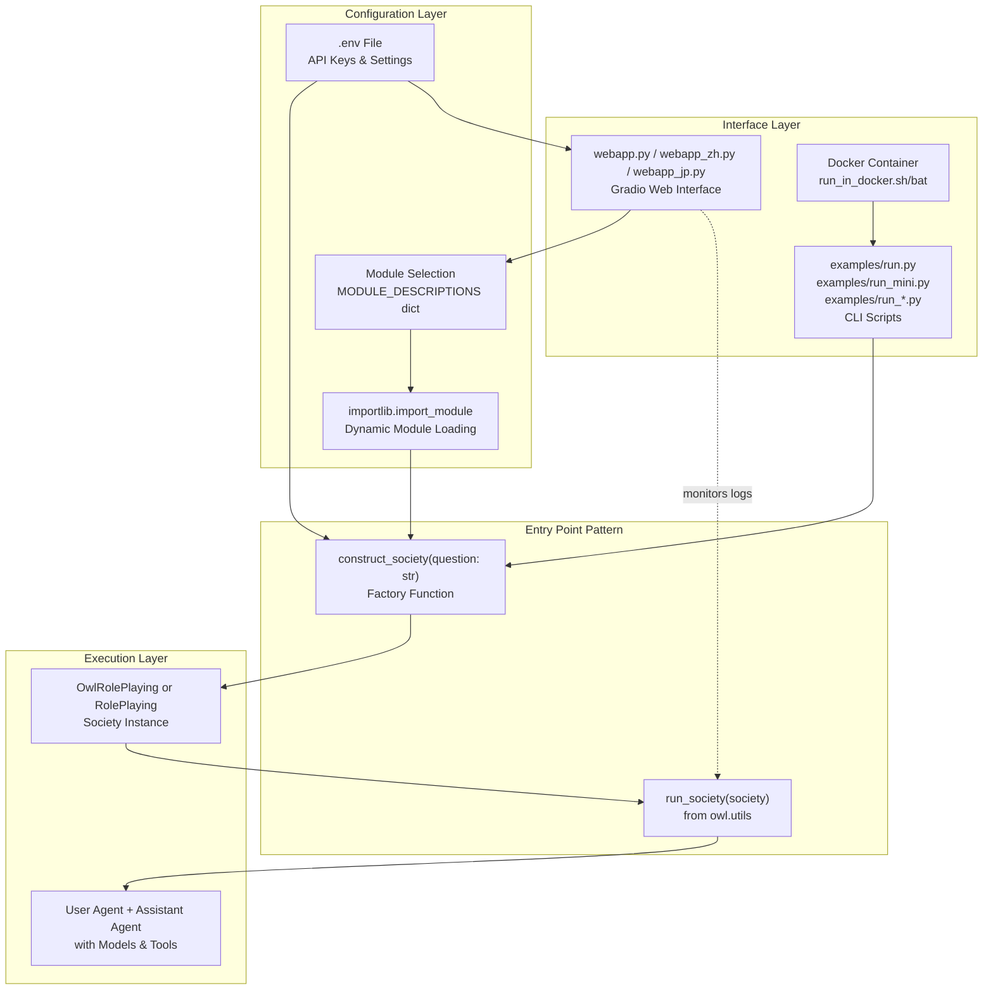
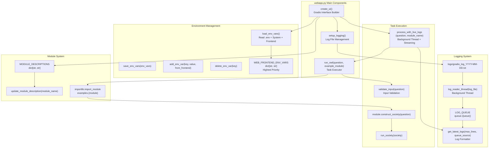
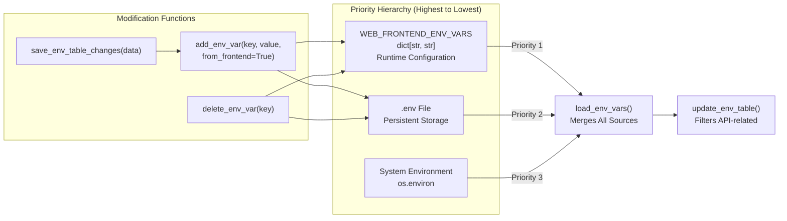
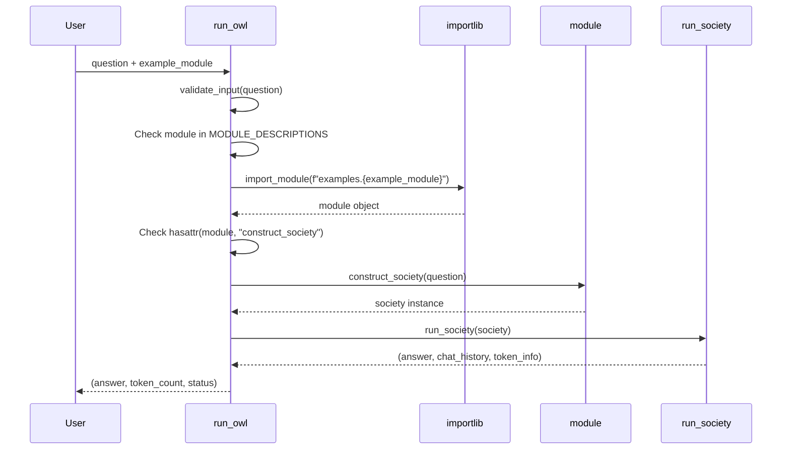
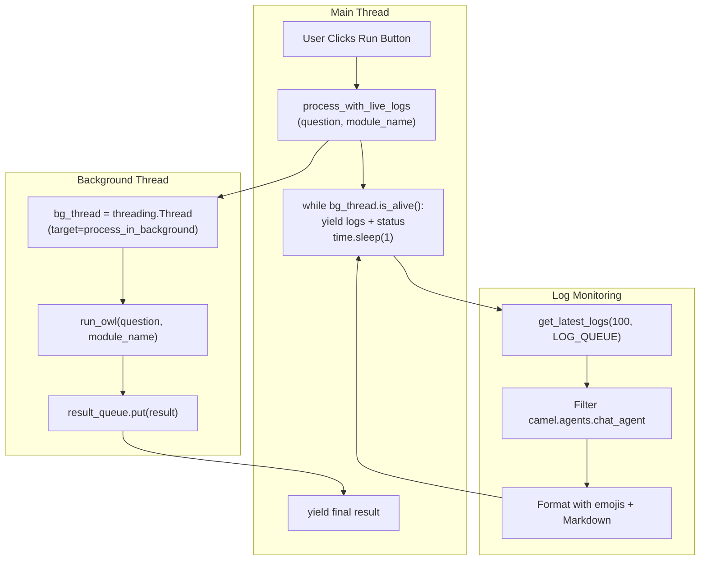
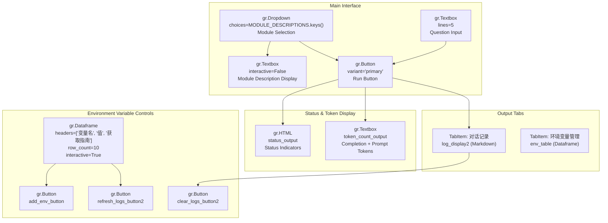
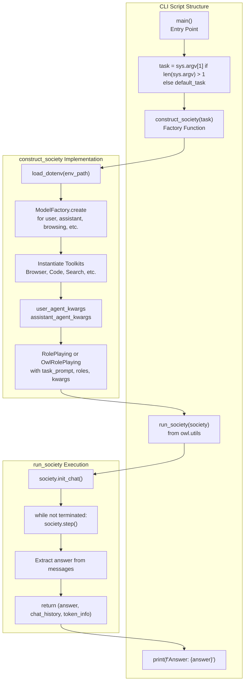
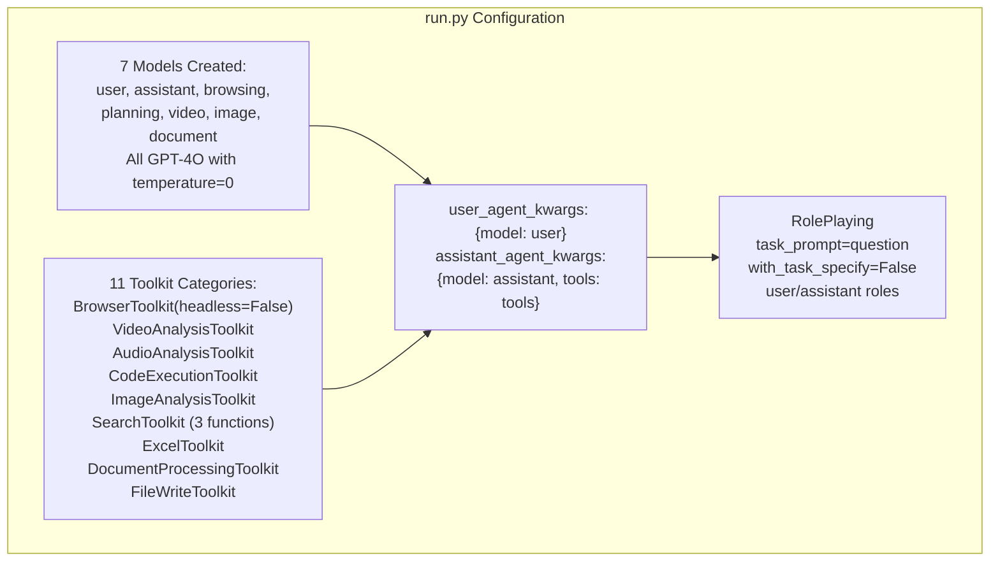
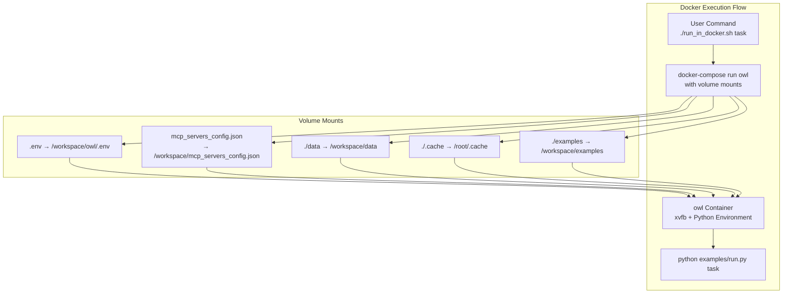

<!-- source: DeepWiki mcp.deepwiki.com · repo camel-ai/owl · page 4 User Interfaces · fetched 2026-10-29 -->

# User Interfaces

<details>
<summary>Relevant source files</summary>

The following files were used as context for generating this wiki page:

- [examples/run.py](examples/run.py)
- [examples/run_azure_openai.py](examples/run_azure_openai.py)
- [examples/run_mini.py](examples/run_mini.py)
- [examples/run_ollama.py](examples/run_ollama.py)
- [examples/run_ppio.py](examples/run_ppio.py)
- [owl/.env_template](owl/.env_template)
- [owl/webapp.py](owl/webapp.py)
- [owl/webapp_backup.py](owl/webapp_backup.py)
- [owl/webapp_zh.py](owl/webapp_zh.py)

</details>


This document describes the three primary user interfaces for interacting with the OWL system: the Web Application (Gradio-based), the Command Line Interface, and Docker containerization. These interfaces serve as entry points for submitting tasks to the multi-agent system and monitoring execution. For information about the underlying execution engine and agent orchestration, see [Architecture](#2). For details about configuring models and toolkits used by these interfaces, see [Model Integration](#6) and [Toolkits](#5).

---

## Interface Architecture Overview

OWL provides three distinct interface layers, all converging on the `construct_society` factory pattern and `run_society` execution function:



**Sources:** [owl/webapp.py:318-436](), [owl/webapp_zh.py:317-419](), [examples/run.py:41-128](), [examples/run_mini.py:40-107]()

---

## Web Application Interface

The web application provides a browser-based interface built with Gradio, offering real-time task execution, environment variable management, and conversation logging. Three language variants are available: English (`webapp.py`), Chinese (`webapp_zh.py`), and Japanese (webapp_jp.py, not in provided files).

### Web Application Architecture



**Sources:** [owl/webapp.py:33-72](), [owl/webapp.py:781-843](), [owl/webapp.py:318-436](), [owl/webapp_zh.py:33-72](), [owl/webapp_zh.py:758-843]()

### Core Web Application Components

#### Logging System

The web application implements a sophisticated real-time logging system that monitors the execution of tasks and streams conversation logs to the user interface.

| Component | File Location | Purpose |
|-----------|---------------|---------|
| `setup_logging()` | [owl/webapp.py:33-72]() | Initializes root logger with file and console handlers, creates daily log files |
| `log_reader_thread()` | [owl/webapp.py:84-99]() | Background thread that continuously reads log file and queues new lines |
| `get_latest_logs()` | [owl/webapp.py:102-240]() | Filters and formats logs, extracts user/assistant messages from JSON |
| `LOG_QUEUE` | [owl/webapp.py:77]() | Global `queue.Queue()` for thread-safe log streaming |

The logging system filters logs to extract only conversation messages from `camel.agents.chat_agent - INFO` entries, parsing JSON message arrays and formatting them with emojis (🙋 for user, 🤖 for assistant).

**Log Parsing Logic:**
```
Raw Log Entry → Extract JSON Message Array → Filter role='user'|'assistant' → 
Format with Markdown → Deduplicate via processed_messages Set → Display
```

**Sources:** [owl/webapp.py:84-240](), [owl/webapp_zh.py:84-240]()

#### Environment Variable Management

The web application provides a three-tier priority system for environment variables:



**Key Functions:**

| Function | Location | Behavior |
|----------|----------|----------|
| `load_env_vars()` | [owl/webapp.py:458-501]() | Loads from `.env` file, system env, and `WEB_FRONTEND_ENV_VARS`; returns dict with (value, source) tuples |
| `add_env_var()` | [owl/webapp.py:532-560]() | Updates `WEB_FRONTEND_ENV_VARS`, `os.environ`, and `.env` file using `set_key()` |
| `delete_env_var()` | [owl/webapp.py:563-585]() | Removes from all three sources using `unset_key()` for `.env` file |
| `is_api_related()` | [owl/webapp.py:588-616]() | Filters environment variables containing keywords: api, key, token, secret, password, etc. |
| `get_api_guide()` | [owl/webapp.py:619-648]() | Returns API key acquisition URLs based on variable name (OpenAI, Qwen, DeepSeek, etc.) |

The `update_env_table()` function [owl/webapp.py:651-668]() generates a Gradio Dataframe with three columns: Variable Name, Value, and a clickable "🔗 Get" link pointing to the API key acquisition page.

**Sources:** [owl/webapp.py:458-668](), [owl/webapp_zh.py:441-651](), [owl/.env_template:1-51]()

#### Module Selection and Dynamic Loading

The web application uses a dictionary-based module registry to enable dynamic loading of execution configurations:

```python
MODULE_DESCRIPTIONS = {
    "run": "Default mode: Using OpenAI model...",
    "run_mini": "Using OpenAI model with minimal configuration...",
    "run_gemini": "Using Gemini model...",
    "run_claude": "Using Claude model...",
    "run_deepseek_zh": "Using deepseek model to process Chinese tasks",
    # ... additional modules
}
```
*[owl/webapp.py:244-260]()*

The `run_owl()` function implements the dynamic loading pattern:



**Dynamic Import Implementation:**
1. Module path construction: `module_path = f"examples.{example_module}"` [owl/webapp.py:356]()
2. Dynamic import: `module = importlib.import_module(module_path)` [owl/webapp.py:359]()
3. Interface validation: `hasattr(module, "construct_society")` [owl/webapp.py:378]()
4. Society construction: `society = module.construct_society(question)` [owl/webapp.py:391]()
5. Execution: `answer, chat_history, token_info = run_society(society)` [owl/webapp.py:404]()

**Sources:** [owl/webapp.py:244-260](), [owl/webapp.py:318-436](), [owl/webapp_zh.py:244-259]()

#### Real-Time Task Execution with Streaming Logs

The `process_with_live_logs()` function implements a background thread pattern with live log streaming:



**Key Implementation Details:**
- Background thread creation: `bg_thread = threading.Thread(target=process_in_background)` [owl/webapp.py:825]()
- Thread tracking: `CURRENT_PROCESS = bg_thread` [owl/webapp.py:826]()
- Live updates: Yields `(token_count, status_with_indicator, logs2)` every 1 second [owl/webapp.py:835-836]()
- Status indicators: CSS classes `.status-running`, `.status-success`, `.status-error` [owl/webapp.py:890-909]()

**Sources:** [owl/webapp.py:805-843](), [owl/webapp_zh.py:782-843]()

### Web Application User Interface Structure

The Gradio interface is organized into tabbed sections with environment variable management:



**Gradio Component Configuration:**

| Component | Properties | Location |
|-----------|-----------|----------|
| Question Input | `lines=5, show_copy_button=True` | [owl/webapp.py:1065-1071]() |
| Module Dropdown | `choices=list(MODULE_DESCRIPTIONS.keys()), value="run_qwen_zh"` | [owl/webapp_zh.py:1076-1081]() |
| Environment Table | `datatype=["str", "str", "html"], row_count=10, interactive=True` | [owl/webapp_zh.py:1159-1172]() |
| Status Output | `gr.HTML` with CSS status indicators | [owl/webapp_zh.py:1096-1099]() |
| Log Display | `gr.Markdown` with `.log-display` CSS class | [owl/webapp_zh.py:1126-1129]() |

**Sources:** [owl/webapp.py:781-1000](), [owl/webapp_zh.py:758-1300]()

### Internationalization

Three language variants exist with identical functionality but different UI text:

| File | Language | Default Module | Key Differences |
|------|----------|----------------|-----------------|
| `webapp.py` | English | `run` | English labels, status messages |
| `webapp_zh.py` | Chinese | `run_qwen_zh` | Chinese labels, includes Chinese-specific modules (run_qwen_zh, run_deepseek_zh) |
| `webapp_jp.py` | Japanese | (not in files) | Japanese labels |

The Chinese variant includes additional modules optimized for Chinese LLM platforms: `run_deepseek_zh`, `run_qwen_zh`, `run_qwen_mini_zh` [owl/webapp_zh.py:244-259]().

**Sources:** [owl/webapp.py:1-30](), [owl/webapp_zh.py:1-30]()

---

## Command Line Interface

The CLI consists of Python scripts in the `examples/` directory that directly instantiate and run agent societies. Each script follows the `construct_society` pattern and can be executed with optional command-line arguments.

### CLI Architecture and Execution Flow



**Sources:** [examples/run.py:131-148](), [examples/run.py:41-128](), [examples/run_mini.py:110-127]()

### CLI Module Pattern: construct_society

All CLI scripts implement the same interface pattern:

```python
def construct_society(question: str) -> RolePlaying:
    """
    Args:
        question: The task or question to be addressed by the society.
    
    Returns:
        RolePlaying: A configured society of agents ready to address the question.
    """
```

This pattern enables:
1. **Modularity**: Each script is self-contained with its own model and toolkit configuration
2. **Web App Integration**: `webapp.py` dynamically imports these scripts via `importlib` [owl/webapp.py:359]()
3. **Testability**: Scripts can be tested independently
4. **Flexibility**: Different scripts can use different model platforms (OpenAI, Qwen, Ollama, etc.)

### CLI Module Examples

#### run.py - Full-Featured Configuration

The default CLI module with comprehensive toolkit support:



**Model Creation Pattern:**
```python
models = {
    "user": ModelFactory.create(
        model_platform=ModelPlatformType.OPENAI,
        model_type=ModelType.GPT_4O,
        model_config_dict={"temperature": 0},
    ),
    # ... 6 additional models
}
```
*[examples/run.py:52-88]()*

**Tool Configuration:**
```python
tools = [
    *BrowserToolkit(headless=False, web_agent_model=models["browsing"], 
                     planning_agent_model=models["planning"]).get_tools(),
    *VideoAnalysisToolkit(model=models["video"]).get_tools(),
    *AudioAnalysisToolkit().get_tools(),  # Requires OpenAI Key
    # ... 8 additional toolkit integrations
]
```
*[examples/run.py:91-107]()*

**Sources:** [examples/run.py:41-128]()

#### run_mini.py - Minimal Configuration

A lightweight CLI module with reduced dependencies:

| Difference from run.py | Implementation |
|------------------------|----------------|
| Models | Only 4 models: user, assistant, browsing, planning (no video/audio/document) |
| Toolkits | No AudioAnalysisToolkit, VideoAnalysisToolkit, ImageAnalysisToolkit, DocumentProcessingToolkit, ExcelToolkit |
| Search Tools | No `SearchToolkit().search_google` (commented out) |
| File Location | [examples/run_mini.py:40-107]() |

**Sources:** [examples/run_mini.py:40-107]()

#### run_azure_openai.py - Azure Platform Configuration

Demonstrates Azure OpenAI platform integration:

```python
base_model_config = {
    "model_platform": ModelPlatformType.AZURE,
    "model_type": os.getenv("AZURE_OPENAI_MODEL_TYPE"),
    "model_config_dict": ChatGPTConfig(temperature=0.4, max_tokens=4096).as_dict(),
}

models = {
    "user": ModelFactory.create(**base_model_config),
    "assistant": ModelFactory.create(**base_model_config),
    # ... 3 additional models
}
```
*[examples/run_azure_openai.py:53-65]()*

Requires environment variables: `AZURE_OPENAI_BASE_URL`, `AZURE_API_VERSION`, `AZURE_OPENAI_API_KEY`, `AZURE_DEPLOYMENT_NAME` [owl/.env_template:26-30]()

**Sources:** [examples/run_azure_openai.py:42-102](), [owl/.env_template:26-30]()

#### run_ollama.py - Local Model Configuration

Enables running OWL with locally hosted models via Ollama:

```python
models = {
    "user": ModelFactory.create(
        model_platform=ModelPlatformType.OLLAMA,
        model_type="qwen2.5:72b",
        url="http://localhost:11434/v1",
        model_config_dict={"temperature": 0.8, "max_tokens": 1000000},
    ),
    "browsing": ModelFactory.create(
        model_platform=ModelPlatformType.OLLAMA,
        model_type="llava:latest",  # Vision model for browser automation
        url="http://localhost:11434/v1",
        model_config_dict={"temperature": 0.4, "max_tokens": 1000000},
    ),
    # ... additional model configurations
}
```
*[examples/run_ollama.py:56-86]()*

**Key Characteristics:**
- Uses `ModelPlatformType.OLLAMA` [examples/run_ollama.py:57]()
- Specifies local URL: `http://localhost:11434/v1` [examples/run_ollama.py:59]()
- High token limits: `max_tokens=1000000` for local models [examples/run_ollama.py:60]()
- Vision model for browsing: `llava:latest` [examples/run_ollama.py:70]()

**Sources:** [examples/run_ollama.py:44-123]()

#### run_ppio.py - PPIO Platform Configuration

Demonstrates integration with PPIO platform (decentralized cloud computing):

```python
models = {
    "user": ModelFactory.create(
        model_platform=ModelPlatformType.PPIO,
        model_type=ModelType.PPIO_DEEPSEEK_V3_COMMUNITY,
        model_config_dict={"temperature": 0},
    ),
    "assistant": ModelFactory.create(
        model_platform=ModelPlatformType.PPIO,
        model_type=ModelType.PPIO_DEEPSEEK_V3_COMMUNITY,
        model_config_dict={"temperature": 0},
    ),
}
```
*[examples/run_ppio.py:56-67]()*

Requires `PPIO_API_KEY` environment variable obtainable from https://ppinfra.com/settings/key-management [examples/run_ppio.py:17-18]()

**Sources:** [examples/run_ppio.py:45-99](), [owl/.env_template:19-20]()

### Running CLI Scripts

#### Direct Execution

```bash
# Using default task
python examples/run.py

# With custom task
python examples/run.py "Your custom task here"

# Using different modules
python examples/run_mini.py "Minimal configuration task"
python examples/run_ollama.py "Local model task"
```

#### Environment Setup

All scripts load environment variables from `.env` file:
```python
base_dir = pathlib.Path(__file__).parent.parent
env_path = base_dir / "owl" / ".env"
load_dotenv(dotenv_path=str(env_path))
```
*[examples/run.py:34-36]()*

#### Output Format

Scripts output colored results to stdout:
```python
print(f"\033[94mAnswer: {answer}\033[0m")
```
*[examples/run.py:144]()*

The `run_society()` function returns three values:
1. `answer` (str): Final answer extracted from conversation
2. `chat_history` (list): Complete conversation history
3. `token_count` (dict): Token usage statistics with keys `completion_token_count` and `prompt_token_count`

**Sources:** [examples/run.py:131-148](), [examples/run_mini.py:110-127](), [examples/run_ollama.py:126-143]()

---

## Docker Deployment Interface

The Docker interface wraps the CLI scripts in a containerized environment with headless browser support and volume mounts for persistent storage. While the Dockerfile and docker-compose.yml files are not provided in the source files, the high-level diagrams indicate the following structure:



**Key Docker Features:**
1. **Headless Browser Support**: xvfb (X Virtual Framebuffer) enables BrowserToolkit to run without display [Architecture Diagram 5]()
2. **Persistent Configuration**: `.env` file mounted for API keys
3. **Data Persistence**: Input/output data directories mounted
4. **Cache Optimization**: Pip and Playwright caches mounted for faster rebuilds
5. **Module Extensibility**: `examples/` directory mounted for custom modules

**Sources:** High-level architecture diagrams provided in context

---

## Interface Comparison Matrix

| Feature | Web Application | CLI | Docker |
|---------|----------------|-----|---------|
| **Entry Point** | `webapp.py`, `webapp_zh.py`, `webapp_jp.py` | `examples/run*.py` | `run_in_docker.sh/bat` |
| **Task Input** | Gradio textbox + module dropdown | Command-line argument | Command-line argument |
| **Environment Config** | Web UI with `add_env_var()`, `delete_env_var()` | `.env` file editing | `.env` file (mounted volume) |
| **Real-Time Logs** | Yes, via `process_with_live_logs()` | No, prints final result only | No, prints final result only |
| **Module Selection** | Dropdown with `MODULE_DESCRIPTIONS` | Edit script file or create new script | Edit script file or create new script |
| **Execution Model** | Background thread with streaming | Synchronous | Synchronous in container |
| **Internationalization** | 3 languages (EN, ZH, JP) | Not applicable | Not applicable |
| **Browser Automation** | Requires display or `headless=True` | Requires display or `headless=True` | xvfb provides virtual display |
| **Typical Use Case** | Interactive experimentation, demos | Scripting, automation, CI/CD | Isolated environments, servers |

**Sources:** [owl/webapp.py:1-30](), [examples/run.py:1-148](), High-level architecture diagrams

---

## Common Patterns Across Interfaces

### The construct_society Pattern

All interfaces converge on the `construct_society(question: str)` factory function, which must return a society instance (either `RolePlaying` or `OwlRolePlaying`). This pattern enforces:

1. **Consistent Interface**: All modules expose the same function signature
2. **Encapsulation**: Model and toolkit configuration is contained within each module
3. **Testability**: Societies can be constructed and tested independently
4. **Modularity**: Web app can dynamically load any module via `importlib.import_module()` [owl/webapp.py:359]()

### Environment Variable Loading

All interfaces use the same environment variable loading mechanism:

```python
import pathlib
from dotenv import load_dotenv

base_dir = pathlib.Path(__file__).parent.parent
env_path = base_dir / "owl" / ".env"
load_dotenv(dotenv_path=str(env_path))
```

This ensures consistent behavior across web, CLI, and Docker interfaces.

### Token Usage Reporting

All interfaces return token usage statistics from `run_society()`:

```python
answer, chat_history, token_info = run_society(society)

completion_tokens = token_info.get("completion_token_count", 0)
prompt_tokens = token_info.get("prompt_token_count", 0)
total_tokens = completion_tokens + prompt_tokens
```

The web application formats this as: `Completion tokens: X | Prompt tokens: Y | Total: Z` [owl/webapp.py:428]()

**Sources:** [examples/run.py:34-36](), [owl/webapp.py:414-428](), [examples/run_mini.py:32-35]()

---

