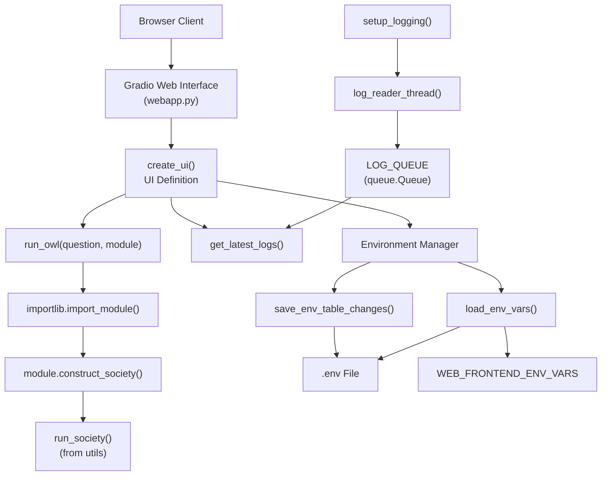
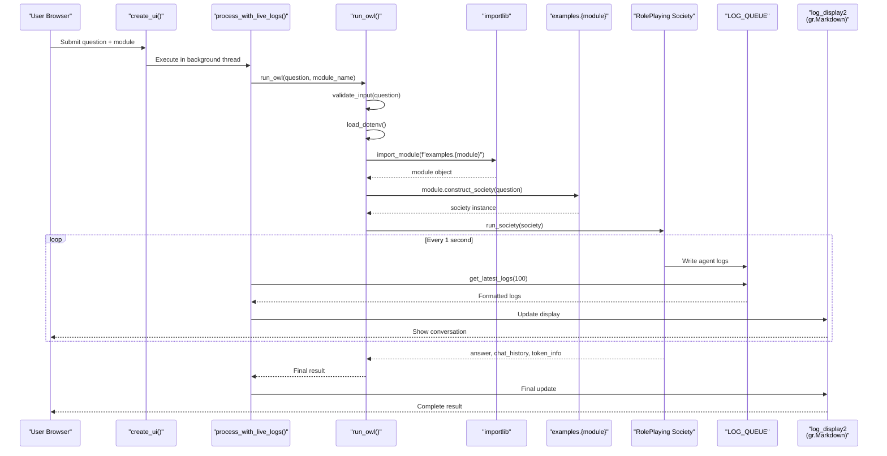
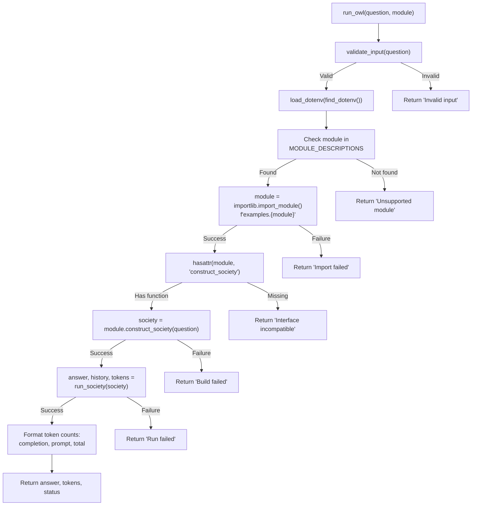
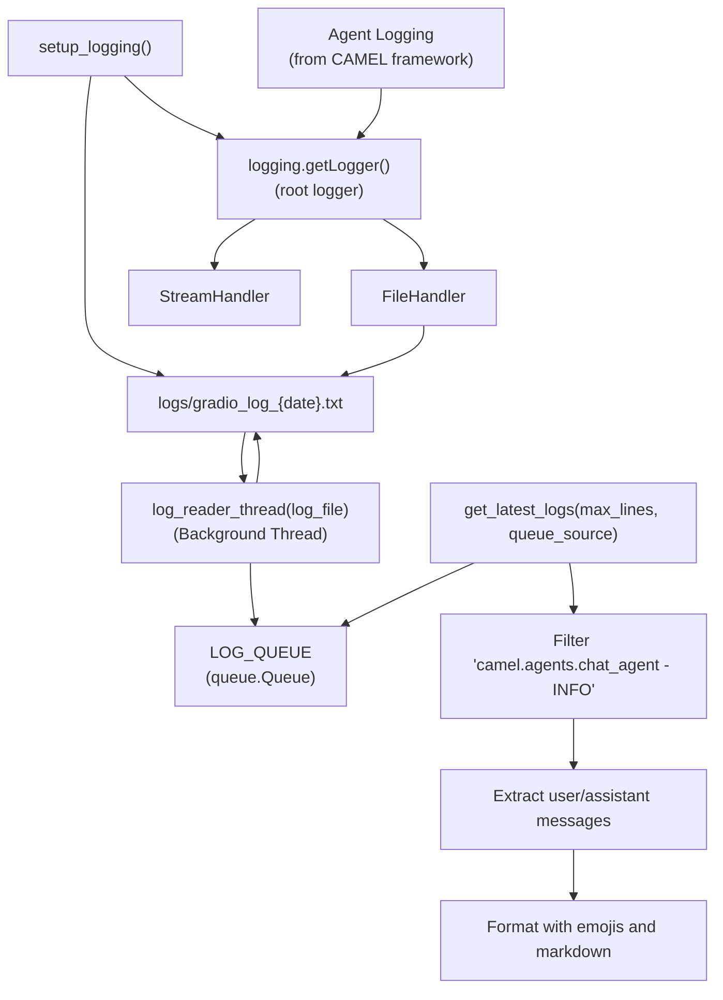
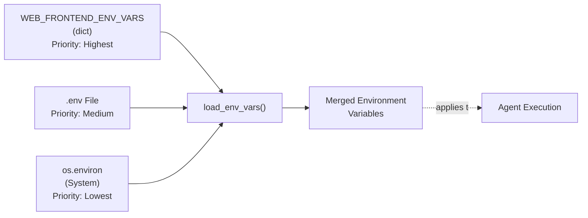
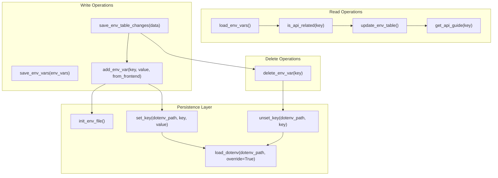
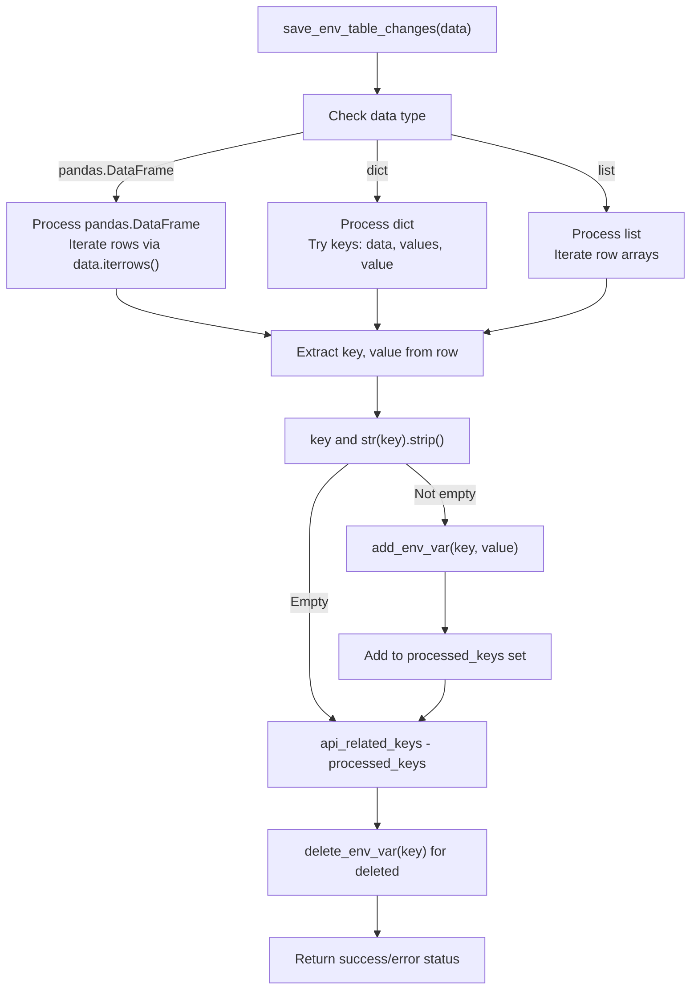
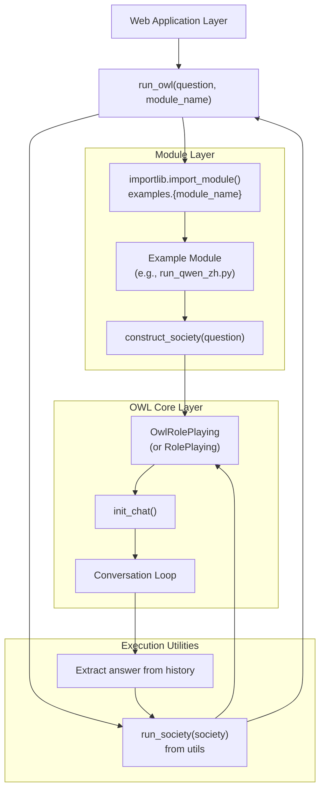

<!-- source: DeepWiki mcp.deepwiki.com · repo camel-ai/owl · page 4.1 Web Application · fetched 2026-10-29 -->

# Web Application

<details>
<summary>Relevant source files</summary>

The following files were used as context for generating this wiki page:

- [.pre-commit-config.yaml](.pre-commit-config.yaml)
- [examples/run_ppio.py](examples/run_ppio.py)
- [licenses/license_template.txt](licenses/license_template.txt)
- [licenses/update_license.py](licenses/update_license.py)
- [owl/.env_template](owl/.env_template)
- [owl/webapp.py](owl/webapp.py)
- [owl/webapp_backup.py](owl/webapp_backup.py)
- [owl/webapp_jp.py](owl/webapp_jp.py)
- [owl/webapp_zh.py](owl/webapp_zh.py)

</details>


The Web Application provides a browser-based interface for interacting with OWL's multi-agent system. Built with Gradio, it offers task execution, real-time conversation monitoring, and environment variable management through an accessible web UI. For command-line usage patterns, see [Command Line Interface](#4.2).

## Purpose and Scope

This document covers the Gradio-based web application implementation, including:
- UI architecture and component structure
- Task execution pipeline and module selection
- Real-time logging and conversation display
- Environment variable management system
- Multi-language support (English, Chinese, Japanese)

For details on Docker deployment of the web application, see [Docker Deployment](#3.2). For information about the underlying execution pipeline, see [Execution Pipeline](#2.2).

## Application Architecture

The web application serves as a frontend to the OWL system, dynamically loading example modules and orchestrating agent execution.

### High-Level Flow



**Sources:** [owl/webapp.py:1-1500](), [owl/webapp_zh.py:1-1500]()

### Task Execution Pipeline



**Sources:** [owl/webapp.py:318-437](), [owl/webapp.py:805-843]()

## Core Components

### UI Creation and Layout

The `create_ui()` function defines the entire Gradio interface structure, including input components, output displays, and environment management.

```mermaid
graph TB
    CreateUI["create_ui()"]
    
    subgraph "Main Tab - Task Execution"
        QuestionInput["question_input<br/>(gr.Textbox)"]
        ModuleDropdown["module_dropdown<br/>(gr.Dropdown)"]
        ModuleDesc["module_description<br/>(gr.Textbox)"]
        RunButton["run_button<br/>(gr.Button)"]
        StatusOutput["status_output<br/>(gr.HTML)"]
        TokenCount["token_count_output<br/>(gr.Textbox)"]
    end
    
    subgraph "Conversation Tab"
        LogDisplay["log_display2<br/>(gr.Markdown)"]
        RefreshBtn["refresh_logs_button2"]
        AutoRefresh["auto_refresh_checkbox2"]
        ClearBtn["clear_logs_button2"]
    end
    
    subgraph "Environment Tab"
        EnvTable["env_table<br/>(gr.Dataframe)"]
        SaveTableBtn["save_table_button"]
        EnvStatus["env_status_output"]
    end
    
    CreateUI --> QuestionInput
    CreateUI --> ModuleDropdown
    CreateUI --> LogDisplay
    CreateUI --> EnvTable
    
    RunButton -.triggers.-> ProcessLogs["process_with_live_logs()"]
    ModuleDropdown -.triggers.-> UpdateDesc["update_module_description()"]
    SaveTableBtn -.triggers.-> SaveChanges["save_env_table_changes()"]
    RefreshBtn -.triggers.-> GetLogs["get_latest_logs()"]
    ClearBtn -.triggers.-> ClearLog["clear_log_file()"]
```



**Sources:** [owl/webapp.py:781-1600](), [owl/webapp_zh.py:758-1700]()

### Module Selection System

The application supports multiple preconfigured example modules through the `MODULE_DESCRIPTIONS` dictionary.

| Module Name | Description | Key Features |
|------------|-------------|--------------|
| `run` | Default OpenAI model collaboration | Standard toolkit set |
| `run_mini` | Minimal OpenAI configuration | Lightweight execution |
| `run_claude` | Claude model integration | Anthropic models |
| `run_gemini` | Google Gemini models | Multimodal support |
| `run_qwen_zh` | Qwen models (Chinese) | Chinese language tasks |
| `run_deepseek_zh` | DeepSeek models (Chinese) | DeepSeek integration |
| `run_azure_openai` | Azure OpenAI deployment | Enterprise deployment |
| `run_ollama` | Local Ollama models | Self-hosted execution |

**Sources:** [owl/webapp.py:244-260](), [owl/webapp_zh.py:244-259]()

### Task Execution Function

The `run_owl()` function orchestrates the entire task execution process:



**Sources:** [owl/webapp.py:318-437](), [owl/webapp_zh.py:317-420]()

## Real-Time Logging System

The application implements a sophisticated logging system that captures agent conversations and displays them in real-time.

### Logging Architecture



**Sources:** [owl/webapp.py:33-240](), [owl/webapp_zh.py:32-241]()

### Log Processing Pipeline

The `get_latest_logs()` function implements a multi-stage processing pipeline:

1. **Queue Retrieval**: Reads from `LOG_QUEUE` (non-blocking)
2. **File Fallback**: If queue empty, reads last N lines from log file
3. **Filtering**: Only keeps logs containing `"camel.agents.chat_agent - INFO"`
4. **Parsing**: Extracts JSON message arrays or regex-matches content
5. **Deduplication**: Uses `processed_messages` set to avoid duplicates
6. **Formatting**: Converts to markdown with role emojis (🙋 user, 🤖 assistant)

**Key Implementation Details:**
- Line [owl/webapp.py:156-165](): Filters logs by agent type
- Line [owl/webapp.py:172-187](): `process_message()` function for formatting
- Line [owl/webapp.py:191-206](): JSON parsing for structured messages
- Line [owl/webapp.py:210-223](): Regex fallback for simple parsing

**Sources:** [owl/webapp.py:102-240]()

## Environment Variable Management

The application provides a three-tier environment variable system with web-based editing capabilities.

### Environment Variable Priority Hierarchy



**Sources:** [owl/webapp.py:458-501](), [owl/webapp_zh.py:441-484]()

### Environment Variable Operations

The web application implements comprehensive CRUD operations for environment variables:



**Sources:** [owl/webapp.py:448-586](), [owl/webapp_zh.py:431-569]()

### API Key Filtering and Guides

The `is_api_related()` function filters environment variables to show only API-related keys in the UI:

**API Keywords Detected:**
```
api, key, token, secret, password, openai, qwen, deepseek, 
google, search, hf, hugging, chunkr, firecrawl
```

**API Guide Mappings:**

| Key Pattern | Guide URL |
|------------|-----------|
| `openai` | `https://platform.openai.com/api-keys` |
| `qwen` or `dashscope` | `https://help.aliyun.com/...` |
| `deepseek` | `https://platform.deepseek.com/api_keys` |
| `ppio` | `https://ppinfra.com/settings/key-management` |
| `google` | `https://coda.io/@jon-dallas/...` |
| `chunkr` | `https://chunkr.ai/` |
| `firecrawl` | `https://www.firecrawl.dev/` |
| `novita` | `https://novita.ai/settings/key-management` |

**Sources:** [owl/webapp.py:588-648](), [owl/webapp_zh.py:571-632]()

### Table Change Persistence

The `save_env_table_changes()` function handles complex data format conversions from Gradio's Dataframe:



**Sources:** [owl/webapp.py:671-765](), [owl/webapp_zh.py:654-742]()

## Multi-Language Support

The application provides three separate implementations for different languages:

### Language Variants

| File | Language | Key Differences |
|------|----------|----------------|
| `webapp.py` | English | Default implementation |
| `webapp_zh.py` | Chinese (中文) | Chinese UI text, example tasks |
| `webapp_jp.py` | Japanese (日本語) | Japanese UI text, adapted modules |

**Common Architecture:** All three variants share identical:
- Function signatures
- Control flow logic
- Environment variable management
- Logging system implementation

**Differences:**
- UI labels and instructions
- Status messages and error text
- Example task prompts
- API guide descriptions
- Module subset (JP version has fewer modules)

**Sources:** [owl/webapp.py:1-1600](), [owl/webapp_zh.py:1-1700](), [owl/webapp_jp.py:1-1600]()

### Language-Specific Module Lists

**English/Chinese** (`webapp.py`, `webapp_zh.py`):
```
run, run_mini, run_gemini, run_claude, run_deepseek_zh, 
run_mistral, run_openai_compatible_model, run_ollama, 
run_qwen_mini_zh, run_qwen_zh, run_azure_openai, run_groq, 
run_ppio, run_together_ai, run_novita_ai
```

**Japanese** (`webapp_jp.py`):
```
run, run_mini, run_deepseek_zh, run_openai_compatible_model, 
run_ollama, run_qwen_mini_zh, run_qwen_zh, run_azure_openai, 
run_groq, run_together_ai
```

**Sources:** [owl/webapp.py:244-260](), [owl/webapp_zh.py:244-259](), [owl/webapp_jp.py:244-256]()

## Integration with OWL System

The web application serves as a thin wrapper around the core OWL execution pipeline:



**Key Integration Points:**

1. **Module Import** ([owl/webapp.py:356-375]()): Dynamic import of example modules
2. **Society Construction** ([owl/webapp.py:389-399]()): Calls module's `construct_society()`
3. **Execution** ([owl/webapp.py:402-412]()): Invokes `run_society()` from utils
4. **Result Handling** ([owl/webapp.py:414-429]()): Extracts answer and token counts

**Sources:** [owl/webapp.py:318-437](), [examples/run_ppio.py:45-99]()

## Starting the Application

The web application is launched by running the module directly:

```bash
# English version
python -m owl.webapp

# Chinese version
python -m owl.webapp_zh

# Japanese version
python -m owl.webapp_jp
```

**Main Entry Point:**
```python
if __name__ == "__main__":
    LOG_FILE = setup_logging()
    log_thread = threading.Thread(target=log_reader_thread, args=(LOG_FILE,))
    log_thread.daemon = True
    log_thread.start()
    
    app = create_ui()
    app.launch(server_name="0.0.0.0", server_port=7860, share=False)
```

**Default Configuration:**
- **Server:** Binds to `0.0.0.0` (all interfaces)
- **Port:** `7860`
- **Share:** `False` (no public Gradio link)
- **Logging:** Daily log files in `logs/gradio_log_{date}.txt`

**Sources:** [owl/webapp.py:1590-1605](), [owl/webapp_zh.py:1683-1698]()

## Environment Template

The application auto-generates a default `.env` file using `DEFAULT_ENV_TEMPLATE` if none exists:

**Template Structure:**
- Model API Keys: OpenAI, Qwen, DeepSeek, Azure, Gemini, Novita, PPIO
- Tool API Keys: Google Search, Chunkr, Firecrawl
- Optional configs: Base URLs, deployment names

**Initialization:**
```python
def init_env_file():
    dotenv_path = find_dotenv()
    if not dotenv_path:
        with open(".env", "w") as f:
            f.write(DEFAULT_ENV_TEMPLATE)
        dotenv_path = find_dotenv()
    return dotenv_path
```

**Sources:** [owl/webapp.py:263-300](), [owl/webapp.py:448-456](), [owl/.env_template:1-51]()

---

