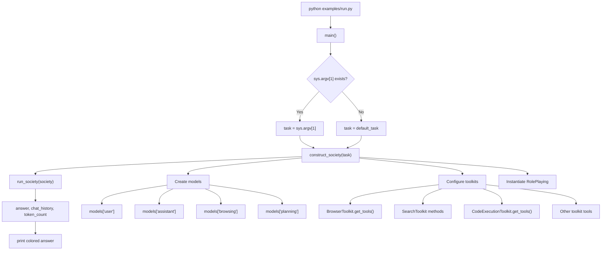
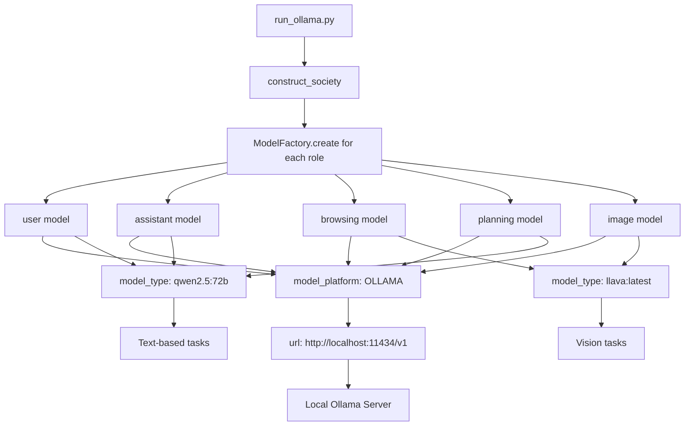
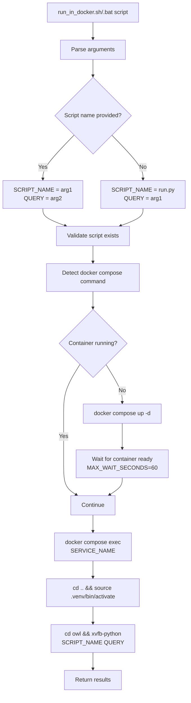
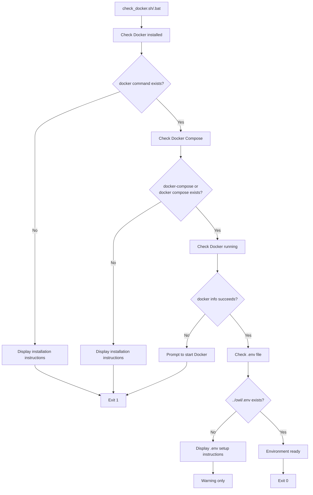
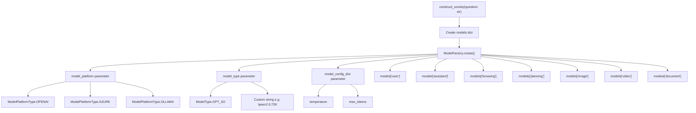
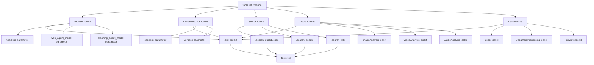

<!-- source: DeepWiki mcp.deepwiki.com · repo camel-ai/owl · page 4.2 Command Line Interface · fetched 2026-10-29 -->

# Command Line Interface

<details>
<summary>Relevant source files</summary>

The following files were used as context for generating this wiki page:

- [.container/check_docker.bat](.container/check_docker.bat)
- [.container/check_docker.sh](.container/check_docker.sh)
- [.container/run_in_docker.bat](.container/run_in_docker.bat)
- [.container/run_in_docker.sh](.container/run_in_docker.sh)
- [examples/run.py](examples/run.py)
- [examples/run_azure_openai.py](examples/run_azure_openai.py)
- [examples/run_mini.py](examples/run_mini.py)
- [examples/run_ollama.py](examples/run_ollama.py)

</details>


This document covers the command line interface patterns and usage methods for the OWL framework. The CLI provides multiple approaches for executing multi-agent tasks, from direct Python script execution to Docker-wrapped execution with automated environment management.

For web-based interfaces, see [Web Application](#4.1). For overall system architecture, see [Architecture](#2). For environment configuration details, see [Environment Configuration](#3.3).

## Direct Python Execution

### Basic CLI Pattern

All example scripts in the `examples/` directory follow a consistent execution pattern. Scripts accept an optional command-line argument for the task prompt, falling back to a default task if no argument is provided.

**Basic CLI Execution Flow**



Sources: [examples/run.py:131-148](), [examples/run_mini.py:110-127](), [examples/run_azure_openai.py:105-123]()

### Command Line Usage Examples

```bash
# Execute with default task
python examples/run.py

# Provide custom task as command-line argument
python examples/run.py "Search for Python frameworks and compare their popularity"

# Use platform-specific scripts
python examples/run_azure_openai.py "Analyze market trends"
python examples/run_ollama.py "Summarize recent AI papers"
python examples/run_mini.py "Generate a data visualization"
```

The argument handling pattern is implemented consistently across all example scripts:

```python
task = sys.argv[1] if len(sys.argv) > 1 else default_task
```

Sources: [examples/run.py:136-137](), [examples/run_mini.py:116](), [examples/run_ollama.py:132](), [examples/run_azure_openai.py:111]()


## Example Scripts

The `examples/` directory contains platform-specific CLI scripts demonstrating integration with different LLM providers:

| Script | Platform | Key Features | Models Used |
|--------|----------|--------------|-------------|
| `run.py` | OpenAI | Full toolkit suite (Browser, Video, Audio, Document, Image, Code, Search, Excel, File) | GPT-4O for all roles |
| `run_mini.py` | OpenAI | Minimal toolkit set (Browser, Code, Search, File) | GPT-4O for all roles |
| `run_azure_openai.py` | Azure OpenAI | Full toolkit integration with Azure endpoints | Configured via `AZURE_OPENAI_MODEL_TYPE` |
| `run_ollama.py` | Ollama | Local model deployment, multimodal support | qwen2.5:72b (text), llava:latest (vision) |


### Ollama Local Deployment Example

The `run_ollama.py` script demonstrates local model deployment using Ollama:

**Ollama Model Configuration Pattern**



Sources: [examples/run_ollama.py:55-86]()

### Default Task Demonstration

Each example script includes a comprehensive default task that exercises multiple toolkit capabilities:

```python
default_task = "Open Brave search, summarize the github stars, fork counts, etc. " \
              "of camel-ai's camel framework, and write the numbers into a python " \
              "file using the plot package, save it locally, and run the generated " \
              "python file. Note: You have been provided with the necessary tools " \
              "to complete this task."
```

This default task demonstrates:
- Web browsing (`BrowserToolkit`)
- Data extraction from websites
- File writing (`FileWriteToolkit`)
- Code generation
- Code execution (`CodeExecutionToolkit`)

Sources: [examples/run.py:133-134](), [examples/run_mini.py:112-113](), [examples/run_azure_openai.py:108]()

## Docker Wrapper Scripts

For users who prefer containerized execution, OWL provides Docker wrapper scripts that handle environment setup, container orchestration, and command execution automatically.

### Docker Wrapper Architecture

**Docker Execution Flow**



Sources: [.container/run_in_docker.sh:1-135](), [.container/run_in_docker.bat:1-181]()

### Docker Wrapper Usage

The Docker wrapper scripts support flexible argument patterns:

```bash
# Linux/macOS
./run_in_docker.sh "What is the capital of France?"
./run_in_docker.sh run_mini.py "Analyze this dataset"
./run_in_docker.sh run_azure_openai.py "Generate a report"

# Windows
.\run_in_docker.bat "What is the capital of France?"
.\run_in_docker.bat run_mini.py "Analyze this dataset"
.\run_in_docker.bat run_azure_openai.py "Generate a report"
```

**Argument Handling Logic**:
- If first argument ends with `.py`: treat as script name, second argument as query
- Otherwise: use `run.py` as default script, first argument as query

Sources: [.container/run_in_docker.sh:22-36](), [.container/run_in_docker.bat:26-44]()

### Docker Environment Validation

Before executing tasks, the `check_docker.sh/.bat` scripts validate the Docker environment:

**Docker Environment Checks**



Sources: [.container/check_docker.sh:1-92](), [.container/check_docker.bat:1-88]()

### Docker Container Configuration

The Docker wrapper scripts handle multiple Docker Compose command variants:

| Command | Detection Method | Priority |
|---------|------------------|----------|
| `docker compose` | `docker compose version` succeeds | First (modern) |
| `docker-compose` | `docker-compose` command exists | Second (legacy) |

Container startup includes:
- **Service detection**: Automatically detects service name from `docker-compose.yml`
- **Readiness waiting**: Polls container status every 2 seconds, maximum 60 seconds
- **Python command detection**: Falls back from `xvfb-python` to `python` if needed
- **Virtual environment activation**: Sources `.venv/bin/activate` before execution

Sources: [.container/run_in_docker.sh:63-114](), [.container/run_in_docker.bat:62-162]()

## Configuration Management

### Environment Loading Pattern

All CLI scripts follow a consistent environment loading pattern using `dotenv`:

```python
import pathlib
from dotenv import load_dotenv

base_dir = pathlib.Path(__file__).parent.parent
env_path = base_dir / "owl" / ".env"
load_dotenv(dotenv_path=str(env_path))
```

This pattern:
1. Locates the script's parent directory
2. Constructs the path to `owl/.env`
3. Loads environment variables into the process

The `.env` file should contain API keys and configuration for various services. See [Environment Configuration](#3.3) for details.

Sources: [examples/run.py:34-36](), [examples/run_mini.py:33-35](), [examples/run_ollama.py:37-39](), [examples/run_azure_openai.py:35-37]()

### Logging Configuration

All example scripts enable debug-level logging to provide detailed execution traces:

```python
from camel.logger import set_log_level
set_log_level(level="DEBUG")
```

This enables comprehensive logging of:
- Agent conversation exchanges
- Tool invocations and results
- Model API calls
- Error traces

Sources: [examples/run.py:38](), [examples/run_mini.py:37](), [examples/run_ollama.py:41](), [examples/run_azure_openai.py:39]()

## Society Construction Pattern

All example scripts implement a `construct_society` function that follows a consistent pattern for creating multi-agent societies.

### Model Factory Pattern

**Model Creation in construct_society**



Sources: [examples/run.py:52-88](), [examples/run_mini.py:52-73](), [examples/run_ollama.py:54-86](), [examples/run_azure_openai.py:52-65]()

### Toolkit Configuration Pattern

**Toolkit Integration in construct_society**



Sources: [examples/run.py:91-107](), [examples/run_mini.py:76-86](), [examples/run_ollama.py:89-102]()

### Society Instantiation

After models and tools are configured, the society is instantiated:

```python
# Configure agent parameters
user_agent_kwargs = {"model": models["user"]}
assistant_agent_kwargs = {"model": models["assistant"], "tools": tools}

# Configure task parameters
task_kwargs = {
    "task_prompt": question,
    "with_task_specify": False,
}

# Create society (RolePlaying or OwlRolePlaying)
society = RolePlaying(
    **task_kwargs,
    user_role_name="user",
    user_agent_kwargs=user_agent_kwargs,
    assistant_role_name="assistant",
    assistant_agent_kwargs=assistant_agent_kwargs,
)

return society
```

The society is then executed with `run_society(society)` which returns:
- `answer`: Final extracted answer
- `chat_history`: Complete conversation log
- `token_count`: Token usage statistics

Sources: [examples/run.py:109-128](), [examples/run_mini.py:88-107](), [examples/run_ollama.py:104-123]()

## Output Formatting

All CLI scripts use consistent output formatting with ANSI color codes:

```python
print(f"\033[94mAnswer: {answer}\033[0m")
```

The `run_society` function returns three components:
- `answer`: Final result string
- `chat_history`: Complete conversation log
- `token_count`: Usage statistics

Sources: [examples/run.py:143-144](), [examples/run_groq.py:160-161](), [examples/run_cli.py:187-189]()

## Module Import Patterns

CLI scripts follow consistent import patterns for OWL components:

```python
from owl.utils import OwlRolePlaying, run_society, DocumentProcessingToolkit
from camel.societies import RolePlaying
from camel.models import ModelFactory
from camel.toolkits import (
    BrowserToolkit,
    SearchToolkit,
    CodeExecutionToolkit,
    # ... other toolkits
)
```

Sources: [examples/run.py:32](), [examples/run_groq.py:45](), [examples/run_cli.py:30]()

---

