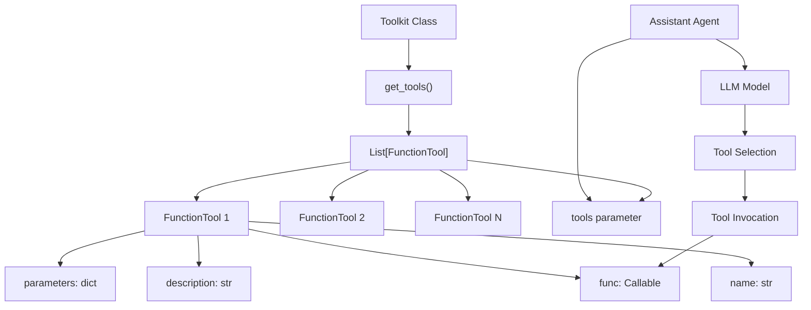
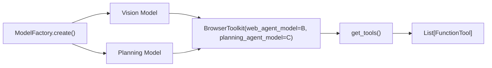
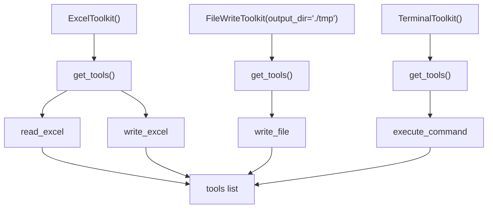
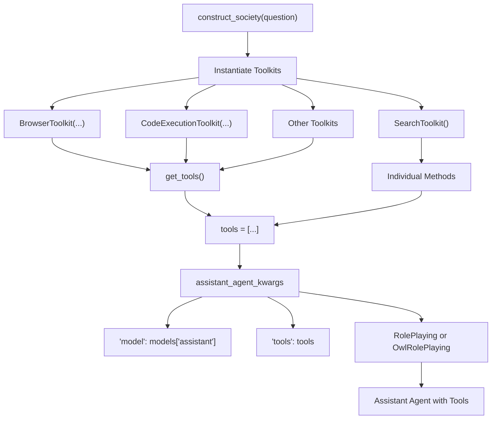
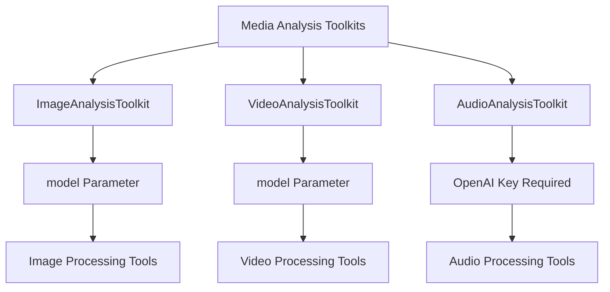
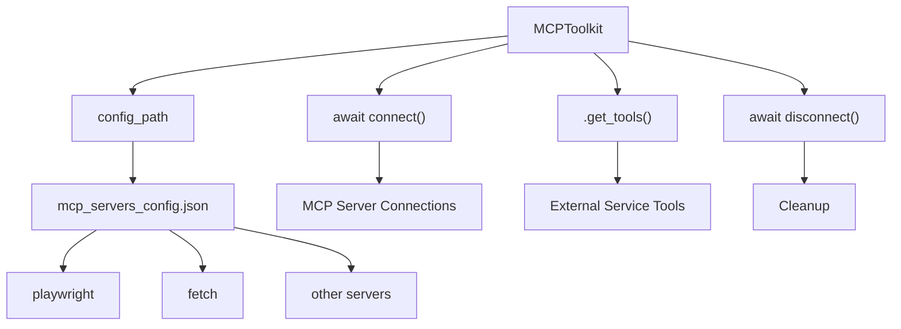
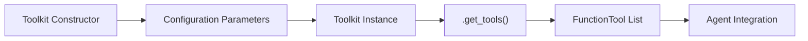
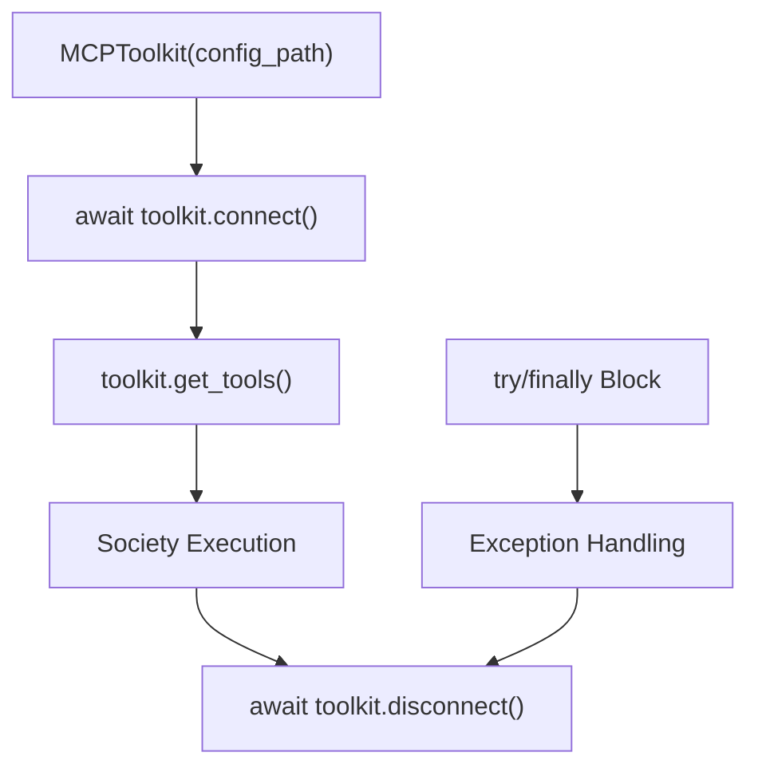
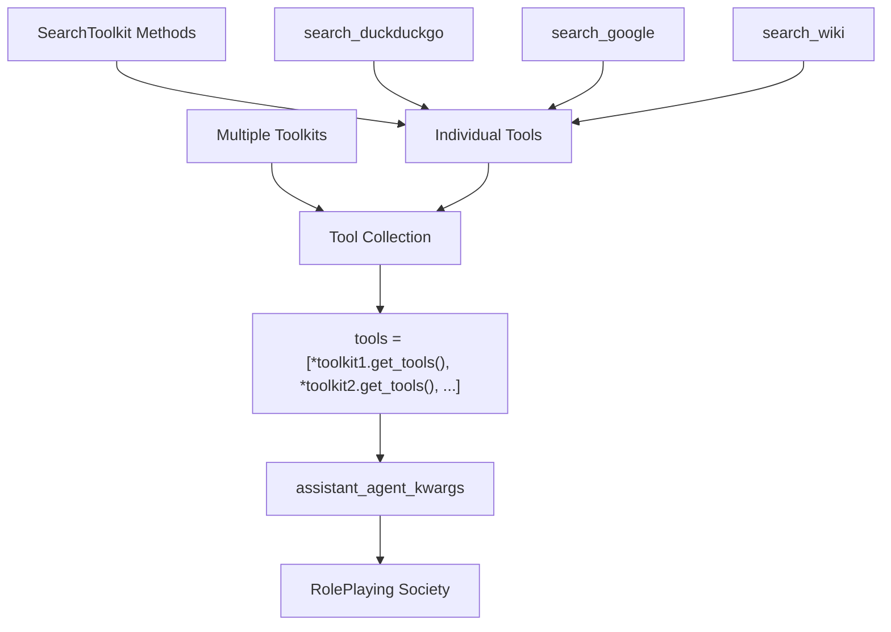

<!-- source: DeepWiki mcp.deepwiki.com · repo camel-ai/owl · page 5 Toolkits · fetched 2026-10-29 -->

# Toolkits

Relevant source files

The following files were used as context for generating this wiki page:

- [.gitignore](.gitignore)
- [README.md](README.md)
- [README_ja.md](README_ja.md)
- [README_zh.md](README_zh.md)
- [examples/run_gemini.py](examples/run_gemini.py)
- [examples/run_groq.py](examples/run_groq.py)
- [examples/run_mistral.py](examples/run_mistral.py)
- [examples/run_novita_ai.py](examples/run_novita_ai.py)
- [examples/run_openai_compatible_model.py](examples/run_openai_compatible_model.py)
- [examples/run_together_ai.py](examples/run_together_ai.py)
- [owl/assets/owl-favicon.ico](owl/assets/owl-favicon.ico)

The toolkit system extends agent capabilities by providing standardized interfaces to external systems, code execution environments, web browsers, document processors, and specialized services. Each toolkit exposes functionality through `FunctionTool` objects that agents can invoke during task execution.

The toolkit ecosystem comprises both "lightweight" toolkits with minimal dependencies (e.g., `ExcelToolkit`, `FileWriteToolkit`) and "heavyweight" toolkits requiring external services or model capabilities (e.g., `BrowserToolkit`, `DocumentProcessingToolkit`). The `MCPToolkit` serves as a meta-toolkit, exposing external MCP servers as tool collections.

This page provides an overview of the toolkit architecture and details on specific toolkit categories. For toolkit integration with agents, see page 2.2.

Sources: [README.md:101-195](), [README.md:488-584]()

## FunctionTool Abstraction

All toolkits expose their capabilities through the `FunctionTool` interface from the CAMEL framework. A `FunctionTool` wraps a Python function with metadata (name, description, parameters) that enables LLM agents to discover, select, and invoke tools based on natural language task requirements.

**FunctionTool Interface Structure**

The `get_tools()` method is the standard interface for extracting tool collections. Some toolkits (e.g., `SearchToolkit`) also expose individual methods as standalone tools.

Sources: [examples/run.py:91-106](), [examples/run_groq.py:102-117]()

## Toolkit Configuration Patterns

Toolkits follow three primary configuration patterns based on their requirements:

### Pattern 1: Model-Dependent Toolkits

These toolkits require LLM model instances for processing:

| Toolkit | Required Models | Purpose |
|---------|----------------|---------|
| `BrowserToolkit` | `web_agent_model`, `planning_agent_model` | Web page interpretation, navigation planning |
| `ImageAnalysisToolkit` | `model` (vision-capable) | Image content analysis |
| `VideoAnalysisToolkit` | `model` (vision-capable) | Video frame analysis |
| `DocumentProcessingToolkit` | `model` | Document content extraction, conversion |

**Model-Dependent Toolkit Configuration**

Sources: [examples/run.py:92-96](), [examples/run_groq.py:104-107](), [examples/run_gemini.py:90-94]()

### Pattern 2: Service-Dependent Toolkits

These toolkits require external services or API keys:

| Toolkit | Dependencies | Configuration |
|---------|--------------|---------------|
| `AudioAnalysisToolkit` | OpenAI API | Requires `OPENAI_API_KEY` environment variable |
| `MCPToolkit` | MCP servers, Node.js | Requires `mcp_servers_config.json` configuration |
| `GitHubToolkit` | GitHub API | Requires `GITHUB_API_KEY` |
| `NotionToolkit` | Notion API | Requires `NOTION_API_KEY` |

Sources: [examples/run.py:98](), [examples/run_groq.py:109](), [examples/run_mistral.py:144-148]()

### Pattern 3: Standalone Toolkits

These toolkits have minimal external dependencies:

- `ExcelToolkit`: Operates on local files using `openpyxl`, `pandas`
- `FileWriteToolkit`: Built-in file operations
- `TerminalToolkit`: System command execution
- `MathToolkit`: Pure Python mathematical operations

**Standalone Toolkit Pattern**

Sources: [examples/run.py:99-106](), [examples/run_groq.py:115-117]()

## Tool Integration in construct_society()

Toolkits are integrated into the agent society through the `assistant_agent_kwargs` configuration within `construct_society()`:

**Toolkit Integration in Society Construction**

The `tools` list aggregates `FunctionTool` objects from multiple sources. Tools from `get_tools()` are unpacked with the `*` operator, while individual toolkit methods (e.g., `SearchToolkit().search_wiki`) are added directly.

Sources: [examples/run.py:91-111](), [examples/run_groq.py:102-122](), [examples/run_mistral.py:162-167]()

## Core Toolkit Categories

### Web Automation and Search

The web-related toolkits provide comprehensive browser automation and search capabilities:

| Toolkit | Primary Function | Key Dependencies |
|---------|------------------|------------------|
| `BrowserToolkit` | Web automation, page interaction | `web_agent_model`, `planning_agent_model` |
| `SearchToolkit` | Search engine queries | DuckDuckGo, Google API, Wikipedia |

The `BrowserToolkit` requires specialized model configuration for web navigation and planning tasks, while `SearchToolkit` provides both unified and individual search methods.

Sources: [examples/run.py:92-96](), [examples/run_groq.py:104-107](), [examples/run_mini.py:77-81]()

### Code and Data Processing

Processing-oriented toolkits handle code execution, data manipulation, and file operations:

| Toolkit | Capabilities | Configuration Options |
|---------|--------------|----------------------|
| `CodeExecutionToolkit` | Python code execution | `sandbox="subprocess"`, `verbose=True` |
| `ExcelToolkit` | Spreadsheet operations | Default configuration |
| `FileWriteToolkit` | File system operations | `output_dir` specification |

Sources: [examples/run.py:99](), [examples/run_groq.py:110](), [examples/run_ollama.py:95]()

### Media Analysis

Media processing toolkits provide multimodal analysis capabilities:

**Media Analysis Toolkit Architecture**

These toolkits typically require model parameters for processing and analysis tasks, with `AudioAnalysisToolkit` specifically requiring OpenAI API access.

Sources: [examples/run.py:97-98](), [examples/run_groq.py:108-109](), [examples/run_novita_ai.py:90]()

### External System Integration

The `MCPToolkit` provides integration with Model Context Protocol servers for extended functionality:

**MCP Toolkit Integration Pattern**

The `MCPToolkit` follows an asynchronous pattern requiring explicit connection management and configuration through external JSON files.

Sources: [examples/run_mistral.py:144-148](), [examples/run_mistral.py:172-176]()

## Toolkit Usage Patterns

### Standard Synchronous Pattern

Most toolkits follow a synchronous instantiation and usage pattern:

**Synchronous Toolkit Usage Flow**

This pattern is used by `BrowserToolkit`, `CodeExecutionToolkit`, `ImageAnalysisToolkit`, and others.

Sources: [examples/run.py:92-106](), [examples/run_groq.py:104-117]()

### Asynchronous MCP Pattern

The `MCPToolkit` requires asynchronous handling:

**Asynchronous MCP Toolkit Pattern**

This pattern ensures proper resource management for external MCP server connections.

Sources: [examples/run_mistral.py:144-176]()

### Model-Dependent Configuration

Several toolkits require model parameters for specialized processing:

| Toolkit | Model Requirements | Usage Pattern |
|---------|-------------------|---------------|
| `BrowserToolkit` | `web_agent_model`, `planning_agent_model` | Web automation with AI guidance |
| `ImageAnalysisToolkit` | `model` parameter | Image processing and analysis |
| `VideoAnalysisToolkit` | `model` parameter | Video content analysis |
| `DocumentProcessingToolkit` | `model` parameter | Document extraction and processing |

Sources: [examples/run.py:92-96](), [examples/run_groq.py:104-107](), [examples/run_novita_ai.py:84-92]()

## Tool Integration in Society Construction

The toolkit system integrates into the agent society through the `assistant_agent_kwargs` configuration:

**Tool Aggregation in Agent Society**

The framework supports mixing tools from multiple toolkits and individual tool methods within a single agent configuration.

Sources: [examples/run.py:91-111](), [examples/run_groq.py:102-122](), [examples/run_mistral.py:162-167]()

---

