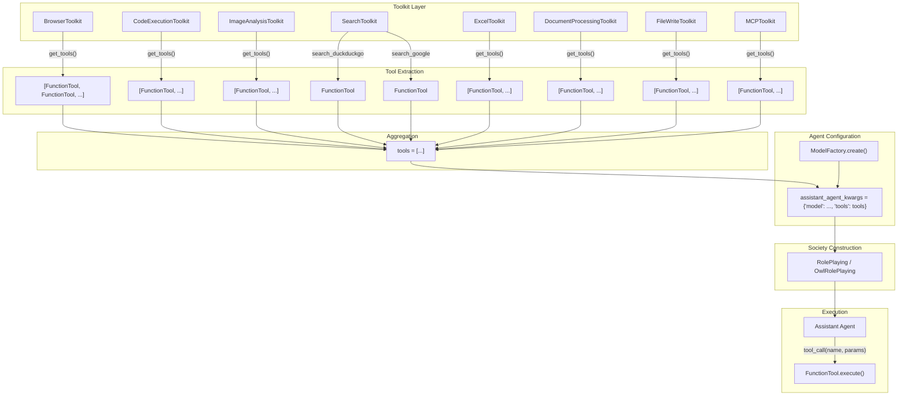
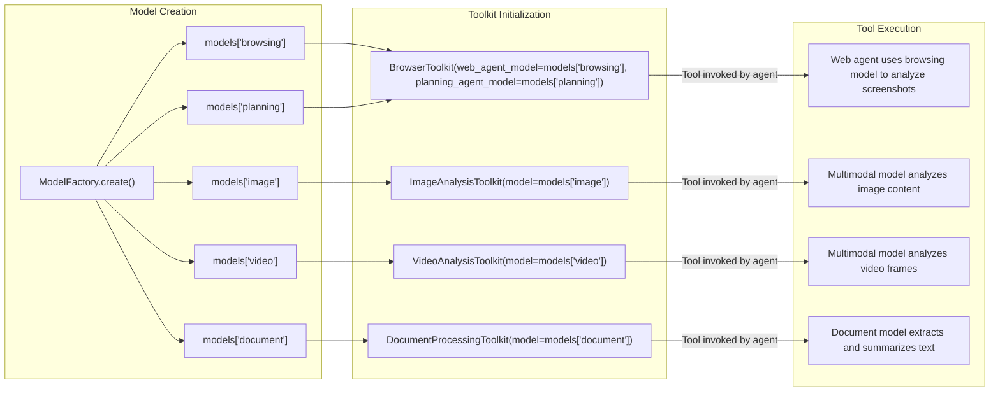
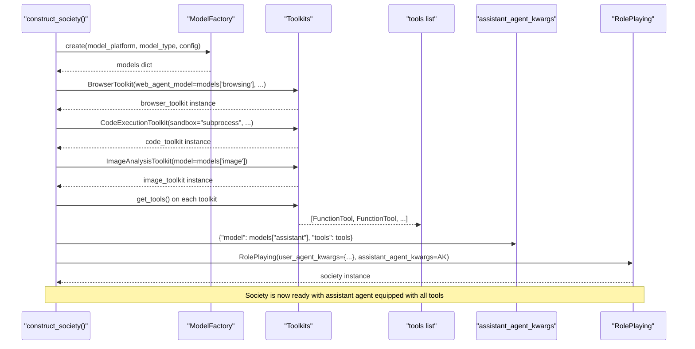
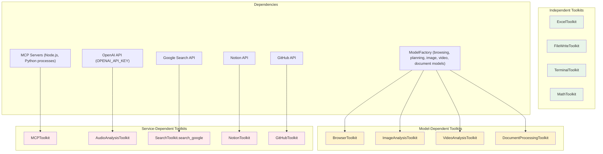

<!-- source: DeepWiki mcp.deepwiki.com · repo camel-ai/owl · page 5.1 Toolkit Architecture · fetched 2026-10-29 -->

# Toolkit Architecture

<details>
<summary>Relevant source files</summary>

The following files were used as context for generating this wiki page:

- [.gitignore](.gitignore)
- [README.md](README.md)
- [README_ja.md](README_ja.md)
- [README_zh.md](README_zh.md)
- [examples/run_gemini.py](examples/run_gemini.py)
- [examples/run_groq.py](examples/run_groq.py)
- [examples/run_mistral.py](examples/run_mistral.py)
- [examples/run_novita_ai.py](examples/run_novita_ai.py)
- [examples/run_openai_compatible_model.py](examples/run_openai_compatible_model.py)
- [examples/run_together_ai.py](examples/run_together_ai.py)
- [owl/assets/owl-favicon.ico](owl/assets/owl-favicon.ico)

</details>


This document explains the architectural patterns and integration mechanisms that enable toolkits to extend agent capabilities in OWL. It covers the `FunctionTool` abstraction, the `get_tools()` pattern, toolkit initialization, and the relationship between toolkits and models.

For details on specific toolkits (MCP, Browser, Document Processing, etc.), see their respective sections ([5.2](#5.2), [5.3](#5.3), etc.). For the overall execution pipeline that uses these toolkits, see [Execution Pipeline](#2.2).

## Core Abstraction: FunctionTool

All toolkits in OWL expose their capabilities as `FunctionTool` instances, which is CAMEL's standardized wrapper for tool calling. The `FunctionTool` class:

- Encapsulates function metadata (name, description, parameters schema)
- Handles serialization to OpenAI-compatible tool schemas
- Manages tool execution and error handling
- Provides a uniform interface for LLM-driven function calling

Agents receive a list of `FunctionTool` objects and invoke them by name during task execution. The toolkit architecture is designed to be modular—each toolkit independently produces `FunctionTool` instances without coupling to other system components.

**Sources**: [README.md:528-545](), [examples/run_mistral.py:82-86]()

## Toolkit Integration Pattern



**Toolkit Integration Architecture**: Shows how toolkits expose `FunctionTool` instances via `get_tools()` or as properties, which are aggregated into a flat list and passed to the assistant agent. The agent invokes tools by name during execution.

**Sources**: [examples/run_groq.py:102-118](), [examples/run_gemini.py:89-103](), [examples/run_mistral.py:162-166]()

## The `get_tools()` Pattern

Most toolkits implement the `get_tools()` method, which returns a list of `FunctionTool` instances. This method is called once during society construction:

```python
tools = [
    *BrowserToolkit(headless=False, web_agent_model=models["browsing"]).get_tools(),
    *CodeExecutionToolkit(sandbox="subprocess").get_tools(),
    *ImageAnalysisToolkit(model=models["image"]).get_tools(),
]
```

The unpacking operator `*` flattens each toolkit's list into the parent `tools` list. Some toolkits expose individual tools as properties instead:

```python
SearchToolkit().search_duckduckgo  # Returns single FunctionTool
SearchToolkit().search_google      # Returns single FunctionTool
```

This dual pattern exists because:
- Toolkits with multiple related tools (Browser, Excel, Document) use `get_tools()` for bulk access
- Toolkits with independent tools (Search) expose them individually for selective inclusion

**Sources**: [examples/run_groq.py:102-118](), [README.md:528-545]()

## Toolkit Configuration Categories

Toolkits fall into three configuration categories:

| Category | Characteristics | Examples | Configuration Parameters |
|----------|----------------|----------|-------------------------|
| **Self-Contained** | No external dependencies | `ExcelToolkit`, `FileWriteToolkit`, `TerminalToolkit` | Output directories, execution modes |
| **Model-Dependent** | Require LLM models for analysis | `BrowserToolkit`, `ImageAnalysisToolkit`, `VideoAnalysisToolkit`, `DocumentProcessingToolkit` | Model instances (browsing, planning, image, video, document) |
| **Service-Dependent** | Require API keys or external services | `MCPToolkit`, `AudioAnalysisToolkit`, `SearchToolkit` (Google) | API keys, server configurations, endpoints |

Configuration is passed during instantiation:

```python
# Model-dependent toolkit
BrowserToolkit(
    headless=False,
    web_agent_model=models["browsing"],
    planning_agent_model=models["planning"]
)

# Self-contained toolkit with configuration
CodeExecutionToolkit(sandbox="subprocess", verbose=True)

# Service-dependent toolkit
MCPToolkit(config_path="mcp_servers_config.json")
```

**Sources**: [examples/run_novita_ai.py:83-94](), [examples/run_together_ai.py:83-94]()

## Model-Dependent Toolkit Architecture



**Model-Dependent Toolkit Initialization Flow**: Specialized models are created via `ModelFactory` and injected into toolkits during construction. These models are invoked internally when the toolkit's tools are called by the agent.

Model-dependent toolkits require specialized models because:

- **BrowserToolkit**: Uses `web_agent_model` (multimodal) to interpret screenshots and `planning_agent_model` to decompose navigation tasks
- **ImageAnalysisToolkit**: Uses `image` model for visual understanding (descriptions, OCR, object detection)
- **VideoAnalysisToolkit**: Uses `video` model to analyze temporal sequences and extract frame-level information
- **DocumentProcessingToolkit**: Uses `document` model for text extraction, summarization, and semantic understanding

These models are typically more capable (GPT-4o, Claude 3.5 Sonnet, Gemini 2.5 Pro) or specialized (vision models) compared to the general assistant model. The toolkit architecture separates model allocation from tool invocation—models are injected at construction time, not at runtime.

**Sources**: [examples/run_groq.py:63-99](), [examples/run_novita_ai.py:49-80]()

## Toolkit Initialization Flow



**Toolkit Initialization Sequence**: The `construct_society()` function orchestrates model creation, toolkit instantiation, tool extraction, and agent configuration. This separation ensures toolkits are fully initialized before the conversation loop begins.

**Sources**: [examples/run_gemini.py:39-124](), [examples/run_together_ai.py:38-115]()

## Asynchronous Toolkit Initialization

Some toolkits (notably `MCPToolkit`) require asynchronous initialization to establish connections with external services:

```python
async def main():
    config_path = Path(__file__).parent / "mcp_servers_config.json"
    mcp_toolkit = MCPToolkit(config_path=str(config_path))
    
    try:
        await mcp_toolkit.connect()  # Async connection establishment
        
        tools = [
            *mcp_toolkit.get_tools(),
            *FileWriteToolkit().get_tools(),
            *CodeExecutionToolkit().get_tools(),
        ]
        society = await construct_society(task, tools)
        answer, chat_history, token_count = await arun_society(society)
    finally:
        await mcp_toolkit.disconnect()  # Cleanup
```

The async pattern follows this lifecycle:
1. **Instantiation**: `MCPToolkit(config_path=...)` creates the toolkit object
2. **Connection**: `await mcp_toolkit.connect()` establishes connections to MCP servers
3. **Tool Extraction**: `mcp_toolkit.get_tools()` returns `FunctionTool` instances for connected servers
4. **Execution**: Agent invokes tools; toolkit forwards calls to MCP servers
5. **Cleanup**: `await mcp_toolkit.disconnect()` closes connections

This pattern is necessary because MCP servers are external processes (Node.js servers, Python servers) that communicate via stdio or SSE. The toolkit manages server lifecycles, protocol translation, and connection pooling.

**Sources**: [examples/run_mistral.py:143-177]()

## Meta-Toolkit Pattern: MCPToolkit

`MCPToolkit` implements a meta-toolkit pattern—it's a toolkit that dynamically generates tools from external services. Unlike standard toolkits that expose fixed functionality, `MCPToolkit`:

1. Reads server definitions from `mcp_servers_config.json`
2. Spawns external MCP server processes
3. Queries each server for its available tools via the MCP protocol
4. Dynamically creates `FunctionTool` wrappers for each server's tools
5. Returns the aggregated tool list via `get_tools()`

This enables integration with any MCP-compatible server without modifying OWL code:

```json
{
  "mcpServers": {
    "playwright": {
      "command": "npx",
      "args": ["-y", "@executeautomation/playwright-mcp-server"]
    },
    "fetch": {
      "command": "python",
      "args": ["-m", "mcp_server_fetch"]
    }
  }
}
```

Each server's tools appear as regular `FunctionTool` instances to the agent. When invoked, `MCPToolkit` forwards the call to the appropriate server, handles serialization/deserialization, and returns results. This architecture allows the toolkit ecosystem to extend indefinitely without code changes.

**Sources**: [examples/run_mistral.py:14-72](), [examples/run_mistral.py:144-149](), [README.md:490-517]()

## Toolkit Dependency Graph



**Toolkit Dependency Categories**: Toolkits are categorized by their external dependencies. Green toolkits require only built-in Python libraries, yellow toolkits require model injection, and red toolkits require external API keys or service connections.

This dependency architecture enables:
- **Progressive Enhancement**: Basic functionality works with self-contained toolkits; advanced features require models or services
- **Selective Activation**: Users only configure toolkits they need by including/excluding them from the tools list
- **Fail-Safe Degradation**: Missing dependencies for one toolkit don't affect others

**Sources**: [README.md:549-562](), [examples/run_groq.py:102-118]()

## Toolkit Selection Strategy

The `tools` list passed to the assistant agent determines available capabilities. Typical selection patterns:

| Pattern | Use Case | Example |
|---------|----------|---------|
| **Minimal** | LLM-only tasks (reasoning, text generation) | `[]` (no tools) |
| **Web-Focused** | Research, data gathering | `BrowserToolkit`, `SearchToolkit`, `DocumentProcessingToolkit` |
| **Data Analysis** | Spreadsheets, visualization | `ExcelToolkit`, `CodeExecutionToolkit`, `FileWriteToolkit` |
| **Multimodal** | Image/video processing | `ImageAnalysisToolkit`, `VideoAnalysisToolkit`, `AudioAnalysisToolkit` |
| **Full-Featured** | Complex multi-step tasks | All toolkits (as shown in `run.py` examples) |

Selection considerations:
- **Token Budget**: More tools increase prompt size and reduce context window for conversation
- **Latency**: Tool-heavy configurations increase agent decision time
- **Error Surface**: Each toolkit introduces potential failure modes
- **Cost**: Some toolkits (AudioAnalysisToolkit) consume API credits per invocation

Optimal selection balances capability breadth against performance and cost constraints.

**Sources**: [examples/run_groq.py:102-118](), [README.md:564-583]()

---

