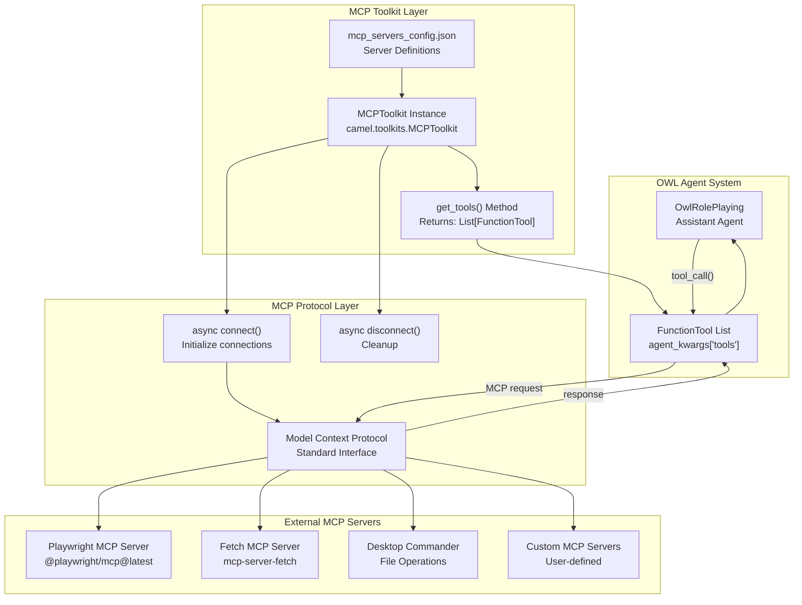
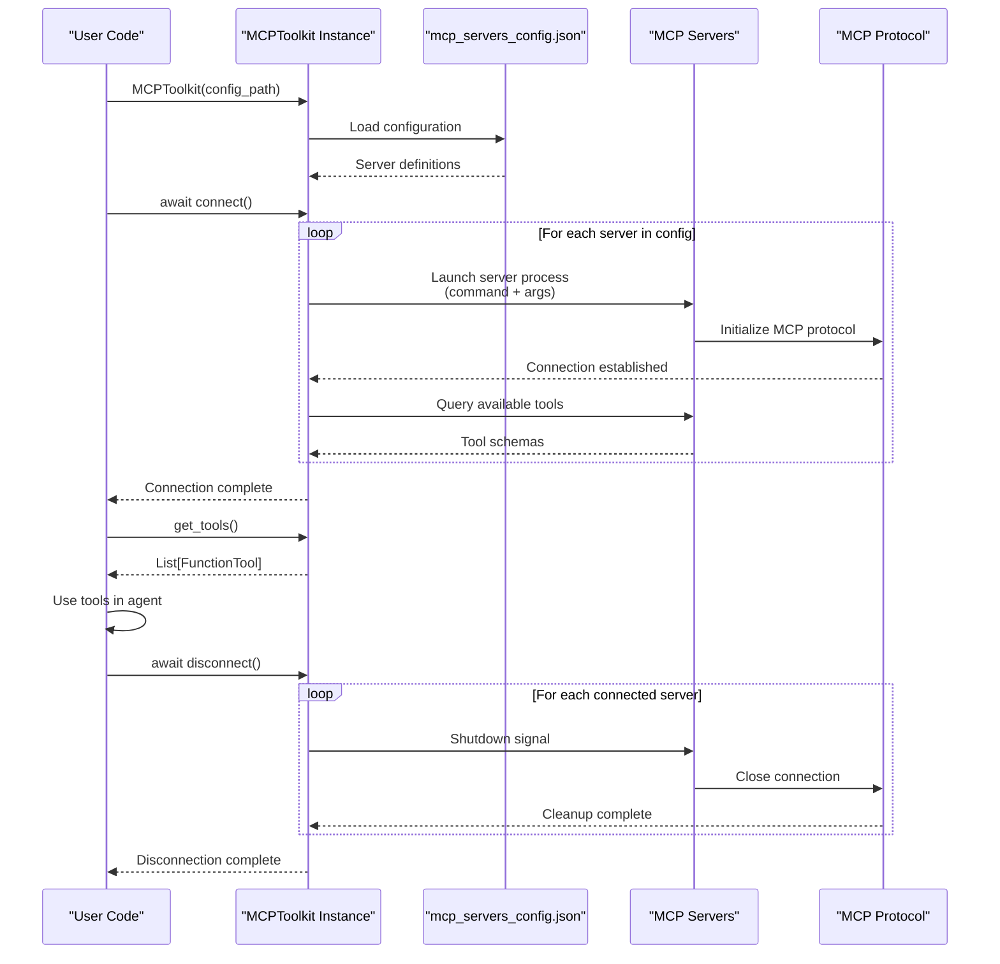
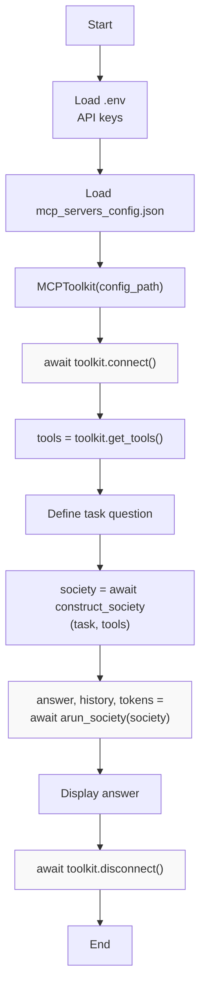

<!-- source: DeepWiki mcp.deepwiki.com · repo camel-ai/owl · page 5.2 MCP Toolkit · fetched 2026-10-29 -->

# MCP Toolkit

<details>
<summary>Relevant source files</summary>

The following files were used as context for generating this wiki page:

- [examples/mcp_servers_config.json](examples/mcp_servers_config.json)
- [examples/run_mcp.py](examples/run_mcp.py)
- [owl/utils/__init__.py](owl/utils/__init__.py)

</details>


## Purpose and Scope

The MCP Toolkit provides integration with the Model Context Protocol (MCP), enabling OWL agents to interact with external MCP-compliant servers. Unlike standard toolkits that implement specific functionality directly, the MCP Toolkit follows a **meta-toolkit pattern**—it dynamically exposes tools from external MCP servers as `FunctionTool` instances that can be used by OWL agents.

This document covers:
- MCP Toolkit architecture and the meta-toolkit pattern
- Configuration via `mcp_servers_config.json`
- Connection lifecycle management
- Integration with OWL agents
- Common MCP servers (Playwright, Fetch, Desktop Commander)

For general toolkit architecture concepts, see [Toolkit Architecture](#5.1). For specific toolkit implementations like Browser and Search, see [Browser & Search Toolkits](#5.3).

**Sources:** [examples/run_mcp.py:14-73]()

## Architecture Overview

The MCP Toolkit acts as a bridge between OWL agents and external MCP servers, implementing a meta-toolkit pattern where the toolkit itself does not provide functionality directly but instead proxies tools from external services.

### Meta-Toolkit Pattern



**Diagram: MCP Toolkit Architecture showing the meta-toolkit pattern where external MCP servers expose tools through a unified protocol**

The key architectural insight is that `MCPToolkit` does not implement tools itself. Instead, it:
1. Reads server definitions from configuration
2. Establishes connections to external MCP servers
3. Queries servers for their available tools
4. Wraps MCP tools as CAMEL `FunctionTool` instances
5. Provides these tools to OWL agents

**Sources:** [examples/run_mcp.py:86](), [examples/run_mcp.py:145-149]()

## Configuration Format

MCP servers are defined in `mcp_servers_config.json`, which specifies how to launch and connect to each server.

### Configuration Structure

```json
{
  "mcpServers": {
    "<server_name>": {
      "command": "<executable>",
      "args": ["<arg1>", "<arg2>", ...]
    }
  }
}
```

### Configuration Fields

| Field | Type | Description |
|-------|------|-------------|
| `mcpServers` | Object | Root object containing all server definitions |
| `<server_name>` | String (key) | Unique identifier for the MCP server |
| `command` | String | Executable command to launch the server (e.g., `npx`, `python`) |
| `args` | Array[String] | Command-line arguments passed to the executable |

### Example: Playwright MCP Server

```json
{
  "mcpServers": {
    "playwright": {
      "command": "npx",
      "args": [
        "@playwright/mcp@latest"
      ]
    }
  }
}
```

This configuration tells the MCP Toolkit to:
1. Use `npx` as the executable
2. Pass `@playwright/mcp@latest` as the argument
3. Launch the Playwright MCP server when `connect()` is called
4. Identify this server as "playwright"

**Sources:** [examples/mcp_servers_config.json:1-10]()

### Common MCP Server Configurations

| Server | Command | Args | Purpose |
|--------|---------|------|---------|
| Playwright | `npx` | `[@playwright/mcp@latest]` | Browser automation |
| Fetch | `python` | `[-m, mcp_server_fetch]` | Web content retrieval |
| Desktop Commander | `npx` | `[@executeautomation/playwright-mcp-server]` | File operations (restricted directories) |

**Sources:** [examples/run_mcp.py:26-57]()

## Connection Lifecycle

The MCP Toolkit manages asynchronous connections to external servers with explicit lifecycle management.

### Connection Flow



**Diagram: MCP Toolkit connection lifecycle showing async initialization and cleanup**

### Initialization Pattern

```python
# Initialize with configuration path
config_path = Path(__file__).parent / "mcp_servers_config.json"
mcp_toolkit = MCPToolkit(config_path=str(config_path))

try:
    # Connect to all configured servers
    await mcp_toolkit.connect()
    
    # Get tools exposed by servers
    tools = [*mcp_toolkit.get_tools()]
    
    # Use tools with agents
    # ...
    
finally:
    # Always disconnect to cleanup resources
    await mcp_toolkit.disconnect()
```

The lifecycle pattern ensures:
- **Lazy initialization**: Servers are not launched until `connect()` is called
- **Resource cleanup**: `disconnect()` terminates server processes and closes connections
- **Exception safety**: Use `try/finally` to guarantee cleanup even on errors

**Sources:** [examples/run_mcp.py:145-171]()

## Integration with OWL Agents

MCP tools are provided to OWL agents through the standard toolkit integration pattern.

### Agent Integration Pattern

```mermaid
graph LR
    subgraph "Setup Phase"
        ConfigFile["mcp_servers_config.json"]
        MCPInit["MCPToolkit(config_path)"]
        Connect["await toolkit.connect()"]
        GetTools["toolkit.get_tools()"]
    end
    
    subgraph "Agent Construction"
        ToolsList["tools: List[FunctionTool]"]
        Society["construct_society(question, tools)"]
        AssistKwargs["assistant_agent_kwargs<br/>{model, tools}"]
    end
    
    subgraph "Execution Phase"
        OwlRP["OwlRolePlaying Instance"]
        RunSociety["arun_society(society)"]
        Assistant["Assistant Agent<br/>with MCP tools"]
    end
    
    ConfigFile --> MCPInit
    MCPInit --> Connect
    Connect --> GetTools
    GetTools --> ToolsList
    
    ToolsList --> Society
    Society --> AssistKwargs
    AssistKwargs --> OwlRP
    OwlRP --> RunSociety
    RunSociety --> Assistant
```



**Diagram: Integration flow from MCP configuration to agent execution**

### Code Example

The following pattern from [examples/run_mcp.py:99-140]() demonstrates MCP toolkit integration:

```python
async def construct_society(
    question: str,
    tools: List[FunctionTool],
) -> OwlRolePlaying:
    models = {
        "user": ModelFactory.create(
            model_platform=ModelPlatformType.OPENAI,
            model_type=ModelType.GPT_4O,
            model_config_dict={"temperature": 0},
        ),
        "assistant": ModelFactory.create(
            model_platform=ModelPlatformType.OPENAI,
            model_type=ModelType.GPT_4O,
            model_config_dict={"temperature": 0},
        ),
    }

    user_agent_kwargs = {"model": models["user"]}
    assistant_agent_kwargs = {
        "model": models["assistant"],
        "tools": tools,  # MCP tools passed here
    }

    society = OwlRolePlaying(
        task_prompt=question,
        with_task_specify=False,
        user_role_name="user",
        user_agent_kwargs=user_agent_kwargs,
        assistant_role_name="assistant",
        assistant_agent_kwargs=assistant_agent_kwargs,
    )
    return society
```

Key integration points:
- **Tool injection**: MCP tools are passed via `assistant_agent_kwargs['tools']`
- **Model selection**: GPT-4o is used for both agents with temperature=0 for deterministic behavior
- **Role separation**: User agent provides instructions; assistant agent has access to MCP tools
- **Task specification**: `with_task_specify=False` uses the question directly without modification

**Sources:** [examples/run_mcp.py:99-140]()

## Complete Usage Example

The full usage pattern combines configuration, connection, agent construction, and execution.

### End-to-End Flow



**Diagram: Complete MCP toolkit usage flow from initialization to cleanup**

### Implementation

The complete example from [examples/run_mcp.py:143-175]():

```python
async def main():
    # 1. Load configuration
    config_path = Path(__file__).parent / "mcp_servers_config.json"
    mcp_toolkit = MCPToolkit(config_path=str(config_path))

    try:
        # 2. Connect to MCP servers
        await mcp_toolkit.connect()

        # 3. Define task
        default_task = (
            "I'd like a academic report about Andrew Ng, including "
            "his research direction, published papers (At least 3),"
            " institutions, etc. "
        )
        task = sys.argv[1] if len(sys.argv) > 1 else default_task

        # 4. Get tools and construct society
        tools = [*mcp_toolkit.get_tools()]
        society = await construct_society(task, tools)
        
        # 5. Execute task
        answer, chat_history, token_count = await arun_society(society)
        print(f"\033[94mAnswer: {answer}\033[0m")

    finally:
        # 6. Cleanup
        try:
            await mcp_toolkit.disconnect()
        except Exception:
            print("Disconnect failed")
```

**Execution Notes:**
- **Async context**: All operations are async and require `asyncio.run(main())`
- **Command-line override**: Task can be specified via `sys.argv[1]`
- **Error handling**: Disconnect is wrapped in try/except to handle cleanup failures gracefully
- **Output formatting**: Answer is displayed with ANSI color codes for visibility

**Sources:** [examples/run_mcp.py:143-175](), [examples/run_mcp.py:174-175]()

## Common MCP Servers

### Playwright MCP Server

**Purpose**: Browser automation and web interaction

**Installation**:
```bash
npm install -g @executeautomation/playwright-mcp-server
npx playwright install-deps
```

**Configuration**:
```json
{
  "mcpServers": {
    "playwright": {
      "command": "npx",
      "args": ["-y", "@executeautomation/playwright-mcp-server"]
    }
  }
}
```

**Capabilities**:
- Navigate to URLs
- Click elements
- Fill forms
- Extract page content
- Take screenshots
- Execute JavaScript

**Sources:** [examples/run_mcp.py:26-41]()

### Fetch MCP Server

**Purpose**: HTTP requests and web content retrieval

**Installation**:
```bash
pip install mcp-server-fetch
```

**Configuration**:
```json
{
  "mcpServers": {
    "fetch": {
      "command": "python",
      "args": ["-m", "mcp_server_fetch"]
    }
  }
}
```

**Capabilities**:
- HTTP GET/POST requests
- Headers management
- Response parsing
- Content type handling

**Sources:** [examples/run_mcp.py:43-57]()

### Desktop Commander MCP Server

**Purpose**: File system operations with security restrictions

**Configuration**: Uses same command as Playwright in some configurations

**Capabilities**:
- Read files from configured directories
- Write files to allowed paths
- List directory contents
- File operations (restricted to safe directories)

**Security Note**: All file operations are restricted to directories specified in the server configuration, preventing unauthorized access.

**Sources:** [examples/run_mcp.py:62-63]()

## Comparison with Direct Toolkits

| Aspect | MCP Toolkit | Direct Toolkits (e.g., BrowserToolkit) |
|--------|-------------|---------------------------------------|
| **Implementation** | Proxies external servers | Implements functionality directly |
| **Tool Source** | External MCP servers | Python code in toolkit |
| **Configuration** | JSON config file | Python parameters |
| **Process Model** | External processes | In-process execution |
| **Extensibility** | Add any MCP-compliant server | Modify toolkit code |
| **Latency** | IPC overhead | Direct function calls |
| **Isolation** | Process boundary security | Same process as agent |
| **Dependencies** | Server-specific (npm, pip) | Python packages only |

The MCP Toolkit is ideal when:
- Using third-party MCP servers (Playwright, Fetch, etc.)
- Requiring process isolation for security
- Integrating with external systems that expose MCP interfaces
- Needing language-agnostic tool integration (Node.js servers, etc.)

Direct toolkits are preferred when:
- Performance is critical (no IPC overhead)
- Functionality is stable and well-defined
- Deep Python integration is required
- Process boundaries are unnecessary

**Sources:** [examples/run_mcp.py:14-73]()

## Error Handling and Best Practices

### Connection Management

```python
# RECOMMENDED: Always use try/finally
mcp_toolkit = MCPToolkit(config_path=str(config_path))
try:
    await mcp_toolkit.connect()
    tools = mcp_toolkit.get_tools()
    # Use tools...
finally:
    try:
        await mcp_toolkit.disconnect()
    except Exception as e:
        print(f"Disconnect failed: {e}")
```

**Rationale**: MCP servers are external processes. Even if the main task fails, cleanup must be attempted to:
- Terminate server processes
- Close network connections
- Free system resources
- Prevent zombie processes

### Logging

Enable debug logging to troubleshoot MCP server issues:

```python
from camel.logger import set_log_level
set_log_level(level="DEBUG")
```

This provides visibility into:
- Server launch commands
- Connection establishment
- Tool discovery
- MCP protocol messages

**Sources:** [examples/run_mcp.py:147-171](), [examples/run_mcp.py:96]()

## Summary

The MCP Toolkit implements a meta-toolkit pattern, enabling OWL agents to interact with external MCP-compliant servers. Key characteristics:

- **Configuration-driven**: Servers defined in `mcp_servers_config.json`
- **Async lifecycle**: Explicit `connect()`/`disconnect()` management
- **Protocol abstraction**: MCP tools exposed as `FunctionTool` instances
- **Process isolation**: External servers run in separate processes
- **Extensible**: Any MCP-compliant server can be integrated

The toolkit bridges OWL's agent system with the broader MCP ecosystem, enabling integration with tools implemented in any language (JavaScript, Python, etc.) that supports the Model Context Protocol.

**Sources:** [examples/run_mcp.py:1-176](), [examples/mcp_servers_config.json:1-10]()

---

