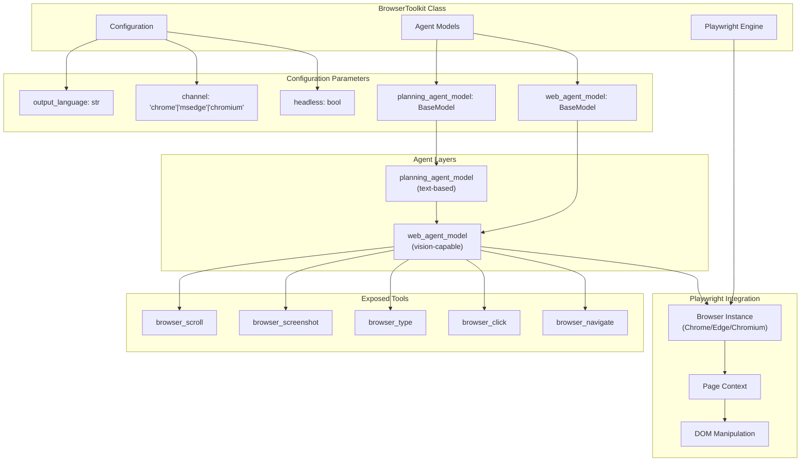
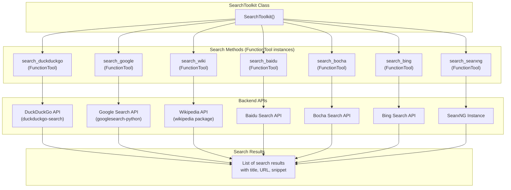
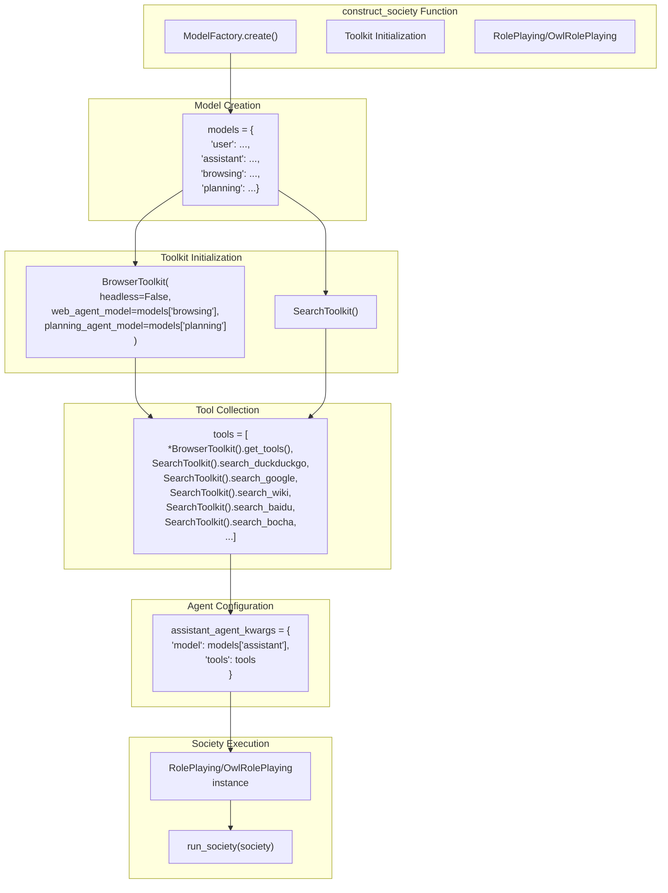

<!-- source: DeepWiki mcp.deepwiki.com · repo camel-ai/owl · page 5.3 Browser & Search Toolkits · fetched 2026-10-29 -->

# Browser & Search Toolkits

<details>
<summary>Relevant source files</summary>

The following files were used as context for generating this wiki page:

- [.gitignore](.gitignore)
- [README.md](README.md)
- [README_ja.md](README_ja.md)
- [README_zh.md](README_zh.md)
- [examples/run_gemini.py](examples/run_gemini.py)
- [examples/run_groq.py](examples/run_groq.py)
- [examples/run_mistral.py](examples/run_mistral.py)
- [examples/run_novita_ai.py](examples/run_novita_ai.py)
- [examples/run_openai_compatible_model.py](examples/run_openai_compatible_model.py)
- [examples/run_together_ai.py](examples/run_together_ai.py)
- [owl/assets/owl-favicon.ico](owl/assets/owl-favicon.ico)

</details>


This document covers the browser automation and search capabilities provided by `BrowserToolkit` and `SearchToolkit` within the OWL framework. These toolkits enable agents to interact with web browsers and perform search operations across multiple search engines.

## Overview

The Browser & Search Toolkits provide two complementary capabilities for web interaction:

- **`BrowserToolkit`**: Playwright-based browser automation toolkit that uses dedicated LLM agents for web navigation tasks. Supports Chrome, Edge, and Chromium browsers with both headless and GUI modes.
- **`SearchToolkit`**: Direct API integration with multiple search engines (DuckDuckGo, Google, Wikipedia, Baidu, Bocha, Bing, SearxNG) without requiring browser automation.

Both toolkits are part of the CAMEL-AI toolkit ecosystem and integrate seamlessly with the OWL multi-agent framework. The toolkits follow the standard `get_tools()` pattern for integration with agent instances.

**Sources:** [README.md:189](), [README.md:187](), [README.md:165]()

## BrowserToolkit Architecture

The `BrowserToolkit` implements a Playwright-based web automation system that uses dedicated LLM agents for web navigation and planning tasks.

### Core Components and Flow

**BrowserToolkit Component Architecture**



**Agent Model Responsibilities**

The `BrowserToolkit` requires two specialized models for operation:

| Model Parameter | Variable Name | Purpose | Model Capability Requirement |
|-----------------|---------------|---------|----------------------------|
| `web_agent_model` | `web_agent_model` | Handles direct browser interactions, DOM analysis, and visual element identification | **Vision-capable LLM** for screenshot analysis and visual understanding |
| `planning_agent_model` | `planning_agent_model` | Plans navigation strategies, decomposes complex web tasks into steps | Text-based LLM with strong reasoning capabilities |

**Sources:** [examples/run_gemini.py:84-94](), [examples/run_novita_ai.py:84-88](), [examples/run_groq.py:103-107](), [README.md:165-166]()

### Configuration Options

The `BrowserToolkit` constructor accepts the following parameters:

| Parameter | Type | Default | Description | Example Values |
|-----------|------|---------|-------------|----------------|
| `headless` | `bool` | `True` | Run browser in headless mode (no GUI) for server/Docker environments | `True`, `False` |
| `channel` | `str` | `"chrome"` | Browser channel to use with Playwright | `"chrome"`, `"msedge"`, `"chromium"` |
| `web_agent_model` | `BaseModel` | **Required** | Vision-capable model for web interaction tasks | GPT-4o, Qwen-VL-Max, Gemini 2.5 Pro |
| `planning_agent_model` | `BaseModel` | **Required** | Text model for task planning and decomposition | GPT-4o, Qwen-Max, Gemini 2.5 Pro |
| `output_language` | `str` | `"English"` | Language for internal agent communications | `"English"`, `"Chinese"`, `"Japanese"` |

**Typical Configuration Pattern:**

```python
# From OWL example implementations
BrowserToolkit(
    headless=False,  # Set to True for headless mode (e.g., on remote servers)
    web_agent_model=models["browsing"],
    planning_agent_model=models["planning"],
).get_tools()
```

**Browser Channel Support:**

The `channel` parameter determines which browser engine Playwright will use. Enhanced in March 2025 to support multiple browser options beyond Chrome.

**Sources:** [examples/run_gemini.py:90-94](), [examples/run_groq.py:103-107](), [examples/run_novita_ai.py:84-88](), [README.md:165-166]()

## SearchToolkit Architecture

The `SearchToolkit` provides direct API integration with multiple search engines through dedicated search methods. Each method is exposed as a standalone `FunctionTool` that can be added to an agent's toolkit.

### Search Engine Integration Map

**SearchToolkit Method Dispatch**



### Available Search Methods

| Method Name | Search Engine | API Key Required | Python Dependency | Primary Use Case |
|-------------|---------------|------------------|-------------------|------------------|
| `search_duckduckgo` | DuckDuckGo | No | `duckduckgo-search` | Privacy-focused general search |
| `search_google` | Google Search | Yes | `googlesearch-python` | Comprehensive web search with ranking |
| `search_wiki` | Wikipedia | No | `wikipedia` | Encyclopedic knowledge queries |
| `search_baidu` | Baidu | No | Built-in | Chinese language web search |
| `search_bocha` | Bocha | No | Built-in | Alternative Chinese search |
| `search_bing` | Bing | Optional | Built-in | Microsoft's search engine |
| `search_searxng` | SearxNG | No | Built-in | Meta-search engine (privacy-focused) |

**Integration Timeline:**
- Core search methods (DuckDuckGo, Google, Wikipedia) available from initial release
- Baidu search added March 16, 2025
- Bocha search added March 12, 2025
- Bing search added March 16, 2025
- SearxNG integration added March 27, 2025

**Sources:** [README.md:187](), [README.md:164](), [README.md:169-170](), [README.md:127](), [examples/run_gemini.py:97-99]()

## Integration Patterns

### Multi-Agent Society Integration

Both toolkits integrate into OWL societies through the standard toolkit pattern used by CAMEL-AI.

**Toolkit Integration Flow in OWL Societies**



### Common Usage Pattern

The typical integration pattern combines both toolkits in a single agent configuration:

```python
# From examples/run_gemini.py and similar files
def construct_society(question: str) -> RolePlaying:
    # 1. Create specialized models
    models = {
        "user": ModelFactory.create(...),
        "assistant": ModelFactory.create(...),
        "browsing": ModelFactory.create(...),  # Vision-capable for BrowserToolkit
        "planning": ModelFactory.create(...),  # For task decomposition
    }
    
    # 2. Initialize and combine toolkits
    tools = [
        # BrowserToolkit returns multiple FunctionTool instances
        *BrowserToolkit(
            headless=False,
            web_agent_model=models["browsing"],
            planning_agent_model=models["planning"],
        ).get_tools(),
        
        # SearchToolkit methods are individual FunctionTool instances
        SearchToolkit().search_duckduckgo,
        SearchToolkit().search_google,
        SearchToolkit().search_wiki,
        SearchToolkit().search_baidu,
        SearchToolkit().search_bocha,
        # ... other tools
    ]
    
    # 3. Configure assistant agent with tools
    assistant_agent_kwargs = {
        "model": models["assistant"],
        "tools": tools
    }
    
    # 4. Create society
    society = RolePlaying(
        task_prompt=question,
        with_task_specify=False,
        user_role_name="user",
        user_agent_kwargs={"model": models["user"]},
        assistant_role_name="assistant",
        assistant_agent_kwargs=assistant_agent_kwargs,
    )
    
    return society
```

**Key Integration Points:**

1. **`BrowserToolkit().get_tools()`**: Returns a list of `FunctionTool` objects, unpacked with `*`
2. **`SearchToolkit().<method_name>`**: Each search method is a direct `FunctionTool` reference
3. **Agent Configuration**: Tools are passed to the assistant agent through `assistant_agent_kwargs["tools"]`
4. **Model Specialization**: Browser toolkit receives dedicated vision and planning models

**Sources:** [examples/run_gemini.py:39-124](), [examples/run_novita_ai.py:38-115](), [examples/run_groq.py:52-139](), [examples/run_together_ai.py:38-115]()

## Model Requirements

### BrowserToolkit Model Specifications

The `BrowserToolkit` requires vision-capable models for the web agent to analyze screenshots and DOM structures:

| Model Platform | Web Agent Model Type | Planning Agent Model Type | Configuration Example |
|----------------|---------------------|--------------------------|----------------------|
| OpenAI | `ModelType.GPT_4O` | `ModelType.GPT_4O` | [examples/run.py:49-69]() |
| Qwen | `ModelType.QWEN_VL_MAX` | `ModelType.QWEN_MAX` | [examples/run_openai_compatible_model.py:68-88]() |
| Qwen (native) | `ModelType.QWEN_VL_MAX` | `ModelType.QWEN_MAX` | Similar to OpenAI-compatible |
| Gemini | `ModelType.GEMINI_2_5_PRO_EXP` | `ModelType.GEMINI_2_5_PRO_EXP` | [examples/run_gemini.py:61-85]() |
| Groq | `ModelType.GROQ_LLAMA_3_3_70B` | `ModelType.GROQ_LLAMA_3_3_70B` | [examples/run_groq.py:74-82]() |
| Together AI | `ModelType.TOGETHER_LLAMA_4_MAVERICK` | `ModelType.TOGETHER_LLAMA_4_MAVERICK` | [examples/run_together_ai.py:60-68]() |
| Novita AI | `ModelType.NOVITA_LLAMA_4_SCOUT_17B` | `ModelType.NOVITA_LLAMA_4_SCOUT_17B` | [examples/run_novita_ai.py:60-68]() |

**Critical Requirement:** The `web_agent_model` **must** be vision-capable (multimodal) to process screenshots and visual elements. The `planning_agent_model` can be text-only but should have strong reasoning capabilities.

### SearchToolkit Model Requirements

The `SearchToolkit` does not require specific models as it performs direct API calls to search engines without model inference. The toolkit methods return raw search results that are then processed by the consuming agent.

**Agent Model Requirements:**
- The assistant agent using `SearchToolkit` methods should have strong text comprehension to process search results
- No vision capabilities required for search operations
- Model must be capable of tool calling to invoke search methods

**Sources:** [examples/run_gemini.py:61-85](), [examples/run_groq.py:64-98](), [examples/run_openai_compatible_model.py:54-88](), [examples/run_novita_ai.py:49-79]()

## Deployment Considerations

### BrowserToolkit Deployment Modes

**Headless vs. GUI Mode**

The `BrowserToolkit` supports both modes of operation with different deployment contexts:

| Mode | `headless` Value | Use Case | Environment | Considerations |
|------|-----------------|----------|-------------|----------------|
| **GUI Mode** | `False` | Development, debugging, local testing | Local machine with display | Browser window visible for observation |
| **Headless Mode** | `True` | Production, Docker, CI/CD, remote servers | Server environments without display | Requires `xvfb` on Linux servers |

**Docker Deployment with Headless Browser:**

When running OWL in Docker containers, headless browser support is provided through `xvfb` (X virtual framebuffer):

```bash
# From Docker deployment instructions
xvfb-python examples/run.py
```

The Docker setup includes Playwright dependencies and `xvfb` for headless browser automation.

**Playwright Installation Requirements:**

```bash
# Install Playwright browser dependencies
npx playwright install-deps
```

### Search Engine API Requirements

| Search Engine | API Key Required | Environment Variable | Python Package | Notes |
|---------------|------------------|---------------------|----------------|-------|
| DuckDuckGo | No | - | `duckduckgo-search` | Always available |
| Google Search | Yes | `GOOGLE_API_KEY` | `googlesearch-python` | Requires API quota setup |
| Wikipedia | No | - | `wikipedia` | Always available |
| Baidu | No | - | Built-in | Always available |
| Bocha | No | - | Built-in | Always available |
| Bing | Optional | `BING_API_KEY` | Built-in | Can work without key |
| SearxNG | No | - | Built-in | Requires SearxNG instance URL |

**API Key Configuration:**

For services requiring API keys, set them in the `.env` file:

```bash
GOOGLE_API_KEY=your-google-api-key-here
BING_API_KEY=your-bing-api-key-here
```

### Language Support and Localization

Both toolkits support multilingual operations:

**BrowserToolkit Language Configuration:**
- `output_language` parameter controls internal agent communication language
- Affects prompt templates and agent-to-agent messages
- Does not affect web page content language

**SearchToolkit Language Optimization:**
- `search_baidu`: Optimized for Chinese language queries
- `search_bocha`: Optimized for Chinese language queries  
- `search_wiki`: Returns results in the query language
- `search_duckduckgo`, `search_google`: Multi-language support

**Example Language Configuration:**

```python
# Chinese language configuration
BrowserToolkit(
    headless=False,
    web_agent_model=models["browsing"],
    planning_agent_model=models["planning"],
    output_language="Chinese",
).get_tools()
```

**Sources:** [README.md:304-305](), [README.md:495-516](), [examples/run_gemini.py:90-94](), [README.md:169-170]()

## Error Handling and Limitations

### BrowserToolkit Limitations

- Requires vision-capable models for screenshot analysis
- Browser automation may be blocked by anti-bot measures
- Headless mode limitations on certain interactive elements

### SearchToolkit Limitations

- Google Search requires API quotas and billing setup
- Search result quality varies by engine
- Rate limiting may apply to certain search engines

**Sources:** [examples/run_gemini.py:98](), [examples/run_openai_compatible_model.py:101]()

---

