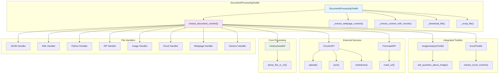
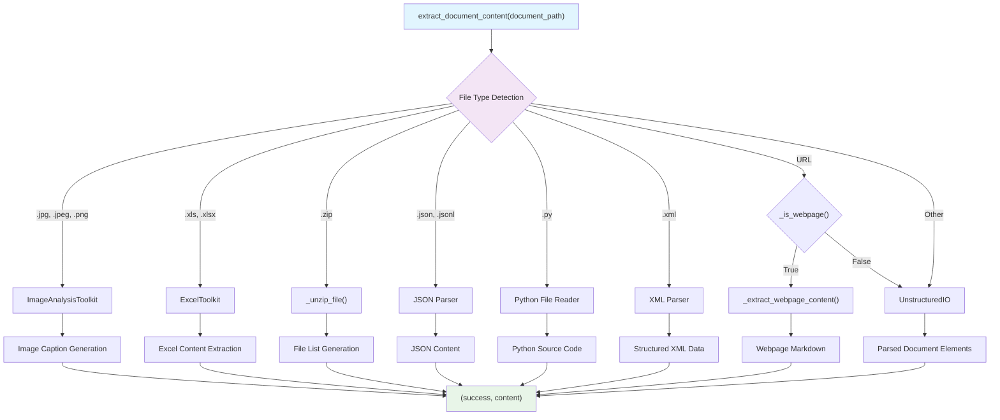
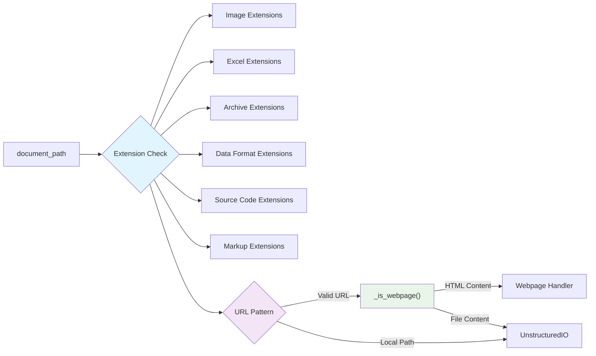
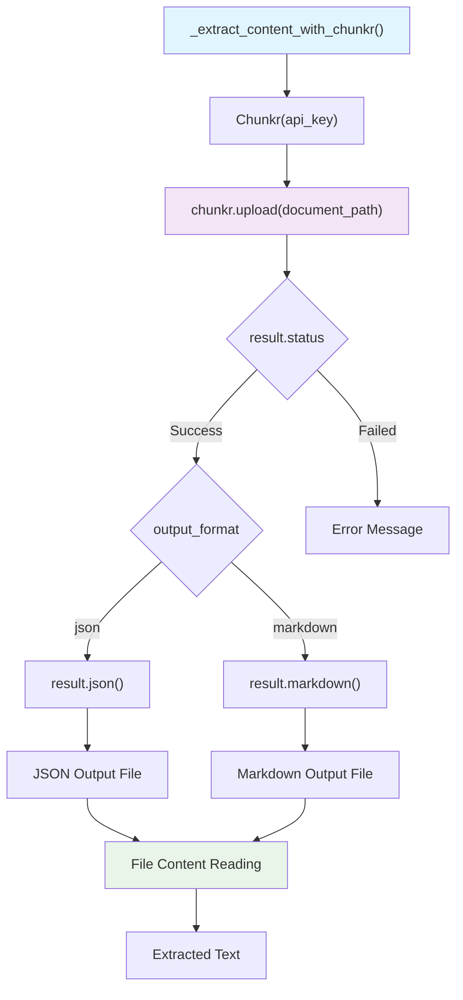
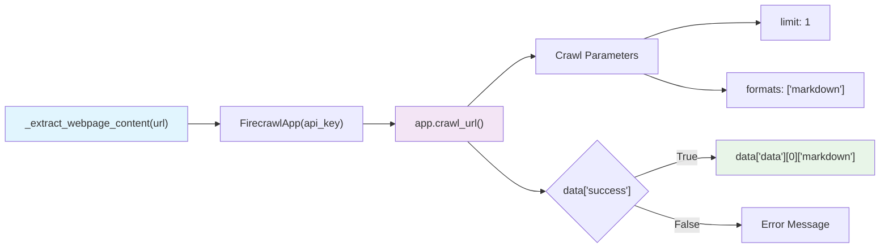
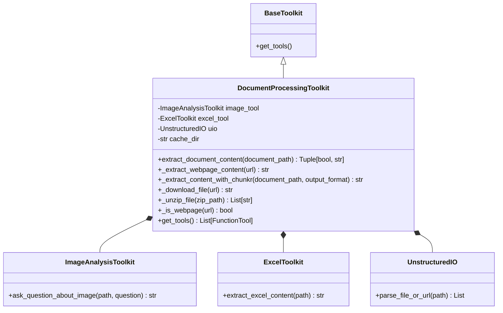
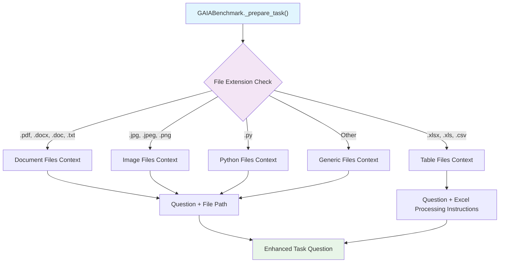

<!-- source: DeepWiki mcp.deepwiki.com · repo camel-ai/owl · page 5.4 Document Processing Toolkit · fetched 2026-10-29 -->

# Document Processing Toolkit

Relevant source files

The following files were used as context for generating this wiki page:

- [owl/utils/document_toolkit.py](owl/utils/document_toolkit.py)
- [owl/utils/gaia.py](owl/utils/gaia.py)

## Purpose and Scope

The Document Processing Toolkit provides comprehensive document extraction and content processing capabilities for agents within the OWL framework. This toolkit enables agents to automatically extract, parse, and analyze content from a wide variety of document formats including PDFs, Word documents, images, Excel files, web pages, and structured data files.

For information about web browsing and search capabilities, see [Browser & Search Toolkits](#5.1). For MCP-based external tool integration, see [MCP Toolkit](#5.3). For other specialized toolkits like code execution and file operations, see [Other Toolkits](#5.4).

## Architecture Overview

The Document Processing Toolkit is implemented as a centralized processing system that delegates specialized tasks to appropriate sub-toolkits and external services.

### System Architecture

Sources: [owl/utils/document_toolkit.py:39-290]()

### Processing Flow

Sources: [owl/utils/document_toolkit.py:58-150]()

## Supported File Formats

The DocumentProcessingToolkit supports a comprehensive range of file formats through different processing strategies:

| Format Category | Extensions | Processing Method | Handler |
|-----------------|------------|-------------------|---------|
| Images | `.jpg`, `.jpeg`, `.png` | Vision model analysis | `ImageAnalysisToolkit` |
| Spreadsheets | `.xls`, `.xlsx` | Structured extraction | `ExcelToolkit` |
| Archives | `.zip` | File extraction | `_unzip_file()` |
| Structured Data | `.json`, `.jsonl`, `.jsonld` | JSON parsing | Built-in parser |
| Source Code | `.py` | Raw text extraction | File reader |
| Markup | `.xml` | XML parsing with fallback | `xmltodict` |
| Web Content | URLs | Web scraping | `FirecrawlApp` |
| Documents | `.pdf`, `.docx`, `.txt`, etc. | Universal parsing | `UnstructuredIO` |

Sources: [owl/utils/document_toolkit.py:74-149]()

### File Type Detection Logic

Sources: [owl/utils/document_toolkit.py:74-149](), [owl/utils/document_toolkit.py:151-179]()

## External Service Integration

### Chunkr API Integration

The toolkit integrates with Chunkr for advanced document processing with support for both JSON and Markdown output formats.

Sources: [owl/utils/document_toolkit.py:180-217]()

### Firecrawl Web Scraping

For webpage content extraction, the toolkit uses Firecrawl to convert web pages into structured markdown format.

Sources: [owl/utils/document_toolkit.py:218-237]()

## Implementation Details

### Core Class Structure

The `DocumentProcessingToolkit` class implements the standard toolkit interface while managing multiple specialized processing capabilities:

Sources: [owl/utils/document_toolkit.py:39-50](), [owl/utils/document_toolkit.py:281-289]()

### Error Handling and Retry Logic

The toolkit implements robust error handling with retry mechanisms for reliable document processing:

- **Retry Decorator**: The `@retry_on_error()` decorator is applied to critical methods like `extract_document_content()` and `_extract_content_with_chunkr()`
- **Fallback Processing**: When webpage extraction fails with Firecrawl, the system falls back to `UnstructuredIO` processing
- **Exception Logging**: Comprehensive error logging with traceback information for debugging

Sources: [owl/utils/document_toolkit.py:58](), [owl/utils/document_toolkit.py:180](), [owl/utils/document_toolkit.py:147-149]()

### Cache Management

The toolkit includes built-in caching capabilities for downloaded files and extracted content:

- **Cache Directory**: Configurable cache directory (default: `"tmp/"`)
- **File Downloads**: Downloaded files are cached locally for reuse
- **Temporary Files**: Generated output files from external services are managed automatically

Sources: [owl/utils/document_toolkit.py:52-54](), [owl/utils/document_toolkit.py:238-255]()

## Integration with GAIA Benchmark

The Document Processing Toolkit plays a crucial role in the GAIA benchmark system, automatically processing attached files and enriching task questions with appropriate context:

Sources: [owl/utils/gaia.py:266-295]()

## Usage Patterns

The Document Processing Toolkit is typically used through the OWL framework's agent system, where agents automatically invoke document processing capabilities when encountering file paths or URLs in their tasks. The toolkit returns a tuple indicating processing success and the extracted content, enabling agents to make informed decisions about how to proceed with the processed information.

Sources: [owl/utils/document_toolkit.py:58-68](), [owl/utils/document_toolkit.py:281-289]()

---

