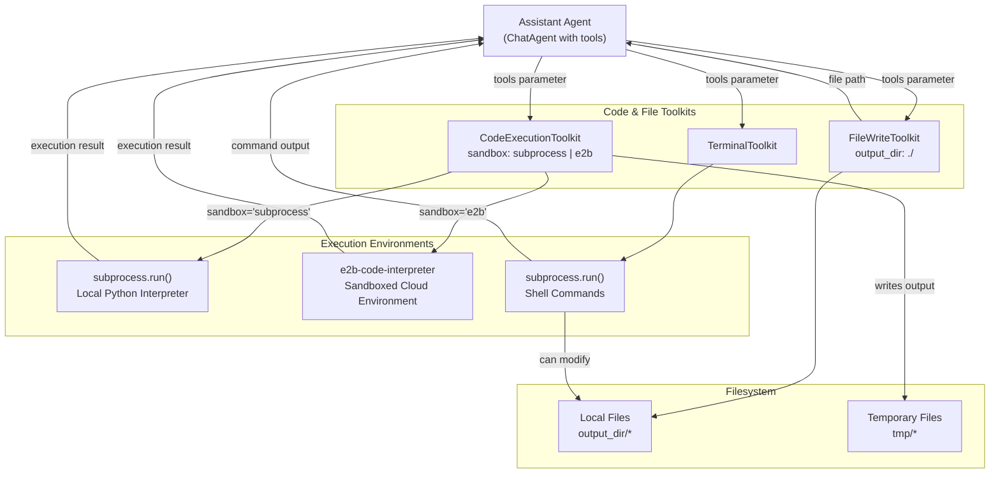
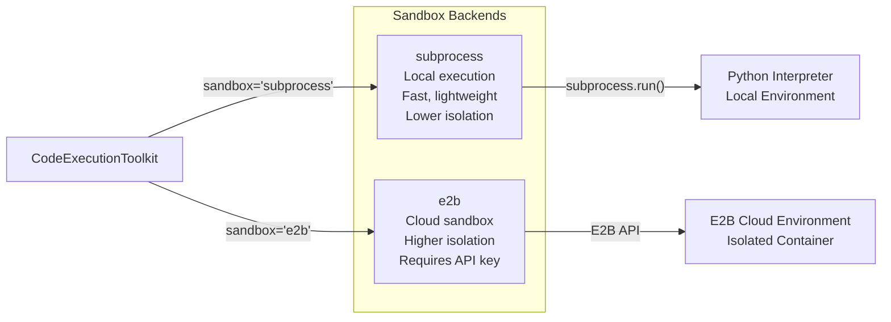
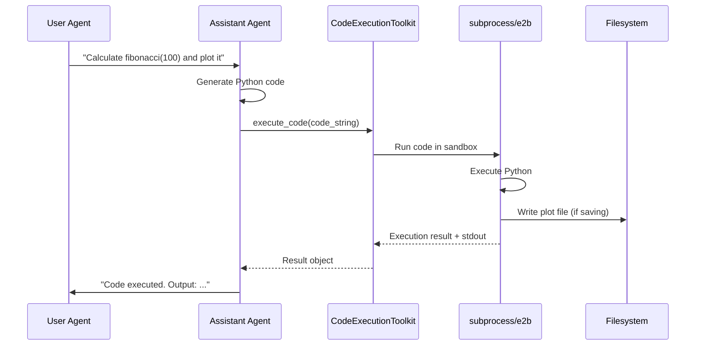
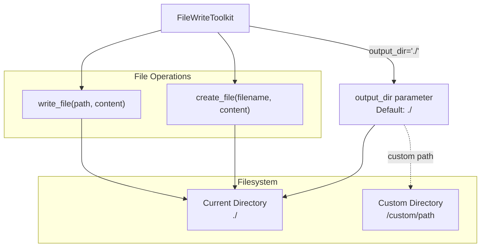
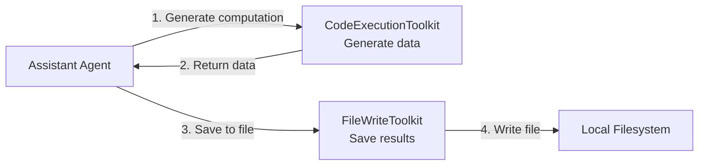
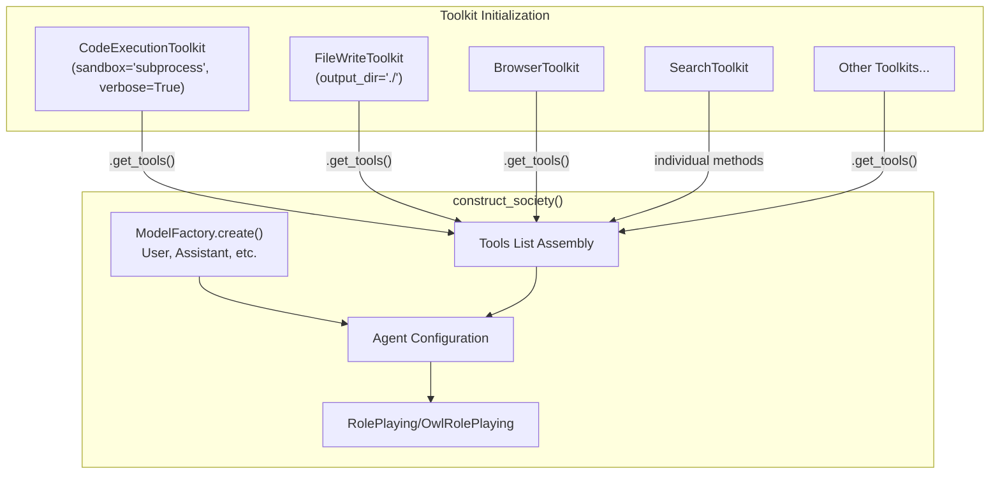
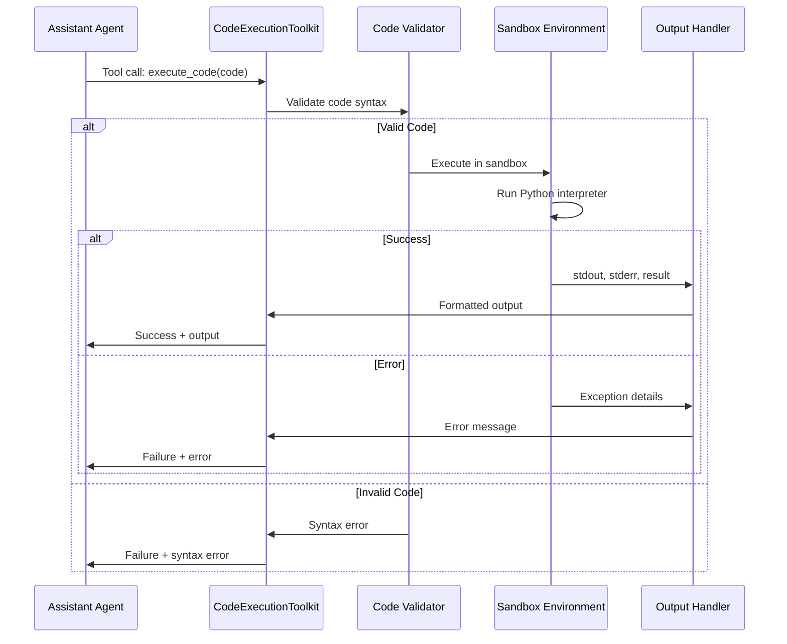
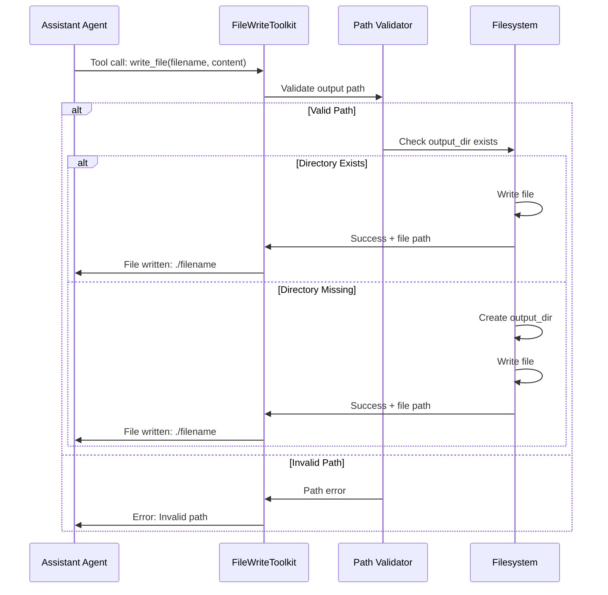

<!-- source: DeepWiki mcp.deepwiki.com · repo camel-ai/owl · page 5.5 Code Execution & File Toolkits · fetched 2026-10-29 -->

# Code Execution & File Toolkits

<details>
<summary>Relevant source files</summary>

The following files were used as context for generating this wiki page:

- [.gitignore](.gitignore)
- [README.md](README.md)
- [README_ja.md](README_ja.md)
- [README_zh.md](README_zh.md)
- [examples/run.py](examples/run.py)
- [examples/run_azure_openai.py](examples/run_azure_openai.py)
- [examples/run_mini.py](examples/run_mini.py)
- [examples/run_ollama.py](examples/run_ollama.py)
- [owl/assets/owl-favicon.ico](owl/assets/owl-favicon.ico)

</details>


This page documents the code execution and file system manipulation toolkits available in OWL. These toolkits enable agents to write and execute code, create and modify files, and execute terminal commands. For document processing capabilities (reading existing files), see [Document Processing Toolkit](#5.4). For web browser automation, see [Browser & Search Toolkits](#5.3).

## Overview

The Code Execution & File Toolkits category encompasses three primary toolkits:

- **CodeExecutionToolkit**: Executes Python code in isolated sandbox environments
- **FileWriteToolkit**: Creates and writes files to the local filesystem
- **TerminalToolkit**: Executes shell commands in a controlled environment

These toolkits work together to enable agents to perform computational tasks, persist results, and interact with the operating system.

**Sources:** [README.md:191](), [README.md:558-559]()

## Toolkit Architecture

### Integration Pattern



**Sources:** [examples/run.py:90-107](), [examples/run_mini.py:75-86]()

### Configuration in Example Scripts

All example scripts follow a consistent pattern for configuring these toolkits:

| Script | CodeExecutionToolkit | FileWriteToolkit | TerminalToolkit |
|--------|---------------------|------------------|-----------------|
| `examples/run.py` | `sandbox="subprocess"`, `verbose=True` | `output_dir="./"` | Not included |
| `examples/run_mini.py` | `sandbox="subprocess"`, `verbose=True` | `output_dir="./"` | Not included |
| `examples/run_azure_openai.py` | `sandbox="subprocess"`, `verbose=True` | `output_dir="./"` | Not included |
| `examples/run_ollama.py` | `sandbox="subprocess"`, `verbose=True` | `output_dir="./"` | Not included |

**Sources:** [examples/run.py:99](), [examples/run.py:106](), [examples/run_mini.py:82](), [examples/run_mini.py:85](), [examples/run_azure_openai.py:74](), [examples/run_azure_openai.py:80](), [examples/run_ollama.py:95](), [examples/run_ollama.py:101]()

## CodeExecutionToolkit

### Purpose and Capabilities

The `CodeExecutionToolkit` enables agents to write and execute Python code dynamically. This toolkit is essential for computational tasks, data analysis, algorithm implementation, and generating programmatic solutions.

**Key Features:**
- Execute arbitrary Python code in isolated environments
- Support for multiple sandbox backends (subprocess, e2b)
- Automatic dependency handling within sandboxes
- Verbose output logging for debugging

**Sources:** [README.md:191](), [README.md:534]()

### Sandbox Options



**Sources:** [README.md:534](), [examples/run.py:99]()

#### subprocess Sandbox

The default and recommended sandbox for most use cases. Executes code using the local Python interpreter via `subprocess.run()`.

**Configuration:**
```python
CodeExecutionToolkit(sandbox="subprocess", verbose=True).get_tools()
```

**Characteristics:**
- **Isolation Level:** Process-level isolation
- **Performance:** Fast execution with minimal overhead
- **Dependencies:** Built-in Python only (no external dependencies required)
- **Use Cases:** Trusted environments, rapid development, most OWL tasks

**Sources:** [examples/run.py:99](), [examples/run_mini.py:82]()

#### e2b-code-interpreter Sandbox

Cloud-based sandboxed environment providing higher security isolation. Requires the `e2b-code-interpreter` package and an E2B API key.

**Configuration:**
```python
CodeExecutionToolkit(sandbox="e2b").get_tools()
```

**Characteristics:**
- **Isolation Level:** Container-level isolation in cloud
- **Performance:** Network latency for API calls
- **Dependencies:** `e2b-code-interpreter` package, E2B API key
- **Use Cases:** Untrusted code execution, production environments requiring strict isolation

**Sources:** [README.md:534]()

### Integration Example



**Sources:** [examples/run.py:99](), [README.md:484-486]()

### Typical Usage Pattern

From the example scripts, the toolkit is initialized and added to the tools list:

```python
# Step 1: Import
from camel.toolkits import CodeExecutionToolkit

# Step 2: Instantiate with configuration
tools = [
    *CodeExecutionToolkit(sandbox="subprocess", verbose=True).get_tools(),
    # ... other tools
]

# Step 3: Pass to assistant agent
assistant_agent_kwargs = {"model": models["assistant"], "tools": tools}
```

**Sources:** [examples/run.py:18-27](), [examples/run.py:99](), [examples/run.py:111]()

## FileWriteToolkit

### Purpose and Capabilities

The `FileWriteToolkit` provides agents with the ability to create and write files to the local filesystem. This toolkit is essential for persisting results, generating reports, and creating artifacts.

**Key Features:**
- Create new files with specified content
- Write to configurable output directory
- Support for various file formats (text, code, data files)
- No external dependencies (built-in only)

**Sources:** [README.md:543](), [examples/run.py:106]()

### Configuration



**Sources:** [examples/run.py:106](), [examples/run_mini.py:85]()

### Configuration Parameters

| Parameter | Type | Default | Description |
|-----------|------|---------|-------------|
| `output_dir` | `str` | `"./"` | Directory where files will be created |

**Typical Configuration:**
```python
FileWriteToolkit(output_dir="./").get_tools()
```

**Sources:** [examples/run.py:106](), [examples/run_azure_openai.py:80]()

### Dependencies

The `FileWriteToolkit` has **no external dependencies** and uses only built-in Python functionality. This makes it lightweight and always available.

**Sources:** [README.md:543]()

### Integration with Other Toolkits

The `FileWriteToolkit` is commonly used in conjunction with `CodeExecutionToolkit` to persist computational results:



**Example Task Flow:**
1. Agent uses `CodeExecutionToolkit` to generate a plot
2. Code returns the plot data or image
3. Agent uses `FileWriteToolkit` to save the plot to disk
4. Agent reports the file path to the user

**Sources:** [examples/run.py:99-106](), [README.md:108]()

## TerminalToolkit

### Purpose and Capabilities

The `TerminalToolkit` enables agents to execute shell commands in a controlled environment. This toolkit extends agent capabilities to system-level operations.

**Key Features:**
- Execute shell commands
- Capture command output (stdout/stderr)
- Process-level isolation
- No external dependencies

**Sources:** [README.md:171](), [README.md:543]()

### Security Considerations

The `TerminalToolkit` provides direct access to system commands. When using this toolkit:

- **Subprocess Isolation:** Commands execute in isolated subprocesses
- **Environment Control:** Execution occurs within the Python process environment
- **Output Capture:** Both stdout and stderr are captured
- **Risk Assessment:** Consider the security implications of allowing shell access

**Best Practices:**
1. Use in trusted environments only
2. Avoid in production systems with untrusted inputs
3. Consider limiting available commands via wrapper functions
4. Log all terminal operations for audit trails

**Sources:** [README.md:171]()

### Typical Use Cases

| Use Case | Description | Example Command |
|----------|-------------|-----------------|
| File Operations | List, move, or inspect files | `ls -la`, `mv file.txt backup/` |
| System Information | Query system state | `df -h`, `ps aux`, `uname -a` |
| Tool Invocation | Run external tools | `git status`, `npm install` |
| Script Execution | Run shell scripts | `bash script.sh` |

**Sources:** [README.md:171]()

## Toolkit Configuration Example

### Complete Society Construction

This example shows how all three toolkits are configured in a typical OWL society:



**Sources:** [examples/run.py:41-128](), [examples/run_mini.py:40-107]()

### Code Implementation Pattern

All example scripts follow this pattern:

```python
def construct_society(question: str) -> RolePlaying:
    # Create models
    models = {
        "user": ModelFactory.create(...),
        "assistant": ModelFactory.create(...),
        # ... other specialized models
    }
    
    # Configure toolkits
    tools = [
        *CodeExecutionToolkit(sandbox="subprocess", verbose=True).get_tools(),
        *FileWriteToolkit(output_dir="./").get_tools(),
        # ... other toolkits
    ]
    
    # Configure agent parameters
    assistant_agent_kwargs = {"model": models["assistant"], "tools": tools}
    
    # Create society
    society = RolePlaying(
        task_prompt=question,
        assistant_agent_kwargs=assistant_agent_kwargs,
        # ... other parameters
    )
    
    return society
```

**Sources:** [examples/run.py:41-128](), [examples/run_mini.py:40-107](), [examples/run_azure_openai.py:42-103]()

## Execution Flow

### Code Execution Lifecycle



**Sources:** [examples/run.py:99](), [README.md:191]()

### File Write Lifecycle



**Sources:** [examples/run.py:106]()

## Dependencies Summary

| Toolkit | Required Dependencies | Optional Dependencies | Installation |
|---------|----------------------|----------------------|--------------|
| `CodeExecutionToolkit` | Python built-in `subprocess` | `e2b-code-interpreter` (for e2b sandbox) | Included in standard install |
| `FileWriteToolkit` | Python built-in only | None | Included in standard install |
| `TerminalToolkit` | Python built-in only | None | Included in standard install |

**Sources:** [README.md:534](), [README.md:543]()

## Best Practices

### When to Use Each Toolkit

**CodeExecutionToolkit:**
- Mathematical computations
- Data analysis and processing
- Algorithm implementation
- Generating visualizations
- Testing hypotheses programmatically

**FileWriteToolkit:**
- Persisting computation results
- Generating reports or documents
- Creating configuration files
- Saving plots or data files
- Building project artifacts

**TerminalToolkit:**
- System information queries
- Version control operations (git)
- Package management
- Running build tools
- File system operations beyond Python's scope

**Sources:** [README.md:191](), [README.md:484-486]()

### Security Guidelines

1. **Subprocess Sandbox:** Suitable for trusted environments where code origin is controlled
2. **E2B Sandbox:** Recommended for production or when executing potentially untrusted code
3. **File Paths:** Always validate that `output_dir` is within expected boundaries
4. **Terminal Commands:** Implement command whitelisting in sensitive environments
5. **Logging:** Enable `verbose=True` for `CodeExecutionToolkit` to track execution

**Sources:** [examples/run.py:99]()

## Common Usage Patterns

### Pattern 1: Generate and Save

Agent generates data, then saves it to a file:

```python
tools = [
    *CodeExecutionToolkit(sandbox="subprocess", verbose=True).get_tools(),
    *FileWriteToolkit(output_dir="./").get_tools(),
]
```

**Task Example:** "Calculate the first 100 prime numbers and save them to primes.txt"

**Sources:** [examples/run.py:99-106]()

### Pattern 2: Execute and Visualize

Agent executes code that creates visualizations, then saves the plots:

```python
# Agent can:
# 1. Use CodeExecutionToolkit to create matplotlib plots
# 2. Use FileWriteToolkit to save plot images
# 3. Return file paths to user
```

**Task Example:** "Plot a sine wave from 0 to 2π and save it as plot.png"

**Sources:** [README.md:108]()

### Pattern 3: Multi-Step Computation

Agent performs multi-step tasks combining code execution and file operations:

```python
# Example flow:
# 1. Execute code to fetch/process data
# 2. Execute code to analyze data
# 3. Write results to JSON file
# 4. Execute code to generate report
# 5. Write report to Markdown file
```

**Sources:** [examples/run.py:99-106]()

## Integration with GAIA Benchmark

The Code Execution & File Toolkits are critical for GAIA benchmark tasks that require computational problem-solving:

- Tasks involving mathematical calculations
- Data analysis from provided files
- Generating programmatic solutions
- Creating and manipulating output files

The consistent configuration across all example scripts (`sandbox="subprocess"`, `verbose=True`) reflects the optimized settings used for benchmark performance.

**Sources:** [README.md:534](), [examples/run.py:99](), [README.md:619-636]()

---

