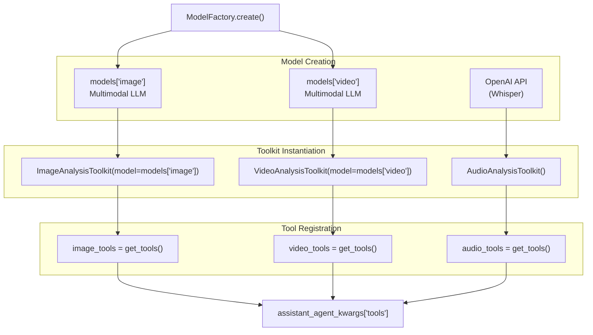
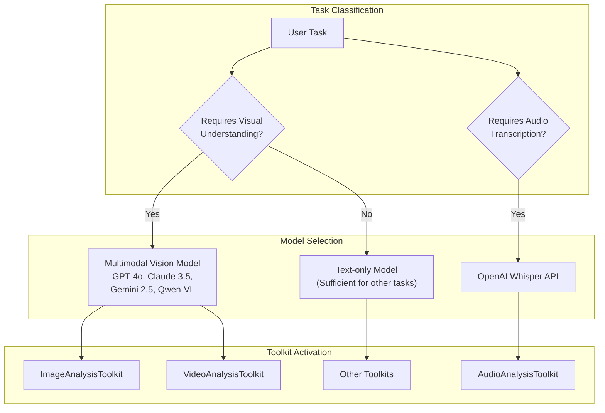
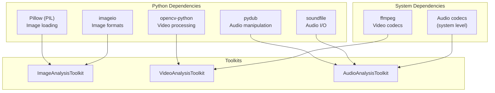
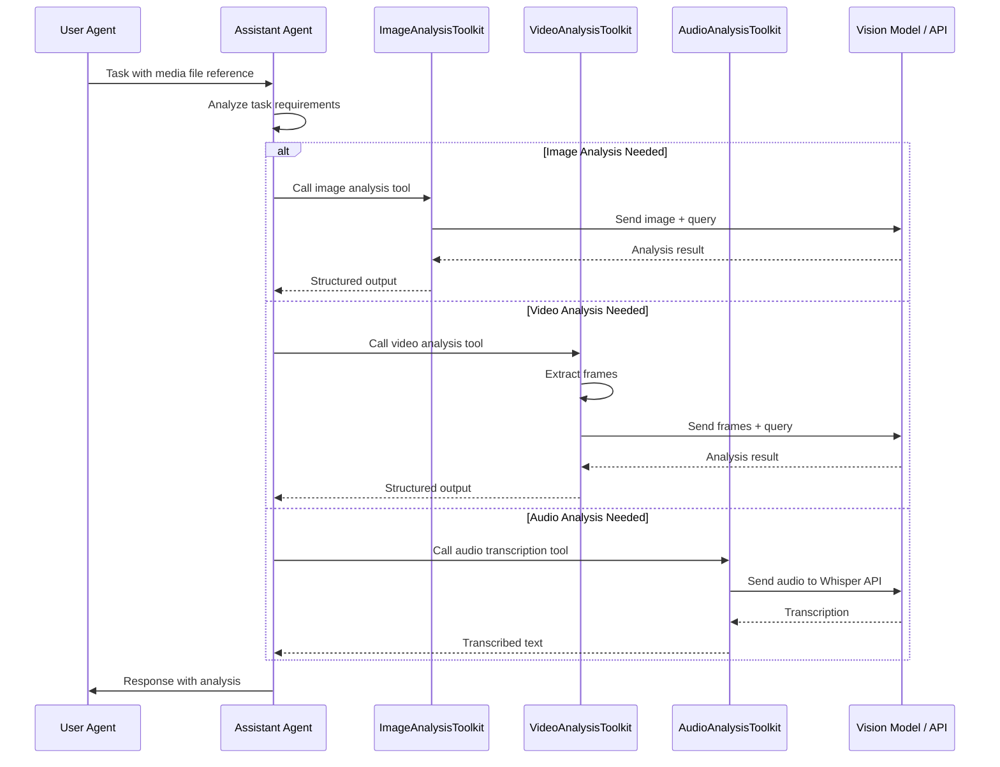

<!-- source: DeepWiki mcp.deepwiki.com · repo camel-ai/owl · page 5.6 Media Analysis Toolkits · fetched 2026-10-29 -->

# Media Analysis Toolkits

<details>
<summary>Relevant source files</summary>

The following files were used as context for generating this wiki page:

- [.gitignore](.gitignore)
- [README.md](README.md)
- [README_ja.md](README_ja.md)
- [README_zh.md](README_zh.md)
- [examples/run.py](examples/run.py)
- [examples/run_azure_openai.py](examples/run_azure_openai.py)
- [examples/run_mini.py](examples/run_mini.py)
- [examples/run_ollama.py](examples/run_ollama.py)
- [owl/assets/owl-favicon.ico](owl/assets/owl-favicon.ico)

</details>


This document covers the three media analysis toolkits that enable OWL agents to process and analyze visual and audio content: `ImageAnalysisToolkit`, `VideoAnalysisToolkit`, and `AudioAnalysisToolkit`. These toolkits extend the agent's capabilities to handle multimodal tasks involving images, videos, and audio files.

For information about browser-based web interaction and search capabilities, see [Browser & Search Toolkits](#5.3). For document processing of text-based files (PDFs, DOCX, Excel), see [Document Processing Toolkit](#5.4). For general toolkit architecture concepts, see [Toolkit Architecture](#5.1).

---

## Purpose and Scope

Media analysis toolkits provide the assistant agent with tools to:
- Analyze and describe visual content in images (local or remote URLs)
- Process and understand video content frame-by-frame
- Transcribe and analyze audio files

These toolkits require models with multimodal understanding capabilities to interpret visual and audio content. They are part of the CAMEL framework but are configured and deployed within OWL's multi-agent architecture.

**Sources**: [README.md:188-195](), [README.md:551-555]()

---

## Toolkit Integration Architecture

The media analysis toolkits follow the standard OWL toolkit integration pattern, where they are instantiated with specialized models and their tools are passed to the assistant agent.

**Diagram: Media Toolkit Integration Flow**



**Sources**: [examples/run.py:51-107](), [examples/run_azure_openai.py:52-81]()

---

## ImageAnalysisToolkit

The `ImageAnalysisToolkit` enables agents to analyze visual content in images. It requires a multimodal language model that supports vision capabilities.

### Configuration

```python
from camel.toolkits import ImageAnalysisToolkit

# Create a multimodal model for image analysis
image_model = ModelFactory.create(
    model_platform=ModelPlatformType.OPENAI,
    model_type=ModelType.GPT_4O,
    model_config_dict={"temperature": 0}
)

# Instantiate the toolkit
toolkit = ImageAnalysisToolkit(model=image_model)

# Get tools to pass to assistant agent
tools = toolkit.get_tools()
```

### Capabilities

The toolkit provides tools to:
- Analyze image content and generate descriptions
- Answer questions about visual elements in images
- Process both local file paths and remote URLs
- Support common image formats (PNG, JPEG, GIF, etc.)

### Model Requirements

**Requires**: A multimodal model with vision capabilities
- OpenAI: `GPT_4O`, `GPT_4_TURBO`
- Anthropic: `CLAUDE_3_5_SONNET`
- Qwen: `QWEN_VL_PLUS`, `QWEN_VL_MAX`
- Google: `GEMINI_2_5_PRO`
- Ollama: `llava:latest` (local vision models)

### Dependencies

External libraries required (installed via requirements.txt):
- `Pillow` (PIL) - Image loading and processing
- `imageio` - Additional image format support

**Sources**: [examples/run.py:78-82](), [examples/run_ollama.py:80-85](), [README.md:554]()

---

## VideoAnalysisToolkit

The `VideoAnalysisToolkit` enables agents to analyze video content by extracting and processing frames.

### Configuration

```python
from camel.toolkits import VideoAnalysisToolkit

# Create a multimodal model for video analysis
video_model = ModelFactory.create(
    model_platform=ModelPlatformType.OPENAI,
    model_type=ModelType.GPT_4O,
    model_config_dict={"temperature": 0}
)

# Instantiate the toolkit
toolkit = VideoAnalysisToolkit(model=video_model)

# Get tools to pass to assistant agent
tools = toolkit.get_tools()
```

### Capabilities

The toolkit provides tools to:
- Extract representative frames from videos
- Analyze video content frame-by-frame
- Generate descriptions of video sequences
- Process both local video files and remote URLs
- Support common video formats (MP4, AVI, MOV, etc.)

### Processing Strategy

The toolkit samples frames at intervals to provide a representative understanding of the video content without processing every frame, which would be computationally expensive. The multimodal model then analyzes these frames to understand the video narrative.

### Model Requirements

**Requires**: A multimodal model with vision capabilities (same as ImageAnalysisToolkit)
- The video toolkit uses frame-based analysis, treating extracted frames as images
- Models must support image inputs with sufficient context window for multiple frames

### Dependencies

External libraries required:
- `opencv-python` (cv2) - Video frame extraction and processing
- `ffmpeg` - Video codec support and format conversion

**Sources**: [examples/run.py:73-77](), [README.md:553]()

---

## AudioAnalysisToolkit

The `AudioAnalysisToolkit` enables agents to transcribe and analyze audio content. Unlike the image and video toolkits, it uses OpenAI's Whisper API directly rather than requiring a model parameter.

### Configuration

```python
from camel.toolkits import AudioAnalysisToolkit

# Instantiate the toolkit (uses OpenAI API by default)
toolkit = AudioAnalysisToolkit()

# Get tools to pass to assistant agent
tools = toolkit.get_tools()
```

### Capabilities

The toolkit provides tools to:
- Transcribe audio files to text (using Whisper API)
- Process various audio formats
- Handle both local files and remote URLs
- Support multiple languages

### API Requirements

**Requires**: OpenAI API key with access to Whisper API
- The toolkit makes direct API calls to OpenAI's Whisper endpoint
- No custom model parameter needed
- Requires `OPENAI_API_KEY` environment variable

### Dependencies

External libraries required:
- `pydub` - Audio file manipulation and format conversion
- `soundfile` - Audio file reading and writing

**Sources**: [examples/run.py:98](), [README.md:557]()

---

## Configuration Patterns

### Basic Pattern

The standard pattern for configuring media analysis toolkits in OWL:

```python
# 1. Create specialized models
models = {
    "assistant": ModelFactory.create(...),  # Main reasoning model
    "image": ModelFactory.create(...),      # Vision model
    "video": ModelFactory.create(...),      # Vision model
}

# 2. Instantiate toolkits with models
tools = [
    *ImageAnalysisToolkit(model=models["image"]).get_tools(),
    *VideoAnalysisToolkit(model=models["video"]).get_tools(),
    *AudioAnalysisToolkit().get_tools(),
    # ... other tools
]

# 3. Pass tools to assistant agent
assistant_agent_kwargs = {
    "model": models["assistant"],
    "tools": tools
}
```

### Model Reuse Pattern

For efficiency, the same multimodal model can be used for both image and video analysis:

```python
# Single multimodal model for all vision tasks
vision_model = ModelFactory.create(
    model_platform=ModelPlatformType.OPENAI,
    model_type=ModelType.GPT_4O,
    model_config_dict={"temperature": 0}
)

tools = [
    *ImageAnalysisToolkit(model=vision_model).get_tools(),
    *VideoAnalysisToolkit(model=vision_model).get_tools(),
    *AudioAnalysisToolkit().get_tools(),
]
```

### Minimal Pattern (No Media Analysis)

If media analysis is not needed for a task, these toolkits can be omitted entirely:

```python
# Minimal configuration without media toolkits
tools = [
    *BrowserToolkit(...).get_tools(),
    *CodeExecutionToolkit(...).get_tools(),
    SearchToolkit().search_duckduckgo,
]
```

**Sources**: [examples/run.py:51-107](), [examples/run_mini.py:75-86]()

---

## Model Requirements and Specialization

**Diagram: Model Specialization for Media Analysis**



### Supported Model Platforms for Vision Tasks

| Platform | Image Analysis | Video Analysis | Notes |
|----------|---------------|---------------|-------|
| OpenAI | ✓ `GPT_4O`, `GPT_4_TURBO` | ✓ `GPT_4O`, `GPT_4_TURBO` | Recommended for best performance |
| Anthropic | ✓ `CLAUDE_3_5_SONNET` | ✓ `CLAUDE_3_5_SONNET` | Strong vision capabilities |
| Qwen | ✓ `QWEN_VL_PLUS`, `QWEN_VL_MAX` | ✓ `QWEN_VL_PLUS`, `QWEN_VL_MAX` | Chinese language support |
| Google | ✓ `GEMINI_2_5_PRO` | ✓ `GEMINI_2_5_PRO` | Large context window |
| Ollama | ✓ `llava:latest` | ✓ `llava:latest` | Local deployment option |
| Azure OpenAI | ✓ Enterprise GPT-4 | ✓ Enterprise GPT-4 | Enterprise deployment |

### Audio Analysis Platform

| Platform | Audio Analysis | Notes |
|----------|---------------|-------|
| OpenAI Whisper API | ✓ Required | No model parameter needed |

**Sources**: [README.md:415-420](), [examples/run_ollama.py:80-86](), [examples/run_azure_openai.py:52-65]()

---

## Dependency Management

**Diagram: Media Toolkit Dependencies**



### Installation

All Python dependencies are included in `requirements.txt` and installed during OWL setup. System-level dependencies may require separate installation:

**FFmpeg** (for video processing):
```bash
# Ubuntu/Debian
sudo apt-get install ffmpeg

# macOS
brew install ffmpeg

# Windows
# Download from https://ffmpeg.org/download.html
```

**Audio Codecs** (usually pre-installed on most systems):
```bash
# Ubuntu/Debian
sudo apt-get install libsndfile1

# macOS (typically pre-installed)
# If needed: brew install libsndfile
```

**Sources**: [README.md:267](), Diagram 4 from high-level overview

---

## Integration with Assistant Agent

The media analysis toolkits integrate with the assistant agent through the standard tool registration mechanism. When the agent encounters a task requiring media analysis, it automatically selects and invokes the appropriate tool.

**Diagram: Tool Selection and Execution Flow**



### Tool Function Pattern

Each toolkit exposes tools through the `get_tools()` method, which returns a list of `FunctionTool` objects that the assistant agent can invoke:

```python
# The asterisk unpacks the list of tools
tools = [
    *ImageAnalysisToolkit(model=vision_model).get_tools(),
    # Returns: [image_analysis_tool1, image_analysis_tool2, ...]
    
    *VideoAnalysisToolkit(model=vision_model).get_tools(),
    # Returns: [video_analysis_tool1, video_analysis_tool2, ...]
    
    *AudioAnalysisToolkit().get_tools(),
    # Returns: [audio_transcription_tool, ...]
]
```

The assistant agent receives tool descriptions and schemas, enabling it to:
1. Understand what each tool can do
2. Determine when to use each tool
3. Format tool call parameters correctly
4. Process tool outputs

**Sources**: [examples/run.py:91-107](), [README.md:528-545]()

---

## Use Cases and Task Examples

### Image Analysis Tasks

Example tasks that trigger `ImageAnalysisToolkit`:
- "What objects are visible in this image: [path/to/image.jpg]?"
- "Describe the main elements in this product photo"
- "Extract text visible in this screenshot"
- "What is the dominant color scheme in this image?"

### Video Analysis Tasks

Example tasks that trigger `VideoAnalysisToolkit`:
- "Summarize what happens in this video: [path/to/video.mp4]"
- "What activities are shown in this instructional video?"
- "Count the number of people visible throughout this video"
- "Describe the key scenes in this video"

### Audio Analysis Tasks

Example tasks that trigger `AudioAnalysisToolkit`:
- "Transcribe this audio file: [path/to/audio.mp3]"
- "What is being discussed in this podcast recording?"
- "Convert this speech to text"
- "Summarize the content of this audio interview"

### Combined Multimodal Tasks

Example tasks that may use multiple media toolkits:
- "Analyze this presentation video and extract all slide text"
- "Transcribe the audio narration and describe the visuals in this tutorial video"
- "Compare the image shown at 1:30 in the video with this reference image"

**Sources**: [README.md:480-487]()

---

## Performance Considerations

### Model Selection Impact

The choice of vision model significantly impacts:
- **Accuracy**: OpenAI GPT-4o and Claude 3.5 Sonnet generally provide highest accuracy
- **Speed**: Smaller models (Qwen-VL, local Ollama models) are faster but may be less accurate
- **Cost**: API-based models incur per-token costs; local models have hardware requirements
- **Context Window**: Longer videos require models with larger context windows

### Resource Usage

| Toolkit | CPU Usage | Memory Usage | API Calls |
|---------|-----------|--------------|-----------|
| ImageAnalysisToolkit | Low | Low | 1 per image |
| VideoAnalysisToolkit | Medium-High | Medium | Multiple (per frame batch) |
| AudioAnalysisToolkit | Low | Low | 1 per audio file |

### Optimization Strategies

1. **Lazy Loading**: Toolkits are only instantiated when needed
2. **Selective Tool Registration**: Only include media toolkits if task likely needs them
3. **Model Reuse**: Share vision model between image and video toolkits
4. **Frame Sampling**: VideoAnalysisToolkit samples frames rather than processing all frames

**Sources**: [README.md:419-420](), [README.md:583]()

---

## Error Handling and Limitations

### Common Issues

1. **Missing Dependencies**: FFmpeg not installed for video processing
2. **Model Limitations**: Vision model context window too small for long videos
3. **API Rate Limits**: Whisper API rate limits for audio transcription
4. **File Format Support**: Unsupported media file formats
5. **API Key Issues**: Missing or invalid OpenAI API key for AudioAnalysisToolkit

### Toolkit-Specific Limitations

**ImageAnalysisToolkit**:
- Requires multimodal model with vision support
- Limited by model's image understanding capabilities
- May struggle with very low-resolution or corrupted images

**VideoAnalysisToolkit**:
- Processes sampled frames, not continuous video
- May miss rapid scene changes between sampled frames
- Computational cost increases with video length
- Limited by model's context window for number of frames

**AudioAnalysisToolkit**:
- Hardcoded dependency on OpenAI Whisper API
- Cannot use alternative speech-to-text services without modification
- Requires OPENAI_API_KEY even if other models are used elsewhere
- Subject to OpenAI API rate limits and costs

**Sources**: [README.md:557](), [README.md:683-705]()

---

## Relationship to Other Systems

### Browser Toolkit Synergy

Media analysis toolkits often work in conjunction with `BrowserToolkit`:
- Browser downloads images/videos from web
- Media toolkits analyze the downloaded content
- Results inform further browsing decisions

See [Browser & Search Toolkits](#5.3) for web automation capabilities.

### Document Processing Toolkit Distinction

While `DocumentProcessingToolkit` also handles images, its focus is on document-embedded images and OCR:
- DocumentProcessingToolkit: Extract text from PDFs, process spreadsheets, parse document images
- ImageAnalysisToolkit: General image understanding, scene description, object recognition

See [Document Processing Toolkit](#5.4) for document-specific capabilities.

### Code Execution Toolkit Integration

Media toolkits may be used in conjunction with `CodeExecutionToolkit`:
- Generate code to process media files in batch
- Create visualizations from media analysis results
- Automate media processing pipelines

See [Code Execution & File Toolkits](#5.5) for code execution capabilities.

**Sources**: [README.md:488-562](), [examples/run.py:91-107]()

---

