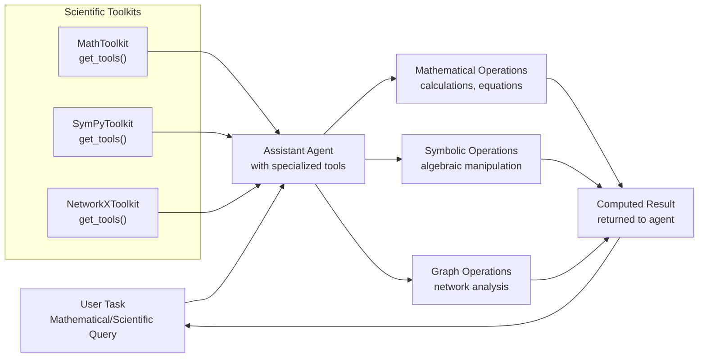
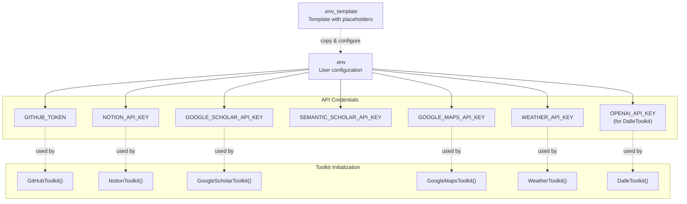
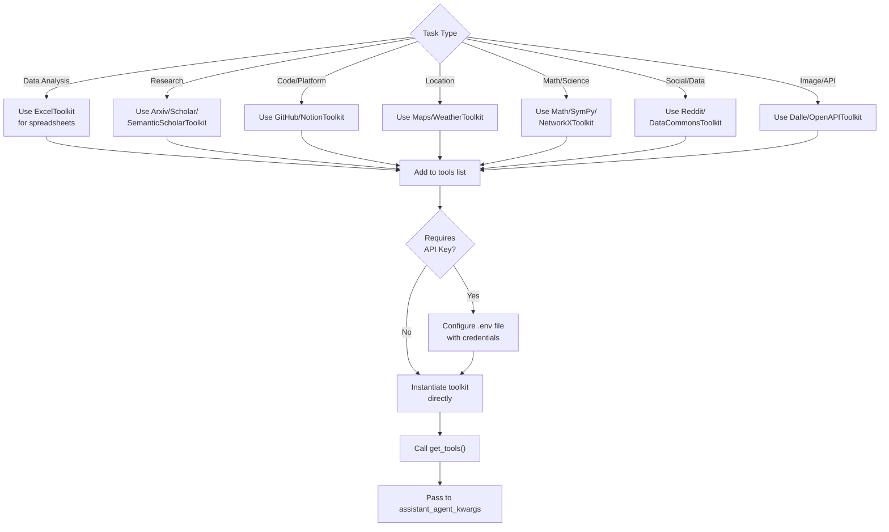

<!-- source: DeepWiki mcp.deepwiki.com · repo camel-ai/owl · page 5.7 Specialized Toolkits · fetched 2026-10-29 -->

# Specialized Toolkits

<details>
<summary>Relevant source files</summary>

The following files were used as context for generating this wiki page:

- [.gitignore](.gitignore)
- [README.md](README.md)
- [README_ja.md](README_ja.md)
- [README_zh.md](README_zh.md)
- [examples/run_gemini.py](examples/run_gemini.py)
- [examples/run_groq.py](examples/run_groq.py)
- [examples/run_mistral.py](examples/run_mistral.py)
- [examples/run_novita_ai.py](examples/run_novita_ai.py)
- [examples/run_openai_compatible_model.py](examples/run_openai_compatible_model.py)
- [examples/run_together_ai.py](examples/run_together_ai.py)
- [owl/assets/owl-favicon.ico](owl/assets/owl-favicon.ico)

</details>


This page documents domain-specific toolkits that extend OWL's capabilities for specialized tasks including data analysis, academic research, developer platforms, location services, scientific computing, social media, and API integration.

For multimodal toolkits (image, video, audio analysis), see [Media Analysis Toolkits](#5.6). For web automation and search, see [Browser & Search Toolkits](#5.3). For document processing, see [Document Processing Toolkit](#5.4). For code execution and file operations, see [Code Execution & File Toolkits](#5.5).

## Overview

Specialized toolkits provide focused functionality for specific domains and services. Unlike general-purpose toolkits, these typically:

- Require external API keys or service credentials configured in the `.env` file
- Target specific platforms or data sources (GitHub, Notion, arXiv, etc.)
- Implement domain-specific operations (mathematical computation, graph analysis, weather queries)
- May have additional Python package dependencies beyond the base OWL installation

All specialized toolkits follow the standard `get_tools()` pattern and return `FunctionTool` instances that can be passed to the assistant agent.

**Sources:** [README.md:192-195](), [README.md:562-562]()

## Toolkit Categorization

### Specialized Toolkit Architecture

```mermaid
graph TB
    subgraph "Data & Office"
        Excel["ExcelToolkit<br/>openpyxl, pandas"]
    end
    
    subgraph "Academic Research"
        Arxiv["ArxivToolkit<br/>arxiv API"]
        Scholar["GoogleScholarToolkit<br/>API key required"]
        Semantic["SemanticScholarToolkit<br/>API key required"]
    end
    
    subgraph "Developer Platforms"
        GitHub["GitHubToolkit<br/>GITHUB_TOKEN"]
        Notion["NotionToolkit<br/>NOTION_API_KEY"]
    end
    
    subgraph "Location & Info Services"
        Maps["GoogleMapsToolkit<br/>GOOGLE_MAPS_API_KEY"]
        Weather["WeatherToolkit<br/>WEATHER_API_KEY"]
    end
    
    subgraph "Scientific Computing"
        Math["MathToolkit<br/>mathematical operations"]
        SymPy["SymPyToolkit<br/>symbolic computation"]
        NetworkX["NetworkXToolkit<br/>graph analysis"]
    end
    
    subgraph "Social & Data"
        Reddit["RedditToolkit<br/>public API"]
        DataCommons["DataCommonsToolkit<br/>public API"]
    end
    
    subgraph "Image & API"
        Dalle["DalleToolkit<br/>DALL-E image generation"]
        OpenAPI["OpenAPIToolkit<br/>custom API integration"]
    end
    
    EnvFile[".env File<br/>API Keys & Tokens"]
    AssistantAgent["Assistant Agent<br/>tools parameter"]
    
    EnvFile -.configures.-> GitHub
    EnvFile -.configures.-> Notion
    EnvFile -.configures.-> Scholar
    EnvFile -.configures.-> Semantic
    EnvFile -.configures.-> Maps
    EnvFile -.configures.-> Weather
    EnvFile -.configures.-> Dalle
    
    Excel --> AssistantAgent
    Arxiv --> AssistantAgent
    Scholar --> AssistantAgent
    Semantic --> AssistantAgent
    GitHub --> AssistantAgent
    Notion --> AssistantAgent
    Maps --> AssistantAgent
    Weather --> AssistantAgent
    Math --> AssistantAgent
    SymPy --> AssistantAgent
    NetworkX --> AssistantAgent
    Reddit --> AssistantAgent
    DataCommons --> AssistantAgent
    Dalle --> AssistantAgent
    OpenAPI --> AssistantAgent
```



This diagram shows how specialized toolkits are organized by domain and their configuration dependencies. Toolkits in the upper categories require external API credentials, while scientific computing toolkits have no external dependencies.

**Sources:** [README.md:192-195](), [examples/run_groq.py:101-118]()

## Data and Office Productivity

### ExcelToolkit

`ExcelToolkit` provides operations for reading, writing, and manipulating Excel spreadsheet files. It is the most commonly used specialized toolkit across OWL example scripts.

**Key Capabilities:**
- Read Excel files (`.xlsx`, `.xls`) and extract cell values, ranges, and formulas
- Write data to Excel files with formatting options
- Query specific cells, rows, columns, or ranges
- Supports complex operations like formula evaluation and data transformation

**Dependencies:** `openpyxl`, `pandas`

**Configuration:** No API keys required; operates on local or provided file paths.

**Usage Pattern:**

```python
from camel.toolkits import ExcelToolkit

tools = [
    *ExcelToolkit().get_tools(),
]
```

The toolkit is instantiated without parameters and returns multiple `FunctionTool` instances via `get_tools()`. Common in nearly all example scripts:

**Sources:** [examples/run_groq.py:115](), [examples/run_gemini.py:100](), [examples/run_together_ai.py:91](), [examples/run_novita_ai.py:91](), [README.md:194]()

## Academic Research Toolkits

### ArxivToolkit

`ArxivToolkit` interfaces with the arXiv.org preprint repository, enabling search and retrieval of academic papers in physics, mathematics, computer science, and related fields.

**Key Capabilities:**
- Search arXiv database by keywords, authors, categories, or identifiers
- Retrieve paper metadata (title, abstract, authors, publication date)
- Download PDF versions of papers
- Filter by subject categories and submission dates

**Dependencies:** arXiv API client library

**Configuration:** No API key required (public API)

### GoogleScholarToolkit

`GoogleScholarToolkit` provides access to Google Scholar's academic search engine, enabling citation lookup and paper discovery.

**Key Capabilities:**
- Search scholarly literature across disciplines
- Retrieve citation information and metrics
- Access author profiles and publication lists
- Query by keywords, authors, or publications

**Dependencies:** Google Scholar API access

**Configuration:** Requires `GOOGLE_SCHOLAR_API_KEY` in `.env` file (if using official API) or web scraping approach

### SemanticScholarToolkit

`SemanticScholarToolkit` integrates with Semantic Scholar's AI-powered research tool, providing advanced paper search and analysis.

**Key Capabilities:**
- Search academic papers with AI-enhanced relevance ranking
- Access citation graphs and paper relationships
- Retrieve influential citations and references
- Query by semantic similarity rather than just keywords

**Dependencies:** Semantic Scholar API client

**Configuration:** May require `SEMANTIC_SCHOLAR_API_KEY` in `.env` file for higher rate limits

**Sources:** [README.md:194](), [README.md:562]()

## Developer Platform Toolkits

### GitHubToolkit

`GitHubToolkit` enables programmatic interaction with GitHub repositories, issues, pull requests, and other platform features.

**Key Capabilities:**
- Repository operations (create, clone, search repositories)
- Issue management (create, update, close issues)
- Pull request operations (create, review, merge PRs)
- File operations (read, write, commit files)
- Search repositories, code, users, and organizations
- Access repository statistics and metrics

**Dependencies:** PyGithub or github API client library

**Configuration:** Requires `GITHUB_TOKEN` in `.env` file. Token should have appropriate repository permissions.

**Typical Use Cases:**
- Automated issue tracking and management
- Code repository analysis and statistics gathering
- Automated pull request workflows
- Repository file content retrieval for analysis

### NotionToolkit

`NotionToolkit` interfaces with Notion's workspace API, enabling automation of note-taking, database operations, and page management.

**Key Capabilities:**
- Page operations (create, read, update, delete pages)
- Database queries and record manipulation
- Block-level content operations
- Search across workspace
- Property updates and filtering

**Dependencies:** Notion API client library

**Configuration:** Requires `NOTION_API_KEY` in `.env` file. Integration must be added to relevant pages/databases.

**Typical Use Cases:**
- Automated documentation generation
- Task and project management automation
- Knowledge base updates
- Data synchronization with external sources

**Sources:** [README.md:194](), [README.md:562]()

## Location and Information Services

### GoogleMapsToolkit

`GoogleMapsToolkit` provides access to Google Maps Platform APIs for geocoding, directions, distance calculations, and place information.

**Key Capabilities:**
- Geocoding (convert addresses to coordinates and vice versa)
- Directions and route planning
- Distance matrix calculations
- Place search and details
- Timezone information for locations

**Dependencies:** Google Maps Python client

**Configuration:** Requires `GOOGLE_MAPS_API_KEY` in `.env` file. API must be enabled in Google Cloud Console.

**Typical Use Cases:**
- Address validation and standardization
- Route optimization and travel time estimation
- Location-based data enrichment
- Geographic analysis

### WeatherToolkit

`WeatherToolkit` retrieves current weather conditions, forecasts, and historical weather data for specified locations.

**Key Capabilities:**
- Current weather conditions lookup
- Weather forecasts (hourly, daily, extended)
- Historical weather data retrieval
- Location-based weather queries
- Weather alerts and warnings

**Dependencies:** Weather API client (OpenWeatherMap, WeatherAPI, or similar)

**Configuration:** Requires `WEATHER_API_KEY` in `.env` file. Specific key depends on weather service provider.

**Typical Use Cases:**
- Weather-dependent task scheduling
- Climate data analysis
- Location recommendations based on weather
- Event planning with weather consideration

**Sources:** [README.md:194](), [README.md:562]()

## Scientific Computing Toolkits

### Toolkit Integration Pattern



Scientific computing toolkits require no external API keys and operate entirely on computational operations.

**Sources:** [README.md:194](), [README.md:562]()

### MathToolkit

`MathToolkit` provides basic and advanced mathematical computation capabilities.

**Key Capabilities:**
- Arithmetic operations with arbitrary precision
- Trigonometric and logarithmic functions
- Statistical calculations (mean, median, standard deviation)
- Matrix operations
- Numerical integration and differentiation
- Equation solving (numerical methods)

**Dependencies:** NumPy, SciPy (typically)

**Configuration:** No API keys required

### SymPyToolkit

`SymPyToolkit` enables symbolic mathematics and algebraic manipulation using the SymPy library.

**Key Capabilities:**
- Symbolic expression manipulation
- Equation solving (algebraic, differential, etc.)
- Calculus operations (differentiation, integration, limits)
- Matrix algebra with symbolic entries
- Polynomial operations
- Simplification and expansion of expressions
- LaTeX output for mathematical notation

**Dependencies:** SymPy library

**Configuration:** No API keys required

**Typical Use Cases:**
- Solving mathematical problems symbolically
- Calculus problem solving
- Algebraic proof generation
- Mathematical formula derivation

### NetworkXToolkit

`NetworkXToolkit` provides graph theory and network analysis capabilities using the NetworkX library.

**Key Capabilities:**
- Graph creation and manipulation (directed, undirected, multigraphs)
- Shortest path algorithms (Dijkstra, A*, etc.)
- Centrality measures (degree, betweenness, closeness, eigenvector)
- Community detection and clustering
- Graph traversal algorithms
- Network visualization and analysis
- Graph properties calculation (diameter, density, connectivity)

**Dependencies:** NetworkX library, potentially matplotlib for visualization

**Configuration:** No API keys required

**Typical Use Cases:**
- Social network analysis
- Route optimization and pathfinding
- Dependency graph analysis
- Network topology analysis

**Sources:** [README.md:194](), [README.md:562]()

## Social Media and Data Toolkits

### RedditToolkit

`RedditToolkit` interfaces with Reddit's API to retrieve posts, comments, subreddit information, and perform searches.

**Key Capabilities:**
- Search posts and comments across subreddits
- Retrieve subreddit information and statistics
- Access user profiles and post history
- Fetch trending and top posts
- Read comment threads

**Dependencies:** PRAW (Python Reddit API Wrapper) or similar

**Configuration:** May require Reddit API credentials (client ID, client secret) depending on rate limits and access requirements. Public read-only access often available without authentication.

**Typical Use Cases:**
- Sentiment analysis on topics
- Community trend monitoring
- Content discovery and curation
- Social listening for research

### DataCommonsToolkit

`DataCommonsToolkit` provides access to Google's Data Commons, a repository of public statistical datasets.

**Key Capabilities:**
- Query demographic data (population, age distribution, etc.)
- Access economic indicators (GDP, employment, income)
- Retrieve environmental data (emissions, weather patterns)
- Geographic data queries
- Time series data retrieval

**Dependencies:** Data Commons API client

**Configuration:** Public API, typically no authentication required for basic access

**Typical Use Cases:**
- Demographic research and analysis
- Economic trend analysis
- Policy research with statistical backing
- Geographic data enrichment

**Sources:** [README.md:194](), [README.md:562]()

## Image Generation and API Toolkits

### DalleToolkit

`DalleToolkit` integrates with OpenAI's DALL-E image generation API.

**Key Capabilities:**
- Generate images from text descriptions
- Edit existing images with text prompts
- Create image variations
- Support for different image sizes and qualities

**Dependencies:** OpenAI Python client

**Configuration:** Requires `OPENAI_API_KEY` in `.env` file (same key used for GPT models)

**Typical Use Cases:**
- Visual content generation for reports
- Concept illustration
- Design prototyping
- Image asset creation

### OpenAPIToolkit

`OpenAPIToolkit` provides a generic interface for integrating with any OpenAPI (Swagger) compliant REST API.

**Key Capabilities:**
- Parse OpenAPI specification files
- Dynamically generate API client methods
- Make authenticated requests to API endpoints
- Handle request/response serialization
- Support for various authentication schemes (API keys, OAuth, etc.)

**Dependencies:** OpenAPI client libraries

**Configuration:** Varies by target API; typically requires API endpoint URL and authentication credentials

**Typical Use Cases:**
- Custom API integration without writing dedicated toolkit code
- Rapid prototyping with third-party APIs
- API testing and exploration
- Connecting to internal/proprietary APIs

**Sources:** [README.md:194]()

## Configuration and Integration

### Environment Variable Configuration



Specialized toolkits requiring external services automatically read credentials from environment variables when instantiated.

**Sources:** [README.md:365-386]()

### Integration Pattern in Example Scripts

While specialized toolkits are available in OWL, they are not included in the standard example scripts. The common pattern for integrating them is:

```python
from camel.toolkits import (
    ExcelToolkit,
    GitHubToolkit,
    NotionToolkit,
    ArxivToolkit,
    # ... other specialized toolkits
)

# Configuration for agent with specialized toolkits
tools = [
    # Include domain-specific toolkits as needed
    *ExcelToolkit().get_tools(),
    *GitHubToolkit().get_tools(),  # Requires GITHUB_TOKEN
    *NotionToolkit().get_tools(),  # Requires NOTION_API_KEY
    *ArxivToolkit().get_tools(),   # Public API, no key needed
    # ... other tools
]

assistant_agent_kwargs = {
    "model": models["assistant"],
    "tools": tools
}
```

Toolkits are imported from `camel.toolkits`, instantiated (with or without configuration depending on the toolkit), and their tools retrieved via `get_tools()`. The resulting `FunctionTool` list is passed to the assistant agent's `tools` parameter.

**Sources:** [examples/run_groq.py:32-41](), [examples/run_groq.py:101-118](), [examples/run_gemini.py:18-25]()

### Dependency Management

Some specialized toolkits require additional Python packages beyond the base OWL installation:

| Toolkit | Additional Dependencies |
|---------|------------------------|
| `ExcelToolkit` | `openpyxl`, `pandas` |
| `GitHubToolkit` | `PyGithub` or GitHub API client |
| `NotionToolkit` | `notion-client` |
| `ArxivToolkit` | `arxiv` |
| `GoogleScholarToolkit` | Scholar API client or scraper |
| `SemanticScholarToolkit` | `semanticscholar` |
| `GoogleMapsToolkit` | `googlemaps` |
| `WeatherToolkit` | Weather API client (varies) |
| `MathToolkit` | `numpy`, `scipy` |
| `SymPyToolkit` | `sympy` |
| `NetworkXToolkit` | `networkx`, `matplotlib` (optional) |
| `RedditToolkit` | `praw` |
| `DataCommonsToolkit` | `datacommons` |
| `DalleToolkit` | `openai` (included in base) |
| `OpenAPIToolkit` | OpenAPI client libraries |

These dependencies are typically included in the OWL `requirements.txt` or can be installed as needed when using specific toolkits.

**Sources:** [README.md:192-195]()

## Toolkit Selection Strategy

### Choosing the Right Specialized Toolkit



The selection process involves identifying task requirements, determining which toolkits provide relevant capabilities, configuring necessary credentials, and integrating them into the agent's tool list.

**Sources:** [README.md:564-583](), [examples/run_groq.py:101-118]()

## Performance and Best Practices

### Toolkit Instantiation

- **Lazy Loading:** Only instantiate toolkits needed for the specific task to reduce initialization overhead
- **Credential Validation:** Ensure API keys are configured before instantiating authenticated toolkits
- **Error Handling:** Toolkits may raise exceptions if credentials are missing or invalid
- **Rate Limiting:** External API-based toolkits (GitHub, Scholar, Maps, Weather) are subject to rate limits

### Tool Selection Optimization

Including only necessary toolkits optimizes agent performance by:
- Reducing the number of tools the LLM must consider when making decisions
- Minimizing API call overhead for unused services
- Decreasing token usage in function calling contexts
- Improving task completion speed

Example of minimal toolkit configuration for a specific task:

```python
# Task: Analyze GitHub repository statistics and create Excel report
tools = [
    *GitHubToolkit().get_tools(),   # Required for GitHub operations
    *ExcelToolkit().get_tools(),    # Required for Excel file creation
    # Omit unnecessary toolkits like Weather, Reddit, etc.
]
```

Versus including all available toolkits (not recommended):

```python
# Including all toolkits increases complexity unnecessarily
tools = [
    *ExcelToolkit().get_tools(),
    *GitHubToolkit().get_tools(),
    *NotionToolkit().get_tools(),
    *ArxivToolkit().get_tools(),
    # ... many more
    # This bloats the available tools and slows down agent decision-making
]
```

**Sources:** [README.md:564-583]()

## Extending with Custom Toolkits

While OWL provides numerous specialized toolkits through CAMEL, additional toolkits can be integrated following the standard toolkit pattern. The complete list of available toolkits and documentation for creating custom toolkits is available in the [CAMEL toolkits documentation](https://docs.camel-ai.org/key_modules/tools.html#built-in-toolkits).

**Sources:** [README.md:562]()

---

