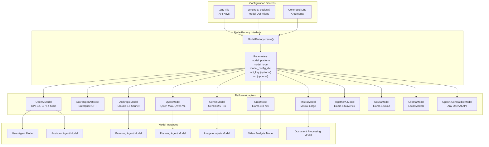
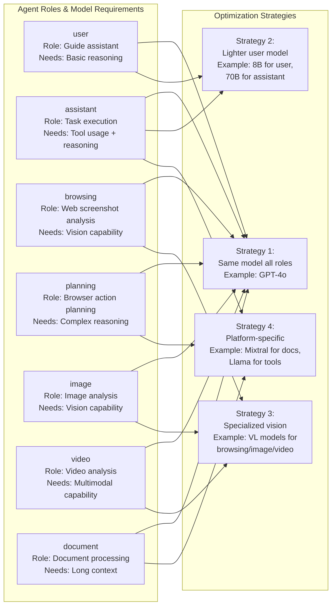
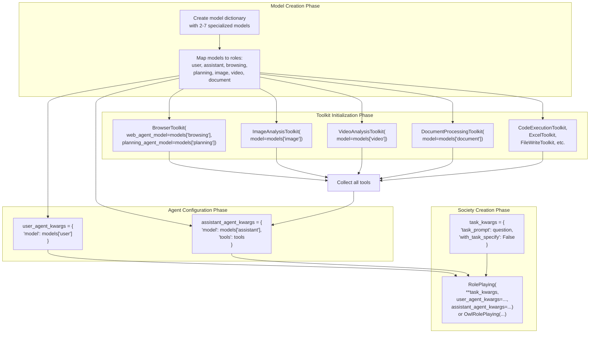

<!-- source: DeepWiki mcp.deepwiki.com · repo camel-ai/owl · page 6 Model Integration · fetched 2026-10-29 -->

# Model Integration

<details>
<summary>Relevant source files</summary>

The following files were used as context for generating this wiki page:

- [examples/run.py](examples/run.py)
- [examples/run_azure_openai.py](examples/run_azure_openai.py)
- [examples/run_gemini.py](examples/run_gemini.py)
- [examples/run_groq.py](examples/run_groq.py)
- [examples/run_mini.py](examples/run_mini.py)
- [examples/run_mistral.py](examples/run_mistral.py)
- [examples/run_novita_ai.py](examples/run_novita_ai.py)
- [examples/run_ollama.py](examples/run_ollama.py)
- [examples/run_openai_compatible_model.py](examples/run_openai_compatible_model.py)
- [examples/run_together_ai.py](examples/run_together_ai.py)

</details>


Model Integration provides the foundation for OWL's multi-platform LLM support. This page documents the `ModelFactory.create()` pattern, platform adapters, role-based model specialization, and configuration strategies across 10+ supported platforms.

For toolkit-specific model requirements (e.g., vision models for `BrowserToolkit`), see [Toolkit Architecture](#5.1). For benchmark-specific model configurations, see [GAIA Benchmark System](#7.1).

## Overview

OWL uses the `ModelFactory` from CAMEL-AI to abstract platform differences while enabling role-specific model optimization. Rather than using a single model for all purposes, the system creates specialized models for different agent roles (user, assistant, browsing, planning, image, video, document), allowing users to allocate computational resources efficiently.

**Key Concepts:**
- **Platform Abstraction**: `ModelPlatformType` enum defines supported platforms (OPENAI, ANTHROPIC, QWEN, GEMINI, GROQ, OLLAMA, etc.)
- **Model Types**: `ModelType` enum or string identifiers specify exact models (GPT_4O, CLAUDE_3_5_SONNET, GEMINI_2_5_PRO_EXP, etc.)
- **Role Specialization**: Different models assigned to `user`, `assistant`, `browsing`, `planning`, `image`, `video`, `document` roles
- **Configuration Dictionaries**: `model_config_dict` controls temperature, max_tokens, top_p, and other generation parameters

## ModelFactory Pattern



**Sources:** [examples/run.py:52-88](), [examples/run_groq.py:63-99](), [examples/run_azure_openai.py:53-65]()

### Basic Factory Usage

The `ModelFactory.create()` method signature:

```python
ModelFactory.create(
    model_platform: ModelPlatformType,
    model_type: ModelType | str,
    model_config_dict: dict,
    api_key: str = None,  # Optional, defaults to env vars
    url: str = None,      # Optional, for custom endpoints
)
```

**Standard Pattern** (OpenAI example):
```python
model = ModelFactory.create(
    model_platform=ModelPlatformType.OPENAI,
    model_type=ModelType.GPT_4O,
    model_config_dict={"temperature": 0},
)
```
[examples/run.py:53-57]()

**Custom Endpoint Pattern** (OpenAI-compatible API):
```python
model = ModelFactory.create(
    model_platform=ModelPlatformType.OPENAI_COMPATIBLE_MODEL,
    model_type="qwen-max",
    api_key=os.getenv("QWEN_API_KEY"),
    url="https://dashscope.aliyuncs.com/compatible-mode/v1",
    model_config_dict={"temperature": 0.4, "max_tokens": 128000},
)
```
[examples/run_openai_compatible_model.py:54-59]()

**Local Model Pattern** (Ollama):
```python
model = ModelFactory.create(
    model_platform=ModelPlatformType.OLLAMA,
    model_type="qwen2.5:72b",
    url="http://localhost:11434/v1",
    model_config_dict={"temperature": 0.8, "max_tokens": 1000000},
)
```
[examples/run_ollama.py:56-61]()

**Sources:** [examples/run.py:52-88](), [examples/run_openai_compatible_model.py:54-89](), [examples/run_ollama.py:55-86]()

## Role-Based Model Specialization



**Sources:** [examples/run.py:52-88](), [examples/run_groq.py:63-99](), [examples/run_ollama.py:55-86]()

### Role Definitions

| Role | Used By | Requirements | Typical Model Choice |
|------|---------|--------------|---------------------|
| `user` | `user_agent_kwargs` | Basic reasoning, conversation guidance | Lighter model (e.g., GPT-4o-mini, Llama-3.1-8B) or same as assistant |
| `assistant` | `assistant_agent_kwargs` | Tool calling, complex reasoning, task execution | Strongest model with tool support (e.g., GPT-4o, Claude-3.5-Sonnet, Llama-3.3-70B) |
| `browsing` | `BrowserToolkit(web_agent_model=...)` | Vision for screenshot analysis, web navigation | Vision-capable model (e.g., GPT-4o, Qwen-VL, Llava) |
| `planning` | `BrowserToolkit(planning_agent_model=...)` | Browser action planning, reasoning | Strong reasoning model (same as assistant) |
| `image` | `ImageAnalysisToolkit(model=...)` | Image understanding, OCR, visual QA | Vision-capable model (e.g., GPT-4o, Gemini-2.5-Pro) |
| `video` | `VideoAnalysisToolkit(model=...)` | Video frame analysis, temporal understanding | Multimodal model (e.g., GPT-4o, Gemini-2.5-Pro) |
| `document` | `DocumentProcessingToolkit(model=...)` | Document structure understanding, long context | Strong reasoning or specialized doc model (e.g., GPT-4o, Mixtral-8x7B) |

**Sources:** [examples/run.py:52-88](), [examples/run_groq.py:63-99](), [examples/run_ollama.py:55-86]()

### Platform-Specific Role Assignments

**OpenAI (Uniform Strategy):**
```python
models = {
    "user": ModelFactory.create(
        model_platform=ModelPlatformType.OPENAI,
        model_type=ModelType.GPT_4O,
        model_config_dict={"temperature": 0},
    ),
    "assistant": ModelFactory.create(...),  # Same GPT_4O
    "browsing": ModelFactory.create(...),   # Same GPT_4O
    "planning": ModelFactory.create(...),   # Same GPT_4O
    "image": ModelFactory.create(...),      # Same GPT_4O
    "video": ModelFactory.create(...),      # Same GPT_4O
    "document": ModelFactory.create(...),   # Same GPT_4O
}
```
[examples/run.py:52-88]()

**Groq (Tiered Strategy):**
```python
models = {
    "user": ModelFactory.create(
        model_platform=ModelPlatformType.GROQ,
        model_type=ModelType.GROQ_LLAMA_3_1_8B,  # Lightweight
        model_config_dict={"temperature": 0},
    ),
    "assistant": ModelFactory.create(
        model_platform=ModelPlatformType.GROQ,
        model_type=ModelType.GROQ_LLAMA_3_3_70B,  # Tool-capable
        model_config_dict={"temperature": 0},
    ),
    "document": ModelFactory.create(
        model_platform=ModelPlatformType.GROQ,
        model_type=ModelType.GROQ_MIXTRAL_8_7B,   # Document-specialized
        model_config_dict={"temperature": 0},
    ),
}
```
[examples/run_groq.py:64-98]()

**Ollama (Local + Vision Mix):**
```python
models = {
    "user": ModelFactory.create(
        model_platform=ModelPlatformType.OLLAMA,
        model_type="qwen2.5:72b",  # Text model
        url="http://localhost:11434/v1",
        model_config_dict={"temperature": 0.8, "max_tokens": 1000000},
    ),
    "browsing": ModelFactory.create(
        model_platform=ModelPlatformType.OLLAMA,
        model_type="llava:latest",  # Vision model
        url="http://localhost:11434/v1",
        model_config_dict={"temperature": 0.4, "max_tokens": 1000000},
    ),
}
```
[examples/run_ollama.py:56-86]()

**Sources:** [examples/run.py:52-88](), [examples/run_groq.py:64-98](), [examples/run_ollama.py:56-86]()

## Platform Configuration

```mermaid
graph TB
    subgraph "Cloud Platforms"
        direction TB
        OpenAI["OpenAI<br/>Requires: OPENAI_API_KEY<br/>Models: GPT_4O, GPT_4O_MINI<br/>Config: ModelType enum"]
        Azure["Azure OpenAI<br/>Requires: AZURE_OPENAI_API_KEY,<br/>AZURE_OPENAI_ENDPOINT,<br/>AZURE_OPENAI_MODEL_TYPE<br/>Config: Environment vars"]
        Anthropic["Anthropic<br/>Requires: ANTHROPIC_API_KEY<br/>Models: CLAUDE_3_5_SONNET<br/>Config: ModelType enum"]
        Gemini["Google Gemini<br/>Requires: GOOGLE_API_KEY<br/>Models: GEMINI_2_5_PRO_EXP<br/>Config: ModelType enum"]
        Groq["Groq<br/>Requires: GROQ_API_KEY<br/>Models: LLAMA_3_3_70B,<br/>MIXTRAL_8_7B, LLAMA_3_1_8B<br/>Config: ModelType enum"]
        Mistral["Mistral<br/>Requires: MISTRAL_API_KEY<br/>Models: MISTRAL_LARGE,<br/>MISTRAL_MEDIUM_3<br/>Config: ModelType enum"]
        Together["Together AI<br/>Requires: TOGETHER_API_KEY<br/>Models: LLAMA_4_MAVERICK<br/>Config: ModelType enum"]
        Novita["Novita<br/>Requires: NOVITA_API_KEY<br/>Models: LLAMA_4_SCOUT_17B<br/>Config: ModelType enum"]
    end
    
    subgraph "Chinese Platforms"
        Qwen["Qwen (Alibaba)<br/>Requires: QWEN_API_KEY<br/>Models: qwen-max, qwen-vl-max<br/>Config: String identifier"]
        DeepSeek["DeepSeek<br/>Requires: DEEPSEEK_API_KEY<br/>Models: deepseek-chat<br/>Config: String identifier"]
    end
    
    subgraph "Local & Custom"
        Ollama["Ollama<br/>Requires: Local server<br/>Models: Any Ollama model<br/>Config: String + URL"]
        Compatible["OpenAI-Compatible<br/>Requires: Custom API key + URL<br/>Models: Any compatible API<br/>Config: String + URL + key"]
    end
    
    ENV[".env File"] --> OpenAI
    ENV --> Azure
    ENV --> Anthropic
    ENV --> Gemini
    ENV --> Groq
    ENV --> Mistral
    ENV --> Together
    ENV --> Novita
    ENV --> Qwen
    ENV --> DeepSeek
    
    Local["Local Installation"] --> Ollama
    Custom["Custom Endpoint"] --> Compatible
```



**Sources:** [examples/run_azure_openai.py:14-65](), [examples/run_openai_compatible_model.py:54-89](), [examples/run_ollama.py:56-86]()

### Configuration Parameters Table

| Parameter | Type | Purpose | Example Values | Notes |
|-----------|------|---------|----------------|-------|
| `model_platform` | `ModelPlatformType` | Platform selector | `OPENAI`, `ANTHROPIC`, `GROQ`, `OLLAMA`, `OPENAI_COMPATIBLE_MODEL` | Required, enum from CAMEL |
| `model_type` | `ModelType` or `str` | Specific model | `GPT_4O`, `"qwen-max"`, `"llava:latest"` | Enum for major platforms, string for custom |
| `model_config_dict` | `dict` | Generation parameters | `{"temperature": 0, "max_tokens": 4096}` | Required, controls model behavior |
| `api_key` | `str` | Authentication | `os.getenv("QWEN_API_KEY")` | Optional, defaults to env vars |
| `url` | `str` | Custom endpoint | `"http://localhost:11434/v1"` | Required for Ollama and compatible APIs |

**Sources:** [examples/run.py:52-88](), [examples/run_openai_compatible_model.py:54-89](), [examples/run_ollama.py:56-86]()

### Common model_config_dict Settings

```python
# Deterministic (benchmarking, production)
{"temperature": 0, "max_tokens": 4096}

# Balanced (general tasks)
{"temperature": 0.4, "max_tokens": 128000}

# Creative (user role with diversity)
{"temperature": 0.8, "max_tokens": 1000000}

# Full configuration example (Azure)
ChatGPTConfig(
    temperature=0.4,
    max_tokens=4096,
    top_p=1.0,
    frequency_penalty=0,
    presence_penalty=0,
).as_dict()
```

**Sources:** [examples/run.py:56](), [examples/run_azure_openai.py:56](), [examples/run_ollama.py:60]()

## Platform-Specific Examples

### OpenAI

**Standard Configuration:**
```python
from camel.types import ModelPlatformType, ModelType

model = ModelFactory.create(
    model_platform=ModelPlatformType.OPENAI,
    model_type=ModelType.GPT_4O,
    model_config_dict={"temperature": 0},
)
```

**Environment Variables Required:**
- `OPENAI_API_KEY`

**Available Models (via ModelType enum):**
- `ModelType.GPT_4O` - Latest GPT-4o
- `ModelType.GPT_4O_MINI` - Lighter GPT-4o variant
- `ModelType.GPT_4_TURBO` - GPT-4 Turbo

**Sources:** [examples/run.py:53-87](), [examples/run_mini.py:53-72]()

### Azure OpenAI

**Configuration:**
```python
from camel.configs import ChatGPTConfig

base_model_config = {
    "model_platform": ModelPlatformType.AZURE,
    "model_type": os.getenv("AZURE_OPENAI_MODEL_TYPE"),
    "model_config_dict": ChatGPTConfig(
        temperature=0.4, 
        max_tokens=4096
    ).as_dict(),
}
model = ModelFactory.create(**base_model_config)
```

**Environment Variables Required:**
- `AZURE_OPENAI_API_KEY`
- `AZURE_OPENAI_ENDPOINT`
- `AZURE_OPENAI_MODEL_TYPE` (your deployment name)

**Notes:**
- Uses deployment names instead of model types
- Enterprise features: private endpoints, data residency
- Same API as OpenAI but with Azure infrastructure

**Sources:** [examples/run_azure_openai.py:53-65]()

### Anthropic Claude

**Configuration:**
```python
# Claude is not shown in the provided files, but follows the standard pattern
model = ModelFactory.create(
    model_platform=ModelPlatformType.ANTHROPIC,
    model_type=ModelType.CLAUDE_3_5_SONNET,
    model_config_dict={"temperature": 0},
)
```

**Environment Variables Required:**
- `ANTHROPIC_API_KEY`

**Available Models:**
- `ModelType.CLAUDE_3_5_SONNET` - Latest Claude 3.5 Sonnet
- Other Claude variants as supported by CAMEL

**Sources:** Based on architecture diagrams (not directly in provided files)

### Google Gemini

**Configuration:**
```python
model = ModelFactory.create(
    model_platform=ModelPlatformType.GEMINI,
    model_type=ModelType.GEMINI_2_5_PRO_EXP,
    model_config_dict={"temperature": 0},
)
```

**Environment Variables Required:**
- `GOOGLE_API_KEY`

**Available Models:**
- `ModelType.GEMINI_2_5_PRO_EXP` - Gemini 2.5 Pro Experimental
- Other Gemini variants

**Vision Support:** Yes, handles image and video analysis

**Sources:** [examples/run_gemini.py:51-86]()

### Groq

**Configuration with Role Specialization:**
```python
models = {
    "user": ModelFactory.create(
        model_platform=ModelPlatformType.GROQ,
        model_type=ModelType.GROQ_LLAMA_3_1_8B,  # Simple role
        model_config_dict={"temperature": 0},
    ),
    "assistant": ModelFactory.create(
        model_platform=ModelPlatformType.GROQ,
        model_type=ModelType.GROQ_LLAMA_3_3_70B,  # Tool-capable
        model_config_dict={"temperature": 0},
    ),
    "document": ModelFactory.create(
        model_platform=ModelPlatformType.GROQ,
        model_type=ModelType.GROQ_MIXTRAL_8_7B,  # Document processing
        model_config_dict={"temperature": 0},
    ),
}
```

**Environment Variables Required:**
- `GROQ_API_KEY`
- `OPENAI_API_BASE_URL` set to `"https://api.groq.com/openai/v1"`

**Available Models:**
- `ModelType.GROQ_LLAMA_3_3_70B` - Best for tool usage and complex reasoning
- `ModelType.GROQ_LLAMA_3_1_8B` - Lightweight for simple roles
- `ModelType.GROQ_MIXTRAL_8_7B` - Good for document processing

**Performance Notes:**
- Extremely fast inference
- Tool-intensive roles require 70B model
- 8B model sufficient for user role without tools

**Sources:** [examples/run_groq.py:64-99]()

### Mistral

**Configuration:**
```python
models = {
    "user": ModelFactory.create(
        model_platform=ModelPlatformType.MISTRAL,
        model_type=ModelType.MISTRAL_MEDIUM_3,
        model_config_dict={"temperature": 0},
    ),
    "assistant": ModelFactory.create(
        model_platform=ModelPlatformType.MISTRAL,
        model_type=ModelType.MISTRAL_LARGE,
        model_config_dict={"temperature": 0},
    ),
}
```

**Environment Variables Required:**
- `MISTRAL_API_KEY`

**Available Models:**
- `ModelType.MISTRAL_LARGE` - Best for assistant role
- `ModelType.MISTRAL_MEDIUM_3` - Good for user role

**Sources:** [examples/run_mistral.py:110-120]()

### Together AI

**Configuration:**
```python
model = ModelFactory.create(
    model_platform=ModelPlatformType.TOGETHER,
    model_type=ModelType.TOGETHER_LLAMA_4_MAVERICK,
    model_config_dict={"temperature": 0},
)
```

**Environment Variables Required:**
- `TOGETHER_API_KEY`

**Available Models:**
- `ModelType.TOGETHER_LLAMA_4_MAVERICK` - Latest Llama 4 variant

**Sources:** [examples/run_together_ai.py:50-79]()

### Novita AI

**Configuration:**
```python
model = ModelFactory.create(
    model_platform=ModelPlatformType.NOVITA,
    model_type=ModelType.NOVITA_LLAMA_4_SCOUT_17B,
    model_config_dict={"temperature": 0},
)
```

**Environment Variables Required:**
- `NOVITA_API_KEY`

**Available Models:**
- `ModelType.NOVITA_LLAMA_4_SCOUT_17B` - 17B parameter Llama 4 variant

**Sources:** [examples/run_novita_ai.py:50-80]()

### Qwen (Alibaba)

**OpenAI-Compatible API Configuration:**
```python
model = ModelFactory.create(
    model_platform=ModelPlatformType.OPENAI_COMPATIBLE_MODEL,
    model_type="qwen-max",
    api_key=os.getenv("QWEN_API_KEY"),
    url="https://dashscope.aliyuncs.com/compatible-mode/v1",
    model_config_dict={"temperature": 0.4, "max_tokens": 128000},
)
```

**Environment Variables Required:**
- `QWEN_API_KEY`

**Available Models:**
- `"qwen-max"` - General reasoning
- `"qwen-vl-max"` - Vision-language for image/browsing tasks

**Notes:**
- Uses OpenAI-compatible endpoint
- Excellent Chinese language support
- Vision variants available for multimodal tasks

**Sources:** [examples/run_openai_compatible_model.py:54-89]()

### Ollama (Local Models)

**Configuration:**
```python
models = {
    "user": ModelFactory.create(
        model_platform=ModelPlatformType.OLLAMA,
        model_type="qwen2.5:72b",
        url="http://localhost:11434/v1",
        model_config_dict={"temperature": 0.8, "max_tokens": 1000000},
    ),
    "browsing": ModelFactory.create(
        model_platform=ModelPlatformType.OLLAMA,
        model_type="llava:latest",  # Vision model
        url="http://localhost:11434/v1",
        model_config_dict={"temperature": 0.4, "max_tokens": 1000000},
    ),
}
```

**Setup Requirements:**
1. Install Ollama: `https://ollama.com`
2. Pull models: `ollama pull qwen2.5:72b`, `ollama pull llava:latest`
3. Start Ollama server (usually automatic)

**Common Model Choices:**
- Text models: `qwen2.5:72b`, `llama3.1:70b`, `mistral:latest`
- Vision models: `llava:latest`, `llava:13b`, `bakllava:latest`

**Advantages:**
- No API costs
- Full privacy (local processing)
- No rate limits
- Support for custom fine-tuned models

**Limitations:**
- Requires local GPU resources
- Slower than cloud APIs for large models
- Vision models may be less capable than cloud alternatives

**Sources:** [examples/run_ollama.py:56-86]()

### OpenAI-Compatible APIs

**Generic Configuration Pattern:**
```python
model = ModelFactory.create(
    model_platform=ModelPlatformType.OPENAI_COMPATIBLE_MODEL,
    model_type="custom-model-name",
    api_key=os.getenv("CUSTOM_API_KEY"),
    url="https://custom-endpoint.com/v1",
    model_config_dict={"temperature": 0.4, "max_tokens": 128000},
)
```

**Use Cases:**
- **Self-hosted vLLM instances:** Deploy open-source models with OpenAI-compatible API
- **Chinese platforms:** Qwen, DeepSeek, Zhipu via compatible endpoints
- **Custom inference providers:** Any service implementing OpenAI API spec
- **Local inference servers:** Text Generation WebUI, LocalAI, etc.

**Configuration Requirements:**
- `url`: Full endpoint URL (usually ends in `/v1`)
- `api_key`: Provider-specific API key (or dummy value for local servers)
- `model_type`: String matching provider's model identifier

**Example: DeepSeek (conceptual, not in provided files):**
```python
model = ModelFactory.create(
    model_platform=ModelPlatformType.OPENAI_COMPATIBLE_MODEL,
    model_type="deepseek-chat",
    api_key=os.getenv("DEEPSEEK_API_KEY"),
    url="https://api.deepseek.com/v1",
    model_config_dict={"temperature": 0.4},
)
```

**Sources:** [examples/run_openai_compatible_model.py:54-89]()

## Integration into construct_society



**Sources:** [examples/run.py:40-128](), [examples/run_groq.py:52-139]()

### Complete Example: construct_society Function

```python
def construct_society(question: str) -> RolePlaying:
    """Construct a society with role-specialized models."""
    
    # Phase 1: Create models for different roles
    models = {
        "user": ModelFactory.create(
            model_platform=ModelPlatformType.OPENAI,
            model_type=ModelType.GPT_4O,
            model_config_dict={"temperature": 0},
        ),
        "assistant": ModelFactory.create(
            model_platform=ModelPlatformType.OPENAI,
            model_type=ModelType.GPT_4O,
            model_config_dict={"temperature": 0},
        ),
        "browsing": ModelFactory.create(
            model_platform=ModelPlatformType.OPENAI,
            model_type=ModelType.GPT_4O,
            model_config_dict={"temperature": 0},
        ),
        "planning": ModelFactory.create(
            model_platform=ModelPlatformType.OPENAI,
            model_type=ModelType.GPT_4O,
            model_config_dict={"temperature": 0},
        ),
        "video": ModelFactory.create(
            model_platform=ModelPlatformType.OPENAI,
            model_type=ModelType.GPT_4O,
            model_config_dict={"temperature": 0},
        ),
        "image": ModelFactory.create(
            model_platform=ModelPlatformType.OPENAI,
            model_type=ModelType.GPT_4O,
            model_config_dict={"temperature": 0},
        ),
        "document": ModelFactory.create(
            model_platform=ModelPlatformType.OPENAI,
            model_type=ModelType.GPT_4O,
            model_config_dict={"temperature": 0},
        ),
    }
    
    # Phase 2: Initialize toolkits with specialized models
    tools = [
        *BrowserToolkit(
            headless=False,
            web_agent_model=models["browsing"],
            planning_agent_model=models["planning"],
        ).get_tools(),
        *VideoAnalysisToolkit(model=models["video"]).get_tools(),
        *AudioAnalysisToolkit().get_tools(),
        *CodeExecutionToolkit(sandbox="subprocess", verbose=True).get_tools(),
        *ImageAnalysisToolkit(model=models["image"]).get_tools(),
        SearchToolkit().search_duckduckgo,
        SearchToolkit().search_google,
        SearchToolkit().search_wiki,
        *ExcelToolkit().get_tools(),
        *DocumentProcessingToolkit(model=models["document"]).get_tools(),
        *FileWriteToolkit(output_dir="./").get_tools(),
    ]
    
    # Phase 3: Configure agents with their models
    user_agent_kwargs = {"model": models["user"]}
    assistant_agent_kwargs = {
        "model": models["assistant"],
        "tools": tools,
    }
    
    # Phase 4: Configure task
    task_kwargs = {
        "task_prompt": question,
        "with_task_specify": False,
    }
    
    # Phase 5: Create society
    society = RolePlaying(
        **task_kwargs,
        user_role_name="user",
        user_agent_kwargs=user_agent_kwargs,
        assistant_role_name="assistant",
        assistant_agent_kwargs=assistant_agent_kwargs,
    )
    
    return society
```

**Sources:** [examples/run.py:41-128]()

## Best Practices

### 1. Choose Platform Based on Requirements

| Requirement | Recommended Platform | Rationale |
|-------------|---------------------|-----------|
| Best performance, all features | OpenAI (GPT-4o) | Most capable multimodal model, excellent tool usage |
| Cost optimization | Groq (tiered approach) | Fast inference, use 8B for simple roles, 70B for tools |
| Chinese language tasks | Qwen | Native Chinese support, competitive pricing |
| Privacy / local processing | Ollama | All processing on-device, no data sharing |
| Enterprise compliance | Azure OpenAI | Data residency, SLAs, private endpoints |
| Fast prototyping | Gemini | Generous free tier, good multimodal support |

### 2. Model Selection by Role

```python
# Pattern 1: Uniform (simple, but potentially expensive)
all_same_model = ModelType.GPT_4O

# Pattern 2: Tiered (cost-optimized)
models = {
    "user": ModelType.GPT_4O_MINI,      # Guidance role, lighter
    "assistant": ModelType.GPT_4O,      # Main reasoning, strongest
    "browsing": ModelType.GPT_4O,       # Needs vision
    "planning": ModelType.GPT_4O,       # Complex reasoning
    "image": ModelType.GPT_4O,          # Needs vision
    "video": ModelType.GPT_4O,          # Needs vision
    "document": ModelType.GPT_4O_MINI,  # Can use lighter
}

# Pattern 3: Platform-specific optimization
groq_models = {
    "user": ModelType.GROQ_LLAMA_3_1_8B,     # No tools needed
    "assistant": ModelType.GROQ_LLAMA_3_3_70B,  # Tool calling
    "document": ModelType.GROQ_MIXTRAL_8_7B,    # Specialized
}
```

### 3. Configuration Guidelines

**Temperature Settings:**
- `0.0`: Deterministic, benchmarking, production tasks requiring consistency
- `0.2-0.4`: Balanced, most general tasks
- `0.6-0.8`: Creative tasks, diverse output needed (user role for guidance variation)

**Max Tokens:**
- Benchmarks: Set to platform maximum (e.g., `128000` for Qwen, `1000000` for Ollama)
- Production: Conservative limits (e.g., `4096`) to control costs
- Long documents: Use platform limits for document processing role

**Example configurations:**
```python
# Production (cost-aware, deterministic)
{"temperature": 0, "max_tokens": 4096}

# Benchmark (maximize capability)
{"temperature": 0, "max_tokens": 128000}

# User role (diverse guidance)
{"temperature": 0.8, "max_tokens": 1000}
```

### 4. Environment Variable Management

**.env Structure:**
```bash
# OpenAI
OPENAI_API_KEY=sk-...

# Azure OpenAI
AZURE_OPENAI_API_KEY=...
AZURE_OPENAI_ENDPOINT=https://....openai.azure.com/
AZURE_OPENAI_MODEL_TYPE=gpt-4o-deployment-name

# Anthropic
ANTHROPIC_API_KEY=sk-ant-...

# Google
GOOGLE_API_KEY=AI...

# Groq
GROQ_API_KEY=gsk_...

# Mistral
MISTRAL_API_KEY=...

# Together AI
TOGETHER_API_KEY=...

# Qwen
QWEN_API_KEY=sk-...

# DeepSeek
DEEPSEEK_API_KEY=sk-...
```

**Loading Pattern:**
```python
import pathlib
from dotenv import load_dotenv

base_dir = pathlib.Path(__file__).parent.parent
env_path = base_dir / "owl" / ".env"
load_dotenv(dotenv_path=str(env_path))
```
[examples/run.py:34-36]()

### 5. Error Handling

**Common Issues:**
- **Missing API keys:** Verify `.env` file and environment variable names
- **Rate limits:** Implement retry logic, use `max_retries` in model config
- **Model not found:** Check `ModelType` enum or string identifier spelling
- **Tool compatibility:** Some platforms don't support all toolkit features (e.g., audio analysis requires OpenAI API)

**Validation approach:**
```python
# Verify model creation before expensive operations
try:
    model = ModelFactory.create(...)
    # Test with a simple prompt
    response = model.run("test")
except Exception as e:
    print(f"Model creation failed: {e}")
```

**Sources:** [examples/run.py:1-149](), [examples/run_groq.py:1-165](), [examples/run_azure_openai.py:1-124]()

## Advanced Topics

### Multi-Model Societies

For complex tasks, different sub-agents can use different models simultaneously:

```python
# Browser automation uses vision model
browser_model = ModelFactory.create(
    model_platform=ModelPlatformType.QWEN,
    model_type="qwen-vl-max",  # Vision-capable
    ...
)

# Main reasoning uses text model
reasoning_model = ModelFactory.create(
    model_platform=ModelPlatformType.QWEN,
    model_type="qwen-max",  # Text-only, faster
    ...
)

# Document processing uses specialized model
document_model = ModelFactory.create(
    model_platform=ModelPlatformType.GROQ,
    model_type=ModelType.GROQ_MIXTRAL_8_7B,  # Good at documents
    ...
)
```

This pattern enables:
- Cost optimization (vision models only where needed)
- Performance optimization (faster models for simple tasks)
- Platform optimization (use each platform's strengths)

**Sources:** [examples/run_openai_compatible_model.py:68-88](), [examples/run_groq.py:64-98]()

### Custom Model Configurations

For specialized use cases, extend `model_config_dict`:

```python
from camel.configs import ChatGPTConfig

advanced_config = ChatGPTConfig(
    temperature=0.4,
    max_tokens=4096,
    top_p=0.95,
    frequency_penalty=0.1,
    presence_penalty=0.1,
    response_format={"type": "json_object"},  # Force JSON output
).as_dict()

model = ModelFactory.create(
    model_platform=ModelPlatformType.OPENAI,
    model_type=ModelType.GPT_4O,
    model_config_dict=advanced_config,
)
```

**Sources:** [examples/run_azure_openai.py:56]()

### Testing Multiple Platforms

To compare platforms, parameterize the `construct_society` function:

```python
def construct_society(
    question: str, 
    platform: ModelPlatformType,
    model_type: str | ModelType,
) -> RolePlaying:
    """Platform-agnostic society construction."""
    
    base_config = {
        "model_platform": platform,
        "model_type": model_type,
        "model_config_dict": {"temperature": 0},
    }
    
    # Create models for all roles
    models = {role: ModelFactory.create(**base_config) 
              for role in ["user", "assistant", "browsing", ...]}
    
    # Rest of society construction...
```

This enables systematic benchmarking across platforms while maintaining identical toolkit and task configurations.

**Sources:** Based on patterns from all example files

---

