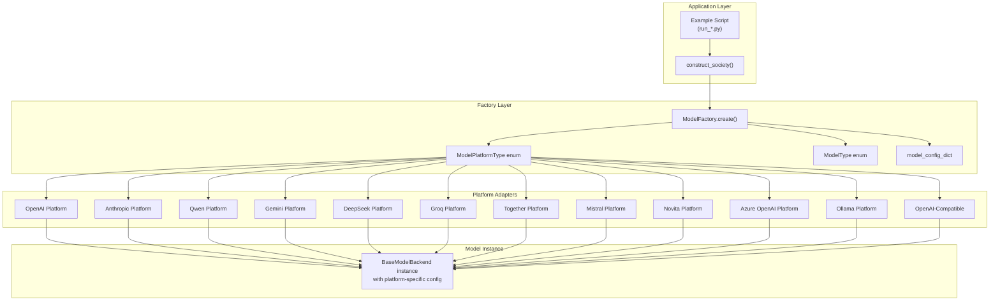
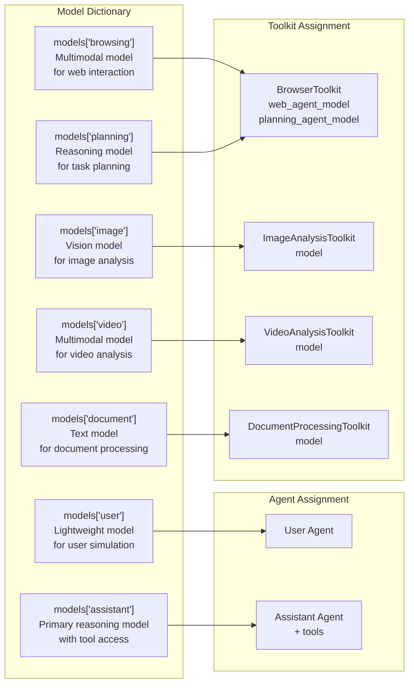
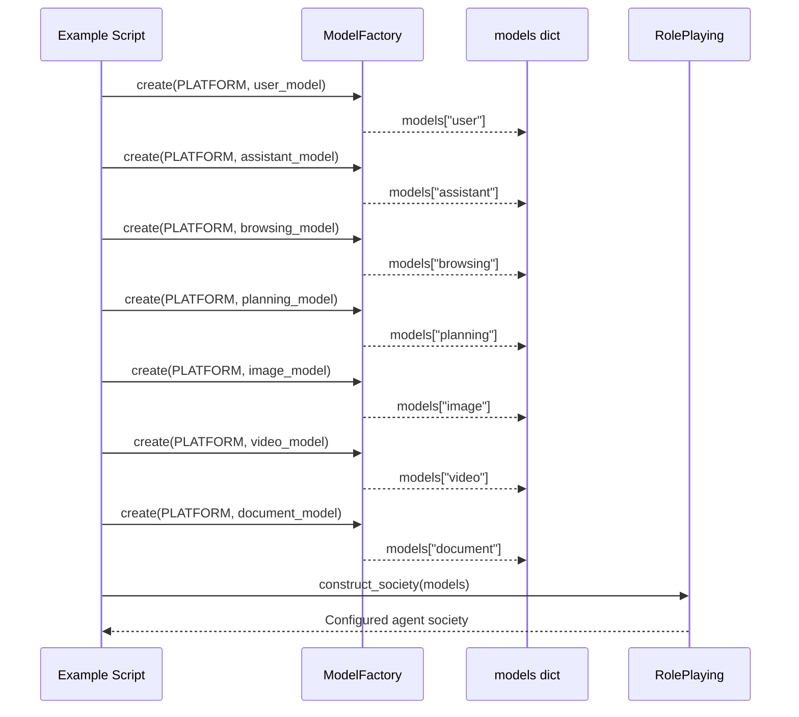

<!-- source: DeepWiki mcp.deepwiki.com · repo camel-ai/owl · page 6.1 Supported Platforms Overview · fetched 2026-10-29 -->

# Supported Platforms Overview

<details>
<summary>Relevant source files</summary>

The following files were used as context for generating this wiki page:

- [.gitignore](.gitignore)
- [README.md](README.md)
- [README_ja.md](README_ja.md)
- [README_zh.md](README_zh.md)
- [examples/run_gemini.py](examples/run_gemini.py)
- [examples/run_groq.py](examples/run_groq.py)
- [examples/run_mistral.py](examples/run_mistral.py)
- [examples/run_novita_ai.py](examples/run_novita_ai.py)
- [examples/run_openai_compatible_model.py](examples/run_openai_compatible_model.py)
- [examples/run_together_ai.py](examples/run_together_ai.py)
- [owl/assets/owl-favicon.ico](owl/assets/owl-favicon.ico)

</details>


## Purpose and Scope

This page provides a comprehensive overview of all LLM platforms supported by OWL for model integration. It catalogs the available platforms, their capabilities, and the factory pattern used to instantiate models across different providers. For detailed configuration instructions specific to each platform, see [OpenAI & Azure OpenAI](#6.2), [Claude & Gemini](#6.3), [Chinese LLM Platforms](#6.4), and [Local & Self-Hosted Models](#6.5).

## Platform Integration Architecture

OWL uses the `ModelFactory.create()` pattern from the CAMEL framework to abstract platform differences and provide a unified interface for model instantiation. All model creation flows through this factory, which handles platform-specific authentication, API routing, and configuration.

### ModelFactory Creation Pattern



**Sources:** [examples/run_mistral.py:109-120](), [examples/run_groq.py:64-99](), [examples/run_gemini.py:50-86]()

## Supported Platforms Matrix

The table below catalogs all supported LLM platforms, their primary model types, key capabilities, and authentication requirements.

| Platform | ModelPlatformType | Example Models | Tool Calling | Multimodal | Auth Method | Example Script |
|----------|-------------------|----------------|--------------|------------|-------------|----------------|
| **OpenAI** | `OPENAI` | GPT-4o, GPT-4-turbo, GPT-4o-mini | ✓ | ✓ (vision) | API Key (`OPENAI_API_KEY`) | run.py |
| **Anthropic Claude** | `ANTHROPIC` | Claude 3.5 Sonnet, Claude 3 Opus | ✓ | ✓ (vision) | API Key (`ANTHROPIC_API_KEY`) | run_claude.py |
| **Google Gemini** | `GEMINI` | Gemini 2.5 Pro Exp, Gemini 1.5 Pro | ✓ | ✓ (vision, video) | API Key (`GOOGLE_API_KEY`) | run_gemini.py |
| **Qwen (Alibaba)** | `QWEN` | Qwen Max, Qwen VL Max | ✓ | ✓ (vision) | API Key (`QWEN_API_KEY`) | run_qwen_zh.py |
| **DeepSeek** | `DEEPSEEK` | DeepSeek Chat, DeepSeek Coder | ✓ | ✗ | API Key (`DEEPSEEK_API_KEY`) | run_deepseek_zh.py |
| **Azure OpenAI** | `AZURE_OPENAI` | GPT-4o, GPT-4-turbo (Azure-hosted) | ✓ | ✓ (vision) | API Key + Endpoint | run_azure_openai.py |
| **Groq** | `GROQ` | Llama 3.3 70B, Llama 3.1 8B, Mixtral 8x7B | ✓ | Limited | API Key (`GROQ_API_KEY`) | run_groq.py |
| **Together AI** | `TOGETHER` | Llama 4 Maverick, various OSS models | ✓ | Limited | API Key (`TOGETHER_API_KEY`) | run_together_ai.py |
| **Mistral** | `MISTRAL` | Mistral Large, Mistral Medium | ✓ | Limited | API Key (`MISTRAL_API_KEY`) | run_mistral.py |
| **Novita AI** | `NOVITA` | Llama 4 Scout 17B, various models | ✓ | Limited | API Key (`NOVITA_API_KEY`) | run_novita_ai.py |
| **Ollama** | `OLLAMA` | Llama 3, Mistral, custom local models | ✓ | Varies | Local (no key) | run_ollama.py |
| **OpenAI-Compatible** | `OPENAI_COMPATIBLE_MODEL` | Any OpenAI-spec API | Varies | Varies | Custom API Key + URL | run_openai_compatible_model.py |

**Sources:** [README.md:416-444](), [examples/run_groq.py:64-99](), [examples/run_gemini.py:50-86](), [examples/run_together_ai.py:50-80]()

## Platform Categories

### Commercial Cloud Platforms

These platforms provide managed API services with enterprise-grade reliability:

- **OpenAI**: Industry-leading tool calling and multimodal capabilities. Recommended for production use per [README.md:419]().
- **Anthropic Claude**: Strong reasoning and safety features with vision support.
- **Google Gemini**: Advanced multimodal capabilities including native video understanding.
- **Azure OpenAI**: Enterprise deployment of OpenAI models with additional compliance features.

### Chinese LLM Platforms

Platforms optimized for Chinese language tasks and deployed within Chinese infrastructure:

- **Qwen (Alibaba)**: Qwen Max and Qwen VL Max with strong Chinese language support.
- **DeepSeek**: Focus on coding and reasoning tasks.

See [Chinese LLM Platforms](#6.4) for detailed configuration.

### High-Performance Inference Platforms

Platforms providing fast, cost-effective inference for open-source models:

- **Groq**: Ultra-fast inference using custom LPU chips. Supports Llama and Mixtral models.
- **Together AI**: Wide selection of open-source models with competitive pricing.
- **Mistral**: First-party API for Mistral model family.
- **Novita AI**: GPU-accelerated inference for various open models.

### Local and Self-Hosted

- **Ollama**: Run models locally without API keys. Supports Llama, Mistral, and custom models.
- **OpenAI-Compatible APIs**: Generic adapter for any service implementing OpenAI's API specification (vLLM, LocalAI, text-generation-webui, etc.).

See [Local & Self-Hosted Models](#6.5) for setup instructions.

**Sources:** [README.md:416-444](), [examples/run_groq.py:15-27]()

## Model Role Specialization

OWL employs role-based model selection where different models are assigned to specialized tasks. The `construct_society()` function creates a dictionary of models keyed by role:



### Role-Specific Requirements

| Role | Model Type | Capabilities Required | Typical Platform Choice |
|------|-----------|----------------------|------------------------|
| `user` | Lightweight | Basic chat | GPT-4o-mini, Llama 3.1 8B, Qwen Plus |
| `assistant` | Full-featured | Tool calling, reasoning | GPT-4o, Claude 3.5 Sonnet, Gemini 2.5 Pro |
| `browsing` | Multimodal | Vision + tool calling | GPT-4o, Qwen VL Max, Gemini 2.5 Pro |
| `planning` | Reasoning | Complex planning | GPT-4o, Claude 3.5 Sonnet |
| `image` | Vision | Image understanding | GPT-4o, Qwen VL Max, Gemini 2.5 Pro |
| `video` | Video-capable | Video understanding | Gemini 2.5 Pro, GPT-4o |
| `document` | Text processing | Document parsing | GPT-4o, Mixtral 8x7B |

**Sources:** [examples/run_groq.py:64-99](), [examples/run_gemini.py:50-86](), [examples/run_novita_ai.py:49-80]()

## Configuration Patterns

### Basic Configuration

All platforms follow this configuration pattern:

```python
model = ModelFactory.create(
    model_platform=ModelPlatformType.PLATFORM_NAME,
    model_type=ModelType.SPECIFIC_MODEL,
    model_config_dict={"temperature": 0, "max_tokens": 4096}
)
```

**Common Configuration Parameters:**

| Parameter | Type | Purpose | Example Values |
|-----------|------|---------|----------------|
| `temperature` | float | Sampling randomness | `0` (deterministic), `0.7` (creative) |
| `max_tokens` | int | Maximum output length | `4096`, `8192`, `128000` |
| `top_p` | float | Nucleus sampling | `0.9`, `1.0` |
| `top_k` | int | Top-k sampling | `50`, `100` |

**Sources:** [examples/run_mistral.py:110-119](), [examples/run_groq.py:64-73]()

### Platform-Specific Configuration

#### OpenAI-Compatible APIs

For custom endpoints, additional parameters are required:

```python
model = ModelFactory.create(
    model_platform=ModelPlatformType.OPENAI_COMPATIBLE_MODEL,
    model_type="custom-model-name",
    api_key=os.getenv("CUSTOM_API_KEY"),
    url="https://custom-endpoint.com/v1",
    model_config_dict={"temperature": 0.4, "max_tokens": 128000}
)
```

**Sources:** [examples/run_openai_compatible_model.py:54-67]()

#### Ollama (Local)

Ollama does not require API keys but needs local installation:

```python
model = ModelFactory.create(
    model_platform=ModelPlatformType.OLLAMA,
    model_type="llama3",
    model_config_dict={"temperature": 0}
)
```

### Multi-Model Society Pattern

The typical pattern creates 6-7 specialized models:



**Sources:** [examples/run_groq.py:64-99](), [examples/run_gemini.py:50-86]()

## Platform Selection Guidance

### Recommended Platforms by Use Case

| Use Case | Recommended Platform | Rationale |
|----------|---------------------|-----------|
| Production deployment | OpenAI (GPT-4o) | Best tool calling, multimodal support, reliability |
| Chinese language tasks | Qwen Max | Native Chinese optimization |
| Budget-conscious | Groq (Llama 3.3 70B) | Fast inference, competitive pricing |
| Privacy/on-premise | Ollama | Local execution, no data transmission |
| Video understanding | Gemini 2.5 Pro | Native video processing |
| Maximum throughput | Together AI | Parallel processing capabilities |
| Enterprise compliance | Azure OpenAI | SLA guarantees, compliance certifications |

### Performance Considerations

From [README.md:419](): "For optimal performance, we strongly recommend using OpenAI models (GPT-4 or later versions). Our experiments show that other models may result in significantly lower performance on complex tasks and benchmarks, especially those requiring advanced multi-modal understanding and tool use."

**Critical Requirements for OWL:**

1. **Tool Calling**: Models must robustly parse tool schemas and generate valid function calls
2. **Multimodal Understanding**: Web automation requires visual understanding of screenshots
3. **Long Context**: Document processing benefits from 32K+ context windows
4. **Instruction Following**: Precise adherence to formatting requirements (e.g., TASK_DONE markers)

**Sources:** [README.md:409-420]()

## Environment Variable Mapping

Each platform requires specific environment variables for authentication:

| Platform | Environment Variable(s) | Location in `.env` |
|----------|------------------------|-------------------|
| OpenAI | `OPENAI_API_KEY` | `.env` |
| Claude | `ANTHROPIC_API_KEY` | `.env` |
| Gemini | `GOOGLE_API_KEY` | `.env` |
| Qwen | `QWEN_API_KEY` | `.env` |
| DeepSeek | `DEEPSEEK_API_KEY` | `.env` |
| Azure OpenAI | `AZURE_OPENAI_API_KEY`, `AZURE_OPENAI_API_BASE_URL` | `.env` |
| Groq | `GROQ_API_KEY` | `.env` |
| Together AI | `TOGETHER_API_KEY` | `.env` |
| Mistral | `MISTRAL_API_KEY` | `.env` |
| Novita AI | `NOVITA_API_KEY` | `.env` |
| Ollama | None (local) | N/A |
| Custom APIs | Custom variable name + URL | `.env` |

For complete environment setup instructions, see [Environment Configuration](#3.3).

**Sources:** [README.md:339-394](), [examples/run_openai_compatible_model.py:57-58]()

## Extension Points

### Adding New Platforms

To integrate a new platform that implements the OpenAI API specification:

1. Use `ModelPlatformType.OPENAI_COMPATIBLE_MODEL`
2. Specify the `api_key` and `url` parameters
3. Provide the model name as `model_type`

For platforms requiring custom authentication or API formats, integration requires extending the CAMEL framework's model backend implementations.

**Sources:** [examples/run_openai_compatible_model.py:54-67]()

---

