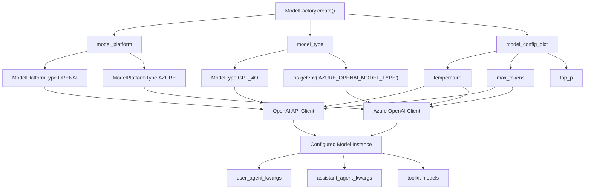
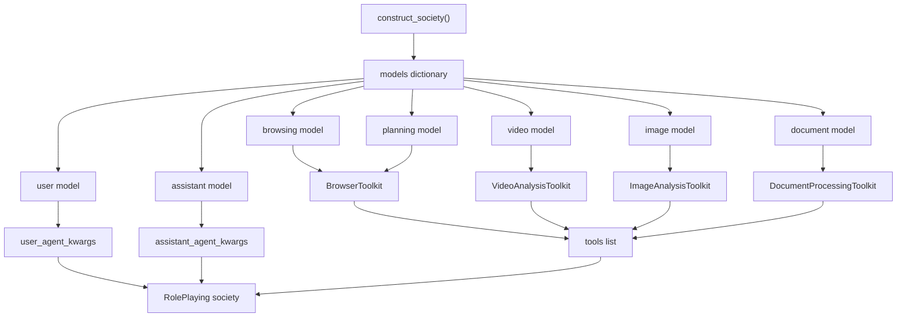

<!-- source: DeepWiki mcp.deepwiki.com · repo camel-ai/owl · page 6.2 OpenAI & Azure OpenAI · fetched 2026-10-29 -->

# OpenAI & Azure OpenAI

<details>
<summary>Relevant source files</summary>

The following files were used as context for generating this wiki page:

- [.gitignore](.gitignore)
- [README.md](README.md)
- [README_ja.md](README_ja.md)
- [README_zh.md](README_zh.md)
- [examples/run.py](examples/run.py)
- [examples/run_azure_openai.py](examples/run_azure_openai.py)
- [examples/run_mini.py](examples/run_mini.py)
- [examples/run_ollama.py](examples/run_ollama.py)
- [owl/assets/owl-favicon.ico](owl/assets/owl-favicon.ico)

</details>


This document covers the integration and configuration of OpenAI and Azure OpenAI models within the OWL framework. It explains how these models are instantiated, configured, and used across different agent roles and toolkits within the multi-agent system.

For information about other model platforms like Claude, Gemini, Qwen, and DeepSeek, see sections [6.3](#6.3) and [6.4](#6.4). For the overall model integration architecture, see [Model Integration](#6).

Sources: [README.md:416-444](), [examples/run_azure_openai.py:1-124](), [examples/run.py:1-149]()
</thinking>

## OpenAI Configuration

OpenAI is the recommended model platform for OWL, providing robust tool calling and multimodal capabilities. Configuration requires setting up API credentials and selecting appropriate models.

### API Key Setup

OpenAI models require an API key for authentication. The key should be configured as an environment variable:

**Using `.env` file (recommended):**
```bash
OPENAI_API_KEY=your-openai-api-key-here
```

**Direct environment variable:**
```bash
# macOS/Linux
export OPENAI_API_KEY="your-openai-api-key-here"

# Windows Command Prompt
set OPENAI_API_KEY=your-openai-api-key-here

# Windows PowerShell
$env:OPENAI_API_KEY = "your-openai-api-key-here"
```

The `.env` file is loaded in application code using:
```python
from dotenv import load_dotenv
load_dotenv(dotenv_path=str(env_path))
```

Sources: [README.md:339-395](), [examples/run.py:34-36](), [examples/run_mini.py:32-35]()

### Model Selection

OWL primarily uses `ModelType.GPT_4O` (GPT-4 Omni), which provides comprehensive multimodal capabilities including text, image, audio, and robust tool calling.

| Model Type | Identifier | Capabilities |
|------------|-----------|--------------|
| GPT-4o | `ModelType.GPT_4O` | Text, image, audio, tool calling, function execution |
| GPT-4-turbo | `ModelType.GPT_4_TURBO` | Text, vision, tool calling (alternative option) |

The framework uses `GPT_4O` consistently across all agent roles for uniform performance characteristics.

Sources: [examples/run.py:55-86](), [README.md:416-420]()

### Configuration Parameters

OpenAI models accept configuration parameters through `model_config_dict`. Common parameters include:

| Parameter | Description | Common Values |
|-----------|-------------|---------------|
| `temperature` | Randomness in output (0-2) | `0` (deterministic), `0.4` (balanced) |
| `max_tokens` | Maximum response length | `4096`, `8192` |
| `top_p` | Nucleus sampling threshold | `1` (default) |

**Deterministic configuration (default):**
```python
model_config_dict = {"temperature": 0}
```

**Advanced configuration:**
```python
from camel.configs import ChatGPTConfig

model_config_dict = ChatGPTConfig(
    temperature=0.4,
    max_tokens=4096
).as_dict()
```

Sources: [examples/run.py:56](), [examples/run_azure_openai.py:56]()

## Model Factory Pattern

Both OpenAI and Azure OpenAI models are instantiated through the CAMEL-AI `ModelFactory` class, which provides a consistent interface across different platforms.



**Model Creation Flow for OpenAI and Azure OpenAI**

### Standard OpenAI Creation
```python
from camel.models import ModelFactory
from camel.types import ModelPlatformType, ModelType

model = ModelFactory.create(
    model_platform=ModelPlatformType.OPENAI,
    model_type=ModelType.GPT_4O,
    model_config_dict={"temperature": 0}
)
```

### Azure OpenAI Creation
```python
import os
from camel.models import ModelFactory
from camel.types import ModelPlatformType

model = ModelFactory.create(
    model_platform=ModelPlatformType.AZURE,
    model_type=os.getenv("AZURE_OPENAI_MODEL_TYPE"),
    model_config_dict={"temperature": 0.4, "max_tokens": 4096}
)
```

The factory automatically handles platform-specific authentication, endpoint resolution, and API client initialization based on the `model_platform` parameter.

Sources: [examples/run.py:53-62](), [examples/run_mini.py:52-62](), [examples/run_azure_openai.py:52-65]()


## Role-Specific Model Assignment

The OWL framework creates separate model instances for different agent roles and specialized functions. This pattern allows for role-specific optimization and resource management.



**Model Assignment to System Components**

### Core Agent Roles
- **User Model**: Represents the human user in the conversation
- **Assistant Model**: Primary AI assistant with tool access
- **Browsing Model**: Specialized for web interaction tasks
- **Planning Model**: Handles strategic planning for browser toolkit

### Toolkit-Specific Models
- **Video Model**: Used by `VideoAnalysisToolkit` for video processing
- **Image Model**: Used by `ImageAnalysisToolkit` for image analysis
- **Document Model**: Used by `DocumentProcessingToolkit` for document processing

Sources: [examples/run.py:51-88](), [examples/run_gaia_roleplaying.py:63-94]()

## Azure OpenAI Configuration

Azure OpenAI provides enterprise-grade deployment of OpenAI models with enhanced security, compliance, and regional availability. The configuration pattern differs from standard OpenAI in platform specification and credential management.

### Environment Variables

Azure OpenAI requires multiple environment variables for authentication and endpoint configuration:

| Variable | Description | Example |
|----------|-------------|---------|
| `AZURE_OPENAI_API_KEY` | Azure API key | `abc123...` |
| `AZURE_OPENAI_ENDPOINT` | Azure endpoint URL | `https://your-resource.openai.azure.com/` |
| `AZURE_API_VERSION` | API version | `2024-02-15-preview` |
| `AZURE_OPENAI_MODEL_TYPE` | Deployment name | `gpt-4o`, `gpt-4-turbo` |

**`.env` file configuration:**
```bash
AZURE_OPENAI_API_KEY=your-azure-api-key
AZURE_OPENAI_ENDPOINT=https://your-resource.openai.azure.com/
AZURE_API_VERSION=2024-02-15-preview
AZURE_OPENAI_MODEL_TYPE=gpt-4o
```

Sources: [examples/run_azure_openai.py:14-37](), [README.md:439-440]()

### Model Factory Configuration

Azure OpenAI models use `ModelPlatformType.AZURE` with environment-driven model type specification:

```python
import os
from camel.configs import ChatGPTConfig
from camel.models import ModelFactory
from camel.types import ModelPlatformType

base_model_config = {
    "model_platform": ModelPlatformType.AZURE,
    "model_type": os.getenv("AZURE_OPENAI_MODEL_TYPE"),
    "model_config_dict": ChatGPTConfig(
        temperature=0.4,
        max_tokens=4096
    ).as_dict(),
}

model = ModelFactory.create(**base_model_config)
```

**Key differences from standard OpenAI:**
- Uses `ModelPlatformType.AZURE` instead of `ModelPlatformType.OPENAI`
- Model type read from `AZURE_OPENAI_MODEL_TYPE` environment variable (deployment name)
- Endpoint and API version handled automatically via environment variables
- Same `model_config_dict` parameters as standard OpenAI

Sources: [examples/run_azure_openai.py:52-65]()

### Unified Model Configuration

Azure deployments typically use a single model configuration across all roles to simplify enterprise deployment:

```python
models = {
    "user": ModelFactory.create(**base_model_config),
    "assistant": ModelFactory.create(**base_model_config),
    "browsing": ModelFactory.create(**base_model_config),
    "planning": ModelFactory.create(**base_model_config),
    "image": ModelFactory.create(**base_model_config),
}
```

This pattern creates identical model instances for each role, which is acceptable since Azure deployments often have specific quota and rate limiting per deployment.

Sources: [examples/run_azure_openai.py:59-65]()

## Usage in Toolkits

OpenAI models are integrated into various toolkits to provide AI capabilities for specialized tasks. The models are passed during toolkit initialization and used for internal processing.

### Browser Toolkit Integration
```python
*BrowserToolkit(
    web_agent_model=models["browsing"],
    planning_agent_model=models["planning"],
).get_tools()
```

### Multimodal Toolkit Integration
```python
*VideoAnalysisToolkit(model=models["video"]).get_tools()
*ImageAnalysisToolkit(model=models["image"]).get_tools()
*DocumentProcessingToolkit(model=models["document"]).get_tools()
```

### Audio Processing
```python
*AudioAnalysisToolkit().get_tools()  # Uses OpenAI key internally
```

The `AudioAnalysisToolkit` requires an OpenAI API key but doesn't accept a model parameter, indicating it uses OpenAI's specialized audio models internally.

Sources: [examples/run.py:92-106](), [examples/run_gaia_roleplaying.py:98-111]()

## Configuration Examples

### Basic OpenAI Setup
```python
models = {
    "user": ModelFactory.create(
        model_platform=ModelPlatformType.OPENAI,
        model_type=ModelType.GPT_4O,
        model_config_dict={"temperature": 0},
    ),
    "assistant": ModelFactory.create(
        model_platform=ModelPlatformType.OPENAI,
        model_type=ModelType.GPT_4O,
        model_config_dict={"temperature": 0},
    ),
}
```

### Comprehensive Multi-Role Setup
The framework typically creates 6-7 specialized model instances for different purposes, all using the same OpenAI model type but potentially with different configurations for their specific roles.

### Environment Integration
OpenAI models require proper environment setup with API keys loaded from `.env` files:

```python
load_dotenv(dotenv_path=str(env_path))
```

Sources: [examples/run.py:51-88](), [examples/run_mini.py:51-73](), [examples/run.py:34-36]()

---

