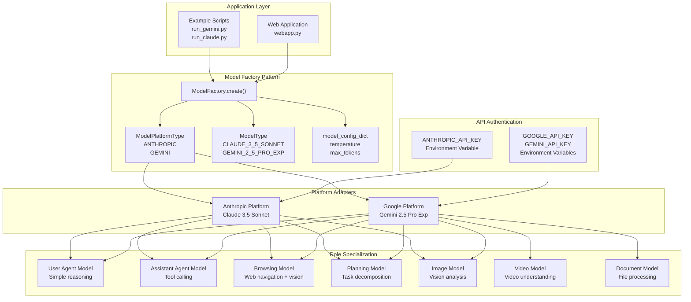
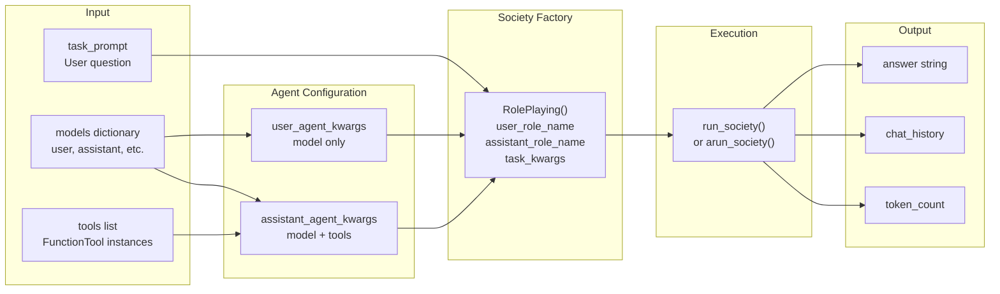
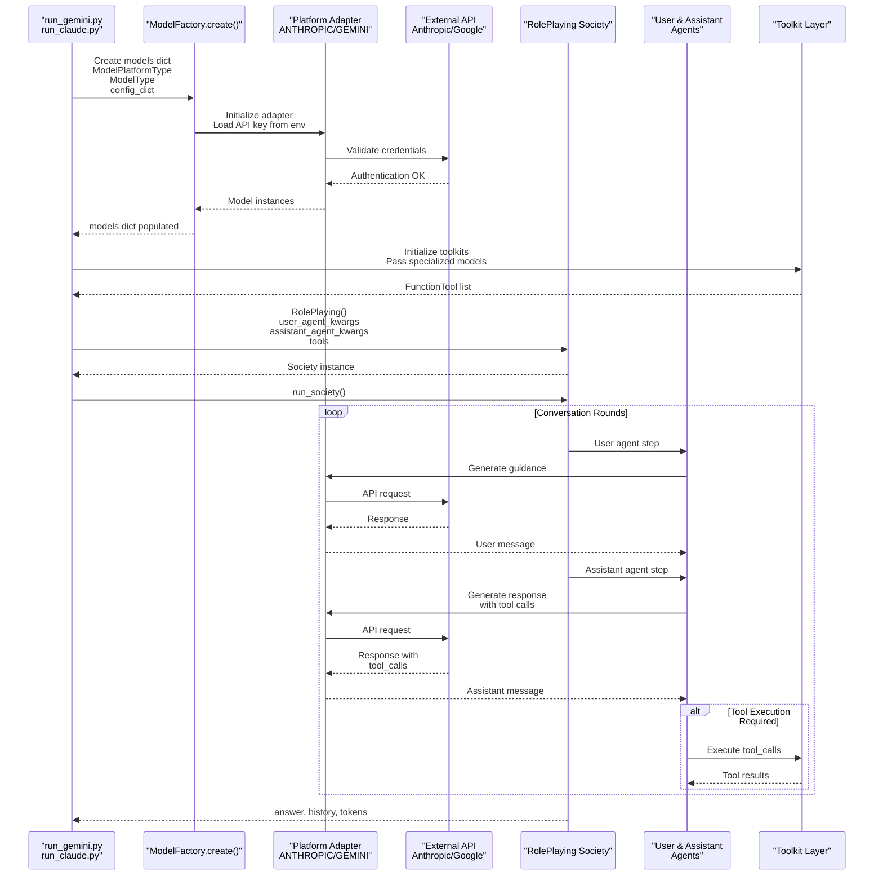
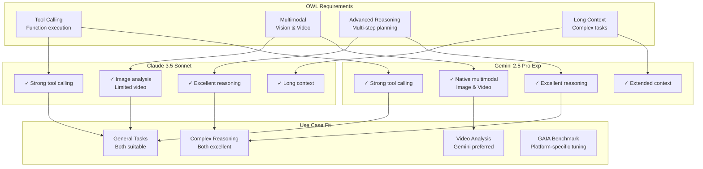

<!-- source: DeepWiki mcp.deepwiki.com · repo camel-ai/owl · page 6.3 Claude & Gemini · fetched 2026-10-29 -->

# Claude & Gemini

<details>
<summary>Relevant source files</summary>

The following files were used as context for generating this wiki page:

- [.gitignore](.gitignore)
- [README.md](README.md)
- [README_ja.md](README_ja.md)
- [README_zh.md](README_zh.md)
- [examples/run_gemini.py](examples/run_gemini.py)
- [examples/run_groq.py](examples/run_groq.py)
- [examples/run_mistral.py](examples/run_mistral.py)
- [examples/run_novita_ai.py](examples/run_novita_ai.py)
- [examples/run_openai_compatible_model.py](examples/run_openai_compatible_model.py)
- [examples/run_together_ai.py](examples/run_together_ai.py)
- [owl/assets/owl-favicon.ico](owl/assets/owl-favicon.ico)

</details>


This page documents the configuration and integration of Anthropic Claude models and Google Gemini 2.5 Pro within the OWL framework. It covers API authentication, model selection, role-specific configuration, and platform-specific features.

For general information about the model factory system and platform abstractions, see [Model Factory System](#2.3). For other model platforms including OpenAI, Azure, and Chinese LLMs, see [OpenAI & Azure OpenAI](#6.2) and [Chinese LLM Platforms](#6.4).

## Overview

Both Claude and Gemini are accessed through the `ModelFactory.create()` pattern using `ModelPlatformType` enumerations. These models support:

- **Tool calling**: Both platforms provide robust function calling capabilities required by OWL's toolkit ecosystem
- **Multimodal understanding**: Gemini 2.5 Pro supports vision capabilities for image and video analysis; Claude 3.5 Sonnet supports vision for image analysis
- **Role-specific deployment**: Models can be specialized for different agent roles (user, assistant, browsing, planning, image, video, document)

**Sources:** [README.md:416-444](), [examples/run_gemini.py:1-145]()

## Anthropic Claude Configuration

### API Authentication

Claude models require an Anthropic API key configured in the environment:

```bash
# In .env file or environment variables
ANTHROPIC_API_KEY=your-anthropic-api-key-here
```

The API key is automatically loaded by the CAMEL framework when creating Claude models through `ModelFactory`.

**Sources:** [README.md:339-386]()

### Model Types

OWL supports Claude 3.5 Sonnet and other Claude models through the `ModelType` enumeration. While the exact model types are defined in the CAMEL framework, the README references Claude usage:

```bash
# Run with Claude model
python examples/run_claude.py
```

The script demonstrates Claude configuration for multi-agent tasks with tool calling and multimodal capabilities.

**Sources:** [README.md:424-426]()

### Role-Specific Configuration

Claude models are typically configured for multiple agent roles. The pattern follows this structure:

```python
from camel.models import ModelFactory
from camel.types import ModelPlatformType, ModelType

models = {
    "user": ModelFactory.create(
        model_platform=ModelPlatformType.ANTHROPIC,
        model_type=ModelType.CLAUDE_3_5_SONNET,
        model_config_dict={"temperature": 0},
    ),
    "assistant": ModelFactory.create(
        model_platform=ModelPlatformType.ANTHROPIC,
        model_type=ModelType.CLAUDE_3_5_SONNET,
        model_config_dict={"temperature": 0},
    ),
    "browsing": ModelFactory.create(
        model_platform=ModelPlatformType.ANTHROPIC,
        model_type=ModelType.CLAUDE_3_5_SONNET,  # Supports vision
        model_config_dict={"temperature": 0},
    ),
    "planning": ModelFactory.create(
        model_platform=ModelPlatformType.ANTHROPIC,
        model_type=ModelType.CLAUDE_3_5_SONNET,
        model_config_dict={"temperature": 0},
    ),
    "image": ModelFactory.create(
        model_platform=ModelPlatformType.ANTHROPIC,
        model_type=ModelType.CLAUDE_3_5_SONNET,  # Multimodal
        model_config_dict={"temperature": 0},
    ),
}
```

**Note:** The exact `ModelType` constants are defined in the CAMEL framework. The pattern shown is inferred from other platform examples.

**Sources:** [examples/run_gemini.py:50-86](), [examples/run_groq.py:63-99]()

## Google Gemini Configuration

### API Authentication

Gemini models require a Google API key configured in the environment:

```bash
# In .env file or environment variables
GOOGLE_API_KEY=your-google-api-key-here
```

Alternatively, some deployments may use:

```bash
GEMINI_API_KEY=your-gemini-api-key-here
```

**Sources:** [README.md:339-386]()

### Model Types and Selection

OWL supports Gemini 2.5 Pro Experimental model through `ModelType.GEMINI_2_5_PRO_EXP`. This model provides:

- Advanced multimodal capabilities (vision, video)
- Strong tool calling support
- Long context windows
- Experimental features for improved reasoning

**Sources:** [README.md:166](), [examples/run_gemini.py:52-85]()

### Complete Configuration Example

The [examples/run_gemini.py]() script demonstrates a complete Gemini integration:

```python
from camel.models import ModelFactory
from camel.types import ModelPlatformType, ModelType

# Create models for different roles
models = {
    "user": ModelFactory.create(
        model_platform=ModelPlatformType.GEMINI,
        model_type=ModelType.GEMINI_2_5_PRO_EXP,
        model_config_dict={"temperature": 0},
    ),
    "assistant": ModelFactory.create(
        model_platform=ModelPlatformType.GEMINI,
        model_type=ModelType.GEMINI_2_5_PRO_EXP,
        model_config_dict={"temperature": 0},
    ),
    "browsing": ModelFactory.create(
        model_platform=ModelPlatformType.GEMINI,
        model_type=ModelType.GEMINI_2_5_PRO_EXP,
        model_config_dict={"temperature": 0},
    ),
    "planning": ModelFactory.create(
        model_platform=ModelPlatformType.GEMINI,
        model_type=ModelType.GEMINI_2_5_PRO_EXP,
        model_config_dict={"temperature": 0},
    ),
    "video": ModelFactory.create(
        model_platform=ModelPlatformType.GEMINI,
        model_type=ModelType.GEMINI_2_5_PRO_EXP,
        model_config_dict={"temperature": 0},
    ),
    "image": ModelFactory.create(
        model_platform=ModelPlatformType.GEMINI,
        model_type=ModelType.GEMINI_2_5_PRO_EXP,
        model_config_dict={"temperature": 0},
    ),
    "document": ModelFactory.create(
        model_platform=ModelPlatformType.GEMINI,
        model_type=ModelType.GEMINI_2_5_PRO_EXP,
        model_config_dict={"temperature": 0},
    ),
}
```

**Sources:** [examples/run_gemini.py:49-86]()

### Toolkit Integration

The Gemini example integrates with multiple toolkits, demonstrating the model's capabilities:

```python
tools = [
    *BrowserToolkit(
        headless=False,
        web_agent_model=models["browsing"],
        planning_agent_model=models["planning"],
    ).get_tools(),
    *CodeExecutionToolkit(sandbox="subprocess", verbose=True).get_tools(),
    *ImageAnalysisToolkit(model=models["image"]).get_tools(),
    SearchToolkit().search_duckduckgo,
    SearchToolkit().search_google,
    SearchToolkit().search_wiki,
    *ExcelToolkit().get_tools(),
    *DocumentProcessingToolkit(model=models["document"]).get_tools(),
    *FileWriteToolkit(output_dir="./").get_tools(),
]
```

**Sources:** [examples/run_gemini.py:88-103]()

## Model Factory Integration Architecture

The following diagram shows how Claude and Gemini integrate with the `ModelFactory` system:



**Sources:** [examples/run_gemini.py:1-145](), [examples/run_groq.py:52-99]()

## Role-Specific Model Assignment

Different agent roles require different model capabilities. The following table shows typical role assignments for Claude and Gemini:

| Role | Purpose | Required Capabilities | Claude Support | Gemini Support |
|------|---------|----------------------|----------------|----------------|
| `user` | Simulates user queries and guidance | Basic reasoning, instruction following | ✓ Claude 3.5 Sonnet | ✓ Gemini 2.5 Pro Exp |
| `assistant` | Main agent with tool calling | Advanced reasoning, tool calling, multi-step planning | ✓ Claude 3.5 Sonnet | ✓ Gemini 2.5 Pro Exp |
| `browsing` | Web navigation and interaction | Vision (screenshot analysis), tool calling | ✓ Claude 3.5 Sonnet | ✓ Gemini 2.5 Pro Exp |
| `planning` | Task decomposition and planning | Advanced reasoning, strategic thinking | ✓ Claude 3.5 Sonnet | ✓ Gemini 2.5 Pro Exp |
| `image` | Image content analysis | Vision, OCR, scene understanding | ✓ Claude 3.5 Sonnet | ✓ Gemini 2.5 Pro Exp |
| `video` | Video content analysis | Video understanding, temporal reasoning | Limited | ✓ Gemini 2.5 Pro Exp |
| `document` | Document parsing and extraction | Text understanding, structure recognition | ✓ Claude 3.5 Sonnet | ✓ Gemini 2.5 Pro Exp |

**Sources:** [examples/run_gemini.py:49-86](), [README.md:409-420]()

## Configuration Parameters

Both platforms support common configuration parameters through `model_config_dict`:

```python
model_config_dict = {
    "temperature": 0,      # Deterministic output (0) to creative (1+)
    "max_tokens": 4096,    # Maximum response length
    "top_p": 1.0,          # Nucleus sampling parameter
    # Platform-specific parameters may vary
}
```

### Temperature Settings

OWL examples typically use `temperature: 0` for deterministic, reproducible results. This is especially important for:

- Benchmark evaluations (GAIA)
- Tool calling (precise function arguments)
- Multi-agent coordination (consistent behavior)

**Sources:** [examples/run_gemini.py:54-85](), [examples/run_groq.py:66-98]()

## Society Construction Pattern

Both Claude and Gemini follow the standard `RolePlaying` society construction pattern:



**Sources:** [examples/run_gemini.py:106-124](), [examples/run_gemini.py:127-140]()

## Platform-Specific Features

### Claude-Specific Features

While not explicitly documented in the provided files, Claude models typically offer:

- **Constitutional AI**: Built-in safety and helpfulness alignment
- **Long context windows**: Support for extended conversations and document analysis
- **Strong reasoning**: Particularly effective for complex multi-step tasks
- **Vision capabilities**: Claude 3.5 Sonnet supports image analysis

### Gemini-Specific Features

Gemini 2.5 Pro Experimental provides:

- **Native multimodal**: Unified architecture for text, images, and video
- **Video understanding**: Temporal reasoning across video frames
- **Experimental features**: Access to cutting-edge model capabilities
- **Large context**: Extended context window for complex tasks

**News Update:** Support for Gemini 2.5 Pro was added on 2025.03.25 as noted in the README.

**Sources:** [README.md:166](), [examples/run_gemini.py:70-85]()

## Complete Execution Flow

The following diagram shows the complete execution flow for Claude and Gemini-based societies:



**Sources:** [examples/run_gemini.py:127-140](), [owl/utils/enhanced_role_playing.py]() (referenced but not provided)

## Execution Examples

### Running with Gemini

```bash
# Basic execution with default task
python examples/run_gemini.py

# Custom task via command line
python examples/run_gemini.py "Your custom task here"
```

The default task demonstrates multi-toolkit integration:

```python
default_task = "Open Brave search, summarize the github stars, fork counts, etc. of camel-ai's camel framework, and write the numbers into a python file using the plot package, save it locally, and run the generated python file. Note: You have been provided with the necessary tools to complete this task."
```

This task exercises:
- Browser automation (`BrowserToolkit`)
- Web search (`SearchToolkit`)
- Code generation (`CodeExecutionToolkit`)
- File operations (`FileWriteToolkit`)

**Sources:** [examples/run_gemini.py:127-144]()

### Running with Claude

```bash
# Basic execution
python examples/run_claude.py

# Custom task
python examples/run_claude.py "Your custom task here"
```

While the `run_claude.py` file is not provided, the README confirms its existence and usage pattern.

**Sources:** [README.md:424-426]()

## Model Capability Comparison

The following diagram compares Claude and Gemini capabilities in the context of OWL's requirements:



**Sources:** [README.md:409-420](), [examples/run_gemini.py:1-145]()

## Performance Considerations

### Model Selection Guidelines

The README provides important guidance on model selection:

> **Note**: For optimal performance, we strongly recommend using OpenAI models (GPT-4 or later versions). Our experiments show that other models may result in significantly lower performance on complex tasks and benchmarks, especially those requiring advanced multi-modal understanding and tool use.

While Claude and Gemini are supported and capable, OpenAI models remain the recommended choice for production use and benchmark performance.

**Sources:** [README.md:419-420]()

### GAIA Benchmark Performance

For reproducing GAIA benchmark results, OWL uses custom branches with optimized model configurations:

- `gaia69` branch: Achieved 69.09% accuracy (#1 ranking)
- `gaia58.18` branch: Achieved 58.18% accuracy

These branches include customized CAMEL framework versions with enhanced toolkit stability specific to benchmark evaluation.

**Sources:** [README.md:162-163](), [README.md:203](), [README.md:622-636]()

## Troubleshooting

### Common Issues

| Issue | Cause | Solution |
|-------|-------|----------|
| `AuthenticationError` | Missing or invalid API key | Verify `ANTHROPIC_API_KEY` or `GOOGLE_API_KEY` in `.env` |
| `ModelNotFoundError` | Incorrect `ModelType` | Check CAMEL documentation for supported model types |
| `RateLimitError` | API quota exceeded | Implement rate limiting or upgrade API plan |
| Tool calling failures | Model not following function schemas | Verify model supports structured outputs; adjust temperature |
| Vision tasks failing | Non-multimodal model used | Ensure `browsing`, `image`, `video` roles use multimodal models |

### Debug Configuration

Enable debug logging to troubleshoot model issues:

```python
from camel.logger import set_log_level

set_log_level(level="DEBUG")
```

This outputs detailed information about:
- Model initialization
- API requests and responses
- Tool call formatting
- Error messages

**Sources:** [examples/run_gemini.py:36](), [examples/run_groq.py:49]()

## Environment Variable Summary

Required environment variables for Claude and Gemini integration:

```bash
# Claude Configuration
ANTHROPIC_API_KEY=sk-ant-xxxxx

# Gemini Configuration
GOOGLE_API_KEY=AIzaSyxxxxx
# or
GEMINI_API_KEY=AIzaSyxxxxx

# Optional: Override default base URLs (rarely needed)
ANTHROPIC_API_BASE=https://api.anthropic.com
GOOGLE_API_BASE=https://generativelanguage.googleapis.com
```

These should be configured in the `.env` file in the `owl/` directory, following the template in `.env_template`.

**Sources:** [README.md:365-386]()

---

