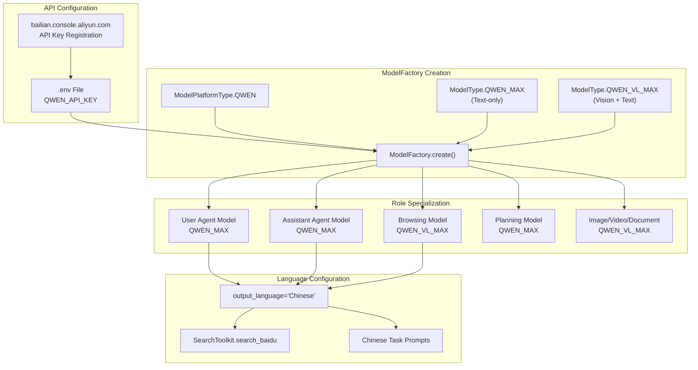
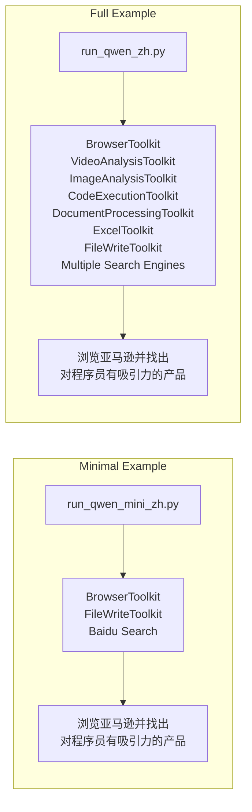
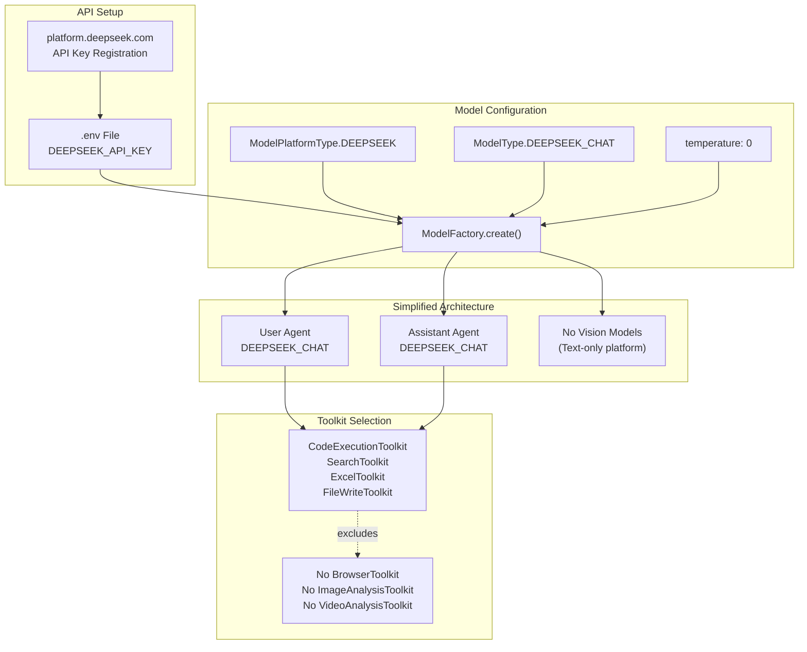
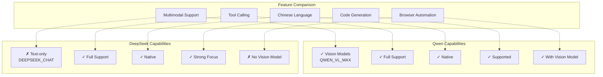
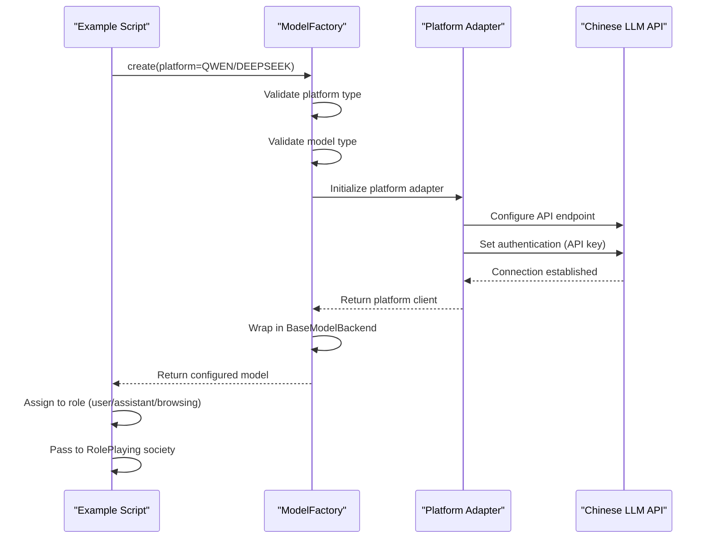

<!-- source: DeepWiki mcp.deepwiki.com · repo camel-ai/owl · page 6.4 Chinese LLM Platforms · fetched 2026-10-29 -->

# Chinese LLM Platforms

<details>
<summary>Relevant source files</summary>

The following files were used as context for generating this wiki page:

- [.gitignore](.gitignore)
- [README.md](README.md)
- [README_ja.md](README_ja.md)
- [README_zh.md](README_zh.md)
- [examples/run_deepseek_zh.py](examples/run_deepseek_zh.py)
- [examples/run_qwen_mini_zh.py](examples/run_qwen_mini_zh.py)
- [examples/run_qwen_zh.py](examples/run_qwen_zh.py)
- [owl/assets/owl-favicon.ico](owl/assets/owl-favicon.ico)

</details>


This page documents the integration of Chinese LLM platforms into OWL, specifically Qwen (Alibaba Cloud) and DeepSeek. For general model platform information, see [Supported Platforms Overview](#6.1). For OpenAI and Anthropic models, see [OpenAI & Azure OpenAI](#6.2) and [Claude & Gemini](#6.3). For local deployment options, see [Local & Self-Hosted Models](#6.5).

## Overview

OWL supports two primary Chinese LLM platforms that provide both competitive performance and native Chinese language support:

| Platform | Provider | Model Types | Multimodal Support | Primary Use Cases |
|----------|----------|-------------|-------------------|-------------------|
| **Qwen** | Alibaba Cloud | `QWEN_MAX`, `QWEN_VL_MAX` | Yes (Vision) | General reasoning, Chinese tasks, vision |
| **DeepSeek** | DeepSeek AI | `DEEPSEEK_CHAT` | No | Code generation, Chinese reasoning |

Both platforms integrate through the `ModelFactory` pattern and support tool calling capabilities required for OWL's agent system.

**Sources:** [README.md:415-444](), [examples/run_qwen_zh.py:1-159](), [examples/run_deepseek_zh.py:1-121]()

## Qwen Platform Integration

### Platform Configuration

Qwen models are accessed through Alibaba Cloud's Bailian platform and support both text-only and vision-capable models.



**Sources:** [examples/run_qwen_zh.py:56-96](), [examples/run_qwen_mini_zh.py:56-92]()

### Model Type Selection

Qwen provides two primary model types with distinct capabilities:

**QWEN_MAX (Text-Only):**
- Used for user agent, assistant agent, and planning roles
- Optimized for reasoning and tool calling
- Lower latency for text-based operations
- Configuration: `model_config_dict={"temperature": 0}`

**QWEN_VL_MAX (Vision + Language):**
- Used for browsing, image analysis, video analysis, document processing
- Accepts both text and image inputs
- Required for `BrowserToolkit`, `ImageAnalysisToolkit`, `VideoAnalysisToolkit`, `DocumentProcessingToolkit`
- Same configuration pattern as text-only models

**Sources:** [examples/run_qwen_zh.py:56-96]()

### Full Qwen Configuration Example

The complete model dictionary pattern for Qwen integration:

```python
models = {
    "user": ModelFactory.create(
        model_platform=ModelPlatformType.QWEN,
        model_type=ModelType.QWEN_MAX,
        model_config_dict={"temperature": 0},
    ),
    "assistant": ModelFactory.create(
        model_platform=ModelPlatformType.QWEN,
        model_type=ModelType.QWEN_MAX,
        model_config_dict={"temperature": 0},
    ),
    "browsing": ModelFactory.create(
        model_platform=ModelPlatformType.QWEN,
        model_type=ModelType.QWEN_VL_MAX,
        model_config_dict={"temperature": 0},
    ),
    "planning": ModelFactory.create(
        model_platform=ModelPlatformType.QWEN,
        model_type=ModelType.QWEN_MAX,
        model_config_dict={"temperature": 0},
    ),
    "video": ModelFactory.create(
        model_platform=ModelPlatformType.QWEN,
        model_type=ModelType.QWEN_VL_MAX,
        model_config_dict={"temperature": 0},
    ),
    "image": ModelFactory.create(
        model_platform=ModelPlatformType.QWEN,
        model_type=ModelType.QWEN_VL_MAX,
        model_config_dict={"temperature": 0},
    ),
    "document": ModelFactory.create(
        model_platform=ModelPlatformType.QWEN,
        model_type=ModelType.QWEN_VL_MAX,
        model_config_dict={"temperature": 0},
    ),
}
```

**Sources:** [examples/run_qwen_zh.py:60-96]()

### Qwen Example Scripts



**run_qwen_mini_zh.py** - Minimal configuration for quick testing:
- Only essential toolkits: `BrowserToolkit`, `FileWriteToolkit`, Baidu search
- Suitable for basic web browsing and file operations
- Lower resource requirements
- [examples/run_qwen_mini_zh.py:1-147]()

**run_qwen_zh.py** - Full feature set:
- Complete toolkit suite including multimodal processing
- Video and image analysis capabilities
- Document processing with vision models
- Code execution and Excel manipulation
- Multiple search engines (DuckDuckGo, Google, Wikipedia, Baidu)
- [examples/run_qwen_zh.py:1-159]()

**Sources:** [examples/run_qwen_mini_zh.py:95-104](), [examples/run_qwen_zh.py:99-116]()

## DeepSeek Platform Integration

### Platform Configuration

DeepSeek provides a simplified integration focused on text-based reasoning and code generation tasks.



**Sources:** [examples/run_deepseek_zh.py:16-67]()

### DeepSeek Model Configuration

DeepSeek uses a single model type for all roles:

```python
models = {
    "user": ModelFactory.create(
        model_platform=ModelPlatformType.DEEPSEEK,
        model_type=ModelType.DEEPSEEK_CHAT,
        model_config_dict={"temperature": 0},
    ),
    "assistant": ModelFactory.create(
        model_platform=ModelPlatformType.DEEPSEEK,
        model_type=ModelType.DEEPSEEK_CHAT,
        model_config_dict={"temperature": 0},
    ),
}
```

**Key Characteristics:**
- **No vision model variants** - DeepSeek currently provides text-only models
- **Simplified model dictionary** - Only `user` and `assistant` roles
- **Strong code generation** - Optimized for programming tasks
- **Chinese language support** - Native support via `output_language="Chinese"`

**Sources:** [examples/run_deepseek_zh.py:56-67]()

### DeepSeek Toolkit Restrictions

Due to the lack of multimodal capabilities, DeepSeek configurations exclude vision-dependent toolkits:

**Supported Toolkits:**
- `CodeExecutionToolkit` - Python code execution
- `SearchToolkit` - Text-based web search (DuckDuckGo, Wikipedia, Baidu)
- `ExcelToolkit` - Spreadsheet manipulation
- `FileWriteToolkit` - File I/O operations

**Excluded Toolkits:**
- `BrowserToolkit` - Requires vision model for web screenshots
- `ImageAnalysisToolkit` - Requires vision capabilities
- `VideoAnalysisToolkit` - Requires vision capabilities
- `DocumentProcessingToolkit` - Image-based document parsing requires vision model

**Sources:** [examples/run_deepseek_zh.py:70-77]()

### DeepSeek Example Script

The [examples/run_deepseek_zh.py:1-121]() demonstrates a focused use case:

**Default Task:** `"搜索OWL项目最近的新闻并生成一篇报告,最后保存到本地。"`
- Search for recent OWL project news
- Generate a report
- Save to local file

This task leverages DeepSeek's strengths:
1. Text search via `SearchToolkit`
2. Content analysis and report generation
3. File writing via `FileWriteToolkit`

**Sources:** [examples/run_deepseek_zh.py:102-120]()

## Language-Specific Configuration

### Chinese Output Language Setting

Both Qwen and DeepSeek integrations use the `output_language` parameter to ensure Chinese responses:

```python
society = RolePlaying(
    **task_kwargs,
    user_role_name="user",
    user_agent_kwargs=user_agent_kwargs,
    assistant_role_name="assistant",
    assistant_agent_kwargs=assistant_agent_kwargs,
    output_language="Chinese",  # Forces Chinese responses
)
```

This parameter affects:
- Agent communication language
- Tool output descriptions
- Error messages
- Final answer format

**Sources:** [examples/run_qwen_zh.py:129-136](), [examples/run_deepseek_zh.py:90-97]()

### Chinese Search Integration

The `SearchToolkit` provides Chinese-specific search engines:

**Baidu Search:**
```python
SearchToolkit().search_baidu
```
- China's dominant search engine
- Better results for Chinese-language queries
- Integrated in both Qwen examples

**Configuration in BrowserToolkit:**
```python
BrowserToolkit(
    headless=False,
    web_agent_model=models["browsing"],
    planning_agent_model=models["planning"],
    output_language="Chinese",  # Browser automation in Chinese
)
```

**Sources:** [examples/run_qwen_zh.py:100-105](), [examples/run_qwen_mini_zh.py:96-101]()

### Chinese Task Prompts

Default tasks in example scripts use Chinese:

| Script | Default Task (Chinese) | Translation |
|--------|----------------------|-------------|
| `run_qwen_zh.py` | 浏览亚马逊并找出一款对程序员有吸引力的产品。请提供产品名称和价格 | Browse Amazon and find a product appealing to programmers. Provide product name and price |
| `run_qwen_mini_zh.py` | 浏览亚马逊并找出一款对程序员有吸引力的产品。请提供产品名称和价格 | Browse Amazon and find a product appealing to programmers. Provide product name and price |
| `run_deepseek_zh.py` | 搜索OWL项目最近的新闻并生成一篇报告,最后保存到本地。 | Search for recent OWL project news, generate a report, and save it locally |

**Sources:** [examples/run_qwen_zh.py:144](), [examples/run_qwen_mini_zh.py:132](), [examples/run_deepseek_zh.py:105]()

## Comparison: Qwen vs DeepSeek



**Decision Matrix:**

| Use Case | Recommended Platform | Reason |
|----------|---------------------|---------|
| Web browsing with screenshots | Qwen | Requires `QWEN_VL_MAX` for visual understanding |
| Image/Video analysis | Qwen | Only platform with vision models |
| Document processing (PDFs, images) | Qwen | Vision model needed for OCR-like tasks |
| Code generation and execution | DeepSeek | Optimized for programming tasks |
| Text search and analysis | Either | Both support text-based toolkits |
| Excel data manipulation | Either | Both support `ExcelToolkit` |
| Cost-sensitive applications | DeepSeek | Simpler architecture, single model type |

**Sources:** [examples/run_qwen_zh.py:99-116](), [examples/run_deepseek_zh.py:70-77]()

## Environment Variable Configuration

### API Key Setup

Both platforms require API keys configured in the `.env` file:

```
# Qwen (Alibaba Cloud)
QWEN_API_KEY=your-qwen-api-key-here

# DeepSeek
DEEPSEEK_API_KEY=your-deepseek-api-key-here
```

**API Key Registration:**
- **Qwen:** Register at [bailian.console.aliyun.com](https://bailian.console.aliyun.com)
- **DeepSeek:** Register at [platform.deepseek.com/api_keys](https://platform.deepseek.com/api_keys)

**Sources:** [examples/run_qwen_zh.py:15-17](), [examples/run_deepseek_zh.py:16-18]()

### Environment File Loading

All Chinese platform examples use the same `.env` file loading pattern:

```python
import pathlib
from dotenv import load_dotenv

base_dir = pathlib.Path(__file__).parent.parent
env_path = base_dir / "owl" / ".env"
load_dotenv(dotenv_path=str(env_path))
```

This pattern:
1. Locates the `.env` file relative to the script location
2. Loads environment variables before model creation
3. Supports running scripts from any working directory

**Sources:** [examples/run_qwen_zh.py:39-43](), [examples/run_deepseek_zh.py:36-42]()

## Running Chinese Platform Examples

### Command Line Execution

```bash
# Qwen minimal example
python examples/run_qwen_mini_zh.py

# Qwen full example
python examples/run_qwen_zh.py

# DeepSeek example
python examples/run_deepseek_zh.py

# With custom task (Chinese)
python examples/run_qwen_zh.py "搜索最新的AI新闻并总结"
```

**Custom Task Override:**
All scripts support command-line task specification via `sys.argv[1]`:
```python
task = sys.argv[1] if len(sys.argv) > 1 else default_task
```

**Sources:** [examples/run_qwen_zh.py:147](), [examples/run_deepseek_zh.py:108]()

### Logging Configuration

Both platforms use the same logging setup for debugging:

```python
from camel.logger import set_log_level
set_log_level(level="DEBUG")
```

This enables:
- Model API request/response logging
- Tool execution traces
- Agent communication debugging
- Error stack traces

**Sources:** [examples/run_qwen_zh.py:45](), [examples/run_deepseek_zh.py:38]()

## Model Factory Integration Pattern

### Factory Creation Workflow



**Sources:** [examples/run_qwen_zh.py:56-96](), [examples/run_deepseek_zh.py:56-67]()

### Platform Type Enumeration

Chinese platforms use the following `ModelPlatformType` values:

- `ModelPlatformType.QWEN` - Alibaba Cloud Qwen models
- `ModelPlatformType.DEEPSEEK` - DeepSeek AI models

These are defined in the CAMEL framework and used consistently across all Chinese platform integrations.

**Sources:** [examples/run_qwen_zh.py:31](), [examples/run_deepseek_zh.py:30]()

## Troubleshooting

### Common Issues

**Missing API Key:**
```
Error: QWEN_API_KEY not found in environment
```
**Solution:** Ensure `.env` file contains `QWEN_API_KEY=your-key` and is located at `owl/.env`

**Vision Model Required:**
```
Error: Model does not support image inputs
```
**Solution:** Use `ModelType.QWEN_VL_MAX` for toolkits requiring vision (`BrowserToolkit`, `ImageAnalysisToolkit`)

**DeepSeek Multimodal Attempt:**
```
Error: Toolkit requires multimodal model
```
**Solution:** Remove vision-dependent toolkits when using DeepSeek (use Qwen for multimodal tasks)

**Chinese Character Encoding:**
```
UnicodeDecodeError: 'ascii' codec can't decode byte
```
**Solution:** Ensure UTF-8 encoding in output files and terminal

**Sources:** [examples/run_qwen_zh.py:1-159](), [examples/run_deepseek_zh.py:1-121]()

---

