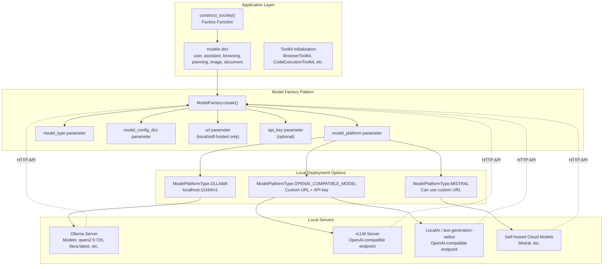
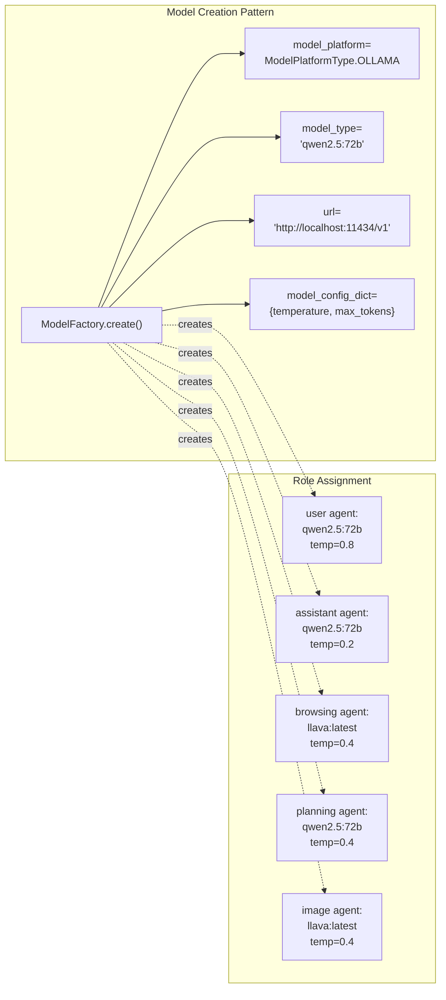
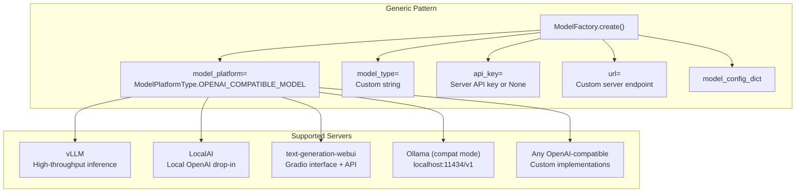
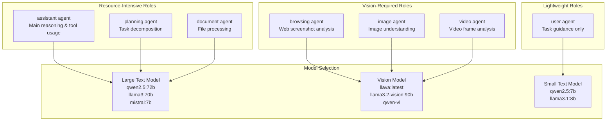
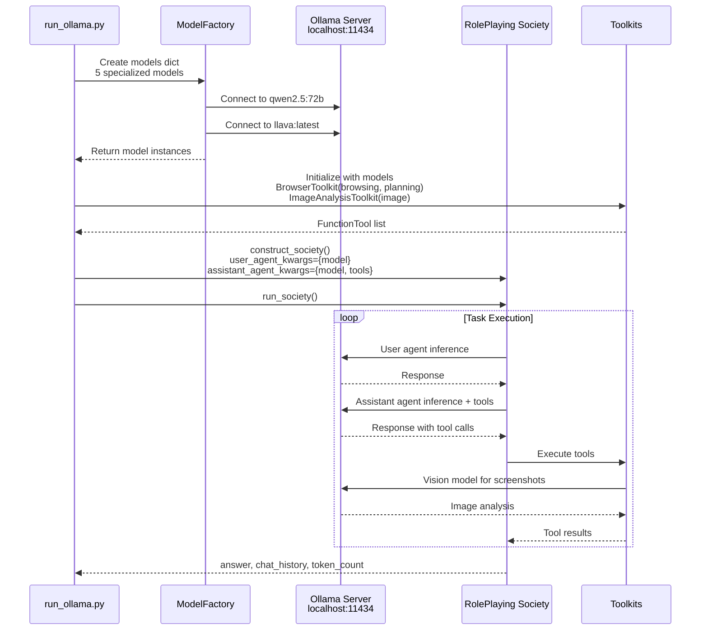
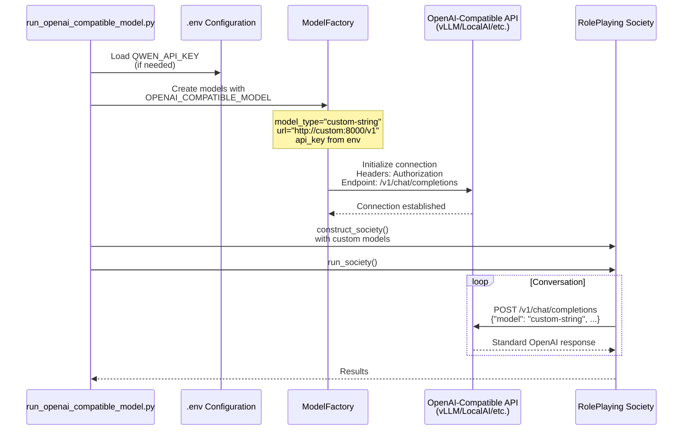

<!-- source: DeepWiki mcp.deepwiki.com · repo camel-ai/owl · page 6.5 Local & Self-Hosted Models · fetched 2026-10-29 -->

# Local & Self-Hosted Models

<details>
<summary>Relevant source files</summary>

The following files were used as context for generating this wiki page:

- [examples/run.py](examples/run.py)
- [examples/run_azure_openai.py](examples/run_azure_openai.py)
- [examples/run_gemini.py](examples/run_gemini.py)
- [examples/run_groq.py](examples/run_groq.py)
- [examples/run_mini.py](examples/run_mini.py)
- [examples/run_mistral.py](examples/run_mistral.py)
- [examples/run_novita_ai.py](examples/run_novita_ai.py)
- [examples/run_ollama.py](examples/run_ollama.py)
- [examples/run_openai_compatible_model.py](examples/run_openai_compatible_model.py)
- [examples/run_together_ai.py](examples/run_together_ai.py)

</details>


## Overview

This page covers integration of local and self-hosted language models with OWL. Local deployment provides data privacy, reduced latency, and cost savings compared to cloud APIs. OWL supports three primary approaches for local/self-hosted model integration:

1. **Ollama** - Simple local model hosting with model management
2. **OpenAI-Compatible APIs** - Generic pattern supporting vLLM, LocalAI, text-generation-webui, and other OpenAI-compatible servers
3. **Cloud Platforms with Self-Host Options** - Platforms like Mistral that offer both cloud and self-hosted deployment

For cloud-hosted platforms like OpenAI, Claude, and Gemini, see [OpenAI & Azure OpenAI](#6.2), [Claude & Gemini](#6.3), and [Chinese LLM Platforms](#6.4). For the overall model factory pattern, see [Model Factory System](#2.3).

---

## Integration Architecture

The following diagram shows how local models integrate with OWL's architecture through the `ModelFactory` abstraction:



**Sources:** [examples/run_ollama.py:1-144](), [examples/run_openai_compatible_model.py:1-148](), [examples/run_mistral.py:1-181]()

---

## Ollama Integration

Ollama provides a simple way to run large language models locally. It handles model downloads, memory management, and provides an OpenAI-compatible API endpoint.

### Installation and Setup

Install Ollama from [ollama.ai](https://ollama.ai), then pull models:

```bash
# Text models
ollama pull qwen2.5:72b
ollama pull llama3:70b

# Vision models  
ollama pull llava:latest
ollama pull llama3.2-vision:90b

# Start the server (default: localhost:11434)
ollama serve
```

### Configuration in OWL

Ollama models are configured using `ModelPlatformType.OLLAMA` with the server URL and model names. The example below shows role-specific model assignment:



**Configuration Example** from [examples/run_ollama.py:54-86]():

| Role | Model | Temperature | Purpose |
|------|-------|-------------|---------|
| `user` | `qwen2.5:72b` | 0.8 | Higher creativity for task interpretation |
| `assistant` | `qwen2.5:72b` | 0.2 | Lower temperature for focused execution |
| `browsing` | `llava:latest` | 0.4 | Vision model for web screenshots |
| `planning` | `qwen2.5:72b` | 0.4 | Balanced reasoning for task planning |
| `image` | `llava:latest` | 0.4 | Vision model for image analysis |

**Key Parameters:**
- `model_platform`: Must be `ModelPlatformType.OLLAMA`
- `model_type`: String matching Ollama model name (e.g., `"qwen2.5:72b"`, `"llava:latest"`)
- `url`: Ollama server endpoint, default `"http://localhost:11434/v1"`
- `model_config_dict`: Configuration including `temperature` and `max_tokens`

**Complete Example** [examples/run_ollama.py:54-86]():
```python
models = {
    "user": ModelFactory.create(
        model_platform=ModelPlatformType.OLLAMA,
        model_type="qwen2.5:72b",
        url="http://localhost:11434/v1",
        model_config_dict={"temperature": 0.8, "max_tokens": 1000000},
    ),
    "assistant": ModelFactory.create(
        model_platform=ModelPlatformType.OLLAMA,
        model_type="qwen2.5:72b",
        url="http://localhost:11434/v1",
        model_config_dict={"temperature": 0.2, "max_tokens": 1000000},
    ),
    # Vision models for multimodal tasks
    "browsing": ModelFactory.create(
        model_platform=ModelPlatformType.OLLAMA,
        model_type="llava:latest",
        url="http://localhost:11434/v1",
        model_config_dict={"temperature": 0.4, "max_tokens": 1000000},
    ),
}
```

**Sources:** [examples/run_ollama.py:44-124]()

---

## OpenAI-Compatible API Pattern

The `OPENAI_COMPATIBLE_MODEL` platform type provides a generic integration pattern that works with any server implementing the OpenAI API specification. This includes vLLM, LocalAI, text-generation-webui, Ollama (in compatibility mode), and many others.

### Configuration Structure



**Sources:** [examples/run_openai_compatible_model.py:1-148]()

### Configuration Parameters

| Parameter | Description | Example |
|-----------|-------------|---------|
| `model_platform` | Always `ModelPlatformType.OPENAI_COMPATIBLE_MODEL` | Required |
| `model_type` | String matching server's model identifier | `"qwen-max"`, `"mistral-7b"`, any string |
| `url` | Full API endpoint URL | `"http://localhost:8000/v1"` |
| `api_key` | API key if server requires authentication | From `.env` or `None` |
| `model_config_dict` | Standard OpenAI parameters | `{"temperature": 0.4, "max_tokens": 128000}` |

### vLLM Example

vLLM provides high-throughput inference for local models. Start a vLLM server:

```bash
# Install vLLM
pip install vllm

# Start server with a model
python -m vllm.entrypoints.openai.api_server \
    --model Qwen/Qwen2.5-72B-Instruct \
    --host localhost \
    --port 8000
```

Configure OWL to use the vLLM server [examples/run_openai_compatible_model.py:54-89]():

```python
models = {
    "assistant": ModelFactory.create(
        model_platform=ModelPlatformType.OPENAI_COMPATIBLE_MODEL,
        model_type="Qwen/Qwen2.5-72B-Instruct",  # Match vLLM model name
        api_key=None,  # vLLM typically doesn't require API key
        url="http://localhost:8000/v1",
        model_config_dict={"temperature": 0.4, "max_tokens": 128000},
    ),
}
```

### Cloud Platform in OpenAI-Compatible Mode

The example uses Qwen's cloud API in OpenAI-compatible mode [examples/run_openai_compatible_model.py:54-89]():

```python
models = {
    "user": ModelFactory.create(
        model_platform=ModelPlatformType.OPENAI_COMPATIBLE_MODEL,
        model_type="qwen-max",
        api_key=os.getenv("QWEN_API_KEY"),
        url="https://dashscope.aliyuncs.com/compatible-mode/v1",
        model_config_dict={"temperature": 0.4, "max_tokens": 128000},
    ),
    # Vision model for multimodal tasks
    "browsing": ModelFactory.create(
        model_platform=ModelPlatformType.OPENAI_COMPATIBLE_MODEL,
        model_type="qwen-vl-max",
        api_key=os.getenv("QWEN_API_KEY"),
        url="https://dashscope.aliyuncs.com/compatible-mode/v1",
        model_config_dict={"temperature": 0.4, "max_tokens": 128000},
    ),
}
```

This pattern works identically for local servers - simply change the `url` to your local endpoint and adjust `api_key` as needed.

**Sources:** [examples/run_openai_compatible_model.py:42-126]()

---

## Model Role Specialization for Local Deployment

Local and self-hosted deployments often require careful model selection for different agent roles due to resource constraints. The following diagram shows the typical model assignment strategy:



**Sources:** [examples/run_ollama.py:54-86](), [examples/run_openai_compatible_model.py:54-89]()

### Role-Specific Requirements

**High-Capability Models (70B+ parameters):**
- `assistant`: Main agent requiring tool calling, complex reasoning
- `planning`: Task decomposition for browser automation
- `document`: Document understanding and extraction

**Vision Models:**
- `browsing`: Analyzing web page screenshots during automation
- `image`: Processing image files from toolkits
- `video`: Analyzing video frames

**Lightweight Models (7B-8B parameters):**
- `user`: Task interpretation, minimal tool usage

### Configuration Example from Ollama

[examples/run_ollama.py:54-86]() demonstrates this specialization:

```python
models = {
    # Lightweight for user role
    "user": ModelFactory.create(
        model_platform=ModelPlatformType.OLLAMA,
        model_type="qwen2.5:72b",  # Can use smaller model here
        url="http://localhost:11434/v1",
        model_config_dict={"temperature": 0.8, "max_tokens": 1000000},
    ),
    # Heavy lifting for assistant
    "assistant": ModelFactory.create(
        model_platform=ModelPlatformType.OLLAMA,
        model_type="qwen2.5:72b",
        url="http://localhost:11434/v1",
        model_config_dict={"temperature": 0.2, "max_tokens": 1000000},
    ),
    # Vision model for web automation
    "browsing": ModelFactory.create(
        model_platform=ModelPlatformType.OLLAMA,
        model_type="llava:latest",
        url="http://localhost:11434/v1",
        model_config_dict={"temperature": 0.4, "max_tokens": 1000000},
    ),
    # Vision model for image analysis
    "image": ModelFactory.create(
        model_platform=ModelPlatformType.OLLAMA,
        model_type="llava:latest",
        url="http://localhost:11434/v1",
        model_config_dict={"temperature": 0.4, "max_tokens": 1000000},
    ),
}
```

**Sources:** [examples/run_ollama.py:54-86]()

---

## Complete Integration Examples

### Ollama Full Example

The complete Ollama integration pattern [examples/run_ollama.py:44-124]():



**Sources:** [examples/run_ollama.py:1-144]()

### OpenAI-Compatible Full Example

The generic OpenAI-compatible pattern [examples/run_openai_compatible_model.py:42-126]():



**Sources:** [examples/run_openai_compatible_model.py:1-148]()

---

## Environment Configuration

### Required Environment Variables

Local and self-hosted models typically require minimal environment configuration:

**Ollama** - No API key required, only URL configuration:
```bash
# .env file (optional, can be hardcoded)
OLLAMA_BASE_URL=http://localhost:11434/v1
```

**OpenAI-Compatible APIs** - May require API key for authentication:
```bash
# For servers requiring authentication
CUSTOM_API_KEY=your-api-key-here
CUSTOM_API_URL=http://localhost:8000/v1

# For Qwen cloud in compatible mode (as shown in example)
QWEN_API_KEY=sk-your-qwen-key
```

**vLLM** - Typically no authentication:
```bash
# vLLM usually runs without authentication
VLLM_BASE_URL=http://localhost:8000/v1
```

### Configuration Priority

Model configuration follows this priority order:

1. **Hardcoded in script** - Direct values in `ModelFactory.create()` calls
2. **Environment variables** - Loaded via `os.getenv()` or `load_dotenv()`
3. **Default values** - Platform defaults (e.g., Ollama's `localhost:11434`)

**Example** from [examples/run_openai_compatible_model.py:54-67]():
```python
# Using environment variable for API key
"user": ModelFactory.create(
    model_platform=ModelPlatformType.OPENAI_COMPATIBLE_MODEL,
    model_type="qwen-max",
    api_key=os.getenv("QWEN_API_KEY"),  # From .env
    url="https://dashscope.aliyuncs.com/compatible-mode/v1",  # Hardcoded
    model_config_dict={"temperature": 0.4, "max_tokens": 128000},
),
```

**Sources:** [examples/run_ollama.py:36-40](), [examples/run_openai_compatible_model.py:33-37](), [examples/run_openai_compatible_model.py:54-67]()

---

## Advanced Configuration

### Custom Model Parameters

All local models support standard OpenAI-compatible parameters via `model_config_dict`:

```python
model_config_dict = {
    "temperature": 0.2,      # Randomness (0.0-1.0)
    "max_tokens": 128000,    # Maximum response length
    "top_p": 0.95,           # Nucleus sampling
    "frequency_penalty": 0,   # Repetition penalty
    "presence_penalty": 0,    # New topic bias
    "stop": ["TASK_DONE"],   # Custom stop sequences
}
```

### Multiple Server Instances

OWL supports connecting to multiple local servers simultaneously by assigning different URLs to different model instances:

```python
models = {
    # Local vLLM for text
    "assistant": ModelFactory.create(
        model_platform=ModelPlatformType.OPENAI_COMPATIBLE_MODEL,
        model_type="qwen-72b",
        url="http://localhost:8000/v1",
        api_key=None,
        model_config_dict={"temperature": 0.2},
    ),
    # Ollama for vision
    "image": ModelFactory.create(
        model_platform=ModelPlatformType.OLLAMA,
        model_type="llava:latest",
        url="http://localhost:11434/v1",
        model_config_dict={"temperature": 0.4},
    ),
    # Remote self-hosted for heavy tasks
    "document": ModelFactory.create(
        model_platform=ModelPlatformType.OPENAI_COMPATIBLE_MODEL,
        model_type="qwen-max",
        url="http://remote-server:8080/v1",
        api_key=os.getenv("REMOTE_API_KEY"),
        model_config_dict={"temperature": 0.3},
    ),
}
```

This pattern enables resource optimization by distributing workload across multiple servers.

**Sources:** [examples/run_ollama.py:54-86](), [examples/run_openai_compatible_model.py:54-89]()

---

## Toolkit Compatibility

Most OWL toolkits work seamlessly with local models, but some considerations apply:

### Fully Compatible Toolkits

These toolkits require no special configuration for local models:

- `CodeExecutionToolkit` - Executes locally, no model dependency
- `FileWriteToolkit` - File operations, no model dependency
- `ExcelToolkit` - Excel operations, no model dependency
- `SearchToolkit` - Web search, no model dependency
- `TerminalToolkit` - Shell commands, no model dependency

### Model-Dependent Toolkits

These toolkits require model instances and work with local models when properly configured:

| Toolkit | Required Model Role | Configuration |
|---------|-------------------|---------------|
| `BrowserToolkit` | `web_agent_model`, `planning_agent_model` | Must be vision-capable for screenshots |
| `ImageAnalysisToolkit` | `model` parameter | Must be vision model (llava, etc.) |
| `VideoAnalysisToolkit` | `model` parameter | Must be vision model |
| `DocumentProcessingToolkit` | `model` parameter | Text model for document understanding |

**Example** from [examples/run_ollama.py:89-102]():
```python
tools = [
    # Requires vision models
    *BrowserToolkit(
        headless=False,
        web_agent_model=models["browsing"],      # llava:latest
        planning_agent_model=models["planning"],  # qwen2.5:72b
    ).get_tools(),
    # Requires vision model
    *ImageAnalysisToolkit(model=models["image"]).get_tools(),  # llava:latest
    # No model required
    *CodeExecutionToolkit(sandbox="subprocess", verbose=True).get_tools(),
    *ExcelToolkit().get_tools(),
]
```

### API-Dependent Toolkits

Some toolkits require external API keys and cannot be run fully locally:

- `AudioAnalysisToolkit` - Currently requires OpenAI API for Whisper
- `SearchToolkit.search_google` - Requires Google API key
- `GitHubToolkit` - Requires GitHub token
- `NotionToolkit` - Requires Notion API key

**Sources:** [examples/run_ollama.py:89-102](), [examples/run_openai_compatible_model.py:92-105]()

---

## Performance Considerations

### Hardware Requirements

Local model deployment requires significant computational resources:

| Model Size | Minimum VRAM | Recommended VRAM | CPU RAM | Notes |
|------------|--------------|------------------|---------|-------|
| 7B-8B | 6 GB | 10 GB | 16 GB | Suitable for user role |
| 13B-14B | 10 GB | 16 GB | 32 GB | Balanced performance |
| 30B-34B | 20 GB | 24 GB | 64 GB | High capability |
| 70B-72B | 40 GB | 80 GB | 128 GB | Best performance |

### Inference Speed

Typical inference speeds on consumer hardware:

- **7B models**: 20-50 tokens/second on RTX 3090
- **13B models**: 10-30 tokens/second on RTX 3090
- **70B models**: 5-15 tokens/second on 2x A100 40GB

### Quantization Options

Ollama and vLLM support quantization to reduce memory requirements:

```bash
# Ollama automatically handles quantization
ollama pull qwen2.5:72b-q4_K_M  # 4-bit quantization
ollama pull qwen2.5:72b-q8_0    # 8-bit quantization

# vLLM quantization
python -m vllm.entrypoints.openai.api_server \
    --model Qwen/Qwen2.5-72B-Instruct \
    --quantization awq  # or gptq, fp8
```

Trade-offs:
- **4-bit**: ~50% memory, ~10% quality loss, faster
- **8-bit**: ~40% memory, ~5% quality loss, balanced
- **16-bit (FP16)**: Full memory, full quality, slower

**Sources:** [examples/run_ollama.py:1-144]()

---

## Troubleshooting

### Common Issues

**Connection Refused:**
```
Error: ConnectionError: ('Connection aborted.', RemoteDisconnected('Remote end closed connection'))
```
- **Solution**: Verify server is running (`ollama serve` or vLLM server)
- Check firewall settings
- Verify URL is correct (`localhost` vs `127.0.0.1`)

**Model Not Found:**
```
Error: Model 'qwen2.5:72b' not found
```
- **Solution**: Pull model first: `ollama pull qwen2.5:72b`
- For vLLM, ensure model path is correct

**Out of Memory:**
```
Error: CUDA out of memory
```
- **Solution**: Use smaller model or quantized version
- Reduce `max_tokens` in config
- Close other GPU applications

**API Key Invalid:**
```
Error: 401 Unauthorized
```
- **Solution**: Check API key in `.env` file
- Verify `api_key` parameter is correctly passed
- For local servers, try `api_key=None`

### Debug Configuration

Enable detailed logging to diagnose issues [examples/run_ollama.py:41]():

```python
from camel.logger import set_log_level
set_log_level(level="DEBUG")  # Shows all API calls and responses
```

This outputs detailed information about model initialization, API requests, and responses, helping identify configuration issues.

**Sources:** [examples/run_ollama.py:33-41](), [examples/run_openai_compatible_model.py:31-39]()

---

