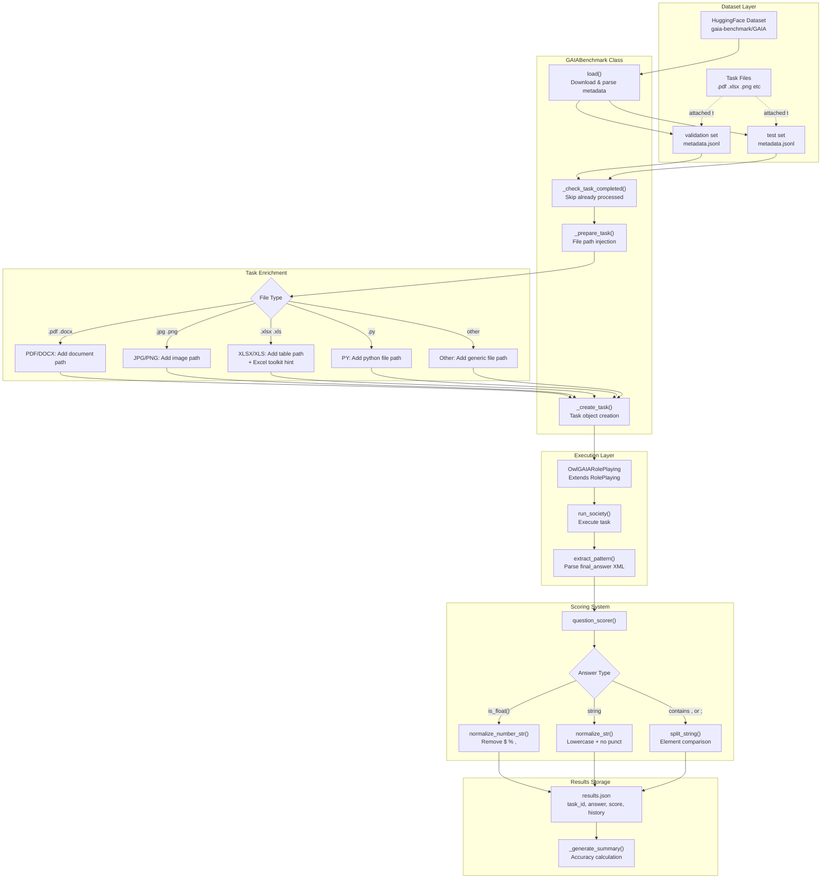
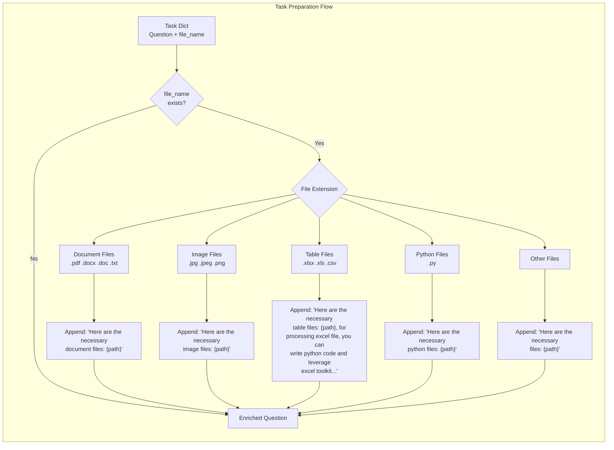
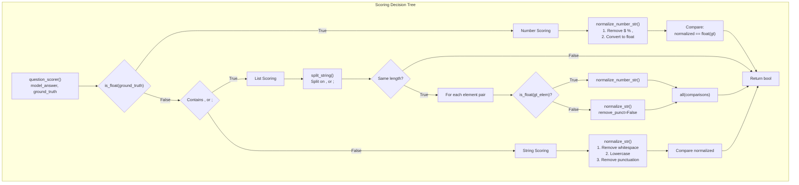

<!-- source: DeepWiki mcp.deepwiki.com · repo camel-ai/owl · page 7 Benchmarking & Evaluation · fetched 2026-10-29 -->

# Benchmarking & Evaluation

<details>
<summary>Relevant source files</summary>

The following files were used as context for generating this wiki page:

- [.gitignore](.gitignore)
- [README.md](README.md)
- [README_ja.md](README_ja.md)
- [README_zh.md](README_zh.md)
- [owl/assets/owl-favicon.ico](owl/assets/owl-favicon.ico)
- [owl/utils/document_toolkit.py](owl/utils/document_toolkit.py)
- [owl/utils/gaia.py](owl/utils/gaia.py)

</details>


This document describes the GAIA benchmark integration system, which provides standardized evaluation of OWL's multi-agent task automation capabilities. The benchmarking framework includes dataset loading, task preparation, execution orchestration, type-aware answer scoring, and results analysis. For information about the core execution pipeline that runs benchmark tasks, see [Architecture - Execution Pipeline](#2.2). For toolkit configuration used in benchmark evaluation, see [Toolkits](#5).

## Overview

OWL integrates with the GAIA (General AI Assistants) benchmark from HuggingFace to evaluate its performance on real-world task automation. The system achieved **69.09% accuracy** on the GAIA validation set, ranking #1 among open-source frameworks. The benchmark evaluates agents across three difficulty levels on tasks requiring multi-step reasoning, tool usage, and multimodal understanding.

The benchmarking system is implemented through the `GAIABenchmark` class, which extends CAMEL's `BaseBenchmark` and provides specialized task preparation, execution orchestration, and type-aware answer scoring.

**Sources:** [README.md:52-56](), [owl/utils/gaia.py:36-46]()

## Benchmark Architecture

The following diagram shows the complete benchmark evaluation pipeline, from dataset loading through result analysis:



**Sources:** [owl/utils/gaia.py:36-410]()

## GAIABenchmark Class

The `GAIABenchmark` class orchestrates the entire evaluation pipeline:

| Method | Purpose | Returns |
|--------|---------|---------|
| `__init__(data_dir, save_to, processes)` | Initialize benchmark with paths | None |
| `download()` | Download dataset from HuggingFace | None |
| `load(force_download)` | Load validation and test metadata | self |
| `run(...)` | Execute benchmark on specified split/level | Dict with accuracy metrics |
| `_prepare_task(task)` | Enrich task with file path context | Tuple[bool, str] |
| `_create_task(task)` | Convert dict to Task object | Task |
| `question_scorer(model_answer, ground_truth)` | Type-aware answer comparison | bool |
| `_generate_summary()` | Calculate aggregate metrics | Dict |

**Sources:** [owl/utils/gaia.py:36-316]()

## Dataset Loading

The benchmark loads data from the HuggingFace `gaia-benchmark/GAIA` repository using `snapshot_download()`. The dataset structure includes:

```
data_dir/
├── 2023/
│   ├── validation/
│   │   ├── metadata.jsonl
│   │   └── [task files: .pdf, .xlsx, .png, etc.]
│   └── test/
│       ├── metadata.jsonl
│       └── [task files]
```

Each line in `metadata.jsonl` contains:

```python
{
    "task_id": str,           # Unique identifier (e.g., "1-1-0-0-0")
    "Question": str,          # Task question
    "Level": int,             # Difficulty: 1, 2, or 3
    "Final answer": str,      # Ground truth answer
    "Annotator Metadata": {   # Additional context
        "Tools": List[str]    # Required tools
    },
    "file_name": str          # Optional attached file
}
```

The `load()` method skips the placeholder task with `task_id == "0-0-0-0-0"` and converts relative file paths to absolute paths.

**Sources:** [owl/utils/gaia.py:100-132]()

## Task Preparation and Enrichment

The `_prepare_task()` method enriches task questions with file-specific context to guide agent behavior:



Note the Excel-specific enrichment includes an explicit hint to use the `ExcelToolkit` and write Python code, which significantly improves task performance on spreadsheet-related questions.

**Sources:** [owl/utils/gaia.py:266-295]()

## Execution with OwlGAIARolePlaying

The benchmark uses a specialized `OwlGAIARolePlaying` class (not shown in provided files, but referenced) that extends the base `RolePlaying` society with GAIA-specific features:

1. **Answer Formatting**: Enforces XML-tagged final answers: `<final_answer>...</final_answer>`
2. **Task Context**: Injects the enriched question with file paths
3. **Execution Control**: Uses `run_society()` to orchestrate multi-agent collaboration

The execution flow:

```python
# From run() method
society = OwlGAIARolePlaying(
    task_prompt=task["Question"],  # Enriched question
    with_task_specify=False,
    user_role_name=user_role_name,
    user_agent_kwargs=user_agent_kwargs,
    assistant_role_name=assistant_role_name,
    assistant_agent_kwargs=assistant_agent_kwargs,
)

raw_answer, chat_history, token_info = run_society(society)
answer = extract_pattern(raw_answer, "final_answer")  # Extract from XML
```

**Sources:** [owl/utils/gaia.py:217-237]()

## Type-Aware Scoring System

The `question_scorer()` method implements sophisticated type-aware comparison that matches the official GAIA benchmark scorer. The scoring logic branches based on answer type detection:



### Number Normalization

The `normalize_number_str()` method strips currency and percentage symbols:

```python
def normalize_number_str(self, number_str: str) -> float:
    for char in ["$", "%", ","]:
        number_str = number_str.replace(char, "")
    try:
        return float(number_str)
    except ValueError:
        logger.error(f"String {number_str} cannot be normalized to number str.")
        return float("inf")  # Ensures mismatch on invalid numbers
```

**Example:**
- Ground truth: `42.5`
- Model answer: `$42.50` → normalized to `42.5` → **Match**
- Model answer: `42.5%` → normalized to `42.5` → **Match**

**Sources:** [owl/utils/gaia.py:371-378]()

### String Normalization

The `normalize_str()` method standardizes text comparison:

```python
def normalize_str(self, input_str, remove_punct=True) -> str:
    no_spaces = re.sub(r"\s", "", input_str)
    if remove_punct:
        translator = str.maketrans("", "", string.punctuation)
        return no_spaces.lower().translate(translator)
    else:
        return no_spaces.lower()
```

**Example:**
- Ground truth: `John Smith`
- Model answer: `john-smith` → normalized to `johnsmith` → **Match**
- Model answer: `John  Smith` → normalized to `johnsmith` → **Match**

**Sources:** [owl/utils/gaia.py:394-409]()

### List Comparison

For comma/semicolon-separated lists, the scorer:

1. Splits both answers using `split_string()` with pattern `[,;]`
2. Checks length equality (fails if different)
3. Compares elements pairwise (number-aware for numeric elements)
4. Returns `True` only if all elements match

**Example:**
- Ground truth: `apple, banana, $3.50`
- Model answer: `Apple,Banana,3.5` → **Match** (normalized per-element)

**Sources:** [owl/utils/gaia.py:343-364]()

## Custom CAMEL Branches

OWL maintains specialized branches with frozen CAMEL versions optimized for benchmark reproducibility:

| Branch | Score | CAMEL Version | Purpose |
|--------|-------|---------------|---------|
| `gaia69` | 69.09% | Custom fork in `owl/camel/` | Latest benchmark submission (#1 ranking) |
| `gaia58.18` | 58.18% | Custom fork in `owl/camel/` | Initial benchmark release |
| `main` | N/A | Latest CAMEL | Active development |

The custom branches include:
- **Enhanced Toolkit Stability**: Bug fixes and optimizations not yet in upstream CAMEL
- **Frozen Dependencies**: Ensures exact reproducibility of benchmark results
- **GAIA-Specific Features**: Answer formatting, error handling tuned for benchmark

To use the benchmark branch:

```bash
git checkout gaia69
pip install -e .
python run_gaia_workforce_claude.py  # or run_gaia_roleplaying.py
```

**Important Note from README:**
> When running the GAIA benchmark evaluation, please use the `gaia58.18` branch which includes a customized version of the CAMEL framework in the `owl/camel` directory. This version contains enhanced toolkits with improved stability specifically optimized for the GAIA benchmark compared to the standard CAMEL installation.

**Sources:** [README.md:203-206](), [README.md:622-636](), [README_zh.md:563-572]()

## Running Benchmark Evaluation

The `run()` method executes the benchmark with extensive configuration options:

```python
def run(
    self,
    user_role_name: str,              # e.g., "Professor"
    assistant_role_name: str,          # e.g., "Student"
    user_agent_kwargs: dict,           # Model config for user agent
    assistant_agent_kwargs: dict,      # Model config + tools for assistant
    on: Literal["train", "valid", "test"],  # Dataset split
    level: Union[int, List[int], Literal["all"]],  # Difficulty: 1, 2, 3, or "all"
    randomize: bool = False,           # Shuffle task order
    subset: Optional[int] = None,      # Limit to N tasks
    idx: Optional[List[int]] = None,   # Run specific task indices
    save_result: bool = False,         # Incremental save to file
) -> Dict[str, Any]:
```

**Execution Process:**

1. **Load Tasks**: Filter by split (`valid`/`test`) and difficulty level
2. **Check Completion**: Skip already-processed tasks if `save_result=True`
3. **Prepare Tasks**: Enrich questions with file paths
4. **Execute**: Run `OwlGAIARolePlaying` society for each task
5. **Score**: Apply type-aware comparison
6. **Save**: Incrementally write results to JSON after each task
7. **Summarize**: Calculate aggregate accuracy

**Example Invocation:**

```python
benchmark = GAIABenchmark(
    data_dir="data/gaia",
    save_to="results/gaia_results.json",
    processes=1
)

benchmark.load()

results = benchmark.run(
    user_role_name="AI User",
    assistant_role_name="AI Assistant",
    user_agent_kwargs={"model": user_model},
    assistant_agent_kwargs={"model": assistant_model, "tools": tools},
    on="valid",
    level="all",
    save_result=True
)

print(f"Accuracy: {results['accuracy']:.2%}")
```

**Sources:** [owl/utils/gaia.py:139-264]()

## Results Analysis

The benchmark generates detailed results for each task and aggregate metrics:

### Per-Task Results

Each task produces a result dictionary saved to `save_to` file:

```python
{
    "task_id": str,           # Task identifier
    "question": str,          # Enriched question
    "level": int,             # Difficulty level
    "model_answer": str,      # Extracted answer (or None)
    "ground_truth": str,      # Correct answer
    "score": bool,            # 1 if correct, 0 otherwise
    "token_info": dict,       # Token usage statistics
    "history": List[dict]     # Full conversation log
}
```

### Aggregate Summary

The `_generate_summary()` method calculates:

```python
{
    "total": int,             # Total tasks evaluated
    "correct": int,           # Number of correct answers
    "accuracy": float,        # correct / total
    "results": List[dict]     # All per-task results
}
```

**Sources:** [owl/utils/gaia.py:308-316]()

## Error Handling and Non-Determinism

The GAIA benchmark evaluates agents in realistic open-world conditions, introducing non-deterministic failures:

**Common Issues:**
- Network timeouts when accessing web resources
- API rate limits during tool execution
- Website blocking automated access
- File download failures

The `gaia58.18` branch includes `filter_failed_cases.py` to identify environmental failures vs. genuine agent errors through keyword matching. This allows distinguishing:
- **Environmental Failures**: Network errors, timeouts, blocked requests → May warrant retry
- **Agent Failures**: Incorrect reasoning, wrong tool usage → Reflects actual performance

> Based on user feedback, one of the most common issues for replication is, for example, agents being blocked on certain webpages due to network reasons.

**Sources:** [README.md:700-705]()

## Performance Metrics

OWL's benchmark performance across GAIA difficulty levels:

| Metric | Value | Details |
|--------|-------|---------|
| Overall Accuracy | 69.09% | Validation set, `gaia69` branch |
| Ranking | #1 | Among open-source frameworks |
| Previous Score | 58.18% | `gaia58.18` branch |
| Test Set | Public | Submitted to official leaderboard |

The technical report provides additional analysis: [Notion Report](https://hypnotic-mind-6bd.notion.site/OWL-Optimized-Workforce-Learning-for-General-Multi-Agent-Assistance-in-Real-World-Task-Automation-1d4004aeb21380158749c7f84b20643f)

**Sources:** [README.md:52-56](), [README.md:163-164]()

## Integration with Document Processing

The benchmark heavily relies on the `DocumentProcessingToolkit` for handling file attachments. The toolkit supports:

- **Images** (`.jpg`, `.png`): Analyzed via `ImageAnalysisToolkit` with vision models
- **Documents** (`.pdf`, `.docx`): Parsed via `UnstructuredIO` 
- **Spreadsheets** (`.xlsx`, `.xls`): Processed via `ExcelToolkit`
- **Archives** (`.zip`): Extracted to access nested files
- **Code** (`.py`, `.json`, `.xml`): Read as text with appropriate parsing

This multimodal capability is critical for GAIA tasks, which frequently require processing heterogeneous file types.

**Sources:** [owl/utils/document_toolkit.py:39-150]()

---

