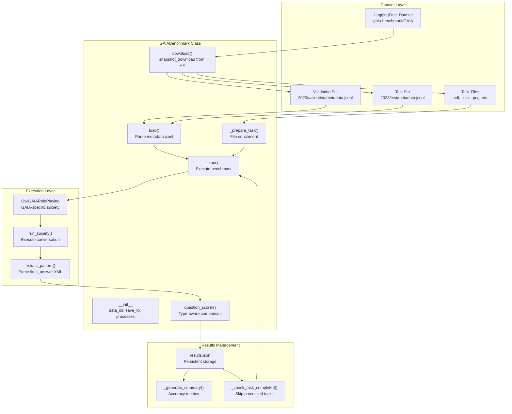
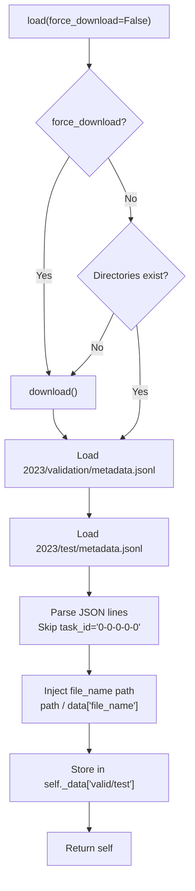
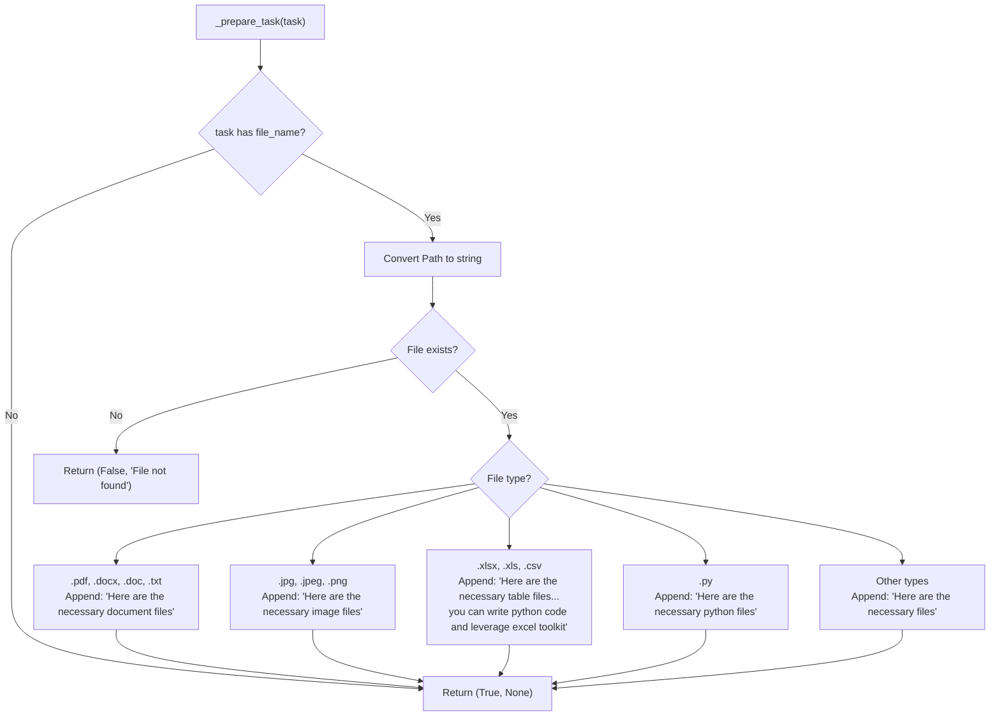
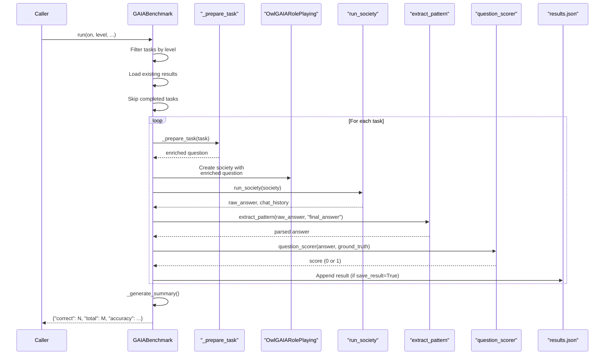

<!-- source: DeepWiki mcp.deepwiki.com · repo camel-ai/owl · page 7.1 GAIA Benchmark System · fetched 2026-10-29 -->

# GAIA Benchmark System

<details>
<summary>Relevant source files</summary>

The following files were used as context for generating this wiki page:

- [examples/run_gaia_roleplaying.py](examples/run_gaia_roleplaying.py)
- [examples/run_terminal.py](examples/run_terminal.py)
- [examples/run_terminal_zh.py](examples/run_terminal_zh.py)
- [owl/utils/document_toolkit.py](owl/utils/document_toolkit.py)
- [owl/utils/gaia.py](owl/utils/gaia.py)

</details>


This document describes the GAIA (General AI Assistants) benchmark integration system, which provides standardized evaluation capabilities for OWL's multi-agent task automation. The GAIA benchmark tests AI assistants on real-world tasks across multiple difficulty levels, requiring diverse tool usage including web search, code execution, document processing, and multimodal analysis.

For information about scoring and metrics calculation, see [7.3](#7.3). For custom CAMEL branches optimized for GAIA performance, see [7.2](#7.2). For general task execution without benchmarking, see [2.2](#2.2).

## Purpose and Scope

The GAIA benchmark system evaluates OWL's ability to solve complex, multi-step real-world tasks. It provides:
- Automated dataset loading from HuggingFace
- Task enrichment with file path injection
- Standardized execution using `OwlGAIARolePlaying`
- Type-aware answer scoring
- Result persistence and resumption

The system is designed for reproducible evaluation on validation and test sets at three difficulty levels.

**Sources:** [owl/utils/gaia.py:36-46]()

## Architecture Overview



**Diagram: GAIA Benchmark System Architecture**

The `GAIABenchmark` class orchestrates the entire evaluation pipeline, from dataset download through result aggregation. It extends `BaseBenchmark` from CAMEL-AI and uses `OwlGAIARolePlaying` for task execution.

**Sources:** [owl/utils/gaia.py:36-410]()

## GAIABenchmark Class

### Initialization and Configuration

The `GAIABenchmark` class is initialized with three parameters:

| Parameter | Type | Description |
|-----------|------|-------------|
| `data_dir` | `str` | Directory for storing dataset files (e.g., `"data/gaia"`) |
| `save_to` | `str` | Path for results JSON file (e.g., `"results/result.json"`) |
| `processes` | `int` | Number of parallel processes (default: 1) |

The class inherits from `BaseBenchmark` and sets the benchmark name to `"gaia"`:

```python
super().__init__("gaia", data_dir, save_to, processes)
```

**Sources:** [owl/utils/gaia.py:48-62]()

### Dataset Management

#### Downloading from HuggingFace

The `download()` method retrieves the GAIA dataset from HuggingFace:

[owl/utils/gaia.py:64-73]()

```python
from huggingface_hub import snapshot_download

snapshot_download(
    repo_id="gaia-benchmark/GAIA",
    repo_type="dataset",
    local_dir=self.data_dir,
    local_dir_use_symlinks=True,
)
```

#### Loading Dataset

The `load()` method parses metadata from both validation and test sets:



**Diagram: Dataset Loading Flow**

The loader skips the placeholder task with ID `"0-0-0-0-0"` and converts relative file paths to absolute paths by prepending the validation or test directory.

**Sources:** [owl/utils/gaia.py:100-132]()

### Difficulty Levels

GAIA tasks are categorized into three difficulty levels:

| Level | Description | Characteristics |
|-------|-------------|-----------------|
| **Level 1** | Simple tasks | Single-step operations, direct tool usage |
| **Level 2** | Medium tasks | Multi-step reasoning, tool composition |
| **Level 3** | Complex tasks | Long reasoning chains, multiple file types |

The `run()` method accepts level filtering:

```python
levels = (
    [1, 2, 3]
    if level == "all"
    else [level]
    if isinstance(level, int)
    else level
)
```

**Sources:** [owl/utils/gaia.py:158-168]()

## Task Preparation and Enrichment

### File Path Injection

The `_prepare_task()` method enriches task questions with file-specific instructions:



**Diagram: Task Preparation and File Enrichment**

The enrichment provides file-type-specific guidance to the agent. For Excel files, it explicitly suggests using Python code and the `ExcelToolkit`, which improves success rates on spreadsheet tasks.

**Sources:** [owl/utils/gaia.py:266-295]()

### Example Enrichment

Original question:
```
"What is the average temperature in the data?"
```

Enriched question (for Excel file):
```
"What is the average temperature in the data? Here are the necessary table files: 
/path/to/data.xlsx, for processing excel file, you can write python code and 
leverage excel toolkit to process the file step-by-step and get the information."
```

## Execution Pipeline

### Run Method Parameters

The `run()` method orchestrates benchmark execution:

| Parameter | Type | Description |
|-----------|------|-------------|
| `user_role_name` | `str` | Name for user agent (e.g., `"user"`) |
| `assistant_role_name` | `str` | Name for assistant agent (e.g., `"assistant"`) |
| `user_agent_kwargs` | `dict` | Configuration for user agent (model, etc.) |
| `assistant_agent_kwargs` | `dict` | Configuration for assistant agent (model, tools) |
| `on` | `Literal["valid", "test"]` | Dataset split to evaluate |
| `level` | `Union[int, List[int], "all"]` | Difficulty levels to include |
| `randomize` | `bool` | Whether to shuffle task order |
| `subset` | `Optional[int]` | Limit to first N tasks |
| `idx` | `Optional[List[int]]` | Specific task indices to run |
| `save_result` | `bool` | Whether to persist results incrementally |

**Sources:** [owl/utils/gaia.py:139-151]()

### Execution Flow



**Diagram: Benchmark Execution Sequence**

The execution loop is fault-tolerant: if a task fails, it logs the error and continues to the next task. Results are saved incrementally if `save_result=True`, allowing resumption after crashes.

**Sources:** [owl/utils/gaia.py:139-264]()

### Result Structure

Each task produces a result entry:

```json
{
    "task_id": "2023-validation-001",
    "question": "What is the average temperature? Here are the necessary...",
    "level": 2,
    "model_answer": "23.5",
    "ground_truth": "23.5",
    "score": 1,
    "token_info": {
        "prompt_tokens": 1234,
        "completion_tokens": 567
    },
    "history": [
        {"role": "user", "content": "..."},
        {"role": "assistant", "content": "..."}
    ]
}
```

**Sources:** [owl/utils/gaia.py:243-254]()

## Integration with OwlGAIARolePlaying

### Society Creation

The benchmark creates a specialized `OwlGAIARolePlaying` society for each task:

```python
society = OwlGAIARolePlaying(
    **task_kwargs,
    user_role_name=user_role_name,
    user_agent_kwargs=user_agent_kwargs,
    assistant_role_name=assistant_role_name,
    assistant_agent_kwargs=assistant_agent_kwargs,
)
```

`OwlGAIARolePlaying` extends the base `OwlRolePlaying` class with GAIA-specific behavior:
- Enforces answer formatting with XML tags (`<final_answer>...</final_answer>`)
- Provides stronger task completion detection
- Optimizes prompt engineering for benchmark performance

**Sources:** [owl/utils/gaia.py:222-228](), [owl/utils/enhanced_role_playing.py]()

### Answer Extraction

After execution, the benchmark extracts the final answer using pattern matching:

```python
raw_answer, chat_history, token_info = run_society(society)
answer = extract_pattern(raw_answer, "final_answer")
```

The `extract_pattern` function parses XML-formatted answers. If extraction fails, the task receives a score of 0.

**Sources:** [owl/utils/gaia.py:230-237](), [owl/utils/common.py]()

## Scoring System Overview

The `question_scorer()` method implements type-aware comparison logic. This is covered in detail in [7.3](#7.3), but the key behaviors are:

| Ground Truth Type | Comparison Strategy |
|-------------------|---------------------|
| **Number** | Normalize both (remove `$`, `%`, `,`), compare as floats |
| **List** (contains `,` or `;`) | Split both, compare element-by-element (recursively) |
| **String** | Normalize (lowercase, remove punctuation), exact match |

**Sources:** [owl/utils/gaia.py:318-409]()

## Usage Example

### Complete Benchmark Execution

The following example demonstrates running GAIA validation set Level 1 tasks:

```python
from owl.utils import GAIABenchmark
from camel.models import ModelFactory
from camel.types import ModelPlatformType, ModelType
from camel.toolkits import (
    BrowserToolkit,
    VideoAnalysisToolkit,
    AudioAnalysisToolkit,
    CodeExecutionToolkit,
    ImageAnalysisToolkit,
    SearchToolkit,
    ExcelToolkit,
    FileWriteToolkit,
)

# Create specialized models
models = {
    "user": ModelFactory.create(
        model_platform=ModelPlatformType.OPENAI,
        model_type=ModelType.GPT_4O,
        model_config_dict={"temperature": 0, "top_p": 1}
    ),
    "assistant": ModelFactory.create(
        model_platform=ModelPlatformType.OPENAI,
        model_type=ModelType.GPT_4O,
        model_config_dict={"temperature": 0, "top_p": 1}
    ),
    "browsing": ModelFactory.create(...),
    "planning": ModelFactory.create(...),
    "video": ModelFactory.create(...),
    "image": ModelFactory.create(...),
}

# Configure comprehensive toolkit
tools = [
    *BrowserToolkit(
        headless=True,
        web_agent_model=models["browsing"],
        planning_agent_model=models["planning"],
    ).get_tools(),
    *VideoAnalysisToolkit(model=models["video"]).get_tools(),
    *AudioAnalysisToolkit().get_tools(),
    *CodeExecutionToolkit(sandbox="subprocess", verbose=True).get_tools(),
    *ImageAnalysisToolkit(model=models["image"]).get_tools(),
    *SearchToolkit().get_tools(),
    *ExcelToolkit().get_tools(),
    *FileWriteToolkit(output_dir="./").get_tools(),
]

# Configure agents
user_agent_kwargs = {"model": models["user"]}
assistant_agent_kwargs = {"model": models["assistant"], "tools": tools}

# Initialize benchmark
benchmark = GAIABenchmark(
    data_dir="data/gaia",
    save_to="results/result.json"
)

# Run benchmark
result = benchmark.run(
    on="valid",
    level=1,
    idx=[0, 1, 2],  # Run first 3 tasks
    save_result=True,
    user_role_name="user",
    user_agent_kwargs=user_agent_kwargs,
    assistant_role_name="assistant",
    assistant_agent_kwargs=assistant_agent_kwargs,
)

# Output results
print(f"Correct: {result['correct']}, Total: {result['total']}")
print(f"Accuracy: {result['accuracy']}")
```

**Sources:** [examples/run_gaia_roleplaying.py:1-144]()

### Incremental Execution with Resumption

The benchmark supports resumption by checking completed tasks:

```python
# First run (processes 5 tasks, crashes on task 6)
benchmark.run(on="valid", level=1, save_result=True)

# Second run (skips tasks 1-5, resumes from task 6)
# Automatically loads results.json and checks _check_task_completed()
benchmark.run(on="valid", level=1, save_result=True)
```

The `_check_task_completed()` method prevents duplicate processing:

[owl/utils/gaia.py:75-79]()

```python
def _check_task_completed(self, task_id: str) -> bool:
    for data in self._results:
        if data["task_id"] == task_id:
            return True
    return False
```

Tasks already present in `results.json` are filtered out before execution:

[owl/utils/gaia.py:194-197]()

**Sources:** [owl/utils/gaia.py:75-79](), [owl/utils/gaia.py:186-197]()

## Summary Generation

After all tasks complete, `_generate_summary()` aggregates metrics:

```python
def _generate_summary(self) -> Dict[str, Any]:
    correct = sum(result["score"] for result in self._results)
    return {
        "total": len(self._results),
        "correct": correct,
        "results": self._results,
        "accuracy": correct / len(self._results) if len(self._results) > 0 else 0,
    }
```

The summary includes:
- `total`: Number of tasks processed
- `correct`: Number of tasks with score=1
- `accuracy`: Fraction of correct answers
- `results`: Full list of individual task results

**Sources:** [owl/utils/gaia.py:308-316]()

## Key Design Decisions

### Why File Path Enrichment?

The GAIA dataset provides file paths in metadata but does not inject them into task questions. Without enrichment, agents must:
1. Infer that files exist from task context
2. Guess file locations
3. Determine appropriate processing tools

Enrichment eliminates this ambiguity, allowing the benchmark to focus on task-solving capability rather than file discovery.

### Why OwlGAIARolePlaying?

The specialized `OwlGAIARolePlaying` class enforces strict answer formatting required for automated scoring. It uses prompt engineering to encourage XML-tagged answers:

```xml
<final_answer>42</final_answer>
```

This ensures that `extract_pattern()` can reliably parse answers from potentially long chat histories.

### Why Type-Aware Scoring?

GAIA ground truth answers have three types:
- **Numbers** (e.g., `"42"`, `"$1,234.56"`, `"89.5%"`)
- **Lists** (e.g., `"Paris, London, Berlin"`)
- **Strings** (e.g., `"The answer is yes"`)

Different types require different normalization strategies. A single string comparison would fail on equivalent numeric representations (e.g., `"1234.5"` vs `"$1,234.50"`).

**Sources:** [owl/utils/gaia.py:318-409]()

---

