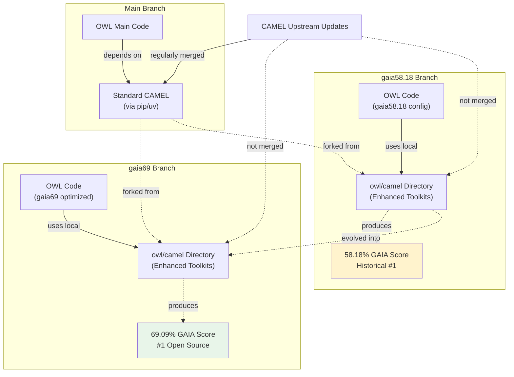
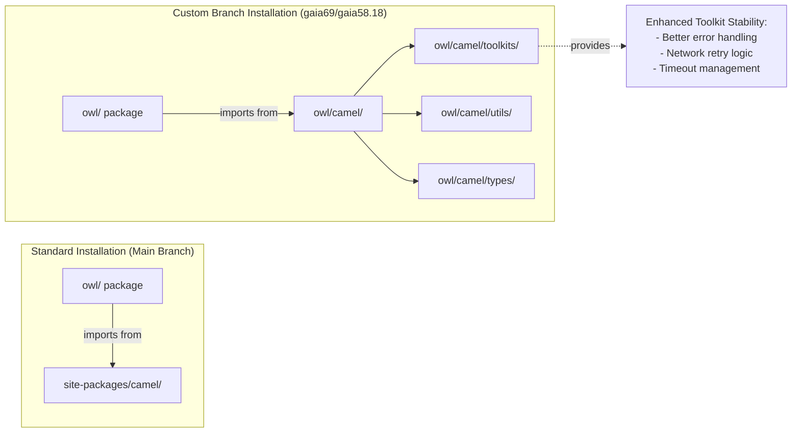
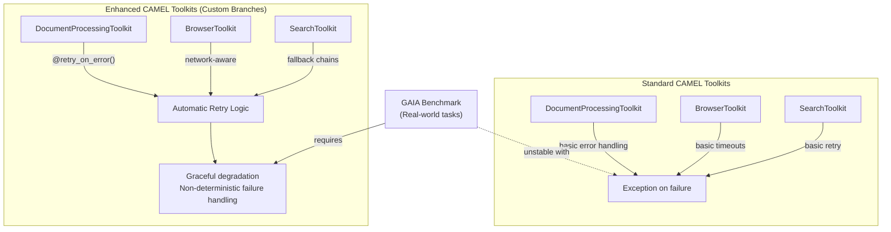
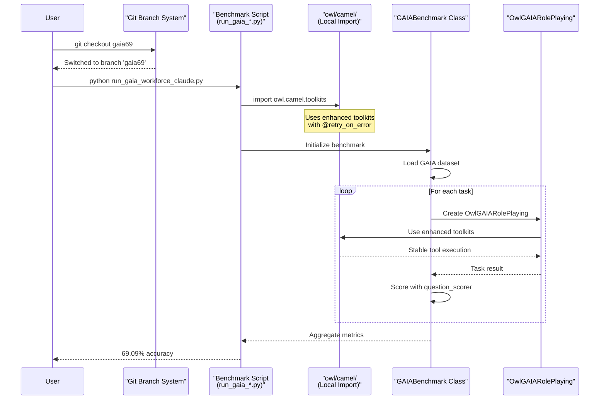
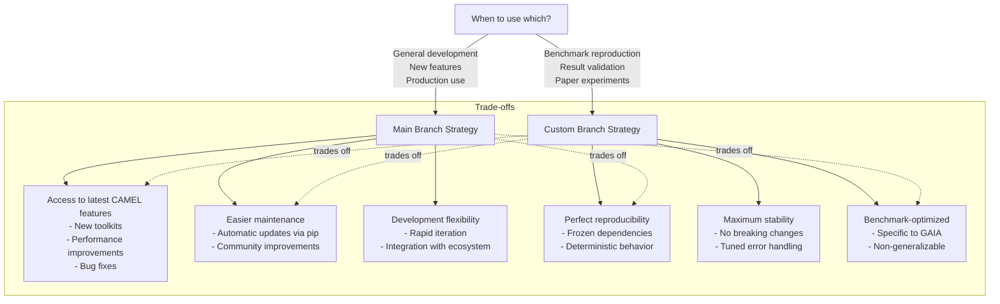

<!-- source: DeepWiki mcp.deepwiki.com · repo camel-ai/owl · page 7.2 Custom CAMEL Branches · fetched 2026-10-29 -->

# Custom CAMEL Branches

<details>
<summary>Relevant source files</summary>

The following files were used as context for generating this wiki page:

- [.gitignore](.gitignore)
- [README.md](README.md)
- [README_ja.md](README_ja.md)
- [README_zh.md](README_zh.md)
- [owl/assets/owl-favicon.ico](owl/assets/owl-favicon.ico)
- [owl/utils/document_toolkit.py](owl/utils/document_toolkit.py)
- [owl/utils/gaia.py](owl/utils/gaia.py)

</details>


## Purpose and Scope

This document describes the specialized Git branches (`gaia69` and `gaia58.18`) that contain frozen, optimized versions of the CAMEL framework for benchmark reproducibility. These branches include a custom `owl/camel` directory with enhanced toolkit stability specifically tuned for the GAIA benchmark. For information about the GAIA benchmark system itself, see [GAIA Benchmark System](#7.1). For scoring methodology, see [Scoring & Metrics](#7.3).

**Important**: The main branch of OWL does not use these custom CAMEL versions. These branches are maintained specifically for reproducing published benchmark results.

**Sources**: [README.md:1-10](), [README.md:203-204](), [README.md:619-636]()

---

## Branch Overview

OWL maintains two specialized branches for GAIA benchmark reproduction:

| Branch | Accuracy | Ranking | Purpose |
|--------|----------|---------|---------|
| `gaia69` | 69.09% | #1 among open-source frameworks | Latest top-performing configuration |
| `gaia58.18` | 58.18% | Historical #1 performance | Earlier benchmark achievement |

These branches exist as **frozen snapshots** rather than active development branches. They prioritize reproducibility and stability over incorporating the latest CAMEL features.

**Key Characteristics**:
- **Frozen Dependencies**: All toolkit implementations are locked to specific versions
- **Enhanced Stability**: Modified toolkits with improved error handling for real-world scenarios
- **Reproducible Results**: Deterministic behavior for benchmark validation
- **Self-Contained**: Include complete `owl/camel` directory to avoid external dependency changes

**Sources**: [README.md:52-56](), [README.md:162-164](), [README.md:619-636]()

---

## Branch Architecture



**Diagram: Custom Branch Architecture**

This architecture shows how the custom branches diverge from the main development line. The `owl/camel` directory in each branch contains a complete fork of CAMEL's toolkit implementations, allowing precise control over behavior without dependency on external package updates.

**Sources**: [README.md:1-10](), [README.md:698-705](), [.gitignore:61-63]()

---

## The owl/camel Directory Structure

The custom branches include an `owl/camel` directory that replaces the standard CAMEL installation:



**Diagram: owl/camel Directory Integration**

The `.gitignore` file explicitly tracks the `owl/camel` directory structure in custom branches:

```
owl/camel/types/__pycache__/
owl/camel/__pycache__/
owl/camel/utils/__pycache_/
```

This indicates that while `__pycache__` directories are ignored, the source code in `owl/camel/` is version-controlled within these branches.

**Sources**: [.gitignore:61-63](), [README.md:203-204]()

---

## Enhanced Toolkit Stability

The custom CAMEL versions in benchmark branches include specific enhancements for real-world task reliability:

### Stability Improvements



**Diagram: Toolkit Stability Enhancements**

### Key Enhancement: @retry_on_error Decorator

The custom branches extensively use the `@retry_on_error()` decorator, visible in [owl/utils/document_toolkit.py:58]():

```python
@retry_on_error()
def extract_document_content(self, document_path: str) -> Tuple[bool, str]:
```

This decorator (lines 58, 180, 218 in document_toolkit.py) provides automatic retry logic for operations that may fail due to network issues, rate limiting, or temporary service unavailability—common scenarios in the real-world GAIA benchmark.

### Non-Deterministic Failure Management

The README acknowledges real-world non-determinism in benchmark evaluation:

> "Since the GAIA benchmark evaluates LLM agents in a realistic world, it introduces a significant amount of randomness. Based on user feedback, one of the most common issues for replication is, for example, agents being blocked on certain webpages due to network reasons."

The custom branches include tooling to identify these failures. A script at `owl/filter_failed_cases.py` helps distinguish between:
- **Genuine agent failures** (incorrect answers)
- **Environmental failures** (network errors, timeouts)

**Sources**: [owl/utils/document_toolkit.py:58](), [owl/utils/document_toolkit.py:180](), [owl/utils/document_toolkit.py:218](), [README.md:698-705]()

---

## Using Custom Branches for Reproduction

### Switching to Custom Branches

To reproduce the benchmark results, switch to the appropriate branch:

```bash
# For 69.09% accuracy (latest top performance)
git checkout gaia69

# For 58.18% accuracy (historical result)
git checkout gaia58.18
```

### Branch-Specific Execution

Each branch has its own execution scripts optimized for its configuration:

**For gaia69 branch**:
```bash
git checkout gaia69
python run_gaia_workforce_claude.py
```

**For gaia58.18 branch**:
```bash
git checkout gaia58.18
python examples/run_gaia_roleplaying.py
```

### Execution Flow in Custom Branches



**Diagram: Custom Branch Execution Flow**

**Sources**: [README.md:619-636](), [owl/utils/gaia.py:1-410]()

---

## Integration with GAIA Benchmark System

The custom branches work seamlessly with the `GAIABenchmark` class defined in [owl/utils/gaia.py]():

### Task Preparation with Enhanced Toolkits

The `_prepare_task` method in [owl/utils/gaia.py:266-295]() enriches questions with file paths and toolkit-specific guidance:

```python
if file_path.suffix in [".xlsx", "xls", ".csv"]:
    task["Question"] += (
        f" Here are the necessary table files: {file_path}, "
        "for processing excel file, you can write python code and "
        "leverage excel toolkit to process the file step-by-step "
        "and get the information."
    )
```

This guidance relies on toolkit stability—failures in `ExcelToolkit` or `DocumentProcessingToolkit` would cascade through the entire benchmark. The enhanced error handling in custom branches prevents such cascades.

### OwlGAIARolePlaying Integration

The custom branches use `OwlGAIARolePlaying` (imported at [owl/utils/gaia.py:31]()) which extends the base `OwlRolePlaying` class with GAIA-specific answer formatting:

```python
society = OwlGAIARolePlaying(
    **task_kwargs,
    user_role_name=user_role_name,
    user_agent_kwargs=user_agent_kwargs,
    assistant_role_name=assistant_role_name,
    assistant_agent_kwargs=assistant_agent_kwargs,
)
```

This class ensures answers are formatted in the specific XML structure required by GAIA's `question_scorer` method at [owl/utils/gaia.py:318-369]().

**Sources**: [owl/utils/gaia.py:222-228](), [owl/utils/gaia.py:266-295](), [owl/utils/gaia.py:318-369]()

---

## Relationship to Main Branch

### Why Main Branch Doesn't Use Custom CAMEL



**Diagram: Branch Strategy Trade-offs**

### Notice in README

The main branch README prominently displays a notice at [README.md:1-10]():

```markdown
‼️ IMPORTANT NOTICE ‼️
The current version of OWL does not use the up-to-date version of CAMEL.
If you want to build the best performing agents powered by workforce, 
please check out eigent.py.
We are also working on updating CAMEL to the latest version.
```

This indicates that:
1. **Main branch uses standard CAMEL** for general development and latest features
2. **Custom branches use frozen CAMEL** for benchmark reproducibility
3. **Future direction** is to update main branch to latest CAMEL while maintaining custom branches for validation

### FAQ Clarification

The FAQ section at [README.md:697-699]() explicitly addresses this:

> **Q: Which CAMEL version should I use for replicate the role playing result?**
> 
> **A:** We provide a modified version of CAMEL (owl/camel) in the gaia58.18 branch. Please make sure you use this CAMEL version for your experiments.

**Sources**: [README.md:1-10](), [README.md:697-705]()

---

## Summary Table

| Aspect | Main Branch | gaia69 Branch | gaia58.18 Branch |
|--------|-------------|---------------|------------------|
| **CAMEL Source** | pip/uv install | owl/camel directory | owl/camel directory |
| **CAMEL Version** | Latest stable | Frozen fork | Frozen fork |
| **Purpose** | General development | 69.09% reproduction | 58.18% reproduction |
| **Toolkit Stability** | Standard | Enhanced | Enhanced |
| **Benchmark Optimized** | No | Yes (GAIA) | Yes (GAIA) |
| **Updates** | Regular | Frozen | Frozen |
| **Use Case** | Production, new features | Result validation | Historical validation |
| **@retry_on_error** | Standard CAMEL | Extensive | Extensive |
| **Execution Script** | examples/run.py | run_gaia_workforce_claude.py | run_gaia_roleplaying.py |

**Sources**: [README.md:1-10](), [README.md:203-204](), [README.md:619-636]()

---

