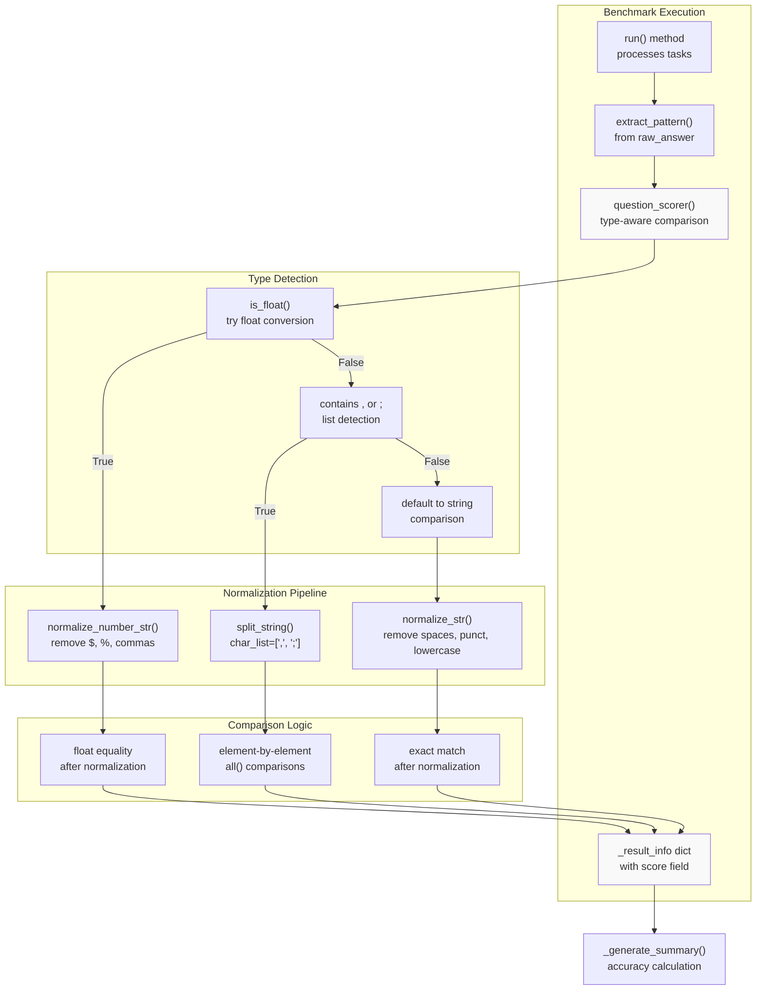
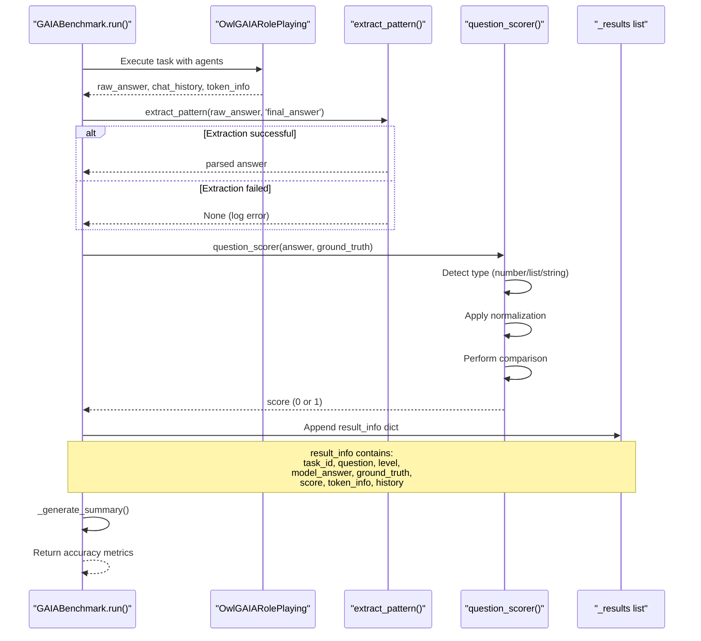

<!-- source: DeepWiki mcp.deepwiki.com · repo camel-ai/owl · page 7.3 Scoring & Metrics · fetched 2026-10-29 -->

# Scoring & Metrics

<details>
<summary>Relevant source files</summary>

The following files were used as context for generating this wiki page:

- [owl/utils/document_toolkit.py](owl/utils/document_toolkit.py)
- [owl/utils/gaia.py](owl/utils/gaia.py)

</details>


This document describes the answer evaluation and scoring system used in OWL's GAIA benchmark implementation. The scoring logic performs type-aware comparison between model-generated answers and ground truth, applying different normalization strategies based on the detected answer type (number, list, or string).

For information about the overall GAIA benchmark framework and task execution, see [GAIA Benchmark System](#7.1). For details on custom branches optimized for specific accuracy targets, see [Custom CAMEL Branches](#7.2).

## Overview

The scoring system is implemented primarily in the `GAIABenchmark` class's `question_scorer` method, which determines whether a model's answer matches the ground truth. Unlike simple string matching, this scorer implements intelligent type detection and normalization to handle the diverse answer formats present in GAIA benchmark tasks.

The scorer returns a boolean value (0 or 1) that is aggregated across all tasks to calculate the overall benchmark accuracy.

**Sources:** [owl/utils/gaia.py:318-369]()

## Scoring Architecture



**Sources:** [owl/utils/gaia.py:318-369](), [owl/utils/gaia.py:230-254](), [owl/utils/gaia.py:308-316]()

## Type-Aware Comparison Logic

The `question_scorer` method implements a three-way branching logic based on the ground truth's type:

### Number Detection

The scorer first attempts to convert the ground truth to a float using a helper function `is_float()`:

```python
def is_float(element: Any) -> bool:
    try:
        float(element)
        return True
    except ValueError:
        return False
```

If the ground truth is numeric, both the model answer and ground truth are normalized using `normalize_number_str()`, which removes currency symbols (`$`), percentage signs (`%`), and commas before conversion.

**Sources:** [owl/utils/gaia.py:331-341](), [owl/utils/gaia.py:371-378]()

### List Detection

If the ground truth contains commas or semicolons, the scorer treats both answers as lists. The logic:

1. Splits both strings using `split_string()` with delimiters `[',', ';']`
2. Validates that both lists have the same length
3. Compares elements pairwise, applying type-specific normalization to each element
4. Returns `True` only if all element comparisons match

This allows for proper evaluation of answers like `"Paris, London, Berlin"` where order matters and each city must match exactly.

**Sources:** [owl/utils/gaia.py:343-364](), [owl/utils/gaia.py:380-392]()

### String Comparison

For all other cases, the scorer normalizes both strings and performs exact matching. The normalization removes whitespace and optionally punctuation.

**Sources:** [owl/utils/gaia.py:366-369](), [owl/utils/gaia.py:394-409]()

## Normalization Strategies

```mermaid
graph LR
    subgraph "Number Normalization"
        NumInput["Input: '$1,234.56'"]
        RemoveDollar["Remove '$'"]
        RemoveComma["Remove ','"]
        RemovePercent["Remove '%'"]
        FloatConvert["float() conversion"]
        NumOutput["Output: 1234.56"]
        
        NumInput --> RemoveDollar
        RemoveDollar --> RemoveComma
        RemoveComma --> RemovePercent
        RemovePercent --> FloatConvert
        FloatConvert --> NumOutput
    end
    
    subgraph "String Normalization"
        StrInput["Input: 'Hello, World!'"]
        RemoveSpaces["Remove all spaces<br/>re.sub(r'\s', '', ...)"]
        Lowercase["Convert to lowercase"]
        RemovePunct["Remove punctuation<br/>str.maketrans()"]
        StrOutput["Output: 'helloworld'"]
        
        StrInput --> RemoveSpaces
        RemoveSpaces --> Lowercase
        Lowercase --> RemovePunct
        RemovePunct --> StrOutput
    end
    
    subgraph "List Processing"
        ListInput["Input: 'A, B; C'"]
        SplitPattern["re.split('[,;]', ...)"]
        ListElements["['A', ' B', ' C']"]
        RecursiveNorm["Apply type-specific<br/>normalization to each"]
        ListOutput["Normalized elements"]
        
        ListInput --> SplitPattern
        SplitPattern --> ListElements
        ListElements --> RecursiveNorm
        RecursiveNorm --> ListOutput
    end
```



### normalize_number_str

This method processes numeric strings to ensure consistent comparison:

| Character | Action |
|-----------|--------|
| `$` | Removed (currency symbol) |
| `%` | Removed (percentage) |
| `,` | Removed (thousands separator) |

If conversion to float fails after normalization, the method returns `float("inf")` to indicate an invalid number format.

**Sources:** [owl/utils/gaia.py:371-378]()

### normalize_str

String normalization has two modes controlled by the `remove_punct` parameter:

**With punctuation removal (default):**
1. Remove all whitespace using `re.sub(r"\s", "", input_str)`
2. Convert to lowercase
3. Remove all punctuation using `str.maketrans("", "", string.punctuation)`

**Without punctuation removal:**
1. Remove all whitespace
2. Convert to lowercase only

The non-punctuation mode is used for list elements where punctuation may be semantically meaningful.

**Sources:** [owl/utils/gaia.py:394-409]()

### split_string

Splits strings on multiple delimiters using regex pattern `[,;]` by default. Custom delimiter lists can be provided via the `char_list` parameter.

**Sources:** [owl/utils/gaia.py:380-392]()

## Integration with Benchmark Execution

The scoring system integrates tightly with the benchmark execution pipeline:



**Sources:** [owl/utils/gaia.py:199-264](), [owl/utils/gaia.py:308-316]()

## Result Structure

Each task execution produces a result dictionary stored in the `_results` list:

| Field | Type | Description |
|-------|------|-------------|
| `task_id` | str | Unique task identifier from GAIA dataset |
| `question` | str | Original question (may be enriched with file paths) |
| `level` | int | Difficulty level (1, 2, or 3) |
| `model_answer` | str or None | Extracted answer from model response |
| `ground_truth` | str | Expected correct answer |
| `score` | int | 0 (incorrect) or 1 (correct) |
| `token_info` | dict | Token usage statistics |
| `history` | list | Full conversation history |

The `_generate_summary()` method aggregates these results to compute:

- **total**: Number of tasks processed
- **correct**: Sum of all scores
- **accuracy**: `correct / total`
- **results**: Full list of individual task results

**Sources:** [owl/utils/gaia.py:243-254](), [owl/utils/gaia.py:308-316]()

## Error Handling

The scoring system handles several error conditions:

### Invalid Number Conversion

When `normalize_number_str()` cannot convert a string to float, it returns `float("inf")` and logs an error. This ensures the comparison will fail without raising an exception.

**Sources:** [owl/utils/gaia.py:371-378]()

### List Length Mismatch

When comparing lists, if the ground truth and model answer have different numbers of elements, the scorer logs a warning and returns `False` immediately without attempting element-wise comparison.

**Sources:** [owl/utils/gaia.py:348-353]()

### Answer Extraction Failure

If `extract_pattern()` fails to parse the model's response (e.g., malformed XML tags), the answer is set to `None` and logged. The scorer will then fail to match, resulting in a score of 0.

**Sources:** [owl/utils/gaia.py:231-237]()

## Scoring Examples

The following table illustrates how different answer types are scored:

| Ground Truth | Model Answer | Type | Normalized GT | Normalized MA | Score |
|--------------|--------------|------|---------------|---------------|-------|
| `"42.5"` | `"$42.50"` | Number | `42.5` | `42.5` | 1 |
| `"100"` | `"100.0"` | Number | `100.0` | `100.0` | 1 |
| `"Paris"` | `"paris"` | String | `"paris"` | `"paris"` | 1 |
| `"Hello, World!"` | `"helloworld"` | String | `"helloworld"` | `"helloworld"` | 1 |
| `"A, B, C"` | `"A,B,C"` | List | `["a","b","c"]` | `["a","b","c"]` | 1 |
| `"1, 2, 3"` | `"1.0, 2.0, 3.0"` | List | `[1.0,2.0,3.0]` | `[1.0,2.0,3.0]` | 1 |
| `"42"` | `"43"` | Number | `42.0` | `43.0` | 0 |
| `"A, B"` | `"A, B, C"` | List | length=2 | length=3 | 0 |

**Sources:** [owl/utils/gaia.py:318-369]()

## Persistent Results

The benchmark supports incremental execution through result persistence:

1. When `save_result=True` is passed to `run()`, results are saved to the file specified in `save_to`
2. On subsequent runs, completed tasks (checked via `_check_task_completed()`) are skipped
3. Results are saved after each task to prevent data loss on interruption

This allows for resumable benchmark runs, especially useful for large validation or test sets.

**Sources:** [owl/utils/gaia.py:186-196](), [owl/utils/gaia.py:259-262]()

## Relationship to Official GAIA Scorer

The OWL implementation is adapted from the official GAIA benchmark scorer available on HuggingFace. The code comment explicitly references the source:

```
https://huggingface.co/spaces/gaia-benchmark/leaderboard/blob/main/scorer.py
```

This ensures consistency with official leaderboard evaluations and reproducibility of benchmark results.

**Sources:** [owl/utils/gaia.py:318-322]()

---

