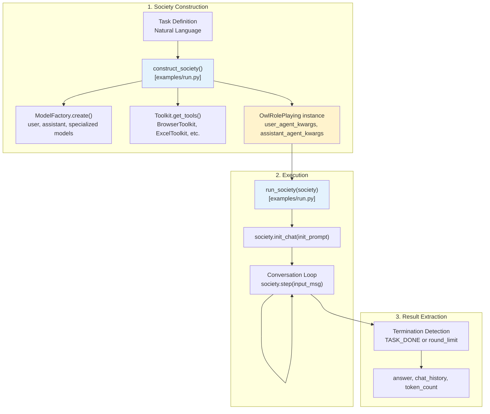
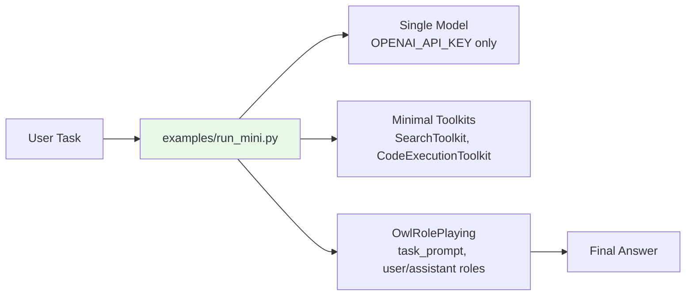
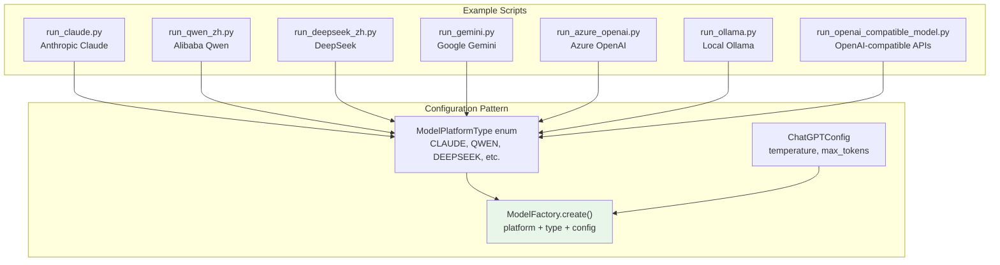
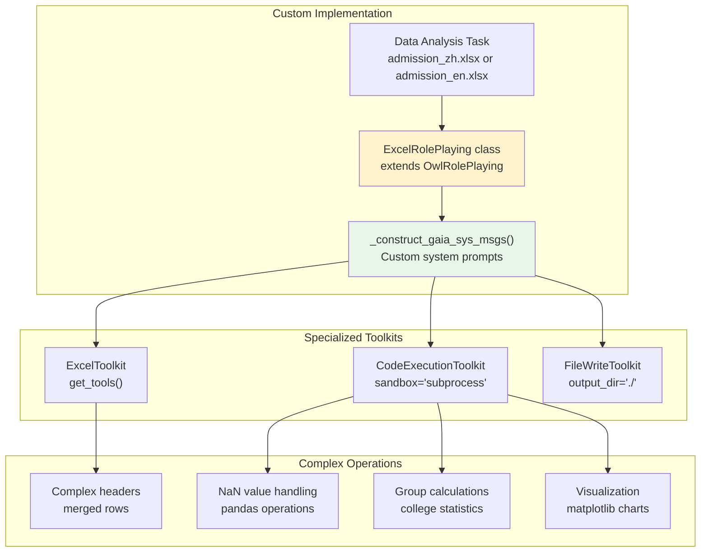
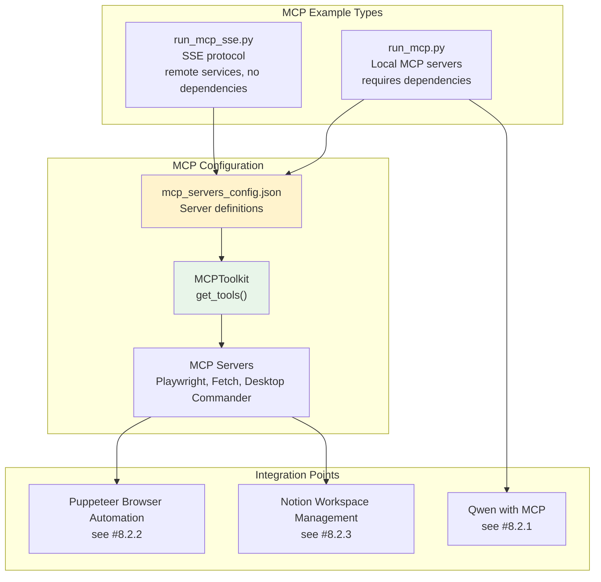
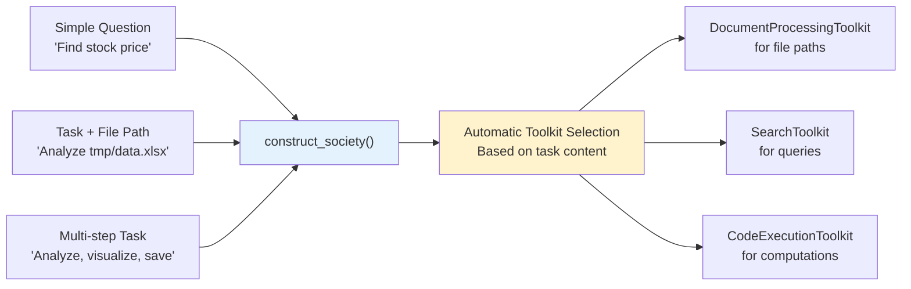
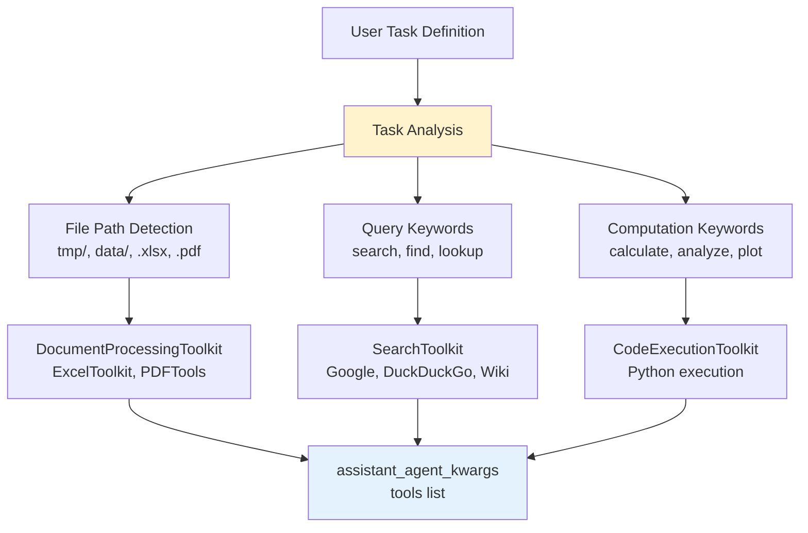

<!-- source: DeepWiki mcp.deepwiki.com · repo camel-ai/owl · page 8 Use Cases & Examples · fetched 2026-10-29 -->

# Use Cases & Examples

<details>
<summary>Relevant source files</summary>

The following files were used as context for generating this wiki page:

- [.gitignore](.gitignore)
- [README.md](README.md)
- [README_ja.md](README_ja.md)
- [README_zh.md](README_zh.md)
- [community_usecase/excel_analyzer/README.md](community_usecase/excel_analyzer/README.md)
- [community_usecase/excel_analyzer/README_zh.md](community_usecase/excel_analyzer/README_zh.md)
- [community_usecase/excel_analyzer/data/admission_en.xlsx](community_usecase/excel_analyzer/data/admission_en.xlsx)
- [community_usecase/excel_analyzer/data/admission_zh.xlsx](community_usecase/excel_analyzer/data/admission_zh.xlsx)
- [community_usecase/excel_analyzer/data_analyzer_en.py](community_usecase/excel_analyzer/data_analyzer_en.py)
- [community_usecase/excel_analyzer/data_analyzer_zh.py](community_usecase/excel_analyzer/data_analyzer_zh.py)
- [owl/assets/owl-favicon.ico](owl/assets/owl-favicon.ico)

</details>


This page demonstrates real-world applications of the OWL framework through concrete examples and implementation patterns. Each use case shows how to configure agents, toolkits, and models to accomplish specific tasks, from simple question-answering to complex data analysis workflows.

For detailed implementation guides on specific toolkits and configuration options, see [Toolkits](#5) and [Model Integration](#6). For benchmark evaluation patterns, see [Benchmarking & Evaluation](#7).

## Example Categories

OWL examples are organized into three main categories:

| Category | Purpose | Complexity | Key Files |
|----------|---------|------------|-----------|
| **Basic Execution** | Simple task automation with minimal configuration | Low | `examples/run.py`, `examples/run_mini.py` |
| **Domain-Specific** | Specialized workflows (Excel analysis, MCP integration) | Medium | `community_usecase/excel_analyzer/`, `examples/run_mcp.py` |
| **Model Variants** | Platform-specific configurations | Low-Medium | `examples/run_claude.py`, `examples/run_qwen_zh.py`, etc. |

## Core Execution Pattern

All OWL examples follow a common three-step pattern:



**Diagram**: Standard OWL execution pipeline showing the three-phase pattern used across all examples.

**Sources**: [examples/run.py:1-100](), [README.md:397-476]()

## Basic Task Execution

### Minimal Example

The simplest OWL example requires only an LLM API key and demonstrates core agent interaction:



**Diagram**: Minimal example architecture with reduced dependencies.

[examples/run_mini.py:1-100]() demonstrates this pattern with:
- Single model configuration (no specialized models)
- Subset of toolkits (Search, Code Execution)
- Simplified error handling

**Sources**: [README.md:446-450](), [examples/run_mini.py]()

### Standard Example

The standard example [examples/run.py:1-100]() provides full functionality:

```python
# Task definition with file path
task = "What is in the given DOCX file? Here is the file path: tmp/example.docx"

# Society construction with specialized models
society = construct_society(task)

# Execution
answer, chat_history, token_count = run_society(society)
```

This pattern automatically:
1. Selects appropriate toolkits based on task content
2. Invokes `DocumentProcessingToolkit` for file handling
3. Manages conversation history and token counting

**Key example tasks** ([README.md:479-487]()):
- Stock price queries: `"Find the latest stock price for Apple Inc."`
- Sentiment analysis: `"Analyze the sentiment of recent tweets about climate change"`
- Code debugging: `"Help me debug this Python code: [code snippet]"`
- Document summarization: `"Summarize the main points from this research paper: [URL]"`
- Data visualization: `"Create a data visualization for this dataset: [path]"`

**Sources**: [README.md:399-476](), [examples/run.py]()

## Model-Specific Examples

OWL provides platform-specific examples for different LLM providers:



**Diagram**: Model-specific example scripts and their common configuration pattern.

Each example follows the same structure but with platform-specific configuration:

| Script | Platform | Key Configuration |
|--------|----------|-------------------|
| `run_claude.py` | `ModelPlatformType.ANTHROPIC` | Claude 3.5 Sonnet models |
| `run_qwen_zh.py` | `ModelPlatformType.QWEN` | Chinese language optimization |
| `run_deepseek_zh.py` | `ModelPlatformType.DEEPSEEK` | Chinese language support |
| `run_gemini.py` | `ModelPlatformType.GOOGLE` | Gemini 2.5 Pro |
| `run_azure_openai.py` | `ModelPlatformType.AZURE` | Enterprise deployment |
| `run_ollama.py` | `ModelPlatformType.OLLAMA` | Local model execution |

**Sources**: [README.md:421-444](), [examples/run_claude.py](), [examples/run_qwen_zh.py]()

## Excel Data Analysis Use Case

For a comprehensive walkthrough of the Excel analysis example, see [Excel Data Analysis](#8.1).

The Excel analyzer demonstrates custom role-playing implementation:



**Diagram**: Excel analyzer architecture showing custom role-playing and toolkit integration.

Key implementation details from [community_usecase/excel_analyzer/data_analyzer_zh.py:44-158]():

**Custom System Prompts**: The `ExcelRolePlaying` class overrides `_construct_gaia_sys_msgs()` to provide specialized instructions:
- User agent: Task decomposition with Excel-specific guidance
- Assistant agent: Code execution tips, library imports, matplotlib configuration for Chinese fonts

**Toolkit Configuration** ([community_usecase/excel_analyzer/data_analyzer_zh.py:254-258]()):
```python
tools = [
    *CodeExecutionToolkit(sandbox="subprocess", verbose=True).get_tools(),
    *ExcelToolkit().get_tools(),
    *FileWriteToolkit(output_dir="./").get_tools(),
]
```

**Supported Operations**:
- Complex header parsing (merged rows in Excel)
- Missing value (NaN) detection and handling
- Group-by calculations (statistics by college)
- Multi-chart visualization (bar charts + line charts)

**Tested Models**: `gpt-4o`, `deepseek-v3` ([community_usecase/excel_analyzer/README.md:11]())

**Sources**: [community_usecase/excel_analyzer/data_analyzer_zh.py](), [community_usecase/excel_analyzer/data_analyzer_en.py](), [community_usecase/excel_analyzer/README.md]()

## MCP Integration Examples

For detailed MCP integration patterns, see [MCP Integration Examples](#8.2).

OWL supports Model Context Protocol (MCP) for connecting to external services:



**Diagram**: MCP integration architecture showing local and remote execution patterns.

**Local Execution** ([README.md:519]()): `examples/run_mcp.py` demonstrates basic MCP functionality with local server requirements.

**Remote Execution** ([README.md:520]()): `examples/run_mcp_sse.py` uses Server-Sent Events (SSE) protocol for remote services without local dependencies.

**MCP Server Configuration**: [mcp_servers_config.json]() defines available servers:
- Playwright MCP server for browser automation
- Fetch server for HTTP requests
- Desktop Commander for system operations

**Sources**: [README.md:492-521](), [examples/run_mcp.py](), [examples/run_mcp_sse.py]()

## Implementation Patterns

### Task Definition Pattern



**Diagram**: How OWL automatically selects toolkits based on task content.

**Sources**: [README.md:464-476]()

### Custom Role-Playing Pattern

The Excel analyzer demonstrates how to customize agent behavior:

1. **Extend Base Class**: Create subclass of `OwlRolePlaying`
2. **Override System Messages**: Implement `_construct_gaia_sys_msgs()` 
3. **Specialized Prompts**: Add domain-specific guidance (Excel operations, visualization)
4. **Custom Run Logic**: Optionally override `run_society()` for specialized execution

This pattern is particularly useful for:
- Domain-specific tasks (data analysis, document processing)
- Language-specific optimization (Chinese, Japanese)
- Custom termination conditions
- Specialized toolkit usage patterns

**Sources**: [community_usecase/excel_analyzer/data_analyzer_zh.py:44-158]()

### Toolkit Selection Pattern



**Diagram**: Toolkit selection based on task characteristics.

Standard toolkit configuration from [README.md:528-544]():
```python
tools = [
    *BrowserToolkit(headless=False).get_tools(),
    *VideoAnalysisToolkit(model=models["video"]).get_tools(),
    *AudioAnalysisToolkit().get_tools(),
    *CodeExecutionToolkit(sandbox="subprocess").get_tools(),
    *ImageAnalysisToolkit(model=models["image"]).get_tools(),
    SearchToolkit().search_duckduckgo,
    SearchToolkit().search_google,
    SearchToolkit().search_wiki,
    *ExcelToolkit().get_tools(),
    *DocumentProcessingToolkit(model=models["document"]).get_tools(),
    *FileWriteToolkit(output_dir="./").get_tools(),
]
```

**Sources**: [README.md:528-584]()

## Example Task Types

### Information Retrieval

**Pattern**: Query → Search Toolkit → Answer Extraction

**Example**: `"Find the latest stock price for Apple Inc."` ([README.md:481]())

**Toolkits Used**:
- `SearchToolkit`: Web search capabilities
- `CodeExecutionToolkit`: Data parsing and formatting

### Data Analysis

**Pattern**: File Input → Processing → Computation → Visualization

**Example**: `"Create a data visualization for this dataset: [dataset path]"` ([README.md:485]())

**Toolkits Used**:
- `ExcelToolkit`: Spreadsheet operations
- `CodeExecutionToolkit`: pandas, matplotlib
- `FileWriteToolkit`: Save outputs

See [Excel Data Analysis](#8.1) for detailed walkthrough.

### Document Processing

**Pattern**: File Path → Document Parsing → Content Extraction → Analysis

**Example**: `"What is in the given DOCX file? Here is the file path: tmp/example.docx"` ([README.md:468]())

**Toolkits Used**:
- `DocumentProcessingToolkit`: DOCX, PDF, XLSX parsing
- `CodeExecutionToolkit`: Text processing

### Code Assistance

**Pattern**: Code Input → Analysis → Debugging/Improvement → Explanation

**Example**: `"Help me debug this Python code: [your code here]"` ([README.md:483]())

**Toolkits Used**:
- `CodeExecutionToolkit`: Execute and test code
- `SearchToolkit`: Look up documentation/errors

### Web Research

**Pattern**: Query → Multi-source Search → Synthesis → Summary

**Example**: `"Summarize the main points from this research paper: [paper URL]"` ([README.md:484]())

**Toolkits Used**:
- `SearchToolkit`: Find sources
- `BrowserToolkit`: Navigate and extract content
- `DocumentProcessingToolkit`: Process downloaded content

### Sentiment Analysis

**Pattern**: Data Collection → Text Processing → Classification → Summary

**Example**: `"Analyze the sentiment of recent tweets about climate change"` ([README.md:482]())

**Toolkits Used**:
- `SearchToolkit`: Gather recent tweets/posts
- `CodeExecutionToolkit`: NLP processing

**Sources**: [README.md:479-487]()

## Language-Specific Examples

OWL provides localized examples for different languages:

| Language | Files | Features |
|----------|-------|----------|
| **Chinese** | `run_qwen_zh.py`, `run_deepseek_zh.py`, `excel_analyzer_zh.py` | Chinese model optimization, matplotlib font configuration |
| **Japanese** | `webapp_jp.py` | Japanese web interface |
| **English** | `run.py`, `run_mini.py`, `excel_analyzer_en.py` | Standard configurations |

**Chinese-specific considerations** ([community_usecase/excel_analyzer/data_analyzer_zh.py:140-145]()):
```python
# Matplotlib Chinese font support
matplotlib.rcParams['font.sans-serif'] = ['SimHei']
matplotlib.rcParams['axes.unicode_minus'] = False
```

**Sources**: [community_usecase/excel_analyzer/data_analyzer_zh.py:140-145](), [README.md:428-432]()

## Next Steps

For detailed implementations:
- **Excel Analysis**: See [Excel Data Analysis](#8.1) for complete walkthrough
- **MCP Integration**: See [MCP Integration Examples](#8.2) for external service patterns
- **Basic Examples**: See [Basic Task Execution Examples](#8.3) for getting started guides
- **Toolkit Configuration**: See [Toolkit Architecture](#5.1) for advanced toolkit patterns
- **Model Selection**: See [Model Integration](#6) for platform-specific configurations

**Sources**: [README.md:1-738](), [community_usecase/excel_analyzer/]()

---

