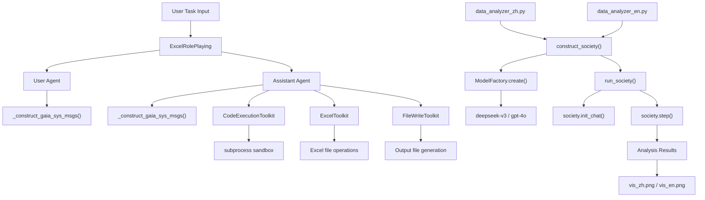
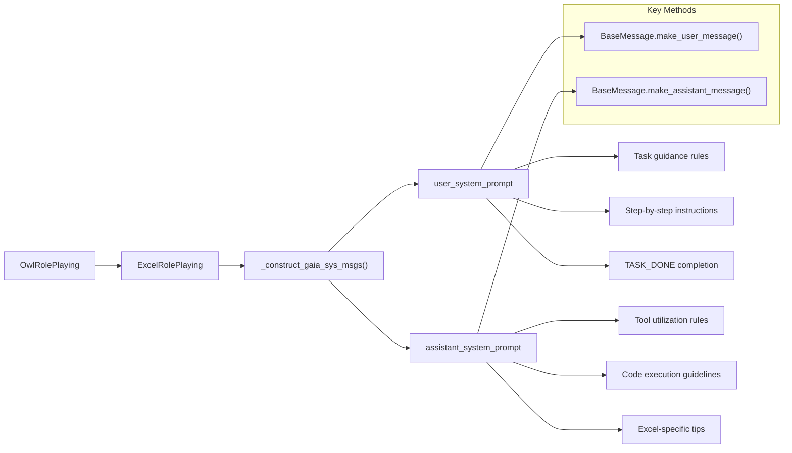
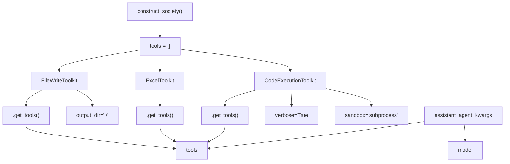
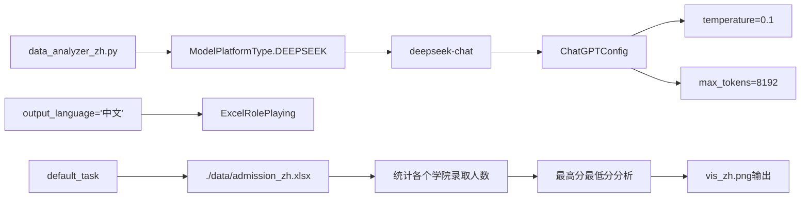
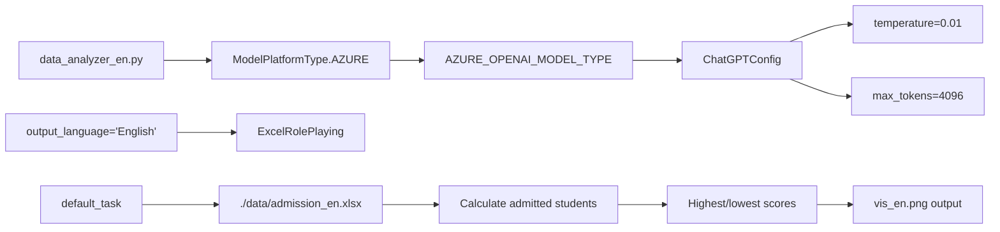
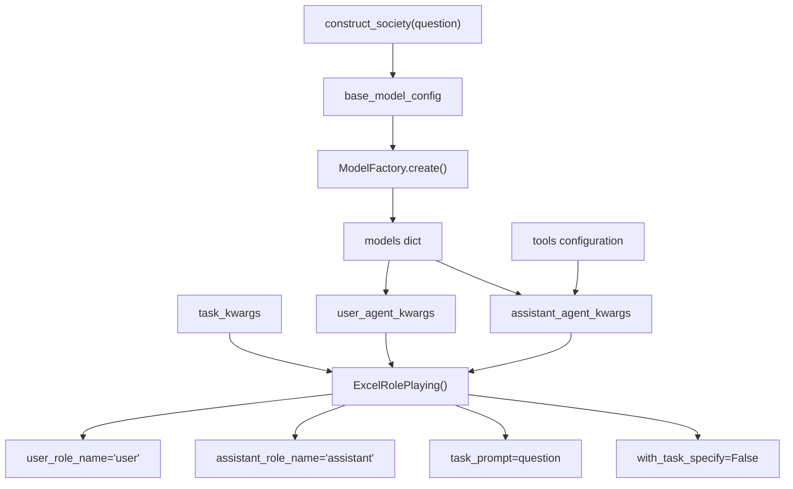
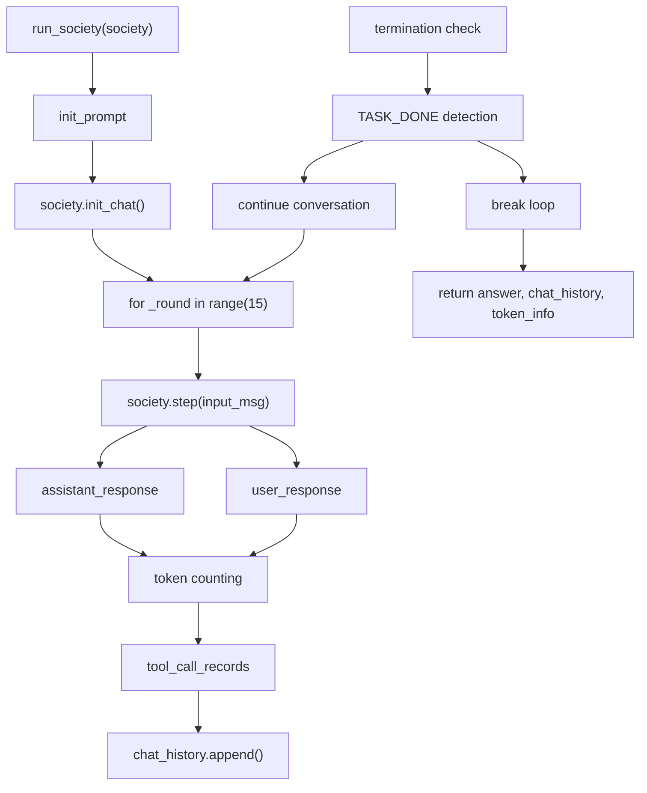

<!-- source: DeepWiki mcp.deepwiki.com · repo camel-ai/owl · page 8.1 Excel Data Analysis · fetched 2026-10-29 -->

# Excel Data Analysis

<details>
<summary>Relevant source files</summary>

The following files were used as context for generating this wiki page:

- [community_usecase/excel_analyzer/README.md](community_usecase/excel_analyzer/README.md)
- [community_usecase/excel_analyzer/README_zh.md](community_usecase/excel_analyzer/README_zh.md)
- [community_usecase/excel_analyzer/data/admission_en.xlsx](community_usecase/excel_analyzer/data/admission_en.xlsx)
- [community_usecase/excel_analyzer/data/admission_zh.xlsx](community_usecase/excel_analyzer/data/admission_zh.xlsx)
- [community_usecase/excel_analyzer/data_analyzer_en.py](community_usecase/excel_analyzer/data_analyzer_en.py)
- [community_usecase/excel_analyzer/data_analyzer_zh.py](community_usecase/excel_analyzer/data_analyzer_zh.py)

</details>


This document describes the Excel Data Analysis use case implementation within the OWL framework, which demonstrates automated analysis and visualization of Excel spreadsheets using multi-agent collaboration. The system handles complex Excel features including merged headers, missing values, grouped calculations, and generates visualizations automatically.

For information about other toolkit integrations, see [Other Toolkits](#5.4). For general MCP integrations, see [MCP Integrations](#8.2).

## System Overview

The Excel Data Analysis system extends the core OWL framework to provide specialized capabilities for processing Excel files. It combines natural language task specification with programmatic Excel manipulation through a custom role-playing agent implementation.

## Excel Analysis Architecture



**System Architecture Overview**

Sources: [community_usecase/excel_analyzer/data_analyzer_zh.py:44-158](), [community_usecase/excel_analyzer/data_analyzer_en.py:44-122]()

## Core Components

### ExcelRolePlaying Class

The `ExcelRolePlaying` class extends `OwlRolePlaying` and overrides the system message construction to provide specialized prompts for Excel analysis tasks.



**ExcelRolePlaying Class Structure**

The class customizes system prompts for both user and assistant agents with Excel-specific guidance:

- **User Agent**: Provides step-by-step task guidance and completion criteria
- **Assistant Agent**: Includes Excel analysis best practices and tool usage instructions

Sources: [community_usecase/excel_analyzer/data_analyzer_zh.py:44-158](), [community_usecase/excel_analyzer/data_analyzer_en.py:44-122]()

### Toolkit Integration



**Toolkit Configuration**

The system integrates three primary toolkits:

- **CodeExecutionToolkit**: Enables Python code execution with subprocess sandbox
- **ExcelToolkit**: Provides Excel file reading and manipulation capabilities  
- **FileWriteToolkit**: Handles output file generation and saving

Sources: [community_usecase/excel_analyzer/data_analyzer_zh.py:254-258](), [community_usecase/excel_analyzer/data_analyzer_en.py:212-216]()

## Implementation Variants

The system provides two language-specific implementations with different model configurations:

| Implementation | Model Platform | Model Type | Temperature | Language |
|----------------|----------------|------------|-------------|----------|
| `data_analyzer_zh.py` | DEEPSEEK | deepseek-chat | 0.1 | Chinese |
| `data_analyzer_en.py` | AZURE | gpt-4o | 0.01 | English |

### Chinese Implementation



**Chinese Implementation Flow**

Sources: [community_usecase/excel_analyzer/data_analyzer_zh.py:234-238](), [community_usecase/excel_analyzer/data_analyzer_zh.py:288-291]()

### English Implementation



**English Implementation Flow**

Sources: [community_usecase/excel_analyzer/data_analyzer_en.py:199-203](), [community_usecase/excel_analyzer/data_analyzer_en.py:244-247]()

## Execution Flow

### Society Construction

The `construct_society()` function creates and configures the multi-agent system:



**Society Construction Process**

Sources: [community_usecase/excel_analyzer/data_analyzer_zh.py:224-280](), [community_usecase/excel_analyzer/data_analyzer_en.py:188-238]()

### Conversation Loop

The `run_society()` function manages the multi-agent conversation:



**Conversation Management Flow**

Sources: [community_usecase/excel_analyzer/data_analyzer_zh.py:160-222](), [community_usecase/excel_analyzer/data_analyzer_en.py:124-186]()

## Data Handling Capabilities

The system handles complex Excel analysis scenarios including:

### Complex Excel Features

- **Merged Headers**: Handles spreadsheets with merged row headers
- **NaN Values**: Processes missing data appropriately  
- **Group Calculations**: Performs aggregations across grouped data
- **Visualization**: Generates charts combining multiple data representations

### Analysis Tasks

The default tasks demonstrate comprehensive Excel analysis:

**Chinese Task**:
- Analyze `./data/admission_zh.xlsx`
- Calculate admission counts by college
- Determine highest and lowest scores
- Generate combined bar and line charts
- Save as `vis_zh.png`

**English Task**:
- Analyze `./data/admission_en.xlsx` 
- Calculate admitted students per college
- Find highest/lowest scores
- Create bar charts for admissions, line charts for scores
- Save as `vis_en.png`

Sources: [community_usecase/excel_analyzer/data_analyzer_zh.py:288-291](), [community_usecase/excel_analyzer/data_analyzer_en.py:244-247]()

## Usage Instructions

### Prerequisites

1. Set up OWL environment according to official instructions
2. Configure appropriate API keys for chosen model platform
3. Ensure Excel data files are available in the data directory

### Execution

```bash
cd community_usecase/excel_analyzer

# Chinese version using deepseek-v3
python data_analyzer_zh.py

# English version using gpt-4o  
python data_analyzer_en.py
```

### Output

The system generates:
- Analysis results in the console
- Visualization files (`vis_zh.png` or `vis_en.png`)
- Detailed execution logs (`log.txt`)

Sources: [community_usecase/excel_analyzer/README.md:18-30]()

---

