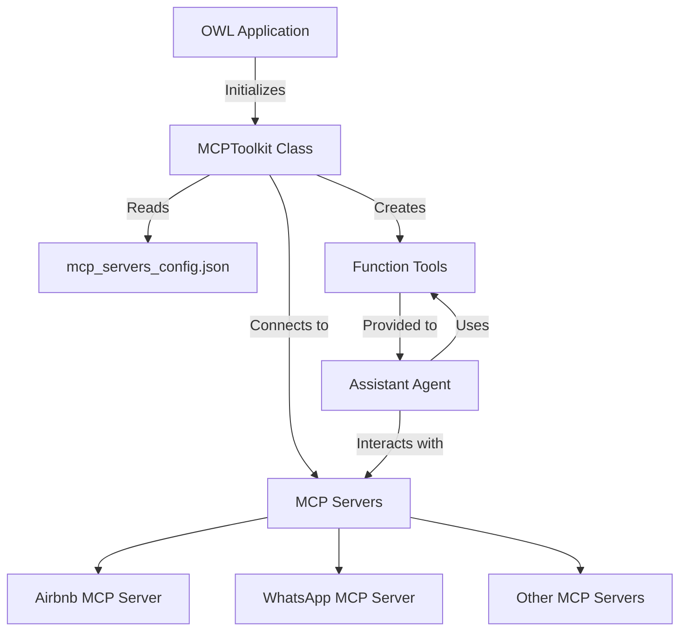
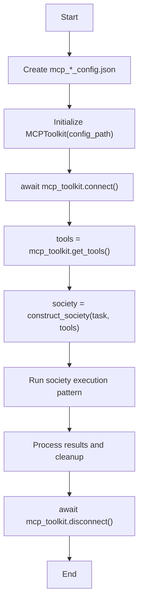

<!-- source: DeepWiki mcp.deepwiki.com · repo camel-ai/owl · page 8.2 MCP Integration Examples · fetched 2026-10-29 -->

# MCP Integration Examples

<details>
<summary>Relevant source files</summary>

The following files were used as context for generating this wiki page:

- [community_usecase/qwen3_mcp/mcp_sse_config.json](community_usecase/qwen3_mcp/mcp_sse_config.json)
- [community_usecase/qwen3_mcp/run_mcp_qwen3.py](community_usecase/qwen3_mcp/run_mcp_qwen3.py)
- [examples/mcp_servers_config.json](examples/mcp_servers_config.json)
- [examples/run_mcp.py](examples/run_mcp.py)

</details>


## Purpose and Scope

This document provides an overview of Model Context Protocol (MCP) integration patterns across different use cases in OWL. It demonstrates how to connect AI agent societies to external services through standardized MCP interfaces. The page covers general integration architecture, configuration patterns, and execution workflows. For detailed implementation examples, see subsections 8.2.1 (Qwen with MCP), 8.2.2 (Puppeteer Browser Automation), and 8.2.3 (Notion Workspace Management). For information about the core MCP Toolkit implementation, see section 5.2.

## What is MCP?

The Model Context Protocol (MCP) is a standardized communication protocol that enables AI models to interact with external tools and data sources. In the OWL framework, MCP serves as a bridge allowing agent societies to access and manipulate external services through a consistent interface.

### Key Characteristics

- **Standardized Interface**: Provides a uniform way for models to access different services
- **Client-Server Architecture**: Uses a client-server model where OWL communicates with MCP servers
- **Dynamic Tool Discovery**: Enables models to discover and use tools without hardcoded integrations

## MCP Architecture in OWL

MCP integration in OWL follows a modular architecture that connects agent societies with external services through the MCPToolkit.



Sources:
- [community_usecase/Airbnb-MCP/Airbnb_MCP.py:67-68]()
- [community_usecase/Whatsapp-MCP/app.py:141-142]()

## Configuration System

MCP integrations are configured through JSON files that specify how to spawn and connect to MCP servers.

### Configuration Structure

```mermaid
classDiagram
    class "mcp_servers_config.json" {
        +Object mcpServers
    }
    
    class "mcpServers" {
        +Object serverName1
        +Object serverName2
        +Object serverNameN
    }
    
    class "serverConfig" {
        +String command
        +Array args
    }
    
    "mcp_servers_config.json" --> "mcpServers"
    "mcpServers" --> "serverConfig" : contains
```

### Sample Configuration

Each MCP server entry in the configuration file requires:
- **command**: The executable to run (e.g., `npx`, path to UV)
- **args**: Arguments passed to the command to launch the server
- **env**: Optional environment variables for authentication

#### Examples

| Use Case | Command | Package | Purpose |
|----------|---------|---------|---------|
| EdgeOne Pages | `npx` | `edgeone-pages-mcp` | Web page deployment |
| Playwright | `npx` | `@playwright/mcp@latest` | Browser automation |
| Puppeteer | `npx` | `@modelcontextprotocol/server-puppeteer` | Web scraping |
| Notion API | `npx` | `@notionhq/notion-mcp-server` | Workspace management |
| FireCrawl | `npx` | `firecrawl-mcp` | Content extraction |

Sources:
- [community_usecase/qwen3_mcp/mcp_sse_config.json:1-14]()
- [community_usecase/Puppeteer MCP/mcp_servers_config.json:1-8]()
- [community_usecase/Notion-MCP/mcp_servers_config.json:1-11]()
- [community_usecase/Mcp_use_case/mcp_servers_config.json:1-21]()

## Integration Pattern Overview

MCP integrations in OWL follow a consistent pattern across different use cases. The general workflow involves:

1. **Configuration**: Define MCP servers in a JSON configuration file
2. **Connection**: Initialize `MCPToolkit` and connect to servers
3. **Tool Discovery**: Extract tools from connected servers
4. **Society Construction**: Build `OwlRolePlaying` with MCP tools
5. **Execution**: Run the agent society with task-specific logic
6. **Cleanup**: Properly disconnect from MCP servers

**Common Integration Patterns**

The codebase demonstrates three main integration patterns:

| Pattern | Use Case | Key Characteristics | Example |
|---------|----------|---------------------|---------|
| **Basic Async** | Command-line scripts | Simple async/await flow with `arun_society()` | Section 8.2.1 (Qwen MCP) |
| **UI Integration** | Streamlit applications | Custom event loops for UI frameworks | Section 8.2.2 (Puppeteer) |
| **Service-Specific** | API integrations with auth | Environment variables for credentials | Section 8.2.3 (Notion) |

### Example Implementations

This section provides brief summaries of MCP integration examples. For detailed implementation guides, see the subsections:

**Qwen with MCP (Section 8.2.1)**: Demonstrates web automation using EdgeOne Pages and Playwright MCP servers with Qwen models. Features structured conversation logging to markdown files and GitHub repository documentation generation.

**Puppeteer Browser Automation (Section 8.2.2)**: Streamlit-based web interface for browser automation tasks. Shows how to integrate MCP with UI frameworks using custom event loops.

**Notion Workspace Management (Section 8.2.3)**: Automated Notion operations including page updates, content creation, and database queries. Demonstrates authentication patterns for service-specific MCP integrations.

Sources:
- [community_usecase/qwen3_mcp/run_mcp_qwen3.py:40-84]()
- [examples/run_mcp.py:99-140]()

## Implementation Flow

The general pattern for implementing MCP integrations follows these steps:

**High-Level MCP Integration Flow**



Sources:
- [examples/run_mcp.py:143-175]()
- [community_usecase/qwen3_mcp/run_mcp_qwen3.py:264-330]()

### Code Structure Components

| Component | Description | File Examples |
|-----------|-------------|---------------|
| Configuration File | JSON file defining MCP server settings | `mcp_sse_config.json`, `mcp_servers_config.json` |
| Main Script | Application entry point with `async def main()` | `run_mcp_qwen3.py`, `run_mcp.py` |
| Society Construction | `async def construct_society()` creating `OwlRolePlaying` | See all implementation examples |
| Execution Pattern | `await arun_society(society)` or custom execution | Standard in all examples |
| Model Configuration | `ModelFactory.create()` for different platforms | Platform-specific model setup |

### Core Implementation Patterns

**Pattern 1: Basic MCP Integration**

Used in standard command-line scripts:

```python
async def main():
    config_path = Path(__file__).parent / "mcp_servers_config.json"
    mcp_toolkit = MCPToolkit(config_path=str(config_path))
    
    try:
        await mcp_toolkit.connect()
        tools = [*mcp_toolkit.get_tools()]
        society = await construct_society(task, tools)
        answer, chat_history, token_count = await arun_society(society)
    finally:
        await mcp_toolkit.disconnect()
```

Sources:
- [examples/run_mcp.py:143-175]()

**Pattern 2: Enhanced Logging Pattern**

Adds conversation logging and structured output:

```python
async def main():
    mcp_toolkit = MCPToolkit(config_path=str(config_path), strict=True)
    md_filename = create_md_file(task)
    
    try:
        await mcp_toolkit.connect()
        tools = [*mcp_toolkit.get_tools()]
        society = await construct_society(task, tools)
        answer, chat_history, token_info = await run_society_with_formatted_output(
            society, md_filename
        )
    finally:
        # Enhanced cleanup with timeout
        await asyncio.wait_for(
            asyncio.shield(mcp_toolkit.disconnect()), 
            timeout=3.0
        )
```

Sources:
- [community_usecase/qwen3_mcp/run_mcp_qwen3.py:264-330]()
- [community_usecase/qwen3_mcp/run_mcp_qwen3.py:87-113]()
- [community_usecase/qwen3_mcp/run_mcp_qwen3.py:146-261]()

**Pattern 3: Mixing MCP with Native Toolkits**

Combines MCP tools with OWL's native toolkits:

```python
async def run_task(task: str) -> str:
    mcp_toolkit = MCPToolkit(config_path=str(config_path))
    await mcp_toolkit.connect()
    
    # Combine MCP tools with native toolkits
    tools = [
        *mcp_toolkit.get_tools(),
        SearchToolkit().search_duckduckgo
    ]
    
    society = await construct_society(task, tools)
    answer, chat_history, token_count = await arun_society(society)
    return answer
```

Sources:
- [examples/run_mcp.py:99-140]()

## Best Practices

### Error Handling

Implement comprehensive error handling with proper async cleanup:

```python
try:
    await mcp_toolkit.connect()
    # Your code here
except KeyboardInterrupt:
    print("Received exit signal, shutting down...")
except Exception as e:
    print(f"Error occurred: {e}")
finally:
    try:
        await asyncio.wait_for(
            asyncio.shield(mcp_toolkit.disconnect()), 
            timeout=3.0
        )
    except asyncio.TimeoutError:
        print("Disconnect timed out, but program will exit safely")
```

### Asynchronous Operations

All MCP operations are asynchronous. Different patterns for different contexts:

```python
# Standard async pattern
await mcp_toolkit.connect()

# Streamlit integration pattern
new_loop = asyncio.new_event_loop()
asyncio.set_event_loop(new_loop)
result = new_loop.run_until_complete(run_task(task))
new_loop.close()

# Windows-specific event loop policy
if sys.platform.startswith("win"):
    asyncio.set_event_loop_policy(asyncio.WindowsProactorEventLoopPolicy())
```

### Resource Cleanup

Advanced cleanup patterns for different scenarios:

```python
# Enhanced cleanup with task cancellation
finally:
    tasks = [t for t in asyncio.all_tasks() if t is not asyncio.current_task()]
    for task in tasks:
        task.cancel()
        try:
            await task
        except asyncio.CancelledError:
            pass
    
    try:
        await mcp_toolkit.disconnect()
    except Exception as e:
        print(f"Cleanup error (can be ignored): {e}")
```

### Platform-Specific Handling

```python
# Windows asyncio cleanup
if sys.platform == 'win32':
    try:
        import asyncio.windows_events
        asyncio.windows_events._overlapped = None
    except (ImportError, AttributeError):
        pass
```

Sources:
- [community_usecase/qwen3_mcp/run_mcp_qwen3.py:304-326]()
- [community_usecase/Puppeteer MCP/demo.py:21-22]()
- [community_usecase/Puppeteer MCP/demo.py:99-107]()
- [community_usecase/Notion-MCP/notion_manager.py:111-137]()
- [community_usecase/Mcp_use_case/Content_curator.py:131-142]()

## Common Troubleshooting

| Issue | Solution | Example |
|-------|----------|---------|
| MCP server fails to start | Check Node.js/npm installation and package availability | `npm install -g @notionhq/notion-mcp-server@latest` |
| Authentication failures | Configure proper API keys and tokens in environment | Notion: `"Authorization": "Bearer ntn_****"` |
| Connection timeouts | Implement connection retry and timeout handling | `asyncio.wait_for(mcp_toolkit.disconnect(), timeout=3.0)` |
| Tool function errors | Verify correct parameters and handle tool call exceptions | Check `tool_calls` in assistant response info |
| Async event loop issues | Use proper event loop policies for different platforms | `asyncio.set_event_loop_policy(asyncio.WindowsProactorEventLoopPolicy())` |
| Streamlit async conflicts | Create new event loops for Streamlit integration | `new_loop = asyncio.new_event_loop()` |
| Resource cleanup errors | Implement graceful shutdown with task cancellation | Cancel running tasks before disconnect |

Sources:
- [community_usecase/Notion-MCP/README.md:78-84]()
- [community_usecase/qwen3_mcp/run_mcp_qwen3.py:310-321]()
- [community_usecase/Puppeteer MCP/demo.py:18-22]()
- [community_usecase/Notion-MCP/notion_manager.py:132-137]()

## Extending MCP Integrations

To create a new MCP integration:

1. Identify or develop an MCP server for your target service
2. Create a `mcp_servers_config.json` file with appropriate settings
3. Use the MCPToolkit to connect to your server
4. Extract tools and provide them to your agent society

This modular approach allows for extending OWL with new capabilities without modifying the core codebase.

Sources:
- [community_usecase/Whatsapp-MCP/README.md:137-164]()

---

