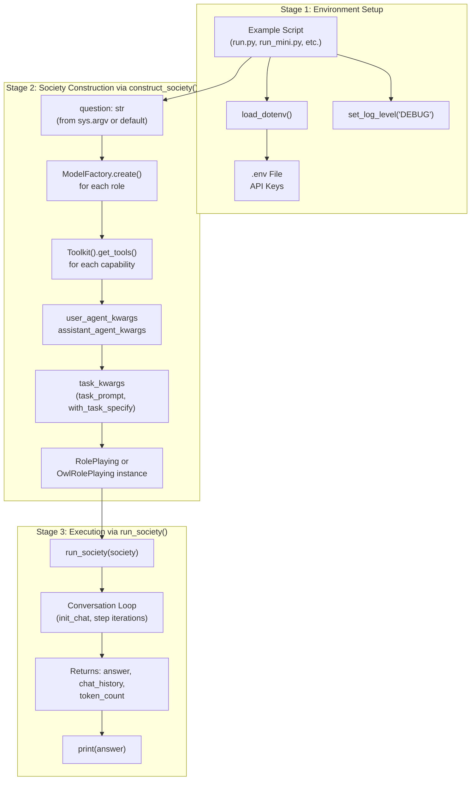
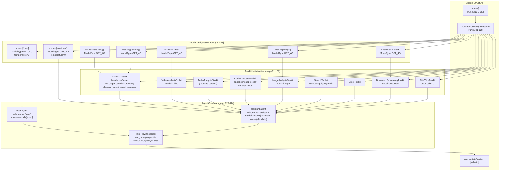
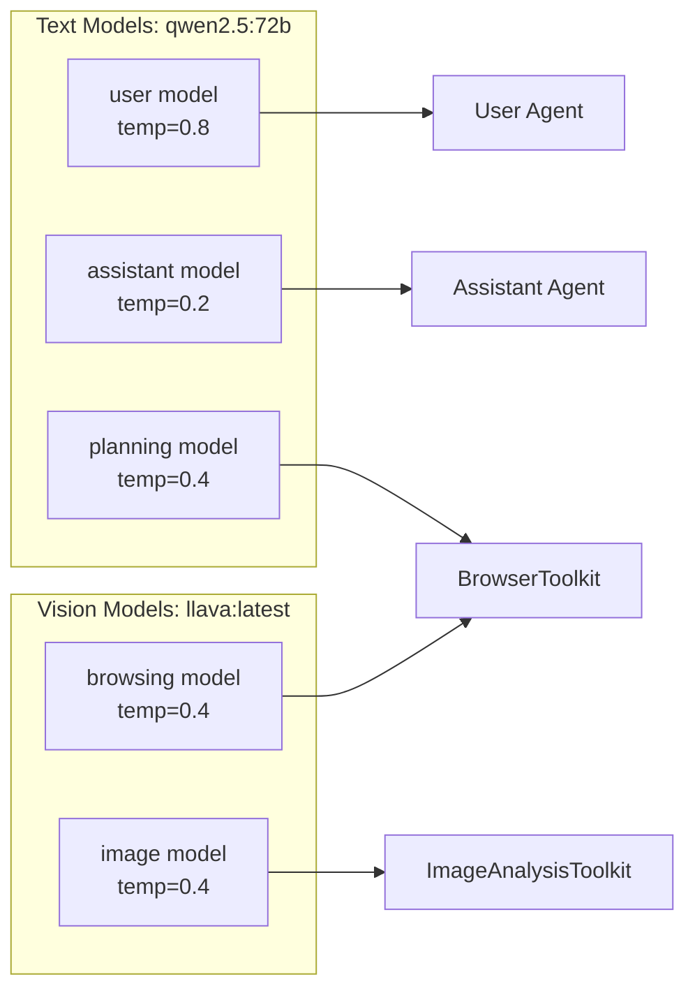
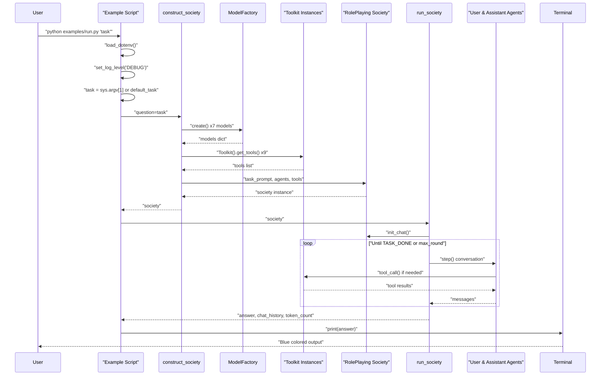

<!-- source: DeepWiki mcp.deepwiki.com · repo camel-ai/owl · page 8.3 Basic Task Execution Examples · fetched 2026-10-29 -->

# Basic Task Execution Examples

<details>
<summary>Relevant source files</summary>

The following files were used as context for generating this wiki page:

- [examples/run.py](examples/run.py)
- [examples/run_azure_openai.py](examples/run_azure_openai.py)
- [examples/run_deepseek_zh.py](examples/run_deepseek_zh.py)
- [examples/run_mini.py](examples/run_mini.py)
- [examples/run_ollama.py](examples/run_ollama.py)
- [examples/run_qwen_mini_zh.py](examples/run_qwen_mini_zh.py)
- [examples/run_qwen_zh.py](examples/run_qwen_zh.py)

</details>


## Purpose and Scope

This document covers the basic task execution example scripts located in the `examples/` directory. These scripts demonstrate the fundamental pattern for running OWL agents on tasks and serve as starting templates for custom implementations. Each example script is a self-contained, executable program that showcases different model platforms and toolkit configurations.

For specialized use cases beyond basic task execution, see [Excel Data Analysis](#8.1) for data processing examples and [MCP Integration Examples](#8.2) for Model Context Protocol integration patterns. For deploying these examples via web interface, see [Web Application](#4.1).

---

## Common Execution Pattern

All basic examples follow a standard three-stage pattern: environment setup, society construction, and execution. This pattern is consistent across all platform-specific variants.



**Sources:** [examples/run.py:1-149](), [examples/run_mini.py:1-128](), [examples/run_azure_openai.py:1-124]()

---

## Example Scripts Overview

The `examples/` directory provides multiple variants demonstrating different configurations. Each script is optimized for a specific platform or use case.

| Script | Primary Platform | Key Features | Language | Toolkits |
|--------|------------------|--------------|----------|----------|
| `run.py` | OpenAI GPT-4o | Full toolkit suite (8 types) | English | Browser, Video, Audio, Code, Image, Search, Excel, Document, File |
| `run_mini.py` | OpenAI GPT-4o | Minimal toolkit set (4 types) | English | Browser, Code, Search, File |
| `run_azure_openai.py` | Azure OpenAI | Enterprise deployment | English | Browser, Code, Image, Search, Excel, File |
| `run_ollama.py` | Ollama (Local) | Self-hosted models | English | Browser, Code, Image, Search, Excel, File |
| `run_qwen_zh.py` | Qwen (Alibaba) | Full Chinese language support | Chinese | Browser, Video, Code, Image, Search, Excel, Document, File |
| `run_qwen_mini_zh.py` | Qwen (Alibaba) | Minimal Chinese configuration | Chinese | Browser, Search, File |
| `run_deepseek_zh.py` | DeepSeek | Chinese platform, no vision | Chinese | Code, Search, Excel, File |

**Sources:** [examples/run.py:1-149](), [examples/run_mini.py:1-128](), [examples/run_azure_openai.py:1-124](), [examples/run_ollama.py:1-144](), [examples/run_qwen_zh.py:1-159](), [examples/run_qwen_mini_zh.py:1-147](), [examples/run_deepseek_zh.py:1-121]()

---

## Core Example: run.py

The [examples/run.py:1-149]() script demonstrates full-featured task execution with comprehensive toolkit integration.

### Code Structure Mapping



**Sources:** [examples/run.py:1-149]()

### Key Implementation Details

**Environment Setup** [examples/run.py:34-38]()
- Loads `.env` file from `owl/.env` using `pathlib` for cross-platform compatibility
- Sets log level to `DEBUG` for detailed execution tracing
- Imports from `owl.utils` for `run_society` and `DocumentProcessingToolkit`

**Model Specialization** [examples/run.py:52-88]()
- Creates 7 specialized models, all using `GPT_4O` with `temperature=0` for reproducibility
- `browsing` and `planning` models dedicated to `BrowserToolkit` sub-agents
- `video`, `image`, `document` models for multimodal analysis toolkits
- Separate `user` and `assistant` models allow asymmetric configurations (lighter user model possible)

**Toolkit Configuration** [examples/run.py:91-107]()
- `BrowserToolkit` receives both `web_agent_model` and `planning_agent_model` for internal multi-agent operation
- `CodeExecutionToolkit` uses `subprocess` sandbox (alternatives: `e2b-code-interpreter`)
- `SearchToolkit` exposes individual methods (`search_duckduckgo`, `search_google`, `search_wiki`) rather than `get_tools()`
- Comment indicates `search_google` requires API key configuration
- All toolkits use `.get_tools()` pattern except `SearchToolkit` which exposes specific functions

**Agent Assembly** [examples/run.py:109-126]()
- `user_agent_kwargs` receives only model (no tools)
- `assistant_agent_kwargs` receives model and tools list
- `task_kwargs` disables task specification (`with_task_specify=False`)
- `RolePlaying` class from `camel.societies` (not `OwlRolePlaying` from `owl.utils`)

**Sources:** [examples/run.py:34-126]()

---

## Minimal Example: run_mini.py

The [examples/run_mini.py:1-128]() script provides a lightweight alternative with reduced dependencies, suitable for quick testing or resource-constrained environments.

### Differences from run.py

| Aspect | run.py | run_mini.py |
|--------|--------|-------------|
| Total Models | 7 (user, assistant, browsing, planning, video, image, document) | 4 (user, assistant, browsing, planning) |
| Toolkits | 8 types (Browser, Video, Audio, Code, Image, Search, Excel, Document, File) | 4 types (Browser, Code, Search, File) |
| Search Methods | 3 (DuckDuckGo, Google, Wikipedia) | 2 (DuckDuckGo, Wikipedia) |
| Multimodal | Yes (Video, Audio, Image, Document) | No |
| Class Type | `RolePlaying` | `RolePlaying` |
| Lines of Code | 149 | 128 |

**Removed Capabilities:**
- [examples/run_mini.py:1-128]() excludes `VideoAnalysisToolkit`, `AudioAnalysisToolkit`, `ImageAnalysisToolkit`, `ExcelToolkit`, and `DocumentProcessingToolkit`
- Does not create `video`, `image`, or `document` specialized models
- Omits `SearchToolkit().search_google` to avoid Google API key dependency

**Retained Core Features:**
- Browser automation with `BrowserToolkit` [examples/run_mini.py:77-81]()
- Code execution with `CodeExecutionToolkit` [examples/run_mini.py:82]()
- Basic search with DuckDuckGo and Wikipedia [examples/run_mini.py:83-84]()
- File writing capability with `FileWriteToolkit` [examples/run_mini.py:85]()

**Sources:** [examples/run_mini.py:1-128](), [examples/run.py:1-149]()

---

## Platform-Specific Examples

### Azure OpenAI: run_azure_openai.py

The [examples/run_azure_openai.py:1-124]() script demonstrates enterprise deployment patterns using Azure OpenAI services.

**Platform Configuration** [examples/run_azure_openai.py:53-65]()
```python
base_model_config = {
    "model_platform": ModelPlatformType.AZURE,
    "model_type": os.getenv("AZURE_OPENAI_MODEL_TYPE"),
    "model_config_dict": ChatGPTConfig(temperature=0.4, max_tokens=4096).as_dict(),
}
```
- Uses `ModelPlatformType.AZURE` enum value
- Model type loaded from environment variable `AZURE_OPENAI_MODEL_TYPE` for deployment flexibility
- Applies same configuration to all 5 models (user, assistant, browsing, planning, image)
- Uses `ChatGPTConfig` with `temperature=0.4` (higher than other examples for creative variation)
- Sets `max_tokens=4096` limit

**Society Type** [examples/run_azure_openai.py:94-101]()
- Uses `OwlRolePlaying` class from `owl.utils` (not standard `RolePlaying`)
- Identical agent configuration pattern to other examples

**Sources:** [examples/run_azure_openai.py:1-124]()

### Local Models: run_ollama.py

The [examples/run_ollama.py:1-144]() script shows self-hosted model configuration using Ollama.

**Model Configuration** [examples/run_ollama.py:56-86]()
- Uses `ModelPlatformType.OLLAMA` enum
- Specifies custom `url="http://localhost:11434/v1"` for local Ollama server
- Uses `qwen2.5:72b` for text-only models (user, assistant, planning)
- Uses `llava:latest` for vision-capable models (browsing, image)
- Different temperature settings per role:
  - User: `0.8` (more creative guidance)
  - Assistant: `0.2` (more deterministic execution)
  - Browsing/Planning/Image: `0.4` (balanced)
- Sets `max_tokens=1000000` for extended context

**Multi-Model Strategy:**


**Sources:** [examples/run_ollama.py:56-86]()

---

## Language-Specific Examples

### Chinese Language: run_qwen_zh.py

The [examples/run_qwen_zh.py:1-159]() script demonstrates comprehensive Chinese language support using Qwen models.

**Model Selection** [examples/run_qwen_zh.py:60-95]()
- Uses `ModelPlatformType.QWEN` with Alibaba Cloud API
- Text models: `ModelType.QWEN_MAX` (user, assistant, planning)
- Vision models: `ModelType.QWEN_VL_MAX` (browsing, video, image, document)
- All models use `temperature=0` for reproducibility

**Language Configuration** [examples/run_qwen_zh.py:100-136]()
- `BrowserToolkit` receives `output_language="Chinese"` parameter [examples/run_qwen_zh.py:104]()
- `RolePlaying` society receives `output_language="Chinese"` parameter [examples/run_qwen_zh.py:135]()
- Includes `SearchToolkit().search_baidu` for Chinese search engine [examples/run_qwen_zh.py:112]()
- Default task in Chinese: "浏览亚马逊并找出一款对程序员有吸引力的产品。请提供产品名称和价格" [examples/run_qwen_zh.py:144]()

**Sources:** [examples/run_qwen_zh.py:1-159]()

### Minimal Chinese: run_qwen_mini_zh.py

The [examples/run_qwen_mini_zh.py:1-147]() script provides lightweight Chinese language configuration.

**Simplified Configuration** [examples/run_qwen_mini_zh.py:56-104]()
- Only 6 models created (vs 7 in full version)
- Only 3 toolkit types: `BrowserToolkit`, `SearchToolkit` (Baidu only), `FileWriteToolkit`
- Excludes code execution, video, audio, image, Excel, and document processing
- Maintains same language configuration as full version

**Sources:** [examples/run_qwen_mini_zh.py:1-147]()

### DeepSeek Platform: run_deepseek_zh.py

The [examples/run_deepseek_zh.py:1-121]() script shows text-only Chinese platform usage.

**Platform Limitations** [examples/run_deepseek_zh.py:56-67]()
- Uses `ModelPlatformType.DEEPSEEK` with `ModelType.DEEPSEEK_CHAT`
- Only 2 models created (user, assistant) - no vision models
- No browser automation (requires vision models for web interaction)
- Focuses on text-based toolkits: Code, Search, Excel, File

**Toolkit Selection** [examples/run_deepseek_zh.py:70-77]()
- `CodeExecutionToolkit` for Python execution
- `SearchToolkit` with DuckDuckGo, Wikipedia, and Baidu
- `ExcelToolkit` for spreadsheet operations
- `FileWriteToolkit` for file output
- No multimodal toolkits (Browser, Video, Audio, Image, Document)

**Sources:** [examples/run_deepseek_zh.py:1-121]()

---

## Running the Examples

### Command Line Execution

**Basic Execution with Default Task:**
```bash
python examples/run.py
```

**Custom Task via Command Line Argument:**
```bash
python examples/run.py "Search for recent developments in AI safety and summarize the findings"
```

**Platform-Specific Execution:**
```bash
# Azure OpenAI
python examples/run_azure_openai.py "Your task here"

# Ollama (requires local server running)
python examples/run_ollama.py "Your task here"

# Qwen Chinese
python examples/run_qwen_zh.py "你的任务"
```

**Docker Execution:**
```bash
./run_in_docker.sh examples/run.py "Your task here"
```

**Sources:** [examples/run.py:111-123](), [examples/run_mini.py:116-127]()

### Command Line Argument Handling

All example scripts implement identical argument parsing logic:

```python
task = sys.argv[1] if len(sys.argv) > 1 else default_task
```

**Behavior:**
- If `sys.argv[1]` exists: use command line argument as task
- If no argument provided: use script's `default_task` variable
- `default_task` varies by script (see table below)

| Script | Default Task |
|--------|--------------|
| `run.py`, `run_mini.py`, `run_azure_openai.py`, `run_ollama.py` | "Open Brave search, summarize the github stars, fork counts, etc. of camel-ai's camel framework, and write the numbers into a python file using the plot package, save it locally, and run the generated python file." |
| `run_qwen_zh.py`, `run_qwen_mini_zh.py` | "浏览亚马逊并找出一款对程序员有吸引力的产品。请提供产品名称和价格" |
| `run_deepseek_zh.py` | "搜索OWL项目最近的新闻并生成一篇报告，最后保存到本地。" |

**Sources:** [examples/run.py:108-138](), [examples/run_qwen_zh.py:129-150](), [examples/run_deepseek_zh.py:102-116]()

---

## Output Format

### Return Values from run_society()

The `run_society()` function returns a tuple with three elements:

```python
answer, chat_history, token_count = run_society(society)
```

**Return Value Structure:**
1. `answer` (str): Final extracted answer from the conversation
2. `chat_history` (list): Complete message exchange between agents
3. `token_count` (int): Total tokens consumed during execution

**Display Pattern** [examples/run.py:143]()
- All examples use ANSI color code `\033[94m` (blue) for answer display
- Reset with `\033[0m` to restore default terminal color
- Pattern: `print(f"\033[94mAnswer: {answer}\033[0m")`

**Sources:** [examples/run.py:116-143](), [examples/run_mini.py:120-123]()

### Execution Flow Diagram



**Sources:** [examples/run.py:1-149]()

---

## Customization Guide

### Modifying Models

To change the model provider or type, update the `models` dictionary in `construct_society()`:

**Example: Switch to Claude 3.5 Sonnet** [examples/run.py:52-88]()
```python
from camel.types import ModelPlatformType, ModelType

models = {
    "assistant": ModelFactory.create(
        model_platform=ModelPlatformType.ANTHROPIC,
        model_type=ModelType.CLAUDE_3_5_SONNET,
        model_config_dict={"temperature": 0.5, "max_tokens": 8192},
    ),
}
```

**Example: Mix Platforms** [examples/run.py:52-88]()
```python
models = {
    "assistant": ModelFactory.create(
        model_platform=ModelPlatformType.OPENAI,
        model_type=ModelType.GPT_4O,
        model_config_dict={"temperature": 0},
    ),
    "browsing": ModelFactory.create(
        model_platform=ModelPlatformType.QWEN,
        model_type=ModelType.QWEN_VL_MAX,
        model_config_dict={"temperature": 0},
    ),
}
```

**Sources:** [examples/run.py:52-88](), [examples/run_ollama.py:56-86]()

### Adding or Removing Toolkits

Toolkits are configured in the `tools` list. Add or remove entries to customize capabilities:

**Example: Add GitHubToolkit** [examples/run.py:91-107]()
```python
from camel.toolkits import GitHubToolkit

tools = [
    *BrowserToolkit(...).get_tools(),
    *CodeExecutionToolkit(...).get_tools(),
    *GitHubToolkit().get_tools(),  # Added
    # ... other toolkits
]
```

**Example: Remove Video/Audio for Faster Execution** [examples/run.py:91-107]()
```python
tools = [
    *BrowserToolkit(...).get_tools(),
    *CodeExecutionToolkit(...).get_tools(),
    # *VideoAnalysisToolkit(...).get_tools(),  # Removed
    # *AudioAnalysisToolkit().get_tools(),      # Removed
    *ImageAnalysisToolkit(...).get_tools(),
    # ... other toolkits
]
```

**Sources:** [examples/run.py:91-107](), [examples/run_mini.py:76-86]()

### Changing Society Type

Examples use either `RolePlaying` or `OwlRolePlaying`:

**Standard RolePlaying** [examples/run.py:120-126]()
```python
from camel.societies import RolePlaying

society = RolePlaying(
    **task_kwargs,
    user_role_name="user",
    user_agent_kwargs=user_agent_kwargs,
    assistant_role_name="assistant",
    assistant_agent_kwargs=assistant_agent_kwargs,
)
```

**OWL Enhanced RolePlaying** [examples/run_azure_openai.py:94-101]()
```python
from owl.utils import OwlRolePlaying

society = OwlRolePlaying(
    **task_kwargs,
    user_role_name="user",
    user_agent_kwargs=user_agent_kwargs,
    assistant_role_name="assistant",
    assistant_agent_kwargs=assistant_agent_kwargs,
)
```

`OwlRolePlaying` extends `RolePlaying` with additional termination detection and logging features. See [Core Framework & Agent System](#2.1) for differences.

**Sources:** [examples/run.py:120-126](), [examples/run_azure_openai.py:94-101]()

---

## Environment Configuration Requirements

All examples require proper `.env` file configuration in `owl/.env`. Required variables vary by platform:

| Platform | Required Environment Variables |
|----------|-------------------------------|
| OpenAI | `OPENAI_API_KEY` |
| Azure OpenAI | `AZURE_OPENAI_API_KEY`, `AZURE_OPENAI_ENDPOINT`, `AZURE_OPENAI_MODEL_TYPE`, `AZURE_API_VERSION` |
| Qwen | `QWEN_API_KEY` |
| DeepSeek | `DEEPSEEK_API_KEY` |
| Ollama | None (local server) |
| Google Search (optional) | `GOOGLE_API_KEY`, `SEARCH_ENGINE_ID` |
| AudioAnalysisToolkit | `OPENAI_API_KEY` (always requires OpenAI) |

**Environment Loading Pattern** [examples/run.py:34-36]()
```python
import pathlib
from dotenv import load_dotenv

base_dir = pathlib.Path(__file__).parent.parent
env_path = base_dir / "owl" / ".env"
load_dotenv(dotenv_path=str(env_path))
```

This pattern ensures the script finds `.env` regardless of execution directory.

**Sources:** [examples/run.py:34-36](), [examples/run_azure_openai.py:35-37]()

---

## Default Tasks Analysis

Each example script includes a carefully designed default task that exercises its configured capabilities:

### English Examples Default Task

[examples/run.py:134](), [examples/run_mini.py:113](), [examples/run_azure_openai.py:108](), [examples/run_ollama.py:129]()

```
"Open Brave search, summarize the github stars, fork counts, etc. of camel-ai's camel framework, 
and write the numbers into a python file using the plot package, save it locally, and run the 
generated python file. Note: You have been provided with the necessary tools to complete this task."
```

**Capabilities Tested:**
1. Browser automation (`BrowserToolkit`)
2. Information extraction from web pages
3. Code generation for data visualization (`CodeExecutionToolkit`)
4. File writing (`FileWriteToolkit`)
5. Code execution with plotting

### Chinese Examples Default Tasks

**Qwen Examples** [examples/run_qwen_zh.py:144](), [examples/run_qwen_mini_zh.py:132]()
```
"浏览亚马逊并找出一款对程序员有吸引力的产品。请提供产品名称和价格"
```
Translation: "Browse Amazon and find a product attractive to programmers. Provide product name and price."

**Capabilities Tested:**
1. Chinese language understanding
2. Browser automation with Chinese interface
3. Product search and evaluation
4. Structured information extraction

**DeepSeek Example** [examples/run_deepseek_zh.py:105]()
```
"搜索OWL项目最近的新闻并生成一篇报告，最后保存到本地。"
```
Translation: "Search for recent news about the OWL project and generate a report, finally save it locally."

**Capabilities Tested:**
1. Web search (`SearchToolkit` with Baidu)
2. Information synthesis and report generation
3. File writing to local storage

**Sources:** [examples/run.py:134](), [examples/run_qwen_zh.py:144](), [examples/run_deepseek_zh.py:105]()