# Page: Overview

# Overview

<details>
<summary>Relevant source files</summary>

The following files were used as context for generating this wiki page:

- [.gitignore](.gitignore)
- [README.md](README.md)
- [README_ja.md](README_ja.md)
- [README_zh.md](README_zh.md)
- [owl/assets/owl-favicon.ico](owl/assets/owl-favicon.ico)
- [owl/utils/enhanced_role_playing.py](owl/utils/enhanced_role_playing.py)
- [pyproject.toml](pyproject.toml)
- [requirements.txt](requirements.txt)
- [uv.lock](uv.lock)

</details>


## Purpose and Scope

This document provides a high-level introduction to OWL (Optimized Workforce Learning), a multi-agent framework for automating real-world tasks. It covers the system's purpose, key capabilities, benchmark performance, and architectural components. For detailed information about specific subsystems, see:

- [Architecture](#2) for design patterns and component interactions
- [Installation & Setup](#3) for deployment instructions
- [Toolkits](#5) for capability extensions
- [Model Integration](#6) for LLM platform configuration
- [Benchmarking & Evaluation](#7) for GAIA performance details

## What is OWL

OWL is a multi-agent framework built on top of the [CAMEL-AI Framework](https://github.com/camel-ai/camel) that orchestrates AI agents to solve complex, real-world tasks through collaborative interactions. The framework implements a role-playing pattern where a user agent and assistant agent communicate iteratively to break down tasks, execute actions using tools, and synthesize results.

The system is designed for task automation scenarios requiring:
- Multi-step reasoning with external tool invocation
- Web navigation and interaction
- Document processing and analysis
- Code generation and execution
- Multimodal understanding (images, videos, audio)

**Important Note**: The current version uses a customized CAMEL installation rather than the latest CAMEL release. For production use with the latest CAMEL features, see the [eigent.py example](https://github.com/camel-ai/camel/blob/master/examples/workforce/eigent.py) in the main CAMEL repository.

Sources: [README.md:1-60]()

## Key Achievements

OWL achieved **69.09%** average accuracy on the [GAIA benchmark](https://huggingface.co/gaia-benchmark), ranking **#1 among open-source frameworks** as of May 2025. This benchmark evaluates AI systems on real-world task automation requiring:
- Web search and navigation
- File processing (PDF, Excel, images, etc.)
- Tool use and multi-step reasoning
- Factual accuracy verification

The system has two documented benchmark configurations:
- **gaia69 branch**: 69.09% accuracy (latest, announced 2025-04-18)
- **gaia58.18 branch**: 58.18% accuracy (earlier release, announced 2025-03-03)

Both branches include customized CAMEL versions in `owl/camel/` with enhanced toolkit stability optimized for benchmark evaluation.

Sources: [README.md:54-56](), [README.md:163](), [README.md:174](), [README.md:622-636]()

## Core Capabilities

| Capability | Description | Key Components |
|------------|-------------|----------------|
| **Online Search** | Multi-engine search (Wikipedia, Google, DuckDuckGo, Baidu, Bocha, SearxNG) | `SearchToolkit` |
| **Browser Automation** | Headless/headed browser control via Playwright (scrolling, clicking, navigation) | `BrowserToolkit` |
| **Document Processing** | Extract content from Word, Excel, PDF, PowerPoint; convert to text/Markdown | `DocumentProcessingToolkit` |
| **Code Execution** | Python code writing and subprocess execution | `CodeExecutionToolkit` |
| **Multimodal Analysis** | Image, video, and audio processing | `ImageAnalysisToolkit`, `VideoAnalysisToolkit`, `AudioAnalysisToolkit` |
| **MCP Integration** | Model Context Protocol for external service integration | `MCPToolkit` |
| **File Operations** | Excel manipulation, file writing, terminal commands | `ExcelToolkit`, `FileWriteToolkit`, `TerminalToolkit` |
| **Specialized Tools** | GitHub, Notion, Google Maps, Weather, Math, etc. | Various domain-specific toolkits |

The framework supports **10+ LLM platforms** including OpenAI, Claude, Gemini, Qwen, DeepSeek, Azure OpenAI, Groq, Together AI, Ollama, and OpenAI-compatible APIs.

Sources: [README.md:185-195](), [README.md:415-420](), [README.md:548-562]()

## System Context

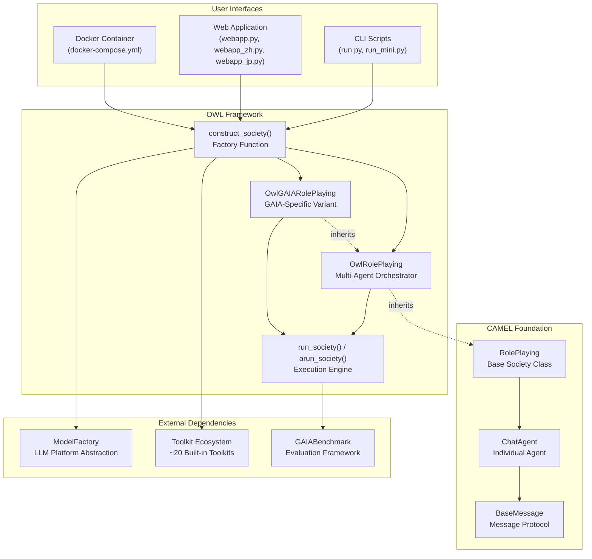

**Diagram: OWL System Context**

OWL extends CAMEL's `RolePlaying` society with two specialized classes: `OwlRolePlaying` for general task automation and `OwlGAIARolePlaying` for GAIA benchmark evaluation. The `construct_society()` factory function creates and configures these societies with appropriate models and toolkits based on the task requirements.

Sources: [README.md:60](), [owl/utils/enhanced_role_playing.py:31-43](), [owl/utils/enhanced_role_playing.py:355-357]()

## Architecture Components

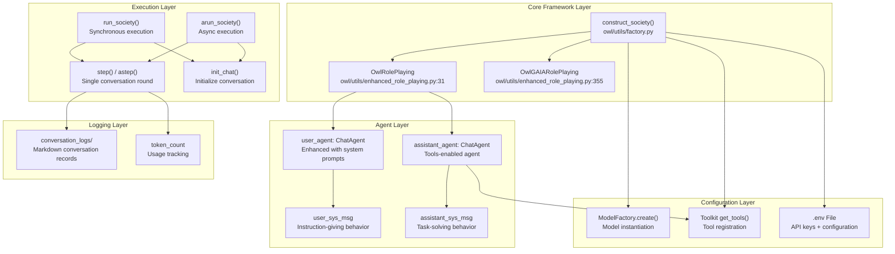

**Diagram: OWL Architecture Components**

The framework consists of four primary layers:

1. **Core Framework**: `construct_society()` factory function creates `OwlRolePlaying` instances configured for specific tasks
2. **Agent Layer**: Two `ChatAgent` instances (user and assistant) with specialized system prompts defined in `_construct_gaia_sys_msgs()`
3. **Execution Layer**: `run_society()` orchestrates conversation rounds via `step()` method until task completion
4. **Configuration Layer**: `ModelFactory` and toolkit `get_tools()` methods inject capabilities into agents

Key code entities:
- `OwlRolePlaying.__init__()`: Initializes agents with system messages at [owl/utils/enhanced_role_playing.py:32-66]()
- `OwlRolePlaying.step()`: Processes one conversation round at [owl/utils/enhanced_role_playing.py:216-284]()
- `OwlRolePlaying._construct_gaia_sys_msgs()`: Defines agent behaviors at [owl/utils/enhanced_role_playing.py:143-214]()

Sources: [owl/utils/enhanced_role_playing.py:31-122](), [owl/utils/enhanced_role_playing.py:216-284]()

## Task Execution Model

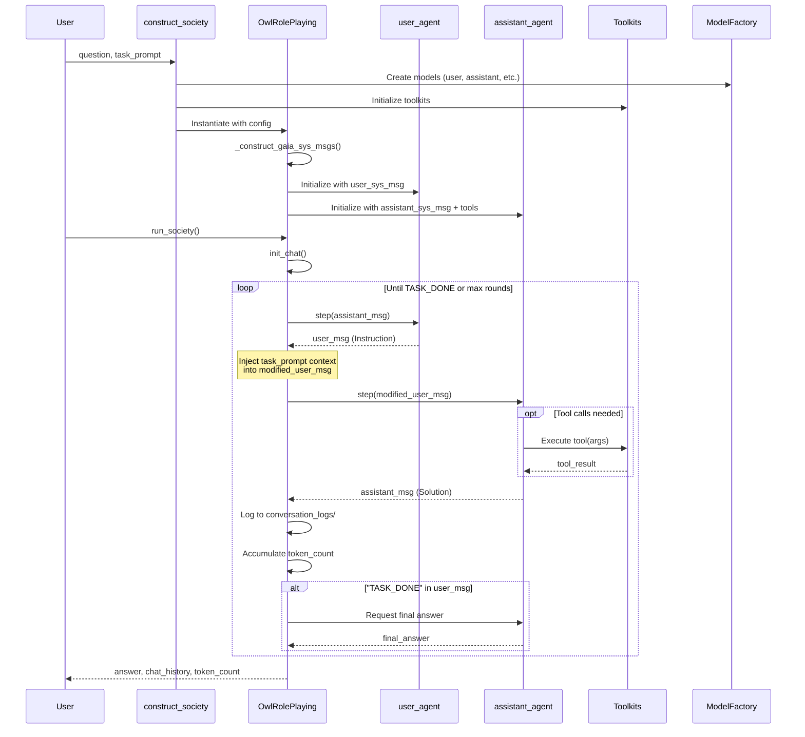

**Diagram: Task Execution Flow**

The execution model implements a modified role-playing pattern where:

1. **Initialization**: `construct_society()` creates an `OwlRolePlaying` instance with configured models and tools
2. **System Prompts**: `_construct_gaia_sys_msgs()` defines user as instruction-giver and assistant as task-solver
3. **Conversation Loop**: `run_society()` iterates via `step()` method:
   - User agent generates next instruction
   - Message is modified to inject `task_prompt` context
   - Assistant agent executes instruction using available tools
   - Both messages are logged and token usage tracked
4. **Termination**: Loop ends when user agent outputs `"TASK_DONE"` marker
5. **Answer Extraction**: Final answer is extracted from assistant's response

The `step()` method at [owl/utils/enhanced_role_playing.py:216-284]() implements the message modification pattern, adding contextual information to both user and assistant messages to maintain task focus.

Sources: [owl/utils/enhanced_role_playing.py:216-284](), [owl/utils/enhanced_role_playing.py:143-214]()

## Package Structure

The OWL framework is distributed as a Python package with the following structure:

| Component | Location | Purpose |
|-----------|----------|---------|
| **Package Metadata** | `pyproject.toml` | Version 0.0.1, requires Python 3.10-3.12 |
| **Core Dependency** | `camel-ai[owl]==0.2.57` | CAMEL framework with OWL extras |
| **Additional Dependencies** | `requirements.txt` | Gradio, Firecrawl, MCP servers, document processors |
| **Framework Code** | `owl/` directory | Core classes, utilities, web interfaces |
| **Example Scripts** | `examples/` directory | Task execution scripts for various models |
| **Documentation** | `README.md`, `README_zh.md`, `README_ja.md` | Multi-language documentation |

Key package specifications:
- **License**: Apache 2.0
- **Python Version**: `>=3.10,<3.13`
- **Primary Dependency**: `camel-ai[owl]==0.2.57` (pinned version)
- **Optional Dependencies**: `mistralai>=1.7.0` for Mistral model support

The package can be installed via:
- `uv pip install -e .` (recommended)
- `pip install -r requirements.txt --use-pep517`
- Docker using `docker compose up -d`

Sources: [pyproject.toml:1-71](), [requirements.txt:1-7](), [README.md:196-338]()

## Deployment Options

OWL supports three deployment methods:

**Local Installation** (Python 3.10-3.12):
- `uv` package manager (recommended): Fast dependency resolution
- `venv + pip`: Standard Python virtual environment
- `conda`: Anaconda/Miniconda environment

**Docker Deployment**:
- Pre-built image: `docker compose up -d` (pulls from Docker Hub)
- Local build: Uncomment `build:` section in `docker-compose.yml`
- Includes xvfb for headless browser automation
- Volume mounts for `.env`, `examples/`, `data/`, `.cache/`

**Web Interface**:
- Gradio-based UI with three language variants: `webapp.py` (English), `webapp_zh.py` (Chinese), `webapp_jp.py` (Japanese)
- Features: model selection, environment variable management, real-time conversation logging
- Runs locally on `localhost:7860`

All deployment methods require API keys configured via `.env` file or environment variables. Minimal setup requires only an LLM API key (e.g., `OPENAI_API_KEY`).

Sources: [README.md:196-395](), [README.md:585-617]()

---

# Page: Architecture

# Architecture

<details>
<summary>Relevant source files</summary>

The following files were used as context for generating this wiki page:

- [.gitignore](.gitignore)
- [README.md](README.md)
- [README_ja.md](README_ja.md)
- [README_zh.md](README_zh.md)
- [owl/assets/owl-favicon.ico](owl/assets/owl-favicon.ico)
- [owl/utils/enhanced_role_playing.py](owl/utils/enhanced_role_playing.py)
- [pyproject.toml](pyproject.toml)
- [requirements.txt](requirements.txt)
- [uv.lock](uv.lock)

</details>


This document describes the overall system architecture of the OWL (Optimized Workforce Learning) framework, including its core components, design patterns, and integration points. The OWL framework is a multi-agent collaboration system built on top of the CAMEL-AI foundation that enables sophisticated task automation through role-playing agent societies.

For information about specific toolkit implementations, see [Toolkits](#5). For deployment and setup details, see [Installation & Setup](#3). For user interface components, see [User Interfaces](#4).

## System Overview

The OWL framework follows a layered architecture pattern with clear separation between user interfaces, orchestration logic, model integration, and external services.

### High-Level Architecture

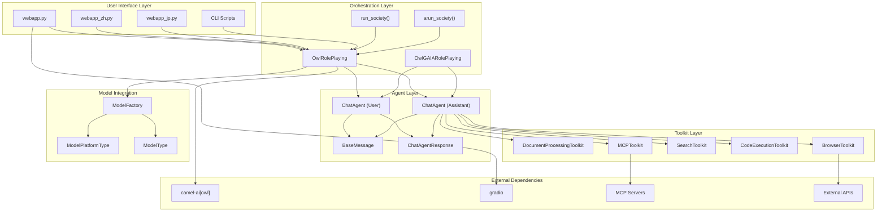

**Sources:** [owl/utils/enhanced_role_playing.py:1-572](), [pyproject.toml:1-71](), [owl/utils/__init__.py:15-33]()

## Core Components

The OWL framework is built around several key architectural components that work together to provide multi-agent task automation capabilities.

### Primary Classes and Their Responsibilities

| Class | File Location | Primary Responsibility |
|-------|---------------|------------------------|
| `OwlRolePlaying` | [owl/utils/enhanced_role_playing.py:31-354]() | Main orchestration class for agent societies |
| `OwlGAIARolePlaying` | [owl/utils/enhanced_role_playing.py:355-441]() | Specialized role-playing for GAIA benchmarks |
| `DocumentProcessingToolkit` | Referenced in [owl/utils/__init__.py:23]() | Document processing capabilities |
| `run_society` | [owl/utils/enhanced_role_playing.py:442-504]() | Synchronous society execution |
| `arun_society` | [owl/utils/enhanced_role_playing.py:507-571]() | Asynchronous society execution |

### Component Interaction Diagram

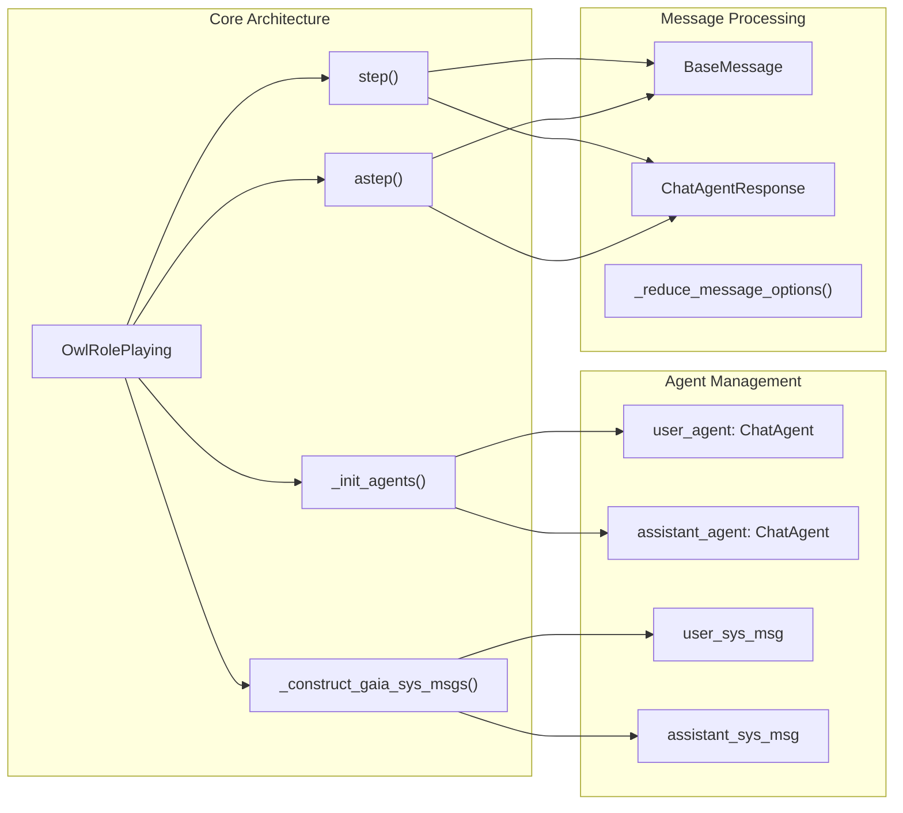

**Sources:** [owl/utils/enhanced_role_playing.py:31-67](), [owl/utils/enhanced_role_playing.py:68-122](), [owl/utils/enhanced_role_playing.py:143-214]()

## Agent Architecture

The OWL framework implements a sophisticated two-agent role-playing system where agents collaborate to solve complex tasks through structured conversations.

### Agent Initialization Pattern

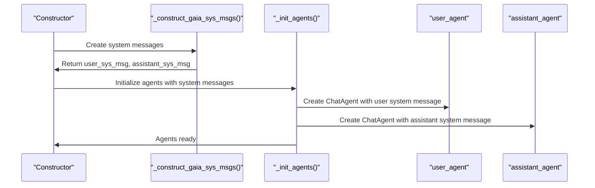

The `OwlRolePlaying` class constructor follows this initialization pattern:

1. **System Message Construction**: [owl/utils/enhanced_role_playing.py:143-214]() - Creates specialized system prompts for user and assistant roles
2. **Agent Initialization**: [owl/utils/enhanced_role_playing.py:68-122]() - Instantiates `ChatAgent` objects with appropriate configurations
3. **Model Assignment**: [owl/utils/enhanced_role_playing.py:92-101]() - Assigns LLM models to agents based on configuration

### Role-Playing Execution Flow

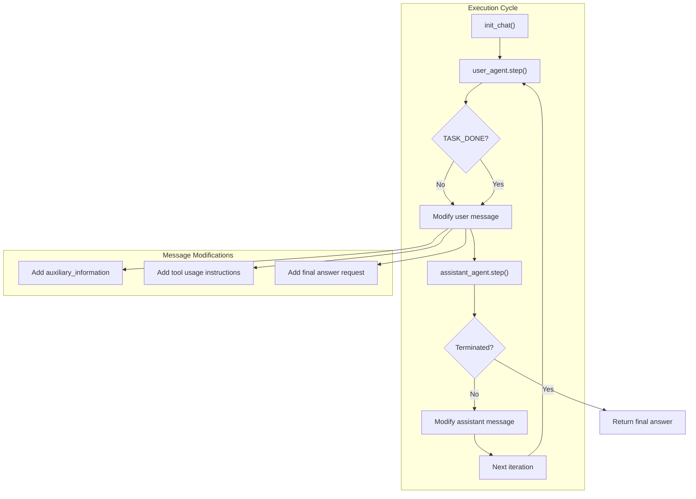

The execution flow is managed by the `step` method at [owl/utils/enhanced_role_playing.py:216-284]() and its async counterpart `astep` at [owl/utils/enhanced_role_playing.py:286-352]().

**Sources:** [owl/utils/enhanced_role_playing.py:216-284](), [owl/utils/enhanced_role_playing.py:286-352](), [owl/utils/enhanced_role_playing.py:442-504]()

## Dependency Architecture

The OWL framework is built on a carefully orchestrated set of dependencies that provide different layers of functionality.

### Core Dependencies

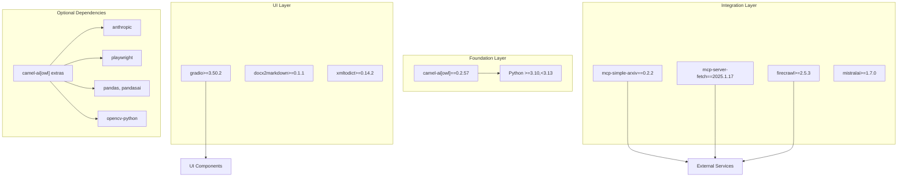

The dependency structure is defined in [pyproject.toml:23-32]() for core dependencies and [requirements.txt:1-7]() for the simplified requirement set.

### Model Integration Architecture

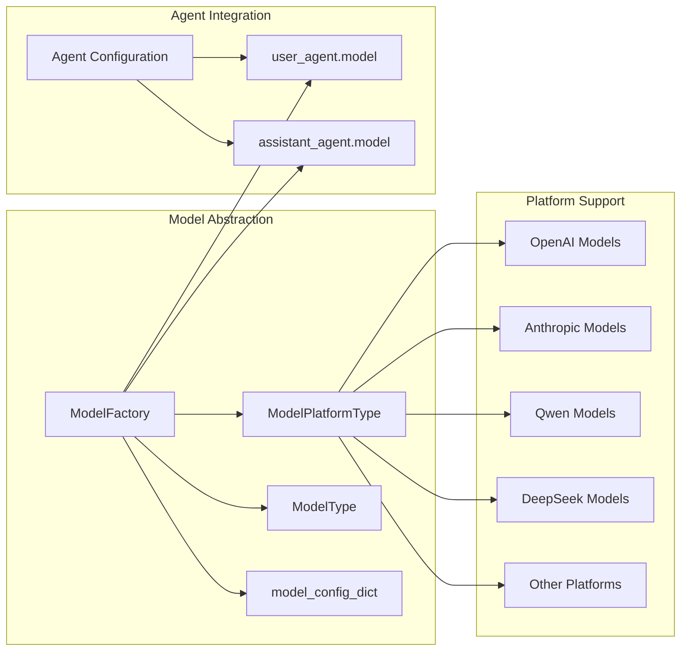

**Sources:** [pyproject.toml:23-32](), [requirements.txt:1-7](), [owl/utils/enhanced_role_playing.py:92-107]()

## Execution Flow

The OWL framework processes tasks through a structured execution pipeline that coordinates agent interactions and manages external tool integration.

### Society Execution Pipeline

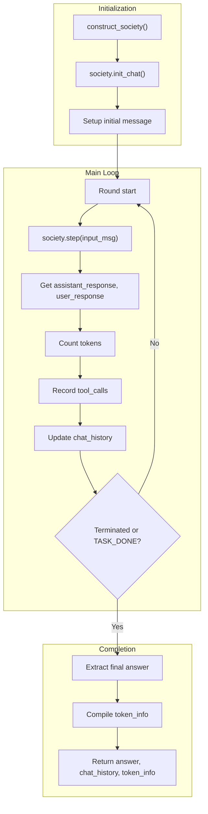

The main execution functions `run_society` and `arun_society` implement this pipeline:

- **Token Tracking**: [owl/utils/enhanced_role_playing.py:456-463]() - Accumulates token usage across rounds
- **Tool Call Recording**: [owl/utils/enhanced_role_playing.py:465-469]() - Captures tool invocations for history
- **Termination Logic**: [owl/utils/enhanced_role_playing.py:489-494]() - Checks for completion conditions
- **Result Compilation**: [owl/utils/enhanced_role_playing.py:498-503]() - Formats final output

### Message Processing Flow

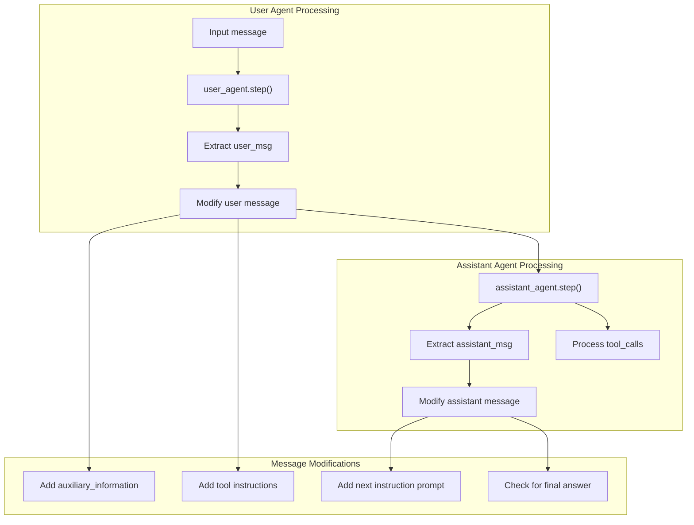

The message processing is handled by the `step` method which:

1. **Processes User Response**: [owl/utils/enhanced_role_playing.py:219-229]() - Gets user agent's response and extracts messages
2. **Modifies User Message**: [owl/utils/enhanced_role_playing.py:233-246]() - Adds contextual information and tool usage instructions  
3. **Processes Assistant Response**: [owl/utils/enhanced_role_playing.py:249-261]() - Gets assistant agent's response and tool calls
4. **Modifies Assistant Message**: [owl/utils/enhanced_role_playing.py:264-270]() - Adds instructions for next steps

**Sources:** [owl/utils/enhanced_role_playing.py:216-284](), [owl/utils/enhanced_role_playing.py:442-504](), [owl/utils/enhanced_role_playing.py:507-571]()

---

# Page: Core Framework & Agent System

# Core Framework & Agent System

<details>
<summary>Relevant source files</summary>

The following files were used as context for generating this wiki page:

- [owl/utils/document_toolkit.py](owl/utils/document_toolkit.py)
- [owl/utils/enhanced_role_playing.py](owl/utils/enhanced_role_playing.py)
- [owl/utils/gaia.py](owl/utils/gaia.py)
- [pyproject.toml](pyproject.toml)
- [requirements.txt](requirements.txt)
- [uv.lock](uv.lock)

</details>


## Purpose and Scope

This document details the core framework and multi-agent system that powers OWL's task automation capabilities. It focuses on the `OwlRolePlaying` and `OwlGAIARolePlaying` classes, their relationship to the CAMEL-AI foundation, the two-agent collaboration mechanism, and the message flow patterns used for task execution.

For information about the execution pipeline and factory patterns, see [Execution Pipeline](#2.2). For model configuration and specialization, see [Model Factory System](#2.3).

**Sources:** [owl/utils/enhanced_role_playing.py:1-572]()

---

## Class Hierarchy and Foundation

### Inheritance Structure

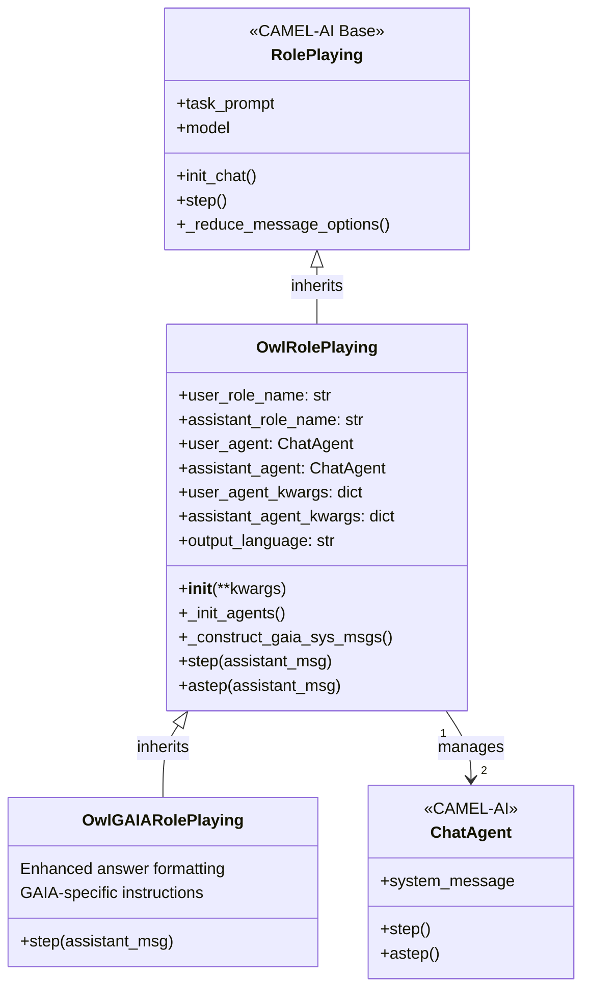

**Sources:** [owl/utils/enhanced_role_playing.py:31-44](), [owl/utils/enhanced_role_playing.py:355-358]()

---

### Core Components

| Component | Type | Purpose | Configuration |
|-----------|------|---------|---------------|
| `user_agent` | `ChatAgent` | Plans task decomposition, issues instructions | `user_agent_kwargs`, `user_role_name` |
| `assistant_agent` | `ChatAgent` | Executes instructions, uses tools, provides solutions | `assistant_agent_kwargs`, `assistant_role_name` |
| `task_prompt` | `str` | Original user task/question | Inherited from `RolePlaying` |
| `output_language` | `str` | Target language for responses | Optional, affects both agents |

The `OwlRolePlaying` class extends CAMEL's base `RolePlaying` society with specialized system prompts, message modification patterns, and task completion detection logic. Agent initialization occurs in `_init_agents()` [owl/utils/enhanced_role_playing.py:68-122](), which creates two `ChatAgent` instances with their respective system messages and configuration.

**Sources:** [owl/utils/enhanced_role_playing.py:31-67](), [owl/utils/enhanced_role_playing.py:68-122]()

---

## Two-Agent Collaboration Model

### Agent Roles and Responsibilities

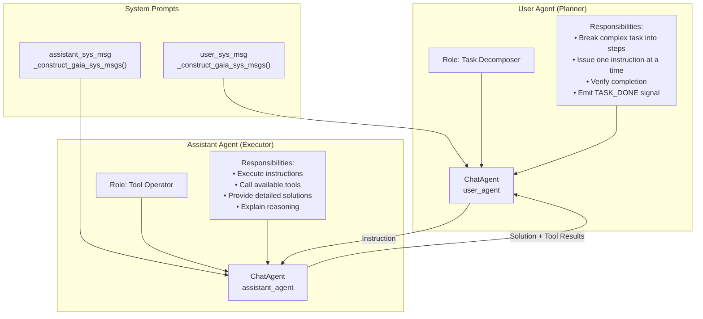

The system prompts are constructed in `_construct_gaia_sys_msgs()` [owl/utils/enhanced_role_playing.py:143-214]() and define strict role boundaries:

**User Agent System Prompt Key Rules:**
- Never flip roles or ask questions
- Must instruct step-by-step
- Cannot attempt to solve the task in a single step
- Provides guidance on tool usage strategies
- Emits `<TASK_DONE>` when task is complete

**Assistant Agent System Prompt Key Rules:**
- Never flip roles or instruct the user
- Must leverage available tools
- Start responses with "Solution: [YOUR_SOLUTION]"
- Must verify answers using multiple methods
- Execute and debug code when necessary

**Sources:** [owl/utils/enhanced_role_playing.py:143-214]()

---

### System Prompt Structure

The system prompts embedded in [owl/utils/enhanced_role_playing.py:144-213]() contain critical instructions that shape agent behavior:

**User Agent Prompt Components:**
1. **Role Definition:** Lines 145-147 establish the user as instructor, never asking questions
2. **Step-by-Step Requirement:** Lines 152-153 mandate decomposition
3. **Tool Usage Tips:** Lines 154-164 provide strategic guidance:
   - Search before browsing
   - Verify answers with multiple tools
   - Process video content when mentioned
   - Write code for Excel tasks
4. **Completion Signal:** Line 170 defines `<TASK_DONE>` as the termination marker

**Assistant Agent Prompt Components:**
1. **Role Definition:** Lines 175-176 establish the assistant as tool operator
2. **Solution Format:** Lines 185-187 require "Solution: [YOUR_SOLUTION]" prefix
3. **Best Practices:** Lines 189-202 include:
   - Cross-validation requirements
   - Error handling strategies
   - Code execution reminders
   - Search query optimization

**Sources:** [owl/utils/enhanced_role_playing.py:143-214]()

---

## Message Flow and Conversation Mechanics

### Step Execution Pattern

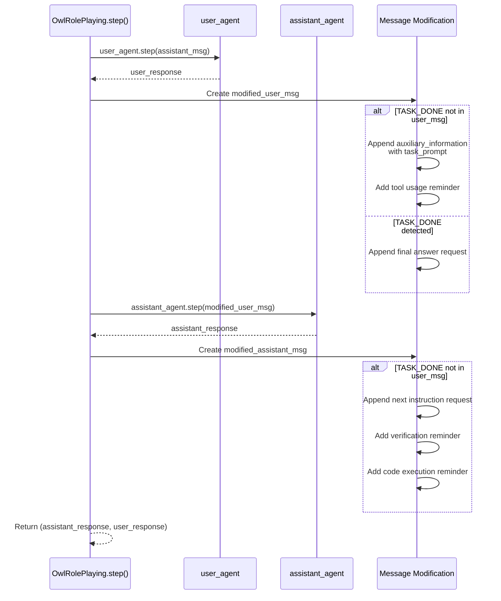

The core conversation step is implemented in [owl/utils/enhanced_role_playing.py:216-284]() for synchronous execution and [owl/utils/enhanced_role_playing.py:286-352]() for asynchronous execution.

**Sources:** [owl/utils/enhanced_role_playing.py:216-284](), [owl/utils/enhanced_role_playing.py:286-352]()

---

### Message Modification Mechanics

The key innovation in `OwlRolePlaying` is the **message modification pattern** that injects context without polluting the conversation history visible to agents:

#### User Message Modifications

When `TASK_DONE` is NOT present [owl/utils/enhanced_role_playing.py:233-240]():
```
<auxiliary_information>
{self.task_prompt}
</auxiliary_information>
If there are available tools and you want to call them, never say 'I will ...', 
but first call the tool and reply based on tool call's result
```

When `TASK_DONE` IS present [owl/utils/enhanced_role_playing.py:243-246]():
```
Now please make a final answer of the original task based on our conversation: 
<task>{self.task_prompt}</task>
```

#### Assistant Message Modifications

When `TASK_DONE` is NOT present [owl/utils/enhanced_role_playing.py:264-270]():
```
Provide me with the next instruction and input (if needed) based on my response 
and our current task: <task>{self.task_prompt}</task>
Before producing the final answer, please check whether I have rechecked the 
final answer using different toolkit as much as possible. If not, please remind me.
If I have written codes, remind me to run the codes.
If you think our task is done, reply with `TASK_DONE` to end our conversation.
```

This pattern ensures agents always have context about the overall task while maintaining natural conversational flow.

**Sources:** [owl/utils/enhanced_role_playing.py:231-284]()

---

### Task Completion Detection

The system uses the `<TASK_DONE>` marker as an explicit termination signal. Detection occurs in multiple locations:

1. **Within step() method** [owl/utils/enhanced_role_playing.py:489-494]():
   ```python
   if (assistant_response.terminated or 
       user_response.terminated or 
       "TASK_DONE" in user_response.msg.content):
       break
   ```

2. **Message branching logic** [owl/utils/enhanced_role_playing.py:233](), [owl/utils/enhanced_role_playing.py:243]():
   - Changes message modifications based on presence of `TASK_DONE`
   - Triggers final answer extraction when detected

3. **Asynchronous variant** [owl/utils/enhanced_role_playing.py:555-561]():
   - Also checks for Chinese variant: `"任务已完成"`
   - Same termination logic as synchronous version

**Sources:** [owl/utils/enhanced_role_playing.py:489-494](), [owl/utils/enhanced_role_playing.py:555-561]()

---

## GAIA Benchmark Specialization

### OwlGAIARolePlaying Class

The `OwlGAIARolePlaying` class [owl/utils/enhanced_role_playing.py:355-439]() extends `OwlRolePlaying` with specialized behavior for the GAIA benchmark:

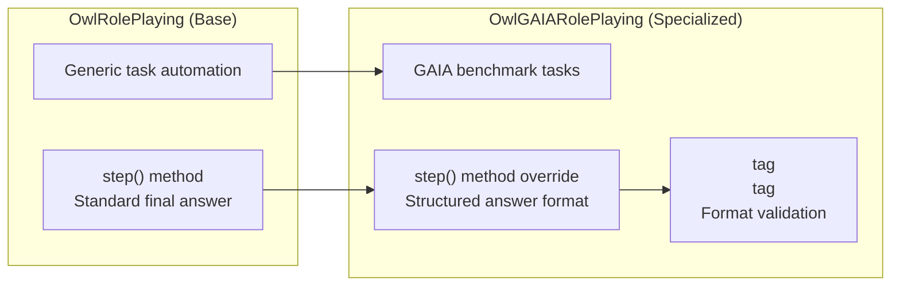

**Sources:** [owl/utils/enhanced_role_playing.py:355-439]()

---

### Answer Format Requirements

When `TASK_DONE` is detected, `OwlGAIARolePlaying` injects additional formatting instructions [owl/utils/enhanced_role_playing.py:386-401]():

**Required Output Structure:**
```xml
<analysis>
[Detailed analysis of the reasoning result]
</analysis>

<final_answer>
[Answer in GAIA-compliant format]
</final_answer>
```

**GAIA Format Constraints** [owl/utils/enhanced_role_playing.py:396-400]():
| Answer Type | Rules |
|-------------|-------|
| **Number** | No commas, no units ($, %), unless specified |
| **String** | No articles, no abbreviations, digits as plain text |
| **List** | Comma-separated, apply number/string rules per element |

This structured output enables reliable answer extraction via `extract_pattern(raw_answer, "final_answer")` in [owl/utils/gaia.py:232]().

**Sources:** [owl/utils/enhanced_role_playing.py:386-401](), [owl/utils/gaia.py:232-237]()

---

## Execution Functions

### run_society and arun_society

The execution functions orchestrate the complete conversation lifecycle:

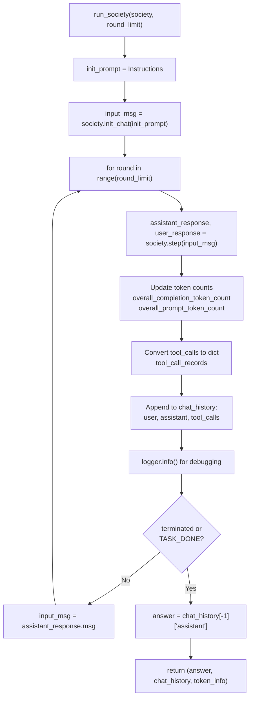

**Key Implementation Details:**

1. **Initialization** [owl/utils/enhanced_role_playing.py:450-453]():
   - Standard initialization prompt instructs step-by-step solving
   - `society.init_chat()` prepares the first message

2. **Loop Mechanics** [owl/utils/enhanced_role_playing.py:454-496]():
   - Maximum `round_limit` iterations (default: 15)
   - Each iteration calls `society.step()`
   - Token usage tracked from response info

3. **Tool Call Recording** [owl/utils/enhanced_role_playing.py:466-469]():
   - Extracts tool calls from `assistant_response.info["tool_calls"]`
   - Converts to dictionary format via `.as_dict()`
   - Preserves complete tool execution history

4. **Chat History Format** [owl/utils/enhanced_role_playing.py:471-481]():
   ```python
   {
       "user": user_response.msg.content,
       "assistant": assistant_response.msg.content,
       "tool_calls": [tool_call.as_dict() for tool_call in tool_calls]
   }
   ```

5. **Token Accumulation** [owl/utils/enhanced_role_playing.py:458-463]():
   - Sums `completion_tokens` and `prompt_tokens` from both agents
   - Returned as `token_info` dictionary

6. **Async Variant** [owl/utils/enhanced_role_playing.py:507-571]():
   - Uses `await society.astep()` instead of `society.step()`
   - Identical logic otherwise
   - Minor bug: Line 524 accumulates completion tokens into prompt count

**Sources:** [owl/utils/enhanced_role_playing.py:442-571]()

---

## Integration with CAMEL-AI Foundation

The `OwlRolePlaying` class depends on several CAMEL-AI components:

| CAMEL Component | Usage in OWL | Import Location |
|-----------------|--------------|-----------------|
| `RolePlaying` | Base class for `OwlRolePlaying` | [owl/utils/enhanced_role_playing.py:22]() |
| `ChatAgent` | Agent instances for user and assistant | [owl/utils/enhanced_role_playing.py:19]() |
| `BaseMessage` | Message creation and manipulation | [owl/utils/enhanced_role_playing.py:21]() |
| `ChatAgentResponse` | Response wrapping and metadata | [owl/utils/enhanced_role_playing.py:20]() |

**Model Assignment Pattern** [owl/utils/enhanced_role_playing.py:92-100]():
```python
if self.model is not None:
    if assistant_agent_kwargs is None:
        assistant_agent_kwargs = {"model": self.model}
    elif "model" not in assistant_agent_kwargs:
        assistant_agent_kwargs.update(dict(model=self.model))
    # Similar for user_agent_kwargs
```

This ensures models specified at the society level propagate to agents unless explicitly overridden in agent-specific kwargs.

**Sources:** [owl/utils/enhanced_role_playing.py:19-28](), [owl/utils/enhanced_role_playing.py:92-100]()

---

## Usage in Benchmark Systems

The `GAIABenchmark` class [owl/utils/gaia.py:36-410]() demonstrates practical usage of `OwlGAIARolePlaying`:

**Benchmark Instantiation Pattern** [owl/utils/gaia.py:222-228]():
```python
society = OwlGAIARolePlaying(
    task_prompt=task["Question"],
    with_task_specify=False,
    user_role_name=user_role_name,
    user_agent_kwargs=user_agent_kwargs,
    assistant_role_name=assistant_role_name,
    assistant_agent_kwargs=assistant_agent_kwargs,
)
```

**Execution and Extraction** [owl/utils/gaia.py:230-237]():
```python
raw_answer, chat_history, token_info = run_society(society)
answer = extract_pattern(raw_answer, "final_answer")
```

This pattern shows how the core framework integrates with evaluation systems, demonstrating the separation between agent orchestration (`OwlRolePlaying`) and task evaluation (`GAIABenchmark`).

**Sources:** [owl/utils/gaia.py:222-237]()

---

# Page: Execution Pipeline

# Execution Pipeline

<details>
<summary>Relevant source files</summary>

The following files were used as context for generating this wiki page:

- [examples/run_ppio.py](examples/run_ppio.py)
- [owl/.env_template](owl/.env_template)
- [owl/utils/enhanced_role_playing.py](owl/utils/enhanced_role_playing.py)
- [owl/webapp.py](owl/webapp.py)
- [owl/webapp_backup.py](owl/webapp_backup.py)
- [owl/webapp_zh.py](owl/webapp_zh.py)
- [pyproject.toml](pyproject.toml)
- [requirements.txt](requirements.txt)
- [uv.lock](uv.lock)

</details>


## Purpose and Scope

This document describes the execution pipeline that orchestrates multi-agent task solving in OWL. The pipeline handles the complete lifecycle from task initialization through iterative agent collaboration to final answer extraction. For information about the underlying agent architecture and message handling, see [Core Framework & Agent System](#2.1). For details on model configuration and platform integration, see [Model Factory System](#2.3).

The execution pipeline consists of three primary components:
1. **Factory Pattern** - `construct_society()` functions that instantiate configured agent societies
2. **Execution Functions** - `run_society()` and `arun_society()` that manage the conversation loop
3. **Termination Detection** - Logic that identifies task completion via `TASK_DONE` markers

---

## Pipeline Architecture Overview

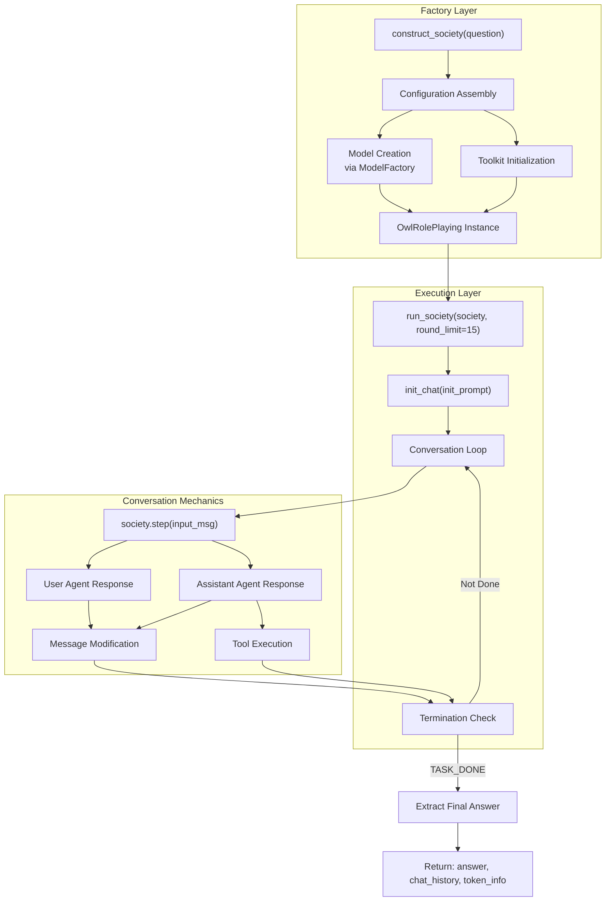

**Sources:** [owl/utils/enhanced_role_playing.py:442-504](), [owl/webapp.py:318-436]()

---

## The construct_society Factory Pattern

Every example module implements a `construct_society(question: str) -> RolePlaying` function that serves as the entry point for task execution. This factory pattern separates configuration from execution and enables the web interface and CLI to dynamically load different configurations.

### Factory Function Structure

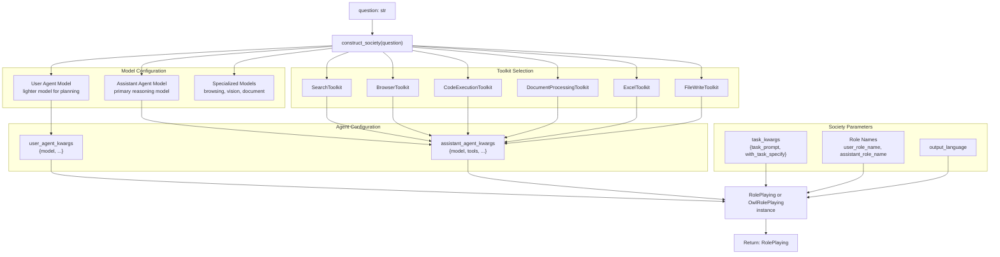

**Sources:** [examples/run_ppio.py:45-99]()

### Factory Implementation Pattern

All `construct_society` functions follow this structure:

| Step | Purpose | Code Location |
|------|---------|---------------|
| 1. Create Models | Instantiate LLM instances for each agent role | [examples/run_ppio.py:56-67]() |
| 2. Initialize Toolkits | Configure function tools available to the assistant | [examples/run_ppio.py:70-77]() |
| 3. Assemble Agent Kwargs | Package model and tools into agent configuration dictionaries | [examples/run_ppio.py:80-81]() |
| 4. Configure Task | Define task prompt and specify parameters | [examples/run_ppio.py:84-87]() |
| 5. Instantiate Society | Create `RolePlaying` or `OwlRolePlaying` instance | [examples/run_ppio.py:90-97]() |

**Example from run_ppio.py:**

```python
# Step 1: Create models
models = {
    "user": ModelFactory.create(
        model_platform=ModelPlatformType.PPIO,
        model_type=ModelType.PPIO_DEEPSEEK_V3_COMMUNITY,
        model_config_dict={"temperature": 0},
    ),
    "assistant": ModelFactory.create(...)
}

# Step 2: Initialize toolkits
tools = [
    *CodeExecutionToolkit(sandbox="subprocess", verbose=True).get_tools(),
    SearchToolkit().search_duckduckgo,
    *ExcelToolkit().get_tools(),
]

# Step 3-5: Assemble and return
society = RolePlaying(
    task_prompt=question,
    user_agent_kwargs={"model": models["user"]},
    assistant_agent_kwargs={"model": models["assistant"], "tools": tools},
)
```

**Sources:** [examples/run_ppio.py:45-99]()

---

## Initialization Phase

Once the society is constructed, execution begins with the `run_society()` function calling `society.init_chat()` to start the conversation.

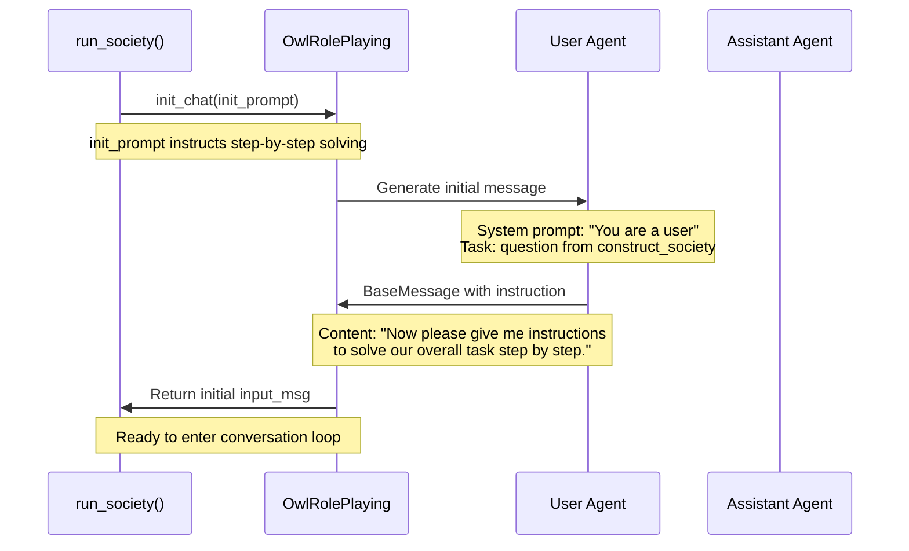

### Initialization Code Flow

1. **run_society invocation** - [owl/utils/enhanced_role_playing.py:442-453]()
   ```python
   def run_society(society: OwlRolePlaying, round_limit: int = 15):
       chat_history = []
       init_prompt = """
       Now please give me instructions to solve over overall task step by step.
       """
       input_msg = society.init_chat(init_prompt)
   ```

2. **System Message Construction** - The `OwlRolePlaying` class defines elaborate system prompts in `_construct_gaia_sys_msgs()` [owl/utils/enhanced_role_playing.py:143-214]():
   - **User System Prompt**: Instructs the user agent to break down tasks step-by-step, never solve in one step, and use `<TASK_DONE>` when complete
   - **Assistant System Prompt**: Provides reasoning tips, emphasizes tool usage, and requires structured responses with "Solution:" prefix

**Sources:** [owl/utils/enhanced_role_playing.py:442-453](), [owl/utils/enhanced_role_playing.py:143-214]()

---

## Conversation Loop Mechanics

The conversation loop is the core of the execution pipeline, iterating between user and assistant agents until task completion or round limit.

### Loop Structure

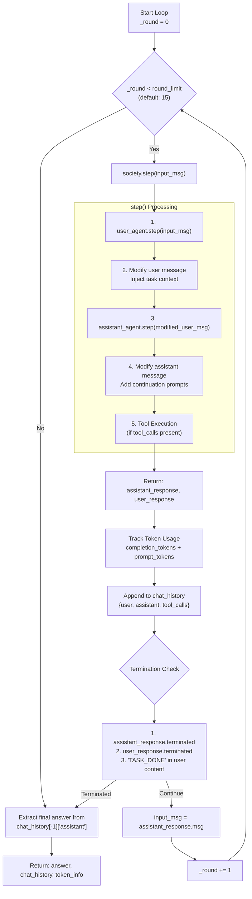

**Sources:** [owl/utils/enhanced_role_playing.py:454-497]()

### Message Modification Pattern

The `step()` method in `OwlRolePlaying` implements a sophisticated message modification strategy to inject context and maintain task focus.

#### User Message Modification

When the user agent responds (before sending to assistant), the message is modified at [owl/utils/enhanced_role_playing.py:231-246]():

```python
modified_user_msg = deepcopy(user_msg)

if "TASK_DONE" not in user_msg.content:
    modified_user_msg.content += f"""\n
    Here are auxiliary information about the overall task:
    <auxiliary_information>
    {self.task_prompt}
    </auxiliary_information>
    If there are available tools and you want to call them, 
    never say 'I will ...', but first call the tool and reply 
    based on tool call's result.
    """
else:
    # Task is done, request final answer formatting
    modified_user_msg.content += f"""\n
    Now please make a final answer of the original task based on 
    our conversation: <task>{self.task_prompt}</task>
    """
```

#### Assistant Message Modification

After the assistant responds (before sending back to user), the message is modified at [owl/utils/enhanced_role_playing.py:263-270]():

```python
modified_assistant_msg = deepcopy(assistant_msg)
if "TASK_DONE" not in user_msg.content:
    modified_assistant_msg.content += f"""\n
    Provide me with the next instruction based on my response 
    and our current task: <task>{self.task_prompt}</task>
    Before producing the final answer, check whether I have 
    rechecked using different toolkit. If I have written codes, 
    remind me to run the codes.
    If you think our task is done, reply with `TASK_DONE`.
    """
```

**Purpose of Modifications:**
1. **Context Injection**: Ensures both agents always have access to the original task prompt
2. **Tool Usage Enforcement**: Discourages the assistant from planning without executing
3. **Verification Reminders**: Prompts the user agent to request result verification
4. **Termination Guidance**: Reminds the user agent to signal completion with `TASK_DONE`

**Sources:** [owl/utils/enhanced_role_playing.py:216-284]()

---

## Task Completion Detection

The pipeline supports three termination mechanisms that trigger different behaviors:

### Termination Conditions Table

| Condition | Trigger Location | Behavior | Code Reference |
|-----------|-----------------|----------|----------------|
| **TASK_DONE Detection** | User agent message contains `"TASK_DONE"` | Extract final answer from assistant's last response | [owl/utils/enhanced_role_playing.py:489-494]() |
| **Agent Termination Flag** | `assistant_response.terminated` or `user_response.terminated` | Exit loop immediately | [owl/utils/enhanced_role_playing.py:489-494]() |
| **Round Limit Exceeded** | `_round >= round_limit` | Exit loop and return last response | [owl/utils/enhanced_role_playing.py:454]() |

### TASK_DONE Flow Diagram

```mermaid
stateDiagram-v2
    [*] --> NormalOperation: Loop Start
    
    NormalOperation --> CheckUserMessage: User agent responds
    
    CheckUserMessage --> InjectContext: "TASK_DONE" not found
    CheckUserMessage --> RequestFinalAnswer: "TASK_DONE" found
    
    InjectContext --> AssistantProcesses: Send modified message
    AssistantProcesses --> AddContinuationPrompt: Assistant responds
    AddContinuationPrompt --> LogAndCheck: Append to history
    
    RequestFinalAnswer --> AssistantFormats: Send final answer request
    AssistantFormats --> ExtractAnswer: Format answer (GAIA: XML tags)
    ExtractAnswer --> Return: chat_history[-1]["assistant"]
    
    LogAndCheck --> CheckTermination: Check all conditions
    CheckTermination --> NormalOperation: No termination
    CheckTermination --> Return: Terminated
    
    Return --> [*]: answer, chat_history, token_info
```

### GAIA-Specific Termination

The `OwlGAIARolePlaying` subclass extends termination handling to enforce answer formatting for benchmark evaluation at [owl/utils/enhanced_role_playing.py:385-401]():

```python
# When TASK_DONE is detected, special formatting instructions are added
modified_user_msg.content += f"""\n
Now please make a final answer of the original task...
Your response should include the following content:
- `analysis`: enclosed by <analysis> </analysis>
- `final_answer`: enclosed by <final_answer> </final_answer>

Hints about final answer format:
- If you are asked for a number, don't use comma or units
- If you are asked for a string, don't use articles or abbreviations
- If you are asked for a comma separated list, apply above rules
"""
```

This ensures the final answer can be correctly parsed by the scoring system (see [Scoring & Metrics](#7.3)).

**Sources:** [owl/utils/enhanced_role_playing.py:355-439](), [owl/utils/enhanced_role_playing.py:489-494]()

---

## Token Tracking and Return Values

The execution pipeline tracks token usage throughout the conversation and returns structured data.

### Token Accumulation

At each conversation round, token counts are extracted from agent responses and accumulated [owl/utils/enhanced_role_playing.py:456-463]():

```python
overall_completion_token_count = 0
overall_prompt_token_count = 0

# Inside loop
if assistant_response.info.get("usage") and user_response.info.get("usage"):
    overall_completion_token_count += assistant_response.info["usage"].get(
        "completion_tokens", 0
    ) + user_response.info["usage"].get("completion_tokens", 0)
    overall_prompt_token_count += assistant_response.info["usage"].get(
        "prompt_tokens", 0
    ) + user_response.info["usage"].get("prompt_tokens", 0)
```

### Chat History Structure

Each conversation round is logged as a dictionary [owl/utils/enhanced_role_playing.py:466-481]():

```python
tool_call_records: List[dict] = []
if assistant_response.info.get("tool_calls"):
    for tool_call in assistant_response.info["tool_calls"]:
        tool_call_records.append(tool_call.as_dict())

_data = {
    "user": user_response.msg.content if user_response.msg else "",
    "assistant": assistant_response.msg.content if assistant_response.msg else "",
    "tool_calls": tool_call_records,
}
chat_history.append(_data)
```

### Return Value Structure

```mermaid
graph LR
    subgraph "run_society Return Tuple"
        answer["answer: str<br/>Final assistant response"]
        history["chat_history: List[dict]<br/>All conversation rounds"]
        tokens["token_info: dict<br/>Aggregated usage stats"]
    end
    
    subgraph "token_info Contents"
        completion["completion_token_count: int"]
        prompt["prompt_token_count: int"]
    end
    
    subgraph "chat_history[i] Contents"
        user["user: str"]
        assistant["assistant: str"]
        tools["tool_calls: List[dict]"]
    end
    
    answer --> tuple["Tuple[str, List[dict], dict]"]
    history --> tuple
    tokens --> tuple
    
    completion -.member of.-> tokens
    prompt -.member of.-> tokens
    
    user -.member of.-> history
    assistant -.member of.-> history
    tools -.member of.-> history
```

**Return Value Usage:**
- **Web Interface**: Displays answer, token counts, and chat history in separate tabs [owl/webapp.py:411-428]()
- **Benchmark System**: Extracts final answer for scoring [owl/utils/enhanced_role_playing.py:498]()
- **Logging**: Records full conversation for debugging and analysis

**Sources:** [owl/utils/enhanced_role_playing.py:498-503](), [owl/webapp.py:411-428]()

---

## Asynchronous Execution

The pipeline provides an async variant `arun_society()` with identical logic but using async/await patterns.

### Async Implementation Differences

| Aspect | Synchronous | Asynchronous | Code Reference |
|--------|-------------|--------------|----------------|
| **Function Definition** | `def run_society(...)` | `async def arun_society(...)` | [owl/utils/enhanced_role_playing.py:507-510]() |
| **Step Invocation** | `society.step(input_msg)` | `await society.astep(input_msg)` | [owl/utils/enhanced_role_playing.py:520]() |
| **Agent Step** | `user_agent.step(...)` | `await user_agent.astep(...)` | [owl/utils/enhanced_role_playing.py:289]() |
| **Use Case** | CLI, web interface (blocking) | Concurrent task processing | - |

The async version follows the same conversation loop, message modification, and termination logic as the synchronous version. The primary difference is the ability to process multiple tasks concurrently or integrate with async frameworks.

**Additional Termination Condition in Async:**
The async version includes Chinese language support for task completion at [owl/utils/enhanced_role_playing.py:555-561]():

```python
if (
    assistant_response.terminated
    or user_response.terminated
    or "TASK_DONE" in user_response.msg.content
    or "任务已完成" in user_response.msg.content  # Chinese: "Task completed"
):
    break
```

**Sources:** [owl/utils/enhanced_role_playing.py:507-571]()

---

## Integration with Web Interface

The web application demonstrates how the execution pipeline integrates with user interfaces.

### Web Interface Execution Flow

```mermaid
sequenceDiagram
    participant User as User Browser
    participant Gradio as Gradio WebUI
    participant run_owl as run_owl()
    participant import as Dynamic Import
    participant factory as module.construct_society()
    participant pipeline as run_society()
    participant society as OwlRolePlaying
    
    User->>Gradio: Enter question, select module
    Gradio->>run_owl: run_owl(question, "run_ppio")
    
    run_owl->>run_owl: validate_input(question)
    Note over run_owl: Check not empty
    
    run_owl->>run_owl: load_dotenv()
    Note over run_owl: Load API keys from .env
    
    run_owl->>import: importlib.import_module("examples.run_ppio")
    import-->>run_owl: module object
    
    run_owl->>run_owl: Check hasattr(module, "construct_society")
    
    run_owl->>factory: module.construct_society(question)
    factory-->>run_owl: society instance
    
    run_owl->>pipeline: run_society(society)
    
    loop Conversation Rounds (max 15)
        pipeline->>society: step(input_msg)
        society-->>pipeline: assistant_response, user_response
        pipeline->>pipeline: Track tokens, append chat_history
    end
    
    pipeline-->>run_owl: answer, chat_history, token_info
    
    run_owl->>run_owl: Format token counts
    Note over run_owl: "Completion: X | Prompt: Y | Total: Z"
    
    run_owl-->>Gradio: (answer, token_string, "✅ Success")
    Gradio-->>User: Display results in tabs
```

### Error Handling in Web Interface

The `run_owl()` function implements comprehensive error handling at [owl/webapp.py:329-419]():

1. **Input Validation**: Returns error if question is empty [owl/webapp.py:330-336]()
2. **Module Import Errors**: Catches `ImportError` for missing modules [owl/webapp.py:360-365]()
3. **Interface Check**: Verifies `construct_society` function exists [owl/webapp.py:377-385]()
4. **Construction Errors**: Catches exceptions during society instantiation [owl/webapp.py:388-398]()
5. **Execution Errors**: Handles runtime failures in `run_society()` [owl/webapp.py:401-411]()

Each error returns a tuple with error message, "0" tokens, and formatted status string that the UI displays.

**Sources:** [owl/webapp.py:318-436](), [owl/webapp_zh.py:317-419]()

---

## Pipeline Configuration Examples

Different example modules demonstrate various pipeline configurations:

### Minimal Configuration
From `run_mini.py` (not shown in files but referenced in documentation):
- Single model for both agents
- Basic toolkits only (Search, FileWrite, CodeExecution)
- Default round limit

### Full Configuration  
From `run.py` pattern:
- Specialized models (user, assistant, browsing, planning, image, video)
- Comprehensive toolkit suite
- Custom round limits
- Output language specification

### GAIA Benchmark Configuration
Using `OwlGAIARolePlaying`:
- Enhanced system prompts with task-specific instructions
- Strict answer formatting requirements
- File path injection for task files
- Extended round limits (20-30 rounds typical)

**Configuration Pattern Table:**

| Component | Mini Config | Standard Config | GAIA Config |
|-----------|-------------|-----------------|-------------|
| **User Model** | GPT-4o-mini | GPT-4o | Claude-3.5-sonnet |
| **Assistant Model** | GPT-4o-mini | GPT-4o | GPT-4o |
| **Specialized Models** | None | Browsing, Vision | Browsing, Planning, Vision |
| **Toolkits** | 3-5 | 8-12 | 12-15 |
| **Round Limit** | 15 | 15 | 20-30 |
| **Society Class** | `RolePlaying` | `OwlRolePlaying` | `OwlGAIARolePlaying` |

**Sources:** [owl/utils/enhanced_role_playing.py:31-66](), [owl/utils/enhanced_role_playing.py:355-439]()

---

## Summary

The execution pipeline in OWL follows a clear separation of concerns:

1. **Configuration Phase**: `construct_society()` factories assemble models, tools, and agent parameters
2. **Initialization Phase**: `init_chat()` starts the conversation with structured prompts
3. **Execution Phase**: `run_society()` orchestrates iterative agent collaboration with message modification
4. **Termination Phase**: Multiple conditions trigger loop exit and answer extraction
5. **Return Phase**: Structured data (answer, history, tokens) flows back to callers

This architecture enables:
- **Modularity**: Different configurations via factory functions
- **Flexibility**: Easy addition of new toolkits and models
- **Observability**: Complete conversation logging and token tracking
- **Reliability**: Multiple termination mechanisms prevent infinite loops
- **Reusability**: Same pipeline serves CLI, web UI, and benchmarks

The pipeline's design makes it straightforward to create new task-solving configurations by implementing a single `construct_society()` function following the established pattern.

**Sources:** [owl/utils/enhanced_role_playing.py:1-572](), [owl/webapp.py:318-436](), [examples/run_ppio.py:45-121]()

---

# Page: Model Factory System

# Model Factory System

<details>
<summary>Relevant source files</summary>

The following files were used as context for generating this wiki page:

- [examples/run.py](examples/run.py)
- [examples/run_azure_openai.py](examples/run_azure_openai.py)
- [examples/run_gemini.py](examples/run_gemini.py)
- [examples/run_groq.py](examples/run_groq.py)
- [examples/run_mini.py](examples/run_mini.py)
- [examples/run_mistral.py](examples/run_mistral.py)
- [examples/run_novita_ai.py](examples/run_novita_ai.py)
- [examples/run_ollama.py](examples/run_ollama.py)
- [examples/run_openai_compatible_model.py](examples/run_openai_compatible_model.py)
- [examples/run_together_ai.py](examples/run_together_ai.py)

</details>


The Model Factory System provides a unified interface for creating and configuring language models across multiple LLM platforms. It implements the factory design pattern to abstract platform-specific initialization details and enables role-based model specialization for different agent types in the OWL multi-agent system.

For information about how these models are used within agents, see [Core Framework & Agent System](#2.1). For toolkit model requirements, see [Toolkit Architecture](#5.1). For platform-specific configuration details, see [Model Integration](#6).

## Factory Pattern Architecture

The `ModelFactory.create()` method serves as the central creation point for all model instances in OWL. This factory pattern decouples model instantiation from model usage, allowing the system to support multiple platforms through a consistent interface.

```mermaid
graph TB
    subgraph "Application Code"
        Examples["Example Scripts<br/>run.py, run_groq.py, etc."]
        ConstructSociety["construct_society()"]
    end
    
    subgraph "ModelFactory Interface"
        FactoryCreate["ModelFactory.create()"]
        Parameters["Parameters:<br/>- model_platform<br/>- model_type<br/>- model_config_dict<br/>- url (optional)<br/>- api_key (optional)"]
    end
    
    subgraph "Platform Enumerations"
        PlatformType["ModelPlatformType<br/>OPENAI, AZURE, GEMINI,<br/>GROQ, TOGETHER, OLLAMA,<br/>MISTRAL, QWEN, DEEPSEEK,<br/>NOVITA, OPENAI_COMPATIBLE_MODEL"]
        ModelTypeEnum["ModelType<br/>GPT_4O, CLAUDE_3_5_SONNET,<br/>GROQ_LLAMA_3_3_70B,<br/>GEMINI_2_5_PRO_EXP, etc."]
    end
    
    subgraph "Platform-Specific Implementations"
        OpenAIModel["OpenAI Models"]
        AzureModel["Azure OpenAI Models"]
        GeminiModel["Gemini Models"]
        GroqModel["Groq Models"]
        OllamaModel["Ollama Models"]
        OtherModels["Other Platform Models"]
    end
    
    subgraph "Model Instances"
        UserModel["User Agent Model"]
        AssistantModel["Assistant Agent Model"]
        BrowsingModel["Browsing Model"]
        PlanningModel["Planning Model"]
        ImageModel["Image Analysis Model"]
        VideoModel["Video Analysis Model"]
        DocumentModel["Document Processing Model"]
    end
    
    Examples --> ConstructSociety
    ConstructSociety --> FactoryCreate
    Parameters --> FactoryCreate
    
    FactoryCreate --> PlatformType
    FactoryCreate --> ModelTypeEnum
    
    PlatformType --> OpenAIModel
    PlatformType --> AzureModel
    PlatformType --> GeminiModel
    PlatformType --> GroqModel
    PlatformType --> OllamaModel
    PlatformType --> OtherModels
    
    OpenAIModel --> UserModel
    OpenAIModel --> AssistantModel
    GeminiModel --> BrowsingModel
    GroqModel --> PlanningModel
    GeminiModel --> ImageModel
    OllamaModel --> VideoModel
    OpenAIModel --> DocumentModel
```

**Sources:** [examples/run.py:52-88](), [examples/run_groq.py:63-99](), [examples/run_gemini.py:50-86](), [examples/run_azure_openai.py:52-65]()

### Basic Factory Usage

The standard pattern for creating a model instance:

```python
from camel.models import ModelFactory
from camel.types import ModelPlatformType, ModelType

model = ModelFactory.create(
    model_platform=ModelPlatformType.OPENAI,
    model_type=ModelType.GPT_4O,
    model_config_dict={"temperature": 0}
)
```

**Sources:** [examples/run.py:53-57](), [examples/run_mini.py:53-57]()

## Platform and Type Enumerations

### ModelPlatformType Enumeration

The `ModelPlatformType` enum defines supported LLM platforms. Each platform requires specific authentication and configuration:

| Platform | Enum Value | Authentication | Notes |
|----------|-----------|----------------|-------|
| OpenAI | `ModelPlatformType.OPENAI` | `OPENAI_API_KEY` | Default platform |
| Azure OpenAI | `ModelPlatformType.AZURE` | `AZURE_OPENAI_API_KEY`, `AZURE_OPENAI_ENDPOINT` | Enterprise deployment |
| Google Gemini | `ModelPlatformType.GEMINI` | `GOOGLE_API_KEY` | Multimodal support |
| Anthropic Claude | `ModelPlatformType.ANTHROPIC` | `ANTHROPIC_API_KEY` | Not shown in examples |
| Groq | `ModelPlatformType.GROQ` | `GROQ_API_KEY` | High-speed inference |
| Together AI | `ModelPlatformType.TOGETHER` | `TOGETHER_API_KEY` | Multiple model families |
| Ollama | `ModelPlatformType.OLLAMA` | None (local) | Self-hosted models |
| Mistral | `ModelPlatformType.MISTRAL` | `MISTRAL_API_KEY` | European provider |
| Qwen | `ModelPlatformType.QWEN` | `QWEN_API_KEY` | Alibaba models |
| DeepSeek | `ModelPlatformType.DEEPSEEK` | `DEEPSEEK_API_KEY` | Chinese provider |
| Novita | `ModelPlatformType.NOVITA` | `NOVITA_API_KEY` | Alternative provider |
| OpenAI-Compatible | `ModelPlatformType.OPENAI_COMPATIBLE_MODEL` | Custom `api_key` | Generic interface |

**Sources:** [examples/run.py:54](), [examples/run_azure_openai.py:54](), [examples/run_groq.py:65](), [examples/run_ollama.py:57](), [examples/run_mistral.py:111](), [examples/run_openai_compatible_model.py:55]()

### ModelType Enumeration

The `ModelType` enum provides type-safe model identifiers for each platform:

```mermaid
graph TB
    subgraph "OpenAI Models"
        GPT4O["ModelType.GPT_4O"]
        GPT4_TURBO["ModelType.GPT_4_TURBO"]
    end
    
    subgraph "Groq Models"
        GROQ_LLAMA_70B["ModelType.GROQ_LLAMA_3_3_70B"]
        GROQ_LLAMA_8B["ModelType.GROQ_LLAMA_3_1_8B"]
        GROQ_MIXTRAL["ModelType.GROQ_MIXTRAL_8_7B"]
    end
    
    subgraph "Gemini Models"
        GEMINI_PRO["ModelType.GEMINI_2_5_PRO_EXP"]
    end
    
    subgraph "Together AI Models"
        TOGETHER_LLAMA["ModelType.TOGETHER_LLAMA_4_MAVERICK"]
    end
    
    subgraph "Novita Models"
        NOVITA_LLAMA["ModelType.NOVITA_LLAMA_4_SCOUT_17B"]
    end
    
    subgraph "Mistral Models"
        MISTRAL_LARGE["ModelType.MISTRAL_LARGE"]
        MISTRAL_MEDIUM["ModelType.MISTRAL_MEDIUM_3"]
    end
    
    subgraph "Custom/Ollama Models"
        CustomString["String literals<br/>'qwen2.5:72b'<br/>'llava:latest'<br/>'qwen-max'"]
    end
    
    ModelFactory["ModelFactory.create()"]
    
    GPT4O --> ModelFactory
    GROQ_LLAMA_70B --> ModelFactory
    GEMINI_PRO --> ModelFactory
    TOGETHER_LLAMA --> ModelFactory
    MISTRAL_LARGE --> ModelFactory
    CustomString --> ModelFactory
```

**Sources:** [examples/run.py:55,60](), [examples/run_groq.py:66,72](), [examples/run_gemini.py:53](), [examples/run_together_ai.py:52](), [examples/run_mistral.py:112,117](), [examples/run_ollama.py:58,64]()

### Platform-Specific Model Selection Patterns

Different platforms have different model selection approaches:

**Enum-based (OpenAI, Groq, Gemini):**
```python
model_type=ModelType.GPT_4O
model_type=ModelType.GROQ_LLAMA_3_3_70B
model_type=ModelType.GEMINI_2_5_PRO_EXP
```

**String-based (Ollama, OpenAI-Compatible):**
```python
model_type="qwen2.5:72b"
model_type="llava:latest"
model_type="qwen-max"
```

**Environment-based (Azure):**
```python
model_type=os.getenv("AZURE_OPENAI_MODEL_TYPE")
```

**Sources:** [examples/run.py:55](), [examples/run_ollama.py:58](), [examples/run_openai_compatible_model.py:56](), [examples/run_azure_openai.py:55]()

## Role-Based Model Specialization

OWL creates different model instances for specialized roles rather than using a single model for all purposes. This allows optimization of cost, capability, and performance for each task type.

```mermaid
graph TB
    subgraph "Model Dictionary Pattern"
        ModelsDict["models = {...}"]
    end
    
    subgraph "Core Agent Roles"
        UserRole["'user' model<br/>Lightweight instruction<br/>generation"]
        AssistantRole["'assistant' model<br/>Main task execution<br/>with tools"]
    end
    
    subgraph "Toolkit-Specific Roles"
        BrowsingRole["'browsing' model<br/>Web page analysis<br/>Multimodal capable"]
        PlanningRole["'planning' model<br/>Task decomposition<br/>for browser actions"]
        ImageRole["'image' model<br/>Image analysis<br/>Vision required"]
        VideoRole["'video' model<br/>Video frame analysis<br/>Multimodal required"]
        DocumentRole["'document' model<br/>Document parsing<br/>Text processing"]
    end
    
    subgraph "Agent/Toolkit Assignment"
        UserAgent["user_agent_kwargs<br/>{'model': models['user']}"]
        AssistantAgent["assistant_agent_kwargs<br/>{'model': models['assistant'],<br/>'tools': tools}"]
        BrowserToolkit["BrowserToolkit(<br/>web_agent_model=...,<br/>planning_agent_model=...)"]
        ImageToolkit["ImageAnalysisToolkit(<br/>model=...)"]
        VideoToolkit["VideoAnalysisToolkit(<br/>model=...)"]
        DocToolkit["DocumentProcessingToolkit(<br/>model=...)"]
    end
    
    ModelsDict --> UserRole
    ModelsDict --> AssistantRole
    ModelsDict --> BrowsingRole
    ModelsDict --> PlanningRole
    ModelsDict --> ImageRole
    ModelsDict --> VideoRole
    ModelsDict --> DocumentRole
    
    UserRole --> UserAgent
    AssistantRole --> AssistantAgent
    BrowsingRole --> BrowserToolkit
    PlanningRole --> BrowserToolkit
    ImageRole --> ImageToolkit
    VideoRole --> VideoToolkit
    DocumentRole --> DocToolkit
```

**Sources:** [examples/run.py:52-88](), [examples/run_groq.py:63-99](), [examples/run_mini.py:52-73]()

### Standard Role Configuration

The typical pattern creates a dictionary of specialized models:

```python
models = {
    "user": ModelFactory.create(...),
    "assistant": ModelFactory.create(...),
    "browsing": ModelFactory.create(...),
    "planning": ModelFactory.create(...),
    "image": ModelFactory.create(...),
    "video": ModelFactory.create(...),
    "document": ModelFactory.create(...),
}
```

**Sources:** [examples/run.py:52-88](), [examples/run_novita_ai.py:49-80]()

### Role Assignment Patterns

**Core Agents:**
```python
user_agent_kwargs = {"model": models["user"]}
assistant_agent_kwargs = {
    "model": models["assistant"],
    "tools": tools
}
```

**Sources:** [examples/run.py:109-111](), [examples/run_mini.py:89-90]()

**Toolkits:**
```python
BrowserToolkit(
    headless=False,
    web_agent_model=models["browsing"],
    planning_agent_model=models["planning"],
).get_tools()

ImageAnalysisToolkit(model=models["image"]).get_tools()
VideoAnalysisToolkit(model=models["video"]).get_tools()
DocumentProcessingToolkit(model=models["document"]).get_tools()
```

**Sources:** [examples/run.py:92-106](), [examples/run_groq.py:103-117]()

### Role Specialization Strategies

Different platforms optimize role assignments differently:

**Groq (Tool Capability Focus):**
- Tool-intensive roles (assistant, browsing, planning, video, image): `GROQ_LLAMA_3_3_70B`
- Document processing: `GROQ_MIXTRAL_8_7B`
- Simple user role: `GROQ_LLAMA_3_1_8B`

**Sources:** [examples/run_groq.py:15-27](), [examples/run_groq.py:64-98]()

**Ollama (Local Resource Optimization):**
- Text reasoning (user, assistant, planning): `qwen2.5:72b`
- Vision tasks (browsing, image): `llava:latest`

**Sources:** [examples/run_ollama.py:56-85]()

**OpenAI-Compatible (Multimodal Specialization):**
- Text tasks: `qwen-max`
- Vision tasks (browsing, image): `qwen-vl-max`

**Sources:** [examples/run_openai_compatible_model.py:54-88]()

### Minimal Role Configuration

For simpler use cases, only core roles are required:

```python
models = {
    "user": ModelFactory.create(...),
    "assistant": ModelFactory.create(...),
    "browsing": ModelFactory.create(...),
    "planning": ModelFactory.create(...),
}
```

**Sources:** [examples/run_mini.py:52-73]()

## Configuration System

### Model Configuration Dictionary

The `model_config_dict` parameter controls model behavior:

| Parameter | Purpose | Typical Values | Usage |
|-----------|---------|----------------|-------|
| `temperature` | Response randomness | `0` (deterministic), `0.4` (balanced), `0.8` (creative) | Used in all examples |
| `max_tokens` | Maximum output length | `1000000`, `128000`, `4096` | Platform-dependent limits |
| `top_p` | Nucleus sampling | `0.0` to `1.0` | Optional |

```python
model_config_dict={
    "temperature": 0,
    "max_tokens": 4096
}
```

**Sources:** [examples/run.py:56](), [examples/run_ollama.py:60](), [examples/run_azure_openai.py:56]()

### Platform-Specific Parameters

**Azure OpenAI:**
Uses `ChatGPTConfig` for structured configuration:
```python
model_config_dict=ChatGPTConfig(
    temperature=0.4,
    max_tokens=4096
).as_dict()
```

**Sources:** [examples/run_azure_openai.py:56]()

**Ollama:**
Requires explicit URL for local deployment:
```python
ModelFactory.create(
    model_platform=ModelPlatformType.OLLAMA,
    model_type="qwen2.5:72b",
    url="http://localhost:11434/v1",
    model_config_dict={"temperature": 0.8, "max_tokens": 1000000}
)
```

**Sources:** [examples/run_ollama.py:56-61]()

**OpenAI-Compatible:**
Requires both custom URL and API key:
```python
ModelFactory.create(
    model_platform=ModelPlatformType.OPENAI_COMPATIBLE_MODEL,
    model_type="qwen-max",
    api_key=os.getenv("QWEN_API_KEY"),
    url="https://dashscope.aliyuncs.com/compatible-mode/v1",
    model_config_dict={"temperature": 0.4, "max_tokens": 128000}
)
```

**Sources:** [examples/run_openai_compatible_model.py:54-59]()

## Usage Patterns

### Standard Synchronous Pattern

```python
def construct_society(question: str) -> RolePlaying:
    models = {
        "user": ModelFactory.create(...),
        "assistant": ModelFactory.create(...),
        # ... other roles
    }
    
    tools = [
        *BrowserToolkit(
            web_agent_model=models["browsing"],
            planning_agent_model=models["planning"],
        ).get_tools(),
        # ... other toolkits
    ]
    
    user_agent_kwargs = {"model": models["user"]}
    assistant_agent_kwargs = {"model": models["assistant"], "tools": tools}
    
    task_kwargs = {
        "task_prompt": question,
        "with_task_specify": False,
    }
    
    society = RolePlaying(
        **task_kwargs,
        user_role_name="user",
        user_agent_kwargs=user_agent_kwargs,
        assistant_role_name="assistant",
        assistant_agent_kwargs=assistant_agent_kwargs,
    )
    
    return society
```

**Sources:** [examples/run.py:41-128](), [examples/run_mini.py:40-107]()

### Asynchronous Pattern

```python
async def construct_society(
    question: str,
    tools: List[FunctionTool],
) -> RolePlaying:
    models = {
        "user": ModelFactory.create(
            model_platform=ModelPlatformType.MISTRAL,
            model_type=ModelType.MISTRAL_MEDIUM_3,
            model_config_dict={"temperature": 0},
        ),
        "assistant": ModelFactory.create(
            model_platform=ModelPlatformType.MISTRAL,
            model_type=ModelType.MISTRAL_LARGE,
            model_config_dict={"temperature": 0},
        ),
    }
    
    # ... configure agents and society
    return society
```

**Sources:** [examples/run_mistral.py:99-140]()

### Model Reuse Pattern

When the same model configuration is used for multiple roles:

```python
base_model_config = {
    "model_platform": ModelPlatformType.AZURE,
    "model_type": os.getenv("AZURE_OPENAI_MODEL_TYPE"),
    "model_config_dict": ChatGPTConfig(temperature=0.4, max_tokens=4096).as_dict(),
}

models = {
    "user": ModelFactory.create(**base_model_config),
    "assistant": ModelFactory.create(**base_model_config),
    "browsing": ModelFactory.create(**base_model_config),
    "planning": ModelFactory.create(**base_model_config),
    "image": ModelFactory.create(**base_model_config),
}
```

**Sources:** [examples/run_azure_openai.py:53-65]()

## Model Selection Decision Tree

```mermaid
graph TB
    Start["Select Model Platform"]
    
    Start --> CloudVsLocal{"Cloud or Local?"}
    
    CloudVsLocal -->|Cloud| SelectProvider{"Which Provider?"}
    CloudVsLocal -->|Local| LocalType{"Deployment Type?"}
    
    SelectProvider -->|"Cost-effective"| Groq["Groq<br/>GROQ_LLAMA_3_3_70B"]
    SelectProvider -->|"Best quality"| OpenAI["OpenAI<br/>GPT_4O"]
    SelectProvider -->|"Chinese market"| Qwen["Qwen/DeepSeek<br/>qwen-max"]
    SelectProvider -->|"Enterprise"| Azure["Azure OpenAI<br/>GPT-4-turbo"]
    SelectProvider -->|"Multimodal focus"| Gemini["Gemini<br/>GEMINI_2_5_PRO_EXP"]
    
    LocalType -->|"Ollama"| OllamaConfig["Ollama<br/>qwen2.5:72b<br/>llava:latest"]
    LocalType -->|"Custom API"| Compatible["OpenAI-Compatible<br/>Custom URL + Key"]
    
    Groq --> RoleAssignment["Role Assignment"]
    OpenAI --> RoleAssignment
    Qwen --> RoleAssignment
    Azure --> RoleAssignment
    Gemini --> RoleAssignment
    OllamaConfig --> RoleAssignment
    Compatible --> RoleAssignment
    
    RoleAssignment --> CheckToolkit{"Toolkits Needed?"}
    
    CheckToolkit -->|"Browser"| BrowserModels["browsing + planning models"]
    CheckToolkit -->|"Image"| ImageModels["image model"]
    CheckToolkit -->|"Video"| VideoModels["video model"]
    CheckToolkit -->|"Document"| DocModels["document model"]
    CheckToolkit -->|"Basic only"| CoreModels["user + assistant only"]
    
    BrowserModels --> Configure["Configure in models dict"]
    ImageModels --> Configure
    VideoModels --> Configure
    DocModels --> Configure
    CoreModels --> Configure
    
    Configure --> CreateSociety["Pass to construct_society()"]
```

**Sources:** [examples/run.py:52-88](), [examples/run_groq.py:15-27](), [examples/run_mini.py:52-73](), [examples/run_ollama.py:54-86](), [examples/run_openai_compatible_model.py:52-89]()

---

# Page: Utility Modules

# Utility Modules

<details>
<summary>Relevant source files</summary>

The following files were used as context for generating this wiki page:

- [owl/utils/__init__.py](owl/utils/__init__.py)
- [owl/utils/enhanced_role_playing.py](owl/utils/enhanced_role_playing.py)
- [pyproject.toml](pyproject.toml)
- [requirements.txt](requirements.txt)
- [uv.lock](uv.lock)

</details>


The utility modules provide essential infrastructure and support functions that enable the OWL multi-agent framework to operate effectively. These modules handle core functionality including society orchestration, logging management, environment configuration, input validation, and benchmarking capabilities.

For information about the Agent Society Framework and role-playing mechanics, see [Agent Society Framework](#2.1). For toolkit integration details, see [Toolkits](#5).

## Core Society Orchestration

The central utility functions for running multi-agent societies are provided through the enhanced role playing module. These functions serve as the primary interface between user interfaces and the underlying CAMEL framework.

```mermaid
graph TD
    A["run_society()"] --> B["OwlRolePlaying"]
    A --> C["arun_society()"]
    D["webapp.py"] --> A
    E["webapp_zh.py"] --> A
    F["examples/run_ppio.py"] --> A
    
    B --> G["RolePlaying Society"]
    C --> G
    
    G --> H["Chat History"]
    G --> I["Token Count"]
    G --> J["Final Answer"]
    
    K["construct_society()"] --> B
    L["ModelFactory"] --> K
    M["Toolkits"] --> K
```

**Society Execution Functions**

The `run_society` and `arun_society` functions serve as the primary orchestration layer for executing multi-agent conversations:

```mermaid
graph LR
    A["question"] --> B["construct_society()"]
    B --> C["OwlRolePlaying"]
    C --> D["run_society()"]
    D --> E["answer"]
    D --> F["chat_history"]  
    D --> G["token_info"]
    
    H["arun_society()"] --> E
    H --> F
    H --> G
```

Sources: [owl/utils/__init__.py:15-21](), [owl/webapp.py:15](), [owl/webapp_zh.py:15](), [examples/run_ppio.py:34]()

## Logging Infrastructure

The OWL framework implements a comprehensive logging system that captures agent interactions, system events, and debugging information across multiple output channels.

```mermaid
graph TD
    A["setup_logging()"] --> B["logs/gradio_log_YYYY-MM-DD.txt"]
    A --> C["LOG_QUEUE"]
    A --> D["Console Output"]
    
    E["log_reader_thread()"] --> C
    F["get_latest_logs()"] --> C
    F --> G["Filtered Chat Logs"]
    
    H["camel.agents.chat_agent"] --> B
    I["System Events"] --> B
    J["Error Messages"] --> B
    
    G --> K["Web UI Display"]
    G --> L["Real-time Updates"]
```

**Log Processing Pipeline**

The logging system processes agent conversations and extracts meaningful dialogue for display:

```mermaid
flowchart TD
    A["Raw Log Entry"] --> B["Filter: camel.agents.chat_agent - INFO"]
    B --> C["Extract Message Array"]
    C --> D["Parse JSON Messages"]
    D --> E["Filter: user/assistant roles"]
    E --> F["Format with Emojis"]
    F --> G["🙋 User Agent / 🤖 Assistant Agent"]
    G --> H["Markdown Display"]
    
    I["process_message()"] --> F
    J["processed_messages Set"] --> I
    K["Duplicate Detection"] --> J
```

Sources: [owl/webapp.py:32-100](), [owl/webapp_zh.py:32-241](), [owl/webapp.py:156-241]()

## Environment Management System

The framework provides comprehensive environment variable management for API keys, model configurations, and service credentials.

```mermaid
graph TD
    A[".env_template"] --> B["init_env_file()"]
    B --> C[".env file"]
    
    D["WEB_FRONTEND_ENV_VARS"] --> E["load_env_vars()"]
    C --> E
    F["System Environment"] --> E
    
    E --> G["Merged Environment State"]
    
    H["add_env_var()"] --> C
    H --> D  
    I["delete_env_var()"] --> C
    I --> D
    
    J["is_api_related()"] --> K["API Key Filtering"]
    L["get_api_guide()"] --> M["Provider Documentation Links"]
    
    G --> N["Model Configuration"]
    G --> O["Toolkit Authentication"]
```

**Environment Variable Priority System**

The system implements a three-tier priority hierarchy for environment variable resolution:

```mermaid
graph LR
    A["Frontend Configuration"] --> D["Final Value"]
    B[".env File"] --> D
    C["System Environment"] --> D
    
    E["Highest Priority"] --> A
    F["Medium Priority"] --> B  
    G["Lowest Priority"] --> C
    
    H["os.environ[key]"] --> D
    I["WEB_FRONTEND_ENV_VARS[key]"] --> A
```

Sources: [owl/webapp.py:447-779](), [owl/webapp_zh.py:431-756](), [owl/.env_template:1-51]()

## Input Validation and Processing

The utility modules include robust input validation and processing functions to ensure safe and reliable operation.

```mermaid
graph TD
    A["User Input"] --> B["validate_input()"]
    B --> C["Empty/Whitespace Check"]
    C --> D["Valid Input"]
    C --> E["Invalid Input Error"]
    
    F["Module Selection"] --> G["MODULE_DESCRIPTIONS Check"]
    G --> H["Supported Module"]
    G --> I["Unsupported Module Error"]
    
    J["Dynamic Import"] --> K["importlib.import_module()"]
    K --> L["construct_society Check"]
    L --> M["Valid Module Interface"]
    L --> N["Interface Error"]
    
    D --> O["run_owl()"]
    H --> O
    M --> O
```

**Module Loading Pipeline**

The system dynamically loads example modules using a standardized interface:

```mermaid
flowchart LR
    A["example_module"] --> B["f'examples.{example_module}'"]
    B --> C["importlib.import_module()"]
    C --> D["hasattr(module, 'construct_society')"]
    D --> E["module.construct_society(question)"]
    E --> F["OwlRolePlaying Society"]
    F --> G["run_society()"]
    
    H["ImportError"] --> I["Module Load Failed"]
    J["AttributeError"] --> K["Interface Incompatible"]
```

Sources: [owl/webapp.py:302-442](), [owl/webapp_zh.py:302-425](), [owl/webapp.py:243-260]()

## Pattern Extraction and Common Utilities

The common utilities module provides pattern matching and data extraction functions used throughout the framework.

```mermaid
graph TD
    A["extract_pattern()"] --> B["Regular Expression Processing"]
    B --> C["Text Pattern Matching"]
    C --> D["Structured Data Extraction"]
    
    E["Log Processing"] --> A
    F["Response Parsing"] --> A
    G["Content Filtering"] --> A
    
    H["Message Array Extraction"] --> I["re.search()"]
    I --> J["JSON Parsing"]  
    J --> K["Structured Messages"]
    
    L["User Pattern"] --> M["r\"\\{'role': 'user', 'content': '(.*?)'\\}\""]
    N["Assistant Pattern"] --> O["r\"\\{'role': 'assistant', 'content': '(.*?)'\\}\""]
```

Sources: [owl/utils/__init__.py:15](), [owl/webapp.py:188-226](), [owl/webapp_zh.py:188-226]()

## Benchmarking Infrastructure

The framework includes specialized utilities for benchmarking and performance evaluation, particularly for GAIA (General AI Assistant) benchmark integration.

```mermaid
graph TD
    A["GAIABenchmark"] --> B["Performance Evaluation"]
    A --> C["OwlGAIARolePlaying"]
    
    C --> D["Enhanced Role Playing"]
    C --> E["Benchmark-Specific Features"]
    
    F["Standard Metrics"] --> B
    G["Task Completion"] --> B
    H["Token Usage"] --> B
    
    I["arun_society()"] --> J["Async Execution"]
    I --> K["Concurrent Processing"]
    
    L["Token Counting"] --> M["completion_token_count"]
    L --> N["prompt_token_count"]
    M --> O["Total Token Usage"]
    N --> O
```

**Benchmark Integration Flow**

```mermaid
flowchart LR
    A["Benchmark Task"] --> B["OwlGAIARolePlaying"]
    B --> C["Society Construction"]
    C --> D["Task Execution"]
    D --> E["Performance Metrics"]
    E --> F["Evaluation Results"]
    
    G["GAIABenchmark"] --> H["Test Suite Management"]
    H --> I["Result Aggregation"]
    I --> J["Performance Analysis"]
```

Sources: [owl/utils/__init__.py:17-18,22](), [owl/webapp.py:414-430](), [owl/webapp_zh.py:399-415]()

## Token Management and Monitoring

The utility modules provide comprehensive token usage tracking and monitoring capabilities across all model interactions.

```mermaid
graph TD
    A["Model Interaction"] --> B["Token Counting"]
    B --> C["completion_token_count"]
    B --> D["prompt_token_count"]
    
    C --> E["Total Calculation"]
    D --> E
    E --> F["Usage Display"]
    
    G["token_info Dictionary"] --> H["Safe Extraction"]
    H --> I["Default Value Handling"]
    I --> J["Formatted Output"]
    
    K["isinstance(token_info, dict)"] --> L["Type Validation"]
    L --> M["Completion: 1,234 | Prompt: 5,678 | Total: 6,912"]
```

Sources: [owl/webapp.py:414-430](), [owl/webapp_zh.py:399-415](), [examples/run_ppio.py:113]()

---

# Page: Installation & Setup

# Installation & Setup

<details>
<summary>Relevant source files</summary>

The following files were used as context for generating this wiki page:

- [.gitignore](.gitignore)
- [README.md](README.md)
- [README_ja.md](README_ja.md)
- [README_zh.md](README_zh.md)
- [owl/assets/owl-favicon.ico](owl/assets/owl-favicon.ico)

</details>


This page provides comprehensive instructions for installing and configuring the OWL (Optimized Workforce Learning) framework for multi-agent collaboration and task automation. OWL is built on the CAMEL-AI framework and requires specific setup procedures to enable its multi-agent orchestration capabilities. For information about the system architecture, see [Architecture](#2).

## Prerequisites

### Python Version Requirements

OWL requires Python 3.10, 3.11, or 3.12. The version constraint is defined in the project configuration:

```bash
# Check if Python is installed
python --version

# If not installed, download and install from https://www.python.org/downloads/
# For macOS users with Homebrew:
brew install python@3.10

# For Ubuntu/Debian:
sudo apt update
sudo apt install python3.10 python3.10-venv python3-pip
```

### System Requirements

OWL requires specific system capabilities for its multi-agent operations:

| Component | Requirement | Purpose |
|-----------|-------------|---------|
| Memory | 8GB minimum, 16GB+ recommended | Browser automation and model operations |
| Disk Space | 2GB basic, 5GB+ with Docker | Package dependencies and container images |
| Network | Stable internet connection | API access and model communication |
| Browser Support | Chrome/Chromium compatible | BrowserToolkit automation |

Sources: [README.md:148-162](), [pyproject.toml:10-31]()

## Installation Architecture Context

Understanding how installation fits into the OWL system architecture helps with proper configuration and troubleshooting.

### Installation Flow and System Integration

```mermaid
flowchart TD
    subgraph "Installation Process"
        Start["Start Installation"] --> Clone["git clone camel-ai/owl"]
        Clone --> SelectMethod["Select Installation Method"]
        
        SelectMethod --> UV["uv (Recommended)"]
        SelectMethod --> VenvPip["venv & pip"]
        SelectMethod --> Conda["conda"]
        SelectMethod --> Docker["Docker"]
        
        UV --> CreateEnvUV["uv venv .venv"]
        VenvPip --> CreateVenv["python -m venv .venv"]
        Conda --> CreateConda["conda create -n owl"]
        Docker --> SelectDockerMethod["Select Docker method"]
        
        CreateEnvUV --> InstallDepsUV["uv pip install -e ."]
        CreateVenv --> InstallDepsVenv["pip install -r requirements.txt"]
        CreateConda --> InstallCondaDeps["pip install -e ."]
        SelectDockerMethod --> DockerSetup["docker compose up -d"]
    end
    
    subgraph "Configuration Files"
        PyprojectToml["pyproject.toml"]
        RequirementsTxt["requirements.txt"]
        EnvTemplate[".env_template"]
        DockerCompose["docker-compose.yml"]
        Dockerfile["Dockerfile"]
    end
    
    subgraph "Installed Components"
        CamelCore["camel-ai[owl] core"]
        OwlModules["owl/ modules"]
        Toolkits["Toolkit ecosystem"]
        WebApp["webapp.py interfaces"]
        Examples["examples/ scripts"]
    end
    
    InstallDepsUV --> CamelCore
    InstallDepsVenv --> CamelCore
    InstallCondaDeps --> CamelCore
    DockerSetup --> CamelCore
    
    PyprojectToml --> CamelCore
    RequirementsTxt --> CamelCore
    EnvTemplate --> ConfigEnv["Environment Configuration"]
    DockerCompose --> DockerSetup
    Dockerfile --> DockerSetup
    
    CamelCore --> OwlModules
    CamelCore --> Toolkits
    CamelCore --> WebApp
    CamelCore --> Examples
```

### Installation Method Comparison

| Method | Configuration File | Package Manager | Environment Isolation | Best For |
|--------|-------------------|-----------------|----------------------|----------|
| uv | [pyproject.toml:10-31]() | uv | Virtual environment | Development (recommended) |
| venv & pip | [requirements.txt:1-7]() | pip | Virtual environment | Standard Python workflows |
| conda | [pyproject.toml:10-31]() | conda + pip | Conda environment | Data science environments |
| Docker | [.container/docker-compose.yml:1-45]() | Docker | Container isolation | Production deployment |

Sources: [README.md:164-287](), [pyproject.toml:10-31](), [requirements.txt:1-7](), [.container/docker-compose.yml:1-45]()

## Core Installation Components

The OWL installation process configures several key system components that enable multi-agent functionality.

### Component Installation Architecture

```mermaid
flowchart TD
    subgraph "Package Configuration"
        PyprojectToml["pyproject.toml
        [project]
        name = 'camel-ai'
        requires-python = '>=3.10'"]
        
        RequirementsTxt["requirements.txt
        camel-ai[owl]==0.2.45
        chunkr-ai>=0.0.41
        docx2markdown>=0.1.1
        gradio>=3.50.2"]
    end
    
    subgraph "Core Framework"
        CamelCore["camel-ai[owl]
        Multi-agent framework"]
        OwlSociety["OwlRolePlaying
        construct_society()
        run_society()"]
        ModelFactory["ModelFactory
        LLM integration"]
    end
    
    subgraph "Toolkit Ecosystem"
        BrowserToolkit["BrowserToolkit
        Web automation"]
        SearchToolkit["SearchToolkit
        Information retrieval"]
        MCPToolkit["MCPToolkit
        External integrations"]
        DocumentToolkit["DocumentProcessingToolkit
        File handling"]
    end
    
    subgraph "User Interfaces"
        WebApp["webapp.py
        Gradio interface"]
        Examples["examples/
        Python scripts"]
        CLI["Command line usage"]
    end
    
    PyprojectToml --> CamelCore
    RequirementsTxt --> CamelCore
    
    CamelCore --> OwlSociety
    CamelCore --> ModelFactory
    CamelCore --> BrowserToolkit
    CamelCore --> SearchToolkit
    CamelCore --> MCPToolkit
    CamelCore --> DocumentToolkit
    
    OwlSociety --> WebApp
    OwlSociety --> Examples
    OwlSociety --> CLI
```

Sources: [pyproject.toml:10-31](), [requirements.txt:1-7](), [README.md:164-236]()

## Installation with uv (Recommended)

The `uv` package installer provides faster dependency resolution and is the recommended installation method. It uses the [pyproject.toml:10-31]() configuration for dependency management:

```bash
# Clone github repo
git clone https://github.com/camel-ai/owl.git

# Change directory into project directory
cd owl

# Install uv if you don't have it already
pip install uv

# Create a virtual environment and install dependencies
uv venv .venv --python=3.10

# Activate the virtual environment
# For macOS/Linux
source .venv/bin/activate
# For Windows
.venv\Scripts\activate

# Install CAMEL with all dependencies (reads pyproject.toml)
uv pip install -e .
```

This method installs the core `camel-ai[owl]` package and all required dependencies defined in the project configuration.

Sources: [README.md:169-192](), [pyproject.toml:10-31]()

## Installation with venv and pip

Traditional Python virtual environment approach using [requirements.txt:1-7]():

```bash
# Clone github repo
git clone https://github.com/camel-ai/owl.git

# Change directory into project directory
cd owl

# Create a virtual environment
# For Python 3.10 (also works with 3.11, 3.12)
python3.10 -m venv .venv

# Activate the virtual environment
# For macOS/Linux
source .venv/bin/activate
# For Windows
.venv\Scripts\activate

# Install from requirements.txt (includes camel-ai[owl]==0.2.45)
pip install -r requirements.txt --use-pep517
```

The `requirements.txt` file specifies exact versions for reproducible builds, including the core `camel-ai[owl]` package and supporting libraries like `gradio` for web interfaces and `chunkr-ai` for document processing.

Sources: [README.md:194-215](), [requirements.txt:1-7]()

## Installation with conda

For users who prefer conda environments:

```bash
# Clone github repo
git clone https://github.com/camel-ai/owl.git

# Change directory into project directory
cd owl

# Create a conda environment
conda create -n owl python=3.10

# Activate the conda environment
conda activate owl

# Option 1: Install as a package (recommended)
pip install -e .

# Option 2: Install from requirements.txt
pip install -r requirements.txt --use-pep517
```

Sources: [README.md:217-236]()

## Environment Configuration

After installing OWL, you need to configure the environment variables for API access.

### Environment Setup Process

```mermaid
flowchart TD
    Start["Begin Environment Setup"] --> SelectMethod["Select Configuration Method"]
    
    SelectMethod --> DirectVars["Set Variables Directly in Terminal"]
    SelectMethod --> EnvFile["Use .env Configuration File"]
    
    DirectVars --> SelectOS["Select Operating System"]
    SelectOS --> MacLinux["macOS/Linux Setup"]
    SelectOS --> WinCmd["Windows Command Prompt Setup"]
    SelectOS --> WinPS["Windows PowerShell Setup"]
    
    MacLinux --> ExportVar["export OPENAI_API_KEY='your-key'"]
    WinCmd --> SetVar["set OPENAI_API_KEY=your-key"]
    WinPS --> EnvVar["$env:OPENAI_API_KEY='your-key'"]
    
    EnvFile --> CopyTemplate["Copy Template:
    cp .env_template .env"]
    CopyTemplate --> EditEnv["Edit .env file with text editor"]
    
    ExportVar --> Verify["Verify Configuration with Test Run"]
    SetVar --> Verify
    EnvVar --> Verify
    EditEnv --> Verify
    
    Verify --> RunExample["Run: python examples/run_mini.py"]
    RunExample --> End["Environment Configuration Complete"]
```

Sources: [README.md:287-333]()

### Setting Environment Variables Directly

You can set environment variables directly in your terminal:

- **macOS/Linux (Bash/Zsh)**:
  ```bash
  export OPENAI_API_KEY="your-openai-api-key-here"
  # Add other required API keys as needed
  ```

- **Windows (Command Prompt)**:
  ```batch
  set OPENAI_API_KEY=your-openai-api-key-here
  ```

- **Windows (PowerShell)**:
  ```powershell
  $env:OPENAI_API_KEY = "your-openai-api-key-here"
  ```

> **Note**: Environment variables set directly in the terminal will only persist for the current session.

Sources: [README.md:293-309]()

### Using a `.env` File (Recommended)

Using a `.env` file allows for more persistent configuration:

1. **Copy and Rename the Template**:
   ```bash
   # For macOS/Linux
   cd owl
   cp .env_template .env
   
   # For Windows
   cd owl
   copy .env_template .env
   ```

2. **Configure Your API Keys**:
   Open the `.env` file in your preferred text editor and insert your API keys in the corresponding fields.

> **Note**: For the minimal example (`examples/run_mini.py`), you only need to configure the LLM API key (e.g., `OPENAI_API_KEY`).

Sources: [README.md:311-333]()

### Required API Keys

The following table lists the API keys that may be needed depending on your usage:

| API Key | Environment Variable | Purpose | Required? |
|---------|---------------------|---------|-----------|
| OpenAI API | OPENAI_API_KEY | Access to GPT models | Yes |
| Azure OpenAI | AZURE_OPENAI_API_KEY, AZURE_OPENAI_ENDPOINT | Azure OpenAI models | Optional |
| Google Search | GOOGLE_API_KEY, GOOGLE_CSE_ID | Web searching | Optional |
| DuckDuckGo | (No key needed) | Web searching | N/A |
| Bocha Search | BOCHA_API_KEY | Web searching | Optional |
| Baidu Search | BAIDU_COOKIE | Web searching | Optional |

Sources: [README.md:287-333]()

## Docker Deployment Overview

OWL provides a complete Docker-based deployment solution with pre-configured environments. The Docker setup is managed through several key files in the `.container/` directory.

### Docker Infrastructure Components

```mermaid
flowchart TD
    subgraph "Docker Configuration Files"
        DockerCompose[".container/docker-compose.yml
        Services: owl
        Image: mugglejinx/owl:latest
        Ports: 7860:7860"]
        
        Dockerfile[".container/Dockerfile
        FROM python:3.10-slim
        WORKDIR /app
        ENV PLAYWRIGHT_BROWSERS_PATH"]
        
        BuildScript[".container/build_docker.sh
        DOCKER_BUILDKIT=1
        docker compose build"]
        
        RunScript[".container/run_in_docker.sh
        docker compose exec owl"]
    end
    
    subgraph "Container Environment"
        PythonEnv["Python 3.10 + uv
        Virtual Environment: .venv"]
        
        SystemDeps["System Dependencies:
        curl git ffmpeg
        xvfb xauth x11-utils"]
        
        OwlPackages["OWL Installation:
        uv pip install -e ."]
        
        XvfbWrapper["xvfb-python wrapper
        Virtual display for browsers"]
    end
    
    subgraph "Runtime Components"
        WebappService["webapp.py
        Gradio on port 7860"]
        
        ExampleScripts["examples/
        run.py, run_mcp.py
        run_claude.py"]
        
        PlaywrightBrowsers["Playwright Browsers
        Chrome, Firefox, Safari"]
    end
    
    DockerCompose --> PythonEnv
    Dockerfile --> SystemDeps
    BuildScript --> OwlPackages
    
    PythonEnv --> XvfbWrapper
    SystemDeps --> XvfbWrapper
    OwlPackages --> WebappService
    OwlPackages --> ExampleScripts
    OwlPackages --> PlaywrightBrowsers
    
    RunScript --> ExampleScripts
```

### Docker Deployment Methods

| Method | Command | Configuration File | Use Case |
|--------|---------|-------------------|----------|
| Pre-built Image | `docker compose up -d` | [.container/docker-compose.yml:4]() | Quick deployment |
| Local Build | `docker compose up -d --build` | [.container/docker-compose.yml:8-10]() | Custom modifications |
| Build Script | `.container/build_docker.sh` | [.container/build_docker.sh:121]() | Automated building |
| Run Script | `.container/run_in_docker.sh` | Shell automation | Quick testing |

Sources: [README.md:239-287](), [.container/docker-compose.yml:1-45](), [.container/Dockerfile:1-59](), [.container/build_docker.sh:1-150]()

### Using Pre-built Image (Recommended)

The fastest method uses the pre-built image specified in [.container/docker-compose.yml:4]():

```bash
# This downloads the mugglejinx/owl:latest image from Docker Hub
docker compose up -d

# Run OWL inside the container with virtual display support
docker compose exec owl bash
cd .. && source .venv/bin/activate
playwright install-deps
xvfb-python examples/run.py
```

The container includes `xvfb-python` wrapper script for running browser automation in headless environments, configured in [.container/Dockerfile:44-45]().

Sources: [README.md:241-253](), [.container/docker-compose.yml:4](), [.container/Dockerfile:44-45]()

### Building Image Locally

For customized Docker setups, modify [.container/docker-compose.yml:6-10]():

```bash
# 1. Edit .container/docker-compose.yml
# 2. Comment out line 4: "image: mugglejinx/owl:latest"
# 3. Uncomment lines 8-10: build configuration
# 4. Then run:
docker compose up -d --build

# Run OWL inside the container
docker compose exec owl bash
cd .. && source .venv/bin/activate
playwright install-deps
xvfb-python examples/run.py
```

The build process uses the [.container/Dockerfile:1-59]() which configures the Python environment, system dependencies, and OWL installation.

Sources: [README.md:255-272](), [.container/docker-compose.yml:6-10](), [.container/Dockerfile:1-59]()

### Using Convenience Scripts

The `.container/` directory provides automation scripts for Docker operations:

```bash
# Navigate to container directory
cd .container

# Make the script executable and build the Docker image
chmod +x build_docker.sh
./build_docker.sh

# Run OWL with your question using the convenience script
./run_in_docker.sh "your question"
```

The [.container/build_docker.sh:1-150]() script handles Docker BuildKit configuration, cache management, and cross-platform compatibility. It sets `DOCKER_BUILDKIT=1` and uses build arguments for optimization.

Sources: [README.md:274-284](), [.container/build_docker.sh:1-150]()

### Docker Options Comparison

| Option | Command | Notes |
|--------|---------|-------|
| Pre-built Image | `docker compose up -d` | Fastest, pulls from Docker Hub |
| Local Build | `docker compose up -d --build` | Customizable, requires editing docker-compose.yml |
| Convenience Scripts | `.container/run_in_docker.sh` | Simplest for quick testing |

Sources: [README.md:239-287]()

## MCP (Model Context Protocol) Setup

The Model Context Protocol enables OWL to interact with external tools and services. To use MCP features, additional setup is required.

### MCP Integration Architecture

```mermaid
flowchart TD
    subgraph "OWL Framework Components"
        OwlCore["OWL Framework
        construct_society()
        run_society()"]
        
        MCPToolkit["MCPToolkit
        External tool integration"]
        
        ExampleScripts["examples/run_mcp_sse.py
        MCP demonstration"]
    end
    
    subgraph "MCP Infrastructure"
        NodeJS["Node.js Runtime
        JavaScript execution"]
        
        PlaywrightMCP["@executeautomation/playwright-mcp-server
        Browser automation via MCP"]
        
        SSEConfig["examples/mcp_sse_config.json
        Server configuration"]
    end
    
    subgraph "Installation Commands"
        WindowsNode["Windows: nodejs.org installer"]
        LinuxNode["Linux: apt install nodejs npm"]
        MacNode["macOS: brew install node"]
        
        PlaywrightInstall["npm install -g @executeautomation/playwright-mcp-server"]
        PlaywrightDeps["npx playwright install-deps"]
    end
    
    OwlCore --> MCPToolkit
    MCPToolkit --> NodeJS
    MCPToolkit --> PlaywrightMCP
    MCPToolkit --> SSEConfig
    
    NodeJS --> WindowsNode
    NodeJS --> LinuxNode
    NodeJS --> MacNode
    
    PlaywrightMCP --> PlaywrightInstall
    PlaywrightMCP --> PlaywrightDeps
    
    SSEConfig --> ExampleScripts
    PlaywrightMCP --> ExampleScripts
```

Sources: [README.md:435-443](), [examples/run_mcp_sse.py:1-122](), [examples/mcp_sse_config.json:1-7]()

### Install Node.js

First, install Node.js which is required for MCP functionality:

#### Windows

Download the official installer from [Node.js](https://nodejs.org/en) and check "Add to PATH" option during installation.

#### Linux
```bash
sudo apt update
sudo apt install nodejs npm -y
```

#### Mac
```bash
brew install node
```

### Install Playwright MCP Server

After installing Node.js, install the Playwright MCP server:

```bash
npm install -g @executeautomation/playwright-mcp-server
npx playwright install-deps
```

Sources: [README.md:435-443]()

### MCP Desktop Commander Setup

If using MCP Desktop Commander within Docker, run:

```bash
npx -y @wonderwhy-er/desktop-commander setup --force-file-protocol
```

Sources: [README.md:333-343]()

## Installation Verification

After completing the installation, verify your setup by running example scripts that test different components of the OWL system.

### Verification Test Flow

```mermaid
flowchart TD
    subgraph "Basic Verification"
        RunMini["python examples/run_mini.py
        Tests: Core framework
        Requirements: OPENAI_API_KEY only"]
        
        CheckCore["Verify: construct_society()
        run_society() functions"]
    end
    
    subgraph "Full System Test"
        RunFull["python examples/run.py
        Tests: All toolkits
        Requirements: Multiple API keys"]
        
        CheckToolkits["Verify: BrowserToolkit
        SearchToolkit, DocumentProcessing"]
    end
    
    subgraph "MCP Integration Test"
        RunMCP["python examples/run_mcp_sse.py
        Tests: MCP server connectivity
        Requirements: Node.js + MCP setup"]
        
        CheckMCP["Verify: MCP server communication
        External tool integration"]
    end
    
    subgraph "Web Interface Test"
        RunWebApp["python owl/webapp.py
        Tests: Gradio interface
        Port: 7860"]
        
        CheckWebUI["Verify: Web interface loads
        Model selection works"]
    end
    
    RunMini --> CheckCore
    CheckCore --> RunFull
    RunFull --> CheckToolkits
    CheckToolkits --> RunMCP
    RunMCP --> CheckMCP
    CheckMCP --> RunWebApp
    RunWebApp --> CheckWebUI
```

### Verification Commands

| Test Level | Command | Purpose | Required APIs |
|------------|---------|---------|---------------|
| Basic | `python examples/run_mini.py` | Core framework functionality | OPENAI_API_KEY |
| Full | `python examples/run.py` | Complete toolkit integration | Multiple API keys |
| MCP | `python examples/run_mcp_sse.py` | External tool connectivity | Node.js + MCP setup |
| Web UI | `python owl/webapp.py` | Web interface functionality | API keys for selected models |

Sources: [README.md:345-372](), [examples/run_mcp_sse.py:82-121]()

## Troubleshooting Common Issues

Installation and configuration issues can often be resolved by checking specific components and files.

### Troubleshooting Decision Tree

```mermaid
flowchart TD
    Problem["Installation/Runtime Issue"] --> CheckPython["Check Python Version
    python --version
    Required: 3.10-3.12"]
    
    CheckPython --> PythonOK{Python Version OK?}
    PythonOK -->|No| InstallPython["Install correct Python version
    Update pyproject.toml constraints"]
    PythonOK -->|Yes| CheckEnv["Check Environment Variables
    cat .env or echo $OPENAI_API_KEY"]
    
    CheckEnv --> EnvOK{API Keys Set?}
    EnvOK -->|No| ConfigureEnv["Configure .env file
    Copy from .env_template"]
    EnvOK -->|Yes| CheckDeps["Check Dependencies
    pip list | grep camel-ai"]
    
    CheckDeps --> DepsOK{Dependencies OK?}
    DepsOK -->|No| ReinstallDeps["Reinstall dependencies
    pip install -r requirements.txt"]
    DepsOK -->|Yes| CheckDocker["Check Docker (if using)
    docker ps, docker logs"]
    
    CheckDocker --> DockerOK{Docker Running?}
    DockerOK -->|No| FixDocker["Fix Docker issues
    Check docker-compose.yml"]
    DockerOK -->|Yes| CheckMCP["Check MCP Setup (if using)
    node --version, npm list -g"]
    
    CheckMCP --> MCPOk{MCP OK?}
    MCPOk -->|No| FixMCP["Install Node.js and MCP server
    npm install -g @executeautomation/playwright-mcp-server"]
    MCPOk -->|Yes| CheckLogs["Check Application Logs
    Look for specific error messages"]
    
    InstallPython --> CheckEnv
    ConfigureEnv --> CheckDeps
    ReinstallDeps --> CheckDocker
    FixDocker --> CheckMCP
    FixMCP --> CheckLogs
```

### Common Error Patterns and Solutions

| Error Pattern | Likely Cause | Solution | Related Files |
|---------------|--------------|----------|---------------|
| `ModuleNotFoundError: camel` | Missing core dependency | `pip install -r requirements.txt` | [requirements.txt:1]() |
| `python: command not found` | Python not installed/configured | Install Python 3.10-3.12 | [pyproject.toml:23]() |
| `OPENAI_API_KEY not found` | Missing environment variables | Configure `.env` file | [.env_template]() |
| `Docker container not found` | Docker service not running | `docker compose up -d` | [.container/docker-compose.yml:1]() |
| `playwright install failed` | Missing system dependencies | Run in Docker or install deps | [.container/Dockerfile:17-21]() |
| `Node.js not found` | MCP dependencies missing | Install Node.js and MCP server | [README.md:435-443]() |

### Diagnostic Commands

```bash
# Check Python and package versions
python --version
pip show camel-ai

# Verify environment configuration
cat owl/.env
python -c "import os; print(os.getenv('OPENAI_API_KEY', 'NOT SET'))"

# Test basic imports
python -c "from owl.utils import construct_society, run_society; print('Import successful')"

# Check Docker status (if using Docker)
docker ps
docker compose logs owl

# Verify MCP setup (if using MCP)
node --version
npm list -g @executeautomation/playwright-mcp-server
```

Sources: [README.md:633-646](), [pyproject.toml:23](), [.container/docker-compose.yml:1-45](), [.container/Dockerfile:17-21]()

## System Requirements

OWL is designed to run on modern systems with the following specifications:

- **OS Compatibility**: Windows 10+, macOS 10.15+, or Linux (Ubuntu 20.04+ recommended)
- **RAM**: 8GB minimum, 16GB+ recommended for browser automation
- **Disk Space**: 2GB for basic installation, 5GB+ when using Docker
- **Processor**: Multi-core CPU recommended for parallel processing
- **Internet Connection**: Required for API access and package downloads

Sources: [README.md:148-162](), [pyproject.toml:10-31]()

## Core Dependencies

OWL relies on several key dependencies managed through its package requirements:

| Dependency | Version | Purpose |
|------------|---------|---------|
| camel-ai[owl] | 0.2.45 | Core framework functionality |
| chunkr-ai | >=0.0.41 | Document processing capabilities |
| docx2markdown | >=0.1.1 | Document conversion utilities |
| gradio | >=3.50.2 | Web interface components |
| mcp-simple-arxiv | 0.2.2 | ArXiv integration via MCP |
| mcp-server-fetch | 2025.1.17 | MCP server functionality |

Sources: [requirements.txt:1-7](), [pyproject.toml:23-31]()

---

# Page: Local Installation

# Local Installation

<details>
<summary>Relevant source files</summary>

The following files were used as context for generating this wiki page:

- [.gitignore](.gitignore)
- [README.md](README.md)
- [README_ja.md](README_ja.md)
- [README_zh.md](README_zh.md)
- [owl/assets/owl-favicon.ico](owl/assets/owl-favicon.ico)
- [owl/utils/enhanced_role_playing.py](owl/utils/enhanced_role_playing.py)
- [pyproject.toml](pyproject.toml)
- [requirements.txt](requirements.txt)
- [uv.lock](uv.lock)

</details>


This document provides comprehensive instructions for installing OWL locally on your machine using three supported methods: uv (recommended), venv with pip, or conda. For containerized deployment, see [Docker Deployment](#3.2). For configuring API keys and environment variables after installation, see [Environment Configuration](#3.3).

## Overview

OWL supports multiple installation approaches to accommodate different development workflows and preferences. All methods require cloning the GitHub repository and installing Python dependencies. The framework relies on the CAMEL-AI framework as its foundation, along with specialized packages for document processing, web interfaces, and external service integrations.
</thinking>

## Prerequisites

### Python Version Requirements

OWL requires Python 3.10, 3.11, or 3.12. Python 3.13 and newer versions are not supported.

| Python Version | Support Status | Notes |
|---------------|----------------|-------|
| 3.10 | ✅ Fully Supported | Recommended for maximum compatibility |
| 3.11 | ✅ Fully Supported | Good balance of features and stability |
| 3.12 | ✅ Fully Supported | Latest supported version |
| 3.13+ | ❌ Not Supported | Dependency conflicts |

**Checking Your Python Version**

```bash
# Check if Python is installed and verify version
python --version
# or
python3 --version
```

Sources: [README.md:201-216](), [pyproject.toml:10]()

### System Requirements

Before installation, ensure you have:

- **Git**: For cloning the repository
- **pip**: Python package installer (usually included with Python)
- **Internet connection**: For downloading dependencies
- **Disk space**: Approximately 2-3 GB for full installation with dependencies

Sources: [README.md:196-220]()

## Installation Methods

### Method 1: Using uv (Recommended)

The `uv` package manager provides the fastest and most reliable installation experience. It creates isolated virtual environments and resolves dependencies efficiently.

```mermaid
graph TB
    A["Clone Repository"] --> B["Install uv"]
    B --> C["uv venv .venv --python=3.10"]
    C --> D["Activate Virtual Environment"]
    D --> E["uv pip install -e ."]
    E --> F["Installation Complete"]
    
    F --> G["owl/"]
    F --> H[".venv/"]
    F --> I["pyproject.toml"]
    
    H --> J["Python 3.10 Interpreter"]
    H --> K["camel-ai[owl]==0.2.57"]
    H --> L["gradio, docx2markdown, etc."]
```

**Installation Workflow with uv**
Sources: [README.md:222-245]()

**Step-by-Step Instructions**

```bash
# 1. Clone the repository
git clone https://github.com/camel-ai/owl.git
cd owl

# 2. Install uv (if not already installed)
pip install uv

# 3. Create virtual environment with Python 3.10
uv venv .venv --python=3.10

# 4. Activate the virtual environment
# On macOS/Linux:
source .venv/bin/activate
# On Windows:
.venv\Scripts\activate

# 5. Install OWL and all dependencies
uv pip install -e .

# 6. Verify installation (optional)
python -c "import camel; print(camel.__version__)"
```

The `-e` flag installs OWL in "editable" mode, allowing you to modify the source code without reinstalling.

Sources: [README.md:222-245](), [pyproject.toml:23-32]()

### Method 2: Using venv and pip

The standard Python virtual environment approach works with any Python installation.

```mermaid
graph TB
    A["Clone Repository"] --> B["python3.10 -m venv .venv"]
    B --> C["Activate Virtual Environment"]
    C --> D["pip install -r requirements.txt --use-pep517"]
    D --> E["Installation Complete"]
    
    E --> F["owl/"]
    E --> G[".venv/"]
    E --> H["requirements.txt"]
    
    G --> I["Site-packages"]
    I --> J["camel-ai with owl extras"]
    I --> K["All transitive dependencies"]
```

**Installation Workflow with venv and pip**
Sources: [README.md:247-268]()

**Step-by-Step Instructions**

```bash
# 1. Clone the repository
git clone https://github.com/camel-ai/owl.git
cd owl

# 2. Create virtual environment
python3.10 -m venv .venv
# Can also use python3.11 or python3.12

# 3. Activate the virtual environment
# On macOS/Linux:
source .venv/bin/activate
# On Windows:
.venv\Scripts\activate

# 4. Install dependencies from requirements.txt
pip install -r requirements.txt --use-pep517

# The --use-pep517 flag ensures compatibility with modern Python packaging standards
```

Sources: [README.md:247-268](), [requirements.txt:1-7]()

### Method 3: Using conda

Conda provides environment management and works well for data science workflows.

```mermaid
graph TB
    A["Clone Repository"] --> B["conda create -n owl python=3.10"]
    B --> C["conda activate owl"]
    C --> D{"Choose Installation Method"}
    D -->|"Recommended"| E["pip install -e ."]
    D -->|"Alternative"| F["pip install -r requirements.txt --use-pep517"]
    E --> G["Installation Complete"]
    F --> G
    
    G --> H["owl/"]
    G --> I["conda env: owl"]
    I --> J["Python 3.10 + base packages"]
    I --> K["pip-installed dependencies"]
```

**Installation Workflow with conda**
Sources: [README.md:270-290]()

**Step-by-Step Instructions**

```bash
# 1. Clone the repository
git clone https://github.com/camel-ai/owl.git
cd owl

# 2. Create conda environment with Python 3.10
conda create -n owl python=3.10

# 3. Activate conda environment
conda activate owl

# 4. Install OWL (choose one option)

# Option A: Install as editable package (recommended)
pip install -e .

# Option B: Install from requirements.txt
pip install -r requirements.txt --use-pep517

# 5. Deactivate when done
conda deactivate
```

**Important Note**: Even with conda, dependencies are installed using pip. Conda only manages the Python interpreter and base environment.

Sources: [README.md:270-290]()

## Understanding OWL's Dependencies

After installation, OWL includes several categories of dependencies:

### Core Framework Dependencies

```mermaid
graph TB
    subgraph "Primary Dependency"
        A["camel-ai[owl]==0.2.57"]
    end
    
    subgraph "Core OWL Classes"
        B["OwlRolePlaying"]
        C["OwlGAIARolePlaying"]
        D["construct_society"]
        E["run_society/arun_society"]
    end
    
    subgraph "Imported CAMEL Components"
        F["camel.societies.RolePlaying"]
        G["camel.agents.ChatAgent"]
        H["camel.messages.base.BaseMessage"]
        I["camel.responses.ChatAgentResponse"]
        J["camel.toolkits.*"]
    end
    
    A --> F
    A --> G
    A --> H
    A --> I
    A --> J
    
    B --> F
    C --> B
    D --> B
    D --> C
    E --> B
```

**Dependency Structure and Code Integration**
Sources: [owl/utils/enhanced_role_playing.py:19-23](), [owl/utils/enhanced_role_playing.py:31](), [requirements.txt:1]()

| Dependency Category | Key Packages | Purpose |
|---------------------|--------------|---------|
| **Core Framework** | `camel-ai[owl]==0.2.57` | Multi-agent orchestration, toolkit ecosystem |
| **Web Interface** | `gradio>=3.50.2` | Web UI for `webapp.py`, `webapp_zh.py`, `webapp_jp.py` |
| **Document Processing** | `docx2markdown>=0.1.1`, `firecrawl>=2.5.3` | Document parsing and web scraping |
| **MCP Integration** | `mcp-simple-arxiv==0.2.2`, `mcp-server-fetch==2025.1.17` | Model Context Protocol servers |
| **Data Handling** | `xmltodict>=0.14.2` | XML parsing for various toolkits |
| **Model Support** | `mistralai>=1.7.0` | Additional model platform support |

Sources: [requirements.txt:1-7](), [pyproject.toml:23-32]()

### Transitive Dependencies

The `camel-ai[owl]` package brings in extensive transitive dependencies:

- **HTTP Clients**: `httpx`, `aiohttp`, `requests` for API calls
- **Async Infrastructure**: `anyio`, `aiosignal` for async execution
- **Model Platforms**: `anthropic`, `openai`, `google-generativeai`
- **Document Processing**: `beautifulsoup4`, `lxml`, `pypdf`, `python-docx`
- **Media Processing**: `pillow`, `opencv-python`, `av` for image/video/audio
- **Browser Automation**: `playwright` for BrowserToolkit
- **Code Execution**: `e2b-code-interpreter` for CodeExecutionToolkit

The complete dependency tree includes over 200 packages. The `uv.lock` file contains the full resolved dependency graph with platform-specific wheel URLs.

Sources: [uv.lock:16-100](), [pyproject.toml:24]()

## Dependency Resolution System

```mermaid
graph TD
    subgraph "Resolution Process"
        A["pyproject.toml"] --> B["uv resolver"]
        B --> C["Platform Detection"]
        C --> D["Python Version Check"]
        D --> E["Constraint Resolution"]
        E --> F["uv.lock Generation"]
    end
    
    subgraph "Platform Markers"
        G["python_full_version >= '3.12'"]
        H["python_full_version == '3.11.*'"]
        I["python_full_version < '3.11'"]
        J["sys_platform == 'darwin'"]
        K["platform_machine == 'aarch64'"]
    end
    
    subgraph "Output Artifacts"
        L["Resolved Package Tree"]
        M["Platform-Specific Wheels"]
        N["Transitive Dependencies"]
    end
    
    C --> G
    C --> H
    C --> I
    C --> J
    C --> K
    
    F --> L
    F --> M
    F --> N
```

**Dependency Resolution and Platform Support**
Sources: [uv.lock:3-14](), [pyproject.toml:10]()

## Python Version Compatibility

The OWL framework maintains strict Python version requirements defined in the project configuration:

- **Minimum Version**: Python 3.10
- **Maximum Version**: Python 3.13 (exclusive)
- **Recommended**: Python 3.11 or 3.12

The `uv.lock` file contains platform-specific resolution markers that ensure compatibility across different operating systems and architectures including macOS (Intel/ARM), Linux (x86_64/aarch64), and Windows.

Sources: [pyproject.toml:10](), [uv.lock:4-13]()

## Build System Configuration

The project uses a modern Python build system with the following configuration:

| Component | Value | Purpose |
|-----------|-------|---------|
| Build Backend | `hatchling.build` | Modern Python packaging |
| Package Discovery | `["owl"]` | Identifies source packages |
| License | `Apache-2.0` | Open source licensing |

Additional development tools are configured including:

- **MyPy**: Type checking with relaxed configuration for research code
- **Codespell**: Spell checking with project-specific ignore patterns

Sources: [pyproject.toml:1-4](), [pyproject.toml:39-41](), [pyproject.toml:42-71]()

## Transitive Dependencies

The locked dependency tree includes over 200 transitive dependencies covering:

### Core Infrastructure
- HTTP clients (`httpx`, `aiohttp`)
- Async frameworks (`anyio`, `aiosignal`)
- Authentication (`cryptography`, `certifi`)

### AI/ML Ecosystem
- Model interfaces (`anthropic`, `openai`)
- Data processing (`numpy`, `pandas`)
- Document handling (`pillow`, `beautifulsoup4`)

### Development Tools
- Testing frameworks
- Code quality tools
- Documentation generation

The complete dependency resolution is managed through the UV package manager which provides reproducible, platform-specific installations.

Sources: [uv.lock:16-794]()

---

# Page: Docker Deployment

# Docker Deployment

<details>
<summary>Relevant source files</summary>

The following files were used as context for generating this wiki page:

- [.container/.dockerignore](.container/.dockerignore)
- [.container/DOCKER_README.md](.container/DOCKER_README.md)
- [.container/Dockerfile](.container/Dockerfile)
- [.container/build_docker.bat](.container/build_docker.bat)
- [.container/build_docker.sh](.container/build_docker.sh)
- [.container/check_docker.bat](.container/check_docker.bat)
- [.container/check_docker.sh](.container/check_docker.sh)
- [.container/docker-compose.yml](.container/docker-compose.yml)
- [.container/run_in_docker.bat](.container/run_in_docker.bat)
- [.container/run_in_docker.sh](.container/run_in_docker.sh)
- [examples/__init__.py](examples/__init__.py)

</details>


This document covers the Docker-based deployment infrastructure for the OWL multi-agent framework. It explains the containerization architecture, build processes, runtime configuration, and cross-platform deployment scripts. For general installation instructions, see [Dependencies](#3.1). For environment configuration details, see [Environment Configuration](#3.3).

## Overview

OWL provides Docker containerization to isolate execution environments and handle dependencies including Playwright browser automation, Xvfb virtual display, and Python package management via `uv`. The deployment infrastructure consists of:

- **Pre-built images**: Available at `mugglejinx/owl:latest` on Docker Hub
- **Local build system**: Multi-platform build scripts with BuildKit optimization
- **Volume mounts**: Configuration (`.env`), examples, data, and caches
- **Execution wrappers**: Shell scripts for running OWL tasks in containers

Sources: [.container/docker-compose.yml:3-4](), [.container/Dockerfile:1-59]()

## Docker Architecture

### Container File Structure

```mermaid
graph TB
    subgraph "Host: .container/"
        dockerfile[".container/Dockerfile"]
        compose[".container/docker-compose.yml"]
        buildsh["build_docker.sh"]
        buildbat["build_docker.bat"]
        runsh["run_in_docker.sh"]
        runbat["run_in_docker.bat"]
        checksh["check_docker.sh"]
        checkbat["check_docker.bat"]
    end
    
    subgraph "Container: /app/"
        pyproject["/app/pyproject.toml"]
        venv["/app/.venv/"]
        owl_dir["/app/owl/"]
        examples_dir["/app/examples/"]
        assets["/app/assets/"]
        licenses["/app/licenses/"]
    end
    
    subgraph "Container: /usr/local/bin/"
        xvfb_python["/usr/local/bin/xvfb-python"]
        owl_welcome["/usr/local/bin/owl-welcome"]
    end
    
    subgraph "Volume Mounts"
        env_mount["../owl/.env → /app/owl/.env"]
        examples_mount["../examples → /app/examples"]
        data_mount["./data → /app/owl/data"]
        pip_cache["~/.cache/pip → /root/.pip/cache"]
        playwright_cache["~/.cache/playwright → /root/.cache/ms-playwright"]
    end
    
    dockerfile --> pyproject
    dockerfile --> venv
    dockerfile --> owl_dir
    dockerfile --> xvfb_python
    dockerfile --> owl_welcome
    
    compose --> env_mount
    compose --> examples_mount
    compose --> data_mount
    compose --> pip_cache
    compose --> playwright_cache
    
    buildsh --> compose
    buildbat --> compose
    runsh --> compose
    runbat --> compose
```

**Container Base**: `python:3.10-slim` with system packages: `xvfb`, `xauth`, `x11-utils`, `ffmpeg`, `libsm6`, `libxext6`, `build-essential`, `python3-dev`, `vim` [.container/Dockerfile:1](), [.container/Dockerfile:17-21]()

**Package Manager**: `uv` installed via pip, creates virtual environment at `/app/.venv` [.container/Dockerfile:24](), [.container/Dockerfile:33-35]()

**Work Directory**: `/app/owl` set as final working directory [.container/Dockerfile:52]()

Sources: [.container/Dockerfile:1-59](), [.container/docker-compose.yml:12-21](), [.container/docker-compose.yml:2-10]()

### Build Process

```mermaid
graph TD
    A["build_docker.sh/.bat"] --> B["Set DOCKER_BUILDKIT=1"]
    A --> C["Set COMPOSE_DOCKER_CLI_BUILD=1"]
    B --> D["Detect Compose Command"]
    C --> D
    D --> E{"docker-compose or docker compose"}
    E -->|"v1"| F["docker-compose"]
    E -->|"v2"| G["docker compose"]
    F --> H["build --build-arg BUILDKIT_INLINE_CACHE=1"]
    G --> H
    
    H --> I["Dockerfile Stage 1: apt-get install"]
    I --> J["Dockerfile Stage 2: pip install uv"]
    J --> K["Dockerfile Stage 3: COPY pyproject.toml"]
    K --> L["Dockerfile Stage 4: uv venv + uv pip install"]
    L --> M["Dockerfile Stage 5: COPY owl/ assets/ licenses/"]
    M --> N["Dockerfile Stage 6: RUN printf xvfb-python script"]
    N --> O["Dockerfile Stage 7: RUN printf owl-welcome script"]
    O --> P["Image Ready"]
    
    Q[".docker-cache/pip"] --> H
    R["~/.cache/pip volume"] --> L
    S["~/.cache/playwright volume"] --> M
```

**Build Command Detection**: Scripts check for `docker-compose` command first [.container/build_docker.sh:99-109](), fall back to `docker compose` [.container/build_docker.sh:102-104]()

**BuildKit Flags**: `DOCKER_BUILDKIT=1` enables parallel layer builds [.container/build_docker.sh:12](), `BUILDKIT_INLINE_CACHE=1` enables layer caching [.container/build_docker.sh:5]()

**Parallel Builds**: Unix script detects CPU cores and uses `--parallel` flag if cores > 2 [.container/build_docker.sh:111-118]()

Sources: [.container/build_docker.sh:11-13](), [.container/build_docker.sh:99-109](), [.container/build_docker.bat:8-12](), [.container/Dockerfile:16-49]()

## Build Configuration

### Dockerfile Configuration

| Layer | Instruction | Line | Purpose |
|-------|-------------|------|---------|
| Base | `FROM python:3.10-slim` | 1 | Debian-based Python runtime |
| Env | `ENV PYTHONDONTWRITEBYTECODE=1` | 4 | Disable `.pyc` generation |
| Env | `ENV PYTHONUNBUFFERED=1` | 5 | Stream output immediately |
| Env | `ENV PIP_INDEX_URL=https://pypi.tuna.tsinghua.edu.cn/simple` | 7 | Chinese mirror for pip |
| Env | `ENV PLAYWRIGHT_DOWNLOAD_HOST=https://npmmirror.com/mirrors/playwright` | 8 | Chinese mirror for Playwright |
| Env | `ENV PLAYWRIGHT_BROWSERS_PATH=/root/.cache/ms-playwright` | 9 | Browser cache location |
| Env | `ENV PATH="/app/.venv/bin:$PATH"` | 11 | Prepend venv to PATH |
| System | `apt-get install xvfb xauth x11-utils` | 18 | X11 virtual framebuffer |
| System | `apt-get install ffmpeg libsm6 libxext6` | 18 | Video/image processing |
| Python | `pip install uv` | 24 | Fast package installer |
| Venv | `uv venv .venv --python=3.10` | 33 | Create virtual environment |
| Deps | `uv pip install -e .` | 35 | Install OWL from pyproject.toml |
| Script | `printf '#!/bin/bash\nxvfb-run...'` | 44 | Create xvfb-python wrapper |
| Script | `printf '#!/bin/bash\necho...'` | 48 | Create owl-welcome script |

**Mirror Configuration**: Uses Tsinghua University mirror for pip packages [.container/Dockerfile:7]() and npmmirror for Playwright browsers [.container/Dockerfile:8]() to accelerate downloads in China.

**Virtual Environment PATH**: Prepends `/app/.venv/bin` to `PATH` so installed packages are available without activation [.container/Dockerfile:11]()

Sources: [.container/Dockerfile:1-11](), [.container/Dockerfile:17-21](), [.container/Dockerfile:24](), [.container/Dockerfile:33-35](), [.container/Dockerfile:44-49]()

### Docker Compose Configuration

| Section | Key | Value | Line | Purpose |
|---------|-----|-------|------|---------|
| Service | `image` | `mugglejinx/owl:latest` | 4 | Pre-built image from Docker Hub |
| Service | `build.context` | `..` (commented) | 9 | Local build from project root |
| Service | `build.dockerfile` | `.container/Dockerfile` | 10 | Dockerfile location |
| Volume | Bind | `../owl/.env:/app/owl/.env` | 14 | Mount `.env` for API keys |
| Volume | Bind | `../examples:/app/examples` | 16 | Mount examples directory |
| Volume | Bind | `./data:/app/owl/data` | 18 | Mount data directory |
| Volume | Bind | `~/.cache/pip:/root/.pip/cache` | 20 | Cache pip downloads |
| Volume | Bind | `~/.cache/playwright:/root/.cache/ms-playwright` | 21 | Cache Playwright browsers |
| Env | `OPENAI_API_KEY` | `${OPENAI_API_KEY}` | 23 | Pass through from host |
| Env | `DISPLAY` | `:99` | 24 | X11 display for Xvfb |
| Env | `GRADIO_SERVER_NAME` | `0.0.0.0` | 28 | Bind web UI to all interfaces |
| Env | `GRADIO_SERVER_PORT` | `7860` | 29 | Web UI port |
| Port | Mapping | `7860:7860` | 32 | Expose Gradio web interface |
| Resource | `shm_size` | `2gb` | 35 | Shared memory for browser |
| Resource | `memory` | `4G` | 40 | Memory limit |

**Image Selection**: Default uses pre-built `mugglejinx/owl:latest` [.container/docker-compose.yml:4](). Uncomment `build` section [.container/docker-compose.yml:8-10]() to build locally.

**Cache Strategy**: Mounts host cache directories to avoid re-downloading dependencies across container rebuilds [.container/docker-compose.yml:20-21]()

Sources: [.container/docker-compose.yml:1-45]()

## Runtime Environment

### Container Scripts

#### /usr/local/bin/xvfb-python

Created by `printf` command at [.container/Dockerfile:44-45]():

```bash
#!/bin/bash
xvfb-run --auto-servernum --server-args="-screen 0 1280x960x24" python "$@"
```

**Flags**:
- `--auto-servernum`: Automatically selects available X server display number
- `--server-args="-screen 0 1280x960x24"`: Creates virtual screen at 1280x960 resolution, 24-bit color depth

**Usage**: Wrapper for any Python script requiring X11 display (e.g., Playwright browser automation)

#### /usr/local/bin/owl-welcome

Created by `printf` command at [.container/Dockerfile:48-49]():

```bash
#!/bin/bash
echo "Welcome to the OWL Project Docker environment!"
echo "Welcome to OWL Project Docker environment!"
echo ""
echo "Available scripts:"
ls -1 *.py | grep -v "__" | sed "s/^/- /"
echo ""
echo "Run examples:"
echo "  xvfb-python run.py                     # Run default script"
echo "  xvfb-python run_deepseek_example.py      # Run DeepSeek example"
echo ""
echo "Or use custom query:"
echo "  xvfb-python run.py \"Your question\""
echo ""
```

**Purpose**: Interactive shell greeting when entering container via `docker-compose exec owl bash`

Sources: [.container/Dockerfile:44-49](), [.container/Dockerfile:58-59]()

### Runtime Environment Variables

| Variable | Set In | Value | Purpose |
|----------|--------|-------|---------|
| `PYTHONDONTWRITEBYTECODE` | Dockerfile | `1` | Disable `.pyc` file creation |
| `PYTHONUNBUFFERED` | Dockerfile | `1` | Output streams unbuffered |
| `PIP_NO_CACHE_DIR` | Dockerfile | `0` | Enable pip caching |
| `DEBIAN_FRONTEND` | Dockerfile | `noninteractive` | No apt prompts |
| `PATH` | Dockerfile | `/app/.venv/bin:$PATH` | Virtual env in PATH |
| `OPENAI_API_KEY` | docker-compose.yml | `${OPENAI_API_KEY}` | From host environment |
| `DISPLAY` | docker-compose.yml | `:99` | X11 display for Xvfb |
| `GRADIO_SERVER_NAME` | docker-compose.yml | `0.0.0.0` | Bind Gradio to all IPs |
| `GRADIO_SERVER_PORT` | docker-compose.yml | `7860` | Gradio web UI port |
| `PYTHONPATH` | docker-compose.yml | `.` | Module search path |
| `TERM` | docker-compose.yml | `xterm-256color` | Terminal color support |

**Variable Precedence**: Dockerfile ENV < docker-compose.yml environment < host `.env` file (mounted as volume)

Sources: [.container/Dockerfile:4-11](), [.container/docker-compose.yml:22-30]()

## Cross-Platform Management Scripts

### Build Scripts

```mermaid
graph TD
    A["build_docker.sh/.bat"] --> B["Parse Arguments"]
    B --> C{"--clean?"}
    C -->|Yes| D["rm -rf .docker-cache/pip"]
    C -->|No| E["mkdir -p .docker-cache/pip"]
    D --> E
    
    E --> F["command -v docker"]
    F --> G["docker info"]
    G --> H{"Compose Available?"}
    H -->|"docker-compose"| I["COMPOSE_CMD=docker-compose"]
    H -->|"docker compose"| J["COMPOSE_CMD=docker compose"]
    
    I --> K["export DOCKER_BUILDKIT=1"]
    J --> K
    K --> L["export COMPOSE_DOCKER_CLI_BUILD=1"]
    
    L --> M{"--rebuild?"}
    M -->|Yes| N["$COMPOSE_CMD build --no-cache"]
    M -->|No| O["$COMPOSE_CMD build"]
    
    N --> P["BUILD_ARGS=--build-arg BUILDKIT_INLINE_CACHE=1"]
    O --> P
    
    P --> Q{"--service specified?"}
    Q -->|Yes| R["build SERVICE_NAME"]
    Q -->|No| S["build all services"]
```

#### build_docker.sh (Unix/Linux/macOS)

| Function | Lines | Implementation |
|----------|-------|----------------|
| OS Detection | 48-49 | `uname -s` → OS_TYPE |
| Docker Check | 52-56 | `command -v docker` |
| Docker Status | 59-63 | `docker info` |
| Compose Detection | 99-109 | Check `docker-compose` then `docker compose` |
| CPU Detection | 111-118 | `grep -c ^processor /proc/cpuinfo` or `sysctl -n hw.ncpu` |
| Parallel Flag | 113-118 | Add `--parallel` if CPU_CORES > 2 |
| Cache Clean | 75-78 | `rm -rf "$CACHE_DIR"` if `--clean` |
| Build Time Tag | 84-85 | `date +"%Y%m%d_%H%M%S"` |
| Build Command | 121-139 | `eval $BUILD_CMD` with platform-specific handling |

#### build_docker.bat (Windows)

| Function | Lines | Implementation |
|----------|-------|----------------|
| Encoding | 2 | `chcp 65001` for Unicode support |
| Argument Parse | 25-60 | Loop with `if "%~1"=="--flag"` |
| Docker Check | 64-72 | `where docker` |
| Docker Status | 76-84 | `docker info` |
| Compose Detection | 99-116 | Check `docker-compose` then `docker compose` |
| Cache Clean | 123-127 | `rmdir /s /q "%CACHE_DIR%"` if `CLEAN_CACHE=1` |
| Build Time Tag | 139-146 | `wmic OS Get localdatetime` |
| Build Command | 153-171 | `%COMPOSE_CMD% build` with conditional `--no-cache` |

**Command Line Arguments**:
- `--clean`: Remove `.docker-cache/pip` before build [.container/build_docker.sh:18-19]()
- `--rebuild`: Pass `--no-cache` to Docker [.container/build_docker.sh:22-23]()
- `--service <name>`: Build specific service only [.container/build_docker.sh:26-28]()
- `--help`: Display usage information [.container/build_docker.sh:30-37]()

Sources: [.container/build_docker.sh:3-150](), [.container/build_docker.bat:1-186]()

### Execution Scripts

```mermaid
graph TD
    A["run_in_docker.sh/.bat"] --> B{"First arg ends with .py?"}
    B -->|Yes| C["SCRIPT_NAME=$1, QUERY=$2"]
    B -->|No| D["SCRIPT_NAME=run.py, QUERY=$1"]
    
    C --> E["Check ../owl/$SCRIPT_NAME exists"]
    D --> E
    E --> F["Detect COMPOSE_CMD"]
    
    F --> G["$COMPOSE_CMD ps | grep owl.*Up"]
    G --> H{Container Up?}
    H -->|No| I["$COMPOSE_CMD up -d"]
    H -->|Yes| J["Continue"]
    
    I --> K["Loop: Wait MAX_WAIT_SECONDS"]
    K --> L["sleep CHECK_INTERVAL_SECONDS"]
    L --> M["Check ps again"]
    M --> N{Ready?}
    N -->|No| O{Timeout?}
    O -->|Yes| P["Exit with error"]
    O -->|No| K
    N -->|Yes| J
    
    J --> Q["Check if xvfb-python exists"]
    Q --> R{Found?}
    R -->|No| S["PYTHON_CMD=python"]
    R -->|Yes| T["PYTHON_CMD=xvfb-python"]
    
    S --> U["exec: cd .. && source .venv/bin/activate && cd owl"]
    T --> U
    U --> V["exec: $PYTHON_CMD $SCRIPT_NAME \"$QUERY\""]
```

#### run_in_docker.sh (Unix/Linux/macOS)

| Function | Lines | Implementation |
|----------|-------|----------------|
| Arg Detection | 23-36 | Check if `$1` ends with `.py` |
| Script Validation | 39-48 | Test `-f "../owl/$SCRIPT_NAME"` |
| Service Detection | 54-60 | Parse `docker-compose.yml` for service name |
| Compose Command | 63-70 | Check `docker-compose` then `docker compose` |
| Container Check | 73-74 | `$COMPOSE_CMD ps \| grep "$SERVICE_NAME.*Up"` |
| Startup Wait | 82-93 | Loop with `sleep $CHECK_INTERVAL_SECONDS` |
| Command Check | 104-114 | `$COMPOSE_CMD exec -T $SERVICE_NAME which $PYTHON_CMD` |
| Execution | 122-127 | `bash -c "cd .. && source .venv/bin/activate && cd owl && ..."` |

#### run_in_docker.bat (Windows)

| Function | Lines | Implementation |
|----------|-------|----------------|
| Arg Detection | 31-44 | Check if `!SCRIPT_NAME:~-3!==.py` |
| Script Validation | 48-55 | Test `if not exist "..\owl\!SCRIPT_NAME!"` |
| Service Detection | 90-103 | Parse with `findstr /r "^  [a-zA-Z0-9_-]*:"` |
| Compose Command | 64-85 | Check `docker compose version` then `docker-compose` |
| Container Check | 107-108 | `%COMPOSE_CMD% ps \| findstr "!SERVICE_NAME!.*Up"` |
| Startup Wait | 119-140 | Loop with `timeout /t !CHECK_INTERVAL_SECONDS!` |
| Command Check | 146-162 | `%COMPOSE_CMD% exec -T !SERVICE_NAME! which !PYTHON_CMD!` |
| Execution | 171 | `bash -c "cd .. && source .venv/bin/activate && cd owl && ..."` |

**Configuration Variables**:
- `SERVICE_NAME="owl"`: Default service name from docker-compose.yml [.container/run_in_docker.sh:4]()
- `PYTHON_CMD="xvfb-python"`: Wrapper script, falls back to `python` [.container/run_in_docker.sh:5]()
- `MAX_WAIT_SECONDS=60`: Container startup timeout [.container/run_in_docker.sh:6]()
- `CHECK_INTERVAL_SECONDS=2`: Poll interval for container status [.container/run_in_docker.sh:7]()

**Usage Examples**:
```bash
# Default run.py with query
./run_in_docker.sh "Summarize the latest AI news"

# Specific script with query
./run_in_docker.sh run_deepseek_example.py "Explain transformers"

# Windows equivalent
run_in_docker.bat run_qwen_mini_zh.py "解释人工智能"
```

Sources: [.container/run_in_docker.sh:1-135](), [.container/run_in_docker.bat:1-181]()

### Validation Scripts

#### check_docker.sh (Unix/Linux/macOS)

| Check | Lines | Command | Action on Failure |
|-------|-------|---------|-------------------|
| OS Detection | 4-5 | `uname -s` | Display OS type |
| Docker Install | 8-30 | `command -v docker` | Show platform-specific install URL |
| Docker Running | 54-67 | `docker info` | Prompt to start Docker service/Desktop |
| Compose Install | 35-51 | `command -v docker-compose` | Note: Desktop includes Compose |
| Disk Space | 72-73 | `df -h .` | Display available space |
| .env File | 76-83 | `[ -f "../owl/.env" ]` | Show `cp` command for template |

#### check_docker.bat (Windows)

| Check | Lines | Command | Action on Failure |
|-------|-------|---------|-------------------|
| Docker Install | 8-20 | `where docker` | Show Docker Desktop download URL |
| Compose Install | 27-50 | `where docker-compose` or `docker compose version` | Note: Desktop includes Compose |
| Docker Running | 54-62 | `docker info` | Prompt to start Docker Desktop |
| .env File | 69-80 | `if not exist "..\owl\.env"` | Show `copy` command for template |

**Output**: Bilingual Chinese/English messages for all checks [.container/check_docker.sh:3-92](), [.container/check_docker.bat:2-88]()

**Exit Codes**: Non-zero exit on any failure to prevent proceeding with build

Sources: [.container/check_docker.sh:1-92](), [.container/check_docker.bat:1-88]()

## Health Check

The Dockerfile defines a health check at [.container/Dockerfile:55-56]():

```dockerfile
HEALTHCHECK --interval=30s --timeout=10s --start-period=5s --retries=3 \
    CMD python -c "import sys; sys.exit(0 if __import__('os').path.exists('/app/owl') else 1)"
```

**Parameters**:
- `--interval=30s`: Check every 30 seconds
- `--timeout=10s`: Consider check failed if takes > 10 seconds
- `--start-period=5s`: Grace period before first check
- `--retries=3`: Mark unhealthy after 3 consecutive failures

**Check Logic**: Verifies `/app/owl` directory exists (indicates successful COPY from Dockerfile layer)

Sources: [.container/Dockerfile:55-56]()

## Resource Management

### Memory and CPU Limits

The Docker Compose configuration includes resource constraints to ensure stable operation:

```yaml
deploy:
  resources:
    limits:
      memory: 4G
```

The configuration also allocates shared memory for browser operations:

```yaml
shm_size: 2gb
```

### Volume Persistence

The Docker setup uses both bind mounts and named volumes for data persistence:

- **Bind Mounts**: Direct host-to-container file sharing for development
- **Named Volumes**: Docker-managed storage for caches and temporary data

Sources: [.container/docker-compose.yml:35-45]()

---

# Page: Environment Configuration

# Environment Configuration

<details>
<summary>Relevant source files</summary>

The following files were used as context for generating this wiki page:

- [.gitignore](.gitignore)
- [README.md](README.md)
- [README_ja.md](README_ja.md)
- [README_zh.md](README_zh.md)
- [examples/run_ppio.py](examples/run_ppio.py)
- [owl/.env_template](owl/.env_template)
- [owl/assets/owl-favicon.ico](owl/assets/owl-favicon.ico)
- [owl/webapp.py](owl/webapp.py)
- [owl/webapp_backup.py](owl/webapp_backup.py)
- [owl/webapp_zh.py](owl/webapp_zh.py)

</details>


This document covers the setup and management of environment variables required for the OWL multi-agent framework. Environment configuration is essential for connecting OWL to various LLM platforms, search engines, and external services. For information about Docker-based environment setup, see [Docker Deployment](#3.2). For dependency management, see [Dependencies](#3.1).

## Purpose and Scope

Environment configuration in OWL manages API keys, service endpoints, and platform-specific settings required for:
- LLM model platforms (OpenAI, Qwen, DeepSeek, etc.)
- Search and external services (Google Search, Chunkr, Firecrawl)
- Tool-specific configurations
- Web interface management

## Environment Variable Structure

### Environment Variable Categories

```mermaid
graph TB
    EnvVars["Environment Variables"]
    
    EnvVars --> ModelAPIs["Model Platform APIs"]
    EnvVars --> ServiceAPIs["Service APIs"]
    EnvVars --> ToolConfigs["Tool Configurations"]
    
    ModelAPIs --> OpenAI["OPENAI_API_KEY"]
    ModelAPIs --> Qwen["QWEN_API_KEY"]
    ModelAPIs --> DeepSeek["DEEPSEEK_API_KEY"]
    ModelAPIs --> Azure["AZURE_OPENAI_API_KEY"]
    ModelAPIs --> Gemini["GEMINI_API_KEY"]
    ModelAPIs --> PPIO["PPIO_API_KEY"]
    ModelAPIs --> Groq["GROQ_API_KEY"]
    ModelAPIs --> Novita["NOVITA_API_KEY"]
    
    ServiceAPIs --> Google["GOOGLE_API_KEY"]
    ServiceAPIs --> SearchEngine["SEARCH_ENGINE_ID"]
    ServiceAPIs --> Chunkr["CHUNKR_API_KEY"]
    ServiceAPIs --> Firecrawl["FIRECRAWL_API_KEY"]
    
    ToolConfigs --> BaseURL["API_BASE_URL configs"]
    ToolConfigs --> Versions["API_VERSION configs"]
```

**Environment Variable Template Structure**
Sources: [owl/.env_template:1-51]()

### Template Structure Analysis

The `.env_template` file organizes environment variables into logical sections:

| Category | Variables | Purpose |
|----------|-----------|---------|
| **Model APIs** | `OPENAI_API_KEY`, `QWEN_API_KEY`, `DEEPSEEK_API_KEY` | LLM platform authentication |
| **Azure Configuration** | `AZURE_OPENAI_BASE_URL`, `AZURE_API_VERSION`, `AZURE_DEPLOYMENT_NAME` | Azure OpenAI service setup |
| **Service APIs** | `GOOGLE_API_KEY`, `SEARCH_ENGINE_ID`, `CHUNKR_API_KEY` | External service integration |
| **Optional Services** | `FIRECRAWL_API_KEY`, `GROQ_API_KEY`, `NOVITA_API_KEY` | Additional tool platforms |

Sources: [owl/.env_template:1-51]()

## Configuration Methods

### Method 1: .env File Configuration

The primary configuration method uses a `.env` file in the owl directory:

```mermaid
flowchart LR
    Template[".env_template"] --> Copy["cp .env_template .env"]
    Copy --> Edit["Edit API keys"]
    Edit --> Load["load_dotenv()"]
    Load --> Environment["os.environ"]
```

**Setup Process:**
1. Copy template: `cp owl/.env_template owl/.env`
2. Edit `.env` file with actual API keys
3. System automatically loads variables via `load_dotenv()`

Sources: [README.md:350-370](), [owl/.env_template:1-51]()

### Method 2: Direct Environment Variables

Set variables directly in terminal session:

**Linux/macOS:**
```bash
export OPENAI_API_KEY="your-api-key-here"
```

**Windows Command Prompt:**
```cmd
set OPENAI_API_KEY=your-api-key-here
```

**Windows PowerShell:**
```powershell
$env:OPENAI_API_KEY = "your-api-key-here"
```

Sources: [README.md:332-347]()

### Method 3: Web Interface Management

```mermaid
graph TB
    WebUI["Web Interface"] --> EnvManager["Environment Manager"]
    
    EnvManager --> LoadVars["load_env_vars()"]
    EnvManager --> SaveVars["save_env_vars()"]
    EnvManager --> AddVar["add_env_var()"]
    EnvManager --> DeleteVar["delete_env_var()"]
    
    LoadVars --> DotEnvFile[".env file"]
    LoadVars --> SystemEnv["System Environment"]
    LoadVars --> FrontendVars["WEB_FRONTEND_ENV_VARS"]
    
    SaveVars --> SetKey["set_key()"]
    SaveVars --> ReloadEnv["load_dotenv()"]
    
    AddVar --> UpdateFrontend["Update WEB_FRONTEND_ENV_VARS"]
    AddVar --> UpdateSystem["Update os.environ"]
```

**Web Interface Features:**
- Real-time environment variable editing
- Sensitive value masking for security
- API key validation and guides
- Priority management (Frontend > .env > System)

Sources: [owl/webapp.py:458-586](), [owl/webapp_zh.py:441-568]()

## Environment Loading System

### Loading Priority and Flow

```mermaid
flowchart TD
    Start["Application Start"] --> InitEnv["init_env_file()"]
    InitEnv --> CheckTemplate{".env exists?"}
    CheckTemplate -->|No| CreateFromTemplate["Create from DEFAULT_ENV_TEMPLATE"]
    CheckTemplate -->|Yes| LoadDotEnv["load_dotenv()"]
    CreateFromTemplate --> LoadDotEnv
    
    LoadDotEnv --> MergeVars["Merge Environment Variables"]
    MergeVars --> SystemVars["System Variables (Low Priority)"]
    MergeVars --> FileVars[".env File Variables (Medium Priority)"]
    MergeVars --> FrontendVars["Frontend Variables (High Priority)"]
    
    FrontendVars --> UpdateOS["Update os.environ"]
    UpdateOS --> Ready["Ready for Use"]
```

**Environment Variable Priority:**
1. **Frontend Configuration** (Highest) - Set via web interface
2. **.env File** (Medium) - Persistent local configuration
3. **System Environment** (Lowest) - OS-level variables

Sources: [owl/webapp.py:458-502](), [owl/webapp_zh.py:441-484]()

### Variable Management Functions

The system provides comprehensive environment variable management:

| Function | Purpose | File Location |
|----------|---------|---------------|
| `init_env_file()` | Initialize .env from template | [owl/webapp.py:448-456]() |
| `load_env_vars()` | Load and merge all env sources | [owl/webapp.py:458-502]() |
| `save_env_vars()` | Persist variables to .env | [owl/webapp.py:504-530]() |
| `add_env_var()` | Add/update single variable | [owl/webapp.py:532-561]() |
| `delete_env_var()` | Remove variable | [owl/webapp.py:563-586]() |
| `is_api_related()` | Filter API-related variables | [owl/webapp.py:588-632]() |

Sources: [owl/webapp.py:448-632](), [owl/webapp_zh.py:431-631]()

## Model Platform Configuration

### Platform-Specific Requirements

Different model platforms require specific environment variable configurations:

```mermaid
graph LR
    ModelFactory["ModelFactory.create()"] --> Platform["ModelPlatformType"]
    
    Platform --> OpenAI["OPENAI"]
    Platform --> Qwen["QWEN"] 
    Platform --> DeepSeek["DEEPSEEK"]
    Platform --> Azure["AZURE_OPENAI"]
    Platform --> PPIO["PPIO"]
    Platform --> Groq["GROQ"]
    
    OpenAI --> OpenAIKey["OPENAI_API_KEY"]
    OpenAI --> OpenAIBase["OPENAI_API_BASE_URL"]
    
    Qwen --> QwenKey["QWEN_API_KEY"]
    Qwen --> QwenBase["QWEN_API_BASE_URL"]
    
    DeepSeek --> DeepSeekKey["DEEPSEEK_API_KEY"]
    DeepSeek --> DeepSeekBase["DEEPSEEK_API_BASE_URL"]
    
    Azure --> AzureKey["AZURE_OPENAI_API_KEY"]
    Azure --> AzureBase["AZURE_OPENAI_BASE_URL"]
    Azure --> AzureVersion["AZURE_API_VERSION"]
    Azure --> AzureDeployment["AZURE_DEPLOYMENT_NAME"]
    
    PPIO --> PPIOKey["PPIO_API_KEY"]
    Groq --> GroqKey["GROQ_API_KEY"]
```

**Platform Configuration Examples:**

**OpenAI Configuration:**
- Required: `OPENAI_API_KEY`
- Optional: `OPENAI_API_BASE_URL` (for custom endpoints)

**Azure OpenAI Configuration:**
- Required: `AZURE_OPENAI_API_KEY`, `AZURE_OPENAI_BASE_URL`
- Required: `AZURE_API_VERSION`, `AZURE_DEPLOYMENT_NAME`

Sources: [owl/.env_template:6-31](), [examples/run_ppio.py:58-67]()

## Service API Configuration

### External Service Integration

```mermaid
graph TB
    Services["External Services"] --> Search["Search Services"]
    Services --> Document["Document Processing"]
    Services --> Specialized["Specialized Tools"]
    
    Search --> Google["Google Search"]
    Search --> Baidu["Baidu Search"]
    Search --> Wiki["Wikipedia"]
    
    Document --> Chunkr["Chunkr API"]
    Document --> Firecrawl["Firecrawl API"]
    
    Specialized --> Maps["Google Maps"]
    Specialized --> Scholar["Google Scholar"]
    
    Google --> GoogleKey["GOOGLE_API_KEY"]
    Google --> SearchID["SEARCH_ENGINE_ID"]
    
    Chunkr --> ChunkrKey["CHUNKR_API_KEY"]
    Firecrawl --> FirecrawlKey["FIRECRAWL_API_KEY"]
    Firecrawl --> FirecrawlURL["FIRECRAWL_API_URL"]
```

**Service-Specific Requirements:**

| Service | Required Variables | Optional Variables |
|---------|-------------------|-------------------|
| **Google Search** | `GOOGLE_API_KEY`, `SEARCH_ENGINE_ID` | - |
| **Chunkr** | `CHUNKR_API_KEY` | - |
| **Firecrawl** | `FIRECRAWL_API_KEY` | `FIRECRAWL_API_URL` |

Sources: [owl/.env_template:42-51]()

## Web Interface Environment Management

### API Key Management Interface

The web interface provides comprehensive environment variable management with security features:

```mermaid
flowchart TD
    WebInterface["Web Interface"] --> EnvTable["Environment Table Display"]
    WebInterface --> AddForm["Add/Update Form"]
    WebInterface --> DeleteForm["Delete Form"]
    
    EnvTable --> FilterAPI["is_api_related()"]
    EnvTable --> MaskSensitive["mask_sensitive_value()"]
    EnvTable --> GetGuide["get_api_guide()"]
    
    FilterAPI --> APIKeywords["API-related keywords"]
    MaskSensitive --> MaskedDisplay["Show ******** for sensitive values"]
    GetGuide --> GuideLinks["Platform-specific API key URLs"]
    
    AddForm --> ValidateKey["Validate key name"]
    AddForm --> UpdateFrontend["WEB_FRONTEND_ENV_VARS"]
    AddForm --> SaveToDotEnv["Save to .env file"]
    
    DeleteForm --> SelectVar["Variable selector dropdown"]
    DeleteForm --> RemoveFromAll["Remove from all sources"]
```

**Security Features:**
- Sensitive value masking for display
- API key validation
- Secure local storage only
- Platform-specific acquisition guides

Sources: [owl/webapp.py:588-652](), [owl/webapp_zh.py:571-651]()

### API Key Acquisition Guides

The system provides automatic links to API key acquisition pages:

| Platform | Environment Variable | Acquisition URL |
|----------|---------------------|------------------|
| OpenAI | `OPENAI_API_KEY` | https://platform.openai.com/api-keys |
| Qwen | `QWEN_API_KEY` | https://help.aliyun.com/zh/model-studio/developer-reference/get-api-key |
| DeepSeek | `DEEPSEEK_API_KEY` | https://platform.deepseek.com/api_keys |
| Google Search | `GOOGLE_API_KEY` | Custom search API documentation |
| PPIO | `PPIO_API_KEY` | https://ppinfra.com/settings/key-management |

Sources: [owl/webapp.py:602-632](), [owl/webapp_zh.py:602-631]()

---

# Page: User Interfaces

# User Interfaces

<details>
<summary>Relevant source files</summary>

The following files were used as context for generating this wiki page:

- [examples/run.py](examples/run.py)
- [examples/run_azure_openai.py](examples/run_azure_openai.py)
- [examples/run_mini.py](examples/run_mini.py)
- [examples/run_ollama.py](examples/run_ollama.py)
- [examples/run_ppio.py](examples/run_ppio.py)
- [owl/.env_template](owl/.env_template)
- [owl/webapp.py](owl/webapp.py)
- [owl/webapp_backup.py](owl/webapp_backup.py)
- [owl/webapp_zh.py](owl/webapp_zh.py)

</details>


This document describes the three primary user interfaces for interacting with the OWL system: the Web Application (Gradio-based), the Command Line Interface, and Docker containerization. These interfaces serve as entry points for submitting tasks to the multi-agent system and monitoring execution. For information about the underlying execution engine and agent orchestration, see [Architecture](#2). For details about configuring models and toolkits used by these interfaces, see [Model Integration](#6) and [Toolkits](#5).

---

## Interface Architecture Overview

OWL provides three distinct interface layers, all converging on the `construct_society` factory pattern and `run_society` execution function:

```mermaid
graph TB
    subgraph "Interface Layer"
        WebApp["webapp.py / webapp_zh.py / webapp_jp.py<br/>Gradio Web Interface"]
        CLI["examples/run.py<br/>examples/run_mini.py<br/>examples/run_*.py<br/>CLI Scripts"]
        Docker["Docker Container<br/>run_in_docker.sh/bat"]
    end
    
    subgraph "Entry Point Pattern"
        ConstructSociety["construct_society(question: str)<br/>Factory Function"]
        RunSociety["run_society(society)<br/>from owl.utils"]
    end
    
    subgraph "Configuration Layer"
        EnvFile[".env File<br/>API Keys & Settings"]
        ModuleSelection["Module Selection<br/>MODULE_DESCRIPTIONS dict"]
        DynamicImport["importlib.import_module<br/>Dynamic Module Loading"]
    end
    
    subgraph "Execution Layer"
        Society["OwlRolePlaying or RolePlaying<br/>Society Instance"]
        Agents["User Agent + Assistant Agent<br/>with Models & Tools"]
    end
    
    WebApp --> ModuleSelection
    CLI --> ConstructSociety
    Docker --> CLI
    
    ModuleSelection --> DynamicImport
    DynamicImport --> ConstructSociety
    
    EnvFile --> ConstructSociety
    EnvFile --> WebApp
    
    ConstructSociety --> Society
    Society --> RunSociety
    RunSociety --> Agents
    
    WebApp -.monitors logs.-> RunSociety
```

**Sources:** [owl/webapp.py:318-436](), [owl/webapp_zh.py:317-419](), [examples/run.py:41-128](), [examples/run_mini.py:40-107]()

---

## Web Application Interface

The web application provides a browser-based interface built with Gradio, offering real-time task execution, environment variable management, and conversation logging. Three language variants are available: English (`webapp.py`), Chinese (`webapp_zh.py`), and Japanese (webapp_jp.py, not in provided files).

### Web Application Architecture

```mermaid
graph TB
    subgraph "webapp.py Main Components"
        CreateUI["create_ui()<br/>Gradio Interface Builder"]
        SetupLogging["setup_logging()<br/>Log File Management"]
        RunOwl["run_owl(question, example_module)<br/>Task Executor"]
    end
    
    subgraph "Logging System"
        LogFile["logs/gradio_log_YYYY-MM-DD.txt"]
        LogQueue["LOG_QUEUE<br/>queue.Queue()"]
        LogReaderThread["log_reader_thread(log_file)<br/>Background Thread"]
        GetLatestLogs["get_latest_logs(max_lines, queue_source)<br/>Log Formatter"]
    end
    
    subgraph "Environment Management"
        LoadEnvVars["load_env_vars()<br/>Read .env + System + Frontend"]
        SaveEnvVars["save_env_vars(env_vars)"]
        AddEnvVar["add_env_var(key, value, from_frontend)"]
        DeleteEnvVar["delete_env_var(key)"]
        WEB_FRONTEND_ENV_VARS["WEB_FRONTEND_ENV_VARS<br/>dict[str, str]<br/>Highest Priority"]
    end
    
    subgraph "Module System"
        MODULE_DESCRIPTIONS["MODULE_DESCRIPTIONS<br/>dict[str, str]"]
        UpdateModuleDescription["update_module_description(module_name)"]
        DynamicImport["importlib.import_module<br/>examples.{module}"]
    end
    
    subgraph "Task Execution"
        ValidateInput["validate_input(question)<br/>Input Validation"]
        ProcessWithLiveLogs["process_with_live_logs<br/>(question, module_name)<br/>Background Thread + Streaming"]
        ConstructSociety["module.construct_society(question)"]
        RunSociety["run_society(society)"]
    end
    
    CreateUI --> SetupLogging
    SetupLogging --> LogFile
    LogFile --> LogReaderThread
    LogReaderThread --> LogQueue
    LogQueue --> GetLatestLogs
    
    CreateUI --> LoadEnvVars
    LoadEnvVars --> WEB_FRONTEND_ENV_VARS
    
    CreateUI --> MODULE_DESCRIPTIONS
    MODULE_DESCRIPTIONS --> UpdateModuleDescription
    
    CreateUI --> ProcessWithLiveLogs
    ProcessWithLiveLogs --> RunOwl
    RunOwl --> ValidateInput
    RunOwl --> DynamicImport
    DynamicImport --> ConstructSociety
    ConstructSociety --> RunSociety
    
    ProcessWithLiveLogs --> GetLatestLogs
```

**Sources:** [owl/webapp.py:33-72](), [owl/webapp.py:781-843](), [owl/webapp.py:318-436](), [owl/webapp_zh.py:33-72](), [owl/webapp_zh.py:758-843]()

### Core Web Application Components

#### Logging System

The web application implements a sophisticated real-time logging system that monitors the execution of tasks and streams conversation logs to the user interface.

| Component | File Location | Purpose |
|-----------|---------------|---------|
| `setup_logging()` | [owl/webapp.py:33-72]() | Initializes root logger with file and console handlers, creates daily log files |
| `log_reader_thread()` | [owl/webapp.py:84-99]() | Background thread that continuously reads log file and queues new lines |
| `get_latest_logs()` | [owl/webapp.py:102-240]() | Filters and formats logs, extracts user/assistant messages from JSON |
| `LOG_QUEUE` | [owl/webapp.py:77]() | Global `queue.Queue()` for thread-safe log streaming |

The logging system filters logs to extract only conversation messages from `camel.agents.chat_agent - INFO` entries, parsing JSON message arrays and formatting them with emojis (🙋 for user, 🤖 for assistant).

**Log Parsing Logic:**
```
Raw Log Entry → Extract JSON Message Array → Filter role='user'|'assistant' → 
Format with Markdown → Deduplicate via processed_messages Set → Display
```

**Sources:** [owl/webapp.py:84-240](), [owl/webapp_zh.py:84-240]()

#### Environment Variable Management

The web application provides a three-tier priority system for environment variables:

```mermaid
graph LR
    subgraph "Priority Hierarchy (Highest to Lowest)"
        Frontend["WEB_FRONTEND_ENV_VARS<br/>dict[str, str]<br/>Runtime Configuration"]
        EnvFile[".env File<br/>Persistent Storage"]
        System["System Environment<br/>os.environ"]
    end
    
    Frontend -->|Priority 1| LoadEnvVars["load_env_vars()<br/>Merges All Sources"]
    EnvFile -->|Priority 2| LoadEnvVars
    System -->|Priority 3| LoadEnvVars
    
    LoadEnvVars --> DisplayTable["update_env_table()<br/>Filters API-related"]
    
    subgraph "Modification Functions"
        AddEnv["add_env_var(key, value,<br/>from_frontend=True)"]
        DeleteEnv["delete_env_var(key)"]
        SaveTable["save_env_table_changes(data)"]
    end
    
    AddEnv --> Frontend
    AddEnv --> EnvFile
    DeleteEnv --> Frontend
    DeleteEnv --> EnvFile
    SaveTable --> AddEnv
```

**Key Functions:**

| Function | Location | Behavior |
|----------|----------|----------|
| `load_env_vars()` | [owl/webapp.py:458-501]() | Loads from `.env` file, system env, and `WEB_FRONTEND_ENV_VARS`; returns dict with (value, source) tuples |
| `add_env_var()` | [owl/webapp.py:532-560]() | Updates `WEB_FRONTEND_ENV_VARS`, `os.environ`, and `.env` file using `set_key()` |
| `delete_env_var()` | [owl/webapp.py:563-585]() | Removes from all three sources using `unset_key()` for `.env` file |
| `is_api_related()` | [owl/webapp.py:588-616]() | Filters environment variables containing keywords: api, key, token, secret, password, etc. |
| `get_api_guide()` | [owl/webapp.py:619-648]() | Returns API key acquisition URLs based on variable name (OpenAI, Qwen, DeepSeek, etc.) |

The `update_env_table()` function [owl/webapp.py:651-668]() generates a Gradio Dataframe with three columns: Variable Name, Value, and a clickable "🔗 Get" link pointing to the API key acquisition page.

**Sources:** [owl/webapp.py:458-668](), [owl/webapp_zh.py:441-651](), [owl/.env_template:1-51]()

#### Module Selection and Dynamic Loading

The web application uses a dictionary-based module registry to enable dynamic loading of execution configurations:

```python
MODULE_DESCRIPTIONS = {
    "run": "Default mode: Using OpenAI model...",
    "run_mini": "Using OpenAI model with minimal configuration...",
    "run_gemini": "Using Gemini model...",
    "run_claude": "Using Claude model...",
    "run_deepseek_zh": "Using deepseek model to process Chinese tasks",
    # ... additional modules
}
```
*[owl/webapp.py:244-260]()*

The `run_owl()` function implements the dynamic loading pattern:

```mermaid
sequenceDiagram
    participant User
    participant run_owl
    participant importlib
    participant module
    participant run_society
    
    User->>run_owl: question + example_module
    run_owl->>run_owl: validate_input(question)
    run_owl->>run_owl: Check module in MODULE_DESCRIPTIONS
    run_owl->>importlib: import_module(f"examples.{example_module}")
    importlib-->>run_owl: module object
    run_owl->>run_owl: Check hasattr(module, "construct_society")
    run_owl->>module: construct_society(question)
    module-->>run_owl: society instance
    run_owl->>run_society: run_society(society)
    run_society-->>run_owl: (answer, chat_history, token_info)
    run_owl-->>User: (answer, token_count, status)
```

**Dynamic Import Implementation:**
1. Module path construction: `module_path = f"examples.{example_module}"` [owl/webapp.py:356]()
2. Dynamic import: `module = importlib.import_module(module_path)` [owl/webapp.py:359]()
3. Interface validation: `hasattr(module, "construct_society")` [owl/webapp.py:378]()
4. Society construction: `society = module.construct_society(question)` [owl/webapp.py:391]()
5. Execution: `answer, chat_history, token_info = run_society(society)` [owl/webapp.py:404]()

**Sources:** [owl/webapp.py:244-260](), [owl/webapp.py:318-436](), [owl/webapp_zh.py:244-259]()

#### Real-Time Task Execution with Streaming Logs

The `process_with_live_logs()` function implements a background thread pattern with live log streaming:

```mermaid
graph TB
    subgraph "Main Thread"
        ClickRun["User Clicks Run Button"]
        ProcessWithLiveLogs["process_with_live_logs<br/>(question, module_name)"]
        YieldLoop["while bg_thread.is_alive():<br/>yield logs + status<br/>time.sleep(1)"]
        YieldFinal["yield final result"]
    end
    
    subgraph "Background Thread"
        BGThread["bg_thread = threading.Thread<br/>(target=process_in_background)"]
        RunOwl["run_owl(question, module_name)"]
        ResultQueue["result_queue.put(result)"]
    end
    
    subgraph "Log Monitoring"
        GetLogs["get_latest_logs(100, LOG_QUEUE)"]
        FilterLogs["Filter camel.agents.chat_agent"]
        FormatMarkdown["Format with emojis + Markdown"]
    end
    
    ClickRun --> ProcessWithLiveLogs
    ProcessWithLiveLogs --> BGThread
    ProcessWithLiveLogs --> YieldLoop
    
    BGThread --> RunOwl
    RunOwl --> ResultQueue
    
    YieldLoop --> GetLogs
    GetLogs --> FilterLogs
    FilterLogs --> FormatMarkdown
    FormatMarkdown --> YieldLoop
    
    ResultQueue --> YieldFinal
```

**Key Implementation Details:**
- Background thread creation: `bg_thread = threading.Thread(target=process_in_background)` [owl/webapp.py:825]()
- Thread tracking: `CURRENT_PROCESS = bg_thread` [owl/webapp.py:826]()
- Live updates: Yields `(token_count, status_with_indicator, logs2)` every 1 second [owl/webapp.py:835-836]()
- Status indicators: CSS classes `.status-running`, `.status-success`, `.status-error` [owl/webapp.py:890-909]()

**Sources:** [owl/webapp.py:805-843](), [owl/webapp_zh.py:782-843]()

### Web Application User Interface Structure

The Gradio interface is organized into tabbed sections with environment variable management:

```mermaid
graph TB
    subgraph "Main Interface"
        QuestionInput["gr.Textbox<br/>lines=5<br/>Question Input"]
        ModuleDropdown["gr.Dropdown<br/>choices=MODULE_DESCRIPTIONS.keys()<br/>Module Selection"]
        ModuleDescription["gr.Textbox<br/>interactive=False<br/>Module Description Display"]
        RunButton["gr.Button<br/>variant='primary'<br/>Run Button"]
    end
    
    subgraph "Output Tabs"
        ConversationTab["TabItem: 对话记录<br/>log_display2 (Markdown)"]
        EnvTab["TabItem: 环境变量管理<br/>env_table (Dataframe)"]
    end
    
    subgraph "Status & Token Display"
        StatusOutput["gr.HTML<br/>status_output<br/>Status Indicators"]
        TokenCount["gr.Textbox<br/>token_count_output<br/>Completion + Prompt Tokens"]
    end
    
    subgraph "Environment Variable Controls"
        EnvTable["gr.Dataframe<br/>headers=['变量名', '值', '获取指南']<br/>row_count=10<br/>interactive=True"]
        AddButton["gr.Button<br/>add_env_button"]
        RefreshButton["gr.Button<br/>refresh_logs_button2"]
        ClearButton["gr.Button<br/>clear_logs_button2"]
    end
    
    QuestionInput --> RunButton
    ModuleDropdown --> ModuleDescription
    ModuleDropdown --> RunButton
    
    RunButton --> StatusOutput
    RunButton --> TokenCount
    RunButton --> ConversationTab
    
    EnvTable --> AddButton
    EnvTable --> RefreshButton
    
    ConversationTab --> ClearButton
```

**Gradio Component Configuration:**

| Component | Properties | Location |
|-----------|-----------|----------|
| Question Input | `lines=5, show_copy_button=True` | [owl/webapp.py:1065-1071]() |
| Module Dropdown | `choices=list(MODULE_DESCRIPTIONS.keys()), value="run_qwen_zh"` | [owl/webapp_zh.py:1076-1081]() |
| Environment Table | `datatype=["str", "str", "html"], row_count=10, interactive=True` | [owl/webapp_zh.py:1159-1172]() |
| Status Output | `gr.HTML` with CSS status indicators | [owl/webapp_zh.py:1096-1099]() |
| Log Display | `gr.Markdown` with `.log-display` CSS class | [owl/webapp_zh.py:1126-1129]() |

**Sources:** [owl/webapp.py:781-1000](), [owl/webapp_zh.py:758-1300]()

### Internationalization

Three language variants exist with identical functionality but different UI text:

| File | Language | Default Module | Key Differences |
|------|----------|----------------|-----------------|
| `webapp.py` | English | `run` | English labels, status messages |
| `webapp_zh.py` | Chinese | `run_qwen_zh` | Chinese labels, includes Chinese-specific modules (run_qwen_zh, run_deepseek_zh) |
| `webapp_jp.py` | Japanese | (not in files) | Japanese labels |

The Chinese variant includes additional modules optimized for Chinese LLM platforms: `run_deepseek_zh`, `run_qwen_zh`, `run_qwen_mini_zh` [owl/webapp_zh.py:244-259]().

**Sources:** [owl/webapp.py:1-30](), [owl/webapp_zh.py:1-30]()

---

## Command Line Interface

The CLI consists of Python scripts in the `examples/` directory that directly instantiate and run agent societies. Each script follows the `construct_society` pattern and can be executed with optional command-line arguments.

### CLI Architecture and Execution Flow

```mermaid
graph TB
    subgraph "CLI Script Structure"
        Main["main()<br/>Entry Point"]
        GetTask["task = sys.argv[1] if len(sys.argv) > 1<br/>else default_task"]
        ConstructSociety["construct_society(task)<br/>Factory Function"]
        RunSociety["run_society(society)<br/>from owl.utils"]
        PrintAnswer["print(f'Answer: {answer}')"]
    end
    
    subgraph "construct_society Implementation"
        LoadEnv["load_dotenv(env_path)"]
        CreateModels["ModelFactory.create<br/>for user, assistant, browsing, etc."]
        ConfigureTools["Instantiate Toolkits<br/>Browser, Code, Search, etc."]
        CreateAgentKwargs["user_agent_kwargs<br/>assistant_agent_kwargs"]
        InstantiateSociety["RolePlaying or OwlRolePlaying<br/>with task_prompt, roles, kwargs"]
    end
    
    subgraph "run_society Execution"
        InitChat["society.init_chat()"]
        ConversationLoop["while not terminated:<br/>society.step()"]
        ExtractAnswer["Extract answer from messages"]
        ReturnResults["return (answer, chat_history, token_info)"]
    end
    
    Main --> GetTask
    GetTask --> ConstructSociety
    
    ConstructSociety --> LoadEnv
    LoadEnv --> CreateModels
    CreateModels --> ConfigureTools
    ConfigureTools --> CreateAgentKwargs
    CreateAgentKwargs --> InstantiateSociety
    
    InstantiateSociety --> RunSociety
    
    RunSociety --> InitChat
    InitChat --> ConversationLoop
    ConversationLoop --> ExtractAnswer
    ExtractAnswer --> ReturnResults
    
    ReturnResults --> PrintAnswer
```

**Sources:** [examples/run.py:131-148](), [examples/run.py:41-128](), [examples/run_mini.py:110-127]()

### CLI Module Pattern: construct_society

All CLI scripts implement the same interface pattern:

```python
def construct_society(question: str) -> RolePlaying:
    """
    Args:
        question: The task or question to be addressed by the society.
    
    Returns:
        RolePlaying: A configured society of agents ready to address the question.
    """
```

This pattern enables:
1. **Modularity**: Each script is self-contained with its own model and toolkit configuration
2. **Web App Integration**: `webapp.py` dynamically imports these scripts via `importlib` [owl/webapp.py:359]()
3. **Testability**: Scripts can be tested independently
4. **Flexibility**: Different scripts can use different model platforms (OpenAI, Qwen, Ollama, etc.)

### CLI Module Examples

#### run.py - Full-Featured Configuration

The default CLI module with comprehensive toolkit support:

```mermaid
graph TB
    subgraph "run.py Configuration"
        Models["7 Models Created:<br/>user, assistant, browsing,<br/>planning, video, image, document<br/>All GPT-4O with temperature=0"]
        
        Toolkits["11 Toolkit Categories:<br/>BrowserToolkit(headless=False)<br/>VideoAnalysisToolkit<br/>AudioAnalysisToolkit<br/>CodeExecutionToolkit<br/>ImageAnalysisToolkit<br/>SearchToolkit (3 functions)<br/>ExcelToolkit<br/>DocumentProcessingToolkit<br/>FileWriteToolkit"]
        
        AgentConfig["user_agent_kwargs: {model: user}<br/>assistant_agent_kwargs:<br/>{model: assistant, tools: tools}"]
        
        Society["RolePlaying<br/>task_prompt=question<br/>with_task_specify=False<br/>user/assistant roles"]
    end
    
    Models --> AgentConfig
    Toolkits --> AgentConfig
    AgentConfig --> Society
```

**Model Creation Pattern:**
```python
models = {
    "user": ModelFactory.create(
        model_platform=ModelPlatformType.OPENAI,
        model_type=ModelType.GPT_4O,
        model_config_dict={"temperature": 0},
    ),
    # ... 6 additional models
}
```
*[examples/run.py:52-88]()*

**Tool Configuration:**
```python
tools = [
    *BrowserToolkit(headless=False, web_agent_model=models["browsing"], 
                     planning_agent_model=models["planning"]).get_tools(),
    *VideoAnalysisToolkit(model=models["video"]).get_tools(),
    *AudioAnalysisToolkit().get_tools(),  # Requires OpenAI Key
    # ... 8 additional toolkit integrations
]
```
*[examples/run.py:91-107]()*

**Sources:** [examples/run.py:41-128]()

#### run_mini.py - Minimal Configuration

A lightweight CLI module with reduced dependencies:

| Difference from run.py | Implementation |
|------------------------|----------------|
| Models | Only 4 models: user, assistant, browsing, planning (no video/audio/document) |
| Toolkits | No AudioAnalysisToolkit, VideoAnalysisToolkit, ImageAnalysisToolkit, DocumentProcessingToolkit, ExcelToolkit |
| Search Tools | No `SearchToolkit().search_google` (commented out) |
| File Location | [examples/run_mini.py:40-107]() |

**Sources:** [examples/run_mini.py:40-107]()

#### run_azure_openai.py - Azure Platform Configuration

Demonstrates Azure OpenAI platform integration:

```python
base_model_config = {
    "model_platform": ModelPlatformType.AZURE,
    "model_type": os.getenv("AZURE_OPENAI_MODEL_TYPE"),
    "model_config_dict": ChatGPTConfig(temperature=0.4, max_tokens=4096).as_dict(),
}

models = {
    "user": ModelFactory.create(**base_model_config),
    "assistant": ModelFactory.create(**base_model_config),
    # ... 3 additional models
}
```
*[examples/run_azure_openai.py:53-65]()*

Requires environment variables: `AZURE_OPENAI_BASE_URL`, `AZURE_API_VERSION`, `AZURE_OPENAI_API_KEY`, `AZURE_DEPLOYMENT_NAME` [owl/.env_template:26-30]()

**Sources:** [examples/run_azure_openai.py:42-102](), [owl/.env_template:26-30]()

#### run_ollama.py - Local Model Configuration

Enables running OWL with locally hosted models via Ollama:

```python
models = {
    "user": ModelFactory.create(
        model_platform=ModelPlatformType.OLLAMA,
        model_type="qwen2.5:72b",
        url="http://localhost:11434/v1",
        model_config_dict={"temperature": 0.8, "max_tokens": 1000000},
    ),
    "browsing": ModelFactory.create(
        model_platform=ModelPlatformType.OLLAMA,
        model_type="llava:latest",  # Vision model for browser automation
        url="http://localhost:11434/v1",
        model_config_dict={"temperature": 0.4, "max_tokens": 1000000},
    ),
    # ... additional model configurations
}
```
*[examples/run_ollama.py:56-86]()*

**Key Characteristics:**
- Uses `ModelPlatformType.OLLAMA` [examples/run_ollama.py:57]()
- Specifies local URL: `http://localhost:11434/v1` [examples/run_ollama.py:59]()
- High token limits: `max_tokens=1000000` for local models [examples/run_ollama.py:60]()
- Vision model for browsing: `llava:latest` [examples/run_ollama.py:70]()

**Sources:** [examples/run_ollama.py:44-123]()

#### run_ppio.py - PPIO Platform Configuration

Demonstrates integration with PPIO platform (decentralized cloud computing):

```python
models = {
    "user": ModelFactory.create(
        model_platform=ModelPlatformType.PPIO,
        model_type=ModelType.PPIO_DEEPSEEK_V3_COMMUNITY,
        model_config_dict={"temperature": 0},
    ),
    "assistant": ModelFactory.create(
        model_platform=ModelPlatformType.PPIO,
        model_type=ModelType.PPIO_DEEPSEEK_V3_COMMUNITY,
        model_config_dict={"temperature": 0},
    ),
}
```
*[examples/run_ppio.py:56-67]()*

Requires `PPIO_API_KEY` environment variable obtainable from https://ppinfra.com/settings/key-management [examples/run_ppio.py:17-18]()

**Sources:** [examples/run_ppio.py:45-99](), [owl/.env_template:19-20]()

### Running CLI Scripts

#### Direct Execution

```bash
# Using default task
python examples/run.py

# With custom task
python examples/run.py "Your custom task here"

# Using different modules
python examples/run_mini.py "Minimal configuration task"
python examples/run_ollama.py "Local model task"
```

#### Environment Setup

All scripts load environment variables from `.env` file:
```python
base_dir = pathlib.Path(__file__).parent.parent
env_path = base_dir / "owl" / ".env"
load_dotenv(dotenv_path=str(env_path))
```
*[examples/run.py:34-36]()*

#### Output Format

Scripts output colored results to stdout:
```python
print(f"\033[94mAnswer: {answer}\033[0m")
```
*[examples/run.py:144]()*

The `run_society()` function returns three values:
1. `answer` (str): Final answer extracted from conversation
2. `chat_history` (list): Complete conversation history
3. `token_count` (dict): Token usage statistics with keys `completion_token_count` and `prompt_token_count`

**Sources:** [examples/run.py:131-148](), [examples/run_mini.py:110-127](), [examples/run_ollama.py:126-143]()

---

## Docker Deployment Interface

The Docker interface wraps the CLI scripts in a containerized environment with headless browser support and volume mounts for persistent storage. While the Dockerfile and docker-compose.yml files are not provided in the source files, the high-level diagrams indicate the following structure:

```mermaid
graph TB
    subgraph "Docker Execution Flow"
        User["User Command<br/>./run_in_docker.sh task"]
        DockerCompose["docker-compose run owl<br/>with volume mounts"]
        Container["owl Container<br/>xvfb + Python Environment"]
        CLIScript["python examples/run.py task"]
    end
    
    subgraph "Volume Mounts"
        EnvMount[".env → /workspace/owl/.env"]
        MCPMount["mcp_servers_config.json<br/>→ /workspace/mcp_servers_config.json"]
        DataMount["./data → /workspace/data"]
        CacheMount["./.cache → /root/.cache"]
        ExamplesMount["./examples → /workspace/examples"]
    end
    
    User --> DockerCompose
    DockerCompose --> EnvMount
    DockerCompose --> MCPMount
    DockerCompose --> DataMount
    DockerCompose --> CacheMount
    DockerCompose --> ExamplesMount
    
    EnvMount --> Container
    MCPMount --> Container
    DataMount --> Container
    CacheMount --> Container
    ExamplesMount --> Container
    
    Container --> CLIScript
```

**Key Docker Features:**
1. **Headless Browser Support**: xvfb (X Virtual Framebuffer) enables BrowserToolkit to run without display [Architecture Diagram 5]()
2. **Persistent Configuration**: `.env` file mounted for API keys
3. **Data Persistence**: Input/output data directories mounted
4. **Cache Optimization**: Pip and Playwright caches mounted for faster rebuilds
5. **Module Extensibility**: `examples/` directory mounted for custom modules

**Sources:** High-level architecture diagrams provided in context

---

## Interface Comparison Matrix

| Feature | Web Application | CLI | Docker |
|---------|----------------|-----|---------|
| **Entry Point** | `webapp.py`, `webapp_zh.py`, `webapp_jp.py` | `examples/run*.py` | `run_in_docker.sh/bat` |
| **Task Input** | Gradio textbox + module dropdown | Command-line argument | Command-line argument |
| **Environment Config** | Web UI with `add_env_var()`, `delete_env_var()` | `.env` file editing | `.env` file (mounted volume) |
| **Real-Time Logs** | Yes, via `process_with_live_logs()` | No, prints final result only | No, prints final result only |
| **Module Selection** | Dropdown with `MODULE_DESCRIPTIONS` | Edit script file or create new script | Edit script file or create new script |
| **Execution Model** | Background thread with streaming | Synchronous | Synchronous in container |
| **Internationalization** | 3 languages (EN, ZH, JP) | Not applicable | Not applicable |
| **Browser Automation** | Requires display or `headless=True` | Requires display or `headless=True` | xvfb provides virtual display |
| **Typical Use Case** | Interactive experimentation, demos | Scripting, automation, CI/CD | Isolated environments, servers |

**Sources:** [owl/webapp.py:1-30](), [examples/run.py:1-148](), High-level architecture diagrams

---

## Common Patterns Across Interfaces

### The construct_society Pattern

All interfaces converge on the `construct_society(question: str)` factory function, which must return a society instance (either `RolePlaying` or `OwlRolePlaying`). This pattern enforces:

1. **Consistent Interface**: All modules expose the same function signature
2. **Encapsulation**: Model and toolkit configuration is contained within each module
3. **Testability**: Societies can be constructed and tested independently
4. **Modularity**: Web app can dynamically load any module via `importlib.import_module()` [owl/webapp.py:359]()

### Environment Variable Loading

All interfaces use the same environment variable loading mechanism:

```python
import pathlib
from dotenv import load_dotenv

base_dir = pathlib.Path(__file__).parent.parent
env_path = base_dir / "owl" / ".env"
load_dotenv(dotenv_path=str(env_path))
```

This ensures consistent behavior across web, CLI, and Docker interfaces.

### Token Usage Reporting

All interfaces return token usage statistics from `run_society()`:

```python
answer, chat_history, token_info = run_society(society)

completion_tokens = token_info.get("completion_token_count", 0)
prompt_tokens = token_info.get("prompt_token_count", 0)
total_tokens = completion_tokens + prompt_tokens
```

The web application formats this as: `Completion tokens: X | Prompt tokens: Y | Total: Z` [owl/webapp.py:428]()

**Sources:** [examples/run.py:34-36](), [owl/webapp.py:414-428](), [examples/run_mini.py:32-35]()

---

# Page: Web Application

# Web Application

<details>
<summary>Relevant source files</summary>

The following files were used as context for generating this wiki page:

- [.pre-commit-config.yaml](.pre-commit-config.yaml)
- [examples/run_ppio.py](examples/run_ppio.py)
- [licenses/license_template.txt](licenses/license_template.txt)
- [licenses/update_license.py](licenses/update_license.py)
- [owl/.env_template](owl/.env_template)
- [owl/webapp.py](owl/webapp.py)
- [owl/webapp_backup.py](owl/webapp_backup.py)
- [owl/webapp_jp.py](owl/webapp_jp.py)
- [owl/webapp_zh.py](owl/webapp_zh.py)

</details>


The Web Application provides a browser-based interface for interacting with OWL's multi-agent system. Built with Gradio, it offers task execution, real-time conversation monitoring, and environment variable management through an accessible web UI. For command-line usage patterns, see [Command Line Interface](#4.2).

## Purpose and Scope

This document covers the Gradio-based web application implementation, including:
- UI architecture and component structure
- Task execution pipeline and module selection
- Real-time logging and conversation display
- Environment variable management system
- Multi-language support (English, Chinese, Japanese)

For details on Docker deployment of the web application, see [Docker Deployment](#3.2). For information about the underlying execution pipeline, see [Execution Pipeline](#2.2).

## Application Architecture

The web application serves as a frontend to the OWL system, dynamically loading example modules and orchestrating agent execution.

### High-Level Flow

```mermaid
graph TB
    Browser["Browser Client"]
    GradioUI["Gradio Web Interface<br/>(webapp.py)"]
    CreateUI["create_ui()<br/>UI Definition"]
    RunOwl["run_owl(question, module)"]
    Importlib["importlib.import_module()"]
    ConstructSociety["module.construct_society()"]
    RunSociety["run_society()<br/>(from utils)"]
    
    LogSetup["setup_logging()"]
    LogThread["log_reader_thread()"]
    LogQueue["LOG_QUEUE<br/>(queue.Queue)"]
    GetLogs["get_latest_logs()"]
    
    EnvManager["Environment Manager"]
    LoadEnv["load_env_vars()"]
    SaveEnv["save_env_table_changes()"]
    DotEnv[".env File"]
    FrontendVars["WEB_FRONTEND_ENV_VARS"]
    
    Browser --> GradioUI
    GradioUI --> CreateUI
    CreateUI --> RunOwl
    CreateUI --> EnvManager
    CreateUI --> GetLogs
    
    RunOwl --> Importlib
    Importlib --> ConstructSociety
    ConstructSociety --> RunSociety
    
    LogSetup --> LogThread
    LogThread --> LogQueue
    LogQueue --> GetLogs
    
    EnvManager --> LoadEnv
    EnvManager --> SaveEnv
    SaveEnv --> DotEnv
    LoadEnv --> DotEnv
    LoadEnv --> FrontendVars
```

**Sources:** [owl/webapp.py:1-1500](), [owl/webapp_zh.py:1-1500]()

### Task Execution Pipeline

```mermaid
sequenceDiagram
    participant User as "User Browser"
    participant UI as "create_ui()"
    participant ProcessLogs as "process_with_live_logs()"
    participant RunOwl as "run_owl()"
    participant Importlib as "importlib"
    participant Module as "examples.{module}"
    participant Society as "RolePlaying Society"
    participant LogQueue as "LOG_QUEUE"
    participant Display as "log_display2<br/>(gr.Markdown)"
    
    User->>UI: Submit question + module
    UI->>ProcessLogs: Execute in background thread
    
    ProcessLogs->>RunOwl: run_owl(question, module_name)
    
    RunOwl->>RunOwl: validate_input(question)
    RunOwl->>RunOwl: load_dotenv()
    
    RunOwl->>Importlib: import_module(f"examples.{module}")
    Importlib-->>RunOwl: module object
    
    RunOwl->>Module: module.construct_society(question)
    Module-->>RunOwl: society instance
    
    RunOwl->>Society: run_society(society)
    
    loop Every 1 second
        Society->>LogQueue: Write agent logs
        ProcessLogs->>LogQueue: get_latest_logs(100)
        LogQueue-->>ProcessLogs: Formatted logs
        ProcessLogs->>Display: Update display
        Display-->>User: Show conversation
    end
    
    Society-->>RunOwl: answer, chat_history, token_info
    RunOwl-->>ProcessLogs: Final result
    ProcessLogs->>Display: Final update
    Display-->>User: Complete result
```

**Sources:** [owl/webapp.py:318-437](), [owl/webapp.py:805-843]()

## Core Components

### UI Creation and Layout

The `create_ui()` function defines the entire Gradio interface structure, including input components, output displays, and environment management.

```mermaid
graph TB
    CreateUI["create_ui()"]
    
    subgraph "Main Tab - Task Execution"
        QuestionInput["question_input<br/>(gr.Textbox)"]
        ModuleDropdown["module_dropdown<br/>(gr.Dropdown)"]
        ModuleDesc["module_description<br/>(gr.Textbox)"]
        RunButton["run_button<br/>(gr.Button)"]
        StatusOutput["status_output<br/>(gr.HTML)"]
        TokenCount["token_count_output<br/>(gr.Textbox)"]
    end
    
    subgraph "Conversation Tab"
        LogDisplay["log_display2<br/>(gr.Markdown)"]
        RefreshBtn["refresh_logs_button2"]
        AutoRefresh["auto_refresh_checkbox2"]
        ClearBtn["clear_logs_button2"]
    end
    
    subgraph "Environment Tab"
        EnvTable["env_table<br/>(gr.Dataframe)"]
        SaveTableBtn["save_table_button"]
        EnvStatus["env_status_output"]
    end
    
    CreateUI --> QuestionInput
    CreateUI --> ModuleDropdown
    CreateUI --> LogDisplay
    CreateUI --> EnvTable
    
    RunButton -.triggers.-> ProcessLogs["process_with_live_logs()"]
    ModuleDropdown -.triggers.-> UpdateDesc["update_module_description()"]
    SaveTableBtn -.triggers.-> SaveChanges["save_env_table_changes()"]
    RefreshBtn -.triggers.-> GetLogs["get_latest_logs()"]
    ClearBtn -.triggers.-> ClearLog["clear_log_file()"]
```

**Sources:** [owl/webapp.py:781-1600](), [owl/webapp_zh.py:758-1700]()

### Module Selection System

The application supports multiple preconfigured example modules through the `MODULE_DESCRIPTIONS` dictionary.

| Module Name | Description | Key Features |
|------------|-------------|--------------|
| `run` | Default OpenAI model collaboration | Standard toolkit set |
| `run_mini` | Minimal OpenAI configuration | Lightweight execution |
| `run_claude` | Claude model integration | Anthropic models |
| `run_gemini` | Google Gemini models | Multimodal support |
| `run_qwen_zh` | Qwen models (Chinese) | Chinese language tasks |
| `run_deepseek_zh` | DeepSeek models (Chinese) | DeepSeek integration |
| `run_azure_openai` | Azure OpenAI deployment | Enterprise deployment |
| `run_ollama` | Local Ollama models | Self-hosted execution |

**Sources:** [owl/webapp.py:244-260](), [owl/webapp_zh.py:244-259]()

### Task Execution Function

The `run_owl()` function orchestrates the entire task execution process:

```mermaid
graph TD
    Start["run_owl(question, module)"]
    Validate["validate_input(question)"]
    LoadEnv["load_dotenv(find_dotenv())"]
    CheckModule["Check module in<br/>MODULE_DESCRIPTIONS"]
    ImportModule["module = importlib.import_module()<br/>f'examples.{module}'"]
    CheckFunction["hasattr(module, 'construct_society')"]
    BuildSociety["society = module.construct_society(question)"]
    RunSociety["answer, history, tokens =<br/>run_society(society)"]
    FormatTokens["Format token counts:<br/>completion, prompt, total"]
    Return["Return answer, tokens, status"]
    
    Error1["Return 'Invalid input'"]
    Error2["Return 'Unsupported module'"]
    Error3["Return 'Import failed'"]
    Error4["Return 'Interface incompatible'"]
    Error5["Return 'Build failed'"]
    Error6["Return 'Run failed'"]
    
    Start --> Validate
    Validate -->|Valid| LoadEnv
    Validate -->|Invalid| Error1
    LoadEnv --> CheckModule
    CheckModule -->|Found| ImportModule
    CheckModule -->|Not found| Error2
    ImportModule -->|Success| CheckFunction
    ImportModule -->|Failure| Error3
    CheckFunction -->|Has function| BuildSociety
    CheckFunction -->|Missing| Error4
    BuildSociety -->|Success| RunSociety
    BuildSociety -->|Failure| Error5
    RunSociety -->|Success| FormatTokens
    RunSociety -->|Failure| Error6
    FormatTokens --> Return
```

**Sources:** [owl/webapp.py:318-437](), [owl/webapp_zh.py:317-420]()

## Real-Time Logging System

The application implements a sophisticated logging system that captures agent conversations and displays them in real-time.

### Logging Architecture

```mermaid
graph TB
    SetupLogging["setup_logging()"]
    LogFile["logs/gradio_log_{date}.txt"]
    RootLogger["logging.getLogger()<br/>(root logger)"]
    FileHandler["FileHandler"]
    ConsoleHandler["StreamHandler"]
    
    LogReaderThread["log_reader_thread(log_file)<br/>(Background Thread)"]
    LogQueue["LOG_QUEUE<br/>(queue.Queue)"]
    
    GetLatestLogs["get_latest_logs(max_lines, queue_source)"]
    FilterLogs["Filter 'camel.agents.chat_agent - INFO'"]
    ProcessMessages["Extract user/assistant messages"]
    FormatOutput["Format with emojis and markdown"]
    
    AgentOutput["Agent Logging<br/>(from CAMEL framework)"]
    
    SetupLogging --> LogFile
    SetupLogging --> RootLogger
    RootLogger --> FileHandler
    RootLogger --> ConsoleHandler
    FileHandler --> LogFile
    
    LogReaderThread --> LogFile
    LogFile --> LogReaderThread
    LogReaderThread --> LogQueue
    
    AgentOutput --> RootLogger
    
    GetLatestLogs --> LogQueue
    GetLatestLogs --> FilterLogs
    FilterLogs --> ProcessMessages
    ProcessMessages --> FormatOutput
```

**Sources:** [owl/webapp.py:33-240](), [owl/webapp_zh.py:32-241]()

### Log Processing Pipeline

The `get_latest_logs()` function implements a multi-stage processing pipeline:

1. **Queue Retrieval**: Reads from `LOG_QUEUE` (non-blocking)
2. **File Fallback**: If queue empty, reads last N lines from log file
3. **Filtering**: Only keeps logs containing `"camel.agents.chat_agent - INFO"`
4. **Parsing**: Extracts JSON message arrays or regex-matches content
5. **Deduplication**: Uses `processed_messages` set to avoid duplicates
6. **Formatting**: Converts to markdown with role emojis (🙋 user, 🤖 assistant)

**Key Implementation Details:**
- Line [owl/webapp.py:156-165](): Filters logs by agent type
- Line [owl/webapp.py:172-187](): `process_message()` function for formatting
- Line [owl/webapp.py:191-206](): JSON parsing for structured messages
- Line [owl/webapp.py:210-223](): Regex fallback for simple parsing

**Sources:** [owl/webapp.py:102-240]()

## Environment Variable Management

The application provides a three-tier environment variable system with web-based editing capabilities.

### Environment Variable Priority Hierarchy

```mermaid
graph LR
    FrontendVars["WEB_FRONTEND_ENV_VARS<br/>(dict)<br/>Priority: Highest"]
    DotEnvFile[".env File<br/>Priority: Medium"]
    SystemEnv["os.environ<br/>(System)<br/>Priority: Lowest"]
    
    LoadEnvVars["load_env_vars()"]
    MergedVars["Merged Environment<br/>Variables"]
    
    FrontendVars --> LoadEnvVars
    DotEnvFile --> LoadEnvVars
    SystemEnv --> LoadEnvVars
    LoadEnvVars --> MergedVars
    
    MergedVars -.applies to.-> AgentExecution["Agent Execution"]
```

**Sources:** [owl/webapp.py:458-501](), [owl/webapp_zh.py:441-484]()

### Environment Variable Operations

The web application implements comprehensive CRUD operations for environment variables:

```mermaid
graph TB
    subgraph "Read Operations"
        LoadEnvVars["load_env_vars()"]
        UpdateTable["update_env_table()"]
        IsApiRelated["is_api_related(key)"]
        GetApiGuide["get_api_guide(key)"]
    end
    
    subgraph "Write Operations"
        SaveEnvVars["save_env_vars(env_vars)"]
        AddEnvVar["add_env_var(key, value, from_frontend)"]
        SaveTableChanges["save_env_table_changes(data)"]
    end
    
    subgraph "Delete Operations"
        DeleteEnvVar["delete_env_var(key)"]
    end
    
    subgraph "Persistence Layer"
        DotEnvPath["init_env_file()"]
        SetKey["set_key(dotenv_path, key, value)"]
        UnsetKey["unset_key(dotenv_path, key)"]
        LoadDotenv["load_dotenv(dotenv_path, override=True)"]
    end
    
    LoadEnvVars --> IsApiRelated
    IsApiRelated --> UpdateTable
    UpdateTable --> GetApiGuide
    
    AddEnvVar --> DotEnvPath
    SaveTableChanges --> AddEnvVar
    SaveTableChanges --> DeleteEnvVar
    AddEnvVar --> SetKey
    DeleteEnvVar --> UnsetKey
    
    SetKey --> LoadDotenv
    UnsetKey --> LoadDotenv
```

**Sources:** [owl/webapp.py:448-586](), [owl/webapp_zh.py:431-569]()

### API Key Filtering and Guides

The `is_api_related()` function filters environment variables to show only API-related keys in the UI:

**API Keywords Detected:**
```
api, key, token, secret, password, openai, qwen, deepseek, 
google, search, hf, hugging, chunkr, firecrawl
```

**API Guide Mappings:**

| Key Pattern | Guide URL |
|------------|-----------|
| `openai` | `https://platform.openai.com/api-keys` |
| `qwen` or `dashscope` | `https://help.aliyun.com/...` |
| `deepseek` | `https://platform.deepseek.com/api_keys` |
| `ppio` | `https://ppinfra.com/settings/key-management` |
| `google` | `https://coda.io/@jon-dallas/...` |
| `chunkr` | `https://chunkr.ai/` |
| `firecrawl` | `https://www.firecrawl.dev/` |
| `novita` | `https://novita.ai/settings/key-management` |

**Sources:** [owl/webapp.py:588-648](), [owl/webapp_zh.py:571-632]()

### Table Change Persistence

The `save_env_table_changes()` function handles complex data format conversions from Gradio's Dataframe:

```mermaid
graph TD
    Input["save_env_table_changes(data)"]
    CheckType["Check data type"]
    
    ProcessDF["Process pandas.DataFrame<br/>Iterate rows via data.iterrows()"]
    ProcessDict["Process dict<br/>Try keys: data, values, value"]
    ProcessList["Process list<br/>Iterate row arrays"]
    
    ExtractKV["Extract key, value from row"]
    CheckEmpty["key and str(key).strip()"]
    AddVar["add_env_var(key, value)"]
    TrackKeys["Add to processed_keys set"]
    
    DetectDeletes["api_related_keys - processed_keys"]
    DeleteVars["delete_env_var(key) for deleted"]
    
    Return["Return success/error status"]
    
    Input --> CheckType
    CheckType -->|pandas.DataFrame| ProcessDF
    CheckType -->|dict| ProcessDict
    CheckType -->|list| ProcessList
    
    ProcessDF --> ExtractKV
    ProcessDict --> ExtractKV
    ProcessList --> ExtractKV
    
    ExtractKV --> CheckEmpty
    CheckEmpty -->|Not empty| AddVar
    AddVar --> TrackKeys
    
    CheckEmpty -->|Empty| DetectDeletes
    TrackKeys --> DetectDeletes
    DetectDeletes --> DeleteVars
    DeleteVars --> Return
```

**Sources:** [owl/webapp.py:671-765](), [owl/webapp_zh.py:654-742]()

## Multi-Language Support

The application provides three separate implementations for different languages:

### Language Variants

| File | Language | Key Differences |
|------|----------|----------------|
| `webapp.py` | English | Default implementation |
| `webapp_zh.py` | Chinese (中文) | Chinese UI text, example tasks |
| `webapp_jp.py` | Japanese (日本語) | Japanese UI text, adapted modules |

**Common Architecture:** All three variants share identical:
- Function signatures
- Control flow logic
- Environment variable management
- Logging system implementation

**Differences:**
- UI labels and instructions
- Status messages and error text
- Example task prompts
- API guide descriptions
- Module subset (JP version has fewer modules)

**Sources:** [owl/webapp.py:1-1600](), [owl/webapp_zh.py:1-1700](), [owl/webapp_jp.py:1-1600]()

### Language-Specific Module Lists

**English/Chinese** (`webapp.py`, `webapp_zh.py`):
```
run, run_mini, run_gemini, run_claude, run_deepseek_zh, 
run_mistral, run_openai_compatible_model, run_ollama, 
run_qwen_mini_zh, run_qwen_zh, run_azure_openai, run_groq, 
run_ppio, run_together_ai, run_novita_ai
```

**Japanese** (`webapp_jp.py`):
```
run, run_mini, run_deepseek_zh, run_openai_compatible_model, 
run_ollama, run_qwen_mini_zh, run_qwen_zh, run_azure_openai, 
run_groq, run_together_ai
```

**Sources:** [owl/webapp.py:244-260](), [owl/webapp_zh.py:244-259](), [owl/webapp_jp.py:244-256]()

## Integration with OWL System

The web application serves as a thin wrapper around the core OWL execution pipeline:

```mermaid
graph TD
    WebApp["Web Application Layer"]
    RunOwl["run_owl(question, module_name)"]
    
    subgraph "Module Layer"
        ImportLib["importlib.import_module()<br/>examples.{module_name}"]
        ExampleModule["Example Module<br/>(e.g., run_qwen_zh.py)"]
        ConstructSociety["construct_society(question)"]
    end
    
    subgraph "OWL Core Layer"
        OwlRP["OwlRolePlaying<br/>(or RolePlaying)"]
        InitChat["init_chat()"]
        ConvLoop["Conversation Loop"]
    end
    
    subgraph "Execution Utilities"
        RunSociety["run_society(society)<br/>from utils"]
        ExtractAnswer["Extract answer from history"]
    end
    
    WebApp --> RunOwl
    RunOwl --> ImportLib
    ImportLib --> ExampleModule
    ExampleModule --> ConstructSociety
    ConstructSociety --> OwlRP
    
    OwlRP --> InitChat
    InitChat --> ConvLoop
    
    RunOwl --> RunSociety
    RunSociety --> OwlRP
    ConvLoop --> ExtractAnswer
    ExtractAnswer --> RunSociety
    RunSociety --> RunOwl
```

**Key Integration Points:**

1. **Module Import** ([owl/webapp.py:356-375]()): Dynamic import of example modules
2. **Society Construction** ([owl/webapp.py:389-399]()): Calls module's `construct_society()`
3. **Execution** ([owl/webapp.py:402-412]()): Invokes `run_society()` from utils
4. **Result Handling** ([owl/webapp.py:414-429]()): Extracts answer and token counts

**Sources:** [owl/webapp.py:318-437](), [examples/run_ppio.py:45-99]()

## Starting the Application

The web application is launched by running the module directly:

```bash
# English version
python -m owl.webapp

# Chinese version
python -m owl.webapp_zh

# Japanese version
python -m owl.webapp_jp
```

**Main Entry Point:**
```python
if __name__ == "__main__":
    LOG_FILE = setup_logging()
    log_thread = threading.Thread(target=log_reader_thread, args=(LOG_FILE,))
    log_thread.daemon = True
    log_thread.start()
    
    app = create_ui()
    app.launch(server_name="0.0.0.0", server_port=7860, share=False)
```

**Default Configuration:**
- **Server:** Binds to `0.0.0.0` (all interfaces)
- **Port:** `7860`
- **Share:** `False` (no public Gradio link)
- **Logging:** Daily log files in `logs/gradio_log_{date}.txt`

**Sources:** [owl/webapp.py:1590-1605](), [owl/webapp_zh.py:1683-1698]()

## Environment Template

The application auto-generates a default `.env` file using `DEFAULT_ENV_TEMPLATE` if none exists:

**Template Structure:**
- Model API Keys: OpenAI, Qwen, DeepSeek, Azure, Gemini, Novita, PPIO
- Tool API Keys: Google Search, Chunkr, Firecrawl
- Optional configs: Base URLs, deployment names

**Initialization:**
```python
def init_env_file():
    dotenv_path = find_dotenv()
    if not dotenv_path:
        with open(".env", "w") as f:
            f.write(DEFAULT_ENV_TEMPLATE)
        dotenv_path = find_dotenv()
    return dotenv_path
```

**Sources:** [owl/webapp.py:263-300](), [owl/webapp.py:448-456](), [owl/.env_template:1-51]()

---

# Page: Command Line Interface

# Command Line Interface

<details>
<summary>Relevant source files</summary>

The following files were used as context for generating this wiki page:

- [.container/check_docker.bat](.container/check_docker.bat)
- [.container/check_docker.sh](.container/check_docker.sh)
- [.container/run_in_docker.bat](.container/run_in_docker.bat)
- [.container/run_in_docker.sh](.container/run_in_docker.sh)
- [examples/run.py](examples/run.py)
- [examples/run_azure_openai.py](examples/run_azure_openai.py)
- [examples/run_mini.py](examples/run_mini.py)
- [examples/run_ollama.py](examples/run_ollama.py)

</details>


This document covers the command line interface patterns and usage methods for the OWL framework. The CLI provides multiple approaches for executing multi-agent tasks, from direct Python script execution to Docker-wrapped execution with automated environment management.

For web-based interfaces, see [Web Application](#4.1). For overall system architecture, see [Architecture](#2). For environment configuration details, see [Environment Configuration](#3.3).

## Direct Python Execution

### Basic CLI Pattern

All example scripts in the `examples/` directory follow a consistent execution pattern. Scripts accept an optional command-line argument for the task prompt, falling back to a default task if no argument is provided.

**Basic CLI Execution Flow**

```mermaid
graph TD
    A["python examples/run.py"] --> B["main()"]
    B --> C{"sys.argv[1] exists?"}
    C -->|"Yes"| D["task = sys.argv[1]"]
    C -->|"No"| E["task = default_task"]
    D --> F["construct_society(task)"]
    E --> F
    F --> G["run_society(society)"]
    G --> H["answer, chat_history, token_count"]
    H --> I["print colored answer"]
    
    F --> J["Create models"]
    F --> K["Configure toolkits"]
    F --> L["Instantiate RolePlaying"]
    
    J --> M["models['user']"]
    J --> N["models['assistant']"]
    J --> O["models['browsing']"]
    J --> P["models['planning']"]
    
    K --> Q["BrowserToolkit.get_tools()"]
    K --> R["SearchToolkit methods"]
    K --> S["CodeExecutionToolkit.get_tools()"]
    K --> T["Other toolkit tools"]
```

Sources: [examples/run.py:131-148](), [examples/run_mini.py:110-127](), [examples/run_azure_openai.py:105-123]()

### Command Line Usage Examples

```bash
# Execute with default task
python examples/run.py

# Provide custom task as command-line argument
python examples/run.py "Search for Python frameworks and compare their popularity"

# Use platform-specific scripts
python examples/run_azure_openai.py "Analyze market trends"
python examples/run_ollama.py "Summarize recent AI papers"
python examples/run_mini.py "Generate a data visualization"
```

The argument handling pattern is implemented consistently across all example scripts:

```python
task = sys.argv[1] if len(sys.argv) > 1 else default_task
```

Sources: [examples/run.py:136-137](), [examples/run_mini.py:116](), [examples/run_ollama.py:132](), [examples/run_azure_openai.py:111]()


## Example Scripts

The `examples/` directory contains platform-specific CLI scripts demonstrating integration with different LLM providers:

| Script | Platform | Key Features | Models Used |
|--------|----------|--------------|-------------|
| `run.py` | OpenAI | Full toolkit suite (Browser, Video, Audio, Document, Image, Code, Search, Excel, File) | GPT-4O for all roles |
| `run_mini.py` | OpenAI | Minimal toolkit set (Browser, Code, Search, File) | GPT-4O for all roles |
| `run_azure_openai.py` | Azure OpenAI | Full toolkit integration with Azure endpoints | Configured via `AZURE_OPENAI_MODEL_TYPE` |
| `run_ollama.py` | Ollama | Local model deployment, multimodal support | qwen2.5:72b (text), llava:latest (vision) |


### Ollama Local Deployment Example

The `run_ollama.py` script demonstrates local model deployment using Ollama:

**Ollama Model Configuration Pattern**

```mermaid
graph TD
    A["run_ollama.py"] --> B["construct_society"]
    B --> C["ModelFactory.create for each role"]
    
    C --> D["user model"]
    C --> E["assistant model"]
    C --> F["browsing model"]
    C --> G["planning model"]
    C --> H["image model"]
    
    D --> I["model_platform: OLLAMA"]
    E --> I
    F --> I
    G --> I
    H --> I
    
    I --> J["url: http://localhost:11434/v1"]
    
    D --> K["model_type: qwen2.5:72b"]
    E --> K
    G --> K
    
    F --> L["model_type: llava:latest"]
    H --> L
    
    J --> M["Local Ollama Server"]
    K --> N["Text-based tasks"]
    L --> O["Vision tasks"]
```

Sources: [examples/run_ollama.py:55-86]()

### Default Task Demonstration

Each example script includes a comprehensive default task that exercises multiple toolkit capabilities:

```python
default_task = "Open Brave search, summarize the github stars, fork counts, etc. " \
              "of camel-ai's camel framework, and write the numbers into a python " \
              "file using the plot package, save it locally, and run the generated " \
              "python file. Note: You have been provided with the necessary tools " \
              "to complete this task."
```

This default task demonstrates:
- Web browsing (`BrowserToolkit`)
- Data extraction from websites
- File writing (`FileWriteToolkit`)
- Code generation
- Code execution (`CodeExecutionToolkit`)

Sources: [examples/run.py:133-134](), [examples/run_mini.py:112-113](), [examples/run_azure_openai.py:108]()

## Docker Wrapper Scripts

For users who prefer containerized execution, OWL provides Docker wrapper scripts that handle environment setup, container orchestration, and command execution automatically.

### Docker Wrapper Architecture

**Docker Execution Flow**

```mermaid
graph TD
    A["run_in_docker.sh/.bat script"] --> B["Parse arguments"]
    B --> C{"Script name provided?"}
    C -->|"Yes"| D["SCRIPT_NAME = arg1<br/>QUERY = arg2"]
    C -->|"No"| E["SCRIPT_NAME = run.py<br/>QUERY = arg1"]
    
    D --> F["Validate script exists"]
    E --> F
    F --> G["Detect docker compose command"]
    G --> H{"Container running?"}
    H -->|"No"| I["docker compose up -d"]
    H -->|"Yes"| J["Continue"]
    I --> K["Wait for container ready<br/>MAX_WAIT_SECONDS=60"]
    K --> J
    J --> L["docker compose exec<br/>SERVICE_NAME"]
    L --> M["cd .. && source .venv/bin/activate"]
    M --> N["cd owl && xvfb-python<br/>SCRIPT_NAME QUERY"]
    N --> O["Return results"]
```

Sources: [.container/run_in_docker.sh:1-135](), [.container/run_in_docker.bat:1-181]()

### Docker Wrapper Usage

The Docker wrapper scripts support flexible argument patterns:

```bash
# Linux/macOS
./run_in_docker.sh "What is the capital of France?"
./run_in_docker.sh run_mini.py "Analyze this dataset"
./run_in_docker.sh run_azure_openai.py "Generate a report"

# Windows
.\run_in_docker.bat "What is the capital of France?"
.\run_in_docker.bat run_mini.py "Analyze this dataset"
.\run_in_docker.bat run_azure_openai.py "Generate a report"
```

**Argument Handling Logic**:
- If first argument ends with `.py`: treat as script name, second argument as query
- Otherwise: use `run.py` as default script, first argument as query

Sources: [.container/run_in_docker.sh:22-36](), [.container/run_in_docker.bat:26-44]()

### Docker Environment Validation

Before executing tasks, the `check_docker.sh/.bat` scripts validate the Docker environment:

**Docker Environment Checks**

```mermaid
graph TD
    A["check_docker.sh/.bat"] --> B["Check Docker installed"]
    B --> C{"docker command exists?"}
    C -->|"No"| D["Display installation instructions"]
    C -->|"Yes"| E["Check Docker Compose"]
    
    E --> F{"docker-compose or<br/>docker compose exists?"}
    F -->|"No"| G["Display installation instructions"]
    F -->|"Yes"| H["Check Docker running"]
    
    H --> I{"docker info succeeds?"}
    I -->|"No"| J["Prompt to start Docker"]
    I -->|"Yes"| K["Check .env file"]
    
    K --> L{"../owl/.env exists?"}
    L -->|"No"| M["Display .env setup instructions"]
    L -->|"Yes"| N["Environment ready"]
    
    D --> O["Exit 1"]
    G --> O
    J --> O
    M --> P["Warning only"]
    N --> Q["Exit 0"]
```

Sources: [.container/check_docker.sh:1-92](), [.container/check_docker.bat:1-88]()

### Docker Container Configuration

The Docker wrapper scripts handle multiple Docker Compose command variants:

| Command | Detection Method | Priority |
|---------|------------------|----------|
| `docker compose` | `docker compose version` succeeds | First (modern) |
| `docker-compose` | `docker-compose` command exists | Second (legacy) |

Container startup includes:
- **Service detection**: Automatically detects service name from `docker-compose.yml`
- **Readiness waiting**: Polls container status every 2 seconds, maximum 60 seconds
- **Python command detection**: Falls back from `xvfb-python` to `python` if needed
- **Virtual environment activation**: Sources `.venv/bin/activate` before execution

Sources: [.container/run_in_docker.sh:63-114](), [.container/run_in_docker.bat:62-162]()

## Configuration Management

### Environment Loading Pattern

All CLI scripts follow a consistent environment loading pattern using `dotenv`:

```python
import pathlib
from dotenv import load_dotenv

base_dir = pathlib.Path(__file__).parent.parent
env_path = base_dir / "owl" / ".env"
load_dotenv(dotenv_path=str(env_path))
```

This pattern:
1. Locates the script's parent directory
2. Constructs the path to `owl/.env`
3. Loads environment variables into the process

The `.env` file should contain API keys and configuration for various services. See [Environment Configuration](#3.3) for details.

Sources: [examples/run.py:34-36](), [examples/run_mini.py:33-35](), [examples/run_ollama.py:37-39](), [examples/run_azure_openai.py:35-37]()

### Logging Configuration

All example scripts enable debug-level logging to provide detailed execution traces:

```python
from camel.logger import set_log_level
set_log_level(level="DEBUG")
```

This enables comprehensive logging of:
- Agent conversation exchanges
- Tool invocations and results
- Model API calls
- Error traces

Sources: [examples/run.py:38](), [examples/run_mini.py:37](), [examples/run_ollama.py:41](), [examples/run_azure_openai.py:39]()

## Society Construction Pattern

All example scripts implement a `construct_society` function that follows a consistent pattern for creating multi-agent societies.

### Model Factory Pattern

**Model Creation in construct_society**

```mermaid
graph TD
    A["construct_society(question: str)"] --> B["Create models dict"]
    
    B --> C["ModelFactory.create()"]
    C --> D["model_platform parameter"]
    C --> E["model_type parameter"]
    C --> F["model_config_dict parameter"]
    
    D --> G["ModelPlatformType.OPENAI"]
    D --> H["ModelPlatformType.AZURE"]
    D --> I["ModelPlatformType.OLLAMA"]
    
    E --> J["ModelType.GPT_4O"]
    E --> K["Custom string e.g. 'qwen2.5:72b'"]
    
    F --> L["temperature"]
    F --> M["max_tokens"]
    
    C --> N["models['user']"]
    C --> O["models['assistant']"]
    C --> P["models['browsing']"]
    C --> Q["models['planning']"]
    C --> R["models['image']"]
    C --> S["models['video']"]
    C --> T["models['document']"]
```

Sources: [examples/run.py:52-88](), [examples/run_mini.py:52-73](), [examples/run_ollama.py:54-86](), [examples/run_azure_openai.py:52-65]()

### Toolkit Configuration Pattern

**Toolkit Integration in construct_society**

```mermaid
graph TD
    A["tools list creation"] --> B["BrowserToolkit"]
    A --> C["CodeExecutionToolkit"]
    A --> D["SearchToolkit"]
    A --> E["Media toolkits"]
    A --> F["Data toolkits"]
    
    B --> G[".get_tools()"]
    C --> G
    E --> G
    F --> G
    
    B --> H["headless parameter"]
    B --> I["web_agent_model parameter"]
    B --> J["planning_agent_model parameter"]
    
    C --> K["sandbox parameter"]
    C --> L["verbose parameter"]
    
    D --> M[".search_duckduckgo"]
    D --> N[".search_google"]
    D --> O[".search_wiki"]
    
    E --> P["ImageAnalysisToolkit"]
    E --> Q["VideoAnalysisToolkit"]
    E --> R["AudioAnalysisToolkit"]
    
    F --> S["ExcelToolkit"]
    F --> T["DocumentProcessingToolkit"]
    F --> U["FileWriteToolkit"]
    
    G --> V["tools list"]
    M --> V
    N --> V
    O --> V
```

Sources: [examples/run.py:91-107](), [examples/run_mini.py:76-86](), [examples/run_ollama.py:89-102]()

### Society Instantiation

After models and tools are configured, the society is instantiated:

```python
# Configure agent parameters
user_agent_kwargs = {"model": models["user"]}
assistant_agent_kwargs = {"model": models["assistant"], "tools": tools}

# Configure task parameters
task_kwargs = {
    "task_prompt": question,
    "with_task_specify": False,
}

# Create society (RolePlaying or OwlRolePlaying)
society = RolePlaying(
    **task_kwargs,
    user_role_name="user",
    user_agent_kwargs=user_agent_kwargs,
    assistant_role_name="assistant",
    assistant_agent_kwargs=assistant_agent_kwargs,
)

return society
```

The society is then executed with `run_society(society)` which returns:
- `answer`: Final extracted answer
- `chat_history`: Complete conversation log
- `token_count`: Token usage statistics

Sources: [examples/run.py:109-128](), [examples/run_mini.py:88-107](), [examples/run_ollama.py:104-123]()

## Output Formatting

All CLI scripts use consistent output formatting with ANSI color codes:

```python
print(f"\033[94mAnswer: {answer}\033[0m")
```

The `run_society` function returns three components:
- `answer`: Final result string
- `chat_history`: Complete conversation log
- `token_count`: Usage statistics

Sources: [examples/run.py:143-144](), [examples/run_groq.py:160-161](), [examples/run_cli.py:187-189]()

## Module Import Patterns

CLI scripts follow consistent import patterns for OWL components:

```python
from owl.utils import OwlRolePlaying, run_society, DocumentProcessingToolkit
from camel.societies import RolePlaying
from camel.models import ModelFactory
from camel.toolkits import (
    BrowserToolkit,
    SearchToolkit,
    CodeExecutionToolkit,
    # ... other toolkits
)
```

Sources: [examples/run.py:32](), [examples/run_groq.py:45](), [examples/run_cli.py:30]()

---

# Page: Toolkits

# Toolkits

<details>
<summary>Relevant source files</summary>

The following files were used as context for generating this wiki page:

- [.gitignore](.gitignore)
- [README.md](README.md)
- [README_ja.md](README_ja.md)
- [README_zh.md](README_zh.md)
- [examples/run_gemini.py](examples/run_gemini.py)
- [examples/run_groq.py](examples/run_groq.py)
- [examples/run_mistral.py](examples/run_mistral.py)
- [examples/run_novita_ai.py](examples/run_novita_ai.py)
- [examples/run_openai_compatible_model.py](examples/run_openai_compatible_model.py)
- [examples/run_together_ai.py](examples/run_together_ai.py)
- [owl/assets/owl-favicon.ico](owl/assets/owl-favicon.ico)

</details>


The toolkit system extends agent capabilities by providing standardized interfaces to external systems, code execution environments, web browsers, document processors, and specialized services. Each toolkit exposes functionality through `FunctionTool` objects that agents can invoke during task execution.

The toolkit ecosystem comprises both "lightweight" toolkits with minimal dependencies (e.g., `ExcelToolkit`, `FileWriteToolkit`) and "heavyweight" toolkits requiring external services or model capabilities (e.g., `BrowserToolkit`, `DocumentProcessingToolkit`). The `MCPToolkit` serves as a meta-toolkit, exposing external MCP servers as tool collections.

This page provides an overview of the toolkit architecture and details on specific toolkit categories. For toolkit integration with agents, see page 2.2.

Sources: [README.md:101-195](), [README.md:488-584]()

## FunctionTool Abstraction

All toolkits expose their capabilities through the `FunctionTool` interface from the CAMEL framework. A `FunctionTool` wraps a Python function with metadata (name, description, parameters) that enables LLM agents to discover, select, and invoke tools based on natural language task requirements.

```mermaid
graph TD
    A["Toolkit Class"] --> B["get_tools()"]
    B --> C["List[FunctionTool]"]
    
    C --> D["FunctionTool 1"]
    C --> E["FunctionTool 2"]
    C --> F["FunctionTool N"]
    
    D --> G["func: Callable"]
    D --> H["name: str"]
    D --> I["description: str"]
    D --> J["parameters: dict"]
    
    K["Assistant Agent"] --> L["tools parameter"]
    C --> L
    
    K --> M["LLM Model"]
    M --> N["Tool Selection"]
    N --> O["Tool Invocation"]
    O --> G
```

**FunctionTool Interface Structure**

The `get_tools()` method is the standard interface for extracting tool collections. Some toolkits (e.g., `SearchToolkit`) also expose individual methods as standalone tools.

Sources: [examples/run.py:91-106](), [examples/run_groq.py:102-117]()

## Toolkit Configuration Patterns

Toolkits follow three primary configuration patterns based on their requirements:

### Pattern 1: Model-Dependent Toolkits

These toolkits require LLM model instances for processing:

| Toolkit | Required Models | Purpose |
|---------|----------------|---------|
| `BrowserToolkit` | `web_agent_model`, `planning_agent_model` | Web page interpretation, navigation planning |
| `ImageAnalysisToolkit` | `model` (vision-capable) | Image content analysis |
| `VideoAnalysisToolkit` | `model` (vision-capable) | Video frame analysis |
| `DocumentProcessingToolkit` | `model` | Document content extraction, conversion |

```mermaid
graph LR
    A["ModelFactory.create()"] --> B["Vision Model"]
    A --> C["Planning Model"]
    
    B --> D["BrowserToolkit(web_agent_model=B, planning_agent_model=C)"]
    C --> D
    
    D --> E["get_tools()"]
    E --> F["List[FunctionTool]"]
```

**Model-Dependent Toolkit Configuration**

Sources: [examples/run.py:92-96](), [examples/run_groq.py:104-107](), [examples/run_gemini.py:90-94]()

### Pattern 2: Service-Dependent Toolkits

These toolkits require external services or API keys:

| Toolkit | Dependencies | Configuration |
|---------|--------------|---------------|
| `AudioAnalysisToolkit` | OpenAI API | Requires `OPENAI_API_KEY` environment variable |
| `MCPToolkit` | MCP servers, Node.js | Requires `mcp_servers_config.json` configuration |
| `GitHubToolkit` | GitHub API | Requires `GITHUB_API_KEY` |
| `NotionToolkit` | Notion API | Requires `NOTION_API_KEY` |

Sources: [examples/run.py:98](), [examples/run_groq.py:109](), [examples/run_mistral.py:144-148]()

### Pattern 3: Standalone Toolkits

These toolkits have minimal external dependencies:

- `ExcelToolkit`: Operates on local files using `openpyxl`, `pandas`
- `FileWriteToolkit`: Built-in file operations
- `TerminalToolkit`: System command execution
- `MathToolkit`: Pure Python mathematical operations

```mermaid
graph TD
    A["ExcelToolkit()"] --> B["get_tools()"]
    C["FileWriteToolkit(output_dir='./tmp')"] --> D["get_tools()"]
    E["TerminalToolkit()"] --> F["get_tools()"]
    
    B --> G["read_excel"]
    B --> H["write_excel"]
    
    D --> I["write_file"]
    
    F --> J["execute_command"]
    
    G --> K["tools list"]
    H --> K
    I --> K
    J --> K
```

**Standalone Toolkit Pattern**

Sources: [examples/run.py:99-106](), [examples/run_groq.py:115-117]()

## Tool Integration in construct_society()

Toolkits are integrated into the agent society through the `assistant_agent_kwargs` configuration within `construct_society()`:

```mermaid
graph TD
    A["construct_society(question)"] --> B["Instantiate Toolkits"]
    
    B --> C["BrowserToolkit(...)"]
    B --> D["SearchToolkit()"]
    B --> E["CodeExecutionToolkit(...)"]
    B --> F["Other Toolkits"]
    
    C --> G["get_tools()"]
    D --> H["Individual Methods"]
    E --> G
    F --> G
    
    G --> I["tools = [...]"]
    H --> I
    
    I --> J["assistant_agent_kwargs"]
    J --> K["'model': models['assistant']"]
    J --> L["'tools': tools"]
    
    J --> M["RolePlaying or OwlRolePlaying"]
    M --> N["Assistant Agent with Tools"]
```

**Toolkit Integration in Society Construction**

The `tools` list aggregates `FunctionTool` objects from multiple sources. Tools from `get_tools()` are unpacked with the `*` operator, while individual toolkit methods (e.g., `SearchToolkit().search_wiki`) are added directly.

Sources: [examples/run.py:91-111](), [examples/run_groq.py:102-122](), [examples/run_mistral.py:162-167]()

## Core Toolkit Categories

### Web Automation and Search

The web-related toolkits provide comprehensive browser automation and search capabilities:

| Toolkit | Primary Function | Key Dependencies |
|---------|------------------|------------------|
| `BrowserToolkit` | Web automation, page interaction | `web_agent_model`, `planning_agent_model` |
| `SearchToolkit` | Search engine queries | DuckDuckGo, Google API, Wikipedia |

The `BrowserToolkit` requires specialized model configuration for web navigation and planning tasks, while `SearchToolkit` provides both unified and individual search methods.

Sources: [examples/run.py:92-96](), [examples/run_groq.py:104-107](), [examples/run_mini.py:77-81]()

### Code and Data Processing

Processing-oriented toolkits handle code execution, data manipulation, and file operations:

| Toolkit | Capabilities | Configuration Options |
|---------|--------------|----------------------|
| `CodeExecutionToolkit` | Python code execution | `sandbox="subprocess"`, `verbose=True` |
| `ExcelToolkit` | Spreadsheet operations | Default configuration |
| `FileWriteToolkit` | File system operations | `output_dir` specification |

Sources: [examples/run.py:99](), [examples/run_groq.py:110](), [examples/run_ollama.py:95]()

### Media Analysis

Media processing toolkits provide multimodal analysis capabilities:

```mermaid
graph TD
    A["Media Analysis Toolkits"] --> B["ImageAnalysisToolkit"]
    A --> C["VideoAnalysisToolkit"]
    A --> D["AudioAnalysisToolkit"]
    
    B --> E["model Parameter"]
    C --> F["model Parameter"]
    D --> G["OpenAI Key Required"]
    
    E --> H["Image Processing Tools"]
    F --> I["Video Processing Tools"]
    G --> J["Audio Processing Tools"]
```

**Media Analysis Toolkit Architecture**

These toolkits typically require model parameters for processing and analysis tasks, with `AudioAnalysisToolkit` specifically requiring OpenAI API access.

Sources: [examples/run.py:97-98](), [examples/run_groq.py:108-109](), [examples/run_novita_ai.py:90]()

### External System Integration

The `MCPToolkit` provides integration with Model Context Protocol servers for extended functionality:

```mermaid
graph TD
    A["MCPToolkit"] --> B["config_path"]
    B --> C["mcp_servers_config.json"]
    
    A --> D["await connect()"]
    A --> E[".get_tools()"]
    A --> F["await disconnect()"]
    
    D --> G["MCP Server Connections"]
    E --> H["External Service Tools"]
    F --> I["Cleanup"]
    
    C --> J["playwright"]
    C --> K["fetch"]
    C --> L["other servers"]
```

**MCP Toolkit Integration Pattern**

The `MCPToolkit` follows an asynchronous pattern requiring explicit connection management and configuration through external JSON files.

Sources: [examples/run_mistral.py:144-148](), [examples/run_mistral.py:172-176]()

## Toolkit Usage Patterns

### Standard Synchronous Pattern

Most toolkits follow a synchronous instantiation and usage pattern:

```mermaid
graph LR
    A["Toolkit Constructor"] --> B["Configuration Parameters"]
    B --> C["Toolkit Instance"]
    C --> D[".get_tools()"]
    D --> E["FunctionTool List"]
    E --> F["Agent Integration"]
```

**Synchronous Toolkit Usage Flow**

This pattern is used by `BrowserToolkit`, `CodeExecutionToolkit`, `ImageAnalysisToolkit`, and others.

Sources: [examples/run.py:92-106](), [examples/run_groq.py:104-117]()

### Asynchronous MCP Pattern

The `MCPToolkit` requires asynchronous handling:

```mermaid
graph TD
    A["MCPToolkit(config_path)"] --> B["await toolkit.connect()"]
    B --> C["toolkit.get_tools()"]
    C --> D["Society Execution"]
    D --> E["await toolkit.disconnect()"]
    
    F["Exception Handling"] --> E
    G["try/finally Block"] --> F
```

**Asynchronous MCP Toolkit Pattern**

This pattern ensures proper resource management for external MCP server connections.

Sources: [examples/run_mistral.py:144-176]()

### Model-Dependent Configuration

Several toolkits require model parameters for specialized processing:

| Toolkit | Model Requirements | Usage Pattern |
|---------|-------------------|---------------|
| `BrowserToolkit` | `web_agent_model`, `planning_agent_model` | Web automation with AI guidance |
| `ImageAnalysisToolkit` | `model` parameter | Image processing and analysis |
| `VideoAnalysisToolkit` | `model` parameter | Video content analysis |
| `DocumentProcessingToolkit` | `model` parameter | Document extraction and processing |

Sources: [examples/run.py:92-96](), [examples/run_groq.py:104-107](), [examples/run_novita_ai.py:84-92]()

## Tool Integration in Society Construction

The toolkit system integrates into the agent society through the `assistant_agent_kwargs` configuration:

```mermaid
graph TD
    A["Multiple Toolkits"] --> B["Tool Collection"]
    B --> C["tools = [*toolkit1.get_tools(), *toolkit2.get_tools(), ...]"]
    C --> D["assistant_agent_kwargs"]
    D --> E["RolePlaying Society"]
    
    F["Individual Tools"] --> B
    G["SearchToolkit Methods"] --> F
    
    H["search_duckduckgo"] --> F
    I["search_google"] --> F
    J["search_wiki"] --> F
```

**Tool Aggregation in Agent Society**

The framework supports mixing tools from multiple toolkits and individual tool methods within a single agent configuration.

Sources: [examples/run.py:91-111](), [examples/run_groq.py:102-122](), [examples/run_mistral.py:162-167]()

---

# Page: Toolkit Architecture

# Toolkit Architecture

<details>
<summary>Relevant source files</summary>

The following files were used as context for generating this wiki page:

- [.gitignore](.gitignore)
- [README.md](README.md)
- [README_ja.md](README_ja.md)
- [README_zh.md](README_zh.md)
- [examples/run_gemini.py](examples/run_gemini.py)
- [examples/run_groq.py](examples/run_groq.py)
- [examples/run_mistral.py](examples/run_mistral.py)
- [examples/run_novita_ai.py](examples/run_novita_ai.py)
- [examples/run_openai_compatible_model.py](examples/run_openai_compatible_model.py)
- [examples/run_together_ai.py](examples/run_together_ai.py)
- [owl/assets/owl-favicon.ico](owl/assets/owl-favicon.ico)

</details>


This document explains the architectural patterns and integration mechanisms that enable toolkits to extend agent capabilities in OWL. It covers the `FunctionTool` abstraction, the `get_tools()` pattern, toolkit initialization, and the relationship between toolkits and models.

For details on specific toolkits (MCP, Browser, Document Processing, etc.), see their respective sections ([5.2](#5.2), [5.3](#5.3), etc.). For the overall execution pipeline that uses these toolkits, see [Execution Pipeline](#2.2).

## Core Abstraction: FunctionTool

All toolkits in OWL expose their capabilities as `FunctionTool` instances, which is CAMEL's standardized wrapper for tool calling. The `FunctionTool` class:

- Encapsulates function metadata (name, description, parameters schema)
- Handles serialization to OpenAI-compatible tool schemas
- Manages tool execution and error handling
- Provides a uniform interface for LLM-driven function calling

Agents receive a list of `FunctionTool` objects and invoke them by name during task execution. The toolkit architecture is designed to be modular—each toolkit independently produces `FunctionTool` instances without coupling to other system components.

**Sources**: [README.md:528-545](), [examples/run_mistral.py:82-86]()

## Toolkit Integration Pattern

```mermaid
graph TB
    subgraph "Toolkit Layer"
        BrowserTK["BrowserToolkit"]
        CodeTK["CodeExecutionToolkit"]
        ImageTK["ImageAnalysisToolkit"]
        SearchTK["SearchToolkit"]
        ExcelTK["ExcelToolkit"]
        DocTK["DocumentProcessingToolkit"]
        FileTK["FileWriteToolkit"]
        MCPTK["MCPToolkit"]
    end
    
    subgraph "Tool Extraction"
        BrowserTK -->|"get_tools()"| BrowserTools["[FunctionTool, FunctionTool, ...]"]
        CodeTK -->|"get_tools()"| CodeTools["[FunctionTool, ...]"]
        ImageTK -->|"get_tools()"| ImageTools["[FunctionTool, ...]"]
        SearchTK -->|"search_duckduckgo"| SearchTool1["FunctionTool"]
        SearchTK -->|"search_google"| SearchTool2["FunctionTool"]
        ExcelTK -->|"get_tools()"| ExcelTools["[FunctionTool, ...]"]
        DocTK -->|"get_tools()"| DocTools["[FunctionTool, ...]"]
        FileTK -->|"get_tools()"| FileTools["[FunctionTool, ...]"]
        MCPTK -->|"get_tools()"| MCPTools["[FunctionTool, ...]"]
    end
    
    subgraph "Aggregation"
        BrowserTools --> ToolsList["tools = [...]"]
        CodeTools --> ToolsList
        ImageTools --> ToolsList
        SearchTool1 --> ToolsList
        SearchTool2 --> ToolsList
        ExcelTools --> ToolsList
        DocTools --> ToolsList
        FileTools --> ToolsList
        MCPTools --> ToolsList
    end
    
    subgraph "Agent Configuration"
        ToolsList --> AgentKwargs["assistant_agent_kwargs = {'model': ..., 'tools': tools}"]
        ModelFactory["ModelFactory.create()"] --> AgentKwargs
    end
    
    subgraph "Society Construction"
        AgentKwargs --> Society["RolePlaying / OwlRolePlaying"]
    end
    
    subgraph "Execution"
        Society --> Assistant["Assistant Agent"]
        Assistant -->|"tool_call(name, params)"| ToolExec["FunctionTool.execute()"]
    end
```

**Toolkit Integration Architecture**: Shows how toolkits expose `FunctionTool` instances via `get_tools()` or as properties, which are aggregated into a flat list and passed to the assistant agent. The agent invokes tools by name during execution.

**Sources**: [examples/run_groq.py:102-118](), [examples/run_gemini.py:89-103](), [examples/run_mistral.py:162-166]()

## The `get_tools()` Pattern

Most toolkits implement the `get_tools()` method, which returns a list of `FunctionTool` instances. This method is called once during society construction:

```python
tools = [
    *BrowserToolkit(headless=False, web_agent_model=models["browsing"]).get_tools(),
    *CodeExecutionToolkit(sandbox="subprocess").get_tools(),
    *ImageAnalysisToolkit(model=models["image"]).get_tools(),
]
```

The unpacking operator `*` flattens each toolkit's list into the parent `tools` list. Some toolkits expose individual tools as properties instead:

```python
SearchToolkit().search_duckduckgo  # Returns single FunctionTool
SearchToolkit().search_google      # Returns single FunctionTool
```

This dual pattern exists because:
- Toolkits with multiple related tools (Browser, Excel, Document) use `get_tools()` for bulk access
- Toolkits with independent tools (Search) expose them individually for selective inclusion

**Sources**: [examples/run_groq.py:102-118](), [README.md:528-545]()

## Toolkit Configuration Categories

Toolkits fall into three configuration categories:

| Category | Characteristics | Examples | Configuration Parameters |
|----------|----------------|----------|-------------------------|
| **Self-Contained** | No external dependencies | `ExcelToolkit`, `FileWriteToolkit`, `TerminalToolkit` | Output directories, execution modes |
| **Model-Dependent** | Require LLM models for analysis | `BrowserToolkit`, `ImageAnalysisToolkit`, `VideoAnalysisToolkit`, `DocumentProcessingToolkit` | Model instances (browsing, planning, image, video, document) |
| **Service-Dependent** | Require API keys or external services | `MCPToolkit`, `AudioAnalysisToolkit`, `SearchToolkit` (Google) | API keys, server configurations, endpoints |

Configuration is passed during instantiation:

```python
# Model-dependent toolkit
BrowserToolkit(
    headless=False,
    web_agent_model=models["browsing"],
    planning_agent_model=models["planning"]
)

# Self-contained toolkit with configuration
CodeExecutionToolkit(sandbox="subprocess", verbose=True)

# Service-dependent toolkit
MCPToolkit(config_path="mcp_servers_config.json")
```

**Sources**: [examples/run_novita_ai.py:83-94](), [examples/run_together_ai.py:83-94]()

## Model-Dependent Toolkit Architecture

```mermaid
graph LR
    subgraph "Model Creation"
        MF["ModelFactory.create()"] --> BrowsingModel["models['browsing']"]
        MF --> PlanningModel["models['planning']"]
        MF --> ImageModel["models['image']"]
        MF --> VideoModel["models['video']"]
        MF --> DocumentModel["models['document']"]
    end
    
    subgraph "Toolkit Initialization"
        BrowsingModel --> BrowserTK["BrowserToolkit(web_agent_model=models['browsing'], planning_agent_model=models['planning'])"]
        PlanningModel --> BrowserTK
        ImageModel --> ImageTK["ImageAnalysisToolkit(model=models['image'])"]
        VideoModel --> VideoTK["VideoAnalysisToolkit(model=models['video'])"]
        DocumentModel --> DocTK["DocumentProcessingToolkit(model=models['document'])"]
    end
    
    subgraph "Tool Execution"
        BrowserTK -->|"Tool invoked by agent"| BrowserExec["Web agent uses browsing model to analyze screenshots"]
        ImageTK -->|"Tool invoked by agent"| ImageExec["Multimodal model analyzes image content"]
        VideoTK -->|"Tool invoked by agent"| VideoExec["Multimodal model analyzes video frames"]
        DocTK -->|"Tool invoked by agent"| DocExec["Document model extracts and summarizes text"]
    end
```

**Model-Dependent Toolkit Initialization Flow**: Specialized models are created via `ModelFactory` and injected into toolkits during construction. These models are invoked internally when the toolkit's tools are called by the agent.

Model-dependent toolkits require specialized models because:

- **BrowserToolkit**: Uses `web_agent_model` (multimodal) to interpret screenshots and `planning_agent_model` to decompose navigation tasks
- **ImageAnalysisToolkit**: Uses `image` model for visual understanding (descriptions, OCR, object detection)
- **VideoAnalysisToolkit**: Uses `video` model to analyze temporal sequences and extract frame-level information
- **DocumentProcessingToolkit**: Uses `document` model for text extraction, summarization, and semantic understanding

These models are typically more capable (GPT-4o, Claude 3.5 Sonnet, Gemini 2.5 Pro) or specialized (vision models) compared to the general assistant model. The toolkit architecture separates model allocation from tool invocation—models are injected at construction time, not at runtime.

**Sources**: [examples/run_groq.py:63-99](), [examples/run_novita_ai.py:49-80]()

## Toolkit Initialization Flow

```mermaid
sequenceDiagram
    participant CF as "construct_society()"
    participant MF as "ModelFactory"
    participant TK as "Toolkits"
    participant AL as "tools list"
    participant AK as "assistant_agent_kwargs"
    participant RP as "RolePlaying"
    
    CF->>MF: create(model_platform, model_type, config)
    MF-->>CF: models dict
    
    CF->>TK: BrowserToolkit(web_agent_model=models['browsing'], ...)
    TK-->>CF: browser_toolkit instance
    
    CF->>TK: CodeExecutionToolkit(sandbox="subprocess", ...)
    TK-->>CF: code_toolkit instance
    
    CF->>TK: ImageAnalysisToolkit(model=models['image'])
    TK-->>CF: image_toolkit instance
    
    CF->>TK: get_tools() on each toolkit
    TK-->>AL: [FunctionTool, FunctionTool, ...]
    
    CF->>AK: {"model": models["assistant"], "tools": tools}
    
    CF->>RP: RolePlaying(user_agent_kwargs={...}, assistant_agent_kwargs=AK)
    RP-->>CF: society instance
    
    Note over CF,RP: Society is now ready with assistant agent equipped with all tools
```

**Toolkit Initialization Sequence**: The `construct_society()` function orchestrates model creation, toolkit instantiation, tool extraction, and agent configuration. This separation ensures toolkits are fully initialized before the conversation loop begins.

**Sources**: [examples/run_gemini.py:39-124](), [examples/run_together_ai.py:38-115]()

## Asynchronous Toolkit Initialization

Some toolkits (notably `MCPToolkit`) require asynchronous initialization to establish connections with external services:

```python
async def main():
    config_path = Path(__file__).parent / "mcp_servers_config.json"
    mcp_toolkit = MCPToolkit(config_path=str(config_path))
    
    try:
        await mcp_toolkit.connect()  # Async connection establishment
        
        tools = [
            *mcp_toolkit.get_tools(),
            *FileWriteToolkit().get_tools(),
            *CodeExecutionToolkit().get_tools(),
        ]
        society = await construct_society(task, tools)
        answer, chat_history, token_count = await arun_society(society)
    finally:
        await mcp_toolkit.disconnect()  # Cleanup
```

The async pattern follows this lifecycle:
1. **Instantiation**: `MCPToolkit(config_path=...)` creates the toolkit object
2. **Connection**: `await mcp_toolkit.connect()` establishes connections to MCP servers
3. **Tool Extraction**: `mcp_toolkit.get_tools()` returns `FunctionTool` instances for connected servers
4. **Execution**: Agent invokes tools; toolkit forwards calls to MCP servers
5. **Cleanup**: `await mcp_toolkit.disconnect()` closes connections

This pattern is necessary because MCP servers are external processes (Node.js servers, Python servers) that communicate via stdio or SSE. The toolkit manages server lifecycles, protocol translation, and connection pooling.

**Sources**: [examples/run_mistral.py:143-177]()

## Meta-Toolkit Pattern: MCPToolkit

`MCPToolkit` implements a meta-toolkit pattern—it's a toolkit that dynamically generates tools from external services. Unlike standard toolkits that expose fixed functionality, `MCPToolkit`:

1. Reads server definitions from `mcp_servers_config.json`
2. Spawns external MCP server processes
3. Queries each server for its available tools via the MCP protocol
4. Dynamically creates `FunctionTool` wrappers for each server's tools
5. Returns the aggregated tool list via `get_tools()`

This enables integration with any MCP-compatible server without modifying OWL code:

```json
{
  "mcpServers": {
    "playwright": {
      "command": "npx",
      "args": ["-y", "@executeautomation/playwright-mcp-server"]
    },
    "fetch": {
      "command": "python",
      "args": ["-m", "mcp_server_fetch"]
    }
  }
}
```

Each server's tools appear as regular `FunctionTool` instances to the agent. When invoked, `MCPToolkit` forwards the call to the appropriate server, handles serialization/deserialization, and returns results. This architecture allows the toolkit ecosystem to extend indefinitely without code changes.

**Sources**: [examples/run_mistral.py:14-72](), [examples/run_mistral.py:144-149](), [README.md:490-517]()

## Toolkit Dependency Graph

```mermaid
graph TB
    subgraph "Independent Toolkits"
        ExcelTK["ExcelToolkit"]
        FileTK["FileWriteToolkit"]
        TerminalTK["TerminalToolkit"]
        MathTK["MathToolkit"]
    end
    
    subgraph "Model-Dependent Toolkits"
        BrowserTK["BrowserToolkit"]
        ImageTK["ImageAnalysisToolkit"]
        VideoTK["VideoAnalysisToolkit"]
        DocTK["DocumentProcessingToolkit"]
    end
    
    subgraph "Service-Dependent Toolkits"
        MCPTK["MCPToolkit"]
        AudioTK["AudioAnalysisToolkit"]
        SearchGoogle["SearchToolkit.search_google"]
        NotionTK["NotionToolkit"]
        GitHubTK["GitHubToolkit"]
    end
    
    subgraph "Dependencies"
        ModelFactory["ModelFactory (browsing, planning, image, video, document models)"]
        OpenAIAPI["OpenAI API (OPENAI_API_KEY)"]
        MCPServers["MCP Servers (Node.js, Python processes)"]
        GoogleAPI["Google Search API"]
        NotionAPI["Notion API"]
        GitHubAPI["GitHub API"]
    end
    
    ModelFactory --> BrowserTK
    ModelFactory --> ImageTK
    ModelFactory --> VideoTK
    ModelFactory --> DocTK
    
    OpenAIAPI --> AudioTK
    MCPServers --> MCPTK
    GoogleAPI --> SearchGoogle
    NotionAPI --> NotionTK
    GitHubAPI --> GitHubTK
    
    style ExcelTK fill:#e8f5e9
    style FileTK fill:#e8f5e9
    style TerminalTK fill:#e8f5e9
    style MathTK fill:#e8f5e9
    
    style BrowserTK fill:#fff3cd
    style ImageTK fill:#fff3cd
    style VideoTK fill:#fff3cd
    style DocTK fill:#fff3cd
    
    style MCPTK fill:#ffebee
    style AudioTK fill:#ffebee
    style SearchGoogle fill:#ffebee
    style NotionTK fill:#ffebee
    style GitHubTK fill:#ffebee
```

**Toolkit Dependency Categories**: Toolkits are categorized by their external dependencies. Green toolkits require only built-in Python libraries, yellow toolkits require model injection, and red toolkits require external API keys or service connections.

This dependency architecture enables:
- **Progressive Enhancement**: Basic functionality works with self-contained toolkits; advanced features require models or services
- **Selective Activation**: Users only configure toolkits they need by including/excluding them from the tools list
- **Fail-Safe Degradation**: Missing dependencies for one toolkit don't affect others

**Sources**: [README.md:549-562](), [examples/run_groq.py:102-118]()

## Toolkit Selection Strategy

The `tools` list passed to the assistant agent determines available capabilities. Typical selection patterns:

| Pattern | Use Case | Example |
|---------|----------|---------|
| **Minimal** | LLM-only tasks (reasoning, text generation) | `[]` (no tools) |
| **Web-Focused** | Research, data gathering | `BrowserToolkit`, `SearchToolkit`, `DocumentProcessingToolkit` |
| **Data Analysis** | Spreadsheets, visualization | `ExcelToolkit`, `CodeExecutionToolkit`, `FileWriteToolkit` |
| **Multimodal** | Image/video processing | `ImageAnalysisToolkit`, `VideoAnalysisToolkit`, `AudioAnalysisToolkit` |
| **Full-Featured** | Complex multi-step tasks | All toolkits (as shown in `run.py` examples) |

Selection considerations:
- **Token Budget**: More tools increase prompt size and reduce context window for conversation
- **Latency**: Tool-heavy configurations increase agent decision time
- **Error Surface**: Each toolkit introduces potential failure modes
- **Cost**: Some toolkits (AudioAnalysisToolkit) consume API credits per invocation

Optimal selection balances capability breadth against performance and cost constraints.

**Sources**: [examples/run_groq.py:102-118](), [README.md:564-583]()

---

# Page: MCP Toolkit

# MCP Toolkit

<details>
<summary>Relevant source files</summary>

The following files were used as context for generating this wiki page:

- [examples/mcp_servers_config.json](examples/mcp_servers_config.json)
- [examples/run_mcp.py](examples/run_mcp.py)
- [owl/utils/__init__.py](owl/utils/__init__.py)

</details>


## Purpose and Scope

The MCP Toolkit provides integration with the Model Context Protocol (MCP), enabling OWL agents to interact with external MCP-compliant servers. Unlike standard toolkits that implement specific functionality directly, the MCP Toolkit follows a **meta-toolkit pattern**—it dynamically exposes tools from external MCP servers as `FunctionTool` instances that can be used by OWL agents.

This document covers:
- MCP Toolkit architecture and the meta-toolkit pattern
- Configuration via `mcp_servers_config.json`
- Connection lifecycle management
- Integration with OWL agents
- Common MCP servers (Playwright, Fetch, Desktop Commander)

For general toolkit architecture concepts, see [Toolkit Architecture](#5.1). For specific toolkit implementations like Browser and Search, see [Browser & Search Toolkits](#5.3).

**Sources:** [examples/run_mcp.py:14-73]()

## Architecture Overview

The MCP Toolkit acts as a bridge between OWL agents and external MCP servers, implementing a meta-toolkit pattern where the toolkit itself does not provide functionality directly but instead proxies tools from external services.

### Meta-Toolkit Pattern

```mermaid
graph TB
    subgraph "OWL Agent System"
        Agent["OwlRolePlaying<br/>Assistant Agent"]
        Tools["FunctionTool List<br/>agent_kwargs['tools']"]
    end
    
    subgraph "MCP Toolkit Layer"
        MCPToolkit["MCPToolkit Instance<br/>camel.toolkits.MCPToolkit"]
        Config["mcp_servers_config.json<br/>Server Definitions"]
        GetTools["get_tools() Method<br/>Returns: List[FunctionTool]"]
    end
    
    subgraph "External MCP Servers"
        Playwright["Playwright MCP Server<br/>@playwright/mcp@latest"]
        Fetch["Fetch MCP Server<br/>mcp-server-fetch"]
        Desktop["Desktop Commander<br/>File Operations"]
        Custom["Custom MCP Servers<br/>User-defined"]
    end
    
    subgraph "MCP Protocol Layer"
        Protocol["Model Context Protocol<br/>Standard Interface"]
        Connect["async connect()<br/>Initialize connections"]
        Disconnect["async disconnect()<br/>Cleanup"]
    end
    
    Config --> MCPToolkit
    MCPToolkit --> Connect
    Connect --> Protocol
    Protocol --> Playwright
    Protocol --> Fetch
    Protocol --> Desktop
    Protocol --> Custom
    
    MCPToolkit --> GetTools
    GetTools --> Tools
    Tools --> Agent
    
    MCPToolkit --> Disconnect
    
    Agent -->|"tool_call()"| Tools
    Tools -->|"MCP request"| Protocol
    Protocol -->|"response"| Tools
```

**Diagram: MCP Toolkit Architecture showing the meta-toolkit pattern where external MCP servers expose tools through a unified protocol**

The key architectural insight is that `MCPToolkit` does not implement tools itself. Instead, it:
1. Reads server definitions from configuration
2. Establishes connections to external MCP servers
3. Queries servers for their available tools
4. Wraps MCP tools as CAMEL `FunctionTool` instances
5. Provides these tools to OWL agents

**Sources:** [examples/run_mcp.py:86](), [examples/run_mcp.py:145-149]()

## Configuration Format

MCP servers are defined in `mcp_servers_config.json`, which specifies how to launch and connect to each server.

### Configuration Structure

```json
{
  "mcpServers": {
    "<server_name>": {
      "command": "<executable>",
      "args": ["<arg1>", "<arg2>", ...]
    }
  }
}
```

### Configuration Fields

| Field | Type | Description |
|-------|------|-------------|
| `mcpServers` | Object | Root object containing all server definitions |
| `<server_name>` | String (key) | Unique identifier for the MCP server |
| `command` | String | Executable command to launch the server (e.g., `npx`, `python`) |
| `args` | Array[String] | Command-line arguments passed to the executable |

### Example: Playwright MCP Server

```json
{
  "mcpServers": {
    "playwright": {
      "command": "npx",
      "args": [
        "@playwright/mcp@latest"
      ]
    }
  }
}
```

This configuration tells the MCP Toolkit to:
1. Use `npx` as the executable
2. Pass `@playwright/mcp@latest` as the argument
3. Launch the Playwright MCP server when `connect()` is called
4. Identify this server as "playwright"

**Sources:** [examples/mcp_servers_config.json:1-10]()

### Common MCP Server Configurations

| Server | Command | Args | Purpose |
|--------|---------|------|---------|
| Playwright | `npx` | `[@playwright/mcp@latest]` | Browser automation |
| Fetch | `python` | `[-m, mcp_server_fetch]` | Web content retrieval |
| Desktop Commander | `npx` | `[@executeautomation/playwright-mcp-server]` | File operations (restricted directories) |

**Sources:** [examples/run_mcp.py:26-57]()

## Connection Lifecycle

The MCP Toolkit manages asynchronous connections to external servers with explicit lifecycle management.

### Connection Flow

```mermaid
sequenceDiagram
    participant Code as "User Code"
    participant Toolkit as "MCPToolkit Instance"
    participant Config as "mcp_servers_config.json"
    participant Servers as "MCP Servers"
    participant Protocol as "MCP Protocol"
    
    Code->>Toolkit: MCPToolkit(config_path)
    Toolkit->>Config: Load configuration
    Config-->>Toolkit: Server definitions
    
    Code->>Toolkit: await connect()
    
    loop For each server in config
        Toolkit->>Servers: Launch server process<br/>(command + args)
        Servers->>Protocol: Initialize MCP protocol
        Protocol-->>Toolkit: Connection established
        Toolkit->>Servers: Query available tools
        Servers-->>Toolkit: Tool schemas
    end
    
    Toolkit-->>Code: Connection complete
    
    Code->>Toolkit: get_tools()
    Toolkit-->>Code: List[FunctionTool]
    
    Code->>Code: Use tools in agent
    
    Code->>Toolkit: await disconnect()
    
    loop For each connected server
        Toolkit->>Servers: Shutdown signal
        Servers->>Protocol: Close connection
        Protocol-->>Toolkit: Cleanup complete
    end
    
    Toolkit-->>Code: Disconnection complete
```

**Diagram: MCP Toolkit connection lifecycle showing async initialization and cleanup**

### Initialization Pattern

```python
# Initialize with configuration path
config_path = Path(__file__).parent / "mcp_servers_config.json"
mcp_toolkit = MCPToolkit(config_path=str(config_path))

try:
    # Connect to all configured servers
    await mcp_toolkit.connect()
    
    # Get tools exposed by servers
    tools = [*mcp_toolkit.get_tools()]
    
    # Use tools with agents
    # ...
    
finally:
    # Always disconnect to cleanup resources
    await mcp_toolkit.disconnect()
```

The lifecycle pattern ensures:
- **Lazy initialization**: Servers are not launched until `connect()` is called
- **Resource cleanup**: `disconnect()` terminates server processes and closes connections
- **Exception safety**: Use `try/finally` to guarantee cleanup even on errors

**Sources:** [examples/run_mcp.py:145-171]()

## Integration with OWL Agents

MCP tools are provided to OWL agents through the standard toolkit integration pattern.

### Agent Integration Pattern

```mermaid
graph LR
    subgraph "Setup Phase"
        ConfigFile["mcp_servers_config.json"]
        MCPInit["MCPToolkit(config_path)"]
        Connect["await toolkit.connect()"]
        GetTools["toolkit.get_tools()"]
    end
    
    subgraph "Agent Construction"
        ToolsList["tools: List[FunctionTool]"]
        Society["construct_society(question, tools)"]
        AssistKwargs["assistant_agent_kwargs<br/>{model, tools}"]
    end
    
    subgraph "Execution Phase"
        OwlRP["OwlRolePlaying Instance"]
        RunSociety["arun_society(society)"]
        Assistant["Assistant Agent<br/>with MCP tools"]
    end
    
    ConfigFile --> MCPInit
    MCPInit --> Connect
    Connect --> GetTools
    GetTools --> ToolsList
    
    ToolsList --> Society
    Society --> AssistKwargs
    AssistKwargs --> OwlRP
    OwlRP --> RunSociety
    RunSociety --> Assistant
```

**Diagram: Integration flow from MCP configuration to agent execution**

### Code Example

The following pattern from [examples/run_mcp.py:99-140]() demonstrates MCP toolkit integration:

```python
async def construct_society(
    question: str,
    tools: List[FunctionTool],
) -> OwlRolePlaying:
    models = {
        "user": ModelFactory.create(
            model_platform=ModelPlatformType.OPENAI,
            model_type=ModelType.GPT_4O,
            model_config_dict={"temperature": 0},
        ),
        "assistant": ModelFactory.create(
            model_platform=ModelPlatformType.OPENAI,
            model_type=ModelType.GPT_4O,
            model_config_dict={"temperature": 0},
        ),
    }

    user_agent_kwargs = {"model": models["user"]}
    assistant_agent_kwargs = {
        "model": models["assistant"],
        "tools": tools,  # MCP tools passed here
    }

    society = OwlRolePlaying(
        task_prompt=question,
        with_task_specify=False,
        user_role_name="user",
        user_agent_kwargs=user_agent_kwargs,
        assistant_role_name="assistant",
        assistant_agent_kwargs=assistant_agent_kwargs,
    )
    return society
```

Key integration points:
- **Tool injection**: MCP tools are passed via `assistant_agent_kwargs['tools']`
- **Model selection**: GPT-4o is used for both agents with temperature=0 for deterministic behavior
- **Role separation**: User agent provides instructions; assistant agent has access to MCP tools
- **Task specification**: `with_task_specify=False` uses the question directly without modification

**Sources:** [examples/run_mcp.py:99-140]()

## Complete Usage Example

The full usage pattern combines configuration, connection, agent construction, and execution.

### End-to-End Flow

```mermaid
graph TB
    Start["Start"]
    LoadEnv["Load .env<br/>API keys"]
    LoadConfig["Load mcp_servers_config.json"]
    
    InitToolkit["MCPToolkit(config_path)"]
    Connect["await toolkit.connect()"]
    GetTools["tools = toolkit.get_tools()"]
    
    DefTask["Define task question"]
    ConstructSoc["society = await construct_society<br/>(task, tools)"]
    RunSoc["answer, history, tokens =<br/>await arun_society(society)"]
    
    Display["Display answer"]
    
    Disconnect["await toolkit.disconnect()"]
    End["End"]
    
    Start --> LoadEnv
    LoadEnv --> LoadConfig
    LoadConfig --> InitToolkit
    InitToolkit --> Connect
    Connect --> GetTools
    GetTools --> DefTask
    DefTask --> ConstructSoc
    ConstructSoc --> RunSoc
    RunSoc --> Display
    Display --> Disconnect
    Disconnect --> End
    
    style Connect fill:#f9f9f9
    style Disconnect fill:#f9f9f9
    style RunSoc fill:#f9f9f9
```

**Diagram: Complete MCP toolkit usage flow from initialization to cleanup**

### Implementation

The complete example from [examples/run_mcp.py:143-175]():

```python
async def main():
    # 1. Load configuration
    config_path = Path(__file__).parent / "mcp_servers_config.json"
    mcp_toolkit = MCPToolkit(config_path=str(config_path))

    try:
        # 2. Connect to MCP servers
        await mcp_toolkit.connect()

        # 3. Define task
        default_task = (
            "I'd like a academic report about Andrew Ng, including "
            "his research direction, published papers (At least 3),"
            " institutions, etc. "
        )
        task = sys.argv[1] if len(sys.argv) > 1 else default_task

        # 4. Get tools and construct society
        tools = [*mcp_toolkit.get_tools()]
        society = await construct_society(task, tools)
        
        # 5. Execute task
        answer, chat_history, token_count = await arun_society(society)
        print(f"\033[94mAnswer: {answer}\033[0m")

    finally:
        # 6. Cleanup
        try:
            await mcp_toolkit.disconnect()
        except Exception:
            print("Disconnect failed")
```

**Execution Notes:**
- **Async context**: All operations are async and require `asyncio.run(main())`
- **Command-line override**: Task can be specified via `sys.argv[1]`
- **Error handling**: Disconnect is wrapped in try/except to handle cleanup failures gracefully
- **Output formatting**: Answer is displayed with ANSI color codes for visibility

**Sources:** [examples/run_mcp.py:143-175](), [examples/run_mcp.py:174-175]()

## Common MCP Servers

### Playwright MCP Server

**Purpose**: Browser automation and web interaction

**Installation**:
```bash
npm install -g @executeautomation/playwright-mcp-server
npx playwright install-deps
```

**Configuration**:
```json
{
  "mcpServers": {
    "playwright": {
      "command": "npx",
      "args": ["-y", "@executeautomation/playwright-mcp-server"]
    }
  }
}
```

**Capabilities**:
- Navigate to URLs
- Click elements
- Fill forms
- Extract page content
- Take screenshots
- Execute JavaScript

**Sources:** [examples/run_mcp.py:26-41]()

### Fetch MCP Server

**Purpose**: HTTP requests and web content retrieval

**Installation**:
```bash
pip install mcp-server-fetch
```

**Configuration**:
```json
{
  "mcpServers": {
    "fetch": {
      "command": "python",
      "args": ["-m", "mcp_server_fetch"]
    }
  }
}
```

**Capabilities**:
- HTTP GET/POST requests
- Headers management
- Response parsing
- Content type handling

**Sources:** [examples/run_mcp.py:43-57]()

### Desktop Commander MCP Server

**Purpose**: File system operations with security restrictions

**Configuration**: Uses same command as Playwright in some configurations

**Capabilities**:
- Read files from configured directories
- Write files to allowed paths
- List directory contents
- File operations (restricted to safe directories)

**Security Note**: All file operations are restricted to directories specified in the server configuration, preventing unauthorized access.

**Sources:** [examples/run_mcp.py:62-63]()

## Comparison with Direct Toolkits

| Aspect | MCP Toolkit | Direct Toolkits (e.g., BrowserToolkit) |
|--------|-------------|---------------------------------------|
| **Implementation** | Proxies external servers | Implements functionality directly |
| **Tool Source** | External MCP servers | Python code in toolkit |
| **Configuration** | JSON config file | Python parameters |
| **Process Model** | External processes | In-process execution |
| **Extensibility** | Add any MCP-compliant server | Modify toolkit code |
| **Latency** | IPC overhead | Direct function calls |
| **Isolation** | Process boundary security | Same process as agent |
| **Dependencies** | Server-specific (npm, pip) | Python packages only |

The MCP Toolkit is ideal when:
- Using third-party MCP servers (Playwright, Fetch, etc.)
- Requiring process isolation for security
- Integrating with external systems that expose MCP interfaces
- Needing language-agnostic tool integration (Node.js servers, etc.)

Direct toolkits are preferred when:
- Performance is critical (no IPC overhead)
- Functionality is stable and well-defined
- Deep Python integration is required
- Process boundaries are unnecessary

**Sources:** [examples/run_mcp.py:14-73]()

## Error Handling and Best Practices

### Connection Management

```python
# RECOMMENDED: Always use try/finally
mcp_toolkit = MCPToolkit(config_path=str(config_path))
try:
    await mcp_toolkit.connect()
    tools = mcp_toolkit.get_tools()
    # Use tools...
finally:
    try:
        await mcp_toolkit.disconnect()
    except Exception as e:
        print(f"Disconnect failed: {e}")
```

**Rationale**: MCP servers are external processes. Even if the main task fails, cleanup must be attempted to:
- Terminate server processes
- Close network connections
- Free system resources
- Prevent zombie processes

### Logging

Enable debug logging to troubleshoot MCP server issues:

```python
from camel.logger import set_log_level
set_log_level(level="DEBUG")
```

This provides visibility into:
- Server launch commands
- Connection establishment
- Tool discovery
- MCP protocol messages

**Sources:** [examples/run_mcp.py:147-171](), [examples/run_mcp.py:96]()

## Summary

The MCP Toolkit implements a meta-toolkit pattern, enabling OWL agents to interact with external MCP-compliant servers. Key characteristics:

- **Configuration-driven**: Servers defined in `mcp_servers_config.json`
- **Async lifecycle**: Explicit `connect()`/`disconnect()` management
- **Protocol abstraction**: MCP tools exposed as `FunctionTool` instances
- **Process isolation**: External servers run in separate processes
- **Extensible**: Any MCP-compliant server can be integrated

The toolkit bridges OWL's agent system with the broader MCP ecosystem, enabling integration with tools implemented in any language (JavaScript, Python, etc.) that supports the Model Context Protocol.

**Sources:** [examples/run_mcp.py:1-176](), [examples/mcp_servers_config.json:1-10]()

---

# Page: Browser & Search Toolkits

# Browser & Search Toolkits

<details>
<summary>Relevant source files</summary>

The following files were used as context for generating this wiki page:

- [.gitignore](.gitignore)
- [README.md](README.md)
- [README_ja.md](README_ja.md)
- [README_zh.md](README_zh.md)
- [examples/run_gemini.py](examples/run_gemini.py)
- [examples/run_groq.py](examples/run_groq.py)
- [examples/run_mistral.py](examples/run_mistral.py)
- [examples/run_novita_ai.py](examples/run_novita_ai.py)
- [examples/run_openai_compatible_model.py](examples/run_openai_compatible_model.py)
- [examples/run_together_ai.py](examples/run_together_ai.py)
- [owl/assets/owl-favicon.ico](owl/assets/owl-favicon.ico)

</details>


This document covers the browser automation and search capabilities provided by `BrowserToolkit` and `SearchToolkit` within the OWL framework. These toolkits enable agents to interact with web browsers and perform search operations across multiple search engines.

## Overview

The Browser & Search Toolkits provide two complementary capabilities for web interaction:

- **`BrowserToolkit`**: Playwright-based browser automation toolkit that uses dedicated LLM agents for web navigation tasks. Supports Chrome, Edge, and Chromium browsers with both headless and GUI modes.
- **`SearchToolkit`**: Direct API integration with multiple search engines (DuckDuckGo, Google, Wikipedia, Baidu, Bocha, Bing, SearxNG) without requiring browser automation.

Both toolkits are part of the CAMEL-AI toolkit ecosystem and integrate seamlessly with the OWL multi-agent framework. The toolkits follow the standard `get_tools()` pattern for integration with agent instances.

**Sources:** [README.md:189](), [README.md:187](), [README.md:165]()

## BrowserToolkit Architecture

The `BrowserToolkit` implements a Playwright-based web automation system that uses dedicated LLM agents for web navigation and planning tasks.

### Core Components and Flow

**BrowserToolkit Component Architecture**

```mermaid
graph TB
    subgraph "BrowserToolkit Class"
        Config["Configuration"]
        Models["Agent Models"]
        Engine["Playwright Engine"]
    end
    
    subgraph "Configuration Parameters"
        headless["headless: bool"]
        channel["channel: 'chrome'|'msedge'|'chromium'"]
        web_model["web_agent_model: BaseModel"]
        planning_model["planning_agent_model: BaseModel"]
        output_lang["output_language: str"]
    end
    
    subgraph "Agent Layers"
        WebAgent["web_agent_model<br/>(vision-capable)"]
        PlanningAgent["planning_agent_model<br/>(text-based)"]
    end
    
    subgraph "Playwright Integration"
        Browser["Browser Instance<br/>(Chrome/Edge/Chromium)"]
        Page["Page Context"]
        DOM["DOM Manipulation"]
    end
    
    subgraph "Exposed Tools"
        tool_navigate["browser_navigate"]
        tool_click["browser_click"]
        tool_type["browser_type"]
        tool_screenshot["browser_screenshot"]
        tool_scroll["browser_scroll"]
    end
    
    Config --> headless
    Config --> channel
    Models --> web_model
    Models --> planning_model
    Config --> output_lang
    
    web_model --> WebAgent
    planning_model --> PlanningAgent
    
    PlanningAgent --> WebAgent
    WebAgent --> Browser
    Browser --> Page
    Page --> DOM
    
    Engine --> Browser
    
    WebAgent --> tool_navigate
    WebAgent --> tool_click
    WebAgent --> tool_type
    WebAgent --> tool_screenshot
    WebAgent --> tool_scroll
```

**Agent Model Responsibilities**

The `BrowserToolkit` requires two specialized models for operation:

| Model Parameter | Variable Name | Purpose | Model Capability Requirement |
|-----------------|---------------|---------|----------------------------|
| `web_agent_model` | `web_agent_model` | Handles direct browser interactions, DOM analysis, and visual element identification | **Vision-capable LLM** for screenshot analysis and visual understanding |
| `planning_agent_model` | `planning_agent_model` | Plans navigation strategies, decomposes complex web tasks into steps | Text-based LLM with strong reasoning capabilities |

**Sources:** [examples/run_gemini.py:84-94](), [examples/run_novita_ai.py:84-88](), [examples/run_groq.py:103-107](), [README.md:165-166]()

### Configuration Options

The `BrowserToolkit` constructor accepts the following parameters:

| Parameter | Type | Default | Description | Example Values |
|-----------|------|---------|-------------|----------------|
| `headless` | `bool` | `True` | Run browser in headless mode (no GUI) for server/Docker environments | `True`, `False` |
| `channel` | `str` | `"chrome"` | Browser channel to use with Playwright | `"chrome"`, `"msedge"`, `"chromium"` |
| `web_agent_model` | `BaseModel` | **Required** | Vision-capable model for web interaction tasks | GPT-4o, Qwen-VL-Max, Gemini 2.5 Pro |
| `planning_agent_model` | `BaseModel` | **Required** | Text model for task planning and decomposition | GPT-4o, Qwen-Max, Gemini 2.5 Pro |
| `output_language` | `str` | `"English"` | Language for internal agent communications | `"English"`, `"Chinese"`, `"Japanese"` |

**Typical Configuration Pattern:**

```python
# From OWL example implementations
BrowserToolkit(
    headless=False,  # Set to True for headless mode (e.g., on remote servers)
    web_agent_model=models["browsing"],
    planning_agent_model=models["planning"],
).get_tools()
```

**Browser Channel Support:**

The `channel` parameter determines which browser engine Playwright will use. Enhanced in March 2025 to support multiple browser options beyond Chrome.

**Sources:** [examples/run_gemini.py:90-94](), [examples/run_groq.py:103-107](), [examples/run_novita_ai.py:84-88](), [README.md:165-166]()

## SearchToolkit Architecture

The `SearchToolkit` provides direct API integration with multiple search engines through dedicated search methods. Each method is exposed as a standalone `FunctionTool` that can be added to an agent's toolkit.

### Search Engine Integration Map

**SearchToolkit Method Dispatch**

```mermaid
graph TB
    subgraph "SearchToolkit Class"
        Instance["SearchToolkit()"]
    end
    
    subgraph "Search Methods (FunctionTool instances)"
        duckduckgo["search_duckduckgo<br/>(FunctionTool)"]
        google["search_google<br/>(FunctionTool)"]
        wiki["search_wiki<br/>(FunctionTool)"]
        baidu["search_baidu<br/>(FunctionTool)"]
        bocha["search_bocha<br/>(FunctionTool)"]
        bing["search_bing<br/>(FunctionTool)"]
        searxng["search_searxng<br/>(FunctionTool)"]
    end
    
    subgraph "Backend APIs"
        DDG["DuckDuckGo API<br/>(duckduckgo-search)"]
        GoogleAPI["Google Search API<br/>(googlesearch-python)"]
        WikiAPI["Wikipedia API<br/>(wikipedia package)"]
        BaiduAPI["Baidu Search API"]
        BochaAPI["Bocha Search API"]
        BingAPI["Bing Search API"]
        SearxAPI["SearxNG Instance"]
    end
    
    subgraph "Search Results"
        results["List of search results<br/>with title, URL, snippet"]
    end
    
    Instance --> duckduckgo
    Instance --> google
    Instance --> wiki
    Instance --> baidu
    Instance --> bocha
    Instance --> bing
    Instance --> searxng
    
    duckduckgo --> DDG
    google --> GoogleAPI
    wiki --> WikiAPI
    baidu --> BaiduAPI
    bocha --> BochaAPI
    bing --> BingAPI
    searxng --> SearxAPI
    
    DDG --> results
    GoogleAPI --> results
    WikiAPI --> results
    BaiduAPI --> results
    BochaAPI --> results
    BingAPI --> results
    SearxAPI --> results
```

### Available Search Methods

| Method Name | Search Engine | API Key Required | Python Dependency | Primary Use Case |
|-------------|---------------|------------------|-------------------|------------------|
| `search_duckduckgo` | DuckDuckGo | No | `duckduckgo-search` | Privacy-focused general search |
| `search_google` | Google Search | Yes | `googlesearch-python` | Comprehensive web search with ranking |
| `search_wiki` | Wikipedia | No | `wikipedia` | Encyclopedic knowledge queries |
| `search_baidu` | Baidu | No | Built-in | Chinese language web search |
| `search_bocha` | Bocha | No | Built-in | Alternative Chinese search |
| `search_bing` | Bing | Optional | Built-in | Microsoft's search engine |
| `search_searxng` | SearxNG | No | Built-in | Meta-search engine (privacy-focused) |

**Integration Timeline:**
- Core search methods (DuckDuckGo, Google, Wikipedia) available from initial release
- Baidu search added March 16, 2025
- Bocha search added March 12, 2025
- Bing search added March 16, 2025
- SearxNG integration added March 27, 2025

**Sources:** [README.md:187](), [README.md:164](), [README.md:169-170](), [README.md:127](), [examples/run_gemini.py:97-99]()

## Integration Patterns

### Multi-Agent Society Integration

Both toolkits integrate into OWL societies through the standard toolkit pattern used by CAMEL-AI.

**Toolkit Integration Flow in OWL Societies**

```mermaid
graph TB
    subgraph "construct_society Function"
        ModelFactory["ModelFactory.create()"]
        ToolkitInit["Toolkit Initialization"]
        SocietyCreation["RolePlaying/OwlRolePlaying"]
    end
    
    subgraph "Model Creation"
        models_dict["models = {<br/>'user': ...,<br/>'assistant': ...,<br/>'browsing': ...,<br/>'planning': ...}"]
    end
    
    subgraph "Toolkit Initialization"
        browser_init["BrowserToolkit(<br/>headless=False,<br/>web_agent_model=models['browsing'],<br/>planning_agent_model=models['planning']<br/>)"]
        search_init["SearchToolkit()"]
    end
    
    subgraph "Tool Collection"
        tools_list["tools = [<br/>*BrowserToolkit().get_tools(),<br/>SearchToolkit().search_duckduckgo,<br/>SearchToolkit().search_google,<br/>SearchToolkit().search_wiki,<br/>SearchToolkit().search_baidu,<br/>SearchToolkit().search_bocha,<br/>...]"]
    end
    
    subgraph "Agent Configuration"
        assistant_kwargs["assistant_agent_kwargs = {<br/>'model': models['assistant'],<br/>'tools': tools<br/>}"]
    end
    
    subgraph "Society Execution"
        society["RolePlaying/OwlRolePlaying<br/>instance"]
        run["run_society(society)"]
    end
    
    ModelFactory --> models_dict
    models_dict --> browser_init
    models_dict --> search_init
    
    browser_init --> tools_list
    search_init --> tools_list
    
    tools_list --> assistant_kwargs
    assistant_kwargs --> society
    society --> run
```

### Common Usage Pattern

The typical integration pattern combines both toolkits in a single agent configuration:

```python
# From examples/run_gemini.py and similar files
def construct_society(question: str) -> RolePlaying:
    # 1. Create specialized models
    models = {
        "user": ModelFactory.create(...),
        "assistant": ModelFactory.create(...),
        "browsing": ModelFactory.create(...),  # Vision-capable for BrowserToolkit
        "planning": ModelFactory.create(...),  # For task decomposition
    }
    
    # 2. Initialize and combine toolkits
    tools = [
        # BrowserToolkit returns multiple FunctionTool instances
        *BrowserToolkit(
            headless=False,
            web_agent_model=models["browsing"],
            planning_agent_model=models["planning"],
        ).get_tools(),
        
        # SearchToolkit methods are individual FunctionTool instances
        SearchToolkit().search_duckduckgo,
        SearchToolkit().search_google,
        SearchToolkit().search_wiki,
        SearchToolkit().search_baidu,
        SearchToolkit().search_bocha,
        # ... other tools
    ]
    
    # 3. Configure assistant agent with tools
    assistant_agent_kwargs = {
        "model": models["assistant"],
        "tools": tools
    }
    
    # 4. Create society
    society = RolePlaying(
        task_prompt=question,
        with_task_specify=False,
        user_role_name="user",
        user_agent_kwargs={"model": models["user"]},
        assistant_role_name="assistant",
        assistant_agent_kwargs=assistant_agent_kwargs,
    )
    
    return society
```

**Key Integration Points:**

1. **`BrowserToolkit().get_tools()`**: Returns a list of `FunctionTool` objects, unpacked with `*`
2. **`SearchToolkit().<method_name>`**: Each search method is a direct `FunctionTool` reference
3. **Agent Configuration**: Tools are passed to the assistant agent through `assistant_agent_kwargs["tools"]`
4. **Model Specialization**: Browser toolkit receives dedicated vision and planning models

**Sources:** [examples/run_gemini.py:39-124](), [examples/run_novita_ai.py:38-115](), [examples/run_groq.py:52-139](), [examples/run_together_ai.py:38-115]()

## Model Requirements

### BrowserToolkit Model Specifications

The `BrowserToolkit` requires vision-capable models for the web agent to analyze screenshots and DOM structures:

| Model Platform | Web Agent Model Type | Planning Agent Model Type | Configuration Example |
|----------------|---------------------|--------------------------|----------------------|
| OpenAI | `ModelType.GPT_4O` | `ModelType.GPT_4O` | [examples/run.py:49-69]() |
| Qwen | `ModelType.QWEN_VL_MAX` | `ModelType.QWEN_MAX` | [examples/run_openai_compatible_model.py:68-88]() |
| Qwen (native) | `ModelType.QWEN_VL_MAX` | `ModelType.QWEN_MAX` | Similar to OpenAI-compatible |
| Gemini | `ModelType.GEMINI_2_5_PRO_EXP` | `ModelType.GEMINI_2_5_PRO_EXP` | [examples/run_gemini.py:61-85]() |
| Groq | `ModelType.GROQ_LLAMA_3_3_70B` | `ModelType.GROQ_LLAMA_3_3_70B` | [examples/run_groq.py:74-82]() |
| Together AI | `ModelType.TOGETHER_LLAMA_4_MAVERICK` | `ModelType.TOGETHER_LLAMA_4_MAVERICK` | [examples/run_together_ai.py:60-68]() |
| Novita AI | `ModelType.NOVITA_LLAMA_4_SCOUT_17B` | `ModelType.NOVITA_LLAMA_4_SCOUT_17B` | [examples/run_novita_ai.py:60-68]() |

**Critical Requirement:** The `web_agent_model` **must** be vision-capable (multimodal) to process screenshots and visual elements. The `planning_agent_model` can be text-only but should have strong reasoning capabilities.

### SearchToolkit Model Requirements

The `SearchToolkit` does not require specific models as it performs direct API calls to search engines without model inference. The toolkit methods return raw search results that are then processed by the consuming agent.

**Agent Model Requirements:**
- The assistant agent using `SearchToolkit` methods should have strong text comprehension to process search results
- No vision capabilities required for search operations
- Model must be capable of tool calling to invoke search methods

**Sources:** [examples/run_gemini.py:61-85](), [examples/run_groq.py:64-98](), [examples/run_openai_compatible_model.py:54-88](), [examples/run_novita_ai.py:49-79]()

## Deployment Considerations

### BrowserToolkit Deployment Modes

**Headless vs. GUI Mode**

The `BrowserToolkit` supports both modes of operation with different deployment contexts:

| Mode | `headless` Value | Use Case | Environment | Considerations |
|------|-----------------|----------|-------------|----------------|
| **GUI Mode** | `False` | Development, debugging, local testing | Local machine with display | Browser window visible for observation |
| **Headless Mode** | `True` | Production, Docker, CI/CD, remote servers | Server environments without display | Requires `xvfb` on Linux servers |

**Docker Deployment with Headless Browser:**

When running OWL in Docker containers, headless browser support is provided through `xvfb` (X virtual framebuffer):

```bash
# From Docker deployment instructions
xvfb-python examples/run.py
```

The Docker setup includes Playwright dependencies and `xvfb` for headless browser automation.

**Playwright Installation Requirements:**

```bash
# Install Playwright browser dependencies
npx playwright install-deps
```

### Search Engine API Requirements

| Search Engine | API Key Required | Environment Variable | Python Package | Notes |
|---------------|------------------|---------------------|----------------|-------|
| DuckDuckGo | No | - | `duckduckgo-search` | Always available |
| Google Search | Yes | `GOOGLE_API_KEY` | `googlesearch-python` | Requires API quota setup |
| Wikipedia | No | - | `wikipedia` | Always available |
| Baidu | No | - | Built-in | Always available |
| Bocha | No | - | Built-in | Always available |
| Bing | Optional | `BING_API_KEY` | Built-in | Can work without key |
| SearxNG | No | - | Built-in | Requires SearxNG instance URL |

**API Key Configuration:**

For services requiring API keys, set them in the `.env` file:

```bash
GOOGLE_API_KEY=your-google-api-key-here
BING_API_KEY=your-bing-api-key-here
```

### Language Support and Localization

Both toolkits support multilingual operations:

**BrowserToolkit Language Configuration:**
- `output_language` parameter controls internal agent communication language
- Affects prompt templates and agent-to-agent messages
- Does not affect web page content language

**SearchToolkit Language Optimization:**
- `search_baidu`: Optimized for Chinese language queries
- `search_bocha`: Optimized for Chinese language queries  
- `search_wiki`: Returns results in the query language
- `search_duckduckgo`, `search_google`: Multi-language support

**Example Language Configuration:**

```python
# Chinese language configuration
BrowserToolkit(
    headless=False,
    web_agent_model=models["browsing"],
    planning_agent_model=models["planning"],
    output_language="Chinese",
).get_tools()
```

**Sources:** [README.md:304-305](), [README.md:495-516](), [examples/run_gemini.py:90-94](), [README.md:169-170]()

## Error Handling and Limitations

### BrowserToolkit Limitations

- Requires vision-capable models for screenshot analysis
- Browser automation may be blocked by anti-bot measures
- Headless mode limitations on certain interactive elements

### SearchToolkit Limitations

- Google Search requires API quotas and billing setup
- Search result quality varies by engine
- Rate limiting may apply to certain search engines

**Sources:** [examples/run_gemini.py:98](), [examples/run_openai_compatible_model.py:101]()

---

# Page: Document Processing Toolkit

# Document Processing Toolkit

<details>
<summary>Relevant source files</summary>

The following files were used as context for generating this wiki page:

- [owl/utils/document_toolkit.py](owl/utils/document_toolkit.py)
- [owl/utils/gaia.py](owl/utils/gaia.py)

</details>


## Purpose and Scope

The Document Processing Toolkit provides comprehensive document extraction and content processing capabilities for agents within the OWL framework. This toolkit enables agents to automatically extract, parse, and analyze content from a wide variety of document formats including PDFs, Word documents, images, Excel files, web pages, and structured data files.

For information about web browsing and search capabilities, see [Browser & Search Toolkits](#5.1). For MCP-based external tool integration, see [MCP Toolkit](#5.3). For other specialized toolkits like code execution and file operations, see [Other Toolkits](#5.4).

## Architecture Overview

The Document Processing Toolkit is implemented as a centralized processing system that delegates specialized tasks to appropriate sub-toolkits and external services.

### System Architecture

```mermaid
graph TB
    subgraph "DocumentProcessingToolkit"
        A[DocumentProcessingToolkit] --> B["extract_document_content()"]
        A --> C["_extract_webpage_content()"]
        A --> D["_extract_content_with_chunkr()"]
        A --> E["_download_file()"]
        A --> F["_unzip_file()"]
    end
    
    subgraph "Integrated Toolkits"
        G[ImageAnalysisToolkit] --> H["ask_question_about_image()"]
        I[ExcelToolkit] --> J["extract_excel_content()"]
    end
    
    subgraph "External Services"
        K[ChunkrAPI] --> L["upload()"]
        K --> M["json()"]
        K --> N["markdown()"]
        O[FirecrawlAPI] --> P["crawl_url()"]
    end
    
    subgraph "Core Processing"
        Q[UnstructuredIO] --> R["parse_file_or_url()"]
    end
    
    subgraph "File Handlers"
        S["JSON Handler"]
        T["XML Handler"] 
        U["Python Handler"]
        V["ZIP Handler"]
        W["Image Handler"]
        X["Excel Handler"]
        Y["Webpage Handler"]
        Z["Generic Handler"]
    end
    
    B --> G
    B --> I
    B --> K
    B --> O
    B --> Q
    B --> S
    B --> T
    B --> U
    B --> V
    B --> W
    B --> X
    B --> Y
    B --> Z
    
    style A fill:#e1f5fe
    style B fill:#f3e5f5
    style Q fill:#e8f5e8
```

Sources: [owl/utils/document_toolkit.py:39-290]()

### Processing Flow

```mermaid
graph TD
    A["extract_document_content(document_path)"] --> B{"File Type Detection"}
    
    B -->|".jpg, .jpeg, .png"| C["ImageAnalysisToolkit"]
    B -->|".xls, .xlsx"| D["ExcelToolkit"]
    B -->|".zip"| E["_unzip_file()"]
    B -->|".json, .jsonl"| F["JSON Parser"]
    B -->|".py"| G["Python File Reader"]
    B -->|".xml"| H["XML Parser"]
    B -->|"URL"| I{"_is_webpage()"}
    B -->|"Other"| J["UnstructuredIO"]
    
    I -->|"True"| K["_extract_webpage_content()"]
    I -->|"False"| J
    
    C --> L["Image Caption Generation"]
    D --> M["Excel Content Extraction"]
    E --> N["File List Generation"]
    F --> O["JSON Content"]
    G --> P["Python Source Code"]
    H --> Q["Structured XML Data"]
    K --> R["Webpage Markdown"]
    J --> S["Parsed Document Elements"]
    
    L --> T["(success, content)"]
    M --> T
    N --> T
    O --> T
    P --> T
    Q --> T
    R --> T
    S --> T
    
    style A fill:#e1f5fe
    style B fill:#f3e5f5
    style T fill:#e8f5e8
```

Sources: [owl/utils/document_toolkit.py:58-150]()

## Supported File Formats

The DocumentProcessingToolkit supports a comprehensive range of file formats through different processing strategies:

| Format Category | Extensions | Processing Method | Handler |
|-----------------|------------|-------------------|---------|
| Images | `.jpg`, `.jpeg`, `.png` | Vision model analysis | `ImageAnalysisToolkit` |
| Spreadsheets | `.xls`, `.xlsx` | Structured extraction | `ExcelToolkit` |
| Archives | `.zip` | File extraction | `_unzip_file()` |
| Structured Data | `.json`, `.jsonl`, `.jsonld` | JSON parsing | Built-in parser |
| Source Code | `.py` | Raw text extraction | File reader |
| Markup | `.xml` | XML parsing with fallback | `xmltodict` |
| Web Content | URLs | Web scraping | `FirecrawlApp` |
| Documents | `.pdf`, `.docx`, `.txt`, etc. | Universal parsing | `UnstructuredIO` |

Sources: [owl/utils/document_toolkit.py:74-149]()

### File Type Detection Logic

```mermaid
graph LR
    A["document_path"] --> B{"Extension Check"}
    B --> C["Image Extensions"]
    B --> D["Excel Extensions"] 
    B --> E["Archive Extensions"]
    B --> F["Data Format Extensions"]
    B --> G["Source Code Extensions"]
    B --> H["Markup Extensions"]
    B --> I{"URL Pattern"}
    
    I -->|"Valid URL"| J["_is_webpage()"]
    J -->|"HTML Content"| K["Webpage Handler"]
    J -->|"File Content"| L["UnstructuredIO"]
    
    I -->|"Local Path"| L
    
    style B fill:#e1f5fe
    style I fill:#f3e5f5
    style J fill:#e8f5e8
```

Sources: [owl/utils/document_toolkit.py:74-149](), [owl/utils/document_toolkit.py:151-179]()

## External Service Integration

### Chunkr API Integration

The toolkit integrates with Chunkr for advanced document processing with support for both JSON and Markdown output formats.

```mermaid
graph TB
    A["_extract_content_with_chunkr()"] --> B["Chunkr(api_key)"]
    B --> C["chunkr.upload(document_path)"]
    C --> D{"result.status"}
    
    D -->|"Success"| E{"output_format"}
    D -->|"Failed"| F["Error Message"]
    
    E -->|"json"| G["result.json()"]
    E -->|"markdown"| H["result.markdown()"]
    
    G --> I["JSON Output File"]
    H --> J["Markdown Output File"]
    
    I --> K["File Content Reading"]
    J --> K
    K --> L["Extracted Text"]
    
    style A fill:#e1f5fe
    style C fill:#f3e5f5
    style K fill:#e8f5e8
```

Sources: [owl/utils/document_toolkit.py:180-217]()

### Firecrawl Web Scraping

For webpage content extraction, the toolkit uses Firecrawl to convert web pages into structured markdown format.

```mermaid
graph LR
    A["_extract_webpage_content(url)"] --> B["FirecrawlApp(api_key)"]
    B --> C["app.crawl_url()"]
    C --> D["Crawl Parameters"]
    D --> E["limit: 1"]
    D --> F["formats: ['markdown']"]
    
    C --> G{"data['success']"}
    G -->|"True"| H["data['data'][0]['markdown']"]
    G -->|"False"| I["Error Message"]
    
    style A fill:#e1f5fe
    style C fill:#f3e5f5
    style H fill:#e8f5e8
```

Sources: [owl/utils/document_toolkit.py:218-237]()

## Implementation Details

### Core Class Structure

The `DocumentProcessingToolkit` class implements the standard toolkit interface while managing multiple specialized processing capabilities:

```mermaid
classDiagram
    class BaseToolkit {
        +get_tools()
    }
    
    class DocumentProcessingToolkit {
        -ImageAnalysisToolkit image_tool
        -ExcelToolkit excel_tool
        -UnstructuredIO uio
        -str cache_dir
        +extract_document_content(document_path) Tuple[bool, str]
        +_extract_webpage_content(url) str
        +_extract_content_with_chunkr(document_path, output_format) str
        +_download_file(url) str
        +_unzip_file(zip_path) List[str]
        +_is_webpage(url) bool
        +get_tools() List[FunctionTool]
    }
    
    class ImageAnalysisToolkit {
        +ask_question_about_image(path, question) str
    }
    
    class ExcelToolkit {
        +extract_excel_content(path) str
    }
    
    class UnstructuredIO {
        +parse_file_or_url(path) List
    }
    
    BaseToolkit <|-- DocumentProcessingToolkit
    DocumentProcessingToolkit *-- ImageAnalysisToolkit
    DocumentProcessingToolkit *-- ExcelToolkit
    DocumentProcessingToolkit *-- UnstructuredIO
```

Sources: [owl/utils/document_toolkit.py:39-50](), [owl/utils/document_toolkit.py:281-289]()

### Error Handling and Retry Logic

The toolkit implements robust error handling with retry mechanisms for reliable document processing:

- **Retry Decorator**: The `@retry_on_error()` decorator is applied to critical methods like `extract_document_content()` and `_extract_content_with_chunkr()`
- **Fallback Processing**: When webpage extraction fails with Firecrawl, the system falls back to `UnstructuredIO` processing
- **Exception Logging**: Comprehensive error logging with traceback information for debugging

Sources: [owl/utils/document_toolkit.py:58](), [owl/utils/document_toolkit.py:180](), [owl/utils/document_toolkit.py:147-149]()

### Cache Management

The toolkit includes built-in caching capabilities for downloaded files and extracted content:

- **Cache Directory**: Configurable cache directory (default: `"tmp/"`)
- **File Downloads**: Downloaded files are cached locally for reuse
- **Temporary Files**: Generated output files from external services are managed automatically

Sources: [owl/utils/document_toolkit.py:52-54](), [owl/utils/document_toolkit.py:238-255]()

## Integration with GAIA Benchmark

The Document Processing Toolkit plays a crucial role in the GAIA benchmark system, automatically processing attached files and enriching task questions with appropriate context:

```mermaid
graph TD
    A["GAIABenchmark._prepare_task()"] --> B{"File Extension Check"}
    
    B -->|".pdf, .docx, .doc, .txt"| C["Document Files Context"]
    B -->|".jpg, .jpeg, .png"| D["Image Files Context"]
    B -->|".xlsx, .xls, .csv"| E["Table Files Context"]
    B -->|".py"| F["Python Files Context"]
    B -->|"Other"| G["Generic Files Context"]
    
    C --> H["Question + File Path"]
    D --> H
    E --> I["Question + Excel Processing Instructions"]
    F --> H
    G --> H
    
    H --> J["Enhanced Task Question"]
    I --> J
    
    style A fill:#e1f5fe
    style B fill:#f3e5f5
    style J fill:#e8f5e8
```

Sources: [owl/utils/gaia.py:266-295]()

## Usage Patterns

The Document Processing Toolkit is typically used through the OWL framework's agent system, where agents automatically invoke document processing capabilities when encountering file paths or URLs in their tasks. The toolkit returns a tuple indicating processing success and the extracted content, enabling agents to make informed decisions about how to proceed with the processed information.

Sources: [owl/utils/document_toolkit.py:58-68](), [owl/utils/document_toolkit.py:281-289]()

---

# Page: Code Execution & File Toolkits

# Code Execution & File Toolkits

<details>
<summary>Relevant source files</summary>

The following files were used as context for generating this wiki page:

- [.gitignore](.gitignore)
- [README.md](README.md)
- [README_ja.md](README_ja.md)
- [README_zh.md](README_zh.md)
- [examples/run.py](examples/run.py)
- [examples/run_azure_openai.py](examples/run_azure_openai.py)
- [examples/run_mini.py](examples/run_mini.py)
- [examples/run_ollama.py](examples/run_ollama.py)
- [owl/assets/owl-favicon.ico](owl/assets/owl-favicon.ico)

</details>


This page documents the code execution and file system manipulation toolkits available in OWL. These toolkits enable agents to write and execute code, create and modify files, and execute terminal commands. For document processing capabilities (reading existing files), see [Document Processing Toolkit](#5.4). For web browser automation, see [Browser & Search Toolkits](#5.3).

## Overview

The Code Execution & File Toolkits category encompasses three primary toolkits:

- **CodeExecutionToolkit**: Executes Python code in isolated sandbox environments
- **FileWriteToolkit**: Creates and writes files to the local filesystem
- **TerminalToolkit**: Executes shell commands in a controlled environment

These toolkits work together to enable agents to perform computational tasks, persist results, and interact with the operating system.

**Sources:** [README.md:191](), [README.md:558-559]()

## Toolkit Architecture

### Integration Pattern

```mermaid
graph TB
    AssistantAgent["Assistant Agent<br/>(ChatAgent with tools)"]
    
    subgraph "Code & File Toolkits"
        CodeExec["CodeExecutionToolkit<br/>sandbox: subprocess | e2b"]
        FileWrite["FileWriteToolkit<br/>output_dir: ./"]
        Terminal["TerminalToolkit"]
    end
    
    subgraph "Execution Environments"
        Subprocess["subprocess.run()<br/>Local Python Interpreter"]
        E2B["e2b-code-interpreter<br/>Sandboxed Cloud Environment"]
        Shell["subprocess.run()<br/>Shell Commands"]
    end
    
    subgraph "Filesystem"
        LocalFiles["Local Files<br/>output_dir/*"]
        TempFiles["Temporary Files<br/>tmp/*"]
    end
    
    AssistantAgent -->|"tools parameter"| CodeExec
    AssistantAgent -->|"tools parameter"| FileWrite
    AssistantAgent -->|"tools parameter"| Terminal
    
    CodeExec -->|"sandbox='subprocess'"| Subprocess
    CodeExec -->|"sandbox='e2b'"| E2B
    Terminal --> Shell
    
    FileWrite --> LocalFiles
    CodeExec -->|"writes output"| TempFiles
    Shell -->|"can modify"| LocalFiles
    
    Subprocess -->|"execution result"| AssistantAgent
    E2B -->|"execution result"| AssistantAgent
    Shell -->|"command output"| AssistantAgent
    FileWrite -->|"file path"| AssistantAgent
```

**Sources:** [examples/run.py:90-107](), [examples/run_mini.py:75-86]()

### Configuration in Example Scripts

All example scripts follow a consistent pattern for configuring these toolkits:

| Script | CodeExecutionToolkit | FileWriteToolkit | TerminalToolkit |
|--------|---------------------|------------------|-----------------|
| `examples/run.py` | `sandbox="subprocess"`, `verbose=True` | `output_dir="./"` | Not included |
| `examples/run_mini.py` | `sandbox="subprocess"`, `verbose=True` | `output_dir="./"` | Not included |
| `examples/run_azure_openai.py` | `sandbox="subprocess"`, `verbose=True` | `output_dir="./"` | Not included |
| `examples/run_ollama.py` | `sandbox="subprocess"`, `verbose=True` | `output_dir="./"` | Not included |

**Sources:** [examples/run.py:99](), [examples/run.py:106](), [examples/run_mini.py:82](), [examples/run_mini.py:85](), [examples/run_azure_openai.py:74](), [examples/run_azure_openai.py:80](), [examples/run_ollama.py:95](), [examples/run_ollama.py:101]()

## CodeExecutionToolkit

### Purpose and Capabilities

The `CodeExecutionToolkit` enables agents to write and execute Python code dynamically. This toolkit is essential for computational tasks, data analysis, algorithm implementation, and generating programmatic solutions.

**Key Features:**
- Execute arbitrary Python code in isolated environments
- Support for multiple sandbox backends (subprocess, e2b)
- Automatic dependency handling within sandboxes
- Verbose output logging for debugging

**Sources:** [README.md:191](), [README.md:534]()

### Sandbox Options

```mermaid
graph LR
    CodeExecToolkit["CodeExecutionToolkit"]
    
    subgraph "Sandbox Backends"
        SubprocessSandbox["subprocess<br/>Local execution<br/>Fast, lightweight<br/>Lower isolation"]
        E2BSandbox["e2b<br/>Cloud sandbox<br/>Higher isolation<br/>Requires API key"]
    end
    
    CodeExecToolkit -->|"sandbox='subprocess'"| SubprocessSandbox
    CodeExecToolkit -->|"sandbox='e2b'"| E2BSandbox
    
    SubprocessSandbox -->|"subprocess.run()"| PythonInterpreter["Python Interpreter<br/>Local Environment"]
    E2BSandbox -->|"E2B API"| CloudSandbox["E2B Cloud Environment<br/>Isolated Container"]
```

**Sources:** [README.md:534](), [examples/run.py:99]()

#### subprocess Sandbox

The default and recommended sandbox for most use cases. Executes code using the local Python interpreter via `subprocess.run()`.

**Configuration:**
```python
CodeExecutionToolkit(sandbox="subprocess", verbose=True).get_tools()
```

**Characteristics:**
- **Isolation Level:** Process-level isolation
- **Performance:** Fast execution with minimal overhead
- **Dependencies:** Built-in Python only (no external dependencies required)
- **Use Cases:** Trusted environments, rapid development, most OWL tasks

**Sources:** [examples/run.py:99](), [examples/run_mini.py:82]()

#### e2b-code-interpreter Sandbox

Cloud-based sandboxed environment providing higher security isolation. Requires the `e2b-code-interpreter` package and an E2B API key.

**Configuration:**
```python
CodeExecutionToolkit(sandbox="e2b").get_tools()
```

**Characteristics:**
- **Isolation Level:** Container-level isolation in cloud
- **Performance:** Network latency for API calls
- **Dependencies:** `e2b-code-interpreter` package, E2B API key
- **Use Cases:** Untrusted code execution, production environments requiring strict isolation

**Sources:** [README.md:534]()

### Integration Example

```mermaid
sequenceDiagram
    participant User as User Agent
    participant Asst as Assistant Agent
    participant Toolkit as CodeExecutionToolkit
    participant Sandbox as subprocess/e2b
    participant FS as Filesystem
    
    User->>Asst: "Calculate fibonacci(100) and plot it"
    Asst->>Asst: Generate Python code
    Asst->>Toolkit: execute_code(code_string)
    Toolkit->>Sandbox: Run code in sandbox
    Sandbox->>Sandbox: Execute Python
    Sandbox->>FS: Write plot file (if saving)
    Sandbox-->>Toolkit: Execution result + stdout
    Toolkit-->>Asst: Result object
    Asst->>User: "Code executed. Output: ..."
```

**Sources:** [examples/run.py:99](), [README.md:484-486]()

### Typical Usage Pattern

From the example scripts, the toolkit is initialized and added to the tools list:

```python
# Step 1: Import
from camel.toolkits import CodeExecutionToolkit

# Step 2: Instantiate with configuration
tools = [
    *CodeExecutionToolkit(sandbox="subprocess", verbose=True).get_tools(),
    # ... other tools
]

# Step 3: Pass to assistant agent
assistant_agent_kwargs = {"model": models["assistant"], "tools": tools}
```

**Sources:** [examples/run.py:18-27](), [examples/run.py:99](), [examples/run.py:111]()

## FileWriteToolkit

### Purpose and Capabilities

The `FileWriteToolkit` provides agents with the ability to create and write files to the local filesystem. This toolkit is essential for persisting results, generating reports, and creating artifacts.

**Key Features:**
- Create new files with specified content
- Write to configurable output directory
- Support for various file formats (text, code, data files)
- No external dependencies (built-in only)

**Sources:** [README.md:543](), [examples/run.py:106]()

### Configuration

```mermaid
graph TB
    FileWriteToolkit["FileWriteToolkit"]
    OutputDir["output_dir parameter<br/>Default: ./"]
    
    subgraph "File Operations"
        CreateFile["create_file(filename, content)"]
        WriteFile["write_file(path, content)"]
    end
    
    subgraph "Filesystem"
        CurrentDir["Current Directory<br/>./"]
        CustomDir["Custom Directory<br/>/custom/path"]
    end
    
    FileWriteToolkit -->|"output_dir='./'"| OutputDir
    OutputDir --> CurrentDir
    OutputDir -.->|"custom path"| CustomDir
    
    FileWriteToolkit --> CreateFile
    FileWriteToolkit --> WriteFile
    
    CreateFile --> CurrentDir
    WriteFile --> CurrentDir
```

**Sources:** [examples/run.py:106](), [examples/run_mini.py:85]()

### Configuration Parameters

| Parameter | Type | Default | Description |
|-----------|------|---------|-------------|
| `output_dir` | `str` | `"./"` | Directory where files will be created |

**Typical Configuration:**
```python
FileWriteToolkit(output_dir="./").get_tools()
```

**Sources:** [examples/run.py:106](), [examples/run_azure_openai.py:80]()

### Dependencies

The `FileWriteToolkit` has **no external dependencies** and uses only built-in Python functionality. This makes it lightweight and always available.

**Sources:** [README.md:543]()

### Integration with Other Toolkits

The `FileWriteToolkit` is commonly used in conjunction with `CodeExecutionToolkit` to persist computational results:

```mermaid
graph LR
    Agent["Assistant Agent"]
    CodeExec["CodeExecutionToolkit<br/>Generate data"]
    FileWrite["FileWriteToolkit<br/>Save results"]
    LocalFS["Local Filesystem"]
    
    Agent -->|"1. Generate computation"| CodeExec
    CodeExec -->|"2. Return data"| Agent
    Agent -->|"3. Save to file"| FileWrite
    FileWrite -->|"4. Write file"| LocalFS
```

**Example Task Flow:**
1. Agent uses `CodeExecutionToolkit` to generate a plot
2. Code returns the plot data or image
3. Agent uses `FileWriteToolkit` to save the plot to disk
4. Agent reports the file path to the user

**Sources:** [examples/run.py:99-106](), [README.md:108]()

## TerminalToolkit

### Purpose and Capabilities

The `TerminalToolkit` enables agents to execute shell commands in a controlled environment. This toolkit extends agent capabilities to system-level operations.

**Key Features:**
- Execute shell commands
- Capture command output (stdout/stderr)
- Process-level isolation
- No external dependencies

**Sources:** [README.md:171](), [README.md:543]()

### Security Considerations

The `TerminalToolkit` provides direct access to system commands. When using this toolkit:

- **Subprocess Isolation:** Commands execute in isolated subprocesses
- **Environment Control:** Execution occurs within the Python process environment
- **Output Capture:** Both stdout and stderr are captured
- **Risk Assessment:** Consider the security implications of allowing shell access

**Best Practices:**
1. Use in trusted environments only
2. Avoid in production systems with untrusted inputs
3. Consider limiting available commands via wrapper functions
4. Log all terminal operations for audit trails

**Sources:** [README.md:171]()

### Typical Use Cases

| Use Case | Description | Example Command |
|----------|-------------|-----------------|
| File Operations | List, move, or inspect files | `ls -la`, `mv file.txt backup/` |
| System Information | Query system state | `df -h`, `ps aux`, `uname -a` |
| Tool Invocation | Run external tools | `git status`, `npm install` |
| Script Execution | Run shell scripts | `bash script.sh` |

**Sources:** [README.md:171]()

## Toolkit Configuration Example

### Complete Society Construction

This example shows how all three toolkits are configured in a typical OWL society:

```mermaid
graph TB
    subgraph "construct_society()"
        Models["ModelFactory.create()<br/>User, Assistant, etc."]
        Tools["Tools List Assembly"]
        AgentKwargs["Agent Configuration"]
        Society["RolePlaying/OwlRolePlaying"]
    end
    
    subgraph "Toolkit Initialization"
        CodeExec["CodeExecutionToolkit<br/>(sandbox='subprocess', verbose=True)"]
        FileWrite["FileWriteToolkit<br/>(output_dir='./')"]
        Browser["BrowserToolkit"]
        Search["SearchToolkit"]
        Other["Other Toolkits..."]
    end
    
    Models --> AgentKwargs
    
    CodeExec -->|".get_tools()"| Tools
    FileWrite -->|".get_tools()"| Tools
    Browser -->|".get_tools()"| Tools
    Search -->|"individual methods"| Tools
    Other -->|".get_tools()"| Tools
    
    Tools --> AgentKwargs
    AgentKwargs --> Society
```

**Sources:** [examples/run.py:41-128](), [examples/run_mini.py:40-107]()

### Code Implementation Pattern

All example scripts follow this pattern:

```python
def construct_society(question: str) -> RolePlaying:
    # Create models
    models = {
        "user": ModelFactory.create(...),
        "assistant": ModelFactory.create(...),
        # ... other specialized models
    }
    
    # Configure toolkits
    tools = [
        *CodeExecutionToolkit(sandbox="subprocess", verbose=True).get_tools(),
        *FileWriteToolkit(output_dir="./").get_tools(),
        # ... other toolkits
    ]
    
    # Configure agent parameters
    assistant_agent_kwargs = {"model": models["assistant"], "tools": tools}
    
    # Create society
    society = RolePlaying(
        task_prompt=question,
        assistant_agent_kwargs=assistant_agent_kwargs,
        # ... other parameters
    )
    
    return society
```

**Sources:** [examples/run.py:41-128](), [examples/run_mini.py:40-107](), [examples/run_azure_openai.py:42-103]()

## Execution Flow

### Code Execution Lifecycle

```mermaid
sequenceDiagram
    participant Agent as Assistant Agent
    participant Toolkit as CodeExecutionToolkit
    participant Validator as Code Validator
    participant Sandbox as Sandbox Environment
    participant Output as Output Handler
    
    Agent->>Toolkit: Tool call: execute_code(code)
    Toolkit->>Validator: Validate code syntax
    
    alt Valid Code
        Validator->>Sandbox: Execute in sandbox
        Sandbox->>Sandbox: Run Python interpreter
        
        alt Success
            Sandbox->>Output: stdout, stderr, result
            Output->>Toolkit: Formatted output
            Toolkit->>Agent: Success + output
        else Error
            Sandbox->>Output: Exception details
            Output->>Toolkit: Error message
            Toolkit->>Agent: Failure + error
        end
    else Invalid Code
        Validator->>Toolkit: Syntax error
        Toolkit->>Agent: Failure + syntax error
    end
```

**Sources:** [examples/run.py:99](), [README.md:191]()

### File Write Lifecycle

```mermaid
sequenceDiagram
    participant Agent as Assistant Agent
    participant Toolkit as FileWriteToolkit
    participant PathValidator as Path Validator
    participant FS as Filesystem
    
    Agent->>Toolkit: Tool call: write_file(filename, content)
    Toolkit->>PathValidator: Validate output path
    
    alt Valid Path
        PathValidator->>FS: Check output_dir exists
        
        alt Directory Exists
            FS->>FS: Write file
            FS->>Toolkit: Success + file path
            Toolkit->>Agent: File written: ./filename
        else Directory Missing
            FS->>FS: Create output_dir
            FS->>FS: Write file
            FS->>Toolkit: Success + file path
            Toolkit->>Agent: File written: ./filename
        end
    else Invalid Path
        PathValidator->>Toolkit: Path error
        Toolkit->>Agent: Error: Invalid path
    end
```

**Sources:** [examples/run.py:106]()

## Dependencies Summary

| Toolkit | Required Dependencies | Optional Dependencies | Installation |
|---------|----------------------|----------------------|--------------|
| `CodeExecutionToolkit` | Python built-in `subprocess` | `e2b-code-interpreter` (for e2b sandbox) | Included in standard install |
| `FileWriteToolkit` | Python built-in only | None | Included in standard install |
| `TerminalToolkit` | Python built-in only | None | Included in standard install |

**Sources:** [README.md:534](), [README.md:543]()

## Best Practices

### When to Use Each Toolkit

**CodeExecutionToolkit:**
- Mathematical computations
- Data analysis and processing
- Algorithm implementation
- Generating visualizations
- Testing hypotheses programmatically

**FileWriteToolkit:**
- Persisting computation results
- Generating reports or documents
- Creating configuration files
- Saving plots or data files
- Building project artifacts

**TerminalToolkit:**
- System information queries
- Version control operations (git)
- Package management
- Running build tools
- File system operations beyond Python's scope

**Sources:** [README.md:191](), [README.md:484-486]()

### Security Guidelines

1. **Subprocess Sandbox:** Suitable for trusted environments where code origin is controlled
2. **E2B Sandbox:** Recommended for production or when executing potentially untrusted code
3. **File Paths:** Always validate that `output_dir` is within expected boundaries
4. **Terminal Commands:** Implement command whitelisting in sensitive environments
5. **Logging:** Enable `verbose=True` for `CodeExecutionToolkit` to track execution

**Sources:** [examples/run.py:99]()

## Common Usage Patterns

### Pattern 1: Generate and Save

Agent generates data, then saves it to a file:

```python
tools = [
    *CodeExecutionToolkit(sandbox="subprocess", verbose=True).get_tools(),
    *FileWriteToolkit(output_dir="./").get_tools(),
]
```

**Task Example:** "Calculate the first 100 prime numbers and save them to primes.txt"

**Sources:** [examples/run.py:99-106]()

### Pattern 2: Execute and Visualize

Agent executes code that creates visualizations, then saves the plots:

```python
# Agent can:
# 1. Use CodeExecutionToolkit to create matplotlib plots
# 2. Use FileWriteToolkit to save plot images
# 3. Return file paths to user
```

**Task Example:** "Plot a sine wave from 0 to 2π and save it as plot.png"

**Sources:** [README.md:108]()

### Pattern 3: Multi-Step Computation

Agent performs multi-step tasks combining code execution and file operations:

```python
# Example flow:
# 1. Execute code to fetch/process data
# 2. Execute code to analyze data
# 3. Write results to JSON file
# 4. Execute code to generate report
# 5. Write report to Markdown file
```

**Sources:** [examples/run.py:99-106]()

## Integration with GAIA Benchmark

The Code Execution & File Toolkits are critical for GAIA benchmark tasks that require computational problem-solving:

- Tasks involving mathematical calculations
- Data analysis from provided files
- Generating programmatic solutions
- Creating and manipulating output files

The consistent configuration across all example scripts (`sandbox="subprocess"`, `verbose=True`) reflects the optimized settings used for benchmark performance.

**Sources:** [README.md:534](), [examples/run.py:99](), [README.md:619-636]()

---

# Page: Media Analysis Toolkits

# Media Analysis Toolkits

<details>
<summary>Relevant source files</summary>

The following files were used as context for generating this wiki page:

- [.gitignore](.gitignore)
- [README.md](README.md)
- [README_ja.md](README_ja.md)
- [README_zh.md](README_zh.md)
- [examples/run.py](examples/run.py)
- [examples/run_azure_openai.py](examples/run_azure_openai.py)
- [examples/run_mini.py](examples/run_mini.py)
- [examples/run_ollama.py](examples/run_ollama.py)
- [owl/assets/owl-favicon.ico](owl/assets/owl-favicon.ico)

</details>


This document covers the three media analysis toolkits that enable OWL agents to process and analyze visual and audio content: `ImageAnalysisToolkit`, `VideoAnalysisToolkit`, and `AudioAnalysisToolkit`. These toolkits extend the agent's capabilities to handle multimodal tasks involving images, videos, and audio files.

For information about browser-based web interaction and search capabilities, see [Browser & Search Toolkits](#5.3). For document processing of text-based files (PDFs, DOCX, Excel), see [Document Processing Toolkit](#5.4). For general toolkit architecture concepts, see [Toolkit Architecture](#5.1).

---

## Purpose and Scope

Media analysis toolkits provide the assistant agent with tools to:
- Analyze and describe visual content in images (local or remote URLs)
- Process and understand video content frame-by-frame
- Transcribe and analyze audio files

These toolkits require models with multimodal understanding capabilities to interpret visual and audio content. They are part of the CAMEL framework but are configured and deployed within OWL's multi-agent architecture.

**Sources**: [README.md:188-195](), [README.md:551-555]()

---

## Toolkit Integration Architecture

The media analysis toolkits follow the standard OWL toolkit integration pattern, where they are instantiated with specialized models and their tools are passed to the assistant agent.

**Diagram: Media Toolkit Integration Flow**

```mermaid
graph TB
    ModelFactory["ModelFactory.create()"]
    
    subgraph "Model Creation"
        ImageModel["models['image']<br/>Multimodal LLM"]
        VideoModel["models['video']<br/>Multimodal LLM"]
        AudioAPI["OpenAI API<br/>(Whisper)"]
    end
    
    subgraph "Toolkit Instantiation"
        ImageToolkit["ImageAnalysisToolkit(model=models['image'])"]
        VideoToolkit["VideoAnalysisToolkit(model=models['video'])"]
        AudioToolkit["AudioAnalysisToolkit()"]
    end
    
    subgraph "Tool Registration"
        ImageTools["image_tools = get_tools()"]
        VideoTools["video_tools = get_tools()"]
        AudioTools["audio_tools = get_tools()"]
    end
    
    AssistantAgent["assistant_agent_kwargs['tools']"]
    
    ModelFactory --> ImageModel
    ModelFactory --> VideoModel
    
    ImageModel --> ImageToolkit
    VideoModel --> VideoToolkit
    AudioAPI --> AudioToolkit
    
    ImageToolkit --> ImageTools
    VideoToolkit --> VideoTools
    AudioToolkit --> AudioTools
    
    ImageTools --> AssistantAgent
    VideoTools --> AssistantAgent
    AudioTools --> AssistantAgent
```

**Sources**: [examples/run.py:51-107](), [examples/run_azure_openai.py:52-81]()

---

## ImageAnalysisToolkit

The `ImageAnalysisToolkit` enables agents to analyze visual content in images. It requires a multimodal language model that supports vision capabilities.

### Configuration

```python
from camel.toolkits import ImageAnalysisToolkit

# Create a multimodal model for image analysis
image_model = ModelFactory.create(
    model_platform=ModelPlatformType.OPENAI,
    model_type=ModelType.GPT_4O,
    model_config_dict={"temperature": 0}
)

# Instantiate the toolkit
toolkit = ImageAnalysisToolkit(model=image_model)

# Get tools to pass to assistant agent
tools = toolkit.get_tools()
```

### Capabilities

The toolkit provides tools to:
- Analyze image content and generate descriptions
- Answer questions about visual elements in images
- Process both local file paths and remote URLs
- Support common image formats (PNG, JPEG, GIF, etc.)

### Model Requirements

**Requires**: A multimodal model with vision capabilities
- OpenAI: `GPT_4O`, `GPT_4_TURBO`
- Anthropic: `CLAUDE_3_5_SONNET`
- Qwen: `QWEN_VL_PLUS`, `QWEN_VL_MAX`
- Google: `GEMINI_2_5_PRO`
- Ollama: `llava:latest` (local vision models)

### Dependencies

External libraries required (installed via requirements.txt):
- `Pillow` (PIL) - Image loading and processing
- `imageio` - Additional image format support

**Sources**: [examples/run.py:78-82](), [examples/run_ollama.py:80-85](), [README.md:554]()

---

## VideoAnalysisToolkit

The `VideoAnalysisToolkit` enables agents to analyze video content by extracting and processing frames.

### Configuration

```python
from camel.toolkits import VideoAnalysisToolkit

# Create a multimodal model for video analysis
video_model = ModelFactory.create(
    model_platform=ModelPlatformType.OPENAI,
    model_type=ModelType.GPT_4O,
    model_config_dict={"temperature": 0}
)

# Instantiate the toolkit
toolkit = VideoAnalysisToolkit(model=video_model)

# Get tools to pass to assistant agent
tools = toolkit.get_tools()
```

### Capabilities

The toolkit provides tools to:
- Extract representative frames from videos
- Analyze video content frame-by-frame
- Generate descriptions of video sequences
- Process both local video files and remote URLs
- Support common video formats (MP4, AVI, MOV, etc.)

### Processing Strategy

The toolkit samples frames at intervals to provide a representative understanding of the video content without processing every frame, which would be computationally expensive. The multimodal model then analyzes these frames to understand the video narrative.

### Model Requirements

**Requires**: A multimodal model with vision capabilities (same as ImageAnalysisToolkit)
- The video toolkit uses frame-based analysis, treating extracted frames as images
- Models must support image inputs with sufficient context window for multiple frames

### Dependencies

External libraries required:
- `opencv-python` (cv2) - Video frame extraction and processing
- `ffmpeg` - Video codec support and format conversion

**Sources**: [examples/run.py:73-77](), [README.md:553]()

---

## AudioAnalysisToolkit

The `AudioAnalysisToolkit` enables agents to transcribe and analyze audio content. Unlike the image and video toolkits, it uses OpenAI's Whisper API directly rather than requiring a model parameter.

### Configuration

```python
from camel.toolkits import AudioAnalysisToolkit

# Instantiate the toolkit (uses OpenAI API by default)
toolkit = AudioAnalysisToolkit()

# Get tools to pass to assistant agent
tools = toolkit.get_tools()
```

### Capabilities

The toolkit provides tools to:
- Transcribe audio files to text (using Whisper API)
- Process various audio formats
- Handle both local files and remote URLs
- Support multiple languages

### API Requirements

**Requires**: OpenAI API key with access to Whisper API
- The toolkit makes direct API calls to OpenAI's Whisper endpoint
- No custom model parameter needed
- Requires `OPENAI_API_KEY` environment variable

### Dependencies

External libraries required:
- `pydub` - Audio file manipulation and format conversion
- `soundfile` - Audio file reading and writing

**Sources**: [examples/run.py:98](), [README.md:557]()

---

## Configuration Patterns

### Basic Pattern

The standard pattern for configuring media analysis toolkits in OWL:

```python
# 1. Create specialized models
models = {
    "assistant": ModelFactory.create(...),  # Main reasoning model
    "image": ModelFactory.create(...),      # Vision model
    "video": ModelFactory.create(...),      # Vision model
}

# 2. Instantiate toolkits with models
tools = [
    *ImageAnalysisToolkit(model=models["image"]).get_tools(),
    *VideoAnalysisToolkit(model=models["video"]).get_tools(),
    *AudioAnalysisToolkit().get_tools(),
    # ... other tools
]

# 3. Pass tools to assistant agent
assistant_agent_kwargs = {
    "model": models["assistant"],
    "tools": tools
}
```

### Model Reuse Pattern

For efficiency, the same multimodal model can be used for both image and video analysis:

```python
# Single multimodal model for all vision tasks
vision_model = ModelFactory.create(
    model_platform=ModelPlatformType.OPENAI,
    model_type=ModelType.GPT_4O,
    model_config_dict={"temperature": 0}
)

tools = [
    *ImageAnalysisToolkit(model=vision_model).get_tools(),
    *VideoAnalysisToolkit(model=vision_model).get_tools(),
    *AudioAnalysisToolkit().get_tools(),
]
```

### Minimal Pattern (No Media Analysis)

If media analysis is not needed for a task, these toolkits can be omitted entirely:

```python
# Minimal configuration without media toolkits
tools = [
    *BrowserToolkit(...).get_tools(),
    *CodeExecutionToolkit(...).get_tools(),
    SearchToolkit().search_duckduckgo,
]
```

**Sources**: [examples/run.py:51-107](), [examples/run_mini.py:75-86]()

---

## Model Requirements and Specialization

**Diagram: Model Specialization for Media Analysis**

```mermaid
graph TB
    subgraph "Task Classification"
        Task["User Task"]
        NeedsVision{"Requires Visual<br/>Understanding?"}
        NeedsAudio{"Requires Audio<br/>Transcription?"}
    end
    
    subgraph "Model Selection"
        VisionModel["Multimodal Vision Model<br/>GPT-4o, Claude 3.5,<br/>Gemini 2.5, Qwen-VL"]
        WhisperAPI["OpenAI Whisper API"]
        TextModel["Text-only Model<br/>(Sufficient for other tasks)"]
    end
    
    subgraph "Toolkit Activation"
        ImageToolkit["ImageAnalysisToolkit"]
        VideoToolkit["VideoAnalysisToolkit"]
        AudioToolkit["AudioAnalysisToolkit"]
        OtherToolkits["Other Toolkits"]
    end
    
    Task --> NeedsVision
    Task --> NeedsAudio
    
    NeedsVision -->|Yes| VisionModel
    NeedsVision -->|No| TextModel
    NeedsAudio -->|Yes| WhisperAPI
    
    VisionModel --> ImageToolkit
    VisionModel --> VideoToolkit
    WhisperAPI --> AudioToolkit
    TextModel --> OtherToolkits
```

### Supported Model Platforms for Vision Tasks

| Platform | Image Analysis | Video Analysis | Notes |
|----------|---------------|---------------|-------|
| OpenAI | ✓ `GPT_4O`, `GPT_4_TURBO` | ✓ `GPT_4O`, `GPT_4_TURBO` | Recommended for best performance |
| Anthropic | ✓ `CLAUDE_3_5_SONNET` | ✓ `CLAUDE_3_5_SONNET` | Strong vision capabilities |
| Qwen | ✓ `QWEN_VL_PLUS`, `QWEN_VL_MAX` | ✓ `QWEN_VL_PLUS`, `QWEN_VL_MAX` | Chinese language support |
| Google | ✓ `GEMINI_2_5_PRO` | ✓ `GEMINI_2_5_PRO` | Large context window |
| Ollama | ✓ `llava:latest` | ✓ `llava:latest` | Local deployment option |
| Azure OpenAI | ✓ Enterprise GPT-4 | ✓ Enterprise GPT-4 | Enterprise deployment |

### Audio Analysis Platform

| Platform | Audio Analysis | Notes |
|----------|---------------|-------|
| OpenAI Whisper API | ✓ Required | No model parameter needed |

**Sources**: [README.md:415-420](), [examples/run_ollama.py:80-86](), [examples/run_azure_openai.py:52-65]()

---

## Dependency Management

**Diagram: Media Toolkit Dependencies**

```mermaid
graph TB
    subgraph "Python Dependencies"
        PIL["Pillow (PIL)<br/>Image loading"]
        ImageIO["imageio<br/>Image formats"]
        OpenCV["opencv-python<br/>Video processing"]
        PyDub["pydub<br/>Audio manipulation"]
        SoundFile["soundfile<br/>Audio I/O"]
    end
    
    subgraph "System Dependencies"
        FFmpeg["ffmpeg<br/>Video codecs"]
        AudioCodecs["Audio codecs<br/>(system level)"]
    end
    
    subgraph "Toolkits"
        ImageTK["ImageAnalysisToolkit"]
        VideoTK["VideoAnalysisToolkit"]
        AudioTK["AudioAnalysisToolkit"]
    end
    
    PIL --> ImageTK
    ImageIO --> ImageTK
    OpenCV --> VideoTK
    FFmpeg --> VideoTK
    PyDub --> AudioTK
    SoundFile --> AudioTK
    AudioCodecs --> AudioTK
```

### Installation

All Python dependencies are included in `requirements.txt` and installed during OWL setup. System-level dependencies may require separate installation:

**FFmpeg** (for video processing):
```bash
# Ubuntu/Debian
sudo apt-get install ffmpeg

# macOS
brew install ffmpeg

# Windows
# Download from https://ffmpeg.org/download.html
```

**Audio Codecs** (usually pre-installed on most systems):
```bash
# Ubuntu/Debian
sudo apt-get install libsndfile1

# macOS (typically pre-installed)
# If needed: brew install libsndfile
```

**Sources**: [README.md:267](), Diagram 4 from high-level overview

---

## Integration with Assistant Agent

The media analysis toolkits integrate with the assistant agent through the standard tool registration mechanism. When the agent encounters a task requiring media analysis, it automatically selects and invokes the appropriate tool.

**Diagram: Tool Selection and Execution Flow**

```mermaid
sequenceDiagram
    participant User as User Agent
    participant Assistant as Assistant Agent
    participant ImageTool as ImageAnalysisToolkit
    participant VideoTool as VideoAnalysisToolkit
    participant AudioTool as AudioAnalysisToolkit
    participant Model as Vision Model / API
    
    User->>Assistant: Task with media file reference
    Assistant->>Assistant: Analyze task requirements
    
    alt Image Analysis Needed
        Assistant->>ImageTool: Call image analysis tool
        ImageTool->>Model: Send image + query
        Model-->>ImageTool: Analysis result
        ImageTool-->>Assistant: Structured output
    else Video Analysis Needed
        Assistant->>VideoTool: Call video analysis tool
        VideoTool->>VideoTool: Extract frames
        VideoTool->>Model: Send frames + query
        Model-->>VideoTool: Analysis result
        VideoTool-->>Assistant: Structured output
    else Audio Analysis Needed
        Assistant->>AudioTool: Call audio transcription tool
        AudioTool->>Model: Send audio to Whisper API
        Model-->>AudioTool: Transcription
        AudioTool-->>Assistant: Transcribed text
    end
    
    Assistant->>User: Response with analysis
```

### Tool Function Pattern

Each toolkit exposes tools through the `get_tools()` method, which returns a list of `FunctionTool` objects that the assistant agent can invoke:

```python
# The asterisk unpacks the list of tools
tools = [
    *ImageAnalysisToolkit(model=vision_model).get_tools(),
    # Returns: [image_analysis_tool1, image_analysis_tool2, ...]
    
    *VideoAnalysisToolkit(model=vision_model).get_tools(),
    # Returns: [video_analysis_tool1, video_analysis_tool2, ...]
    
    *AudioAnalysisToolkit().get_tools(),
    # Returns: [audio_transcription_tool, ...]
]
```

The assistant agent receives tool descriptions and schemas, enabling it to:
1. Understand what each tool can do
2. Determine when to use each tool
3. Format tool call parameters correctly
4. Process tool outputs

**Sources**: [examples/run.py:91-107](), [README.md:528-545]()

---

## Use Cases and Task Examples

### Image Analysis Tasks

Example tasks that trigger `ImageAnalysisToolkit`:
- "What objects are visible in this image: [path/to/image.jpg]?"
- "Describe the main elements in this product photo"
- "Extract text visible in this screenshot"
- "What is the dominant color scheme in this image?"

### Video Analysis Tasks

Example tasks that trigger `VideoAnalysisToolkit`:
- "Summarize what happens in this video: [path/to/video.mp4]"
- "What activities are shown in this instructional video?"
- "Count the number of people visible throughout this video"
- "Describe the key scenes in this video"

### Audio Analysis Tasks

Example tasks that trigger `AudioAnalysisToolkit`:
- "Transcribe this audio file: [path/to/audio.mp3]"
- "What is being discussed in this podcast recording?"
- "Convert this speech to text"
- "Summarize the content of this audio interview"

### Combined Multimodal Tasks

Example tasks that may use multiple media toolkits:
- "Analyze this presentation video and extract all slide text"
- "Transcribe the audio narration and describe the visuals in this tutorial video"
- "Compare the image shown at 1:30 in the video with this reference image"

**Sources**: [README.md:480-487]()

---

## Performance Considerations

### Model Selection Impact

The choice of vision model significantly impacts:
- **Accuracy**: OpenAI GPT-4o and Claude 3.5 Sonnet generally provide highest accuracy
- **Speed**: Smaller models (Qwen-VL, local Ollama models) are faster but may be less accurate
- **Cost**: API-based models incur per-token costs; local models have hardware requirements
- **Context Window**: Longer videos require models with larger context windows

### Resource Usage

| Toolkit | CPU Usage | Memory Usage | API Calls |
|---------|-----------|--------------|-----------|
| ImageAnalysisToolkit | Low | Low | 1 per image |
| VideoAnalysisToolkit | Medium-High | Medium | Multiple (per frame batch) |
| AudioAnalysisToolkit | Low | Low | 1 per audio file |

### Optimization Strategies

1. **Lazy Loading**: Toolkits are only instantiated when needed
2. **Selective Tool Registration**: Only include media toolkits if task likely needs them
3. **Model Reuse**: Share vision model between image and video toolkits
4. **Frame Sampling**: VideoAnalysisToolkit samples frames rather than processing all frames

**Sources**: [README.md:419-420](), [README.md:583]()

---

## Error Handling and Limitations

### Common Issues

1. **Missing Dependencies**: FFmpeg not installed for video processing
2. **Model Limitations**: Vision model context window too small for long videos
3. **API Rate Limits**: Whisper API rate limits for audio transcription
4. **File Format Support**: Unsupported media file formats
5. **API Key Issues**: Missing or invalid OpenAI API key for AudioAnalysisToolkit

### Toolkit-Specific Limitations

**ImageAnalysisToolkit**:
- Requires multimodal model with vision support
- Limited by model's image understanding capabilities
- May struggle with very low-resolution or corrupted images

**VideoAnalysisToolkit**:
- Processes sampled frames, not continuous video
- May miss rapid scene changes between sampled frames
- Computational cost increases with video length
- Limited by model's context window for number of frames

**AudioAnalysisToolkit**:
- Hardcoded dependency on OpenAI Whisper API
- Cannot use alternative speech-to-text services without modification
- Requires OPENAI_API_KEY even if other models are used elsewhere
- Subject to OpenAI API rate limits and costs

**Sources**: [README.md:557](), [README.md:683-705]()

---

## Relationship to Other Systems

### Browser Toolkit Synergy

Media analysis toolkits often work in conjunction with `BrowserToolkit`:
- Browser downloads images/videos from web
- Media toolkits analyze the downloaded content
- Results inform further browsing decisions

See [Browser & Search Toolkits](#5.3) for web automation capabilities.

### Document Processing Toolkit Distinction

While `DocumentProcessingToolkit` also handles images, its focus is on document-embedded images and OCR:
- DocumentProcessingToolkit: Extract text from PDFs, process spreadsheets, parse document images
- ImageAnalysisToolkit: General image understanding, scene description, object recognition

See [Document Processing Toolkit](#5.4) for document-specific capabilities.

### Code Execution Toolkit Integration

Media toolkits may be used in conjunction with `CodeExecutionToolkit`:
- Generate code to process media files in batch
- Create visualizations from media analysis results
- Automate media processing pipelines

See [Code Execution & File Toolkits](#5.5) for code execution capabilities.

**Sources**: [README.md:488-562](), [examples/run.py:91-107]()

---

# Page: Specialized Toolkits

# Specialized Toolkits

<details>
<summary>Relevant source files</summary>

The following files were used as context for generating this wiki page:

- [.gitignore](.gitignore)
- [README.md](README.md)
- [README_ja.md](README_ja.md)
- [README_zh.md](README_zh.md)
- [examples/run_gemini.py](examples/run_gemini.py)
- [examples/run_groq.py](examples/run_groq.py)
- [examples/run_mistral.py](examples/run_mistral.py)
- [examples/run_novita_ai.py](examples/run_novita_ai.py)
- [examples/run_openai_compatible_model.py](examples/run_openai_compatible_model.py)
- [examples/run_together_ai.py](examples/run_together_ai.py)
- [owl/assets/owl-favicon.ico](owl/assets/owl-favicon.ico)

</details>


This page documents domain-specific toolkits that extend OWL's capabilities for specialized tasks including data analysis, academic research, developer platforms, location services, scientific computing, social media, and API integration.

For multimodal toolkits (image, video, audio analysis), see [Media Analysis Toolkits](#5.6). For web automation and search, see [Browser & Search Toolkits](#5.3). For document processing, see [Document Processing Toolkit](#5.4). For code execution and file operations, see [Code Execution & File Toolkits](#5.5).

## Overview

Specialized toolkits provide focused functionality for specific domains and services. Unlike general-purpose toolkits, these typically:

- Require external API keys or service credentials configured in the `.env` file
- Target specific platforms or data sources (GitHub, Notion, arXiv, etc.)
- Implement domain-specific operations (mathematical computation, graph analysis, weather queries)
- May have additional Python package dependencies beyond the base OWL installation

All specialized toolkits follow the standard `get_tools()` pattern and return `FunctionTool` instances that can be passed to the assistant agent.

**Sources:** [README.md:192-195](), [README.md:562-562]()

## Toolkit Categorization

### Specialized Toolkit Architecture

```mermaid
graph TB
    subgraph "Data & Office"
        Excel["ExcelToolkit<br/>openpyxl, pandas"]
    end
    
    subgraph "Academic Research"
        Arxiv["ArxivToolkit<br/>arxiv API"]
        Scholar["GoogleScholarToolkit<br/>API key required"]
        Semantic["SemanticScholarToolkit<br/>API key required"]
    end
    
    subgraph "Developer Platforms"
        GitHub["GitHubToolkit<br/>GITHUB_TOKEN"]
        Notion["NotionToolkit<br/>NOTION_API_KEY"]
    end
    
    subgraph "Location & Info Services"
        Maps["GoogleMapsToolkit<br/>GOOGLE_MAPS_API_KEY"]
        Weather["WeatherToolkit<br/>WEATHER_API_KEY"]
    end
    
    subgraph "Scientific Computing"
        Math["MathToolkit<br/>mathematical operations"]
        SymPy["SymPyToolkit<br/>symbolic computation"]
        NetworkX["NetworkXToolkit<br/>graph analysis"]
    end
    
    subgraph "Social & Data"
        Reddit["RedditToolkit<br/>public API"]
        DataCommons["DataCommonsToolkit<br/>public API"]
    end
    
    subgraph "Image & API"
        Dalle["DalleToolkit<br/>DALL-E image generation"]
        OpenAPI["OpenAPIToolkit<br/>custom API integration"]
    end
    
    EnvFile[".env File<br/>API Keys & Tokens"]
    AssistantAgent["Assistant Agent<br/>tools parameter"]
    
    EnvFile -.configures.-> GitHub
    EnvFile -.configures.-> Notion
    EnvFile -.configures.-> Scholar
    EnvFile -.configures.-> Semantic
    EnvFile -.configures.-> Maps
    EnvFile -.configures.-> Weather
    EnvFile -.configures.-> Dalle
    
    Excel --> AssistantAgent
    Arxiv --> AssistantAgent
    Scholar --> AssistantAgent
    Semantic --> AssistantAgent
    GitHub --> AssistantAgent
    Notion --> AssistantAgent
    Maps --> AssistantAgent
    Weather --> AssistantAgent
    Math --> AssistantAgent
    SymPy --> AssistantAgent
    NetworkX --> AssistantAgent
    Reddit --> AssistantAgent
    DataCommons --> AssistantAgent
    Dalle --> AssistantAgent
    OpenAPI --> AssistantAgent
```

This diagram shows how specialized toolkits are organized by domain and their configuration dependencies. Toolkits in the upper categories require external API credentials, while scientific computing toolkits have no external dependencies.

**Sources:** [README.md:192-195](), [examples/run_groq.py:101-118]()

## Data and Office Productivity

### ExcelToolkit

`ExcelToolkit` provides operations for reading, writing, and manipulating Excel spreadsheet files. It is the most commonly used specialized toolkit across OWL example scripts.

**Key Capabilities:**
- Read Excel files (`.xlsx`, `.xls`) and extract cell values, ranges, and formulas
- Write data to Excel files with formatting options
- Query specific cells, rows, columns, or ranges
- Supports complex operations like formula evaluation and data transformation

**Dependencies:** `openpyxl`, `pandas`

**Configuration:** No API keys required; operates on local or provided file paths.

**Usage Pattern:**

```python
from camel.toolkits import ExcelToolkit

tools = [
    *ExcelToolkit().get_tools(),
]
```

The toolkit is instantiated without parameters and returns multiple `FunctionTool` instances via `get_tools()`. Common in nearly all example scripts:

**Sources:** [examples/run_groq.py:115](), [examples/run_gemini.py:100](), [examples/run_together_ai.py:91](), [examples/run_novita_ai.py:91](), [README.md:194]()

## Academic Research Toolkits

### ArxivToolkit

`ArxivToolkit` interfaces with the arXiv.org preprint repository, enabling search and retrieval of academic papers in physics, mathematics, computer science, and related fields.

**Key Capabilities:**
- Search arXiv database by keywords, authors, categories, or identifiers
- Retrieve paper metadata (title, abstract, authors, publication date)
- Download PDF versions of papers
- Filter by subject categories and submission dates

**Dependencies:** arXiv API client library

**Configuration:** No API key required (public API)

### GoogleScholarToolkit

`GoogleScholarToolkit` provides access to Google Scholar's academic search engine, enabling citation lookup and paper discovery.

**Key Capabilities:**
- Search scholarly literature across disciplines
- Retrieve citation information and metrics
- Access author profiles and publication lists
- Query by keywords, authors, or publications

**Dependencies:** Google Scholar API access

**Configuration:** Requires `GOOGLE_SCHOLAR_API_KEY` in `.env` file (if using official API) or web scraping approach

### SemanticScholarToolkit

`SemanticScholarToolkit` integrates with Semantic Scholar's AI-powered research tool, providing advanced paper search and analysis.

**Key Capabilities:**
- Search academic papers with AI-enhanced relevance ranking
- Access citation graphs and paper relationships
- Retrieve influential citations and references
- Query by semantic similarity rather than just keywords

**Dependencies:** Semantic Scholar API client

**Configuration:** May require `SEMANTIC_SCHOLAR_API_KEY` in `.env` file for higher rate limits

**Sources:** [README.md:194](), [README.md:562]()

## Developer Platform Toolkits

### GitHubToolkit

`GitHubToolkit` enables programmatic interaction with GitHub repositories, issues, pull requests, and other platform features.

**Key Capabilities:**
- Repository operations (create, clone, search repositories)
- Issue management (create, update, close issues)
- Pull request operations (create, review, merge PRs)
- File operations (read, write, commit files)
- Search repositories, code, users, and organizations
- Access repository statistics and metrics

**Dependencies:** PyGithub or github API client library

**Configuration:** Requires `GITHUB_TOKEN` in `.env` file. Token should have appropriate repository permissions.

**Typical Use Cases:**
- Automated issue tracking and management
- Code repository analysis and statistics gathering
- Automated pull request workflows
- Repository file content retrieval for analysis

### NotionToolkit

`NotionToolkit` interfaces with Notion's workspace API, enabling automation of note-taking, database operations, and page management.

**Key Capabilities:**
- Page operations (create, read, update, delete pages)
- Database queries and record manipulation
- Block-level content operations
- Search across workspace
- Property updates and filtering

**Dependencies:** Notion API client library

**Configuration:** Requires `NOTION_API_KEY` in `.env` file. Integration must be added to relevant pages/databases.

**Typical Use Cases:**
- Automated documentation generation
- Task and project management automation
- Knowledge base updates
- Data synchronization with external sources

**Sources:** [README.md:194](), [README.md:562]()

## Location and Information Services

### GoogleMapsToolkit

`GoogleMapsToolkit` provides access to Google Maps Platform APIs for geocoding, directions, distance calculations, and place information.

**Key Capabilities:**
- Geocoding (convert addresses to coordinates and vice versa)
- Directions and route planning
- Distance matrix calculations
- Place search and details
- Timezone information for locations

**Dependencies:** Google Maps Python client

**Configuration:** Requires `GOOGLE_MAPS_API_KEY` in `.env` file. API must be enabled in Google Cloud Console.

**Typical Use Cases:**
- Address validation and standardization
- Route optimization and travel time estimation
- Location-based data enrichment
- Geographic analysis

### WeatherToolkit

`WeatherToolkit` retrieves current weather conditions, forecasts, and historical weather data for specified locations.

**Key Capabilities:**
- Current weather conditions lookup
- Weather forecasts (hourly, daily, extended)
- Historical weather data retrieval
- Location-based weather queries
- Weather alerts and warnings

**Dependencies:** Weather API client (OpenWeatherMap, WeatherAPI, or similar)

**Configuration:** Requires `WEATHER_API_KEY` in `.env` file. Specific key depends on weather service provider.

**Typical Use Cases:**
- Weather-dependent task scheduling
- Climate data analysis
- Location recommendations based on weather
- Event planning with weather consideration

**Sources:** [README.md:194](), [README.md:562]()

## Scientific Computing Toolkits

### Toolkit Integration Pattern

```mermaid
graph LR
    Task["User Task<br/>Mathematical/Scientific Query"]
    Agent["Assistant Agent<br/>with specialized tools"]
    
    subgraph "Scientific Toolkits"
        Math["MathToolkit<br/>get_tools()"]
        SymPy["SymPyToolkit<br/>get_tools()"]
        NetworkX["NetworkXToolkit<br/>get_tools()"]
    end
    
    MathOps["Mathematical Operations<br/>calculations, equations"]
    SymbolicOps["Symbolic Operations<br/>algebraic manipulation"]
    GraphOps["Graph Operations<br/>network analysis"]
    
    Result["Computed Result<br/>returned to agent"]
    
    Task --> Agent
    
    Math --> Agent
    SymPy --> Agent
    NetworkX --> Agent
    
    Agent --> MathOps
    Agent --> SymbolicOps
    Agent --> GraphOps
    
    MathOps --> Result
    SymbolicOps --> Result
    GraphOps --> Result
    
    Result --> Task
```

Scientific computing toolkits require no external API keys and operate entirely on computational operations.

**Sources:** [README.md:194](), [README.md:562]()

### MathToolkit

`MathToolkit` provides basic and advanced mathematical computation capabilities.

**Key Capabilities:**
- Arithmetic operations with arbitrary precision
- Trigonometric and logarithmic functions
- Statistical calculations (mean, median, standard deviation)
- Matrix operations
- Numerical integration and differentiation
- Equation solving (numerical methods)

**Dependencies:** NumPy, SciPy (typically)

**Configuration:** No API keys required

### SymPyToolkit

`SymPyToolkit` enables symbolic mathematics and algebraic manipulation using the SymPy library.

**Key Capabilities:**
- Symbolic expression manipulation
- Equation solving (algebraic, differential, etc.)
- Calculus operations (differentiation, integration, limits)
- Matrix algebra with symbolic entries
- Polynomial operations
- Simplification and expansion of expressions
- LaTeX output for mathematical notation

**Dependencies:** SymPy library

**Configuration:** No API keys required

**Typical Use Cases:**
- Solving mathematical problems symbolically
- Calculus problem solving
- Algebraic proof generation
- Mathematical formula derivation

### NetworkXToolkit

`NetworkXToolkit` provides graph theory and network analysis capabilities using the NetworkX library.

**Key Capabilities:**
- Graph creation and manipulation (directed, undirected, multigraphs)
- Shortest path algorithms (Dijkstra, A*, etc.)
- Centrality measures (degree, betweenness, closeness, eigenvector)
- Community detection and clustering
- Graph traversal algorithms
- Network visualization and analysis
- Graph properties calculation (diameter, density, connectivity)

**Dependencies:** NetworkX library, potentially matplotlib for visualization

**Configuration:** No API keys required

**Typical Use Cases:**
- Social network analysis
- Route optimization and pathfinding
- Dependency graph analysis
- Network topology analysis

**Sources:** [README.md:194](), [README.md:562]()

## Social Media and Data Toolkits

### RedditToolkit

`RedditToolkit` interfaces with Reddit's API to retrieve posts, comments, subreddit information, and perform searches.

**Key Capabilities:**
- Search posts and comments across subreddits
- Retrieve subreddit information and statistics
- Access user profiles and post history
- Fetch trending and top posts
- Read comment threads

**Dependencies:** PRAW (Python Reddit API Wrapper) or similar

**Configuration:** May require Reddit API credentials (client ID, client secret) depending on rate limits and access requirements. Public read-only access often available without authentication.

**Typical Use Cases:**
- Sentiment analysis on topics
- Community trend monitoring
- Content discovery and curation
- Social listening for research

### DataCommonsToolkit

`DataCommonsToolkit` provides access to Google's Data Commons, a repository of public statistical datasets.

**Key Capabilities:**
- Query demographic data (population, age distribution, etc.)
- Access economic indicators (GDP, employment, income)
- Retrieve environmental data (emissions, weather patterns)
- Geographic data queries
- Time series data retrieval

**Dependencies:** Data Commons API client

**Configuration:** Public API, typically no authentication required for basic access

**Typical Use Cases:**
- Demographic research and analysis
- Economic trend analysis
- Policy research with statistical backing
- Geographic data enrichment

**Sources:** [README.md:194](), [README.md:562]()

## Image Generation and API Toolkits

### DalleToolkit

`DalleToolkit` integrates with OpenAI's DALL-E image generation API.

**Key Capabilities:**
- Generate images from text descriptions
- Edit existing images with text prompts
- Create image variations
- Support for different image sizes and qualities

**Dependencies:** OpenAI Python client

**Configuration:** Requires `OPENAI_API_KEY` in `.env` file (same key used for GPT models)

**Typical Use Cases:**
- Visual content generation for reports
- Concept illustration
- Design prototyping
- Image asset creation

### OpenAPIToolkit

`OpenAPIToolkit` provides a generic interface for integrating with any OpenAPI (Swagger) compliant REST API.

**Key Capabilities:**
- Parse OpenAPI specification files
- Dynamically generate API client methods
- Make authenticated requests to API endpoints
- Handle request/response serialization
- Support for various authentication schemes (API keys, OAuth, etc.)

**Dependencies:** OpenAPI client libraries

**Configuration:** Varies by target API; typically requires API endpoint URL and authentication credentials

**Typical Use Cases:**
- Custom API integration without writing dedicated toolkit code
- Rapid prototyping with third-party APIs
- API testing and exploration
- Connecting to internal/proprietary APIs

**Sources:** [README.md:194]()

## Configuration and Integration

### Environment Variable Configuration

```mermaid
graph TB
    EnvTemplate[".env_template<br/>Template with placeholders"]
    EnvFile[".env<br/>User configuration"]
    
    subgraph "API Credentials"
        GitHub["GITHUB_TOKEN"]
        Notion["NOTION_API_KEY"]
        Scholar["GOOGLE_SCHOLAR_API_KEY"]
        Semantic["SEMANTIC_SCHOLAR_API_KEY"]
        Maps["GOOGLE_MAPS_API_KEY"]
        Weather["WEATHER_API_KEY"]
        OpenAI["OPENAI_API_KEY<br/>(for DalleToolkit)"]
    end
    
    subgraph "Toolkit Initialization"
        GitHubTK["GitHubToolkit()"]
        NotionTK["NotionToolkit()"]
        ScholarTK["GoogleScholarToolkit()"]
        MapsTK["GoogleMapsToolkit()"]
        WeatherTK["WeatherToolkit()"]
        DalleTK["DalleToolkit()"]
    end
    
    EnvTemplate -.copy & configure.-> EnvFile
    
    EnvFile --> GitHub
    EnvFile --> Notion
    EnvFile --> Scholar
    EnvFile --> Semantic
    EnvFile --> Maps
    EnvFile --> Weather
    EnvFile --> OpenAI
    
    GitHub -.used by.-> GitHubTK
    Notion -.used by.-> NotionTK
    Scholar -.used by.-> ScholarTK
    Maps -.used by.-> MapsTK
    Weather -.used by.-> WeatherTK
    OpenAI -.used by.-> DalleTK
```

Specialized toolkits requiring external services automatically read credentials from environment variables when instantiated.

**Sources:** [README.md:365-386]()

### Integration Pattern in Example Scripts

While specialized toolkits are available in OWL, they are not included in the standard example scripts. The common pattern for integrating them is:

```python
from camel.toolkits import (
    ExcelToolkit,
    GitHubToolkit,
    NotionToolkit,
    ArxivToolkit,
    # ... other specialized toolkits
)

# Configuration for agent with specialized toolkits
tools = [
    # Include domain-specific toolkits as needed
    *ExcelToolkit().get_tools(),
    *GitHubToolkit().get_tools(),  # Requires GITHUB_TOKEN
    *NotionToolkit().get_tools(),  # Requires NOTION_API_KEY
    *ArxivToolkit().get_tools(),   # Public API, no key needed
    # ... other tools
]

assistant_agent_kwargs = {
    "model": models["assistant"],
    "tools": tools
}
```

Toolkits are imported from `camel.toolkits`, instantiated (with or without configuration depending on the toolkit), and their tools retrieved via `get_tools()`. The resulting `FunctionTool` list is passed to the assistant agent's `tools` parameter.

**Sources:** [examples/run_groq.py:32-41](), [examples/run_groq.py:101-118](), [examples/run_gemini.py:18-25]()

### Dependency Management

Some specialized toolkits require additional Python packages beyond the base OWL installation:

| Toolkit | Additional Dependencies |
|---------|------------------------|
| `ExcelToolkit` | `openpyxl`, `pandas` |
| `GitHubToolkit` | `PyGithub` or GitHub API client |
| `NotionToolkit` | `notion-client` |
| `ArxivToolkit` | `arxiv` |
| `GoogleScholarToolkit` | Scholar API client or scraper |
| `SemanticScholarToolkit` | `semanticscholar` |
| `GoogleMapsToolkit` | `googlemaps` |
| `WeatherToolkit` | Weather API client (varies) |
| `MathToolkit` | `numpy`, `scipy` |
| `SymPyToolkit` | `sympy` |
| `NetworkXToolkit` | `networkx`, `matplotlib` (optional) |
| `RedditToolkit` | `praw` |
| `DataCommonsToolkit` | `datacommons` |
| `DalleToolkit` | `openai` (included in base) |
| `OpenAPIToolkit` | OpenAPI client libraries |

These dependencies are typically included in the OWL `requirements.txt` or can be installed as needed when using specific toolkits.

**Sources:** [README.md:192-195]()

## Toolkit Selection Strategy

### Choosing the Right Specialized Toolkit

```mermaid
graph TD
    TaskType{"Task Type"}
    
    TaskType -->|"Data Analysis"| DataTask["Use ExcelToolkit<br/>for spreadsheets"]
    TaskType -->|"Research"| ResearchTask["Use Arxiv/Scholar/<br/>SemanticScholarToolkit"]
    TaskType -->|"Code/Platform"| DevTask["Use GitHub/NotionToolkit"]
    TaskType -->|"Location"| LocationTask["Use Maps/WeatherToolkit"]
    TaskType -->|"Math/Science"| SciTask["Use Math/SymPy/<br/>NetworkXToolkit"]
    TaskType -->|"Social/Data"| SocialTask["Use Reddit/<br/>DataCommonsToolkit"]
    TaskType -->|"Image/API"| APITask["Use Dalle/OpenAPIToolkit"]
    
    DataTask --> ToolSelection["Add to tools list"]
    ResearchTask --> ToolSelection
    DevTask --> ToolSelection
    LocationTask --> ToolSelection
    SciTask --> ToolSelection
    SocialTask --> ToolSelection
    APITask --> ToolSelection
    
    ToolSelection --> ConfigCheck{"Requires<br/>API Key?"}
    ConfigCheck -->|Yes| SetupEnv["Configure .env file<br/>with credentials"]
    ConfigCheck -->|No| DirectUse["Instantiate toolkit<br/>directly"]
    
    SetupEnv --> DirectUse
    DirectUse --> GetTools["Call get_tools()"]
    GetTools --> PassToAgent["Pass to assistant_agent_kwargs"]
```

The selection process involves identifying task requirements, determining which toolkits provide relevant capabilities, configuring necessary credentials, and integrating them into the agent's tool list.

**Sources:** [README.md:564-583](), [examples/run_groq.py:101-118]()

## Performance and Best Practices

### Toolkit Instantiation

- **Lazy Loading:** Only instantiate toolkits needed for the specific task to reduce initialization overhead
- **Credential Validation:** Ensure API keys are configured before instantiating authenticated toolkits
- **Error Handling:** Toolkits may raise exceptions if credentials are missing or invalid
- **Rate Limiting:** External API-based toolkits (GitHub, Scholar, Maps, Weather) are subject to rate limits

### Tool Selection Optimization

Including only necessary toolkits optimizes agent performance by:
- Reducing the number of tools the LLM must consider when making decisions
- Minimizing API call overhead for unused services
- Decreasing token usage in function calling contexts
- Improving task completion speed

Example of minimal toolkit configuration for a specific task:

```python
# Task: Analyze GitHub repository statistics and create Excel report
tools = [
    *GitHubToolkit().get_tools(),   # Required for GitHub operations
    *ExcelToolkit().get_tools(),    # Required for Excel file creation
    # Omit unnecessary toolkits like Weather, Reddit, etc.
]
```

Versus including all available toolkits (not recommended):

```python
# Including all toolkits increases complexity unnecessarily
tools = [
    *ExcelToolkit().get_tools(),
    *GitHubToolkit().get_tools(),
    *NotionToolkit().get_tools(),
    *ArxivToolkit().get_tools(),
    # ... many more
    # This bloats the available tools and slows down agent decision-making
]
```

**Sources:** [README.md:564-583]()

## Extending with Custom Toolkits

While OWL provides numerous specialized toolkits through CAMEL, additional toolkits can be integrated following the standard toolkit pattern. The complete list of available toolkits and documentation for creating custom toolkits is available in the [CAMEL toolkits documentation](https://docs.camel-ai.org/key_modules/tools.html#built-in-toolkits).

**Sources:** [README.md:562]()

---

# Page: Model Integration

# Model Integration

<details>
<summary>Relevant source files</summary>

The following files were used as context for generating this wiki page:

- [examples/run.py](examples/run.py)
- [examples/run_azure_openai.py](examples/run_azure_openai.py)
- [examples/run_gemini.py](examples/run_gemini.py)
- [examples/run_groq.py](examples/run_groq.py)
- [examples/run_mini.py](examples/run_mini.py)
- [examples/run_mistral.py](examples/run_mistral.py)
- [examples/run_novita_ai.py](examples/run_novita_ai.py)
- [examples/run_ollama.py](examples/run_ollama.py)
- [examples/run_openai_compatible_model.py](examples/run_openai_compatible_model.py)
- [examples/run_together_ai.py](examples/run_together_ai.py)

</details>


Model Integration provides the foundation for OWL's multi-platform LLM support. This page documents the `ModelFactory.create()` pattern, platform adapters, role-based model specialization, and configuration strategies across 10+ supported platforms.

For toolkit-specific model requirements (e.g., vision models for `BrowserToolkit`), see [Toolkit Architecture](#5.1). For benchmark-specific model configurations, see [GAIA Benchmark System](#7.1).

## Overview

OWL uses the `ModelFactory` from CAMEL-AI to abstract platform differences while enabling role-specific model optimization. Rather than using a single model for all purposes, the system creates specialized models for different agent roles (user, assistant, browsing, planning, image, video, document), allowing users to allocate computational resources efficiently.

**Key Concepts:**
- **Platform Abstraction**: `ModelPlatformType` enum defines supported platforms (OPENAI, ANTHROPIC, QWEN, GEMINI, GROQ, OLLAMA, etc.)
- **Model Types**: `ModelType` enum or string identifiers specify exact models (GPT_4O, CLAUDE_3_5_SONNET, GEMINI_2_5_PRO_EXP, etc.)
- **Role Specialization**: Different models assigned to `user`, `assistant`, `browsing`, `planning`, `image`, `video`, `document` roles
- **Configuration Dictionaries**: `model_config_dict` controls temperature, max_tokens, top_p, and other generation parameters

## ModelFactory Pattern

```mermaid
graph TB
    subgraph "Configuration Sources"
        ENV[".env File<br/>API Keys"]
        Code["construct_society()<br/>Model Definitions"]
        Args["Command Line<br/>Arguments"]
    end
    
    subgraph "ModelFactory Interface"
        Factory["ModelFactory.create()"]
        Params["Parameters:<br/>model_platform<br/>model_type<br/>model_config_dict<br/>api_key (optional)<br/>url (optional)"]
    end
    
    subgraph "Platform Adapters"
        OAI["OpenAIModel<br/>GPT-4o, GPT-4-turbo"]
        Azure["AzureOpenAIModel<br/>Enterprise GPT"]
        Anth["AnthropicModel<br/>Claude 3.5 Sonnet"]
        Qwen["QwenModel<br/>Qwen Max, Qwen VL"]
        Gem["GeminiModel<br/>Gemini 2.5 Pro"]
        Groq["GroqModel<br/>Llama 3.3 70B"]
        Mistral["MistralModel<br/>Mistral Large"]
        Together["TogetherAIModel<br/>Llama 4 Maverick"]
        Novita["NovitaModel<br/>Llama 4 Scout"]
        Ollama["OllamaModel<br/>Local Models"]
        Compatible["OpenAICompatibleModel<br/>Any OpenAI API"]
    end
    
    subgraph "Model Instances"
        UserModel["User Agent Model"]
        AssistModel["Assistant Agent Model"]
        BrowseModel["Browsing Agent Model"]
        PlanModel["Planning Agent Model"]
        ImageModel["Image Analysis Model"]
        VideoModel["Video Analysis Model"]
        DocModel["Document Processing Model"]
    end
    
    ENV --> Factory
    Code --> Factory
    Args --> Factory
    Factory --> Params
    
    Params --> OAI
    Params --> Azure
    Params --> Anth
    Params --> Qwen
    Params --> Gem
    Params --> Groq
    Params --> Mistral
    Params --> Together
    Params --> Novita
    Params --> Ollama
    Params --> Compatible
    
    OAI --> UserModel
    OAI --> AssistModel
    Anth --> BrowseModel
    Qwen --> PlanModel
    Gem --> ImageModel
    Groq --> VideoModel
    Mistral --> DocModel
```

**Sources:** [examples/run.py:52-88](), [examples/run_groq.py:63-99](), [examples/run_azure_openai.py:53-65]()

### Basic Factory Usage

The `ModelFactory.create()` method signature:

```python
ModelFactory.create(
    model_platform: ModelPlatformType,
    model_type: ModelType | str,
    model_config_dict: dict,
    api_key: str = None,  # Optional, defaults to env vars
    url: str = None,      # Optional, for custom endpoints
)
```

**Standard Pattern** (OpenAI example):
```python
model = ModelFactory.create(
    model_platform=ModelPlatformType.OPENAI,
    model_type=ModelType.GPT_4O,
    model_config_dict={"temperature": 0},
)
```
[examples/run.py:53-57]()

**Custom Endpoint Pattern** (OpenAI-compatible API):
```python
model = ModelFactory.create(
    model_platform=ModelPlatformType.OPENAI_COMPATIBLE_MODEL,
    model_type="qwen-max",
    api_key=os.getenv("QWEN_API_KEY"),
    url="https://dashscope.aliyuncs.com/compatible-mode/v1",
    model_config_dict={"temperature": 0.4, "max_tokens": 128000},
)
```
[examples/run_openai_compatible_model.py:54-59]()

**Local Model Pattern** (Ollama):
```python
model = ModelFactory.create(
    model_platform=ModelPlatformType.OLLAMA,
    model_type="qwen2.5:72b",
    url="http://localhost:11434/v1",
    model_config_dict={"temperature": 0.8, "max_tokens": 1000000},
)
```
[examples/run_ollama.py:56-61]()

**Sources:** [examples/run.py:52-88](), [examples/run_openai_compatible_model.py:54-89](), [examples/run_ollama.py:55-86]()

## Role-Based Model Specialization

```mermaid
graph LR
    subgraph "Agent Roles & Model Requirements"
        User["user<br/>Role: Guide assistant<br/>Needs: Basic reasoning"]
        Assist["assistant<br/>Role: Task execution<br/>Needs: Tool usage + reasoning"]
        Browse["browsing<br/>Role: Web screenshot analysis<br/>Needs: Vision capability"]
        Plan["planning<br/>Role: Browser action planning<br/>Needs: Complex reasoning"]
        Image["image<br/>Role: Image analysis<br/>Needs: Vision capability"]
        Video["video<br/>Role: Video analysis<br/>Needs: Multimodal capability"]
        Doc["document<br/>Role: Document processing<br/>Needs: Long context"]
    end
    
    subgraph "Optimization Strategies"
        S1["Strategy 1:<br/>Same model all roles<br/>Example: GPT-4o"]
        S2["Strategy 2:<br/>Lighter user model<br/>Example: 8B for user,<br/>70B for assistant"]
        S3["Strategy 3:<br/>Specialized vision<br/>Example: VL models for<br/>browsing/image/video"]
        S4["Strategy 4:<br/>Platform-specific<br/>Example: Mixtral for docs,<br/>Llama for tools"]
    end
    
    User --> S1
    User --> S2
    Assist --> S1
    Assist --> S2
    Assist --> S4
    Browse --> S1
    Browse --> S3
    Plan --> S1
    Plan --> S4
    Image --> S1
    Image --> S3
    Video --> S1
    Video --> S3
    Doc --> S1
    Doc --> S4
```

**Sources:** [examples/run.py:52-88](), [examples/run_groq.py:63-99](), [examples/run_ollama.py:55-86]()

### Role Definitions

| Role | Used By | Requirements | Typical Model Choice |
|------|---------|--------------|---------------------|
| `user` | `user_agent_kwargs` | Basic reasoning, conversation guidance | Lighter model (e.g., GPT-4o-mini, Llama-3.1-8B) or same as assistant |
| `assistant` | `assistant_agent_kwargs` | Tool calling, complex reasoning, task execution | Strongest model with tool support (e.g., GPT-4o, Claude-3.5-Sonnet, Llama-3.3-70B) |
| `browsing` | `BrowserToolkit(web_agent_model=...)` | Vision for screenshot analysis, web navigation | Vision-capable model (e.g., GPT-4o, Qwen-VL, Llava) |
| `planning` | `BrowserToolkit(planning_agent_model=...)` | Browser action planning, reasoning | Strong reasoning model (same as assistant) |
| `image` | `ImageAnalysisToolkit(model=...)` | Image understanding, OCR, visual QA | Vision-capable model (e.g., GPT-4o, Gemini-2.5-Pro) |
| `video` | `VideoAnalysisToolkit(model=...)` | Video frame analysis, temporal understanding | Multimodal model (e.g., GPT-4o, Gemini-2.5-Pro) |
| `document` | `DocumentProcessingToolkit(model=...)` | Document structure understanding, long context | Strong reasoning or specialized doc model (e.g., GPT-4o, Mixtral-8x7B) |

**Sources:** [examples/run.py:52-88](), [examples/run_groq.py:63-99](), [examples/run_ollama.py:55-86]()

### Platform-Specific Role Assignments

**OpenAI (Uniform Strategy):**
```python
models = {
    "user": ModelFactory.create(
        model_platform=ModelPlatformType.OPENAI,
        model_type=ModelType.GPT_4O,
        model_config_dict={"temperature": 0},
    ),
    "assistant": ModelFactory.create(...),  # Same GPT_4O
    "browsing": ModelFactory.create(...),   # Same GPT_4O
    "planning": ModelFactory.create(...),   # Same GPT_4O
    "image": ModelFactory.create(...),      # Same GPT_4O
    "video": ModelFactory.create(...),      # Same GPT_4O
    "document": ModelFactory.create(...),   # Same GPT_4O
}
```
[examples/run.py:52-88]()

**Groq (Tiered Strategy):**
```python
models = {
    "user": ModelFactory.create(
        model_platform=ModelPlatformType.GROQ,
        model_type=ModelType.GROQ_LLAMA_3_1_8B,  # Lightweight
        model_config_dict={"temperature": 0},
    ),
    "assistant": ModelFactory.create(
        model_platform=ModelPlatformType.GROQ,
        model_type=ModelType.GROQ_LLAMA_3_3_70B,  # Tool-capable
        model_config_dict={"temperature": 0},
    ),
    "document": ModelFactory.create(
        model_platform=ModelPlatformType.GROQ,
        model_type=ModelType.GROQ_MIXTRAL_8_7B,   # Document-specialized
        model_config_dict={"temperature": 0},
    ),
}
```
[examples/run_groq.py:64-98]()

**Ollama (Local + Vision Mix):**
```python
models = {
    "user": ModelFactory.create(
        model_platform=ModelPlatformType.OLLAMA,
        model_type="qwen2.5:72b",  # Text model
        url="http://localhost:11434/v1",
        model_config_dict={"temperature": 0.8, "max_tokens": 1000000},
    ),
    "browsing": ModelFactory.create(
        model_platform=ModelPlatformType.OLLAMA,
        model_type="llava:latest",  # Vision model
        url="http://localhost:11434/v1",
        model_config_dict={"temperature": 0.4, "max_tokens": 1000000},
    ),
}
```
[examples/run_ollama.py:56-86]()

**Sources:** [examples/run.py:52-88](), [examples/run_groq.py:64-98](), [examples/run_ollama.py:56-86]()

## Platform Configuration

```mermaid
graph TB
    subgraph "Cloud Platforms"
        direction TB
        OpenAI["OpenAI<br/>Requires: OPENAI_API_KEY<br/>Models: GPT_4O, GPT_4O_MINI<br/>Config: ModelType enum"]
        Azure["Azure OpenAI<br/>Requires: AZURE_OPENAI_API_KEY,<br/>AZURE_OPENAI_ENDPOINT,<br/>AZURE_OPENAI_MODEL_TYPE<br/>Config: Environment vars"]
        Anthropic["Anthropic<br/>Requires: ANTHROPIC_API_KEY<br/>Models: CLAUDE_3_5_SONNET<br/>Config: ModelType enum"]
        Gemini["Google Gemini<br/>Requires: GOOGLE_API_KEY<br/>Models: GEMINI_2_5_PRO_EXP<br/>Config: ModelType enum"]
        Groq["Groq<br/>Requires: GROQ_API_KEY<br/>Models: LLAMA_3_3_70B,<br/>MIXTRAL_8_7B, LLAMA_3_1_8B<br/>Config: ModelType enum"]
        Mistral["Mistral<br/>Requires: MISTRAL_API_KEY<br/>Models: MISTRAL_LARGE,<br/>MISTRAL_MEDIUM_3<br/>Config: ModelType enum"]
        Together["Together AI<br/>Requires: TOGETHER_API_KEY<br/>Models: LLAMA_4_MAVERICK<br/>Config: ModelType enum"]
        Novita["Novita<br/>Requires: NOVITA_API_KEY<br/>Models: LLAMA_4_SCOUT_17B<br/>Config: ModelType enum"]
    end
    
    subgraph "Chinese Platforms"
        Qwen["Qwen (Alibaba)<br/>Requires: QWEN_API_KEY<br/>Models: qwen-max, qwen-vl-max<br/>Config: String identifier"]
        DeepSeek["DeepSeek<br/>Requires: DEEPSEEK_API_KEY<br/>Models: deepseek-chat<br/>Config: String identifier"]
    end
    
    subgraph "Local & Custom"
        Ollama["Ollama<br/>Requires: Local server<br/>Models: Any Ollama model<br/>Config: String + URL"]
        Compatible["OpenAI-Compatible<br/>Requires: Custom API key + URL<br/>Models: Any compatible API<br/>Config: String + URL + key"]
    end
    
    ENV[".env File"] --> OpenAI
    ENV --> Azure
    ENV --> Anthropic
    ENV --> Gemini
    ENV --> Groq
    ENV --> Mistral
    ENV --> Together
    ENV --> Novita
    ENV --> Qwen
    ENV --> DeepSeek
    
    Local["Local Installation"] --> Ollama
    Custom["Custom Endpoint"] --> Compatible
```

**Sources:** [examples/run_azure_openai.py:14-65](), [examples/run_openai_compatible_model.py:54-89](), [examples/run_ollama.py:56-86]()

### Configuration Parameters Table

| Parameter | Type | Purpose | Example Values | Notes |
|-----------|------|---------|----------------|-------|
| `model_platform` | `ModelPlatformType` | Platform selector | `OPENAI`, `ANTHROPIC`, `GROQ`, `OLLAMA`, `OPENAI_COMPATIBLE_MODEL` | Required, enum from CAMEL |
| `model_type` | `ModelType` or `str` | Specific model | `GPT_4O`, `"qwen-max"`, `"llava:latest"` | Enum for major platforms, string for custom |
| `model_config_dict` | `dict` | Generation parameters | `{"temperature": 0, "max_tokens": 4096}` | Required, controls model behavior |
| `api_key` | `str` | Authentication | `os.getenv("QWEN_API_KEY")` | Optional, defaults to env vars |
| `url` | `str` | Custom endpoint | `"http://localhost:11434/v1"` | Required for Ollama and compatible APIs |

**Sources:** [examples/run.py:52-88](), [examples/run_openai_compatible_model.py:54-89](), [examples/run_ollama.py:56-86]()

### Common model_config_dict Settings

```python
# Deterministic (benchmarking, production)
{"temperature": 0, "max_tokens": 4096}

# Balanced (general tasks)
{"temperature": 0.4, "max_tokens": 128000}

# Creative (user role with diversity)
{"temperature": 0.8, "max_tokens": 1000000}

# Full configuration example (Azure)
ChatGPTConfig(
    temperature=0.4,
    max_tokens=4096,
    top_p=1.0,
    frequency_penalty=0,
    presence_penalty=0,
).as_dict()
```

**Sources:** [examples/run.py:56](), [examples/run_azure_openai.py:56](), [examples/run_ollama.py:60]()

## Platform-Specific Examples

### OpenAI

**Standard Configuration:**
```python
from camel.types import ModelPlatformType, ModelType

model = ModelFactory.create(
    model_platform=ModelPlatformType.OPENAI,
    model_type=ModelType.GPT_4O,
    model_config_dict={"temperature": 0},
)
```

**Environment Variables Required:**
- `OPENAI_API_KEY`

**Available Models (via ModelType enum):**
- `ModelType.GPT_4O` - Latest GPT-4o
- `ModelType.GPT_4O_MINI` - Lighter GPT-4o variant
- `ModelType.GPT_4_TURBO` - GPT-4 Turbo

**Sources:** [examples/run.py:53-87](), [examples/run_mini.py:53-72]()

### Azure OpenAI

**Configuration:**
```python
from camel.configs import ChatGPTConfig

base_model_config = {
    "model_platform": ModelPlatformType.AZURE,
    "model_type": os.getenv("AZURE_OPENAI_MODEL_TYPE"),
    "model_config_dict": ChatGPTConfig(
        temperature=0.4, 
        max_tokens=4096
    ).as_dict(),
}
model = ModelFactory.create(**base_model_config)
```

**Environment Variables Required:**
- `AZURE_OPENAI_API_KEY`
- `AZURE_OPENAI_ENDPOINT`
- `AZURE_OPENAI_MODEL_TYPE` (your deployment name)

**Notes:**
- Uses deployment names instead of model types
- Enterprise features: private endpoints, data residency
- Same API as OpenAI but with Azure infrastructure

**Sources:** [examples/run_azure_openai.py:53-65]()

### Anthropic Claude

**Configuration:**
```python
# Claude is not shown in the provided files, but follows the standard pattern
model = ModelFactory.create(
    model_platform=ModelPlatformType.ANTHROPIC,
    model_type=ModelType.CLAUDE_3_5_SONNET,
    model_config_dict={"temperature": 0},
)
```

**Environment Variables Required:**
- `ANTHROPIC_API_KEY`

**Available Models:**
- `ModelType.CLAUDE_3_5_SONNET` - Latest Claude 3.5 Sonnet
- Other Claude variants as supported by CAMEL

**Sources:** Based on architecture diagrams (not directly in provided files)

### Google Gemini

**Configuration:**
```python
model = ModelFactory.create(
    model_platform=ModelPlatformType.GEMINI,
    model_type=ModelType.GEMINI_2_5_PRO_EXP,
    model_config_dict={"temperature": 0},
)
```

**Environment Variables Required:**
- `GOOGLE_API_KEY`

**Available Models:**
- `ModelType.GEMINI_2_5_PRO_EXP` - Gemini 2.5 Pro Experimental
- Other Gemini variants

**Vision Support:** Yes, handles image and video analysis

**Sources:** [examples/run_gemini.py:51-86]()

### Groq

**Configuration with Role Specialization:**
```python
models = {
    "user": ModelFactory.create(
        model_platform=ModelPlatformType.GROQ,
        model_type=ModelType.GROQ_LLAMA_3_1_8B,  # Simple role
        model_config_dict={"temperature": 0},
    ),
    "assistant": ModelFactory.create(
        model_platform=ModelPlatformType.GROQ,
        model_type=ModelType.GROQ_LLAMA_3_3_70B,  # Tool-capable
        model_config_dict={"temperature": 0},
    ),
    "document": ModelFactory.create(
        model_platform=ModelPlatformType.GROQ,
        model_type=ModelType.GROQ_MIXTRAL_8_7B,  # Document processing
        model_config_dict={"temperature": 0},
    ),
}
```

**Environment Variables Required:**
- `GROQ_API_KEY`
- `OPENAI_API_BASE_URL` set to `"https://api.groq.com/openai/v1"`

**Available Models:**
- `ModelType.GROQ_LLAMA_3_3_70B` - Best for tool usage and complex reasoning
- `ModelType.GROQ_LLAMA_3_1_8B` - Lightweight for simple roles
- `ModelType.GROQ_MIXTRAL_8_7B` - Good for document processing

**Performance Notes:**
- Extremely fast inference
- Tool-intensive roles require 70B model
- 8B model sufficient for user role without tools

**Sources:** [examples/run_groq.py:64-99]()

### Mistral

**Configuration:**
```python
models = {
    "user": ModelFactory.create(
        model_platform=ModelPlatformType.MISTRAL,
        model_type=ModelType.MISTRAL_MEDIUM_3,
        model_config_dict={"temperature": 0},
    ),
    "assistant": ModelFactory.create(
        model_platform=ModelPlatformType.MISTRAL,
        model_type=ModelType.MISTRAL_LARGE,
        model_config_dict={"temperature": 0},
    ),
}
```

**Environment Variables Required:**
- `MISTRAL_API_KEY`

**Available Models:**
- `ModelType.MISTRAL_LARGE` - Best for assistant role
- `ModelType.MISTRAL_MEDIUM_3` - Good for user role

**Sources:** [examples/run_mistral.py:110-120]()

### Together AI

**Configuration:**
```python
model = ModelFactory.create(
    model_platform=ModelPlatformType.TOGETHER,
    model_type=ModelType.TOGETHER_LLAMA_4_MAVERICK,
    model_config_dict={"temperature": 0},
)
```

**Environment Variables Required:**
- `TOGETHER_API_KEY`

**Available Models:**
- `ModelType.TOGETHER_LLAMA_4_MAVERICK` - Latest Llama 4 variant

**Sources:** [examples/run_together_ai.py:50-79]()

### Novita AI

**Configuration:**
```python
model = ModelFactory.create(
    model_platform=ModelPlatformType.NOVITA,
    model_type=ModelType.NOVITA_LLAMA_4_SCOUT_17B,
    model_config_dict={"temperature": 0},
)
```

**Environment Variables Required:**
- `NOVITA_API_KEY`

**Available Models:**
- `ModelType.NOVITA_LLAMA_4_SCOUT_17B` - 17B parameter Llama 4 variant

**Sources:** [examples/run_novita_ai.py:50-80]()

### Qwen (Alibaba)

**OpenAI-Compatible API Configuration:**
```python
model = ModelFactory.create(
    model_platform=ModelPlatformType.OPENAI_COMPATIBLE_MODEL,
    model_type="qwen-max",
    api_key=os.getenv("QWEN_API_KEY"),
    url="https://dashscope.aliyuncs.com/compatible-mode/v1",
    model_config_dict={"temperature": 0.4, "max_tokens": 128000},
)
```

**Environment Variables Required:**
- `QWEN_API_KEY`

**Available Models:**
- `"qwen-max"` - General reasoning
- `"qwen-vl-max"` - Vision-language for image/browsing tasks

**Notes:**
- Uses OpenAI-compatible endpoint
- Excellent Chinese language support
- Vision variants available for multimodal tasks

**Sources:** [examples/run_openai_compatible_model.py:54-89]()

### Ollama (Local Models)

**Configuration:**
```python
models = {
    "user": ModelFactory.create(
        model_platform=ModelPlatformType.OLLAMA,
        model_type="qwen2.5:72b",
        url="http://localhost:11434/v1",
        model_config_dict={"temperature": 0.8, "max_tokens": 1000000},
    ),
    "browsing": ModelFactory.create(
        model_platform=ModelPlatformType.OLLAMA,
        model_type="llava:latest",  # Vision model
        url="http://localhost:11434/v1",
        model_config_dict={"temperature": 0.4, "max_tokens": 1000000},
    ),
}
```

**Setup Requirements:**
1. Install Ollama: `https://ollama.com`
2. Pull models: `ollama pull qwen2.5:72b`, `ollama pull llava:latest`
3. Start Ollama server (usually automatic)

**Common Model Choices:**
- Text models: `qwen2.5:72b`, `llama3.1:70b`, `mistral:latest`
- Vision models: `llava:latest`, `llava:13b`, `bakllava:latest`

**Advantages:**
- No API costs
- Full privacy (local processing)
- No rate limits
- Support for custom fine-tuned models

**Limitations:**
- Requires local GPU resources
- Slower than cloud APIs for large models
- Vision models may be less capable than cloud alternatives

**Sources:** [examples/run_ollama.py:56-86]()

### OpenAI-Compatible APIs

**Generic Configuration Pattern:**
```python
model = ModelFactory.create(
    model_platform=ModelPlatformType.OPENAI_COMPATIBLE_MODEL,
    model_type="custom-model-name",
    api_key=os.getenv("CUSTOM_API_KEY"),
    url="https://custom-endpoint.com/v1",
    model_config_dict={"temperature": 0.4, "max_tokens": 128000},
)
```

**Use Cases:**
- **Self-hosted vLLM instances:** Deploy open-source models with OpenAI-compatible API
- **Chinese platforms:** Qwen, DeepSeek, Zhipu via compatible endpoints
- **Custom inference providers:** Any service implementing OpenAI API spec
- **Local inference servers:** Text Generation WebUI, LocalAI, etc.

**Configuration Requirements:**
- `url`: Full endpoint URL (usually ends in `/v1`)
- `api_key`: Provider-specific API key (or dummy value for local servers)
- `model_type`: String matching provider's model identifier

**Example: DeepSeek (conceptual, not in provided files):**
```python
model = ModelFactory.create(
    model_platform=ModelPlatformType.OPENAI_COMPATIBLE_MODEL,
    model_type="deepseek-chat",
    api_key=os.getenv("DEEPSEEK_API_KEY"),
    url="https://api.deepseek.com/v1",
    model_config_dict={"temperature": 0.4},
)
```

**Sources:** [examples/run_openai_compatible_model.py:54-89]()

## Integration into construct_society

```mermaid
graph TB
    subgraph "Model Creation Phase"
        Create["Create model dictionary<br/>with 2-7 specialized models"]
        RoleMap["Map models to roles:<br/>user, assistant, browsing,<br/>planning, image, video, document"]
    end
    
    subgraph "Toolkit Initialization Phase"
        BrowserTK["BrowserToolkit(<br/>web_agent_model=models['browsing'],<br/>planning_agent_model=models['planning'])"]
        ImageTK["ImageAnalysisToolkit(<br/>model=models['image'])"]
        VideoTK["VideoAnalysisToolkit(<br/>model=models['video'])"]
        DocTK["DocumentProcessingToolkit(<br/>model=models['document'])"]
        OtherTK["CodeExecutionToolkit,<br/>ExcelToolkit,<br/>FileWriteToolkit, etc."]
    end
    
    subgraph "Agent Configuration Phase"
        UserKwargs["user_agent_kwargs = {<br/>'model': models['user']<br/>}"]
        AssistKwargs["assistant_agent_kwargs = {<br/>'model': models['assistant'],<br/>'tools': tools<br/>}"]
    end
    
    subgraph "Society Creation Phase"
        TaskKwargs["task_kwargs = {<br/>'task_prompt': question,<br/>'with_task_specify': False<br/>}"]
        Society["RolePlaying(<br/>**task_kwargs,<br/>user_agent_kwargs=...,<br/>assistant_agent_kwargs=...)<br/>or OwlRolePlaying(...)"]
    end
    
    Create --> RoleMap
    RoleMap --> BrowserTK
    RoleMap --> ImageTK
    RoleMap --> VideoTK
    RoleMap --> DocTK
    RoleMap --> OtherTK
    
    RoleMap --> UserKwargs
    RoleMap --> AssistKwargs
    BrowserTK --> Tools["Collect all tools"]
    ImageTK --> Tools
    VideoTK --> Tools
    DocTK --> Tools
    OtherTK --> Tools
    
    Tools --> AssistKwargs
    UserKwargs --> Society
    AssistKwargs --> Society
    TaskKwargs --> Society
```

**Sources:** [examples/run.py:40-128](), [examples/run_groq.py:52-139]()

### Complete Example: construct_society Function

```python
def construct_society(question: str) -> RolePlaying:
    """Construct a society with role-specialized models."""
    
    # Phase 1: Create models for different roles
    models = {
        "user": ModelFactory.create(
            model_platform=ModelPlatformType.OPENAI,
            model_type=ModelType.GPT_4O,
            model_config_dict={"temperature": 0},
        ),
        "assistant": ModelFactory.create(
            model_platform=ModelPlatformType.OPENAI,
            model_type=ModelType.GPT_4O,
            model_config_dict={"temperature": 0},
        ),
        "browsing": ModelFactory.create(
            model_platform=ModelPlatformType.OPENAI,
            model_type=ModelType.GPT_4O,
            model_config_dict={"temperature": 0},
        ),
        "planning": ModelFactory.create(
            model_platform=ModelPlatformType.OPENAI,
            model_type=ModelType.GPT_4O,
            model_config_dict={"temperature": 0},
        ),
        "video": ModelFactory.create(
            model_platform=ModelPlatformType.OPENAI,
            model_type=ModelType.GPT_4O,
            model_config_dict={"temperature": 0},
        ),
        "image": ModelFactory.create(
            model_platform=ModelPlatformType.OPENAI,
            model_type=ModelType.GPT_4O,
            model_config_dict={"temperature": 0},
        ),
        "document": ModelFactory.create(
            model_platform=ModelPlatformType.OPENAI,
            model_type=ModelType.GPT_4O,
            model_config_dict={"temperature": 0},
        ),
    }
    
    # Phase 2: Initialize toolkits with specialized models
    tools = [
        *BrowserToolkit(
            headless=False,
            web_agent_model=models["browsing"],
            planning_agent_model=models["planning"],
        ).get_tools(),
        *VideoAnalysisToolkit(model=models["video"]).get_tools(),
        *AudioAnalysisToolkit().get_tools(),
        *CodeExecutionToolkit(sandbox="subprocess", verbose=True).get_tools(),
        *ImageAnalysisToolkit(model=models["image"]).get_tools(),
        SearchToolkit().search_duckduckgo,
        SearchToolkit().search_google,
        SearchToolkit().search_wiki,
        *ExcelToolkit().get_tools(),
        *DocumentProcessingToolkit(model=models["document"]).get_tools(),
        *FileWriteToolkit(output_dir="./").get_tools(),
    ]
    
    # Phase 3: Configure agents with their models
    user_agent_kwargs = {"model": models["user"]}
    assistant_agent_kwargs = {
        "model": models["assistant"],
        "tools": tools,
    }
    
    # Phase 4: Configure task
    task_kwargs = {
        "task_prompt": question,
        "with_task_specify": False,
    }
    
    # Phase 5: Create society
    society = RolePlaying(
        **task_kwargs,
        user_role_name="user",
        user_agent_kwargs=user_agent_kwargs,
        assistant_role_name="assistant",
        assistant_agent_kwargs=assistant_agent_kwargs,
    )
    
    return society
```

**Sources:** [examples/run.py:41-128]()

## Best Practices

### 1. Choose Platform Based on Requirements

| Requirement | Recommended Platform | Rationale |
|-------------|---------------------|-----------|
| Best performance, all features | OpenAI (GPT-4o) | Most capable multimodal model, excellent tool usage |
| Cost optimization | Groq (tiered approach) | Fast inference, use 8B for simple roles, 70B for tools |
| Chinese language tasks | Qwen | Native Chinese support, competitive pricing |
| Privacy / local processing | Ollama | All processing on-device, no data sharing |
| Enterprise compliance | Azure OpenAI | Data residency, SLAs, private endpoints |
| Fast prototyping | Gemini | Generous free tier, good multimodal support |

### 2. Model Selection by Role

```python
# Pattern 1: Uniform (simple, but potentially expensive)
all_same_model = ModelType.GPT_4O

# Pattern 2: Tiered (cost-optimized)
models = {
    "user": ModelType.GPT_4O_MINI,      # Guidance role, lighter
    "assistant": ModelType.GPT_4O,      # Main reasoning, strongest
    "browsing": ModelType.GPT_4O,       # Needs vision
    "planning": ModelType.GPT_4O,       # Complex reasoning
    "image": ModelType.GPT_4O,          # Needs vision
    "video": ModelType.GPT_4O,          # Needs vision
    "document": ModelType.GPT_4O_MINI,  # Can use lighter
}

# Pattern 3: Platform-specific optimization
groq_models = {
    "user": ModelType.GROQ_LLAMA_3_1_8B,     # No tools needed
    "assistant": ModelType.GROQ_LLAMA_3_3_70B,  # Tool calling
    "document": ModelType.GROQ_MIXTRAL_8_7B,    # Specialized
}
```

### 3. Configuration Guidelines

**Temperature Settings:**
- `0.0`: Deterministic, benchmarking, production tasks requiring consistency
- `0.2-0.4`: Balanced, most general tasks
- `0.6-0.8`: Creative tasks, diverse output needed (user role for guidance variation)

**Max Tokens:**
- Benchmarks: Set to platform maximum (e.g., `128000` for Qwen, `1000000` for Ollama)
- Production: Conservative limits (e.g., `4096`) to control costs
- Long documents: Use platform limits for document processing role

**Example configurations:**
```python
# Production (cost-aware, deterministic)
{"temperature": 0, "max_tokens": 4096}

# Benchmark (maximize capability)
{"temperature": 0, "max_tokens": 128000}

# User role (diverse guidance)
{"temperature": 0.8, "max_tokens": 1000}
```

### 4. Environment Variable Management

**.env Structure:**
```bash
# OpenAI
OPENAI_API_KEY=sk-...

# Azure OpenAI
AZURE_OPENAI_API_KEY=...
AZURE_OPENAI_ENDPOINT=https://....openai.azure.com/
AZURE_OPENAI_MODEL_TYPE=gpt-4o-deployment-name

# Anthropic
ANTHROPIC_API_KEY=sk-ant-...

# Google
GOOGLE_API_KEY=AI...

# Groq
GROQ_API_KEY=gsk_...

# Mistral
MISTRAL_API_KEY=...

# Together AI
TOGETHER_API_KEY=...

# Qwen
QWEN_API_KEY=sk-...

# DeepSeek
DEEPSEEK_API_KEY=sk-...
```

**Loading Pattern:**
```python
import pathlib
from dotenv import load_dotenv

base_dir = pathlib.Path(__file__).parent.parent
env_path = base_dir / "owl" / ".env"
load_dotenv(dotenv_path=str(env_path))
```
[examples/run.py:34-36]()

### 5. Error Handling

**Common Issues:**
- **Missing API keys:** Verify `.env` file and environment variable names
- **Rate limits:** Implement retry logic, use `max_retries` in model config
- **Model not found:** Check `ModelType` enum or string identifier spelling
- **Tool compatibility:** Some platforms don't support all toolkit features (e.g., audio analysis requires OpenAI API)

**Validation approach:**
```python
# Verify model creation before expensive operations
try:
    model = ModelFactory.create(...)
    # Test with a simple prompt
    response = model.run("test")
except Exception as e:
    print(f"Model creation failed: {e}")
```

**Sources:** [examples/run.py:1-149](), [examples/run_groq.py:1-165](), [examples/run_azure_openai.py:1-124]()

## Advanced Topics

### Multi-Model Societies

For complex tasks, different sub-agents can use different models simultaneously:

```python
# Browser automation uses vision model
browser_model = ModelFactory.create(
    model_platform=ModelPlatformType.QWEN,
    model_type="qwen-vl-max",  # Vision-capable
    ...
)

# Main reasoning uses text model
reasoning_model = ModelFactory.create(
    model_platform=ModelPlatformType.QWEN,
    model_type="qwen-max",  # Text-only, faster
    ...
)

# Document processing uses specialized model
document_model = ModelFactory.create(
    model_platform=ModelPlatformType.GROQ,
    model_type=ModelType.GROQ_MIXTRAL_8_7B,  # Good at documents
    ...
)
```

This pattern enables:
- Cost optimization (vision models only where needed)
- Performance optimization (faster models for simple tasks)
- Platform optimization (use each platform's strengths)

**Sources:** [examples/run_openai_compatible_model.py:68-88](), [examples/run_groq.py:64-98]()

### Custom Model Configurations

For specialized use cases, extend `model_config_dict`:

```python
from camel.configs import ChatGPTConfig

advanced_config = ChatGPTConfig(
    temperature=0.4,
    max_tokens=4096,
    top_p=0.95,
    frequency_penalty=0.1,
    presence_penalty=0.1,
    response_format={"type": "json_object"},  # Force JSON output
).as_dict()

model = ModelFactory.create(
    model_platform=ModelPlatformType.OPENAI,
    model_type=ModelType.GPT_4O,
    model_config_dict=advanced_config,
)
```

**Sources:** [examples/run_azure_openai.py:56]()

### Testing Multiple Platforms

To compare platforms, parameterize the `construct_society` function:

```python
def construct_society(
    question: str, 
    platform: ModelPlatformType,
    model_type: str | ModelType,
) -> RolePlaying:
    """Platform-agnostic society construction."""
    
    base_config = {
        "model_platform": platform,
        "model_type": model_type,
        "model_config_dict": {"temperature": 0},
    }
    
    # Create models for all roles
    models = {role: ModelFactory.create(**base_config) 
              for role in ["user", "assistant", "browsing", ...]}
    
    # Rest of society construction...
```

This enables systematic benchmarking across platforms while maintaining identical toolkit and task configurations.

**Sources:** Based on patterns from all example files

---

# Page: Supported Platforms Overview

# Supported Platforms Overview

<details>
<summary>Relevant source files</summary>

The following files were used as context for generating this wiki page:

- [.gitignore](.gitignore)
- [README.md](README.md)
- [README_ja.md](README_ja.md)
- [README_zh.md](README_zh.md)
- [examples/run_gemini.py](examples/run_gemini.py)
- [examples/run_groq.py](examples/run_groq.py)
- [examples/run_mistral.py](examples/run_mistral.py)
- [examples/run_novita_ai.py](examples/run_novita_ai.py)
- [examples/run_openai_compatible_model.py](examples/run_openai_compatible_model.py)
- [examples/run_together_ai.py](examples/run_together_ai.py)
- [owl/assets/owl-favicon.ico](owl/assets/owl-favicon.ico)

</details>


## Purpose and Scope

This page provides a comprehensive overview of all LLM platforms supported by OWL for model integration. It catalogs the available platforms, their capabilities, and the factory pattern used to instantiate models across different providers. For detailed configuration instructions specific to each platform, see [OpenAI & Azure OpenAI](#6.2), [Claude & Gemini](#6.3), [Chinese LLM Platforms](#6.4), and [Local & Self-Hosted Models](#6.5).

## Platform Integration Architecture

OWL uses the `ModelFactory.create()` pattern from the CAMEL framework to abstract platform differences and provide a unified interface for model instantiation. All model creation flows through this factory, which handles platform-specific authentication, API routing, and configuration.

### ModelFactory Creation Pattern

```mermaid
graph TB
    subgraph "Application Layer"
        ExampleScript["Example Script<br/>(run_*.py)"]
        ConstructSociety["construct_society()"]
    end
    
    subgraph "Factory Layer"
        ModelFactory["ModelFactory.create()"]
        PlatformType["ModelPlatformType enum"]
        ModelType["ModelType enum"]
        ConfigDict["model_config_dict"]
    end
    
    subgraph "Platform Adapters"
        OpenAI["OpenAI Platform"]
        Claude["Anthropic Platform"]
        Qwen["Qwen Platform"]
        Gemini["Gemini Platform"]
        DeepSeek["DeepSeek Platform"]
        Groq["Groq Platform"]
        Together["Together Platform"]
        Mistral["Mistral Platform"]
        Novita["Novita Platform"]
        Azure["Azure OpenAI Platform"]
        Ollama["Ollama Platform"]
        Compatible["OpenAI-Compatible"]
    end
    
    subgraph "Model Instance"
        ModelObj["BaseModelBackend instance<br/>with platform-specific config"]
    end
    
    ExampleScript --> ConstructSociety
    ConstructSociety --> ModelFactory
    
    ModelFactory --> PlatformType
    ModelFactory --> ModelType
    ModelFactory --> ConfigDict
    
    PlatformType --> OpenAI
    PlatformType --> Claude
    PlatformType --> Qwen
    PlatformType --> Gemini
    PlatformType --> DeepSeek
    PlatformType --> Groq
    PlatformType --> Together
    PlatformType --> Mistral
    PlatformType --> Novita
    PlatformType --> Azure
    PlatformType --> Ollama
    PlatformType --> Compatible
    
    OpenAI --> ModelObj
    Claude --> ModelObj
    Qwen --> ModelObj
    Gemini --> ModelObj
    DeepSeek --> ModelObj
    Groq --> ModelObj
    Together --> ModelObj
    Mistral --> ModelObj
    Novita --> ModelObj
    Azure --> ModelObj
    Ollama --> ModelObj
    Compatible --> ModelObj
```

**Sources:** [examples/run_mistral.py:109-120](), [examples/run_groq.py:64-99](), [examples/run_gemini.py:50-86]()

## Supported Platforms Matrix

The table below catalogs all supported LLM platforms, their primary model types, key capabilities, and authentication requirements.

| Platform | ModelPlatformType | Example Models | Tool Calling | Multimodal | Auth Method | Example Script |
|----------|-------------------|----------------|--------------|------------|-------------|----------------|
| **OpenAI** | `OPENAI` | GPT-4o, GPT-4-turbo, GPT-4o-mini | ✓ | ✓ (vision) | API Key (`OPENAI_API_KEY`) | run.py |
| **Anthropic Claude** | `ANTHROPIC` | Claude 3.5 Sonnet, Claude 3 Opus | ✓ | ✓ (vision) | API Key (`ANTHROPIC_API_KEY`) | run_claude.py |
| **Google Gemini** | `GEMINI` | Gemini 2.5 Pro Exp, Gemini 1.5 Pro | ✓ | ✓ (vision, video) | API Key (`GOOGLE_API_KEY`) | run_gemini.py |
| **Qwen (Alibaba)** | `QWEN` | Qwen Max, Qwen VL Max | ✓ | ✓ (vision) | API Key (`QWEN_API_KEY`) | run_qwen_zh.py |
| **DeepSeek** | `DEEPSEEK` | DeepSeek Chat, DeepSeek Coder | ✓ | ✗ | API Key (`DEEPSEEK_API_KEY`) | run_deepseek_zh.py |
| **Azure OpenAI** | `AZURE_OPENAI` | GPT-4o, GPT-4-turbo (Azure-hosted) | ✓ | ✓ (vision) | API Key + Endpoint | run_azure_openai.py |
| **Groq** | `GROQ` | Llama 3.3 70B, Llama 3.1 8B, Mixtral 8x7B | ✓ | Limited | API Key (`GROQ_API_KEY`) | run_groq.py |
| **Together AI** | `TOGETHER` | Llama 4 Maverick, various OSS models | ✓ | Limited | API Key (`TOGETHER_API_KEY`) | run_together_ai.py |
| **Mistral** | `MISTRAL` | Mistral Large, Mistral Medium | ✓ | Limited | API Key (`MISTRAL_API_KEY`) | run_mistral.py |
| **Novita AI** | `NOVITA` | Llama 4 Scout 17B, various models | ✓ | Limited | API Key (`NOVITA_API_KEY`) | run_novita_ai.py |
| **Ollama** | `OLLAMA` | Llama 3, Mistral, custom local models | ✓ | Varies | Local (no key) | run_ollama.py |
| **OpenAI-Compatible** | `OPENAI_COMPATIBLE_MODEL` | Any OpenAI-spec API | Varies | Varies | Custom API Key + URL | run_openai_compatible_model.py |

**Sources:** [README.md:416-444](), [examples/run_groq.py:64-99](), [examples/run_gemini.py:50-86](), [examples/run_together_ai.py:50-80]()

## Platform Categories

### Commercial Cloud Platforms

These platforms provide managed API services with enterprise-grade reliability:

- **OpenAI**: Industry-leading tool calling and multimodal capabilities. Recommended for production use per [README.md:419]().
- **Anthropic Claude**: Strong reasoning and safety features with vision support.
- **Google Gemini**: Advanced multimodal capabilities including native video understanding.
- **Azure OpenAI**: Enterprise deployment of OpenAI models with additional compliance features.

### Chinese LLM Platforms

Platforms optimized for Chinese language tasks and deployed within Chinese infrastructure:

- **Qwen (Alibaba)**: Qwen Max and Qwen VL Max with strong Chinese language support.
- **DeepSeek**: Focus on coding and reasoning tasks.

See [Chinese LLM Platforms](#6.4) for detailed configuration.

### High-Performance Inference Platforms

Platforms providing fast, cost-effective inference for open-source models:

- **Groq**: Ultra-fast inference using custom LPU chips. Supports Llama and Mixtral models.
- **Together AI**: Wide selection of open-source models with competitive pricing.
- **Mistral**: First-party API for Mistral model family.
- **Novita AI**: GPU-accelerated inference for various open models.

### Local and Self-Hosted

- **Ollama**: Run models locally without API keys. Supports Llama, Mistral, and custom models.
- **OpenAI-Compatible APIs**: Generic adapter for any service implementing OpenAI's API specification (vLLM, LocalAI, text-generation-webui, etc.).

See [Local & Self-Hosted Models](#6.5) for setup instructions.

**Sources:** [README.md:416-444](), [examples/run_groq.py:15-27]()

## Model Role Specialization

OWL employs role-based model selection where different models are assigned to specialized tasks. The `construct_society()` function creates a dictionary of models keyed by role:

```mermaid
graph LR
    subgraph "Model Dictionary"
        UserModel["models['user']<br/>Lightweight model<br/>for user simulation"]
        AssistantModel["models['assistant']<br/>Primary reasoning model<br/>with tool access"]
        BrowsingModel["models['browsing']<br/>Multimodal model<br/>for web interaction"]
        PlanningModel["models['planning']<br/>Reasoning model<br/>for task planning"]
        ImageModel["models['image']<br/>Vision model<br/>for image analysis"]
        VideoModel["models['video']<br/>Multimodal model<br/>for video analysis"]
        DocumentModel["models['document']<br/>Text model<br/>for document processing"]
    end
    
    subgraph "Agent Assignment"
        UserAgent["User Agent"]
        AssistantAgent["Assistant Agent<br/>+ tools"]
    end
    
    subgraph "Toolkit Assignment"
        BrowserToolkit["BrowserToolkit<br/>web_agent_model<br/>planning_agent_model"]
        ImageToolkit["ImageAnalysisToolkit<br/>model"]
        VideoToolkit["VideoAnalysisToolkit<br/>model"]
        DocToolkit["DocumentProcessingToolkit<br/>model"]
    end
    
    UserModel --> UserAgent
    AssistantModel --> AssistantAgent
    
    BrowsingModel --> BrowserToolkit
    PlanningModel --> BrowserToolkit
    ImageModel --> ImageToolkit
    VideoModel --> VideoToolkit
    DocumentModel --> DocToolkit
```

### Role-Specific Requirements

| Role | Model Type | Capabilities Required | Typical Platform Choice |
|------|-----------|----------------------|------------------------|
| `user` | Lightweight | Basic chat | GPT-4o-mini, Llama 3.1 8B, Qwen Plus |
| `assistant` | Full-featured | Tool calling, reasoning | GPT-4o, Claude 3.5 Sonnet, Gemini 2.5 Pro |
| `browsing` | Multimodal | Vision + tool calling | GPT-4o, Qwen VL Max, Gemini 2.5 Pro |
| `planning` | Reasoning | Complex planning | GPT-4o, Claude 3.5 Sonnet |
| `image` | Vision | Image understanding | GPT-4o, Qwen VL Max, Gemini 2.5 Pro |
| `video` | Video-capable | Video understanding | Gemini 2.5 Pro, GPT-4o |
| `document` | Text processing | Document parsing | GPT-4o, Mixtral 8x7B |

**Sources:** [examples/run_groq.py:64-99](), [examples/run_gemini.py:50-86](), [examples/run_novita_ai.py:49-80]()

## Configuration Patterns

### Basic Configuration

All platforms follow this configuration pattern:

```python
model = ModelFactory.create(
    model_platform=ModelPlatformType.PLATFORM_NAME,
    model_type=ModelType.SPECIFIC_MODEL,
    model_config_dict={"temperature": 0, "max_tokens": 4096}
)
```

**Common Configuration Parameters:**

| Parameter | Type | Purpose | Example Values |
|-----------|------|---------|----------------|
| `temperature` | float | Sampling randomness | `0` (deterministic), `0.7` (creative) |
| `max_tokens` | int | Maximum output length | `4096`, `8192`, `128000` |
| `top_p` | float | Nucleus sampling | `0.9`, `1.0` |
| `top_k` | int | Top-k sampling | `50`, `100` |

**Sources:** [examples/run_mistral.py:110-119](), [examples/run_groq.py:64-73]()

### Platform-Specific Configuration

#### OpenAI-Compatible APIs

For custom endpoints, additional parameters are required:

```python
model = ModelFactory.create(
    model_platform=ModelPlatformType.OPENAI_COMPATIBLE_MODEL,
    model_type="custom-model-name",
    api_key=os.getenv("CUSTOM_API_KEY"),
    url="https://custom-endpoint.com/v1",
    model_config_dict={"temperature": 0.4, "max_tokens": 128000}
)
```

**Sources:** [examples/run_openai_compatible_model.py:54-67]()

#### Ollama (Local)

Ollama does not require API keys but needs local installation:

```python
model = ModelFactory.create(
    model_platform=ModelPlatformType.OLLAMA,
    model_type="llama3",
    model_config_dict={"temperature": 0}
)
```

### Multi-Model Society Pattern

The typical pattern creates 6-7 specialized models:

```mermaid
sequenceDiagram
    participant Script as Example Script
    participant Factory as ModelFactory
    participant Models as models dict
    participant Society as RolePlaying
    
    Script->>Factory: create(PLATFORM, user_model)
    Factory-->>Models: models["user"]
    
    Script->>Factory: create(PLATFORM, assistant_model)
    Factory-->>Models: models["assistant"]
    
    Script->>Factory: create(PLATFORM, browsing_model)
    Factory-->>Models: models["browsing"]
    
    Script->>Factory: create(PLATFORM, planning_model)
    Factory-->>Models: models["planning"]
    
    Script->>Factory: create(PLATFORM, image_model)
    Factory-->>Models: models["image"]
    
    Script->>Factory: create(PLATFORM, video_model)
    Factory-->>Models: models["video"]
    
    Script->>Factory: create(PLATFORM, document_model)
    Factory-->>Models: models["document"]
    
    Script->>Society: construct_society(models)
    Society-->>Script: Configured agent society
```

**Sources:** [examples/run_groq.py:64-99](), [examples/run_gemini.py:50-86]()

## Platform Selection Guidance

### Recommended Platforms by Use Case

| Use Case | Recommended Platform | Rationale |
|----------|---------------------|-----------|
| Production deployment | OpenAI (GPT-4o) | Best tool calling, multimodal support, reliability |
| Chinese language tasks | Qwen Max | Native Chinese optimization |
| Budget-conscious | Groq (Llama 3.3 70B) | Fast inference, competitive pricing |
| Privacy/on-premise | Ollama | Local execution, no data transmission |
| Video understanding | Gemini 2.5 Pro | Native video processing |
| Maximum throughput | Together AI | Parallel processing capabilities |
| Enterprise compliance | Azure OpenAI | SLA guarantees, compliance certifications |

### Performance Considerations

From [README.md:419](): "For optimal performance, we strongly recommend using OpenAI models (GPT-4 or later versions). Our experiments show that other models may result in significantly lower performance on complex tasks and benchmarks, especially those requiring advanced multi-modal understanding and tool use."

**Critical Requirements for OWL:**

1. **Tool Calling**: Models must robustly parse tool schemas and generate valid function calls
2. **Multimodal Understanding**: Web automation requires visual understanding of screenshots
3. **Long Context**: Document processing benefits from 32K+ context windows
4. **Instruction Following**: Precise adherence to formatting requirements (e.g., TASK_DONE markers)

**Sources:** [README.md:409-420]()

## Environment Variable Mapping

Each platform requires specific environment variables for authentication:

| Platform | Environment Variable(s) | Location in `.env` |
|----------|------------------------|-------------------|
| OpenAI | `OPENAI_API_KEY` | `.env` |
| Claude | `ANTHROPIC_API_KEY` | `.env` |
| Gemini | `GOOGLE_API_KEY` | `.env` |
| Qwen | `QWEN_API_KEY` | `.env` |
| DeepSeek | `DEEPSEEK_API_KEY` | `.env` |
| Azure OpenAI | `AZURE_OPENAI_API_KEY`, `AZURE_OPENAI_API_BASE_URL` | `.env` |
| Groq | `GROQ_API_KEY` | `.env` |
| Together AI | `TOGETHER_API_KEY` | `.env` |
| Mistral | `MISTRAL_API_KEY` | `.env` |
| Novita AI | `NOVITA_API_KEY` | `.env` |
| Ollama | None (local) | N/A |
| Custom APIs | Custom variable name + URL | `.env` |

For complete environment setup instructions, see [Environment Configuration](#3.3).

**Sources:** [README.md:339-394](), [examples/run_openai_compatible_model.py:57-58]()

## Extension Points

### Adding New Platforms

To integrate a new platform that implements the OpenAI API specification:

1. Use `ModelPlatformType.OPENAI_COMPATIBLE_MODEL`
2. Specify the `api_key` and `url` parameters
3. Provide the model name as `model_type`

For platforms requiring custom authentication or API formats, integration requires extending the CAMEL framework's model backend implementations.

**Sources:** [examples/run_openai_compatible_model.py:54-67]()

---

# Page: OpenAI & Azure OpenAI

# OpenAI & Azure OpenAI

<details>
<summary>Relevant source files</summary>

The following files were used as context for generating this wiki page:

- [.gitignore](.gitignore)
- [README.md](README.md)
- [README_ja.md](README_ja.md)
- [README_zh.md](README_zh.md)
- [examples/run.py](examples/run.py)
- [examples/run_azure_openai.py](examples/run_azure_openai.py)
- [examples/run_mini.py](examples/run_mini.py)
- [examples/run_ollama.py](examples/run_ollama.py)
- [owl/assets/owl-favicon.ico](owl/assets/owl-favicon.ico)

</details>


This document covers the integration and configuration of OpenAI and Azure OpenAI models within the OWL framework. It explains how these models are instantiated, configured, and used across different agent roles and toolkits within the multi-agent system.

For information about other model platforms like Claude, Gemini, Qwen, and DeepSeek, see sections [6.3](#6.3) and [6.4](#6.4). For the overall model integration architecture, see [Model Integration](#6).

Sources: [README.md:416-444](), [examples/run_azure_openai.py:1-124](), [examples/run.py:1-149]()
</thinking>

## OpenAI Configuration

OpenAI is the recommended model platform for OWL, providing robust tool calling and multimodal capabilities. Configuration requires setting up API credentials and selecting appropriate models.

### API Key Setup

OpenAI models require an API key for authentication. The key should be configured as an environment variable:

**Using `.env` file (recommended):**
```bash
OPENAI_API_KEY=your-openai-api-key-here
```

**Direct environment variable:**
```bash
# macOS/Linux
export OPENAI_API_KEY="your-openai-api-key-here"

# Windows Command Prompt
set OPENAI_API_KEY=your-openai-api-key-here

# Windows PowerShell
$env:OPENAI_API_KEY = "your-openai-api-key-here"
```

The `.env` file is loaded in application code using:
```python
from dotenv import load_dotenv
load_dotenv(dotenv_path=str(env_path))
```

Sources: [README.md:339-395](), [examples/run.py:34-36](), [examples/run_mini.py:32-35]()

### Model Selection

OWL primarily uses `ModelType.GPT_4O` (GPT-4 Omni), which provides comprehensive multimodal capabilities including text, image, audio, and robust tool calling.

| Model Type | Identifier | Capabilities |
|------------|-----------|--------------|
| GPT-4o | `ModelType.GPT_4O` | Text, image, audio, tool calling, function execution |
| GPT-4-turbo | `ModelType.GPT_4_TURBO` | Text, vision, tool calling (alternative option) |

The framework uses `GPT_4O` consistently across all agent roles for uniform performance characteristics.

Sources: [examples/run.py:55-86](), [README.md:416-420]()

### Configuration Parameters

OpenAI models accept configuration parameters through `model_config_dict`. Common parameters include:

| Parameter | Description | Common Values |
|-----------|-------------|---------------|
| `temperature` | Randomness in output (0-2) | `0` (deterministic), `0.4` (balanced) |
| `max_tokens` | Maximum response length | `4096`, `8192` |
| `top_p` | Nucleus sampling threshold | `1` (default) |

**Deterministic configuration (default):**
```python
model_config_dict = {"temperature": 0}
```

**Advanced configuration:**
```python
from camel.configs import ChatGPTConfig

model_config_dict = ChatGPTConfig(
    temperature=0.4,
    max_tokens=4096
).as_dict()
```

Sources: [examples/run.py:56](), [examples/run_azure_openai.py:56]()

## Model Factory Pattern

Both OpenAI and Azure OpenAI models are instantiated through the CAMEL-AI `ModelFactory` class, which provides a consistent interface across different platforms.

```mermaid
graph TB
    Factory["ModelFactory.create()"]
    
    Factory --> Platform["model_platform"]
    Factory --> Type["model_type"]
    Factory --> Config["model_config_dict"]
    
    Platform --> OpenAI["ModelPlatformType.OPENAI"]
    Platform --> Azure["ModelPlatformType.AZURE"]
    
    Type --> GPT4O["ModelType.GPT_4O"]
    Type --> AzureModel["os.getenv('AZURE_OPENAI_MODEL_TYPE')"]
    
    Config --> Temp["temperature"]
    Config --> MaxTokens["max_tokens"]
    Config --> TopP["top_p"]
    
    OpenAI --> Client1["OpenAI API Client"]
    Azure --> Client2["Azure OpenAI Client"]
    
    GPT4O --> Client1
    AzureModel --> Client2
    
    Temp --> Client1
    Temp --> Client2
    MaxTokens --> Client1
    MaxTokens --> Client2
    
    Client1 --> Model["Configured Model Instance"]
    Client2 --> Model
    
    Model --> UserAgent["user_agent_kwargs"]
    Model --> AssistantAgent["assistant_agent_kwargs"]
    Model --> Toolkit["toolkit models"]
```

**Model Creation Flow for OpenAI and Azure OpenAI**

### Standard OpenAI Creation
```python
from camel.models import ModelFactory
from camel.types import ModelPlatformType, ModelType

model = ModelFactory.create(
    model_platform=ModelPlatformType.OPENAI,
    model_type=ModelType.GPT_4O,
    model_config_dict={"temperature": 0}
)
```

### Azure OpenAI Creation
```python
import os
from camel.models import ModelFactory
from camel.types import ModelPlatformType

model = ModelFactory.create(
    model_platform=ModelPlatformType.AZURE,
    model_type=os.getenv("AZURE_OPENAI_MODEL_TYPE"),
    model_config_dict={"temperature": 0.4, "max_tokens": 4096}
)
```

The factory automatically handles platform-specific authentication, endpoint resolution, and API client initialization based on the `model_platform` parameter.

Sources: [examples/run.py:53-62](), [examples/run_mini.py:52-62](), [examples/run_azure_openai.py:52-65]()


## Role-Specific Model Assignment

The OWL framework creates separate model instances for different agent roles and specialized functions. This pattern allows for role-specific optimization and resource management.

```mermaid
graph TB
    A["construct_society()"] --> B["models dictionary"]
    
    B --> C["user model"]
    B --> D["assistant model"] 
    B --> E["browsing model"]
    B --> F["planning model"]
    B --> G["video model"]
    B --> H["image model"]
    B --> I["document model"]
    
    C --> J["user_agent_kwargs"]
    D --> K["assistant_agent_kwargs"]
    E --> L["BrowserToolkit"]
    F --> L
    G --> M["VideoAnalysisToolkit"]
    H --> N["ImageAnalysisToolkit"] 
    I --> O["DocumentProcessingToolkit"]
    
    J --> P["RolePlaying society"]
    K --> P
    L --> Q["tools list"]
    M --> Q
    N --> Q
    O --> Q
    Q --> P
```

**Model Assignment to System Components**

### Core Agent Roles
- **User Model**: Represents the human user in the conversation
- **Assistant Model**: Primary AI assistant with tool access
- **Browsing Model**: Specialized for web interaction tasks
- **Planning Model**: Handles strategic planning for browser toolkit

### Toolkit-Specific Models
- **Video Model**: Used by `VideoAnalysisToolkit` for video processing
- **Image Model**: Used by `ImageAnalysisToolkit` for image analysis
- **Document Model**: Used by `DocumentProcessingToolkit` for document processing

Sources: [examples/run.py:51-88](), [examples/run_gaia_roleplaying.py:63-94]()

## Azure OpenAI Configuration

Azure OpenAI provides enterprise-grade deployment of OpenAI models with enhanced security, compliance, and regional availability. The configuration pattern differs from standard OpenAI in platform specification and credential management.

### Environment Variables

Azure OpenAI requires multiple environment variables for authentication and endpoint configuration:

| Variable | Description | Example |
|----------|-------------|---------|
| `AZURE_OPENAI_API_KEY` | Azure API key | `abc123...` |
| `AZURE_OPENAI_ENDPOINT` | Azure endpoint URL | `https://your-resource.openai.azure.com/` |
| `AZURE_API_VERSION` | API version | `2024-02-15-preview` |
| `AZURE_OPENAI_MODEL_TYPE` | Deployment name | `gpt-4o`, `gpt-4-turbo` |

**`.env` file configuration:**
```bash
AZURE_OPENAI_API_KEY=your-azure-api-key
AZURE_OPENAI_ENDPOINT=https://your-resource.openai.azure.com/
AZURE_API_VERSION=2024-02-15-preview
AZURE_OPENAI_MODEL_TYPE=gpt-4o
```

Sources: [examples/run_azure_openai.py:14-37](), [README.md:439-440]()

### Model Factory Configuration

Azure OpenAI models use `ModelPlatformType.AZURE` with environment-driven model type specification:

```python
import os
from camel.configs import ChatGPTConfig
from camel.models import ModelFactory
from camel.types import ModelPlatformType

base_model_config = {
    "model_platform": ModelPlatformType.AZURE,
    "model_type": os.getenv("AZURE_OPENAI_MODEL_TYPE"),
    "model_config_dict": ChatGPTConfig(
        temperature=0.4,
        max_tokens=4096
    ).as_dict(),
}

model = ModelFactory.create(**base_model_config)
```

**Key differences from standard OpenAI:**
- Uses `ModelPlatformType.AZURE` instead of `ModelPlatformType.OPENAI`
- Model type read from `AZURE_OPENAI_MODEL_TYPE` environment variable (deployment name)
- Endpoint and API version handled automatically via environment variables
- Same `model_config_dict` parameters as standard OpenAI

Sources: [examples/run_azure_openai.py:52-65]()

### Unified Model Configuration

Azure deployments typically use a single model configuration across all roles to simplify enterprise deployment:

```python
models = {
    "user": ModelFactory.create(**base_model_config),
    "assistant": ModelFactory.create(**base_model_config),
    "browsing": ModelFactory.create(**base_model_config),
    "planning": ModelFactory.create(**base_model_config),
    "image": ModelFactory.create(**base_model_config),
}
```

This pattern creates identical model instances for each role, which is acceptable since Azure deployments often have specific quota and rate limiting per deployment.

Sources: [examples/run_azure_openai.py:59-65]()

## Usage in Toolkits

OpenAI models are integrated into various toolkits to provide AI capabilities for specialized tasks. The models are passed during toolkit initialization and used for internal processing.

### Browser Toolkit Integration
```python
*BrowserToolkit(
    web_agent_model=models["browsing"],
    planning_agent_model=models["planning"],
).get_tools()
```

### Multimodal Toolkit Integration
```python
*VideoAnalysisToolkit(model=models["video"]).get_tools()
*ImageAnalysisToolkit(model=models["image"]).get_tools()
*DocumentProcessingToolkit(model=models["document"]).get_tools()
```

### Audio Processing
```python
*AudioAnalysisToolkit().get_tools()  # Uses OpenAI key internally
```

The `AudioAnalysisToolkit` requires an OpenAI API key but doesn't accept a model parameter, indicating it uses OpenAI's specialized audio models internally.

Sources: [examples/run.py:92-106](), [examples/run_gaia_roleplaying.py:98-111]()

## Configuration Examples

### Basic OpenAI Setup
```python
models = {
    "user": ModelFactory.create(
        model_platform=ModelPlatformType.OPENAI,
        model_type=ModelType.GPT_4O,
        model_config_dict={"temperature": 0},
    ),
    "assistant": ModelFactory.create(
        model_platform=ModelPlatformType.OPENAI,
        model_type=ModelType.GPT_4O,
        model_config_dict={"temperature": 0},
    ),
}
```

### Comprehensive Multi-Role Setup
The framework typically creates 6-7 specialized model instances for different purposes, all using the same OpenAI model type but potentially with different configurations for their specific roles.

### Environment Integration
OpenAI models require proper environment setup with API keys loaded from `.env` files:

```python
load_dotenv(dotenv_path=str(env_path))
```

Sources: [examples/run.py:51-88](), [examples/run_mini.py:51-73](), [examples/run.py:34-36]()

---

# Page: Claude & Gemini

# Claude & Gemini

<details>
<summary>Relevant source files</summary>

The following files were used as context for generating this wiki page:

- [.gitignore](.gitignore)
- [README.md](README.md)
- [README_ja.md](README_ja.md)
- [README_zh.md](README_zh.md)
- [examples/run_gemini.py](examples/run_gemini.py)
- [examples/run_groq.py](examples/run_groq.py)
- [examples/run_mistral.py](examples/run_mistral.py)
- [examples/run_novita_ai.py](examples/run_novita_ai.py)
- [examples/run_openai_compatible_model.py](examples/run_openai_compatible_model.py)
- [examples/run_together_ai.py](examples/run_together_ai.py)
- [owl/assets/owl-favicon.ico](owl/assets/owl-favicon.ico)

</details>


This page documents the configuration and integration of Anthropic Claude models and Google Gemini 2.5 Pro within the OWL framework. It covers API authentication, model selection, role-specific configuration, and platform-specific features.

For general information about the model factory system and platform abstractions, see [Model Factory System](#2.3). For other model platforms including OpenAI, Azure, and Chinese LLMs, see [OpenAI & Azure OpenAI](#6.2) and [Chinese LLM Platforms](#6.4).

## Overview

Both Claude and Gemini are accessed through the `ModelFactory.create()` pattern using `ModelPlatformType` enumerations. These models support:

- **Tool calling**: Both platforms provide robust function calling capabilities required by OWL's toolkit ecosystem
- **Multimodal understanding**: Gemini 2.5 Pro supports vision capabilities for image and video analysis; Claude 3.5 Sonnet supports vision for image analysis
- **Role-specific deployment**: Models can be specialized for different agent roles (user, assistant, browsing, planning, image, video, document)

**Sources:** [README.md:416-444](), [examples/run_gemini.py:1-145]()

## Anthropic Claude Configuration

### API Authentication

Claude models require an Anthropic API key configured in the environment:

```bash
# In .env file or environment variables
ANTHROPIC_API_KEY=your-anthropic-api-key-here
```

The API key is automatically loaded by the CAMEL framework when creating Claude models through `ModelFactory`.

**Sources:** [README.md:339-386]()

### Model Types

OWL supports Claude 3.5 Sonnet and other Claude models through the `ModelType` enumeration. While the exact model types are defined in the CAMEL framework, the README references Claude usage:

```bash
# Run with Claude model
python examples/run_claude.py
```

The script demonstrates Claude configuration for multi-agent tasks with tool calling and multimodal capabilities.

**Sources:** [README.md:424-426]()

### Role-Specific Configuration

Claude models are typically configured for multiple agent roles. The pattern follows this structure:

```python
from camel.models import ModelFactory
from camel.types import ModelPlatformType, ModelType

models = {
    "user": ModelFactory.create(
        model_platform=ModelPlatformType.ANTHROPIC,
        model_type=ModelType.CLAUDE_3_5_SONNET,
        model_config_dict={"temperature": 0},
    ),
    "assistant": ModelFactory.create(
        model_platform=ModelPlatformType.ANTHROPIC,
        model_type=ModelType.CLAUDE_3_5_SONNET,
        model_config_dict={"temperature": 0},
    ),
    "browsing": ModelFactory.create(
        model_platform=ModelPlatformType.ANTHROPIC,
        model_type=ModelType.CLAUDE_3_5_SONNET,  # Supports vision
        model_config_dict={"temperature": 0},
    ),
    "planning": ModelFactory.create(
        model_platform=ModelPlatformType.ANTHROPIC,
        model_type=ModelType.CLAUDE_3_5_SONNET,
        model_config_dict={"temperature": 0},
    ),
    "image": ModelFactory.create(
        model_platform=ModelPlatformType.ANTHROPIC,
        model_type=ModelType.CLAUDE_3_5_SONNET,  # Multimodal
        model_config_dict={"temperature": 0},
    ),
}
```

**Note:** The exact `ModelType` constants are defined in the CAMEL framework. The pattern shown is inferred from other platform examples.

**Sources:** [examples/run_gemini.py:50-86](), [examples/run_groq.py:63-99]()

## Google Gemini Configuration

### API Authentication

Gemini models require a Google API key configured in the environment:

```bash
# In .env file or environment variables
GOOGLE_API_KEY=your-google-api-key-here
```

Alternatively, some deployments may use:

```bash
GEMINI_API_KEY=your-gemini-api-key-here
```

**Sources:** [README.md:339-386]()

### Model Types and Selection

OWL supports Gemini 2.5 Pro Experimental model through `ModelType.GEMINI_2_5_PRO_EXP`. This model provides:

- Advanced multimodal capabilities (vision, video)
- Strong tool calling support
- Long context windows
- Experimental features for improved reasoning

**Sources:** [README.md:166](), [examples/run_gemini.py:52-85]()

### Complete Configuration Example

The [examples/run_gemini.py]() script demonstrates a complete Gemini integration:

```python
from camel.models import ModelFactory
from camel.types import ModelPlatformType, ModelType

# Create models for different roles
models = {
    "user": ModelFactory.create(
        model_platform=ModelPlatformType.GEMINI,
        model_type=ModelType.GEMINI_2_5_PRO_EXP,
        model_config_dict={"temperature": 0},
    ),
    "assistant": ModelFactory.create(
        model_platform=ModelPlatformType.GEMINI,
        model_type=ModelType.GEMINI_2_5_PRO_EXP,
        model_config_dict={"temperature": 0},
    ),
    "browsing": ModelFactory.create(
        model_platform=ModelPlatformType.GEMINI,
        model_type=ModelType.GEMINI_2_5_PRO_EXP,
        model_config_dict={"temperature": 0},
    ),
    "planning": ModelFactory.create(
        model_platform=ModelPlatformType.GEMINI,
        model_type=ModelType.GEMINI_2_5_PRO_EXP,
        model_config_dict={"temperature": 0},
    ),
    "video": ModelFactory.create(
        model_platform=ModelPlatformType.GEMINI,
        model_type=ModelType.GEMINI_2_5_PRO_EXP,
        model_config_dict={"temperature": 0},
    ),
    "image": ModelFactory.create(
        model_platform=ModelPlatformType.GEMINI,
        model_type=ModelType.GEMINI_2_5_PRO_EXP,
        model_config_dict={"temperature": 0},
    ),
    "document": ModelFactory.create(
        model_platform=ModelPlatformType.GEMINI,
        model_type=ModelType.GEMINI_2_5_PRO_EXP,
        model_config_dict={"temperature": 0},
    ),
}
```

**Sources:** [examples/run_gemini.py:49-86]()

### Toolkit Integration

The Gemini example integrates with multiple toolkits, demonstrating the model's capabilities:

```python
tools = [
    *BrowserToolkit(
        headless=False,
        web_agent_model=models["browsing"],
        planning_agent_model=models["planning"],
    ).get_tools(),
    *CodeExecutionToolkit(sandbox="subprocess", verbose=True).get_tools(),
    *ImageAnalysisToolkit(model=models["image"]).get_tools(),
    SearchToolkit().search_duckduckgo,
    SearchToolkit().search_google,
    SearchToolkit().search_wiki,
    *ExcelToolkit().get_tools(),
    *DocumentProcessingToolkit(model=models["document"]).get_tools(),
    *FileWriteToolkit(output_dir="./").get_tools(),
]
```

**Sources:** [examples/run_gemini.py:88-103]()

## Model Factory Integration Architecture

The following diagram shows how Claude and Gemini integrate with the `ModelFactory` system:

```mermaid
graph TB
    subgraph "Application Layer"
        ExampleScripts["Example Scripts<br/>run_gemini.py<br/>run_claude.py"]
        WebApp["Web Application<br/>webapp.py"]
    end
    
    subgraph "Model Factory Pattern"
        ModelFactory["ModelFactory.create()"]
        PlatformEnum["ModelPlatformType<br/>ANTHROPIC<br/>GEMINI"]
        TypeEnum["ModelType<br/>CLAUDE_3_5_SONNET<br/>GEMINI_2_5_PRO_EXP"]
        Config["model_config_dict<br/>temperature<br/>max_tokens"]
    end
    
    subgraph "Platform Adapters"
        AnthropicAdapter["Anthropic Platform<br/>Claude 3.5 Sonnet"]
        GeminiAdapter["Google Platform<br/>Gemini 2.5 Pro Exp"]
    end
    
    subgraph "API Authentication"
        AnthropicAuth["ANTHROPIC_API_KEY<br/>Environment Variable"]
        GeminiAuth["GOOGLE_API_KEY<br/>GEMINI_API_KEY<br/>Environment Variables"]
    end
    
    subgraph "Role Specialization"
        UserModel["User Agent Model<br/>Simple reasoning"]
        AssistantModel["Assistant Agent Model<br/>Tool calling"]
        BrowsingModel["Browsing Model<br/>Web navigation + vision"]
        PlanningModel["Planning Model<br/>Task decomposition"]
        ImageModel["Image Model<br/>Vision analysis"]
        VideoModel["Video Model<br/>Video understanding"]
        DocumentModel["Document Model<br/>File processing"]
    end
    
    ExampleScripts --> ModelFactory
    WebApp --> ModelFactory
    
    ModelFactory --> PlatformEnum
    ModelFactory --> TypeEnum
    ModelFactory --> Config
    
    PlatformEnum --> AnthropicAdapter
    PlatformEnum --> GeminiAdapter
    
    AnthropicAuth --> AnthropicAdapter
    GeminiAuth --> GeminiAdapter
    
    AnthropicAdapter --> UserModel
    AnthropicAdapter --> AssistantModel
    AnthropicAdapter --> BrowsingModel
    AnthropicAdapter --> PlanningModel
    AnthropicAdapter --> ImageModel
    
    GeminiAdapter --> UserModel
    GeminiAdapter --> AssistantModel
    GeminiAdapter --> BrowsingModel
    GeminiAdapter --> PlanningModel
    GeminiAdapter --> ImageModel
    GeminiAdapter --> VideoModel
    GeminiAdapter --> DocumentModel
```

**Sources:** [examples/run_gemini.py:1-145](), [examples/run_groq.py:52-99]()

## Role-Specific Model Assignment

Different agent roles require different model capabilities. The following table shows typical role assignments for Claude and Gemini:

| Role | Purpose | Required Capabilities | Claude Support | Gemini Support |
|------|---------|----------------------|----------------|----------------|
| `user` | Simulates user queries and guidance | Basic reasoning, instruction following | ✓ Claude 3.5 Sonnet | ✓ Gemini 2.5 Pro Exp |
| `assistant` | Main agent with tool calling | Advanced reasoning, tool calling, multi-step planning | ✓ Claude 3.5 Sonnet | ✓ Gemini 2.5 Pro Exp |
| `browsing` | Web navigation and interaction | Vision (screenshot analysis), tool calling | ✓ Claude 3.5 Sonnet | ✓ Gemini 2.5 Pro Exp |
| `planning` | Task decomposition and planning | Advanced reasoning, strategic thinking | ✓ Claude 3.5 Sonnet | ✓ Gemini 2.5 Pro Exp |
| `image` | Image content analysis | Vision, OCR, scene understanding | ✓ Claude 3.5 Sonnet | ✓ Gemini 2.5 Pro Exp |
| `video` | Video content analysis | Video understanding, temporal reasoning | Limited | ✓ Gemini 2.5 Pro Exp |
| `document` | Document parsing and extraction | Text understanding, structure recognition | ✓ Claude 3.5 Sonnet | ✓ Gemini 2.5 Pro Exp |

**Sources:** [examples/run_gemini.py:49-86](), [README.md:409-420]()

## Configuration Parameters

Both platforms support common configuration parameters through `model_config_dict`:

```python
model_config_dict = {
    "temperature": 0,      # Deterministic output (0) to creative (1+)
    "max_tokens": 4096,    # Maximum response length
    "top_p": 1.0,          # Nucleus sampling parameter
    # Platform-specific parameters may vary
}
```

### Temperature Settings

OWL examples typically use `temperature: 0` for deterministic, reproducible results. This is especially important for:

- Benchmark evaluations (GAIA)
- Tool calling (precise function arguments)
- Multi-agent coordination (consistent behavior)

**Sources:** [examples/run_gemini.py:54-85](), [examples/run_groq.py:66-98]()

## Society Construction Pattern

Both Claude and Gemini follow the standard `RolePlaying` society construction pattern:

```mermaid
graph LR
    subgraph "Input"
        Task["task_prompt<br/>User question"]
        Models["models dictionary<br/>user, assistant, etc."]
        Tools["tools list<br/>FunctionTool instances"]
    end
    
    subgraph "Agent Configuration"
        UserKwargs["user_agent_kwargs<br/>model only"]
        AssistantKwargs["assistant_agent_kwargs<br/>model + tools"]
    end
    
    subgraph "Society Factory"
        RolePlaying["RolePlaying()<br/>user_role_name<br/>assistant_role_name<br/>task_kwargs"]
    end
    
    subgraph "Execution"
        RunSociety["run_society()<br/>or arun_society()"]
    end
    
    subgraph "Output"
        Answer["answer string"]
        History["chat_history"]
        Tokens["token_count"]
    end
    
    Task --> RolePlaying
    Models --> UserKwargs
    Models --> AssistantKwargs
    Tools --> AssistantKwargs
    
    UserKwargs --> RolePlaying
    AssistantKwargs --> RolePlaying
    
    RolePlaying --> RunSociety
    
    RunSociety --> Answer
    RunSociety --> History
    RunSociety --> Tokens
```

**Sources:** [examples/run_gemini.py:106-124](), [examples/run_gemini.py:127-140]()

## Platform-Specific Features

### Claude-Specific Features

While not explicitly documented in the provided files, Claude models typically offer:

- **Constitutional AI**: Built-in safety and helpfulness alignment
- **Long context windows**: Support for extended conversations and document analysis
- **Strong reasoning**: Particularly effective for complex multi-step tasks
- **Vision capabilities**: Claude 3.5 Sonnet supports image analysis

### Gemini-Specific Features

Gemini 2.5 Pro Experimental provides:

- **Native multimodal**: Unified architecture for text, images, and video
- **Video understanding**: Temporal reasoning across video frames
- **Experimental features**: Access to cutting-edge model capabilities
- **Large context**: Extended context window for complex tasks

**News Update:** Support for Gemini 2.5 Pro was added on 2025.03.25 as noted in the README.

**Sources:** [README.md:166](), [examples/run_gemini.py:70-85]()

## Complete Execution Flow

The following diagram shows the complete execution flow for Claude and Gemini-based societies:

```mermaid
sequenceDiagram
    participant Script as "run_gemini.py<br/>run_claude.py"
    participant Factory as "ModelFactory.create()"
    participant Platform as "Platform Adapter<br/>ANTHROPIC/GEMINI"
    participant API as "External API<br/>Anthropic/Google"
    participant Society as "RolePlaying Society"
    participant Agents as "User & Assistant<br/>Agents"
    participant Toolkits as "Toolkit Layer"
    
    Script->>Factory: Create models dict<br/>ModelPlatformType<br/>ModelType<br/>config_dict
    Factory->>Platform: Initialize adapter<br/>Load API key from env
    Platform->>API: Validate credentials
    API-->>Platform: Authentication OK
    Platform-->>Factory: Model instances
    Factory-->>Script: models dict populated
    
    Script->>Toolkits: Initialize toolkits<br/>Pass specialized models
    Toolkits-->>Script: FunctionTool list
    
    Script->>Society: RolePlaying()<br/>user_agent_kwargs<br/>assistant_agent_kwargs<br/>tools
    Society-->>Script: Society instance
    
    Script->>Society: run_society()
    
    loop Conversation Rounds
        Society->>Agents: User agent step
        Agents->>Platform: Generate guidance
        Platform->>API: API request
        API-->>Platform: Response
        Platform-->>Agents: User message
        
        Society->>Agents: Assistant agent step
        Agents->>Platform: Generate response<br/>with tool calls
        Platform->>API: API request
        API-->>Platform: Response with<br/>tool_calls
        Platform-->>Agents: Assistant message
        
        alt Tool Execution Required
            Agents->>Toolkits: Execute tool_calls
            Toolkits-->>Agents: Tool results
        end
    end
    
    Society-->>Script: answer, history, tokens
```

**Sources:** [examples/run_gemini.py:127-140](), [owl/utils/enhanced_role_playing.py]() (referenced but not provided)

## Execution Examples

### Running with Gemini

```bash
# Basic execution with default task
python examples/run_gemini.py

# Custom task via command line
python examples/run_gemini.py "Your custom task here"
```

The default task demonstrates multi-toolkit integration:

```python
default_task = "Open Brave search, summarize the github stars, fork counts, etc. of camel-ai's camel framework, and write the numbers into a python file using the plot package, save it locally, and run the generated python file. Note: You have been provided with the necessary tools to complete this task."
```

This task exercises:
- Browser automation (`BrowserToolkit`)
- Web search (`SearchToolkit`)
- Code generation (`CodeExecutionToolkit`)
- File operations (`FileWriteToolkit`)

**Sources:** [examples/run_gemini.py:127-144]()

### Running with Claude

```bash
# Basic execution
python examples/run_claude.py

# Custom task
python examples/run_claude.py "Your custom task here"
```

While the `run_claude.py` file is not provided, the README confirms its existence and usage pattern.

**Sources:** [README.md:424-426]()

## Model Capability Comparison

The following diagram compares Claude and Gemini capabilities in the context of OWL's requirements:

```mermaid
graph TB
    subgraph "OWL Requirements"
        ToolCalling["Tool Calling<br/>Function execution"]
        Multimodal["Multimodal<br/>Vision & Video"]
        Reasoning["Advanced Reasoning<br/>Multi-step planning"]
        Context["Long Context<br/>Complex tasks"]
    end
    
    subgraph "Claude 3.5 Sonnet"
        ClaudeTool["✓ Strong tool calling"]
        ClaudeVision["✓ Image analysis<br/>Limited video"]
        ClaudeReason["✓ Excellent reasoning"]
        ClaudeContext["✓ Long context"]
    end
    
    subgraph "Gemini 2.5 Pro Exp"
        GeminiTool["✓ Strong tool calling"]
        GeminiVision["✓ Native multimodal<br/>Image & Video"]
        GeminiReason["✓ Excellent reasoning"]
        GeminiContext["✓ Extended context"]
    end
    
    subgraph "Use Case Fit"
        GeneralTasks["General Tasks<br/>Both suitable"]
        VideoTasks["Video Analysis<br/>Gemini preferred"]
        ComplexReasoning["Complex Reasoning<br/>Both excellent"]
        GAIA["GAIA Benchmark<br/>Platform-specific tuning"]
    end
    
    ToolCalling --> ClaudeTool
    ToolCalling --> GeminiTool
    Multimodal --> ClaudeVision
    Multimodal --> GeminiVision
    Reasoning --> ClaudeReason
    Reasoning --> GeminiReason
    Context --> ClaudeContext
    Context --> GeminiContext
    
    ClaudeTool --> GeneralTasks
    GeminiTool --> GeneralTasks
    ClaudeVision --> GeneralTasks
    GeminiVision --> VideoTasks
    ClaudeReason --> ComplexReasoning
    GeminiReason --> ComplexReasoning
```

**Sources:** [README.md:409-420](), [examples/run_gemini.py:1-145]()

## Performance Considerations

### Model Selection Guidelines

The README provides important guidance on model selection:

> **Note**: For optimal performance, we strongly recommend using OpenAI models (GPT-4 or later versions). Our experiments show that other models may result in significantly lower performance on complex tasks and benchmarks, especially those requiring advanced multi-modal understanding and tool use.

While Claude and Gemini are supported and capable, OpenAI models remain the recommended choice for production use and benchmark performance.

**Sources:** [README.md:419-420]()

### GAIA Benchmark Performance

For reproducing GAIA benchmark results, OWL uses custom branches with optimized model configurations:

- `gaia69` branch: Achieved 69.09% accuracy (#1 ranking)
- `gaia58.18` branch: Achieved 58.18% accuracy

These branches include customized CAMEL framework versions with enhanced toolkit stability specific to benchmark evaluation.

**Sources:** [README.md:162-163](), [README.md:203](), [README.md:622-636]()

## Troubleshooting

### Common Issues

| Issue | Cause | Solution |
|-------|-------|----------|
| `AuthenticationError` | Missing or invalid API key | Verify `ANTHROPIC_API_KEY` or `GOOGLE_API_KEY` in `.env` |
| `ModelNotFoundError` | Incorrect `ModelType` | Check CAMEL documentation for supported model types |
| `RateLimitError` | API quota exceeded | Implement rate limiting or upgrade API plan |
| Tool calling failures | Model not following function schemas | Verify model supports structured outputs; adjust temperature |
| Vision tasks failing | Non-multimodal model used | Ensure `browsing`, `image`, `video` roles use multimodal models |

### Debug Configuration

Enable debug logging to troubleshoot model issues:

```python
from camel.logger import set_log_level

set_log_level(level="DEBUG")
```

This outputs detailed information about:
- Model initialization
- API requests and responses
- Tool call formatting
- Error messages

**Sources:** [examples/run_gemini.py:36](), [examples/run_groq.py:49]()

## Environment Variable Summary

Required environment variables for Claude and Gemini integration:

```bash
# Claude Configuration
ANTHROPIC_API_KEY=sk-ant-xxxxx

# Gemini Configuration
GOOGLE_API_KEY=AIzaSyxxxxx
# or
GEMINI_API_KEY=AIzaSyxxxxx

# Optional: Override default base URLs (rarely needed)
ANTHROPIC_API_BASE=https://api.anthropic.com
GOOGLE_API_BASE=https://generativelanguage.googleapis.com
```

These should be configured in the `.env` file in the `owl/` directory, following the template in `.env_template`.

**Sources:** [README.md:365-386]()

---

# Page: Chinese LLM Platforms

# Chinese LLM Platforms

<details>
<summary>Relevant source files</summary>

The following files were used as context for generating this wiki page:

- [.gitignore](.gitignore)
- [README.md](README.md)
- [README_ja.md](README_ja.md)
- [README_zh.md](README_zh.md)
- [examples/run_deepseek_zh.py](examples/run_deepseek_zh.py)
- [examples/run_qwen_mini_zh.py](examples/run_qwen_mini_zh.py)
- [examples/run_qwen_zh.py](examples/run_qwen_zh.py)
- [owl/assets/owl-favicon.ico](owl/assets/owl-favicon.ico)

</details>


This page documents the integration of Chinese LLM platforms into OWL, specifically Qwen (Alibaba Cloud) and DeepSeek. For general model platform information, see [Supported Platforms Overview](#6.1). For OpenAI and Anthropic models, see [OpenAI & Azure OpenAI](#6.2) and [Claude & Gemini](#6.3). For local deployment options, see [Local & Self-Hosted Models](#6.5).

## Overview

OWL supports two primary Chinese LLM platforms that provide both competitive performance and native Chinese language support:

| Platform | Provider | Model Types | Multimodal Support | Primary Use Cases |
|----------|----------|-------------|-------------------|-------------------|
| **Qwen** | Alibaba Cloud | `QWEN_MAX`, `QWEN_VL_MAX` | Yes (Vision) | General reasoning, Chinese tasks, vision |
| **DeepSeek** | DeepSeek AI | `DEEPSEEK_CHAT` | No | Code generation, Chinese reasoning |

Both platforms integrate through the `ModelFactory` pattern and support tool calling capabilities required for OWL's agent system.

**Sources:** [README.md:415-444](), [examples/run_qwen_zh.py:1-159](), [examples/run_deepseek_zh.py:1-121]()

## Qwen Platform Integration

### Platform Configuration

Qwen models are accessed through Alibaba Cloud's Bailian platform and support both text-only and vision-capable models.

```mermaid
graph TB
    subgraph "API Configuration"
        EnvVar[".env File<br/>QWEN_API_KEY"]
        Platform["bailian.console.aliyun.com<br/>API Key Registration"]
    end
    
    subgraph "ModelFactory Creation"
        Factory["ModelFactory.create()"]
        PlatformType["ModelPlatformType.QWEN"]
        ModelType1["ModelType.QWEN_MAX<br/>(Text-only)"]
        ModelType2["ModelType.QWEN_VL_MAX<br/>(Vision + Text)"]
    end
    
    subgraph "Role Specialization"
        UserModel["User Agent Model<br/>QWEN_MAX"]
        AssistantModel["Assistant Agent Model<br/>QWEN_MAX"]
        BrowsingModel["Browsing Model<br/>QWEN_VL_MAX"]
        PlanningModel["Planning Model<br/>QWEN_MAX"]
        VisionModels["Image/Video/Document<br/>QWEN_VL_MAX"]
    end
    
    subgraph "Language Configuration"
        OutputLang["output_language='Chinese'"]
        BaiduSearch["SearchToolkit.search_baidu"]
        ChineseTask["Chinese Task Prompts"]
    end
    
    Platform --> EnvVar
    EnvVar --> Factory
    PlatformType --> Factory
    ModelType1 --> Factory
    ModelType2 --> Factory
    
    Factory --> UserModel
    Factory --> AssistantModel
    Factory --> BrowsingModel
    Factory --> PlanningModel
    Factory --> VisionModels
    
    UserModel --> OutputLang
    AssistantModel --> OutputLang
    BrowsingModel --> OutputLang
    OutputLang --> BaiduSearch
    OutputLang --> ChineseTask
```

**Sources:** [examples/run_qwen_zh.py:56-96](), [examples/run_qwen_mini_zh.py:56-92]()

### Model Type Selection

Qwen provides two primary model types with distinct capabilities:

**QWEN_MAX (Text-Only):**
- Used for user agent, assistant agent, and planning roles
- Optimized for reasoning and tool calling
- Lower latency for text-based operations
- Configuration: `model_config_dict={"temperature": 0}`

**QWEN_VL_MAX (Vision + Language):**
- Used for browsing, image analysis, video analysis, document processing
- Accepts both text and image inputs
- Required for `BrowserToolkit`, `ImageAnalysisToolkit`, `VideoAnalysisToolkit`, `DocumentProcessingToolkit`
- Same configuration pattern as text-only models

**Sources:** [examples/run_qwen_zh.py:56-96]()

### Full Qwen Configuration Example

The complete model dictionary pattern for Qwen integration:

```python
models = {
    "user": ModelFactory.create(
        model_platform=ModelPlatformType.QWEN,
        model_type=ModelType.QWEN_MAX,
        model_config_dict={"temperature": 0},
    ),
    "assistant": ModelFactory.create(
        model_platform=ModelPlatformType.QWEN,
        model_type=ModelType.QWEN_MAX,
        model_config_dict={"temperature": 0},
    ),
    "browsing": ModelFactory.create(
        model_platform=ModelPlatformType.QWEN,
        model_type=ModelType.QWEN_VL_MAX,
        model_config_dict={"temperature": 0},
    ),
    "planning": ModelFactory.create(
        model_platform=ModelPlatformType.QWEN,
        model_type=ModelType.QWEN_MAX,
        model_config_dict={"temperature": 0},
    ),
    "video": ModelFactory.create(
        model_platform=ModelPlatformType.QWEN,
        model_type=ModelType.QWEN_VL_MAX,
        model_config_dict={"temperature": 0},
    ),
    "image": ModelFactory.create(
        model_platform=ModelPlatformType.QWEN,
        model_type=ModelType.QWEN_VL_MAX,
        model_config_dict={"temperature": 0},
    ),
    "document": ModelFactory.create(
        model_platform=ModelPlatformType.QWEN,
        model_type=ModelType.QWEN_VL_MAX,
        model_config_dict={"temperature": 0},
    ),
}
```

**Sources:** [examples/run_qwen_zh.py:60-96]()

### Qwen Example Scripts

```mermaid
graph LR
    subgraph "Minimal Example"
        RunMini["run_qwen_mini_zh.py"]
        MiniTools["BrowserToolkit<br/>FileWriteToolkit<br/>Baidu Search"]
        MiniTask["浏览亚马逊并找出<br/>对程序员有吸引力的产品"]
    end
    
    subgraph "Full Example"
        RunFull["run_qwen_zh.py"]
        FullTools["BrowserToolkit<br/>VideoAnalysisToolkit<br/>ImageAnalysisToolkit<br/>CodeExecutionToolkit<br/>DocumentProcessingToolkit<br/>ExcelToolkit<br/>FileWriteToolkit<br/>Multiple Search Engines"]
        FullTask["浏览亚马逊并找出<br/>对程序员有吸引力的产品"]
    end
    
    RunMini --> MiniTools
    MiniTools --> MiniTask
    RunFull --> FullTools
    FullTools --> FullTask
```

**run_qwen_mini_zh.py** - Minimal configuration for quick testing:
- Only essential toolkits: `BrowserToolkit`, `FileWriteToolkit`, Baidu search
- Suitable for basic web browsing and file operations
- Lower resource requirements
- [examples/run_qwen_mini_zh.py:1-147]()

**run_qwen_zh.py** - Full feature set:
- Complete toolkit suite including multimodal processing
- Video and image analysis capabilities
- Document processing with vision models
- Code execution and Excel manipulation
- Multiple search engines (DuckDuckGo, Google, Wikipedia, Baidu)
- [examples/run_qwen_zh.py:1-159]()

**Sources:** [examples/run_qwen_mini_zh.py:95-104](), [examples/run_qwen_zh.py:99-116]()

## DeepSeek Platform Integration

### Platform Configuration

DeepSeek provides a simplified integration focused on text-based reasoning and code generation tasks.

```mermaid
graph TB
    subgraph "API Setup"
        DeepSeekKey[".env File<br/>DEEPSEEK_API_KEY"]
        DeepSeekPlatform["platform.deepseek.com<br/>API Key Registration"]
    end
    
    subgraph "Model Configuration"
        Factory["ModelFactory.create()"]
        Platform["ModelPlatformType.DEEPSEEK"]
        ModelType["ModelType.DEEPSEEK_CHAT"]
        Config["temperature: 0"]
    end
    
    subgraph "Simplified Architecture"
        UserAgent["User Agent<br/>DEEPSEEK_CHAT"]
        AssistAgent["Assistant Agent<br/>DEEPSEEK_CHAT"]
        NoVision["No Vision Models<br/>(Text-only platform)"]
    end
    
    subgraph "Toolkit Selection"
        TextTools["CodeExecutionToolkit<br/>SearchToolkit<br/>ExcelToolkit<br/>FileWriteToolkit"]
        NoMultimodal["No BrowserToolkit<br/>No ImageAnalysisToolkit<br/>No VideoAnalysisToolkit"]
    end
    
    DeepSeekPlatform --> DeepSeekKey
    DeepSeekKey --> Factory
    Platform --> Factory
    ModelType --> Factory
    Config --> Factory
    
    Factory --> UserAgent
    Factory --> AssistAgent
    Factory --> NoVision
    
    UserAgent --> TextTools
    AssistAgent --> TextTools
    TextTools -.excludes.-> NoMultimodal
```

**Sources:** [examples/run_deepseek_zh.py:16-67]()

### DeepSeek Model Configuration

DeepSeek uses a single model type for all roles:

```python
models = {
    "user": ModelFactory.create(
        model_platform=ModelPlatformType.DEEPSEEK,
        model_type=ModelType.DEEPSEEK_CHAT,
        model_config_dict={"temperature": 0},
    ),
    "assistant": ModelFactory.create(
        model_platform=ModelPlatformType.DEEPSEEK,
        model_type=ModelType.DEEPSEEK_CHAT,
        model_config_dict={"temperature": 0},
    ),
}
```

**Key Characteristics:**
- **No vision model variants** - DeepSeek currently provides text-only models
- **Simplified model dictionary** - Only `user` and `assistant` roles
- **Strong code generation** - Optimized for programming tasks
- **Chinese language support** - Native support via `output_language="Chinese"`

**Sources:** [examples/run_deepseek_zh.py:56-67]()

### DeepSeek Toolkit Restrictions

Due to the lack of multimodal capabilities, DeepSeek configurations exclude vision-dependent toolkits:

**Supported Toolkits:**
- `CodeExecutionToolkit` - Python code execution
- `SearchToolkit` - Text-based web search (DuckDuckGo, Wikipedia, Baidu)
- `ExcelToolkit` - Spreadsheet manipulation
- `FileWriteToolkit` - File I/O operations

**Excluded Toolkits:**
- `BrowserToolkit` - Requires vision model for web screenshots
- `ImageAnalysisToolkit` - Requires vision capabilities
- `VideoAnalysisToolkit` - Requires vision capabilities
- `DocumentProcessingToolkit` - Image-based document parsing requires vision model

**Sources:** [examples/run_deepseek_zh.py:70-77]()

### DeepSeek Example Script

The [examples/run_deepseek_zh.py:1-121]() demonstrates a focused use case:

**Default Task:** `"搜索OWL项目最近的新闻并生成一篇报告,最后保存到本地。"`
- Search for recent OWL project news
- Generate a report
- Save to local file

This task leverages DeepSeek's strengths:
1. Text search via `SearchToolkit`
2. Content analysis and report generation
3. File writing via `FileWriteToolkit`

**Sources:** [examples/run_deepseek_zh.py:102-120]()

## Language-Specific Configuration

### Chinese Output Language Setting

Both Qwen and DeepSeek integrations use the `output_language` parameter to ensure Chinese responses:

```python
society = RolePlaying(
    **task_kwargs,
    user_role_name="user",
    user_agent_kwargs=user_agent_kwargs,
    assistant_role_name="assistant",
    assistant_agent_kwargs=assistant_agent_kwargs,
    output_language="Chinese",  # Forces Chinese responses
)
```

This parameter affects:
- Agent communication language
- Tool output descriptions
- Error messages
- Final answer format

**Sources:** [examples/run_qwen_zh.py:129-136](), [examples/run_deepseek_zh.py:90-97]()

### Chinese Search Integration

The `SearchToolkit` provides Chinese-specific search engines:

**Baidu Search:**
```python
SearchToolkit().search_baidu
```
- China's dominant search engine
- Better results for Chinese-language queries
- Integrated in both Qwen examples

**Configuration in BrowserToolkit:**
```python
BrowserToolkit(
    headless=False,
    web_agent_model=models["browsing"],
    planning_agent_model=models["planning"],
    output_language="Chinese",  # Browser automation in Chinese
)
```

**Sources:** [examples/run_qwen_zh.py:100-105](), [examples/run_qwen_mini_zh.py:96-101]()

### Chinese Task Prompts

Default tasks in example scripts use Chinese:

| Script | Default Task (Chinese) | Translation |
|--------|----------------------|-------------|
| `run_qwen_zh.py` | 浏览亚马逊并找出一款对程序员有吸引力的产品。请提供产品名称和价格 | Browse Amazon and find a product appealing to programmers. Provide product name and price |
| `run_qwen_mini_zh.py` | 浏览亚马逊并找出一款对程序员有吸引力的产品。请提供产品名称和价格 | Browse Amazon and find a product appealing to programmers. Provide product name and price |
| `run_deepseek_zh.py` | 搜索OWL项目最近的新闻并生成一篇报告,最后保存到本地。 | Search for recent OWL project news, generate a report, and save it locally |

**Sources:** [examples/run_qwen_zh.py:144](), [examples/run_qwen_mini_zh.py:132](), [examples/run_deepseek_zh.py:105]()

## Comparison: Qwen vs DeepSeek

```mermaid
graph TB
    subgraph "Feature Comparison"
        Feature1["Multimodal Support"]
        Feature2["Tool Calling"]
        Feature3["Chinese Language"]
        Feature4["Code Generation"]
        Feature5["Browser Automation"]
    end
    
    subgraph "Qwen Capabilities"
        Q1["✓ Vision Models<br/>QWEN_VL_MAX"]
        Q2["✓ Full Support"]
        Q3["✓ Native"]
        Q4["✓ Supported"]
        Q5["✓ With Vision Model"]
    end
    
    subgraph "DeepSeek Capabilities"
        D1["✗ Text-only<br/>DEEPSEEK_CHAT"]
        D2["✓ Full Support"]
        D3["✓ Native"]
        D4["✓ Strong Focus"]
        D5["✗ No Vision Model"]
    end
    
    Feature1 -.-> Q1
    Feature1 -.-> D1
    Feature2 -.-> Q2
    Feature2 -.-> D2
    Feature3 -.-> Q3
    Feature3 -.-> D3
    Feature4 -.-> Q4
    Feature4 -.-> D4
    Feature5 -.-> Q5
    Feature5 -.-> D5
```

**Decision Matrix:**

| Use Case | Recommended Platform | Reason |
|----------|---------------------|---------|
| Web browsing with screenshots | Qwen | Requires `QWEN_VL_MAX` for visual understanding |
| Image/Video analysis | Qwen | Only platform with vision models |
| Document processing (PDFs, images) | Qwen | Vision model needed for OCR-like tasks |
| Code generation and execution | DeepSeek | Optimized for programming tasks |
| Text search and analysis | Either | Both support text-based toolkits |
| Excel data manipulation | Either | Both support `ExcelToolkit` |
| Cost-sensitive applications | DeepSeek | Simpler architecture, single model type |

**Sources:** [examples/run_qwen_zh.py:99-116](), [examples/run_deepseek_zh.py:70-77]()

## Environment Variable Configuration

### API Key Setup

Both platforms require API keys configured in the `.env` file:

```
# Qwen (Alibaba Cloud)
QWEN_API_KEY=your-qwen-api-key-here

# DeepSeek
DEEPSEEK_API_KEY=your-deepseek-api-key-here
```

**API Key Registration:**
- **Qwen:** Register at [bailian.console.aliyun.com](https://bailian.console.aliyun.com)
- **DeepSeek:** Register at [platform.deepseek.com/api_keys](https://platform.deepseek.com/api_keys)

**Sources:** [examples/run_qwen_zh.py:15-17](), [examples/run_deepseek_zh.py:16-18]()

### Environment File Loading

All Chinese platform examples use the same `.env` file loading pattern:

```python
import pathlib
from dotenv import load_dotenv

base_dir = pathlib.Path(__file__).parent.parent
env_path = base_dir / "owl" / ".env"
load_dotenv(dotenv_path=str(env_path))
```

This pattern:
1. Locates the `.env` file relative to the script location
2. Loads environment variables before model creation
3. Supports running scripts from any working directory

**Sources:** [examples/run_qwen_zh.py:39-43](), [examples/run_deepseek_zh.py:36-42]()

## Running Chinese Platform Examples

### Command Line Execution

```bash
# Qwen minimal example
python examples/run_qwen_mini_zh.py

# Qwen full example
python examples/run_qwen_zh.py

# DeepSeek example
python examples/run_deepseek_zh.py

# With custom task (Chinese)
python examples/run_qwen_zh.py "搜索最新的AI新闻并总结"
```

**Custom Task Override:**
All scripts support command-line task specification via `sys.argv[1]`:
```python
task = sys.argv[1] if len(sys.argv) > 1 else default_task
```

**Sources:** [examples/run_qwen_zh.py:147](), [examples/run_deepseek_zh.py:108]()

### Logging Configuration

Both platforms use the same logging setup for debugging:

```python
from camel.logger import set_log_level
set_log_level(level="DEBUG")
```

This enables:
- Model API request/response logging
- Tool execution traces
- Agent communication debugging
- Error stack traces

**Sources:** [examples/run_qwen_zh.py:45](), [examples/run_deepseek_zh.py:38]()

## Model Factory Integration Pattern

### Factory Creation Workflow

```mermaid
sequenceDiagram
    participant Script as "Example Script"
    participant Factory as "ModelFactory"
    participant Platform as "Platform Adapter"
    participant API as "Chinese LLM API"
    
    Script->>Factory: create(platform=QWEN/DEEPSEEK)
    Factory->>Factory: Validate platform type
    Factory->>Factory: Validate model type
    Factory->>Platform: Initialize platform adapter
    Platform->>API: Configure API endpoint
    Platform->>API: Set authentication (API key)
    API-->>Platform: Connection established
    Platform-->>Factory: Return platform client
    Factory->>Factory: Wrap in BaseModelBackend
    Factory-->>Script: Return configured model
    
    Script->>Script: Assign to role (user/assistant/browsing)
    Script->>Script: Pass to RolePlaying society
```

**Sources:** [examples/run_qwen_zh.py:56-96](), [examples/run_deepseek_zh.py:56-67]()

### Platform Type Enumeration

Chinese platforms use the following `ModelPlatformType` values:

- `ModelPlatformType.QWEN` - Alibaba Cloud Qwen models
- `ModelPlatformType.DEEPSEEK` - DeepSeek AI models

These are defined in the CAMEL framework and used consistently across all Chinese platform integrations.

**Sources:** [examples/run_qwen_zh.py:31](), [examples/run_deepseek_zh.py:30]()

## Troubleshooting

### Common Issues

**Missing API Key:**
```
Error: QWEN_API_KEY not found in environment
```
**Solution:** Ensure `.env` file contains `QWEN_API_KEY=your-key` and is located at `owl/.env`

**Vision Model Required:**
```
Error: Model does not support image inputs
```
**Solution:** Use `ModelType.QWEN_VL_MAX` for toolkits requiring vision (`BrowserToolkit`, `ImageAnalysisToolkit`)

**DeepSeek Multimodal Attempt:**
```
Error: Toolkit requires multimodal model
```
**Solution:** Remove vision-dependent toolkits when using DeepSeek (use Qwen for multimodal tasks)

**Chinese Character Encoding:**
```
UnicodeDecodeError: 'ascii' codec can't decode byte
```
**Solution:** Ensure UTF-8 encoding in output files and terminal

**Sources:** [examples/run_qwen_zh.py:1-159](), [examples/run_deepseek_zh.py:1-121]()

---

# Page: Local & Self-Hosted Models

# Local & Self-Hosted Models

<details>
<summary>Relevant source files</summary>

The following files were used as context for generating this wiki page:

- [examples/run.py](examples/run.py)
- [examples/run_azure_openai.py](examples/run_azure_openai.py)
- [examples/run_gemini.py](examples/run_gemini.py)
- [examples/run_groq.py](examples/run_groq.py)
- [examples/run_mini.py](examples/run_mini.py)
- [examples/run_mistral.py](examples/run_mistral.py)
- [examples/run_novita_ai.py](examples/run_novita_ai.py)
- [examples/run_ollama.py](examples/run_ollama.py)
- [examples/run_openai_compatible_model.py](examples/run_openai_compatible_model.py)
- [examples/run_together_ai.py](examples/run_together_ai.py)

</details>


## Overview

This page covers integration of local and self-hosted language models with OWL. Local deployment provides data privacy, reduced latency, and cost savings compared to cloud APIs. OWL supports three primary approaches for local/self-hosted model integration:

1. **Ollama** - Simple local model hosting with model management
2. **OpenAI-Compatible APIs** - Generic pattern supporting vLLM, LocalAI, text-generation-webui, and other OpenAI-compatible servers
3. **Cloud Platforms with Self-Host Options** - Platforms like Mistral that offer both cloud and self-hosted deployment

For cloud-hosted platforms like OpenAI, Claude, and Gemini, see [OpenAI & Azure OpenAI](#6.2), [Claude & Gemini](#6.3), and [Chinese LLM Platforms](#6.4). For the overall model factory pattern, see [Model Factory System](#2.3).

---

## Integration Architecture

The following diagram shows how local models integrate with OWL's architecture through the `ModelFactory` abstraction:

```mermaid
graph TB
    subgraph "Application Layer"
        Society["construct_society()<br/>Factory Function"]
        Models["models dict<br/>user, assistant, browsing,<br/>planning, image, document"]
        Toolkits["Toolkit Initialization<br/>BrowserToolkit, CodeExecutionToolkit, etc."]
    end
    
    subgraph "Model Factory Pattern"
        MF["ModelFactory.create()"]
        Platform["model_platform parameter"]
        Type["model_type parameter"]
        Config["model_config_dict parameter"]
        URL["url parameter<br/>(local/self-hosted only)"]
        APIKey["api_key parameter<br/>(optional)"]
    end
    
    subgraph "Local Deployment Options"
        Ollama["ModelPlatformType.OLLAMA<br/>localhost:11434/v1"]
        Compatible["ModelPlatformType.OPENAI_COMPATIBLE_MODEL<br/>Custom URL + API key"]
        Mistral["ModelPlatformType.MISTRAL<br/>Can use custom URL"]
    end
    
    subgraph "Local Servers"
        OllamaServer["Ollama Server<br/>Models: qwen2.5:72b, llava:latest, etc."]
        vLLM["vLLM Server<br/>OpenAI-compatible endpoint"]
        LocalAI["LocalAI / text-generation-webui<br/>OpenAI-compatible endpoint"]
        SelfHosted["Self-hosted Cloud Models<br/>Mistral, etc."]
    end
    
    Society --> Models
    Models --> MF
    MF --> Platform
    MF --> Type
    MF --> Config
    MF --> URL
    MF --> APIKey
    
    Platform --> Ollama
    Platform --> Compatible
    Platform --> Mistral
    
    Ollama --> OllamaServer
    Compatible --> vLLM
    Compatible --> LocalAI
    Mistral --> SelfHosted
    
    OllamaServer -.HTTP API.-> MF
    vLLM -.HTTP API.-> MF
    LocalAI -.HTTP API.-> MF
    SelfHosted -.HTTP API.-> MF
```

**Sources:** [examples/run_ollama.py:1-144](), [examples/run_openai_compatible_model.py:1-148](), [examples/run_mistral.py:1-181]()

---

## Ollama Integration

Ollama provides a simple way to run large language models locally. It handles model downloads, memory management, and provides an OpenAI-compatible API endpoint.

### Installation and Setup

Install Ollama from [ollama.ai](https://ollama.ai), then pull models:

```bash
# Text models
ollama pull qwen2.5:72b
ollama pull llama3:70b

# Vision models  
ollama pull llava:latest
ollama pull llama3.2-vision:90b

# Start the server (default: localhost:11434)
ollama serve
```

### Configuration in OWL

Ollama models are configured using `ModelPlatformType.OLLAMA` with the server URL and model names. The example below shows role-specific model assignment:

```mermaid
graph LR
    subgraph "Model Creation Pattern"
        Factory["ModelFactory.create()"]
        Platform["model_platform=<br/>ModelPlatformType.OLLAMA"]
        ModelType["model_type=<br/>'qwen2.5:72b'"]
        URL["url=<br/>'http://localhost:11434/v1'"]
        Config["model_config_dict=<br/>{temperature, max_tokens}"]
    end
    
    Factory --> Platform
    Factory --> ModelType
    Factory --> URL
    Factory --> Config
    
    subgraph "Role Assignment"
        User["user agent:<br/>qwen2.5:72b<br/>temp=0.8"]
        Assistant["assistant agent:<br/>qwen2.5:72b<br/>temp=0.2"]
        Browsing["browsing agent:<br/>llava:latest<br/>temp=0.4"]
        Planning["planning agent:<br/>qwen2.5:72b<br/>temp=0.4"]
        Image["image agent:<br/>llava:latest<br/>temp=0.4"]
    end
    
    Factory -.creates.-> User
    Factory -.creates.-> Assistant
    Factory -.creates.-> Browsing
    Factory -.creates.-> Planning
    Factory -.creates.-> Image
```

**Configuration Example** from [examples/run_ollama.py:54-86]():

| Role | Model | Temperature | Purpose |
|------|-------|-------------|---------|
| `user` | `qwen2.5:72b` | 0.8 | Higher creativity for task interpretation |
| `assistant` | `qwen2.5:72b` | 0.2 | Lower temperature for focused execution |
| `browsing` | `llava:latest` | 0.4 | Vision model for web screenshots |
| `planning` | `qwen2.5:72b` | 0.4 | Balanced reasoning for task planning |
| `image` | `llava:latest` | 0.4 | Vision model for image analysis |

**Key Parameters:**
- `model_platform`: Must be `ModelPlatformType.OLLAMA`
- `model_type`: String matching Ollama model name (e.g., `"qwen2.5:72b"`, `"llava:latest"`)
- `url`: Ollama server endpoint, default `"http://localhost:11434/v1"`
- `model_config_dict`: Configuration including `temperature` and `max_tokens`

**Complete Example** [examples/run_ollama.py:54-86]():
```python
models = {
    "user": ModelFactory.create(
        model_platform=ModelPlatformType.OLLAMA,
        model_type="qwen2.5:72b",
        url="http://localhost:11434/v1",
        model_config_dict={"temperature": 0.8, "max_tokens": 1000000},
    ),
    "assistant": ModelFactory.create(
        model_platform=ModelPlatformType.OLLAMA,
        model_type="qwen2.5:72b",
        url="http://localhost:11434/v1",
        model_config_dict={"temperature": 0.2, "max_tokens": 1000000},
    ),
    # Vision models for multimodal tasks
    "browsing": ModelFactory.create(
        model_platform=ModelPlatformType.OLLAMA,
        model_type="llava:latest",
        url="http://localhost:11434/v1",
        model_config_dict={"temperature": 0.4, "max_tokens": 1000000},
    ),
}
```

**Sources:** [examples/run_ollama.py:44-124]()

---

## OpenAI-Compatible API Pattern

The `OPENAI_COMPATIBLE_MODEL` platform type provides a generic integration pattern that works with any server implementing the OpenAI API specification. This includes vLLM, LocalAI, text-generation-webui, Ollama (in compatibility mode), and many others.

### Configuration Structure

```mermaid
graph TB
    subgraph "Generic Pattern"
        Factory["ModelFactory.create()"]
        Platform["model_platform=<br/>ModelPlatformType.OPENAI_COMPATIBLE_MODEL"]
        ModelType["model_type=<br/>Custom string"]
        APIKey["api_key=<br/>Server API key or None"]
        URL["url=<br/>Custom server endpoint"]
        Config["model_config_dict"]
    end
    
    Factory --> Platform
    Factory --> ModelType
    Factory --> APIKey
    Factory --> URL
    Factory --> Config
    
    subgraph "Supported Servers"
        vLLM["vLLM<br/>High-throughput inference"]
        LocalAI["LocalAI<br/>Local OpenAI drop-in"]
        TextGen["text-generation-webui<br/>Gradio interface + API"]
        OllamaCompat["Ollama (compat mode)<br/>localhost:11434/v1"]
        CustomServer["Any OpenAI-compatible<br/>Custom implementations"]
    end
    
    Platform --> vLLM
    Platform --> LocalAI
    Platform --> TextGen
    Platform --> OllamaCompat
    Platform --> CustomServer
```

**Sources:** [examples/run_openai_compatible_model.py:1-148]()

### Configuration Parameters

| Parameter | Description | Example |
|-----------|-------------|---------|
| `model_platform` | Always `ModelPlatformType.OPENAI_COMPATIBLE_MODEL` | Required |
| `model_type` | String matching server's model identifier | `"qwen-max"`, `"mistral-7b"`, any string |
| `url` | Full API endpoint URL | `"http://localhost:8000/v1"` |
| `api_key` | API key if server requires authentication | From `.env` or `None` |
| `model_config_dict` | Standard OpenAI parameters | `{"temperature": 0.4, "max_tokens": 128000}` |

### vLLM Example

vLLM provides high-throughput inference for local models. Start a vLLM server:

```bash
# Install vLLM
pip install vllm

# Start server with a model
python -m vllm.entrypoints.openai.api_server \
    --model Qwen/Qwen2.5-72B-Instruct \
    --host localhost \
    --port 8000
```

Configure OWL to use the vLLM server [examples/run_openai_compatible_model.py:54-89]():

```python
models = {
    "assistant": ModelFactory.create(
        model_platform=ModelPlatformType.OPENAI_COMPATIBLE_MODEL,
        model_type="Qwen/Qwen2.5-72B-Instruct",  # Match vLLM model name
        api_key=None,  # vLLM typically doesn't require API key
        url="http://localhost:8000/v1",
        model_config_dict={"temperature": 0.4, "max_tokens": 128000},
    ),
}
```

### Cloud Platform in OpenAI-Compatible Mode

The example uses Qwen's cloud API in OpenAI-compatible mode [examples/run_openai_compatible_model.py:54-89]():

```python
models = {
    "user": ModelFactory.create(
        model_platform=ModelPlatformType.OPENAI_COMPATIBLE_MODEL,
        model_type="qwen-max",
        api_key=os.getenv("QWEN_API_KEY"),
        url="https://dashscope.aliyuncs.com/compatible-mode/v1",
        model_config_dict={"temperature": 0.4, "max_tokens": 128000},
    ),
    # Vision model for multimodal tasks
    "browsing": ModelFactory.create(
        model_platform=ModelPlatformType.OPENAI_COMPATIBLE_MODEL,
        model_type="qwen-vl-max",
        api_key=os.getenv("QWEN_API_KEY"),
        url="https://dashscope.aliyuncs.com/compatible-mode/v1",
        model_config_dict={"temperature": 0.4, "max_tokens": 128000},
    ),
}
```

This pattern works identically for local servers - simply change the `url` to your local endpoint and adjust `api_key` as needed.

**Sources:** [examples/run_openai_compatible_model.py:42-126]()

---

## Model Role Specialization for Local Deployment

Local and self-hosted deployments often require careful model selection for different agent roles due to resource constraints. The following diagram shows the typical model assignment strategy:

```mermaid
graph TB
    subgraph "Resource-Intensive Roles"
        Assistant["assistant agent<br/>Main reasoning & tool usage"]
        Planning["planning agent<br/>Task decomposition"]
        Document["document agent<br/>File processing"]
    end
    
    subgraph "Vision-Required Roles"
        Browsing["browsing agent<br/>Web screenshot analysis"]
        Image["image agent<br/>Image understanding"]
        Video["video agent<br/>Video frame analysis"]
    end
    
    subgraph "Lightweight Roles"
        User["user agent<br/>Task guidance only"]
    end
    
    subgraph "Model Selection"
        LargeText["Large Text Model<br/>qwen2.5:72b<br/>llama3:70b<br/>mistral:7b"]
        Vision["Vision Model<br/>llava:latest<br/>llama3.2-vision:90b<br/>qwen-vl"]
        SmallText["Small Text Model<br/>qwen2.5:7b<br/>llama3.1:8b"]
    end
    
    Assistant --> LargeText
    Planning --> LargeText
    Document --> LargeText
    
    Browsing --> Vision
    Image --> Vision
    Video --> Vision
    
    User --> SmallText
```

**Sources:** [examples/run_ollama.py:54-86](), [examples/run_openai_compatible_model.py:54-89]()

### Role-Specific Requirements

**High-Capability Models (70B+ parameters):**
- `assistant`: Main agent requiring tool calling, complex reasoning
- `planning`: Task decomposition for browser automation
- `document`: Document understanding and extraction

**Vision Models:**
- `browsing`: Analyzing web page screenshots during automation
- `image`: Processing image files from toolkits
- `video`: Analyzing video frames

**Lightweight Models (7B-8B parameters):**
- `user`: Task interpretation, minimal tool usage

### Configuration Example from Ollama

[examples/run_ollama.py:54-86]() demonstrates this specialization:

```python
models = {
    # Lightweight for user role
    "user": ModelFactory.create(
        model_platform=ModelPlatformType.OLLAMA,
        model_type="qwen2.5:72b",  # Can use smaller model here
        url="http://localhost:11434/v1",
        model_config_dict={"temperature": 0.8, "max_tokens": 1000000},
    ),
    # Heavy lifting for assistant
    "assistant": ModelFactory.create(
        model_platform=ModelPlatformType.OLLAMA,
        model_type="qwen2.5:72b",
        url="http://localhost:11434/v1",
        model_config_dict={"temperature": 0.2, "max_tokens": 1000000},
    ),
    # Vision model for web automation
    "browsing": ModelFactory.create(
        model_platform=ModelPlatformType.OLLAMA,
        model_type="llava:latest",
        url="http://localhost:11434/v1",
        model_config_dict={"temperature": 0.4, "max_tokens": 1000000},
    ),
    # Vision model for image analysis
    "image": ModelFactory.create(
        model_platform=ModelPlatformType.OLLAMA,
        model_type="llava:latest",
        url="http://localhost:11434/v1",
        model_config_dict={"temperature": 0.4, "max_tokens": 1000000},
    ),
}
```

**Sources:** [examples/run_ollama.py:54-86]()

---

## Complete Integration Examples

### Ollama Full Example

The complete Ollama integration pattern [examples/run_ollama.py:44-124]():

```mermaid
sequenceDiagram
    participant Script as run_ollama.py
    participant Factory as ModelFactory
    participant Ollama as Ollama Server<br/>localhost:11434
    participant Society as RolePlaying Society
    participant Toolkits as Toolkits
    
    Script->>Factory: Create models dict<br/>5 specialized models
    Factory->>Ollama: Connect to qwen2.5:72b
    Factory->>Ollama: Connect to llava:latest
    Factory-->>Script: Return model instances
    
    Script->>Toolkits: Initialize with models<br/>BrowserToolkit(browsing, planning)<br/>ImageAnalysisToolkit(image)
    Toolkits-->>Script: FunctionTool list
    
    Script->>Society: construct_society()<br/>user_agent_kwargs={model}<br/>assistant_agent_kwargs={model, tools}
    
    Script->>Society: run_society()
    
    loop Task Execution
        Society->>Ollama: User agent inference
        Ollama-->>Society: Response
        Society->>Ollama: Assistant agent inference + tools
        Ollama-->>Society: Response with tool calls
        Society->>Toolkits: Execute tools
        Toolkits->>Ollama: Vision model for screenshots
        Ollama-->>Toolkits: Image analysis
        Toolkits-->>Society: Tool results
    end
    
    Society-->>Script: answer, chat_history, token_count
```

**Sources:** [examples/run_ollama.py:1-144]()

### OpenAI-Compatible Full Example

The generic OpenAI-compatible pattern [examples/run_openai_compatible_model.py:42-126]():

```mermaid
sequenceDiagram
    participant Script as run_openai_compatible_model.py
    participant Env as .env Configuration
    participant Factory as ModelFactory
    participant API as OpenAI-Compatible API<br/>(vLLM/LocalAI/etc.)
    participant Society as RolePlaying Society
    
    Script->>Env: Load QWEN_API_KEY<br/>(if needed)
    
    Script->>Factory: Create models with<br/>OPENAI_COMPATIBLE_MODEL
    Note over Factory: model_type="custom-string"<br/>url="http://custom:8000/v1"<br/>api_key from env
    
    Factory->>API: Initialize connection<br/>Headers: Authorization<br/>Endpoint: /v1/chat/completions
    API-->>Factory: Connection established
    
    Script->>Society: construct_society()<br/>with custom models
    
    Script->>Society: run_society()
    
    loop Conversation
        Society->>API: POST /v1/chat/completions<br/>{"model": "custom-string", ...}
        API-->>Society: Standard OpenAI response
    end
    
    Society-->>Script: Results
```

**Sources:** [examples/run_openai_compatible_model.py:1-148]()

---

## Environment Configuration

### Required Environment Variables

Local and self-hosted models typically require minimal environment configuration:

**Ollama** - No API key required, only URL configuration:
```bash
# .env file (optional, can be hardcoded)
OLLAMA_BASE_URL=http://localhost:11434/v1
```

**OpenAI-Compatible APIs** - May require API key for authentication:
```bash
# For servers requiring authentication
CUSTOM_API_KEY=your-api-key-here
CUSTOM_API_URL=http://localhost:8000/v1

# For Qwen cloud in compatible mode (as shown in example)
QWEN_API_KEY=sk-your-qwen-key
```

**vLLM** - Typically no authentication:
```bash
# vLLM usually runs without authentication
VLLM_BASE_URL=http://localhost:8000/v1
```

### Configuration Priority

Model configuration follows this priority order:

1. **Hardcoded in script** - Direct values in `ModelFactory.create()` calls
2. **Environment variables** - Loaded via `os.getenv()` or `load_dotenv()`
3. **Default values** - Platform defaults (e.g., Ollama's `localhost:11434`)

**Example** from [examples/run_openai_compatible_model.py:54-67]():
```python
# Using environment variable for API key
"user": ModelFactory.create(
    model_platform=ModelPlatformType.OPENAI_COMPATIBLE_MODEL,
    model_type="qwen-max",
    api_key=os.getenv("QWEN_API_KEY"),  # From .env
    url="https://dashscope.aliyuncs.com/compatible-mode/v1",  # Hardcoded
    model_config_dict={"temperature": 0.4, "max_tokens": 128000},
),
```

**Sources:** [examples/run_ollama.py:36-40](), [examples/run_openai_compatible_model.py:33-37](), [examples/run_openai_compatible_model.py:54-67]()

---

## Advanced Configuration

### Custom Model Parameters

All local models support standard OpenAI-compatible parameters via `model_config_dict`:

```python
model_config_dict = {
    "temperature": 0.2,      # Randomness (0.0-1.0)
    "max_tokens": 128000,    # Maximum response length
    "top_p": 0.95,           # Nucleus sampling
    "frequency_penalty": 0,   # Repetition penalty
    "presence_penalty": 0,    # New topic bias
    "stop": ["TASK_DONE"],   # Custom stop sequences
}
```

### Multiple Server Instances

OWL supports connecting to multiple local servers simultaneously by assigning different URLs to different model instances:

```python
models = {
    # Local vLLM for text
    "assistant": ModelFactory.create(
        model_platform=ModelPlatformType.OPENAI_COMPATIBLE_MODEL,
        model_type="qwen-72b",
        url="http://localhost:8000/v1",
        api_key=None,
        model_config_dict={"temperature": 0.2},
    ),
    # Ollama for vision
    "image": ModelFactory.create(
        model_platform=ModelPlatformType.OLLAMA,
        model_type="llava:latest",
        url="http://localhost:11434/v1",
        model_config_dict={"temperature": 0.4},
    ),
    # Remote self-hosted for heavy tasks
    "document": ModelFactory.create(
        model_platform=ModelPlatformType.OPENAI_COMPATIBLE_MODEL,
        model_type="qwen-max",
        url="http://remote-server:8080/v1",
        api_key=os.getenv("REMOTE_API_KEY"),
        model_config_dict={"temperature": 0.3},
    ),
}
```

This pattern enables resource optimization by distributing workload across multiple servers.

**Sources:** [examples/run_ollama.py:54-86](), [examples/run_openai_compatible_model.py:54-89]()

---

## Toolkit Compatibility

Most OWL toolkits work seamlessly with local models, but some considerations apply:

### Fully Compatible Toolkits

These toolkits require no special configuration for local models:

- `CodeExecutionToolkit` - Executes locally, no model dependency
- `FileWriteToolkit` - File operations, no model dependency
- `ExcelToolkit` - Excel operations, no model dependency
- `SearchToolkit` - Web search, no model dependency
- `TerminalToolkit` - Shell commands, no model dependency

### Model-Dependent Toolkits

These toolkits require model instances and work with local models when properly configured:

| Toolkit | Required Model Role | Configuration |
|---------|-------------------|---------------|
| `BrowserToolkit` | `web_agent_model`, `planning_agent_model` | Must be vision-capable for screenshots |
| `ImageAnalysisToolkit` | `model` parameter | Must be vision model (llava, etc.) |
| `VideoAnalysisToolkit` | `model` parameter | Must be vision model |
| `DocumentProcessingToolkit` | `model` parameter | Text model for document understanding |

**Example** from [examples/run_ollama.py:89-102]():
```python
tools = [
    # Requires vision models
    *BrowserToolkit(
        headless=False,
        web_agent_model=models["browsing"],      # llava:latest
        planning_agent_model=models["planning"],  # qwen2.5:72b
    ).get_tools(),
    # Requires vision model
    *ImageAnalysisToolkit(model=models["image"]).get_tools(),  # llava:latest
    # No model required
    *CodeExecutionToolkit(sandbox="subprocess", verbose=True).get_tools(),
    *ExcelToolkit().get_tools(),
]
```

### API-Dependent Toolkits

Some toolkits require external API keys and cannot be run fully locally:

- `AudioAnalysisToolkit` - Currently requires OpenAI API for Whisper
- `SearchToolkit.search_google` - Requires Google API key
- `GitHubToolkit` - Requires GitHub token
- `NotionToolkit` - Requires Notion API key

**Sources:** [examples/run_ollama.py:89-102](), [examples/run_openai_compatible_model.py:92-105]()

---

## Performance Considerations

### Hardware Requirements

Local model deployment requires significant computational resources:

| Model Size | Minimum VRAM | Recommended VRAM | CPU RAM | Notes |
|------------|--------------|------------------|---------|-------|
| 7B-8B | 6 GB | 10 GB | 16 GB | Suitable for user role |
| 13B-14B | 10 GB | 16 GB | 32 GB | Balanced performance |
| 30B-34B | 20 GB | 24 GB | 64 GB | High capability |
| 70B-72B | 40 GB | 80 GB | 128 GB | Best performance |

### Inference Speed

Typical inference speeds on consumer hardware:

- **7B models**: 20-50 tokens/second on RTX 3090
- **13B models**: 10-30 tokens/second on RTX 3090
- **70B models**: 5-15 tokens/second on 2x A100 40GB

### Quantization Options

Ollama and vLLM support quantization to reduce memory requirements:

```bash
# Ollama automatically handles quantization
ollama pull qwen2.5:72b-q4_K_M  # 4-bit quantization
ollama pull qwen2.5:72b-q8_0    # 8-bit quantization

# vLLM quantization
python -m vllm.entrypoints.openai.api_server \
    --model Qwen/Qwen2.5-72B-Instruct \
    --quantization awq  # or gptq, fp8
```

Trade-offs:
- **4-bit**: ~50% memory, ~10% quality loss, faster
- **8-bit**: ~40% memory, ~5% quality loss, balanced
- **16-bit (FP16)**: Full memory, full quality, slower

**Sources:** [examples/run_ollama.py:1-144]()

---

## Troubleshooting

### Common Issues

**Connection Refused:**
```
Error: ConnectionError: ('Connection aborted.', RemoteDisconnected('Remote end closed connection'))
```
- **Solution**: Verify server is running (`ollama serve` or vLLM server)
- Check firewall settings
- Verify URL is correct (`localhost` vs `127.0.0.1`)

**Model Not Found:**
```
Error: Model 'qwen2.5:72b' not found
```
- **Solution**: Pull model first: `ollama pull qwen2.5:72b`
- For vLLM, ensure model path is correct

**Out of Memory:**
```
Error: CUDA out of memory
```
- **Solution**: Use smaller model or quantized version
- Reduce `max_tokens` in config
- Close other GPU applications

**API Key Invalid:**
```
Error: 401 Unauthorized
```
- **Solution**: Check API key in `.env` file
- Verify `api_key` parameter is correctly passed
- For local servers, try `api_key=None`

### Debug Configuration

Enable detailed logging to diagnose issues [examples/run_ollama.py:41]():

```python
from camel.logger import set_log_level
set_log_level(level="DEBUG")  # Shows all API calls and responses
```

This outputs detailed information about model initialization, API requests, and responses, helping identify configuration issues.

**Sources:** [examples/run_ollama.py:33-41](), [examples/run_openai_compatible_model.py:31-39]()

---

# Page: Benchmarking & Evaluation

# Benchmarking & Evaluation

<details>
<summary>Relevant source files</summary>

The following files were used as context for generating this wiki page:

- [.gitignore](.gitignore)
- [README.md](README.md)
- [README_ja.md](README_ja.md)
- [README_zh.md](README_zh.md)
- [owl/assets/owl-favicon.ico](owl/assets/owl-favicon.ico)
- [owl/utils/document_toolkit.py](owl/utils/document_toolkit.py)
- [owl/utils/gaia.py](owl/utils/gaia.py)

</details>


This document describes the GAIA benchmark integration system, which provides standardized evaluation of OWL's multi-agent task automation capabilities. The benchmarking framework includes dataset loading, task preparation, execution orchestration, type-aware answer scoring, and results analysis. For information about the core execution pipeline that runs benchmark tasks, see [Architecture - Execution Pipeline](#2.2). For toolkit configuration used in benchmark evaluation, see [Toolkits](#5).

## Overview

OWL integrates with the GAIA (General AI Assistants) benchmark from HuggingFace to evaluate its performance on real-world task automation. The system achieved **69.09% accuracy** on the GAIA validation set, ranking #1 among open-source frameworks. The benchmark evaluates agents across three difficulty levels on tasks requiring multi-step reasoning, tool usage, and multimodal understanding.

The benchmarking system is implemented through the `GAIABenchmark` class, which extends CAMEL's `BaseBenchmark` and provides specialized task preparation, execution orchestration, and type-aware answer scoring.

**Sources:** [README.md:52-56](), [owl/utils/gaia.py:36-46]()

## Benchmark Architecture

The following diagram shows the complete benchmark evaluation pipeline, from dataset loading through result analysis:

```mermaid
graph TB
    subgraph "Dataset Layer"
        HF["HuggingFace Dataset<br/>gaia-benchmark/GAIA"]
        Valid["validation set<br/>metadata.jsonl"]
        Test["test set<br/>metadata.jsonl"]
        Files["Task Files<br/>.pdf .xlsx .png etc"]
    end
    
    subgraph "GAIABenchmark Class"
        Load["load()<br/>Download & parse metadata"]
        Check["_check_task_completed()<br/>Skip already processed"]
        Prepare["_prepare_task()<br/>File path injection"]
        Create["_create_task()<br/>Task object creation"]
    end
    
    subgraph "Task Enrichment"
        FileType{"File Type"}
        PDFEnrich["PDF/DOCX: Add document path"]
        ImgEnrich["JPG/PNG: Add image path"]
        XLSEnrich["XLSX/XLS: Add table path<br/>+ Excel toolkit hint"]
        PyEnrich["PY: Add python file path"]
        GenericEnrich["Other: Add generic file path"]
    end
    
    subgraph "Execution Layer"
        OwlGAIA["OwlGAIARolePlaying<br/>Extends RolePlaying"]
        RunSoc["run_society()<br/>Execute task"]
        Extract["extract_pattern()<br/>Parse final_answer XML"]
    end
    
    subgraph "Scoring System"
        Scorer["question_scorer()"]
        TypeCheck{"Answer Type"}
        NumScore["normalize_number_str()<br/>Remove $ % ,"]
        StrScore["normalize_str()<br/>Lowercase + no punct"]
        ListScore["split_string()<br/>Element comparison"]
    end
    
    subgraph "Results Storage"
        Results["results.json<br/>task_id, answer, score, history"]
        Summary["_generate_summary()<br/>Accuracy calculation"]
    end
    
    HF --> Load
    Load --> Valid
    Load --> Test
    Valid --> Check
    Test --> Check
    
    Check --> Prepare
    Prepare --> FileType
    
    FileType -->|".pdf .docx"| PDFEnrich
    FileType -->|".jpg .png"| ImgEnrich
    FileType -->|".xlsx .xls"| XLSEnrich
    FileType -->|".py"| PyEnrich
    FileType -->|"other"| GenericEnrich
    
    PDFEnrich --> Create
    ImgEnrich --> Create
    XLSEnrich --> Create
    PyEnrich --> Create
    GenericEnrich --> Create
    
    Create --> OwlGAIA
    OwlGAIA --> RunSoc
    RunSoc --> Extract
    Extract --> Scorer
    
    Scorer --> TypeCheck
    TypeCheck -->|"is_float()"| NumScore
    TypeCheck -->|"contains , or ;"| ListScore
    TypeCheck -->|"string"| StrScore
    
    NumScore --> Results
    StrScore --> Results
    ListScore --> Results
    
    Results --> Summary
    Files -.attached to.-> Valid
    Files -.attached to.-> Test
```

**Sources:** [owl/utils/gaia.py:36-410]()

## GAIABenchmark Class

The `GAIABenchmark` class orchestrates the entire evaluation pipeline:

| Method | Purpose | Returns |
|--------|---------|---------|
| `__init__(data_dir, save_to, processes)` | Initialize benchmark with paths | None |
| `download()` | Download dataset from HuggingFace | None |
| `load(force_download)` | Load validation and test metadata | self |
| `run(...)` | Execute benchmark on specified split/level | Dict with accuracy metrics |
| `_prepare_task(task)` | Enrich task with file path context | Tuple[bool, str] |
| `_create_task(task)` | Convert dict to Task object | Task |
| `question_scorer(model_answer, ground_truth)` | Type-aware answer comparison | bool |
| `_generate_summary()` | Calculate aggregate metrics | Dict |

**Sources:** [owl/utils/gaia.py:36-316]()

## Dataset Loading

The benchmark loads data from the HuggingFace `gaia-benchmark/GAIA` repository using `snapshot_download()`. The dataset structure includes:

```
data_dir/
├── 2023/
│   ├── validation/
│   │   ├── metadata.jsonl
│   │   └── [task files: .pdf, .xlsx, .png, etc.]
│   └── test/
│       ├── metadata.jsonl
│       └── [task files]
```

Each line in `metadata.jsonl` contains:

```python
{
    "task_id": str,           # Unique identifier (e.g., "1-1-0-0-0")
    "Question": str,          # Task question
    "Level": int,             # Difficulty: 1, 2, or 3
    "Final answer": str,      # Ground truth answer
    "Annotator Metadata": {   # Additional context
        "Tools": List[str]    # Required tools
    },
    "file_name": str          # Optional attached file
}
```

The `load()` method skips the placeholder task with `task_id == "0-0-0-0-0"` and converts relative file paths to absolute paths.

**Sources:** [owl/utils/gaia.py:100-132]()

## Task Preparation and Enrichment

The `_prepare_task()` method enriches task questions with file-specific context to guide agent behavior:

```mermaid
graph LR
    subgraph "Task Preparation Flow"
        Input["Task Dict<br/>Question + file_name"]
        Check{"file_name<br/>exists?"}
        TypeRoute{"File Extension"}
        
        Doc["Document Files<br/>.pdf .docx .doc .txt"]
        DocMsg["Append: 'Here are the necessary<br/>document files: {path}'"]
        
        Img["Image Files<br/>.jpg .jpeg .png"]
        ImgMsg["Append: 'Here are the necessary<br/>image files: {path}'"]
        
        Table["Table Files<br/>.xlsx .xls .csv"]
        TableMsg["Append: 'Here are the necessary<br/>table files: {path}, for<br/>processing excel file, you can<br/>write python code and leverage<br/>excel toolkit...'"]
        
        Py["Python Files<br/>.py"]
        PyMsg["Append: 'Here are the necessary<br/>python files: {path}'"]
        
        Other["Other Files"]
        OtherMsg["Append: 'Here are the necessary<br/>files: {path}'"]
        
        Output["Enriched Question"]
    end
    
    Input --> Check
    Check -->|No| Output
    Check -->|Yes| TypeRoute
    
    TypeRoute --> Doc
    TypeRoute --> Img
    TypeRoute --> Table
    TypeRoute --> Py
    TypeRoute --> Other
    
    Doc --> DocMsg
    Img --> ImgMsg
    Table --> TableMsg
    Py --> PyMsg
    Other --> OtherMsg
    
    DocMsg --> Output
    ImgMsg --> Output
    TableMsg --> Output
    PyMsg --> Output
    OtherMsg --> Output
```

Note the Excel-specific enrichment includes an explicit hint to use the `ExcelToolkit` and write Python code, which significantly improves task performance on spreadsheet-related questions.

**Sources:** [owl/utils/gaia.py:266-295]()

## Execution with OwlGAIARolePlaying

The benchmark uses a specialized `OwlGAIARolePlaying` class (not shown in provided files, but referenced) that extends the base `RolePlaying` society with GAIA-specific features:

1. **Answer Formatting**: Enforces XML-tagged final answers: `<final_answer>...</final_answer>`
2. **Task Context**: Injects the enriched question with file paths
3. **Execution Control**: Uses `run_society()` to orchestrate multi-agent collaboration

The execution flow:

```python
# From run() method
society = OwlGAIARolePlaying(
    task_prompt=task["Question"],  # Enriched question
    with_task_specify=False,
    user_role_name=user_role_name,
    user_agent_kwargs=user_agent_kwargs,
    assistant_role_name=assistant_role_name,
    assistant_agent_kwargs=assistant_agent_kwargs,
)

raw_answer, chat_history, token_info = run_society(society)
answer = extract_pattern(raw_answer, "final_answer")  # Extract from XML
```

**Sources:** [owl/utils/gaia.py:217-237]()

## Type-Aware Scoring System

The `question_scorer()` method implements sophisticated type-aware comparison that matches the official GAIA benchmark scorer. The scoring logic branches based on answer type detection:

```mermaid
graph TB
    subgraph "Scoring Decision Tree"
        Start["question_scorer()<br/>model_answer, ground_truth"]
        FloatCheck{"is_float(ground_truth)"}
        CommaCheck{"Contains , or ;"}
        
        NumPath["Number Scoring"]
        NumNorm["normalize_number_str()<br/>1. Remove $ % ,<br/>2. Convert to float"]
        NumCompare["Compare:<br/>normalized == float(gt)"]
        
        ListPath["List Scoring"]
        Split["split_string()<br/>Split on , or ;"]
        LenCheck{"Same length?"}
        ElemLoop["For each element pair"]
        ElemFloat{"is_float(gt_elem)?"}
        ElemNumNorm["normalize_number_str()"]
        ElemStrNorm["normalize_str()<br/>remove_punct=False"]
        AllCheck["all(comparisons)"]
        
        StrPath["String Scoring"]
        StrNorm["normalize_str()<br/>1. Remove whitespace<br/>2. Lowercase<br/>3. Remove punctuation"]
        StrCompare["Compare normalized"]
        
        Result["Return bool"]
    end
    
    Start --> FloatCheck
    FloatCheck -->|True| NumPath
    FloatCheck -->|False| CommaCheck
    
    NumPath --> NumNorm
    NumNorm --> NumCompare
    NumCompare --> Result
    
    CommaCheck -->|True| ListPath
    CommaCheck -->|False| StrPath
    
    ListPath --> Split
    Split --> LenCheck
    LenCheck -->|False| Result
    LenCheck -->|True| ElemLoop
    ElemLoop --> ElemFloat
    ElemFloat -->|True| ElemNumNorm
    ElemFloat -->|False| ElemStrNorm
    ElemNumNorm --> AllCheck
    ElemStrNorm --> AllCheck
    AllCheck --> Result
    
    StrPath --> StrNorm
    StrNorm --> StrCompare
    StrCompare --> Result
```

### Number Normalization

The `normalize_number_str()` method strips currency and percentage symbols:

```python
def normalize_number_str(self, number_str: str) -> float:
    for char in ["$", "%", ","]:
        number_str = number_str.replace(char, "")
    try:
        return float(number_str)
    except ValueError:
        logger.error(f"String {number_str} cannot be normalized to number str.")
        return float("inf")  # Ensures mismatch on invalid numbers
```

**Example:**
- Ground truth: `42.5`
- Model answer: `$42.50` → normalized to `42.5` → **Match**
- Model answer: `42.5%` → normalized to `42.5` → **Match**

**Sources:** [owl/utils/gaia.py:371-378]()

### String Normalization

The `normalize_str()` method standardizes text comparison:

```python
def normalize_str(self, input_str, remove_punct=True) -> str:
    no_spaces = re.sub(r"\s", "", input_str)
    if remove_punct:
        translator = str.maketrans("", "", string.punctuation)
        return no_spaces.lower().translate(translator)
    else:
        return no_spaces.lower()
```

**Example:**
- Ground truth: `John Smith`
- Model answer: `john-smith` → normalized to `johnsmith` → **Match**
- Model answer: `John  Smith` → normalized to `johnsmith` → **Match**

**Sources:** [owl/utils/gaia.py:394-409]()

### List Comparison

For comma/semicolon-separated lists, the scorer:

1. Splits both answers using `split_string()` with pattern `[,;]`
2. Checks length equality (fails if different)
3. Compares elements pairwise (number-aware for numeric elements)
4. Returns `True` only if all elements match

**Example:**
- Ground truth: `apple, banana, $3.50`
- Model answer: `Apple,Banana,3.5` → **Match** (normalized per-element)

**Sources:** [owl/utils/gaia.py:343-364]()

## Custom CAMEL Branches

OWL maintains specialized branches with frozen CAMEL versions optimized for benchmark reproducibility:

| Branch | Score | CAMEL Version | Purpose |
|--------|-------|---------------|---------|
| `gaia69` | 69.09% | Custom fork in `owl/camel/` | Latest benchmark submission (#1 ranking) |
| `gaia58.18` | 58.18% | Custom fork in `owl/camel/` | Initial benchmark release |
| `main` | N/A | Latest CAMEL | Active development |

The custom branches include:
- **Enhanced Toolkit Stability**: Bug fixes and optimizations not yet in upstream CAMEL
- **Frozen Dependencies**: Ensures exact reproducibility of benchmark results
- **GAIA-Specific Features**: Answer formatting, error handling tuned for benchmark

To use the benchmark branch:

```bash
git checkout gaia69
pip install -e .
python run_gaia_workforce_claude.py  # or run_gaia_roleplaying.py
```

**Important Note from README:**
> When running the GAIA benchmark evaluation, please use the `gaia58.18` branch which includes a customized version of the CAMEL framework in the `owl/camel` directory. This version contains enhanced toolkits with improved stability specifically optimized for the GAIA benchmark compared to the standard CAMEL installation.

**Sources:** [README.md:203-206](), [README.md:622-636](), [README_zh.md:563-572]()

## Running Benchmark Evaluation

The `run()` method executes the benchmark with extensive configuration options:

```python
def run(
    self,
    user_role_name: str,              # e.g., "Professor"
    assistant_role_name: str,          # e.g., "Student"
    user_agent_kwargs: dict,           # Model config for user agent
    assistant_agent_kwargs: dict,      # Model config + tools for assistant
    on: Literal["train", "valid", "test"],  # Dataset split
    level: Union[int, List[int], Literal["all"]],  # Difficulty: 1, 2, 3, or "all"
    randomize: bool = False,           # Shuffle task order
    subset: Optional[int] = None,      # Limit to N tasks
    idx: Optional[List[int]] = None,   # Run specific task indices
    save_result: bool = False,         # Incremental save to file
) -> Dict[str, Any]:
```

**Execution Process:**

1. **Load Tasks**: Filter by split (`valid`/`test`) and difficulty level
2. **Check Completion**: Skip already-processed tasks if `save_result=True`
3. **Prepare Tasks**: Enrich questions with file paths
4. **Execute**: Run `OwlGAIARolePlaying` society for each task
5. **Score**: Apply type-aware comparison
6. **Save**: Incrementally write results to JSON after each task
7. **Summarize**: Calculate aggregate accuracy

**Example Invocation:**

```python
benchmark = GAIABenchmark(
    data_dir="data/gaia",
    save_to="results/gaia_results.json",
    processes=1
)

benchmark.load()

results = benchmark.run(
    user_role_name="AI User",
    assistant_role_name="AI Assistant",
    user_agent_kwargs={"model": user_model},
    assistant_agent_kwargs={"model": assistant_model, "tools": tools},
    on="valid",
    level="all",
    save_result=True
)

print(f"Accuracy: {results['accuracy']:.2%}")
```

**Sources:** [owl/utils/gaia.py:139-264]()

## Results Analysis

The benchmark generates detailed results for each task and aggregate metrics:

### Per-Task Results

Each task produces a result dictionary saved to `save_to` file:

```python
{
    "task_id": str,           # Task identifier
    "question": str,          # Enriched question
    "level": int,             # Difficulty level
    "model_answer": str,      # Extracted answer (or None)
    "ground_truth": str,      # Correct answer
    "score": bool,            # 1 if correct, 0 otherwise
    "token_info": dict,       # Token usage statistics
    "history": List[dict]     # Full conversation log
}
```

### Aggregate Summary

The `_generate_summary()` method calculates:

```python
{
    "total": int,             # Total tasks evaluated
    "correct": int,           # Number of correct answers
    "accuracy": float,        # correct / total
    "results": List[dict]     # All per-task results
}
```

**Sources:** [owl/utils/gaia.py:308-316]()

## Error Handling and Non-Determinism

The GAIA benchmark evaluates agents in realistic open-world conditions, introducing non-deterministic failures:

**Common Issues:**
- Network timeouts when accessing web resources
- API rate limits during tool execution
- Website blocking automated access
- File download failures

The `gaia58.18` branch includes `filter_failed_cases.py` to identify environmental failures vs. genuine agent errors through keyword matching. This allows distinguishing:
- **Environmental Failures**: Network errors, timeouts, blocked requests → May warrant retry
- **Agent Failures**: Incorrect reasoning, wrong tool usage → Reflects actual performance

> Based on user feedback, one of the most common issues for replication is, for example, agents being blocked on certain webpages due to network reasons.

**Sources:** [README.md:700-705]()

## Performance Metrics

OWL's benchmark performance across GAIA difficulty levels:

| Metric | Value | Details |
|--------|-------|---------|
| Overall Accuracy | 69.09% | Validation set, `gaia69` branch |
| Ranking | #1 | Among open-source frameworks |
| Previous Score | 58.18% | `gaia58.18` branch |
| Test Set | Public | Submitted to official leaderboard |

The technical report provides additional analysis: [Notion Report](https://hypnotic-mind-6bd.notion.site/OWL-Optimized-Workforce-Learning-for-General-Multi-Agent-Assistance-in-Real-World-Task-Automation-1d4004aeb21380158749c7f84b20643f)

**Sources:** [README.md:52-56](), [README.md:163-164]()

## Integration with Document Processing

The benchmark heavily relies on the `DocumentProcessingToolkit` for handling file attachments. The toolkit supports:

- **Images** (`.jpg`, `.png`): Analyzed via `ImageAnalysisToolkit` with vision models
- **Documents** (`.pdf`, `.docx`): Parsed via `UnstructuredIO` 
- **Spreadsheets** (`.xlsx`, `.xls`): Processed via `ExcelToolkit`
- **Archives** (`.zip`): Extracted to access nested files
- **Code** (`.py`, `.json`, `.xml`): Read as text with appropriate parsing

This multimodal capability is critical for GAIA tasks, which frequently require processing heterogeneous file types.

**Sources:** [owl/utils/document_toolkit.py:39-150]()

---

# Page: GAIA Benchmark System

# GAIA Benchmark System

<details>
<summary>Relevant source files</summary>

The following files were used as context for generating this wiki page:

- [examples/run_gaia_roleplaying.py](examples/run_gaia_roleplaying.py)
- [examples/run_terminal.py](examples/run_terminal.py)
- [examples/run_terminal_zh.py](examples/run_terminal_zh.py)
- [owl/utils/document_toolkit.py](owl/utils/document_toolkit.py)
- [owl/utils/gaia.py](owl/utils/gaia.py)

</details>


This document describes the GAIA (General AI Assistants) benchmark integration system, which provides standardized evaluation capabilities for OWL's multi-agent task automation. The GAIA benchmark tests AI assistants on real-world tasks across multiple difficulty levels, requiring diverse tool usage including web search, code execution, document processing, and multimodal analysis.

For information about scoring and metrics calculation, see [7.3](#7.3). For custom CAMEL branches optimized for GAIA performance, see [7.2](#7.2). For general task execution without benchmarking, see [2.2](#2.2).

## Purpose and Scope

The GAIA benchmark system evaluates OWL's ability to solve complex, multi-step real-world tasks. It provides:
- Automated dataset loading from HuggingFace
- Task enrichment with file path injection
- Standardized execution using `OwlGAIARolePlaying`
- Type-aware answer scoring
- Result persistence and resumption

The system is designed for reproducible evaluation on validation and test sets at three difficulty levels.

**Sources:** [owl/utils/gaia.py:36-46]()

## Architecture Overview

```mermaid
graph TB
    subgraph "Dataset Layer"
        HF["HuggingFace Dataset<br/>gaia-benchmark/GAIA"]
        ValidSet["Validation Set<br/>2023/validation/metadata.jsonl"]
        TestSet["Test Set<br/>2023/test/metadata.jsonl"]
        TaskFiles["Task Files<br/>.pdf, .xlsx, .png, etc."]
    end
    
    subgraph "GAIABenchmark Class"
        Init["__init__<br/>data_dir, save_to, processes"]
        Download["download()<br/>snapshot_download from HF"]
        Load["load()<br/>Parse metadata.jsonl"]
        Run["run()<br/>Execute benchmark"]
        PrepareTask["_prepare_task()<br/>File enrichment"]
        Scorer["question_scorer()<br/>Type-aware comparison"]
    end
    
    subgraph "Execution Layer"
        OwlGAIA["OwlGAIARolePlaying<br/>GAIA-specific society"]
        RunSociety["run_society()<br/>Execute conversation"]
        ExtractPattern["extract_pattern()<br/>Parse final_answer XML"]
    end
    
    subgraph "Results Management"
        ResultsJSON["results.json<br/>Persistent storage"]
        Summary["_generate_summary()<br/>Accuracy metrics"]
        CheckCompleted["_check_task_completed()<br/>Skip processed tasks"]
    end
    
    HF --> Download
    Download --> ValidSet
    Download --> TestSet
    Download --> TaskFiles
    
    ValidSet --> Load
    TestSet --> Load
    TaskFiles --> PrepareTask
    
    Load --> Run
    PrepareTask --> Run
    Run --> OwlGAIA
    OwlGAIA --> RunSociety
    RunSociety --> ExtractPattern
    ExtractPattern --> Scorer
    
    Scorer --> ResultsJSON
    ResultsJSON --> CheckCompleted
    CheckCompleted --> Run
    ResultsJSON --> Summary
```

**Diagram: GAIA Benchmark System Architecture**

The `GAIABenchmark` class orchestrates the entire evaluation pipeline, from dataset download through result aggregation. It extends `BaseBenchmark` from CAMEL-AI and uses `OwlGAIARolePlaying` for task execution.

**Sources:** [owl/utils/gaia.py:36-410]()

## GAIABenchmark Class

### Initialization and Configuration

The `GAIABenchmark` class is initialized with three parameters:

| Parameter | Type | Description |
|-----------|------|-------------|
| `data_dir` | `str` | Directory for storing dataset files (e.g., `"data/gaia"`) |
| `save_to` | `str` | Path for results JSON file (e.g., `"results/result.json"`) |
| `processes` | `int` | Number of parallel processes (default: 1) |

The class inherits from `BaseBenchmark` and sets the benchmark name to `"gaia"`:

```python
super().__init__("gaia", data_dir, save_to, processes)
```

**Sources:** [owl/utils/gaia.py:48-62]()

### Dataset Management

#### Downloading from HuggingFace

The `download()` method retrieves the GAIA dataset from HuggingFace:

[owl/utils/gaia.py:64-73]()

```python
from huggingface_hub import snapshot_download

snapshot_download(
    repo_id="gaia-benchmark/GAIA",
    repo_type="dataset",
    local_dir=self.data_dir,
    local_dir_use_symlinks=True,
)
```

#### Loading Dataset

The `load()` method parses metadata from both validation and test sets:

```mermaid
flowchart TD
    Start["load(force_download=False)"]
    CheckForce{"force_download?"}
    CheckExists{"Directories exist?"}
    Download["download()"]
    LoadValid["Load 2023/validation/metadata.jsonl"]
    LoadTest["Load 2023/test/metadata.jsonl"]
    ParseLines["Parse JSON lines<br/>Skip task_id='0-0-0-0-0'"]
    InjectPath["Inject file_name path<br/>path / data['file_name']"]
    StoreData["Store in self._data['valid/test']"]
    End["Return self"]
    
    Start --> CheckForce
    CheckForce -->|Yes| Download
    CheckForce -->|No| CheckExists
    CheckExists -->|No| Download
    CheckExists -->|Yes| LoadValid
    Download --> LoadValid
    LoadValid --> LoadTest
    LoadTest --> ParseLines
    ParseLines --> InjectPath
    InjectPath --> StoreData
    StoreData --> End
```

**Diagram: Dataset Loading Flow**

The loader skips the placeholder task with ID `"0-0-0-0-0"` and converts relative file paths to absolute paths by prepending the validation or test directory.

**Sources:** [owl/utils/gaia.py:100-132]()

### Difficulty Levels

GAIA tasks are categorized into three difficulty levels:

| Level | Description | Characteristics |
|-------|-------------|-----------------|
| **Level 1** | Simple tasks | Single-step operations, direct tool usage |
| **Level 2** | Medium tasks | Multi-step reasoning, tool composition |
| **Level 3** | Complex tasks | Long reasoning chains, multiple file types |

The `run()` method accepts level filtering:

```python
levels = (
    [1, 2, 3]
    if level == "all"
    else [level]
    if isinstance(level, int)
    else level
)
```

**Sources:** [owl/utils/gaia.py:158-168]()

## Task Preparation and Enrichment

### File Path Injection

The `_prepare_task()` method enriches task questions with file-specific instructions:

```mermaid
flowchart TD
    Start["_prepare_task(task)"]
    CheckFile{"task has file_name?"}
    ConvertPath["Convert Path to string"]
    CheckExists{"File exists?"}
    CheckType{"File type?"}
    
    PDF[".pdf, .docx, .doc, .txt<br/>Append: 'Here are the necessary document files'"]
    Image[".jpg, .jpeg, .png<br/>Append: 'Here are the necessary image files'"]
    Excel[".xlsx, .xls, .csv<br/>Append: 'Here are the necessary table files...<br/>you can write python code and leverage excel toolkit'"]
    Python[".py<br/>Append: 'Here are the necessary python files'"]
    Other["Other types<br/>Append: 'Here are the necessary files'"]
    
    ReturnTrue["Return (True, None)"]
    ReturnFalse["Return (False, 'File not found')"]
    
    Start --> CheckFile
    CheckFile -->|No| ReturnTrue
    CheckFile -->|Yes| ConvertPath
    ConvertPath --> CheckExists
    CheckExists -->|No| ReturnFalse
    CheckExists -->|Yes| CheckType
    
    CheckType --> PDF
    CheckType --> Image
    CheckType --> Excel
    CheckType --> Python
    CheckType --> Other
    
    PDF --> ReturnTrue
    Image --> ReturnTrue
    Excel --> ReturnTrue
    Python --> ReturnTrue
    Other --> ReturnTrue
```

**Diagram: Task Preparation and File Enrichment**

The enrichment provides file-type-specific guidance to the agent. For Excel files, it explicitly suggests using Python code and the `ExcelToolkit`, which improves success rates on spreadsheet tasks.

**Sources:** [owl/utils/gaia.py:266-295]()

### Example Enrichment

Original question:
```
"What is the average temperature in the data?"
```

Enriched question (for Excel file):
```
"What is the average temperature in the data? Here are the necessary table files: 
/path/to/data.xlsx, for processing excel file, you can write python code and 
leverage excel toolkit to process the file step-by-step and get the information."
```

## Execution Pipeline

### Run Method Parameters

The `run()` method orchestrates benchmark execution:

| Parameter | Type | Description |
|-----------|------|-------------|
| `user_role_name` | `str` | Name for user agent (e.g., `"user"`) |
| `assistant_role_name` | `str` | Name for assistant agent (e.g., `"assistant"`) |
| `user_agent_kwargs` | `dict` | Configuration for user agent (model, etc.) |
| `assistant_agent_kwargs` | `dict` | Configuration for assistant agent (model, tools) |
| `on` | `Literal["valid", "test"]` | Dataset split to evaluate |
| `level` | `Union[int, List[int], "all"]` | Difficulty levels to include |
| `randomize` | `bool` | Whether to shuffle task order |
| `subset` | `Optional[int]` | Limit to first N tasks |
| `idx` | `Optional[List[int]]` | Specific task indices to run |
| `save_result` | `bool` | Whether to persist results incrementally |

**Sources:** [owl/utils/gaia.py:139-151]()

### Execution Flow

```mermaid
sequenceDiagram
    participant Caller
    participant GAIABenchmark
    participant PrepareTask as "_prepare_task"
    participant OwlGAIA as "OwlGAIARolePlaying"
    participant RunSociety as "run_society"
    participant Extract as "extract_pattern"
    participant Scorer as "question_scorer"
    participant Results as "results.json"
    
    Caller->>GAIABenchmark: run(on, level, ...)
    GAIABenchmark->>GAIABenchmark: Filter tasks by level
    GAIABenchmark->>GAIABenchmark: Load existing results
    GAIABenchmark->>GAIABenchmark: Skip completed tasks
    
    loop For each task
        GAIABenchmark->>PrepareTask: _prepare_task(task)
        PrepareTask-->>GAIABenchmark: enriched question
        
        GAIABenchmark->>OwlGAIA: Create society with<br/>enriched question
        GAIABenchmark->>RunSociety: run_society(society)
        RunSociety-->>GAIABenchmark: raw_answer, chat_history
        
        GAIABenchmark->>Extract: extract_pattern(raw_answer, "final_answer")
        Extract-->>GAIABenchmark: parsed answer
        
        GAIABenchmark->>Scorer: question_scorer(answer, ground_truth)
        Scorer-->>GAIABenchmark: score (0 or 1)
        
        GAIABenchmark->>Results: Append result (if save_result=True)
    end
    
    GAIABenchmark->>GAIABenchmark: _generate_summary()
    GAIABenchmark-->>Caller: {"correct": N, "total": M, "accuracy": ...}
```

**Diagram: Benchmark Execution Sequence**

The execution loop is fault-tolerant: if a task fails, it logs the error and continues to the next task. Results are saved incrementally if `save_result=True`, allowing resumption after crashes.

**Sources:** [owl/utils/gaia.py:139-264]()

### Result Structure

Each task produces a result entry:

```json
{
    "task_id": "2023-validation-001",
    "question": "What is the average temperature? Here are the necessary...",
    "level": 2,
    "model_answer": "23.5",
    "ground_truth": "23.5",
    "score": 1,
    "token_info": {
        "prompt_tokens": 1234,
        "completion_tokens": 567
    },
    "history": [
        {"role": "user", "content": "..."},
        {"role": "assistant", "content": "..."}
    ]
}
```

**Sources:** [owl/utils/gaia.py:243-254]()

## Integration with OwlGAIARolePlaying

### Society Creation

The benchmark creates a specialized `OwlGAIARolePlaying` society for each task:

```python
society = OwlGAIARolePlaying(
    **task_kwargs,
    user_role_name=user_role_name,
    user_agent_kwargs=user_agent_kwargs,
    assistant_role_name=assistant_role_name,
    assistant_agent_kwargs=assistant_agent_kwargs,
)
```

`OwlGAIARolePlaying` extends the base `OwlRolePlaying` class with GAIA-specific behavior:
- Enforces answer formatting with XML tags (`<final_answer>...</final_answer>`)
- Provides stronger task completion detection
- Optimizes prompt engineering for benchmark performance

**Sources:** [owl/utils/gaia.py:222-228](), [owl/utils/enhanced_role_playing.py]()

### Answer Extraction

After execution, the benchmark extracts the final answer using pattern matching:

```python
raw_answer, chat_history, token_info = run_society(society)
answer = extract_pattern(raw_answer, "final_answer")
```

The `extract_pattern` function parses XML-formatted answers. If extraction fails, the task receives a score of 0.

**Sources:** [owl/utils/gaia.py:230-237](), [owl/utils/common.py]()

## Scoring System Overview

The `question_scorer()` method implements type-aware comparison logic. This is covered in detail in [7.3](#7.3), but the key behaviors are:

| Ground Truth Type | Comparison Strategy |
|-------------------|---------------------|
| **Number** | Normalize both (remove `$`, `%`, `,`), compare as floats |
| **List** (contains `,` or `;`) | Split both, compare element-by-element (recursively) |
| **String** | Normalize (lowercase, remove punctuation), exact match |

**Sources:** [owl/utils/gaia.py:318-409]()

## Usage Example

### Complete Benchmark Execution

The following example demonstrates running GAIA validation set Level 1 tasks:

```python
from owl.utils import GAIABenchmark
from camel.models import ModelFactory
from camel.types import ModelPlatformType, ModelType
from camel.toolkits import (
    BrowserToolkit,
    VideoAnalysisToolkit,
    AudioAnalysisToolkit,
    CodeExecutionToolkit,
    ImageAnalysisToolkit,
    SearchToolkit,
    ExcelToolkit,
    FileWriteToolkit,
)

# Create specialized models
models = {
    "user": ModelFactory.create(
        model_platform=ModelPlatformType.OPENAI,
        model_type=ModelType.GPT_4O,
        model_config_dict={"temperature": 0, "top_p": 1}
    ),
    "assistant": ModelFactory.create(
        model_platform=ModelPlatformType.OPENAI,
        model_type=ModelType.GPT_4O,
        model_config_dict={"temperature": 0, "top_p": 1}
    ),
    "browsing": ModelFactory.create(...),
    "planning": ModelFactory.create(...),
    "video": ModelFactory.create(...),
    "image": ModelFactory.create(...),
}

# Configure comprehensive toolkit
tools = [
    *BrowserToolkit(
        headless=True,
        web_agent_model=models["browsing"],
        planning_agent_model=models["planning"],
    ).get_tools(),
    *VideoAnalysisToolkit(model=models["video"]).get_tools(),
    *AudioAnalysisToolkit().get_tools(),
    *CodeExecutionToolkit(sandbox="subprocess", verbose=True).get_tools(),
    *ImageAnalysisToolkit(model=models["image"]).get_tools(),
    *SearchToolkit().get_tools(),
    *ExcelToolkit().get_tools(),
    *FileWriteToolkit(output_dir="./").get_tools(),
]

# Configure agents
user_agent_kwargs = {"model": models["user"]}
assistant_agent_kwargs = {"model": models["assistant"], "tools": tools}

# Initialize benchmark
benchmark = GAIABenchmark(
    data_dir="data/gaia",
    save_to="results/result.json"
)

# Run benchmark
result = benchmark.run(
    on="valid",
    level=1,
    idx=[0, 1, 2],  # Run first 3 tasks
    save_result=True,
    user_role_name="user",
    user_agent_kwargs=user_agent_kwargs,
    assistant_role_name="assistant",
    assistant_agent_kwargs=assistant_agent_kwargs,
)

# Output results
print(f"Correct: {result['correct']}, Total: {result['total']}")
print(f"Accuracy: {result['accuracy']}")
```

**Sources:** [examples/run_gaia_roleplaying.py:1-144]()

### Incremental Execution with Resumption

The benchmark supports resumption by checking completed tasks:

```python
# First run (processes 5 tasks, crashes on task 6)
benchmark.run(on="valid", level=1, save_result=True)

# Second run (skips tasks 1-5, resumes from task 6)
# Automatically loads results.json and checks _check_task_completed()
benchmark.run(on="valid", level=1, save_result=True)
```

The `_check_task_completed()` method prevents duplicate processing:

[owl/utils/gaia.py:75-79]()

```python
def _check_task_completed(self, task_id: str) -> bool:
    for data in self._results:
        if data["task_id"] == task_id:
            return True
    return False
```

Tasks already present in `results.json` are filtered out before execution:

[owl/utils/gaia.py:194-197]()

**Sources:** [owl/utils/gaia.py:75-79](), [owl/utils/gaia.py:186-197]()

## Summary Generation

After all tasks complete, `_generate_summary()` aggregates metrics:

```python
def _generate_summary(self) -> Dict[str, Any]:
    correct = sum(result["score"] for result in self._results)
    return {
        "total": len(self._results),
        "correct": correct,
        "results": self._results,
        "accuracy": correct / len(self._results) if len(self._results) > 0 else 0,
    }
```

The summary includes:
- `total`: Number of tasks processed
- `correct`: Number of tasks with score=1
- `accuracy`: Fraction of correct answers
- `results`: Full list of individual task results

**Sources:** [owl/utils/gaia.py:308-316]()

## Key Design Decisions

### Why File Path Enrichment?

The GAIA dataset provides file paths in metadata but does not inject them into task questions. Without enrichment, agents must:
1. Infer that files exist from task context
2. Guess file locations
3. Determine appropriate processing tools

Enrichment eliminates this ambiguity, allowing the benchmark to focus on task-solving capability rather than file discovery.

### Why OwlGAIARolePlaying?

The specialized `OwlGAIARolePlaying` class enforces strict answer formatting required for automated scoring. It uses prompt engineering to encourage XML-tagged answers:

```xml
<final_answer>42</final_answer>
```

This ensures that `extract_pattern()` can reliably parse answers from potentially long chat histories.

### Why Type-Aware Scoring?

GAIA ground truth answers have three types:
- **Numbers** (e.g., `"42"`, `"$1,234.56"`, `"89.5%"`)
- **Lists** (e.g., `"Paris, London, Berlin"`)
- **Strings** (e.g., `"The answer is yes"`)

Different types require different normalization strategies. A single string comparison would fail on equivalent numeric representations (e.g., `"1234.5"` vs `"$1,234.50"`).

**Sources:** [owl/utils/gaia.py:318-409]()

---

# Page: Custom CAMEL Branches

# Custom CAMEL Branches

<details>
<summary>Relevant source files</summary>

The following files were used as context for generating this wiki page:

- [.gitignore](.gitignore)
- [README.md](README.md)
- [README_ja.md](README_ja.md)
- [README_zh.md](README_zh.md)
- [owl/assets/owl-favicon.ico](owl/assets/owl-favicon.ico)
- [owl/utils/document_toolkit.py](owl/utils/document_toolkit.py)
- [owl/utils/gaia.py](owl/utils/gaia.py)

</details>


## Purpose and Scope

This document describes the specialized Git branches (`gaia69` and `gaia58.18`) that contain frozen, optimized versions of the CAMEL framework for benchmark reproducibility. These branches include a custom `owl/camel` directory with enhanced toolkit stability specifically tuned for the GAIA benchmark. For information about the GAIA benchmark system itself, see [GAIA Benchmark System](#7.1). For scoring methodology, see [Scoring & Metrics](#7.3).

**Important**: The main branch of OWL does not use these custom CAMEL versions. These branches are maintained specifically for reproducing published benchmark results.

**Sources**: [README.md:1-10](), [README.md:203-204](), [README.md:619-636]()

---

## Branch Overview

OWL maintains two specialized branches for GAIA benchmark reproduction:

| Branch | Accuracy | Ranking | Purpose |
|--------|----------|---------|---------|
| `gaia69` | 69.09% | #1 among open-source frameworks | Latest top-performing configuration |
| `gaia58.18` | 58.18% | Historical #1 performance | Earlier benchmark achievement |

These branches exist as **frozen snapshots** rather than active development branches. They prioritize reproducibility and stability over incorporating the latest CAMEL features.

**Key Characteristics**:
- **Frozen Dependencies**: All toolkit implementations are locked to specific versions
- **Enhanced Stability**: Modified toolkits with improved error handling for real-world scenarios
- **Reproducible Results**: Deterministic behavior for benchmark validation
- **Self-Contained**: Include complete `owl/camel` directory to avoid external dependency changes

**Sources**: [README.md:52-56](), [README.md:162-164](), [README.md:619-636]()

---

## Branch Architecture

```mermaid
graph TB
    subgraph "Main Branch"
        MainCode["OWL Main Code"]
        MainCAMEL["Standard CAMEL<br/>(via pip/uv)"]
        MainCode -->|"depends on"| MainCAMEL
    end
    
    subgraph "gaia69 Branch"
        G69Code["OWL Code<br/>(gaia69 optimized)"]
        G69CAMEL["owl/camel Directory<br/>(Enhanced Toolkits)"]
        G69Code -->|"uses local"| G69CAMEL
        G69Result["69.09% GAIA Score<br/>#1 Open Source"]
        G69CAMEL -.->|"produces"| G69Result
    end
    
    subgraph "gaia58.18 Branch"
        G58Code["OWL Code<br/>(gaia58.18 config)"]
        G58CAMEL["owl/camel Directory<br/>(Enhanced Toolkits)"]
        G58Code -->|"uses local"| G58CAMEL
        G58Result["58.18% GAIA Score<br/>Historical #1"]
        G58CAMEL -.->|"produces"| G58Result
    end
    
    MainCAMEL -.->|"forked from"| G69CAMEL
    MainCAMEL -.->|"forked from"| G58CAMEL
    
    G58CAMEL -.->|"evolved into"| G69CAMEL
    
    Update["CAMEL Upstream Updates"]
    Update -.->|"not merged"| G69CAMEL
    Update -.->|"not merged"| G58CAMEL
    Update -->|"regularly merged"| MainCAMEL
    
    style G69Result fill:#e8f5e9
    style G58Result fill:#fff3cd
```

**Diagram: Custom Branch Architecture**

This architecture shows how the custom branches diverge from the main development line. The `owl/camel` directory in each branch contains a complete fork of CAMEL's toolkit implementations, allowing precise control over behavior without dependency on external package updates.

**Sources**: [README.md:1-10](), [README.md:698-705](), [.gitignore:61-63]()

---

## The owl/camel Directory Structure

The custom branches include an `owl/camel` directory that replaces the standard CAMEL installation:

```mermaid
graph LR
    subgraph "Standard Installation (Main Branch)"
        OWLMain["owl/ package"]
        SitePackages["site-packages/camel/"]
        OWLMain -->|"imports from"| SitePackages
    end
    
    subgraph "Custom Branch Installation (gaia69/gaia58.18)"
        OWLCustom["owl/ package"]
        LocalCAMEL["owl/camel/"]
        Toolkits["owl/camel/toolkits/"]
        Utils["owl/camel/utils/"]
        Types["owl/camel/types/"]
        
        OWLCustom -->|"imports from"| LocalCAMEL
        LocalCAMEL --> Toolkits
        LocalCAMEL --> Utils
        LocalCAMEL --> Types
    end
    
    EnhancedStability["Enhanced Toolkit Stability:<br/>- Better error handling<br/>- Network retry logic<br/>- Timeout management"]
    
    Toolkits -.->|"provides"| EnhancedStability
```

**Diagram: owl/camel Directory Integration**

The `.gitignore` file explicitly tracks the `owl/camel` directory structure in custom branches:

```
owl/camel/types/__pycache__/
owl/camel/__pycache__/
owl/camel/utils/__pycache_/
```

This indicates that while `__pycache__` directories are ignored, the source code in `owl/camel/` is version-controlled within these branches.

**Sources**: [.gitignore:61-63](), [README.md:203-204]()

---

## Enhanced Toolkit Stability

The custom CAMEL versions in benchmark branches include specific enhancements for real-world task reliability:

### Stability Improvements

```mermaid
graph TB
    subgraph "Standard CAMEL Toolkits"
        StdDoc["DocumentProcessingToolkit"]
        StdBrowser["BrowserToolkit"]
        StdSearch["SearchToolkit"]
        
        StdDoc -->|"basic error handling"| StdErrors["Exception on failure"]
        StdBrowser -->|"basic timeouts"| StdErrors
        StdSearch -->|"basic retry"| StdErrors
    end
    
    subgraph "Enhanced CAMEL Toolkits (Custom Branches)"
        EnhDoc["DocumentProcessingToolkit"]
        EnhBrowser["BrowserToolkit"]
        EnhSearch["SearchToolkit"]
        
        EnhDoc -->|"@retry_on_error()"| RetryLogic["Automatic Retry Logic"]
        EnhBrowser -->|"network-aware"| RetryLogic
        EnhSearch -->|"fallback chains"| RetryLogic
        
        RetryLogic --> EnhErrors["Graceful degradation<br/>Non-deterministic failure handling"]
    end
    
    GAIABench["GAIA Benchmark<br/>(Real-world tasks)"]
    
    GAIABench -->|"requires"| EnhErrors
    GAIABench -.->|"unstable with"| StdErrors
```

**Diagram: Toolkit Stability Enhancements**

### Key Enhancement: @retry_on_error Decorator

The custom branches extensively use the `@retry_on_error()` decorator, visible in [owl/utils/document_toolkit.py:58]():

```python
@retry_on_error()
def extract_document_content(self, document_path: str) -> Tuple[bool, str]:
```

This decorator (lines 58, 180, 218 in document_toolkit.py) provides automatic retry logic for operations that may fail due to network issues, rate limiting, or temporary service unavailability—common scenarios in the real-world GAIA benchmark.

### Non-Deterministic Failure Management

The README acknowledges real-world non-determinism in benchmark evaluation:

> "Since the GAIA benchmark evaluates LLM agents in a realistic world, it introduces a significant amount of randomness. Based on user feedback, one of the most common issues for replication is, for example, agents being blocked on certain webpages due to network reasons."

The custom branches include tooling to identify these failures. A script at `owl/filter_failed_cases.py` helps distinguish between:
- **Genuine agent failures** (incorrect answers)
- **Environmental failures** (network errors, timeouts)

**Sources**: [owl/utils/document_toolkit.py:58](), [owl/utils/document_toolkit.py:180](), [owl/utils/document_toolkit.py:218](), [README.md:698-705]()

---

## Using Custom Branches for Reproduction

### Switching to Custom Branches

To reproduce the benchmark results, switch to the appropriate branch:

```bash
# For 69.09% accuracy (latest top performance)
git checkout gaia69

# For 58.18% accuracy (historical result)
git checkout gaia58.18
```

### Branch-Specific Execution

Each branch has its own execution scripts optimized for its configuration:

**For gaia69 branch**:
```bash
git checkout gaia69
python run_gaia_workforce_claude.py
```

**For gaia58.18 branch**:
```bash
git checkout gaia58.18
python examples/run_gaia_roleplaying.py
```

### Execution Flow in Custom Branches

```mermaid
sequenceDiagram
    participant User
    participant Git as "Git Branch System"
    participant Script as "Benchmark Script<br/>(run_gaia_*.py)"
    participant LocalCAMEL as "owl/camel/<br/>(Local Import)"
    participant GAIABench as "GAIABenchmark Class"
    participant Society as "OwlGAIARolePlaying"
    
    User->>Git: git checkout gaia69
    Git-->>User: Switched to branch 'gaia69'
    
    User->>Script: python run_gaia_workforce_claude.py
    Script->>LocalCAMEL: import owl.camel.toolkits
    Note over LocalCAMEL: Uses enhanced toolkits<br/>with @retry_on_error
    
    Script->>GAIABench: Initialize benchmark
    GAIABench->>GAIABench: Load GAIA dataset
    
    loop For each task
        GAIABench->>Society: Create OwlGAIARolePlaying
        Society->>LocalCAMEL: Use enhanced toolkits
        LocalCAMEL-->>Society: Stable tool execution
        Society-->>GAIABench: Task result
        GAIABench->>GAIABench: Score with question_scorer
    end
    
    GAIABench-->>Script: Aggregate metrics
    Script-->>User: 69.09% accuracy
```

**Diagram: Custom Branch Execution Flow**

**Sources**: [README.md:619-636](), [owl/utils/gaia.py:1-410]()

---

## Integration with GAIA Benchmark System

The custom branches work seamlessly with the `GAIABenchmark` class defined in [owl/utils/gaia.py]():

### Task Preparation with Enhanced Toolkits

The `_prepare_task` method in [owl/utils/gaia.py:266-295]() enriches questions with file paths and toolkit-specific guidance:

```python
if file_path.suffix in [".xlsx", "xls", ".csv"]:
    task["Question"] += (
        f" Here are the necessary table files: {file_path}, "
        "for processing excel file, you can write python code and "
        "leverage excel toolkit to process the file step-by-step "
        "and get the information."
    )
```

This guidance relies on toolkit stability—failures in `ExcelToolkit` or `DocumentProcessingToolkit` would cascade through the entire benchmark. The enhanced error handling in custom branches prevents such cascades.

### OwlGAIARolePlaying Integration

The custom branches use `OwlGAIARolePlaying` (imported at [owl/utils/gaia.py:31]()) which extends the base `OwlRolePlaying` class with GAIA-specific answer formatting:

```python
society = OwlGAIARolePlaying(
    **task_kwargs,
    user_role_name=user_role_name,
    user_agent_kwargs=user_agent_kwargs,
    assistant_role_name=assistant_role_name,
    assistant_agent_kwargs=assistant_agent_kwargs,
)
```

This class ensures answers are formatted in the specific XML structure required by GAIA's `question_scorer` method at [owl/utils/gaia.py:318-369]().

**Sources**: [owl/utils/gaia.py:222-228](), [owl/utils/gaia.py:266-295](), [owl/utils/gaia.py:318-369]()

---

## Relationship to Main Branch

### Why Main Branch Doesn't Use Custom CAMEL

```mermaid
graph TB
    subgraph "Trade-offs"
        MainBranch["Main Branch Strategy"]
        CustomBranch["Custom Branch Strategy"]
        
        MainBranch --> LatestFeatures["Access to latest CAMEL features<br/>- New toolkits<br/>- Performance improvements<br/>- Bug fixes"]
        MainBranch --> EasyMaint["Easier maintenance<br/>- Automatic updates via pip<br/>- Community improvements"]
        MainBranch --> Flexibility["Development flexibility<br/>- Rapid iteration<br/>- Integration with ecosystem"]
        
        CustomBranch --> Reproducibility["Perfect reproducibility<br/>- Frozen dependencies<br/>- Deterministic behavior"]
        CustomBranch --> Stability["Maximum stability<br/>- No breaking changes<br/>- Tuned error handling"]
        CustomBranch --> BenchPerf["Benchmark-optimized<br/>- Specific to GAIA<br/>- Non-generalizable"]
        
        MainBranch -.->|"trades off"| Reproducibility
        MainBranch -.->|"trades off"| BenchPerf
        
        CustomBranch -.->|"trades off"| LatestFeatures
        CustomBranch -.->|"trades off"| EasyMaint
    end
    
    DecisionPoint["When to use which?"]
    
    DecisionPoint -->|"General development<br/>New features<br/>Production use"| MainBranch
    DecisionPoint -->|"Benchmark reproduction<br/>Result validation<br/>Paper experiments"| CustomBranch
```

**Diagram: Branch Strategy Trade-offs**

### Notice in README

The main branch README prominently displays a notice at [README.md:1-10]():

```markdown
‼️ IMPORTANT NOTICE ‼️
The current version of OWL does not use the up-to-date version of CAMEL.
If you want to build the best performing agents powered by workforce, 
please check out eigent.py.
We are also working on updating CAMEL to the latest version.
```

This indicates that:
1. **Main branch uses standard CAMEL** for general development and latest features
2. **Custom branches use frozen CAMEL** for benchmark reproducibility
3. **Future direction** is to update main branch to latest CAMEL while maintaining custom branches for validation

### FAQ Clarification

The FAQ section at [README.md:697-699]() explicitly addresses this:

> **Q: Which CAMEL version should I use for replicate the role playing result?**
> 
> **A:** We provide a modified version of CAMEL (owl/camel) in the gaia58.18 branch. Please make sure you use this CAMEL version for your experiments.

**Sources**: [README.md:1-10](), [README.md:697-705]()

---

## Summary Table

| Aspect | Main Branch | gaia69 Branch | gaia58.18 Branch |
|--------|-------------|---------------|------------------|
| **CAMEL Source** | pip/uv install | owl/camel directory | owl/camel directory |
| **CAMEL Version** | Latest stable | Frozen fork | Frozen fork |
| **Purpose** | General development | 69.09% reproduction | 58.18% reproduction |
| **Toolkit Stability** | Standard | Enhanced | Enhanced |
| **Benchmark Optimized** | No | Yes (GAIA) | Yes (GAIA) |
| **Updates** | Regular | Frozen | Frozen |
| **Use Case** | Production, new features | Result validation | Historical validation |
| **@retry_on_error** | Standard CAMEL | Extensive | Extensive |
| **Execution Script** | examples/run.py | run_gaia_workforce_claude.py | run_gaia_roleplaying.py |

**Sources**: [README.md:1-10](), [README.md:203-204](), [README.md:619-636]()

---

# Page: Scoring & Metrics

# Scoring & Metrics

<details>
<summary>Relevant source files</summary>

The following files were used as context for generating this wiki page:

- [owl/utils/document_toolkit.py](owl/utils/document_toolkit.py)
- [owl/utils/gaia.py](owl/utils/gaia.py)

</details>


This document describes the answer evaluation and scoring system used in OWL's GAIA benchmark implementation. The scoring logic performs type-aware comparison between model-generated answers and ground truth, applying different normalization strategies based on the detected answer type (number, list, or string).

For information about the overall GAIA benchmark framework and task execution, see [GAIA Benchmark System](#7.1). For details on custom branches optimized for specific accuracy targets, see [Custom CAMEL Branches](#7.2).

## Overview

The scoring system is implemented primarily in the `GAIABenchmark` class's `question_scorer` method, which determines whether a model's answer matches the ground truth. Unlike simple string matching, this scorer implements intelligent type detection and normalization to handle the diverse answer formats present in GAIA benchmark tasks.

The scorer returns a boolean value (0 or 1) that is aggregated across all tasks to calculate the overall benchmark accuracy.

**Sources:** [owl/utils/gaia.py:318-369]()

## Scoring Architecture

```mermaid
graph TB
    subgraph "Benchmark Execution"
        RunTask["run() method<br/>processes tasks"]
        ExtractAnswer["extract_pattern()<br/>from raw_answer"]
        Scorer["question_scorer()<br/>type-aware comparison"]
        ResultInfo["_result_info dict<br/>with score field"]
    end
    
    subgraph "Type Detection"
        IsFloat["is_float()<br/>try float conversion"]
        HasComma["contains , or ;<br/>list detection"]
        IsString["default to string<br/>comparison"]
    end
    
    subgraph "Normalization Pipeline"
        NumberNorm["normalize_number_str()<br/>remove $, %, commas"]
        ListSplit["split_string()<br/>char_list=[',', ';']"]
        StrNorm["normalize_str()<br/>remove spaces, punct, lowercase"]
    end
    
    subgraph "Comparison Logic"
        FloatCompare["float equality<br/>after normalization"]
        ListCompare["element-by-element<br/>all() comparisons"]
        StringCompare["exact match<br/>after normalization"]
    end
    
    RunTask --> ExtractAnswer
    ExtractAnswer --> Scorer
    
    Scorer --> IsFloat
    IsFloat -->|True| NumberNorm
    IsFloat -->|False| HasComma
    
    HasComma -->|True| ListSplit
    HasComma -->|False| IsString
    
    IsString --> StrNorm
    
    NumberNorm --> FloatCompare
    ListSplit --> ListCompare
    StrNorm --> StringCompare
    
    FloatCompare --> ResultInfo
    ListCompare --> ResultInfo
    StringCompare --> ResultInfo
    
    ResultInfo --> Summary["_generate_summary()<br/>accuracy calculation"]
    
    style Scorer fill:#f9f9f9
    style ResultInfo fill:#f9f9f9
```

**Sources:** [owl/utils/gaia.py:318-369](), [owl/utils/gaia.py:230-254](), [owl/utils/gaia.py:308-316]()

## Type-Aware Comparison Logic

The `question_scorer` method implements a three-way branching logic based on the ground truth's type:

### Number Detection

The scorer first attempts to convert the ground truth to a float using a helper function `is_float()`:

```python
def is_float(element: Any) -> bool:
    try:
        float(element)
        return True
    except ValueError:
        return False
```

If the ground truth is numeric, both the model answer and ground truth are normalized using `normalize_number_str()`, which removes currency symbols (`$`), percentage signs (`%`), and commas before conversion.

**Sources:** [owl/utils/gaia.py:331-341](), [owl/utils/gaia.py:371-378]()

### List Detection

If the ground truth contains commas or semicolons, the scorer treats both answers as lists. The logic:

1. Splits both strings using `split_string()` with delimiters `[',', ';']`
2. Validates that both lists have the same length
3. Compares elements pairwise, applying type-specific normalization to each element
4. Returns `True` only if all element comparisons match

This allows for proper evaluation of answers like `"Paris, London, Berlin"` where order matters and each city must match exactly.

**Sources:** [owl/utils/gaia.py:343-364](), [owl/utils/gaia.py:380-392]()

### String Comparison

For all other cases, the scorer normalizes both strings and performs exact matching. The normalization removes whitespace and optionally punctuation.

**Sources:** [owl/utils/gaia.py:366-369](), [owl/utils/gaia.py:394-409]()

## Normalization Strategies

```mermaid
graph LR
    subgraph "Number Normalization"
        NumInput["Input: '$1,234.56'"]
        RemoveDollar["Remove '$'"]
        RemoveComma["Remove ','"]
        RemovePercent["Remove '%'"]
        FloatConvert["float() conversion"]
        NumOutput["Output: 1234.56"]
        
        NumInput --> RemoveDollar
        RemoveDollar --> RemoveComma
        RemoveComma --> RemovePercent
        RemovePercent --> FloatConvert
        FloatConvert --> NumOutput
    end
    
    subgraph "String Normalization"
        StrInput["Input: 'Hello, World!'"]
        RemoveSpaces["Remove all spaces<br/>re.sub(r'\s', '', ...)"]
        Lowercase["Convert to lowercase"]
        RemovePunct["Remove punctuation<br/>str.maketrans()"]
        StrOutput["Output: 'helloworld'"]
        
        StrInput --> RemoveSpaces
        RemoveSpaces --> Lowercase
        Lowercase --> RemovePunct
        RemovePunct --> StrOutput
    end
    
    subgraph "List Processing"
        ListInput["Input: 'A, B; C'"]
        SplitPattern["re.split('[,;]', ...)"]
        ListElements["['A', ' B', ' C']"]
        RecursiveNorm["Apply type-specific<br/>normalization to each"]
        ListOutput["Normalized elements"]
        
        ListInput --> SplitPattern
        SplitPattern --> ListElements
        ListElements --> RecursiveNorm
        RecursiveNorm --> ListOutput
    end
```

### normalize_number_str

This method processes numeric strings to ensure consistent comparison:

| Character | Action |
|-----------|--------|
| `$` | Removed (currency symbol) |
| `%` | Removed (percentage) |
| `,` | Removed (thousands separator) |

If conversion to float fails after normalization, the method returns `float("inf")` to indicate an invalid number format.

**Sources:** [owl/utils/gaia.py:371-378]()

### normalize_str

String normalization has two modes controlled by the `remove_punct` parameter:

**With punctuation removal (default):**
1. Remove all whitespace using `re.sub(r"\s", "", input_str)`
2. Convert to lowercase
3. Remove all punctuation using `str.maketrans("", "", string.punctuation)`

**Without punctuation removal:**
1. Remove all whitespace
2. Convert to lowercase only

The non-punctuation mode is used for list elements where punctuation may be semantically meaningful.

**Sources:** [owl/utils/gaia.py:394-409]()

### split_string

Splits strings on multiple delimiters using regex pattern `[,;]` by default. Custom delimiter lists can be provided via the `char_list` parameter.

**Sources:** [owl/utils/gaia.py:380-392]()

## Integration with Benchmark Execution

The scoring system integrates tightly with the benchmark execution pipeline:

```mermaid
sequenceDiagram
    participant Run as "GAIABenchmark.run()"
    participant Society as "OwlGAIARolePlaying"
    participant Extract as "extract_pattern()"
    participant Scorer as "question_scorer()"
    participant Results as "_results list"
    
    Run->>Society: Execute task with agents
    Society-->>Run: raw_answer, chat_history, token_info
    
    Run->>Extract: extract_pattern(raw_answer, 'final_answer')
    
    alt Extraction successful
        Extract-->>Run: parsed answer
    else Extraction failed
        Extract-->>Run: None (log error)
    end
    
    Run->>Scorer: question_scorer(answer, ground_truth)
    
    Scorer->>Scorer: Detect type (number/list/string)
    Scorer->>Scorer: Apply normalization
    Scorer->>Scorer: Perform comparison
    
    Scorer-->>Run: score (0 or 1)
    
    Run->>Results: Append result_info dict
    
    Note over Run,Results: result_info contains:<br/>task_id, question, level,<br/>model_answer, ground_truth,<br/>score, token_info, history
    
    Run->>Run: _generate_summary()
    Run-->>Run: Return accuracy metrics
```

**Sources:** [owl/utils/gaia.py:199-264](), [owl/utils/gaia.py:308-316]()

## Result Structure

Each task execution produces a result dictionary stored in the `_results` list:

| Field | Type | Description |
|-------|------|-------------|
| `task_id` | str | Unique task identifier from GAIA dataset |
| `question` | str | Original question (may be enriched with file paths) |
| `level` | int | Difficulty level (1, 2, or 3) |
| `model_answer` | str or None | Extracted answer from model response |
| `ground_truth` | str | Expected correct answer |
| `score` | int | 0 (incorrect) or 1 (correct) |
| `token_info` | dict | Token usage statistics |
| `history` | list | Full conversation history |

The `_generate_summary()` method aggregates these results to compute:

- **total**: Number of tasks processed
- **correct**: Sum of all scores
- **accuracy**: `correct / total`
- **results**: Full list of individual task results

**Sources:** [owl/utils/gaia.py:243-254](), [owl/utils/gaia.py:308-316]()

## Error Handling

The scoring system handles several error conditions:

### Invalid Number Conversion

When `normalize_number_str()` cannot convert a string to float, it returns `float("inf")` and logs an error. This ensures the comparison will fail without raising an exception.

**Sources:** [owl/utils/gaia.py:371-378]()

### List Length Mismatch

When comparing lists, if the ground truth and model answer have different numbers of elements, the scorer logs a warning and returns `False` immediately without attempting element-wise comparison.

**Sources:** [owl/utils/gaia.py:348-353]()

### Answer Extraction Failure

If `extract_pattern()` fails to parse the model's response (e.g., malformed XML tags), the answer is set to `None` and logged. The scorer will then fail to match, resulting in a score of 0.

**Sources:** [owl/utils/gaia.py:231-237]()

## Scoring Examples

The following table illustrates how different answer types are scored:

| Ground Truth | Model Answer | Type | Normalized GT | Normalized MA | Score |
|--------------|--------------|------|---------------|---------------|-------|
| `"42.5"` | `"$42.50"` | Number | `42.5` | `42.5` | 1 |
| `"100"` | `"100.0"` | Number | `100.0` | `100.0` | 1 |
| `"Paris"` | `"paris"` | String | `"paris"` | `"paris"` | 1 |
| `"Hello, World!"` | `"helloworld"` | String | `"helloworld"` | `"helloworld"` | 1 |
| `"A, B, C"` | `"A,B,C"` | List | `["a","b","c"]` | `["a","b","c"]` | 1 |
| `"1, 2, 3"` | `"1.0, 2.0, 3.0"` | List | `[1.0,2.0,3.0]` | `[1.0,2.0,3.0]` | 1 |
| `"42"` | `"43"` | Number | `42.0` | `43.0` | 0 |
| `"A, B"` | `"A, B, C"` | List | length=2 | length=3 | 0 |

**Sources:** [owl/utils/gaia.py:318-369]()

## Persistent Results

The benchmark supports incremental execution through result persistence:

1. When `save_result=True` is passed to `run()`, results are saved to the file specified in `save_to`
2. On subsequent runs, completed tasks (checked via `_check_task_completed()`) are skipped
3. Results are saved after each task to prevent data loss on interruption

This allows for resumable benchmark runs, especially useful for large validation or test sets.

**Sources:** [owl/utils/gaia.py:186-196](), [owl/utils/gaia.py:259-262]()

## Relationship to Official GAIA Scorer

The OWL implementation is adapted from the official GAIA benchmark scorer available on HuggingFace. The code comment explicitly references the source:

```
https://huggingface.co/spaces/gaia-benchmark/leaderboard/blob/main/scorer.py
```

This ensures consistency with official leaderboard evaluations and reproducibility of benchmark results.

**Sources:** [owl/utils/gaia.py:318-322]()

---

# Page: Use Cases & Examples

# Use Cases & Examples

<details>
<summary>Relevant source files</summary>

The following files were used as context for generating this wiki page:

- [.gitignore](.gitignore)
- [README.md](README.md)
- [README_ja.md](README_ja.md)
- [README_zh.md](README_zh.md)
- [community_usecase/excel_analyzer/README.md](community_usecase/excel_analyzer/README.md)
- [community_usecase/excel_analyzer/README_zh.md](community_usecase/excel_analyzer/README_zh.md)
- [community_usecase/excel_analyzer/data/admission_en.xlsx](community_usecase/excel_analyzer/data/admission_en.xlsx)
- [community_usecase/excel_analyzer/data/admission_zh.xlsx](community_usecase/excel_analyzer/data/admission_zh.xlsx)
- [community_usecase/excel_analyzer/data_analyzer_en.py](community_usecase/excel_analyzer/data_analyzer_en.py)
- [community_usecase/excel_analyzer/data_analyzer_zh.py](community_usecase/excel_analyzer/data_analyzer_zh.py)
- [owl/assets/owl-favicon.ico](owl/assets/owl-favicon.ico)

</details>


This page demonstrates real-world applications of the OWL framework through concrete examples and implementation patterns. Each use case shows how to configure agents, toolkits, and models to accomplish specific tasks, from simple question-answering to complex data analysis workflows.

For detailed implementation guides on specific toolkits and configuration options, see [Toolkits](#5) and [Model Integration](#6). For benchmark evaluation patterns, see [Benchmarking & Evaluation](#7).

## Example Categories

OWL examples are organized into three main categories:

| Category | Purpose | Complexity | Key Files |
|----------|---------|------------|-----------|
| **Basic Execution** | Simple task automation with minimal configuration | Low | `examples/run.py`, `examples/run_mini.py` |
| **Domain-Specific** | Specialized workflows (Excel analysis, MCP integration) | Medium | `community_usecase/excel_analyzer/`, `examples/run_mcp.py` |
| **Model Variants** | Platform-specific configurations | Low-Medium | `examples/run_claude.py`, `examples/run_qwen_zh.py`, etc. |

## Core Execution Pattern

All OWL examples follow a common three-step pattern:

```mermaid
graph TB
    subgraph "1. Society Construction"
        Task[Task Definition<br/>Natural Language] --> ConstructSociety["construct_society()<br/>[examples/run.py]"]
        ConstructSociety --> Models["ModelFactory.create()<br/>user, assistant, specialized models"]
        ConstructSociety --> Tools["Toolkit.get_tools()<br/>BrowserToolkit, ExcelToolkit, etc."]
        ConstructSociety --> Society["OwlRolePlaying instance<br/>user_agent_kwargs, assistant_agent_kwargs"]
    end
    
    subgraph "2. Execution"
        Society --> RunSociety["run_society(society)<br/>[examples/run.py]"]
        RunSociety --> InitChat["society.init_chat(init_prompt)"]
        InitChat --> Loop["Conversation Loop<br/>society.step(input_msg)"]
        Loop --> Loop
    end
    
    subgraph "3. Result Extraction"
        Loop --> Termination["Termination Detection<br/>TASK_DONE or round_limit"]
        Termination --> Answer["answer, chat_history, token_count"]
    end
    
    style ConstructSociety fill:#e3f2fd
    style RunSociety fill:#e3f2fd
    style Society fill:#fff3cd
```

**Diagram**: Standard OWL execution pipeline showing the three-phase pattern used across all examples.

**Sources**: [examples/run.py:1-100](), [README.md:397-476]()

## Basic Task Execution

### Minimal Example

The simplest OWL example requires only an LLM API key and demonstrates core agent interaction:

```mermaid
graph LR
    User["User Task"] --> RunMini["examples/run_mini.py"]
    RunMini --> Models["Single Model<br/>OPENAI_API_KEY only"]
    RunMini --> Tools["Minimal Toolkits<br/>SearchToolkit, CodeExecutionToolkit"]
    RunMini --> Society["OwlRolePlaying<br/>task_prompt, user/assistant roles"]
    Society --> Result["Final Answer"]
    
    style RunMini fill:#e8f5e9
```

**Diagram**: Minimal example architecture with reduced dependencies.

[examples/run_mini.py:1-100]() demonstrates this pattern with:
- Single model configuration (no specialized models)
- Subset of toolkits (Search, Code Execution)
- Simplified error handling

**Sources**: [README.md:446-450](), [examples/run_mini.py]()

### Standard Example

The standard example [examples/run.py:1-100]() provides full functionality:

```python
# Task definition with file path
task = "What is in the given DOCX file? Here is the file path: tmp/example.docx"

# Society construction with specialized models
society = construct_society(task)

# Execution
answer, chat_history, token_count = run_society(society)
```

This pattern automatically:
1. Selects appropriate toolkits based on task content
2. Invokes `DocumentProcessingToolkit` for file handling
3. Manages conversation history and token counting

**Key example tasks** ([README.md:479-487]()):
- Stock price queries: `"Find the latest stock price for Apple Inc."`
- Sentiment analysis: `"Analyze the sentiment of recent tweets about climate change"`
- Code debugging: `"Help me debug this Python code: [code snippet]"`
- Document summarization: `"Summarize the main points from this research paper: [URL]"`
- Data visualization: `"Create a data visualization for this dataset: [path]"`

**Sources**: [README.md:399-476](), [examples/run.py]()

## Model-Specific Examples

OWL provides platform-specific examples for different LLM providers:

```mermaid
graph TB
    subgraph "Example Scripts"
        RunClaude["run_claude.py<br/>Anthropic Claude"]
        RunQwen["run_qwen_zh.py<br/>Alibaba Qwen"]
        RunDeepseek["run_deepseek_zh.py<br/>DeepSeek"]
        RunGemini["run_gemini.py<br/>Google Gemini"]
        RunAzure["run_azure_openai.py<br/>Azure OpenAI"]
        RunOllama["run_ollama.py<br/>Local Ollama"]
        RunCompatible["run_openai_compatible_model.py<br/>OpenAI-compatible APIs"]
    end
    
    subgraph "Configuration Pattern"
        Platform["ModelPlatformType enum<br/>CLAUDE, QWEN, DEEPSEEK, etc."]
        Config["ChatGPTConfig<br/>temperature, max_tokens"]
        Factory["ModelFactory.create()<br/>platform + type + config"]
    end
    
    RunClaude --> Platform
    RunQwen --> Platform
    RunDeepseek --> Platform
    RunGemini --> Platform
    RunAzure --> Platform
    RunOllama --> Platform
    RunCompatible --> Platform
    
    Platform --> Factory
    Config --> Factory
    
    style Factory fill:#e8f5e9
```

**Diagram**: Model-specific example scripts and their common configuration pattern.

Each example follows the same structure but with platform-specific configuration:

| Script | Platform | Key Configuration |
|--------|----------|-------------------|
| `run_claude.py` | `ModelPlatformType.ANTHROPIC` | Claude 3.5 Sonnet models |
| `run_qwen_zh.py` | `ModelPlatformType.QWEN` | Chinese language optimization |
| `run_deepseek_zh.py` | `ModelPlatformType.DEEPSEEK` | Chinese language support |
| `run_gemini.py` | `ModelPlatformType.GOOGLE` | Gemini 2.5 Pro |
| `run_azure_openai.py` | `ModelPlatformType.AZURE` | Enterprise deployment |
| `run_ollama.py` | `ModelPlatformType.OLLAMA` | Local model execution |

**Sources**: [README.md:421-444](), [examples/run_claude.py](), [examples/run_qwen_zh.py]()

## Excel Data Analysis Use Case

For a comprehensive walkthrough of the Excel analysis example, see [Excel Data Analysis](#8.1).

The Excel analyzer demonstrates custom role-playing implementation:

```mermaid
graph TB
    subgraph "Custom Implementation"
        ExcelTask["Data Analysis Task<br/>admission_zh.xlsx or admission_en.xlsx"]
        ExcelRP["ExcelRolePlaying class<br/>extends OwlRolePlaying"]
        Override["_construct_gaia_sys_msgs()<br/>Custom system prompts"]
    end
    
    subgraph "Specialized Toolkits"
        ExcelTK["ExcelToolkit<br/>get_tools()"]
        CodeTK["CodeExecutionToolkit<br/>sandbox='subprocess'"]
        FileTK["FileWriteToolkit<br/>output_dir='./'"]
    end
    
    subgraph "Complex Operations"
        Headers["Complex headers<br/>merged rows"]
        NaN["NaN value handling<br/>pandas operations"]
        GroupCalc["Group calculations<br/>college statistics"]
        Viz["Visualization<br/>matplotlib charts"]
    end
    
    ExcelTask --> ExcelRP
    ExcelRP --> Override
    Override --> ExcelTK
    Override --> CodeTK
    Override --> FileTK
    
    ExcelTK --> Headers
    CodeTK --> NaN
    CodeTK --> GroupCalc
    CodeTK --> Viz
    
    style ExcelRP fill:#fff3cd
    style Override fill:#e8f5e9
```

**Diagram**: Excel analyzer architecture showing custom role-playing and toolkit integration.

Key implementation details from [community_usecase/excel_analyzer/data_analyzer_zh.py:44-158]():

**Custom System Prompts**: The `ExcelRolePlaying` class overrides `_construct_gaia_sys_msgs()` to provide specialized instructions:
- User agent: Task decomposition with Excel-specific guidance
- Assistant agent: Code execution tips, library imports, matplotlib configuration for Chinese fonts

**Toolkit Configuration** ([community_usecase/excel_analyzer/data_analyzer_zh.py:254-258]()):
```python
tools = [
    *CodeExecutionToolkit(sandbox="subprocess", verbose=True).get_tools(),
    *ExcelToolkit().get_tools(),
    *FileWriteToolkit(output_dir="./").get_tools(),
]
```

**Supported Operations**:
- Complex header parsing (merged rows in Excel)
- Missing value (NaN) detection and handling
- Group-by calculations (statistics by college)
- Multi-chart visualization (bar charts + line charts)

**Tested Models**: `gpt-4o`, `deepseek-v3` ([community_usecase/excel_analyzer/README.md:11]())

**Sources**: [community_usecase/excel_analyzer/data_analyzer_zh.py](), [community_usecase/excel_analyzer/data_analyzer_en.py](), [community_usecase/excel_analyzer/README.md]()

## MCP Integration Examples

For detailed MCP integration patterns, see [MCP Integration Examples](#8.2).

OWL supports Model Context Protocol (MCP) for connecting to external services:

```mermaid
graph TB
    subgraph "MCP Example Types"
        Local["run_mcp.py<br/>Local MCP servers<br/>requires dependencies"]
        SSE["run_mcp_sse.py<br/>SSE protocol<br/>remote services, no dependencies"]
    end
    
    subgraph "MCP Configuration"
        Config["mcp_servers_config.json<br/>Server definitions"]
        MCPToolkit["MCPToolkit<br/>get_tools()"]
        Servers["MCP Servers<br/>Playwright, Fetch, Desktop Commander"]
    end
    
    subgraph "Integration Points"
        Browser["Puppeteer Browser Automation<br/>see #8.2.2"]
        Notion["Notion Workspace Management<br/>see #8.2.3"]
        Qwen["Qwen with MCP<br/>see #8.2.1"]
    end
    
    Local --> Config
    SSE --> Config
    Config --> MCPToolkit
    MCPToolkit --> Servers
    
    Servers --> Browser
    Servers --> Notion
    Local --> Qwen
    
    style MCPToolkit fill:#e8f5e9
    style Config fill:#fff3cd
```

**Diagram**: MCP integration architecture showing local and remote execution patterns.

**Local Execution** ([README.md:519]()): `examples/run_mcp.py` demonstrates basic MCP functionality with local server requirements.

**Remote Execution** ([README.md:520]()): `examples/run_mcp_sse.py` uses Server-Sent Events (SSE) protocol for remote services without local dependencies.

**MCP Server Configuration**: [mcp_servers_config.json]() defines available servers:
- Playwright MCP server for browser automation
- Fetch server for HTTP requests
- Desktop Commander for system operations

**Sources**: [README.md:492-521](), [examples/run_mcp.py](), [examples/run_mcp_sse.py]()

## Implementation Patterns

### Task Definition Pattern

```mermaid
graph LR
    Simple["Simple Question<br/>'Find stock price'"] --> ConstructSociety["construct_society()"]
    WithFile["Task + File Path<br/>'Analyze tmp/data.xlsx'"] --> ConstructSociety
    Complex["Multi-step Task<br/>'Analyze, visualize, save'"] --> ConstructSociety
    
    ConstructSociety --> AutoSelect["Automatic Toolkit Selection<br/>Based on task content"]
    AutoSelect --> DocumentTK["DocumentProcessingToolkit<br/>for file paths"]
    AutoSelect --> SearchTK["SearchToolkit<br/>for queries"]
    AutoSelect --> CodeTK["CodeExecutionToolkit<br/>for computations"]
    
    style ConstructSociety fill:#e3f2fd
    style AutoSelect fill:#fff3cd
```

**Diagram**: How OWL automatically selects toolkits based on task content.

**Sources**: [README.md:464-476]()

### Custom Role-Playing Pattern

The Excel analyzer demonstrates how to customize agent behavior:

1. **Extend Base Class**: Create subclass of `OwlRolePlaying`
2. **Override System Messages**: Implement `_construct_gaia_sys_msgs()` 
3. **Specialized Prompts**: Add domain-specific guidance (Excel operations, visualization)
4. **Custom Run Logic**: Optionally override `run_society()` for specialized execution

This pattern is particularly useful for:
- Domain-specific tasks (data analysis, document processing)
- Language-specific optimization (Chinese, Japanese)
- Custom termination conditions
- Specialized toolkit usage patterns

**Sources**: [community_usecase/excel_analyzer/data_analyzer_zh.py:44-158]()

### Toolkit Selection Pattern

```mermaid
graph TB
    Task["User Task Definition"] --> Analysis["Task Analysis"]
    
    Analysis --> FileDetection["File Path Detection<br/>tmp/, data/, .xlsx, .pdf"]
    Analysis --> QueryDetection["Query Keywords<br/>search, find, lookup"]
    Analysis --> CodeDetection["Computation Keywords<br/>calculate, analyze, plot"]
    
    FileDetection --> DocTK["DocumentProcessingToolkit<br/>ExcelToolkit, PDFTools"]
    QueryDetection --> SearchTK["SearchToolkit<br/>Google, DuckDuckGo, Wiki"]
    CodeDetection --> CodeTK["CodeExecutionToolkit<br/>Python execution"]
    
    DocTK --> AssistantAgent["assistant_agent_kwargs<br/>tools list"]
    SearchTK --> AssistantAgent
    CodeTK --> AssistantAgent
    
    style Analysis fill:#fff3cd
    style AssistantAgent fill:#e3f2fd
```

**Diagram**: Toolkit selection based on task characteristics.

Standard toolkit configuration from [README.md:528-544]():
```python
tools = [
    *BrowserToolkit(headless=False).get_tools(),
    *VideoAnalysisToolkit(model=models["video"]).get_tools(),
    *AudioAnalysisToolkit().get_tools(),
    *CodeExecutionToolkit(sandbox="subprocess").get_tools(),
    *ImageAnalysisToolkit(model=models["image"]).get_tools(),
    SearchToolkit().search_duckduckgo,
    SearchToolkit().search_google,
    SearchToolkit().search_wiki,
    *ExcelToolkit().get_tools(),
    *DocumentProcessingToolkit(model=models["document"]).get_tools(),
    *FileWriteToolkit(output_dir="./").get_tools(),
]
```

**Sources**: [README.md:528-584]()

## Example Task Types

### Information Retrieval

**Pattern**: Query → Search Toolkit → Answer Extraction

**Example**: `"Find the latest stock price for Apple Inc."` ([README.md:481]())

**Toolkits Used**:
- `SearchToolkit`: Web search capabilities
- `CodeExecutionToolkit`: Data parsing and formatting

### Data Analysis

**Pattern**: File Input → Processing → Computation → Visualization

**Example**: `"Create a data visualization for this dataset: [dataset path]"` ([README.md:485]())

**Toolkits Used**:
- `ExcelToolkit`: Spreadsheet operations
- `CodeExecutionToolkit`: pandas, matplotlib
- `FileWriteToolkit`: Save outputs

See [Excel Data Analysis](#8.1) for detailed walkthrough.

### Document Processing

**Pattern**: File Path → Document Parsing → Content Extraction → Analysis

**Example**: `"What is in the given DOCX file? Here is the file path: tmp/example.docx"` ([README.md:468]())

**Toolkits Used**:
- `DocumentProcessingToolkit`: DOCX, PDF, XLSX parsing
- `CodeExecutionToolkit`: Text processing

### Code Assistance

**Pattern**: Code Input → Analysis → Debugging/Improvement → Explanation

**Example**: `"Help me debug this Python code: [your code here]"` ([README.md:483]())

**Toolkits Used**:
- `CodeExecutionToolkit`: Execute and test code
- `SearchToolkit`: Look up documentation/errors

### Web Research

**Pattern**: Query → Multi-source Search → Synthesis → Summary

**Example**: `"Summarize the main points from this research paper: [paper URL]"` ([README.md:484]())

**Toolkits Used**:
- `SearchToolkit`: Find sources
- `BrowserToolkit`: Navigate and extract content
- `DocumentProcessingToolkit`: Process downloaded content

### Sentiment Analysis

**Pattern**: Data Collection → Text Processing → Classification → Summary

**Example**: `"Analyze the sentiment of recent tweets about climate change"` ([README.md:482]())

**Toolkits Used**:
- `SearchToolkit`: Gather recent tweets/posts
- `CodeExecutionToolkit`: NLP processing

**Sources**: [README.md:479-487]()

## Language-Specific Examples

OWL provides localized examples for different languages:

| Language | Files | Features |
|----------|-------|----------|
| **Chinese** | `run_qwen_zh.py`, `run_deepseek_zh.py`, `excel_analyzer_zh.py` | Chinese model optimization, matplotlib font configuration |
| **Japanese** | `webapp_jp.py` | Japanese web interface |
| **English** | `run.py`, `run_mini.py`, `excel_analyzer_en.py` | Standard configurations |

**Chinese-specific considerations** ([community_usecase/excel_analyzer/data_analyzer_zh.py:140-145]()):
```python
# Matplotlib Chinese font support
matplotlib.rcParams['font.sans-serif'] = ['SimHei']
matplotlib.rcParams['axes.unicode_minus'] = False
```

**Sources**: [community_usecase/excel_analyzer/data_analyzer_zh.py:140-145](), [README.md:428-432]()

## Next Steps

For detailed implementations:
- **Excel Analysis**: See [Excel Data Analysis](#8.1) for complete walkthrough
- **MCP Integration**: See [MCP Integration Examples](#8.2) for external service patterns
- **Basic Examples**: See [Basic Task Execution Examples](#8.3) for getting started guides
- **Toolkit Configuration**: See [Toolkit Architecture](#5.1) for advanced toolkit patterns
- **Model Selection**: See [Model Integration](#6) for platform-specific configurations

**Sources**: [README.md:1-738](), [community_usecase/excel_analyzer/]()

---

# Page: Excel Data Analysis

# Excel Data Analysis

<details>
<summary>Relevant source files</summary>

The following files were used as context for generating this wiki page:

- [community_usecase/excel_analyzer/README.md](community_usecase/excel_analyzer/README.md)
- [community_usecase/excel_analyzer/README_zh.md](community_usecase/excel_analyzer/README_zh.md)
- [community_usecase/excel_analyzer/data/admission_en.xlsx](community_usecase/excel_analyzer/data/admission_en.xlsx)
- [community_usecase/excel_analyzer/data/admission_zh.xlsx](community_usecase/excel_analyzer/data/admission_zh.xlsx)
- [community_usecase/excel_analyzer/data_analyzer_en.py](community_usecase/excel_analyzer/data_analyzer_en.py)
- [community_usecase/excel_analyzer/data_analyzer_zh.py](community_usecase/excel_analyzer/data_analyzer_zh.py)

</details>


This document describes the Excel Data Analysis use case implementation within the OWL framework, which demonstrates automated analysis and visualization of Excel spreadsheets using multi-agent collaboration. The system handles complex Excel features including merged headers, missing values, grouped calculations, and generates visualizations automatically.

For information about other toolkit integrations, see [Other Toolkits](#5.4). For general MCP integrations, see [MCP Integrations](#8.2).

## System Overview

The Excel Data Analysis system extends the core OWL framework to provide specialized capabilities for processing Excel files. It combines natural language task specification with programmatic Excel manipulation through a custom role-playing agent implementation.

## Excel Analysis Architecture

```mermaid
graph TD
    A["User Task Input"] --> B["ExcelRolePlaying"]
    B --> C["User Agent"]
    B --> D["Assistant Agent"]
    
    C --> E["_construct_gaia_sys_msgs()"]
    D --> F["_construct_gaia_sys_msgs()"]
    
    D --> G["CodeExecutionToolkit"]
    D --> H["ExcelToolkit"]  
    D --> I["FileWriteToolkit"]
    
    G --> J["subprocess sandbox"]
    H --> K["Excel file operations"]
    I --> L["Output file generation"]
    
    M["data_analyzer_zh.py"] --> N["construct_society()"]
    O["data_analyzer_en.py"] --> N
    
    N --> P["ModelFactory.create()"]
    P --> Q["deepseek-v3 / gpt-4o"]
    
    N --> R["run_society()"]
    R --> S["society.init_chat()"]
    R --> T["society.step()"]
    
    T --> U["Analysis Results"]
    U --> V["vis_zh.png / vis_en.png"]
```

**System Architecture Overview**

Sources: [community_usecase/excel_analyzer/data_analyzer_zh.py:44-158](), [community_usecase/excel_analyzer/data_analyzer_en.py:44-122]()

## Core Components

### ExcelRolePlaying Class

The `ExcelRolePlaying` class extends `OwlRolePlaying` and overrides the system message construction to provide specialized prompts for Excel analysis tasks.

```mermaid
graph LR
    A["OwlRolePlaying"] --> B["ExcelRolePlaying"] 
    B --> C["_construct_gaia_sys_msgs()"]
    
    C --> D["user_system_prompt"]
    C --> E["assistant_system_prompt"]
    
    D --> F["Task guidance rules"]
    D --> G["Step-by-step instructions"]
    D --> H["TASK_DONE completion"]
    
    E --> I["Tool utilization rules"]
    E --> J["Code execution guidelines"]
    E --> K["Excel-specific tips"]
    
    subgraph "Key Methods"
        L["BaseMessage.make_user_message()"]
        M["BaseMessage.make_assistant_message()"]
    end
    
    D --> L
    E --> M
```

**ExcelRolePlaying Class Structure**

The class customizes system prompts for both user and assistant agents with Excel-specific guidance:

- **User Agent**: Provides step-by-step task guidance and completion criteria
- **Assistant Agent**: Includes Excel analysis best practices and tool usage instructions

Sources: [community_usecase/excel_analyzer/data_analyzer_zh.py:44-158](), [community_usecase/excel_analyzer/data_analyzer_en.py:44-122]()

### Toolkit Integration

```mermaid
graph TD
    A["construct_society()"] --> B["tools = []"]
    
    B --> C["CodeExecutionToolkit"]
    B --> D["ExcelToolkit"] 
    B --> E["FileWriteToolkit"]
    
    C --> F["sandbox='subprocess'"]
    C --> G["verbose=True"]
    C --> H[".get_tools()"]
    
    D --> I[".get_tools()"]
    
    E --> J["output_dir='./'"]
    E --> K[".get_tools()"]
    
    L["assistant_agent_kwargs"] --> M["model"]
    L --> N["tools"]
    
    H --> N
    I --> N  
    K --> N
```

**Toolkit Configuration**

The system integrates three primary toolkits:

- **CodeExecutionToolkit**: Enables Python code execution with subprocess sandbox
- **ExcelToolkit**: Provides Excel file reading and manipulation capabilities  
- **FileWriteToolkit**: Handles output file generation and saving

Sources: [community_usecase/excel_analyzer/data_analyzer_zh.py:254-258](), [community_usecase/excel_analyzer/data_analyzer_en.py:212-216]()

## Implementation Variants

The system provides two language-specific implementations with different model configurations:

| Implementation | Model Platform | Model Type | Temperature | Language |
|----------------|----------------|------------|-------------|----------|
| `data_analyzer_zh.py` | DEEPSEEK | deepseek-chat | 0.1 | Chinese |
| `data_analyzer_en.py` | AZURE | gpt-4o | 0.01 | English |

### Chinese Implementation

```mermaid
graph LR
    A["data_analyzer_zh.py"] --> B["ModelPlatformType.DEEPSEEK"]
    B --> C["deepseek-chat"]
    C --> D["ChatGPTConfig"]
    D --> E["temperature=0.1"]
    D --> F["max_tokens=8192"]
    
    G["output_language='中文'"] --> H["ExcelRolePlaying"]
    
    I["default_task"] --> J["./data/admission_zh.xlsx"]
    J --> K["统计各个学院录取人数"]
    K --> L["最高分最低分分析"]
    L --> M["vis_zh.png输出"]
```

**Chinese Implementation Flow**

Sources: [community_usecase/excel_analyzer/data_analyzer_zh.py:234-238](), [community_usecase/excel_analyzer/data_analyzer_zh.py:288-291]()

### English Implementation

```mermaid
graph LR
    A["data_analyzer_en.py"] --> B["ModelPlatformType.AZURE"]
    B --> C["AZURE_OPENAI_MODEL_TYPE"]
    C --> D["ChatGPTConfig"]
    D --> E["temperature=0.01"]
    D --> F["max_tokens=4096"]
    
    G["output_language='English'"] --> H["ExcelRolePlaying"]
    
    I["default_task"] --> J["./data/admission_en.xlsx"]
    J --> K["Calculate admitted students"]
    K --> L["Highest/lowest scores"]
    L --> M["vis_en.png output"]
```

**English Implementation Flow**

Sources: [community_usecase/excel_analyzer/data_analyzer_en.py:199-203](), [community_usecase/excel_analyzer/data_analyzer_en.py:244-247]()

## Execution Flow

### Society Construction

The `construct_society()` function creates and configures the multi-agent system:

```mermaid
graph TD
    A["construct_society(question)"] --> B["base_model_config"]
    B --> C["ModelFactory.create()"]
    C --> D["models dict"]
    
    D --> E["user_agent_kwargs"]
    D --> F["assistant_agent_kwargs"]
    
    G["tools configuration"] --> F
    H["task_kwargs"] --> I["ExcelRolePlaying()"]
    
    E --> I
    F --> I
    
    I --> J["user_role_name='user'"]
    I --> K["assistant_role_name='assistant'"]
    I --> L["task_prompt=question"]
    I --> M["with_task_specify=False"]
```

**Society Construction Process**

Sources: [community_usecase/excel_analyzer/data_analyzer_zh.py:224-280](), [community_usecase/excel_analyzer/data_analyzer_en.py:188-238]()

### Conversation Loop

The `run_society()` function manages the multi-agent conversation:

```mermaid
graph TD
    A["run_society(society)"] --> B["init_prompt"]
    B --> C["society.init_chat()"]
    
    C --> D["for _round in range(15)"]
    D --> E["society.step(input_msg)"]
    
    E --> F["assistant_response"]
    E --> G["user_response"]
    
    F --> H["token counting"]
    G --> H
    
    H --> I["tool_call_records"]
    I --> J["chat_history.append()"]
    
    K["termination check"] --> L["TASK_DONE detection"]
    L --> M["break loop"]
    L --> N["continue conversation"]
    
    N --> D
    M --> O["return answer, chat_history, token_info"]
```

**Conversation Management Flow**

Sources: [community_usecase/excel_analyzer/data_analyzer_zh.py:160-222](), [community_usecase/excel_analyzer/data_analyzer_en.py:124-186]()

## Data Handling Capabilities

The system handles complex Excel analysis scenarios including:

### Complex Excel Features

- **Merged Headers**: Handles spreadsheets with merged row headers
- **NaN Values**: Processes missing data appropriately  
- **Group Calculations**: Performs aggregations across grouped data
- **Visualization**: Generates charts combining multiple data representations

### Analysis Tasks

The default tasks demonstrate comprehensive Excel analysis:

**Chinese Task**:
- Analyze `./data/admission_zh.xlsx`
- Calculate admission counts by college
- Determine highest and lowest scores
- Generate combined bar and line charts
- Save as `vis_zh.png`

**English Task**:
- Analyze `./data/admission_en.xlsx` 
- Calculate admitted students per college
- Find highest/lowest scores
- Create bar charts for admissions, line charts for scores
- Save as `vis_en.png`

Sources: [community_usecase/excel_analyzer/data_analyzer_zh.py:288-291](), [community_usecase/excel_analyzer/data_analyzer_en.py:244-247]()

## Usage Instructions

### Prerequisites

1. Set up OWL environment according to official instructions
2. Configure appropriate API keys for chosen model platform
3. Ensure Excel data files are available in the data directory

### Execution

```bash
cd community_usecase/excel_analyzer

# Chinese version using deepseek-v3
python data_analyzer_zh.py

# English version using gpt-4o  
python data_analyzer_en.py
```

### Output

The system generates:
- Analysis results in the console
- Visualization files (`vis_zh.png` or `vis_en.png`)
- Detailed execution logs (`log.txt`)

Sources: [community_usecase/excel_analyzer/README.md:18-30]()

---

# Page: MCP Integration Examples

# MCP Integration Examples

<details>
<summary>Relevant source files</summary>

The following files were used as context for generating this wiki page:

- [community_usecase/qwen3_mcp/mcp_sse_config.json](community_usecase/qwen3_mcp/mcp_sse_config.json)
- [community_usecase/qwen3_mcp/run_mcp_qwen3.py](community_usecase/qwen3_mcp/run_mcp_qwen3.py)
- [examples/mcp_servers_config.json](examples/mcp_servers_config.json)
- [examples/run_mcp.py](examples/run_mcp.py)

</details>


## Purpose and Scope

This document provides an overview of Model Context Protocol (MCP) integration patterns across different use cases in OWL. It demonstrates how to connect AI agent societies to external services through standardized MCP interfaces. The page covers general integration architecture, configuration patterns, and execution workflows. For detailed implementation examples, see subsections 8.2.1 (Qwen with MCP), 8.2.2 (Puppeteer Browser Automation), and 8.2.3 (Notion Workspace Management). For information about the core MCP Toolkit implementation, see section 5.2.

## What is MCP?

The Model Context Protocol (MCP) is a standardized communication protocol that enables AI models to interact with external tools and data sources. In the OWL framework, MCP serves as a bridge allowing agent societies to access and manipulate external services through a consistent interface.

### Key Characteristics

- **Standardized Interface**: Provides a uniform way for models to access different services
- **Client-Server Architecture**: Uses a client-server model where OWL communicates with MCP servers
- **Dynamic Tool Discovery**: Enables models to discover and use tools without hardcoded integrations

## MCP Architecture in OWL

MCP integration in OWL follows a modular architecture that connects agent societies with external services through the MCPToolkit.

```mermaid
flowchart TD
    A["OWL Application"] --> |"Initializes"| B["MCPToolkit Class"]
    B --> |"Reads"| C["mcp_servers_config.json"]
    B --> |"Connects to"| D["MCP Servers"]
    D --> D1["Airbnb MCP Server"]
    D --> D2["WhatsApp MCP Server"]
    D --> D3["Other MCP Servers"]
    B --> |"Creates"| E["Function Tools"]
    E --> |"Provided to"| F["Assistant Agent"]
    F --> |"Uses"| E
    F --> |"Interacts with"| D
```

Sources:
- [community_usecase/Airbnb-MCP/Airbnb_MCP.py:67-68]()
- [community_usecase/Whatsapp-MCP/app.py:141-142]()

## Configuration System

MCP integrations are configured through JSON files that specify how to spawn and connect to MCP servers.

### Configuration Structure

```mermaid
classDiagram
    class "mcp_servers_config.json" {
        +Object mcpServers
    }
    
    class "mcpServers" {
        +Object serverName1
        +Object serverName2
        +Object serverNameN
    }
    
    class "serverConfig" {
        +String command
        +Array args
    }
    
    "mcp_servers_config.json" --> "mcpServers"
    "mcpServers" --> "serverConfig" : contains
```

### Sample Configuration

Each MCP server entry in the configuration file requires:
- **command**: The executable to run (e.g., `npx`, path to UV)
- **args**: Arguments passed to the command to launch the server
- **env**: Optional environment variables for authentication

#### Examples

| Use Case | Command | Package | Purpose |
|----------|---------|---------|---------|
| EdgeOne Pages | `npx` | `edgeone-pages-mcp` | Web page deployment |
| Playwright | `npx` | `@playwright/mcp@latest` | Browser automation |
| Puppeteer | `npx` | `@modelcontextprotocol/server-puppeteer` | Web scraping |
| Notion API | `npx` | `@notionhq/notion-mcp-server` | Workspace management |
| FireCrawl | `npx` | `firecrawl-mcp` | Content extraction |

Sources:
- [community_usecase/qwen3_mcp/mcp_sse_config.json:1-14]()
- [community_usecase/Puppeteer MCP/mcp_servers_config.json:1-8]()
- [community_usecase/Notion-MCP/mcp_servers_config.json:1-11]()
- [community_usecase/Mcp_use_case/mcp_servers_config.json:1-21]()

## Integration Pattern Overview

MCP integrations in OWL follow a consistent pattern across different use cases. The general workflow involves:

1. **Configuration**: Define MCP servers in a JSON configuration file
2. **Connection**: Initialize `MCPToolkit` and connect to servers
3. **Tool Discovery**: Extract tools from connected servers
4. **Society Construction**: Build `OwlRolePlaying` with MCP tools
5. **Execution**: Run the agent society with task-specific logic
6. **Cleanup**: Properly disconnect from MCP servers

**Common Integration Patterns**

The codebase demonstrates three main integration patterns:

| Pattern | Use Case | Key Characteristics | Example |
|---------|----------|---------------------|---------|
| **Basic Async** | Command-line scripts | Simple async/await flow with `arun_society()` | Section 8.2.1 (Qwen MCP) |
| **UI Integration** | Streamlit applications | Custom event loops for UI frameworks | Section 8.2.2 (Puppeteer) |
| **Service-Specific** | API integrations with auth | Environment variables for credentials | Section 8.2.3 (Notion) |

### Example Implementations

This section provides brief summaries of MCP integration examples. For detailed implementation guides, see the subsections:

**Qwen with MCP (Section 8.2.1)**: Demonstrates web automation using EdgeOne Pages and Playwright MCP servers with Qwen models. Features structured conversation logging to markdown files and GitHub repository documentation generation.

**Puppeteer Browser Automation (Section 8.2.2)**: Streamlit-based web interface for browser automation tasks. Shows how to integrate MCP with UI frameworks using custom event loops.

**Notion Workspace Management (Section 8.2.3)**: Automated Notion operations including page updates, content creation, and database queries. Demonstrates authentication patterns for service-specific MCP integrations.

Sources:
- [community_usecase/qwen3_mcp/run_mcp_qwen3.py:40-84]()
- [examples/run_mcp.py:99-140]()

## Implementation Flow

The general pattern for implementing MCP integrations follows these steps:

**High-Level MCP Integration Flow**

```mermaid
graph TB
    A["Start"] --> B["Create mcp_*_config.json"]
    B --> C["Initialize MCPToolkit(config_path)"]
    C --> D["await mcp_toolkit.connect()"]
    D --> E["tools = mcp_toolkit.get_tools()"]
    E --> F["society = construct_society(task, tools)"]
    F --> G["Run society execution pattern"]
    G --> H["Process results and cleanup"]
    H --> I["await mcp_toolkit.disconnect()"]
    I --> J["End"]
```

Sources:
- [examples/run_mcp.py:143-175]()
- [community_usecase/qwen3_mcp/run_mcp_qwen3.py:264-330]()

### Code Structure Components

| Component | Description | File Examples |
|-----------|-------------|---------------|
| Configuration File | JSON file defining MCP server settings | `mcp_sse_config.json`, `mcp_servers_config.json` |
| Main Script | Application entry point with `async def main()` | `run_mcp_qwen3.py`, `run_mcp.py` |
| Society Construction | `async def construct_society()` creating `OwlRolePlaying` | See all implementation examples |
| Execution Pattern | `await arun_society(society)` or custom execution | Standard in all examples |
| Model Configuration | `ModelFactory.create()` for different platforms | Platform-specific model setup |

### Core Implementation Patterns

**Pattern 1: Basic MCP Integration**

Used in standard command-line scripts:

```python
async def main():
    config_path = Path(__file__).parent / "mcp_servers_config.json"
    mcp_toolkit = MCPToolkit(config_path=str(config_path))
    
    try:
        await mcp_toolkit.connect()
        tools = [*mcp_toolkit.get_tools()]
        society = await construct_society(task, tools)
        answer, chat_history, token_count = await arun_society(society)
    finally:
        await mcp_toolkit.disconnect()
```

Sources:
- [examples/run_mcp.py:143-175]()

**Pattern 2: Enhanced Logging Pattern**

Adds conversation logging and structured output:

```python
async def main():
    mcp_toolkit = MCPToolkit(config_path=str(config_path), strict=True)
    md_filename = create_md_file(task)
    
    try:
        await mcp_toolkit.connect()
        tools = [*mcp_toolkit.get_tools()]
        society = await construct_society(task, tools)
        answer, chat_history, token_info = await run_society_with_formatted_output(
            society, md_filename
        )
    finally:
        # Enhanced cleanup with timeout
        await asyncio.wait_for(
            asyncio.shield(mcp_toolkit.disconnect()), 
            timeout=3.0
        )
```

Sources:
- [community_usecase/qwen3_mcp/run_mcp_qwen3.py:264-330]()
- [community_usecase/qwen3_mcp/run_mcp_qwen3.py:87-113]()
- [community_usecase/qwen3_mcp/run_mcp_qwen3.py:146-261]()

**Pattern 3: Mixing MCP with Native Toolkits**

Combines MCP tools with OWL's native toolkits:

```python
async def run_task(task: str) -> str:
    mcp_toolkit = MCPToolkit(config_path=str(config_path))
    await mcp_toolkit.connect()
    
    # Combine MCP tools with native toolkits
    tools = [
        *mcp_toolkit.get_tools(),
        SearchToolkit().search_duckduckgo
    ]
    
    society = await construct_society(task, tools)
    answer, chat_history, token_count = await arun_society(society)
    return answer
```

Sources:
- [examples/run_mcp.py:99-140]()

## Best Practices

### Error Handling

Implement comprehensive error handling with proper async cleanup:

```python
try:
    await mcp_toolkit.connect()
    # Your code here
except KeyboardInterrupt:
    print("Received exit signal, shutting down...")
except Exception as e:
    print(f"Error occurred: {e}")
finally:
    try:
        await asyncio.wait_for(
            asyncio.shield(mcp_toolkit.disconnect()), 
            timeout=3.0
        )
    except asyncio.TimeoutError:
        print("Disconnect timed out, but program will exit safely")
```

### Asynchronous Operations

All MCP operations are asynchronous. Different patterns for different contexts:

```python
# Standard async pattern
await mcp_toolkit.connect()

# Streamlit integration pattern
new_loop = asyncio.new_event_loop()
asyncio.set_event_loop(new_loop)
result = new_loop.run_until_complete(run_task(task))
new_loop.close()

# Windows-specific event loop policy
if sys.platform.startswith("win"):
    asyncio.set_event_loop_policy(asyncio.WindowsProactorEventLoopPolicy())
```

### Resource Cleanup

Advanced cleanup patterns for different scenarios:

```python
# Enhanced cleanup with task cancellation
finally:
    tasks = [t for t in asyncio.all_tasks() if t is not asyncio.current_task()]
    for task in tasks:
        task.cancel()
        try:
            await task
        except asyncio.CancelledError:
            pass
    
    try:
        await mcp_toolkit.disconnect()
    except Exception as e:
        print(f"Cleanup error (can be ignored): {e}")
```

### Platform-Specific Handling

```python
# Windows asyncio cleanup
if sys.platform == 'win32':
    try:
        import asyncio.windows_events
        asyncio.windows_events._overlapped = None
    except (ImportError, AttributeError):
        pass
```

Sources:
- [community_usecase/qwen3_mcp/run_mcp_qwen3.py:304-326]()
- [community_usecase/Puppeteer MCP/demo.py:21-22]()
- [community_usecase/Puppeteer MCP/demo.py:99-107]()
- [community_usecase/Notion-MCP/notion_manager.py:111-137]()
- [community_usecase/Mcp_use_case/Content_curator.py:131-142]()

## Common Troubleshooting

| Issue | Solution | Example |
|-------|----------|---------|
| MCP server fails to start | Check Node.js/npm installation and package availability | `npm install -g @notionhq/notion-mcp-server@latest` |
| Authentication failures | Configure proper API keys and tokens in environment | Notion: `"Authorization": "Bearer ntn_****"` |
| Connection timeouts | Implement connection retry and timeout handling | `asyncio.wait_for(mcp_toolkit.disconnect(), timeout=3.0)` |
| Tool function errors | Verify correct parameters and handle tool call exceptions | Check `tool_calls` in assistant response info |
| Async event loop issues | Use proper event loop policies for different platforms | `asyncio.set_event_loop_policy(asyncio.WindowsProactorEventLoopPolicy())` |
| Streamlit async conflicts | Create new event loops for Streamlit integration | `new_loop = asyncio.new_event_loop()` |
| Resource cleanup errors | Implement graceful shutdown with task cancellation | Cancel running tasks before disconnect |

Sources:
- [community_usecase/Notion-MCP/README.md:78-84]()
- [community_usecase/qwen3_mcp/run_mcp_qwen3.py:310-321]()
- [community_usecase/Puppeteer MCP/demo.py:18-22]()
- [community_usecase/Notion-MCP/notion_manager.py:132-137]()

## Extending MCP Integrations

To create a new MCP integration:

1. Identify or develop an MCP server for your target service
2. Create a `mcp_servers_config.json` file with appropriate settings
3. Use the MCPToolkit to connect to your server
4. Extract tools and provide them to your agent society

This modular approach allows for extending OWL with new capabilities without modifying the core codebase.

Sources:
- [community_usecase/Whatsapp-MCP/README.md:137-164]()

---

# Page: Qwen with MCP

# Qwen with MCP

<details>
<summary>Relevant source files</summary>

The following files were used as context for generating this wiki page:

- [community_usecase/qwen3_mcp/mcp_sse_config.json](community_usecase/qwen3_mcp/mcp_sse_config.json)
- [community_usecase/qwen3_mcp/run_mcp_qwen3.py](community_usecase/qwen3_mcp/run_mcp_qwen3.py)

</details>


This page documents the Qwen-MCP integration example located in `community_usecase/qwen3_mcp/`, which demonstrates using Alibaba's Qwen models with the Model Context Protocol (MCP) toolkit for browser automation and web deployment tasks. This example showcases structured conversation logging to markdown files and formatted terminal output.

For general MCP toolkit architecture and configuration, see [MCP Toolkit](#5.2). For other MCP integration examples including Puppeteer and Notion, see [Puppeteer Browser Automation](#8.2.2) and [Notion Workspace Management](#8.2.3). For Qwen model platform configuration, see [Chinese LLM Platforms](#6.4).

**Sources:** [community_usecase/qwen3_mcp/run_mcp_qwen3.py:1-331]()

## Purpose and Capabilities

The Qwen-MCP example demonstrates:

- **Qwen Model Integration**: Using `ModelPlatformType.QWEN` with `ModelType.QWEN_PLUS_LATEST` for both user and assistant agents
- **MCP Server Connection**: Connecting to Playwright and EdgeOne Pages MCP servers for browser automation and deployment
- **Structured Logging**: Automatic export of conversations to timestamped markdown files
- **Terminal Formatting**: Color-coded output using `colorama` for better readability
- **Async Execution**: Full async/await pattern for MCP toolkit operations

**Sources:** [community_usecase/qwen3_mcp/run_mcp_qwen3.py:40-84](), [community_usecase/qwen3_mcp/run_mcp_qwen3.py:264-330]()

## System Architecture

```mermaid
graph TB
    subgraph "User Input"
        CLI["Command Line Args<br/>sys.argv[1]"]
        DefaultTask["Default Task:<br/>GitHub Analysis +<br/>HTML Generation"]
    end
    
    subgraph "Model Configuration"
        ModelFactory["ModelFactory.create()"]
        QwenUser["User Agent Model<br/>QWEN_PLUS_LATEST<br/>temperature=0"]
        QwenAssist["Assistant Agent Model<br/>QWEN_PLUS_LATEST<br/>temperature=0"]
    end
    
    subgraph "MCP Integration"
        MCPConfig["mcp_sse_config.json"]
        MCPToolkit["MCPToolkit<br/>strict=True"]
        Playwright["Playwright MCP<br/>@playwright/mcp"]
        EdgeOne["EdgeOne Pages MCP<br/>edgeone-pages-mcp"]
    end
    
    subgraph "Society Construction"
        ConstructSociety["construct_society()"]
        OwlRP["OwlRolePlaying<br/>user_role_name='user'<br/>assistant_role_name='assistant'"]
        UserAgent["User Agent<br/>with QWEN model"]
        AssistAgent["Assistant Agent<br/>with QWEN model + tools"]
    end
    
    subgraph "Execution & Logging"
        RunSociety["run_society_with_formatted_output()"]
        TerminalOutput["Terminal Output<br/>colorama formatting"]
        MDLogging["Markdown Logging<br/>conversation_logs/"]
        CreateMD["create_md_file()"]
        WriteMD["write_to_md()"]
    end
    
    CLI --> ConstructSociety
    DefaultTask --> ConstructSociety
    
    ModelFactory --> QwenUser
    ModelFactory --> QwenAssist
    
    MCPConfig --> MCPToolkit
    MCPToolkit --> Playwright
    MCPToolkit --> EdgeOne
    
    QwenUser --> ConstructSociety
    QwenAssist --> ConstructSociety
    MCPToolkit --> ConstructSociety
    
    ConstructSociety --> OwlRP
    OwlRP --> UserAgent
    OwlRP --> AssistAgent
    
    OwlRP --> RunSociety
    RunSociety --> TerminalOutput
    RunSociety --> CreateMD
    CreateMD --> MDLogging
    RunSociety --> WriteMD
    WriteMD --> MDLogging
```

**Diagram: Qwen-MCP System Component Flow**

This diagram shows how the Qwen-MCP example integrates model configuration, MCP toolkit initialization, society construction, and dual-output logging (terminal + markdown).

**Sources:** [community_usecase/qwen3_mcp/run_mcp_qwen3.py:40-84](), [community_usecase/qwen3_mcp/run_mcp_qwen3.py:264-330]()

## MCP Server Configuration

The MCP servers are defined in `mcp_sse_config.json` with a standard structure:

| Server Name | Command | Arguments | Purpose |
|------------|---------|-----------|---------|
| `edgeone-pages-mcp-server` | `npx` | `["edgeone-pages-mcp"]` | Web deployment and hosting services |
| `playwright` | `npx` | `["@playwright/mcp@latest"]` | Browser automation for web scraping and interaction |

The configuration follows the MCP SSE (Server-Sent Events) protocol structure. Each server is spawned as a subprocess using `npx`, which executes the corresponding Node.js packages.

**Sources:** [community_usecase/qwen3_mcp/mcp_sse_config.json:1-14]()

### Configuration Loading and Connection

```mermaid
sequenceDiagram
    participant Main as main()
    participant Config as mcp_sse_config.json
    participant Toolkit as MCPToolkit
    participant Servers as MCP Servers<br/>(npx processes)
    participant Society as OwlRolePlaying
    
    Main->>Config: Load config_path
    Main->>Toolkit: MCPToolkit(config_path, strict=True)
    Main->>Toolkit: await connect()
    
    Toolkit->>Servers: Spawn edgeone-pages-mcp
    Toolkit->>Servers: Spawn playwright MCP
    Servers-->>Toolkit: Server ready
    
    Main->>Toolkit: get_tools()
    Toolkit-->>Main: List[FunctionTool]
    
    Main->>Society: construct_society(task, tools)
    Society-->>Main: OwlRolePlaying instance
    
    Main->>Society: run_society_with_formatted_output()
    
    Note over Main,Servers: Conversation loop with tool calls
    
    Main->>Toolkit: await disconnect()
    Toolkit->>Servers: Terminate processes
```

**Diagram: MCP Toolkit Lifecycle in Qwen Example**

The `MCPToolkit` is initialized with `strict=True`, which enforces type checking on tool parameters. Connection is asynchronous and must complete before tools can be retrieved.

**Sources:** [community_usecase/qwen3_mcp/run_mcp_qwen3.py:264-330]()

## Society Construction Function

The `construct_society` function creates an `OwlRolePlaying` instance with Qwen models and MCP tools:

```mermaid
graph LR
    subgraph "Function: construct_society"
        Input1["question: str"]
        Input2["tools: List[FunctionTool]"]
        
        ModelDict["models dict"]
        UserModelCfg["user: QWEN_PLUS_LATEST<br/>temperature=0"]
        AssistModelCfg["assistant: QWEN_PLUS_LATEST<br/>temperature=0"]
        
        UserKwargs["user_agent_kwargs<br/>{'model': ...}"]
        AssistKwargs["assistant_agent_kwargs<br/>{'model': ..., 'tools': ...}"]
        
        TaskKwargs["task_kwargs<br/>task_prompt, with_task_specify=False"]
        
        Society["OwlRolePlaying<br/>user_role_name='user'<br/>assistant_role_name='assistant'"]
        
        Input1 --> TaskKwargs
        Input2 --> AssistKwargs
        
        UserModelCfg --> ModelDict
        AssistModelCfg --> ModelDict
        
        ModelDict --> UserKwargs
        ModelDict --> AssistKwargs
        
        UserKwargs --> Society
        AssistKwargs --> Society
        TaskKwargs --> Society
    end
```

**Diagram: construct_society Function Flow**

Key configuration details:

- **User Agent**: Uses Qwen Plus with temperature 0 (deterministic), no tools
- **Assistant Agent**: Uses Qwen Plus with temperature 0 (deterministic), receives all MCP tools
- **Task Configuration**: Sets `with_task_specify=False` to use the raw task prompt without modification

**Sources:** [community_usecase/qwen3_mcp/run_mcp_qwen3.py:40-84]()

### Model Configuration Details

Both agents use identical model configurations:

| Parameter | Value | Purpose |
|-----------|-------|---------|
| `model_platform` | `ModelPlatformType.QWEN` | Specifies Alibaba Qwen platform |
| `model_type` | `ModelType.QWEN_PLUS_LATEST` | Uses latest Qwen Plus model version |
| `temperature` | `0` | Deterministic output for reproducibility |

The temperature setting of 0 is important for consistent behavior across multiple runs, which is valuable for debugging and validation.

**Sources:** [community_usecase/qwen3_mcp/run_mcp_qwen3.py:53-64]()

## Markdown Logging System

The example implements a sophisticated logging system that exports conversations to markdown files with timestamps and structured formatting.

### File Creation

The `create_md_file` function generates timestamped markdown files:

| Component | Implementation | Example |
|-----------|---------------|---------|
| **Timestamp Format** | `%Y%m%d_%H%M%S` | `20240315_143022` |
| **Task Shortening** | First 30 chars, replace spaces/slashes | `Visit_the_Qwen3_GitHub_rep` |
| **Directory** | `conversation_logs/` | Auto-created if missing |
| **Filename Pattern** | `conversation_{timestamp}_{task_short}.md` | `conversation_20240315_143022_Visit_the_Qwen3.md` |

The file is initialized with:
- H1 header with full task description
- Generation timestamp
- Task details section
- Empty conversation section

**Sources:** [community_usecase/qwen3_mcp/run_mcp_qwen3.py:87-113]()

### Content Writing

The `write_to_md` function handles different content types:

```mermaid
graph TB
    WriteToMD["write_to_md(filename, content)"]
    
    CheckSystemInfo{"'system_info'<br/>in content?"}
    CheckAssistant{"'assistant'<br/>in content?"}
    CheckUser{"'user'<br/>in content?"}
    CheckSummary{"'summary'<br/>in content?"}
    CheckToolCalls{"'tool_calls'<br/>in content?"}
    
    WriteSystemInfo["Write System Information<br/>with key-value pairs"]
    WriteToolCalls["Write Tool Calls<br/>in code blocks"]
    WriteAssistant["Write Assistant Response<br/>with 🤖 emoji"]
    WriteUser["Write User Response<br/>with 👤 emoji"]
    WriteSummary["Write Summary Section"]
    
    WriteToMD --> CheckSystemInfo
    CheckSystemInfo -->|Yes| WriteSystemInfo
    CheckSystemInfo -->|No| CheckAssistant
    
    WriteSystemInfo --> CheckAssistant
    CheckAssistant -->|Yes| CheckToolCalls
    CheckToolCalls -->|Yes| WriteToolCalls
    CheckToolCalls -->|No| WriteAssistant
    WriteToolCalls --> WriteAssistant
    CheckAssistant -->|No| CheckUser
    
    WriteAssistant --> CheckUser
    CheckUser -->|Yes| WriteUser
    CheckUser -->|No| CheckSummary
    
    WriteUser --> CheckSummary
    CheckSummary -->|Yes| WriteSummary
    CheckSummary -->|No| Done["Done"]
    WriteSummary --> Done
```

**Diagram: Markdown Content Writing Logic**

Content types handled:

1. **System Information**: Configuration and prompts (written once at start)
2. **Tool Calls**: Function calls with parameters in code blocks
3. **Assistant Messages**: AI responses with tool call context
4. **User Messages**: User agent guidance and feedback
5. **Summary**: Task completion or termination information

**Sources:** [community_usecase/qwen3_mcp/run_mcp_qwen3.py:116-144]()

## Execution Flow with Formatted Output

The `run_society_with_formatted_output` function orchestrates the conversation loop with dual output streams.

```mermaid
sequenceDiagram
    participant Function as run_society_with_formatted_output
    participant Society as OwlRolePlaying
    participant Terminal as Terminal<br/>(colorama)
    participant MD as Markdown File
    participant Agents as User/Assistant Agents
    
    Function->>Terminal: Print system messages (GREEN, BLUE)
    Function->>Terminal: Print task prompts (YELLOW, CYAN, RED)
    Function->>MD: Write system_info dict
    
    Function->>Society: init_chat()
    Society-->>Function: initial input_msg
    
    loop n < round_limit (default 15)
        Function->>Society: await astep(input_msg)
        Society->>Agents: Execute conversation step
        Agents-->>Society: assistant_response, user_response
        Society-->>Function: responses with token usage
        
        Function->>Function: Accumulate token counts
        
        alt assistant_response.terminated
            Function->>Terminal: Print termination (GREEN)
            Function->>MD: Write termination summary
            Function->>Function: break
        end
        
        alt user_response.terminated
            Function->>Terminal: Print termination (GREEN)
            Function->>MD: Write termination summary
            Function->>Function: break
        end
        
        alt tool_calls in assistant_response
            Function->>Terminal: Print tool calls (GREEN)
            Function->>MD: Write tool calls in code blocks
        end
        
        Function->>Terminal: Print assistant content (GREEN)
        Function->>Terminal: Print user content (BLUE)
        
        Function->>MD: Write assistant and user content
        Function->>Function: Append to chat_history
        
        alt "TASK_DONE" in user_response
            Function->>Terminal: Print success (YELLOW)
            Function->>MD: Write success summary
            Function->>Function: break
        end
        
        Function->>Function: input_msg = assistant_response.msg
    end
    
    Function->>MD: Write final token counts
    Function-->>Function: Return (answer, chat_history, token_info)
```

**Diagram: Conversation Loop with Dual Output**

**Sources:** [community_usecase/qwen3_mcp/run_mcp_qwen3.py:146-261]()

### Terminal Color Scheme

The colorama library provides colored output for different message types:

| Color | Message Type | Usage |
|-------|-------------|-------|
| `Fore.GREEN` | Assistant messages, tool calls, success | AI responses and system success |
| `Fore.BLUE` | User messages, system info | User agent responses |
| `Fore.YELLOW` | Task prompts, warnings, completion | Important information |
| `Fore.CYAN` | Specified prompts, metadata | Secondary information |
| `Fore.RED` | Final task prompt, errors | Critical information |

**Sources:** [community_usecase/qwen3_mcp/run_mcp_qwen3.py:157-162](), [community_usecase/qwen3_mcp/run_mcp_qwen3.py:222-232]()

### Token Tracking

Token usage is accumulated across all conversation rounds:

```python
# Tracked metrics
overall_completion_token_count += (
    assistant_response.info["usage"].get("completion_tokens", 0) +
    user_response.info["usage"].get("completion_tokens", 0)
)
overall_prompt_token_count += (
    assistant_response.info["usage"].get("prompt_tokens", 0) +
    user_response.info["usage"].get("prompt_tokens", 0)
)
```

The final token information includes:
- `completion_token_count`: Total tokens generated
- `prompt_token_count`: Total tokens in prompts

**Sources:** [community_usecase/qwen3_mcp/run_mcp_qwen3.py:185-195]()

## Main Execution and Error Handling

The `main` function demonstrates robust async execution with proper cleanup:

```mermaid
graph TB
    Main["main() async"]
    LoadConfig["Load mcp_sse_config.json"]
    SetTask["Set task from sys.argv<br/>or use default"]
    CreateToolkit["MCPToolkit(config_path, strict=True)"]
    
    CreateMDFile["create_md_file(task)"]
    Connect["await mcp_toolkit.connect()"]
    GetTools["tools = mcp_toolkit.get_tools()"]
    BuildSociety["await construct_society(task, tools)"]
    RunSociety["await run_society_with_formatted_output()"]
    
    PrintResults["Print final answer and tokens"]
    
    Disconnect["await mcp_toolkit.disconnect()"]
    Sleep["await asyncio.sleep(0.5)"]
    
    Main --> LoadConfig
    LoadConfig --> SetTask
    SetTask --> CreateToolkit
    CreateToolkit --> CreateMDFile
    
    CreateMDFile --> TryBlock
    
    subgraph TryBlock ["Try Block"]
        Connect --> GetTools
        GetTools --> BuildSociety
        BuildSociety --> RunSociety
        RunSociety --> PrintResults
    end
    
    TryBlock --> ExceptBlock
    
    subgraph ExceptBlock ["Exception Handling"]
        KeyboardInt["KeyboardInterrupt:<br/>Exit gracefully"]
        GeneralExc["Exception:<br/>Print error"]
    end
    
    ExceptBlock --> FinallyBlock
    
    subgraph FinallyBlock ["Finally Block"]
        Disconnect
        DisconnectTimeout["Timeout after 3s"]
        DisconnectCancel["Handle cancellation"]
        Sleep
    end
    
    FinallyBlock --> End["Program Exit"]
```

**Diagram: Main Function Error Handling Flow**

### Exception Handling Strategy

The example implements three-tier exception handling:

1. **KeyboardInterrupt**: Graceful shutdown on Ctrl+C
2. **General Exceptions**: Error logging with traceback
3. **Finally Block**: Guaranteed cleanup with timeout protection

The disconnect operation includes:
- `asyncio.wait_for` with 3-second timeout
- `asyncio.shield` to prevent cancellation during cleanup
- Fallback handling for `TimeoutError` and `CancelledError`
- 0.5-second sleep to allow async tasks to complete

**Sources:** [community_usecase/qwen3_mcp/run_mcp_qwen3.py:304-327]()

## Default Task Example

The default task demonstrates complex multi-step automation:

```
Visit the Qwen3 GitHub repository, summarize the introduction of the repository.
Write a comprehensive HTML documentation site with the following features:
- A clear introduction to Qwen3
- Well-organized sections of the technical documentation
- Practical code examples
- A visually appealing purple technology theme (e.g. modern, clean, purple-accented design)
Finally, deploy the HTML site and open it in the browser.
```

This task exercises:
- **Playwright MCP**: GitHub repository access and browser control
- **EdgeOne Pages MCP**: HTML deployment and hosting
- **Multi-step reasoning**: Repository analysis → HTML generation → deployment → browser opening
- **Creative output**: Custom styling and design requirements

**Sources:** [community_usecase/qwen3_mcp/run_mcp_qwen3.py:269-277]()

## Usage Examples

### Running with Default Task

```bash
python community_usecase/qwen3_mcp/run_mcp_qwen3.py
```

This executes the GitHub documentation generation task.

### Running with Custom Task

```bash
python community_usecase/qwen3_mcp/run_mcp_qwen3.py "Search for recent AI papers on arXiv and create a summary webpage"
```

The command-line argument overrides the default task.

### Environment Requirements

Required environment variables (loaded from `.env`):

| Variable | Purpose | Required For |
|----------|---------|--------------|
| `QWEN_API_KEY` | Qwen API authentication | Model calls |

Required system dependencies:

| Dependency | Purpose | Installation |
|-----------|---------|--------------|
| Node.js + npm | npx command for MCP servers | System package manager |
| Playwright browsers | Browser automation | `npx playwright install` |

**Sources:** [community_usecase/qwen3_mcp/run_mcp_qwen3.py:35-37](), [community_usecase/qwen3_mcp/run_mcp_qwen3.py:280-281]()

## Output Structure

### Terminal Output Format

The terminal displays color-coded information in this order:

1. **System Messages** (Green/Blue): Agent system prompts
2. **Task Prompts** (Yellow/Cyan/Red): Original, specified, and final task descriptions
3. **Markdown Path** (Cyan): Location of conversation log file
4. **Connection Status** (Green): MCP server connection confirmation
5. **Conversation Loop**:
   - Assistant messages (Green) with tool calls
   - User messages (Blue) with guidance
6. **Final Results** (Green): Answer and token counts
7. **Log Location** (Cyan): Confirmation of saved conversation

### Markdown Output Structure

Generated markdown files follow this structure:

```markdown
# Agent Conversation: {task}

*Generated on: {timestamp}*

## Task Details

**Task:** {full task description}

## Conversation

### System Information

**AI Assistant System Message:** {system_msg}
**AI User System Message:** {system_msg}
...

### 🤖 Assistant

**Tool Calls:**

```
{tool_call_record}
```

{assistant_content}

### 👤 User

{user_content}

...

## Summary

{completion_message}

**completion_token_count:** {count}
**prompt_token_count:** {count}
```

**Sources:** [community_usecase/qwen3_mcp/run_mcp_qwen3.py:87-144]()

## Key Differences from Other MCP Examples

This Qwen-MCP example differs from other MCP integration examples in several ways:

| Feature | Qwen Example | Puppeteer Example | Notion Example |
|---------|-------------|-------------------|----------------|
| **Model Platform** | Qwen (Chinese LLM) | Various | Various |
| **Conversation Logging** | Markdown files with timestamps | Varies | Varies |
| **Terminal Formatting** | colorama with color coding | Standard output | Standard output |
| **MCP Servers** | EdgeOne Pages + Playwright | Puppeteer | Notion API |
| **Use Case Focus** | Web dev + deployment | Browser automation | Workspace management |
| **Model Temperature** | 0 (deterministic) | Varies | Varies |

The emphasis on structured logging and formatted output makes this example particularly useful for debugging and documentation purposes.

**Sources:** [community_usecase/qwen3_mcp/run_mcp_qwen3.py:1-331]()

---

# Page: Puppeteer Browser Automation

# Puppeteer Browser Automation

<details>
<summary>Relevant source files</summary>

The following files were used as context for generating this wiki page:

- [community_usecase/Puppeteer MCP/README.md](community_usecase/Puppeteer MCP/README.md)
- [community_usecase/Puppeteer MCP/demo.py](community_usecase/Puppeteer MCP/demo.py)
- [community_usecase/Puppeteer MCP/mcp_servers_config.json](community_usecase/Puppeteer MCP/mcp_servers_config.json)
- [community_usecase/Puppeteer MCP/requirements.txt](community_usecase/Puppeteer MCP/requirements.txt)

</details>


## Purpose and Scope

This document describes the Puppeteer MCP integration example, a Streamlit-based demonstration application that uses the Model Context Protocol (MCP) to enable natural language-driven browser automation via the Puppeteer MCP server. This example showcases how to build user-facing applications on top of OWL's multi-agent framework with external service integration.

For general information about MCP toolkit integration, see [MCP Toolkit](#5.2). For OWL's native browser automation using Playwright, see [Browser & Search Toolkits](#5.3). For other MCP integration patterns, see [Qwen with MCP](#8.2.1) and [Notion Workspace Management](#8.2.3).

## Overview

The Puppeteer Browser Automation example is a community-contributed use case demonstrating integration between:
- **Streamlit** for the web-based user interface
- **OwlRolePlaying** for multi-agent task orchestration
- **MCPToolkit** for connecting to the Puppeteer MCP server
- **Puppeteer MCP server** (`@modelcontextprotocol/server-puppeteer`) for browser automation

Unlike OWL's native `BrowserToolkit` which uses Playwright directly, this example delegates browser automation to an external MCP server, illustrating the extensibility pattern for integrating third-party services.

**Sources:** [community_usecase/Puppeteer MCP/README.md:1-116]()

## Application Architecture

```mermaid
graph TB
    subgraph "User Interface Layer"
        StreamlitUI["Streamlit UI<br/>demo.py:main()"]
        TaskInput["st.text_input<br/>Natural Language Task"]
        RunButton["st.button<br/>'Run Task'"]
        Results["st.success/st.error<br/>Display Results"]
    end
    
    subgraph "Orchestration Layer"
        RunTask["run_task()<br/>demo.py:59-85"]
        ConstructSociety["construct_society()<br/>demo.py:26-57"]
        ArunSociety["arun_society()<br/>owl.utils"]
    end
    
    subgraph "Agent System"
        OwlRP["OwlRolePlaying<br/>task_prompt, user, assistant"]
        UserAgent["User Agent<br/>GPT-4O, temperature=0"]
        AssistantAgent["Assistant Agent<br/>GPT-4O + tools"]
    end
    
    subgraph "Tool Layer"
        MCPToolkit["MCPToolkit<br/>config_path"]
        SearchToolkit["SearchToolkit<br/>search_duckduckgo"]
        MCPConnect["mcp_toolkit.connect()"]
        MCPDisconnect["mcp_toolkit.disconnect()"]
        GetTools["mcp_toolkit.get_tools()"]
    end
    
    subgraph "External Services"
        MCPConfig["mcp_servers_config.json<br/>puppeteer server definition"]
        PuppeteerServer["Puppeteer MCP Server<br/>npx @modelcontextprotocol/server-puppeteer"]
        BrowserAutomation["Headless Browser<br/>Page navigation, scraping, interaction"]
    end
    
    subgraph "Configuration"
        EnvFile[".env<br/>OPENAI_API_KEY"]
        ModelFactory["ModelFactory.create()<br/>OpenAI platform"]
    end
    
    TaskInput --> RunButton
    RunButton --> StreamlitUI
    StreamlitUI --> RunTask
    
    RunTask --> MCPToolkit
    MCPToolkit --> MCPConfig
    RunTask --> MCPConnect
    MCPConnect --> PuppeteerServer
    
    RunTask --> GetTools
    GetTools --> SearchToolkit
    GetTools --> RunTask
    
    RunTask --> ConstructSociety
    ConstructSociety --> ModelFactory
    ModelFactory --> EnvFile
    ModelFactory --> UserAgent
    ModelFactory --> AssistantAgent
    
    ConstructSociety --> OwlRP
    OwlRP --> UserAgent
    OwlRP --> AssistantAgent
    
    RunTask --> ArunSociety
    ArunSociety --> OwlRP
    
    AssistantAgent --> GetTools
    AssistantAgent --> PuppeteerServer
    PuppeteerServer --> BrowserAutomation
    
    RunTask --> MCPDisconnect
    MCPDisconnect --> PuppeteerServer
    
    ArunSociety --> Results
    StreamlitUI --> Results
    
    style OwlRP fill:#f9f9f9
    style MCPToolkit fill:#f9f9f9
    style PuppeteerServer fill:#f9f9f9
```

**Sources:** [community_usecase/Puppeteer MCP/demo.py:1-113](), [community_usecase/Puppeteer MCP/README.md:1-116]()

## Configuration Files

### MCP Server Configuration

The application requires an MCP server configuration file defining the Puppeteer server connection details.

| File | Purpose | Key Contents |
|------|---------|--------------|
| `mcp_servers_config.json` | MCP server definitions | Puppeteer server command and arguments |
| `.env` | API key storage | `OPENAI_API_KEY` for model access |
| `requirements.txt` | Python dependencies | `streamlit`, `camel-ai["all"]`, `python-dotenv` |

**mcp_servers_config.json Structure:**

```json
{
  "mcpServers": {
    "puppeteer": {
      "command": "npx",
      "args": ["-y", "@modelcontextprotocol/server-puppeteer"]
    }
  }
}
```

The `command` field specifies the executable (`npx`) and `args` provides the package name. The `-y` flag auto-confirms npm package execution. When `MCPToolkit` connects, it spawns this process and communicates via the MCP protocol.

**Sources:** [community_usecase/Puppeteer MCP/mcp_servers_config.json:1-8](), [community_usecase/Puppeteer MCP/README.md:52-72]()

### Environment Configuration

The application uses `python-dotenv` to load environment variables:

```python
from dotenv import load_dotenv
load_dotenv()
```

Required environment variable:
- `OPENAI_API_KEY`: Authentication for OpenAI API calls

**Sources:** [community_usecase/Puppeteer MCP/demo.py:6-23](), [community_usecase/Puppeteer MCP/README.md:54-58]()

## Execution Flow

```mermaid
sequenceDiagram
    participant User
    participant StreamlitUI as "Streamlit UI<br/>demo.py:main()"
    participant RunTask as "run_task()<br/>demo.py:59-85"
    participant MCPToolkit as "MCPToolkit<br/>connect/disconnect"
    participant PuppeteerMCP as "Puppeteer MCP Server<br/>npx process"
    participant ConstructSociety as "construct_society()<br/>demo.py:26-57"
    participant ArunSociety as "arun_society()<br/>owl.utils"
    participant OwlRP as "OwlRolePlaying<br/>Agent orchestration"
    participant AssistantAgent as "Assistant Agent<br/>GPT-4O + tools"
    
    User->>StreamlitUI: Enter task text
    User->>StreamlitUI: Click "Run Task"
    
    StreamlitUI->>StreamlitUI: Create new event loop
    StreamlitUI->>RunTask: run_until_complete(run_task(task))
    
    RunTask->>MCPToolkit: Instantiate with config_path
    RunTask->>MCPToolkit: await connect()
    MCPToolkit->>PuppeteerMCP: Spawn npx process via stdio
    PuppeteerMCP-->>MCPToolkit: Connection established
    
    RunTask->>MCPToolkit: get_tools()
    MCPToolkit-->>RunTask: List of FunctionTool objects
    RunTask->>RunTask: Add SearchToolkit.search_duckduckgo
    
    RunTask->>ConstructSociety: await construct_society(task, tools)
    ConstructSociety->>ConstructSociety: ModelFactory.create() for user
    ConstructSociety->>ConstructSociety: ModelFactory.create() for assistant
    ConstructSociety->>OwlRP: Instantiate with agents + task
    ConstructSociety-->>RunTask: Return society instance
    
    RunTask->>ArunSociety: await arun_society(society)
    ArunSociety->>OwlRP: Execute conversation loop
    
    loop Agent Conversation
        OwlRP->>AssistantAgent: step() with user message
        AssistantAgent->>AssistantAgent: Process task, decide tool usage
        
        alt Use Puppeteer Tool
            AssistantAgent->>PuppeteerMCP: Tool call via MCP protocol
            PuppeteerMCP->>PuppeteerMCP: Execute browser automation
            PuppeteerMCP-->>AssistantAgent: Tool result
        else Use Search Tool
            AssistantAgent->>SearchToolkit: search_duckduckgo()
            SearchToolkit-->>AssistantAgent: Search results
        end
        
        AssistantAgent-->>OwlRP: Response with tool results
    end
    
    ArunSociety-->>RunTask: answer, chat_history, token_count
    
    RunTask->>MCPToolkit: await disconnect()
    MCPToolkit->>PuppeteerMCP: Terminate process
    PuppeteerMCP-->>MCPToolkit: Cleanup complete
    
    RunTask-->>StreamlitUI: Return answer string
    StreamlitUI->>User: Display results via st.success()
```

**Sources:** [community_usecase/Puppeteer MCP/demo.py:59-109]()

## Key Components

### main() Function

The entry point creates the Streamlit user interface with a text input and button.

```python
def main():
    st.title("OWL X Puppeteer MCP Server")
    task = st.text_input("Enter your task", value="Please find...")
    if st.button("Run Task"):
        # Event loop management for async execution
        new_loop = asyncio.new_event_loop()
        asyncio.set_event_loop(new_loop)
        result = new_loop.run_until_complete(run_task(task))
        new_loop.close()
        st.success("Task completed!")
        st.write(result)
```

**Key characteristics:**
- Creates a fresh event loop per task execution [demo.py:100]()
- Uses `asyncio.WindowsProactorEventLoopPolicy()` on Windows for compatibility [demo.py:21-22]()
- Handles exceptions with `st.error()` and traceback display [demo.py:103-105]()
- Provides a default task example demonstrating Puppeteer capabilities [demo.py:91]()

**Sources:** [community_usecase/Puppeteer MCP/demo.py:87-112]()

### construct_society() Function

This async function instantiates the multi-agent system with specific model and tool configurations.

**Model Configuration:**

| Role | Platform | Model Type | Temperature | Purpose |
|------|----------|-----------|-------------|---------|
| User Agent | OpenAI | GPT-4O | 0 | Deterministic instruction generation |
| Assistant Agent | OpenAI | GPT-4O | 0 | Deterministic tool usage and responses |

Both agents use `temperature=0` for consistent, reproducible behavior—critical for automation tasks where creativity is less important than reliability.

**Agent Configuration:**

```python
user_agent_kwargs = {"model": models["user"]}
assistant_agent_kwargs = {"model": models["assistant"], "tools": tools}
```

The assistant agent receives the tools list (Puppeteer MCP tools + SearchToolkit), while the user agent operates without tools.

**Task Configuration:**

```python
task_kwargs = {
    "task_prompt": task,
    "with_task_specify": False,
}
```

Setting `with_task_specify=False` disables automatic task refinement, executing the user's prompt directly.

**Sources:** [community_usecase/Puppeteer MCP/demo.py:26-57]()

### run_task() Function

The core orchestration function manages the complete lifecycle of task execution.

**Connection Management:**

```python
config_path = Path(__file__).parent / "mcp_servers_config.json"
mcp_toolkit = MCPToolkit(config_path=str(config_path))

await mcp_toolkit.connect()
# ... task execution ...
await mcp_toolkit.disconnect()
```

The function ensures proper cleanup even on exceptions using a `try-finally` block [demo.py:67-84]().

**Tool Aggregation:**

```python
tools = [*mcp_toolkit.get_tools(), SearchToolkit().search_duckduckgo]
```

This combines:
1. All tools exposed by the Puppeteer MCP server (unpacked with `*`)
2. The DuckDuckGo search function from `SearchToolkit`

The spread operator pattern allows flexible tool composition from multiple sources.

**Error Handling:**

```python
except Exception as e:
    import traceback
    st.error(f"An error occurred: {e}")
    st.text(traceback.format_exc())
```

Errors are captured and displayed in the Streamlit UI with full tracebacks for debugging [demo.py:76-79]().

**Sources:** [community_usecase/Puppeteer MCP/demo.py:59-85]()

## Tool Integration Pattern

### MCPToolkit Initialization

```mermaid
graph LR
    ConfigPath["Path(__file__).parent /<br/>mcp_servers_config.json"]
    MCPToolkit["MCPToolkit(config_path)"]
    Connect["await mcp_toolkit.connect()"]
    PuppeteerProcess["Spawned Process:<br/>npx -y @modelcontextprotocol/<br/>server-puppeteer"]
    GetTools["mcp_toolkit.get_tools()"]
    FunctionTools["List[FunctionTool]<br/>Puppeteer capabilities"]
    
    ConfigPath --> MCPToolkit
    MCPToolkit --> Connect
    Connect --> PuppeteerProcess
    PuppeteerProcess --> GetTools
    GetTools --> FunctionTools
    
    style MCPToolkit fill:#f9f9f9
    style FunctionTools fill:#f9f9f9
```

The `MCPToolkit` reads the configuration file to determine which MCP servers to connect to. Each server is spawned as a subprocess, and the toolkit communicates with it via stdio using the MCP protocol. The `get_tools()` method queries the connected server for its available tools and wraps them as `FunctionTool` objects that OWL agents can invoke.

**Sources:** [community_usecase/Puppeteer MCP/demo.py:64-73]()

### Tool Usage by Assistant Agent

During task execution, when the assistant agent decides to use a tool, the flow is:

1. **Agent Decision**: GPT-4O model determines tool call is needed based on task requirements
2. **Tool Call**: Agent invokes the tool with structured parameters
3. **MCP Protocol**: `MCPToolkit` translates the call into MCP protocol format
4. **Puppeteer Execution**: The Puppeteer MCP server executes browser automation
5. **Result Return**: Browser results are returned through MCP protocol back to the agent
6. **Continuation**: Agent processes results and continues conversation

This pattern abstracts away the complexity of browser automation, allowing agents to interact with web content through natural language.

**Sources:** [community_usecase/Puppeteer MCP/demo.py:26-85](), [community_usecase/Puppeteer MCP/README.md:9-13]()

## Comparison with Native BrowserToolkit

| Aspect | Puppeteer MCP Example | Native BrowserToolkit |
|--------|----------------------|----------------------|
| **Technology** | Puppeteer via MCP | Playwright direct integration |
| **Process Model** | External subprocess (npx) | In-process Python library |
| **Configuration** | `mcp_servers_config.json` | Direct instantiation in code |
| **Platform Support** | Node.js required | Python-native |
| **Extensibility** | Can use any MCP server | Limited to Playwright |
| **Use Case** | Community example, external tool integration | Production OWL feature |
| **Model Requirements** | User + Assistant models | User + Assistant + Browsing + Planning models |
| **Location** | [community_usecase/Puppeteer MCP/]() | [owl/toolkits/browser_toolkit.py]() |

The Puppeteer MCP example demonstrates the **meta-toolkit pattern**: using MCP to integrate external automation tools without modifying OWL's core. This is valuable for:
- Prototyping with services not yet integrated into OWL
- Using organization-specific internal tools via MCP
- Experimenting with alternative browser automation libraries
- Keeping the core framework lean while supporting diverse use cases

**Sources:** [community_usecase/Puppeteer MCP/README.md:1-116]()

## Example Use Cases

The default task demonstrates multi-step web automation:

```
"Please find the top articles from dev.to this week and go to each 
article and then summarize it. Please use MCP given to you"
```

This task requires:
1. **Navigation**: Visit dev.to website
2. **Content Extraction**: Identify top articles for the week
3. **Iteration**: Navigate to each article URL
4. **Scraping**: Extract article content from each page
5. **Analysis**: Summarize each article
6. **Synthesis**: Compile summaries into final answer

Other suitable tasks for this pattern:
- Competitive analysis by scraping multiple websites
- Automated form filling and submission
- Website monitoring and change detection
- Multi-page data aggregation workflows
- Screenshot capture for visual verification

**Sources:** [community_usecase/Puppeteer MCP/demo.py:91](), [community_usecase/Puppeteer MCP/README.md:83]()

## Prerequisites and Dependencies

### System Requirements

| Component | Requirement | Purpose |
|-----------|-------------|---------|
| Python | >=3.10, <3.13 | Runtime for Streamlit and OWL |
| Node.js + npm | Latest stable | Required for Puppeteer MCP server |
| OPENAI_API_KEY | Valid API key | Model access for GPT-4O |

### Python Dependencies

- `streamlit`: Web application framework
- `camel-ai["all"]`: OWL framework with all optional dependencies
- `python-dotenv`: Environment variable management

The `["all"]` extras specification ensures all toolkit dependencies are installed, including those needed for `MCPToolkit` and `SearchToolkit`.

**Sources:** [community_usecase/Puppeteer MCP/requirements.txt:1-3](), [community_usecase/Puppeteer MCP/README.md:16-24]()

## Logging and Debugging

The application configures comprehensive logging:

```python
import logging
logging.basicConfig(level=logging.DEBUG)

from camel.logger import set_log_level
set_log_level(level="DEBUG")
```

This enables:
- **Python standard logging**: Captures application-level events [demo.py:18]()
- **CAMEL framework logging**: Tracks agent decisions and tool calls [demo.py:24]()
- **Connection diagnostics**: Logs MCP server connection lifecycle [demo.py:68-70]()

Debug output helps troubleshoot:
- MCP server connection failures
- Tool call parameter formatting issues
- Agent conversation flow
- Model API errors

**Sources:** [community_usecase/Puppeteer MCP/demo.py:16-24]()

## Customization Points

The application can be customized by modifying:

1. **Model Selection** [demo.py:30-40](): Change `ModelType` or `ModelPlatformType` to use different models
2. **Temperature Settings** [demo.py:34, 39](): Adjust for more creative vs. deterministic behavior
3. **Tool Combination** [demo.py:73](): Add or remove toolkits to change agent capabilities
4. **Task Prompt Structure** [demo.py:46](): Enable `with_task_specify=True` for automatic task refinement
5. **Agent Roles** [demo.py:52-55](): Customize role names for domain-specific applications
6. **MCP Servers** [mcp_servers_config.json:1-8](): Add additional MCP servers for more capabilities

**Sources:** [community_usecase/Puppeteer MCP/demo.py:26-57](), [community_usecase/Puppeteer MCP/README.md:87-92]()

---

# Page: Notion Workspace Management

# Notion Workspace Management

<details>
<summary>Relevant source files</summary>

The following files were used as context for generating this wiki page:

- [community_usecase/Notion-MCP/README.md](community_usecase/Notion-MCP/README.md)
- [community_usecase/Notion-MCP/mcp_servers_config.json](community_usecase/Notion-MCP/mcp_servers_config.json)
- [community_usecase/Notion-MCP/notion_manager.py](community_usecase/Notion-MCP/notion_manager.py)

</details>


This document describes the Notion workspace management use case, which demonstrates automated interaction with Notion workspaces through AI agents using the Model Context Protocol (MCP). This implementation enables programmatic operations on Notion pages, databases, and properties without direct API calls, leveraging OWL's multi-agent architecture and the official Notion MCP server.

For general MCP toolkit documentation, see [MCP Toolkit](#5.2). For other MCP integration examples, see [MCP Integration Examples](#8.2).

## Purpose and Scope

The Notion workspace management implementation provides:
- Automated page search and retrieval
- Dynamic property updates on existing pages
- Comment addition and collaboration features
- New page creation with structured content
- Database queries and content extraction

The system abstracts Notion API complexity through the MCP protocol, allowing natural language task descriptions to drive workspace operations.

**Sources:** [community_usecase/Notion-MCP/README.md:1-95]()

## System Architecture

The Notion integration follows OWL's standard MCP integration pattern with specialized configuration for Notion's API requirements.

```mermaid
graph TB
    subgraph "User Layer"
        CLI["Command Line Interface<br/>python notion_manager.py"]
        Task["Natural Language Task<br/>e.g., 'Find page and update properties'"]
    end
    
    subgraph "OWL Framework Layer"
        Main["main()<br/>async orchestrator"]
        ConstructSociety["construct_society()<br/>Agent factory"]
        ExecuteTask["execute_notion_task()<br/>Task executor"]
        ArunSociety["arun_society()<br/>Conversation loop"]
    end
    
    subgraph "Agent Configuration"
        UserAgent["notion_manager agent<br/>ModelType.GPT_4O<br/>temperature: 0.7"]
        AssistantAgent["notion_assistant agent<br/>ModelType.GPT_4O + tools<br/>temperature: 0.7"]
        Society["OwlRolePlaying<br/>Multi-agent coordinator"]
    end
    
    subgraph "MCP Integration"
        MCPToolkit["MCPToolkit<br/>Protocol adapter"]
        ConfigFile["mcp_servers_config.json<br/>Server definitions"]
        NotionServer["@notionhq/notion-mcp-server<br/>npx command execution"]
    end
    
    subgraph "External Services"
        NotionAPI["Notion API<br/>workspace operations"]
        NotionWorkspace["Notion Workspace<br/>pages, databases, properties"]
    end
    
    CLI --> Task
    Task --> Main
    Main --> ConstructSociety
    Main --> ExecuteTask
    
    ConstructSociety --> UserAgent
    ConstructSociety --> AssistantAgent
    UserAgent --> Society
    AssistantAgent --> Society
    
    ConstructSociety --> MCPToolkit
    MCPToolkit --> ConfigFile
    ConfigFile --> NotionServer
    
    Society --> ArunSociety
    ExecuteTask --> ArunSociety
    
    MCPToolkit --> NotionServer
    NotionServer --> NotionAPI
    NotionAPI --> NotionWorkspace
    
    AssistantAgent -.uses tools from.-> MCPToolkit
```

**Architecture Notes:**
- `construct_society()` at [community_usecase/Notion-MCP/notion_manager.py:23-62]() creates the agent pair with identical GPT-4o models
- Both agents use `temperature: 0.7` for balanced creativity and consistency
- `MCPToolkit` connects via `npx` command to the Node.js-based Notion MCP server
- Tools are injected into the assistant agent's `tools` parameter
- `arun_society()` manages the conversation loop until task completion

**Sources:** [community_usecase/Notion-MCP/notion_manager.py:1-137]()

## Configuration Setup

### MCP Server Configuration

The `mcp_servers_config.json` file defines the Notion server connection parameters:

```mermaid
graph LR
    subgraph "mcp_servers_config.json structure"
        Root["mcpServers"]
        NotionEntry["notionApi"]
        Command["command: npx"]
        Args["args: [-y, @notionhq/notion-mcp-server]"]
        Env["env: OPENAPI_MCP_HEADERS"]
        Headers["Authorization: Bearer token<br/>Notion-Version: 2022-06-28"]
    end
    
    Root --> NotionEntry
    NotionEntry --> Command
    NotionEntry --> Args
    NotionEntry --> Env
    Env --> Headers
```

**Configuration Structure:**

| Field | Value | Purpose |
|-------|-------|---------|
| `command` | `"npx"` | Node.js package executor |
| `args[0]` | `"-y"` | Auto-confirm package installation |
| `args[1]` | `"@notionhq/notion-mcp-server"` | Official Notion MCP server package |
| `env.OPENAPI_MCP_HEADERS` | JSON string with `Authorization` and `Notion-Version` | API authentication headers |

**Critical Setup Steps:**

1. **Install Node.js package globally:**
   ```bash
   npm install -g @notionhq/notion-mcp-server@latest
   ```

2. **Create Notion integration:**
   - Navigate to https://www.notion.so/profile/integrations
   - Create new integration and copy token
   - Replace `ntn_****` in config with actual token at [community_usecase/Notion-MCP/mcp_servers_config.json:7]()

3. **Connect pages to integration:**
   - Open target Notion page
   - Click "..." menu → "Add connections" → Select integration
   - Repeat for all pages/databases requiring access

**Sources:** [community_usecase/Notion-MCP/mcp_servers_config.json:1-11](), [community_usecase/Notion-MCP/README.md:28-46]()

## Implementation Details

### Society Construction

The `construct_society()` function at [community_usecase/Notion-MCP/notion_manager.py:23-62]() implements the factory pattern for agent creation:

```mermaid
graph TB
    subgraph "construct_society() function"
        Input["Parameters:<br/>question: str<br/>tools: List[FunctionTool]"]
        
        subgraph "Model Creation"
            UserModel["ModelFactory.create()<br/>platform: OPENAI<br/>type: GPT_4O<br/>temperature: 0.7"]
            AssistantModel["ModelFactory.create()<br/>platform: OPENAI<br/>type: GPT_4O<br/>temperature: 0.7"]
        end
        
        subgraph "Agent Configuration"
            UserKwargs["user_agent_kwargs<br/>model: user_model"]
            AssistantKwargs["assistant_agent_kwargs<br/>model: assistant_model<br/>tools: tools"]
        end
        
        subgraph "Task Configuration"
            TaskKwargs["task_kwargs<br/>task_prompt: question<br/>with_task_specify: False"]
        end
        
        Output["OwlRolePlaying instance<br/>user_role_name: notion_manager<br/>assistant_role_name: notion_assistant"]
    end
    
    Input --> UserModel
    Input --> AssistantModel
    Input --> AssistantKwargs
    
    UserModel --> UserKwargs
    AssistantModel --> AssistantKwargs
    
    UserKwargs --> Output
    AssistantKwargs --> Output
    TaskKwargs --> Output
```

**Key Implementation Details:**

- **Model Configuration:** Both roles use identical `GPT_4O` models with `temperature: 0.7` [community_usecase/Notion-MCP/notion_manager.py:29-42]()
- **Tool Injection:** Only the assistant agent receives tools via `assistant_agent_kwargs["tools"]` [community_usecase/Notion-MCP/notion_manager.py:48]()
- **Task Specification:** `with_task_specify: False` disables automatic task reformulation [community_usecase/Notion-MCP/notion_manager.py:53]()
- **Role Naming:** Custom role names `notion_manager` and `notion_assistant` provide semantic context [community_usecase/Notion-MCP/notion_manager.py:58-60]()

**Sources:** [community_usecase/Notion-MCP/notion_manager.py:23-62]()

### Async Execution Flow

The main execution pipeline coordinates MCP connection lifecycle, task execution, and cleanup:

```mermaid
sequenceDiagram
    participant Script as notion_manager.py
    participant Main as main() async
    participant MCPToolkit as MCPToolkit
    participant NotionServer as Notion MCP Server
    participant Factory as construct_society()
    participant Executor as execute_notion_task()
    participant Society as OwlRolePlaying
    
    Script->>Main: asyncio.run(main())
    Main->>MCPToolkit: __init__(config_path)
    Main->>MCPToolkit: await connect()
    MCPToolkit->>NotionServer: Start npx process
    NotionServer-->>MCPToolkit: Connection established
    
    Main->>Main: Prepare task<br/>(default or sys.argv[1])
    Main->>MCPToolkit: get_tools()
    MCPToolkit-->>Main: List[FunctionTool]
    
    Main->>Factory: await construct_society(task, tools)
    Factory-->>Main: OwlRolePlaying instance
    
    Main->>Executor: await execute_notion_task(society)
    Executor->>Society: await arun_society(society)
    
    loop Conversation Rounds
        Society->>Society: User agent step
        Society->>Society: Assistant agent step<br/>(with tool calls)
        Society->>NotionServer: Tool execution via MCP
        NotionServer-->>Society: Tool results
    end
    
    Society-->>Executor: answer, chat_history, token_count
    Executor-->>Main: Task complete
    
    Main->>Main: Cleanup: Cancel pending tasks
    Main->>MCPToolkit: await disconnect()
    MCPToolkit->>NotionServer: Terminate process
    NotionServer-->>MCPToolkit: Shutdown complete
```

**Execution Steps:**

1. **MCP Connection:** `await mcp_toolkit.connect()` at [community_usecase/Notion-MCP/notion_manager.py:86]() establishes connection
2. **Tool Retrieval:** `mcp_toolkit.get_tools()` at [community_usecase/Notion-MCP/notion_manager.py:101]() extracts available operations
3. **Society Construction:** `await construct_society(task, tools)` at [community_usecase/Notion-MCP/notion_manager.py:102]() creates agent system
4. **Task Execution:** `await execute_notion_task(society)` at [community_usecase/Notion-MCP/notion_manager.py:104]() runs conversation loop
5. **Result Extraction:** Unpacks `answer, chat_history, token_count` tuple at [community_usecase/Notion-MCP/notion_manager.py:69-70]()
6. **Cleanup:** Cancels async tasks at [community_usecase/Notion-MCP/notion_manager.py:112-118]() and disconnects MCP at [community_usecase/Notion-MCP/notion_manager.py:121]()

**Sources:** [community_usecase/Notion-MCP/notion_manager.py:80-125]()

## Task Definition and Execution

### Default Task Example

The script includes a multi-step task demonstrating typical Notion operations:

```mermaid
graph TB
    subgraph "Default Task Workflow"
        TaskDef["Task Definition<br/>lines 89-96"]
        Step1["Step 1: Find page<br/>'Travel Itinerary'"]
        Step2["Step 2: Create list<br/>Top 10 European destinations<br/>+ descriptions"]
        Step3["Step 3: Add metadata<br/>Best time to visit"]
    end
    
    subgraph "Agent Execution"
        Parse["Assistant parses<br/>multi-step task"]
        Tool1["Tool: search pages"]
        Tool2["Tool: update page content"]
        Tool3["Tool: append properties"]
    end
    
    TaskDef --> Step1
    Step1 --> Step2
    Step2 --> Step3
    
    Step1 -.maps to.-> Parse
    Parse --> Tool1
    Parse --> Tool2
    Parse --> Tool3
```

**Task Structure:**

The default task at [community_usecase/Notion-MCP/notion_manager.py:89-96]() demonstrates:
- **Page identification** by title string matching
- **Content creation** with structured data (list format)
- **Metadata enrichment** with additional properties
- **Multi-step coordination** requiring sequential tool calls

**Custom Task Execution:**

Users can override the default task via command line:
```bash
python notion_manager.py "Your custom Notion task here"
```

This is handled at [community_usecase/Notion-MCP/notion_manager.py:98]() via `sys.argv[1]`.

**Sources:** [community_usecase/Notion-MCP/notion_manager.py:89-99]()

## Supported Notion Operations

The Notion MCP server exposes the following capabilities through `MCPToolkit`:

| Operation Category | Operations | Use Cases |
|-------------------|------------|-----------|
| **Search & Retrieval** | Search pages by title/content<br/>Read page content<br/>Retrieve database records | Locate specific pages<br/>Extract existing data<br/>Query structured databases |
| **Content Modification** | Update page properties<br/>Append content blocks<br/>Replace sections | Modify metadata<br/>Add new content<br/>Edit existing text |
| **Collaboration** | Add comments<br/>Mention users<br/>Track changes | Team coordination<br/>Review workflows<br/>Audit trails |
| **Creation** | Create new pages<br/>Create database entries<br/>Duplicate templates | Generate documentation<br/>Populate databases<br/>Clone structures |
| **Database Operations** | Query databases<br/>Filter records<br/>Sort results | Extract analytics<br/>Generate reports<br/>Data aggregation |

**Access Permissions:**

All operations respect Notion's permission model. The integration token must have explicit access to each page/database, configured through the "Add connections" interface described at [community_usecase/Notion-MCP/README.md:39-43]().

**Sources:** [community_usecase/Notion-MCP/README.md:66-75]()

## Error Handling and Cleanup

### Exception Management

The implementation includes multi-layer error handling:

```mermaid
graph TB
    subgraph "Error Handling Layers"
        MainTry["main() try block"]
        TaskTry["execute_notion_task() try block"]
        Finally["finally block"]
        KeyboardInt["KeyboardInterrupt handler"]
    end
    
    subgraph "Error Scenarios"
        ConnErr["MCP connection failure"]
        TaskErr["Task execution error"]
        CleanupErr["Cleanup error"]
        UserInt["User interrupt"]
    end
    
    subgraph "Recovery Actions"
        LogErr["Log error message"]
        CancelTasks["Cancel pending async tasks"]
        Disconnect["await mcp_toolkit.disconnect()"]
        WindowsFix["Windows asyncio cleanup"]
    end
    
    ConnErr --> MainTry
    TaskErr --> TaskTry
    UserInt --> KeyboardInt
    
    MainTry --> LogErr
    TaskTry --> LogErr
    KeyboardInt --> LogErr
    
    MainTry --> Finally
    TaskTry --> Finally
    KeyboardInt --> Finally
    
    Finally --> CancelTasks
    Finally --> Disconnect
    Finally --> WindowsFix
    
    CleanupErr -.ignore.-> Finally
```

**Error Handling Implementation:**

1. **Connection Errors:** Caught in main try block at [community_usecase/Notion-MCP/notion_manager.py:106-108]()
   - Logs connection failure details
   - Re-raises exception for proper exit

2. **Task Execution Errors:** Handled in `execute_notion_task()` at [community_usecase/Notion-MCP/notion_manager.py:76-78]()
   - Captures exceptions during `arun_society()` call
   - Logs error with task context
   - Re-raises for upstream handling

3. **Cleanup Errors:** Safely ignored in finally block at [community_usecase/Notion-MCP/notion_manager.py:120-124]()
   - Disconnection failures are logged but not fatal
   - Allows script to exit cleanly even if server is unresponsive

4. **Async Task Cleanup:** Implemented at [community_usecase/Notion-MCP/notion_manager.py:112-118]()
   - Cancels all pending tasks except current
   - Awaits cancellation with `CancelledError` handling
   - Prevents asyncio warnings on exit

**Platform-Specific Handling:**

Windows requires special cleanup at [community_usecase/Notion-MCP/notion_manager.py:132-136]():
```python
if sys.platform == 'win32':
    try:
        import asyncio.windows_events
        asyncio.windows_events._overlapped = None
    except (ImportError, AttributeError):
        pass
```

This prevents `RuntimeError: Event loop is closed` on Windows platforms.

**Sources:** [community_usecase/Notion-MCP/notion_manager.py:64-137](), [community_usecase/Notion-MCP/README.md:85-91]()

## Logging Configuration

The implementation uses CAMEL's logging framework with file output:

```python
set_log_file("notion_mcp.log")
logger = get_logger(__name__)
```

**Log Output Locations:**
- File: `notion_mcp.log` at [community_usecase/Notion-MCP/notion_manager.py:17]()
- Console: Standard output with info-level messages

**Logged Events:**
- MCP server connection status at [community_usecase/Notion-MCP/notion_manager.py:85,87]()
- Task description at [community_usecase/Notion-MCP/notion_manager.py:99]()
- Task results (answer, token count) at [community_usecase/Notion-MCP/notion_manager.py:71-74]()
- Error messages at [community_usecase/Notion-MCP/notion_manager.py:77,107]()
- Cleanup status at [community_usecase/Notion-MCP/notion_manager.py:111,122]()
- Keyboard interrupt notifications at [community_usecase/Notion-MCP/notion_manager.py:130]()

**Sources:** [community_usecase/Notion-MCP/notion_manager.py:16-18]()

## Troubleshooting Guide

| Issue | Diagnostic Steps | Resolution |
|-------|-----------------|------------|
| **Connection Failure** | Check token format<br/>Verify Node.js installation<br/>Test `npx` availability | Regenerate Notion token<br/>Install Node.js 16+<br/>Run `npm install -g @notionhq/notion-mcp-server@latest` |
| **Permission Denied** | Verify page connections<br/>Check integration scope<br/>Review Notion workspace settings | Add integration to each page via "..." menu<br/>Ensure integration has required capabilities |
| **API Version Mismatch** | Check `Notion-Version` in config<br/>Review Notion API changelog | Update version in `mcp_servers_config.json` at [community_usecase/Notion-MCP/mcp_servers_config.json:7]()<br/>Current: `2022-06-28` |
| **Task Execution Timeout** | Review task complexity<br/>Check network connectivity<br/>Examine token limits | Simplify multi-step tasks<br/>Verify API quotas<br/>Increase model `max_tokens` |
| **Windows Event Loop Error** | Check Python version<br/>Verify asyncio behavior | Apply Windows-specific cleanup at [community_usecase/Notion-MCP/notion_manager.py:132-136]() |

**Common Error Messages:**

- `"Error during task execution"`: Task execution failed at [community_usecase/Notion-MCP/notion_manager.py:77]()
  - Check `notion_mcp.log` for detailed error trace
  - Verify all required pages are connected to integration

- `"Cleanup error (can be ignored)"`: Non-fatal disconnection issue at [community_usecase/Notion-MCP/notion_manager.py:124]()
  - Safe to ignore if task completed successfully
  - Indicates MCP server already terminated

- `"Received keyboard interrupt"`: User-initiated shutdown at [community_usecase/Notion-MCP/notion_manager.py:130]()
  - Graceful shutdown triggered
  - Cleanup proceeds normally

**Sources:** [community_usecase/Notion-MCP/README.md:77-84]()

---

# Page: Basic Task Execution Examples

# Basic Task Execution Examples

<details>
<summary>Relevant source files</summary>

The following files were used as context for generating this wiki page:

- [examples/run.py](examples/run.py)
- [examples/run_azure_openai.py](examples/run_azure_openai.py)
- [examples/run_deepseek_zh.py](examples/run_deepseek_zh.py)
- [examples/run_mini.py](examples/run_mini.py)
- [examples/run_ollama.py](examples/run_ollama.py)
- [examples/run_qwen_mini_zh.py](examples/run_qwen_mini_zh.py)
- [examples/run_qwen_zh.py](examples/run_qwen_zh.py)

</details>


## Purpose and Scope

This document covers the basic task execution example scripts located in the `examples/` directory. These scripts demonstrate the fundamental pattern for running OWL agents on tasks and serve as starting templates for custom implementations. Each example script is a self-contained, executable program that showcases different model platforms and toolkit configurations.

For specialized use cases beyond basic task execution, see [Excel Data Analysis](#8.1) for data processing examples and [MCP Integration Examples](#8.2) for Model Context Protocol integration patterns. For deploying these examples via web interface, see [Web Application](#4.1).

---

## Common Execution Pattern

All basic examples follow a standard three-stage pattern: environment setup, society construction, and execution. This pattern is consistent across all platform-specific variants.

```mermaid
graph TB
    subgraph "Stage 1: Environment Setup"
        Script["Example Script<br/>(run.py, run_mini.py, etc.)"]
        DotEnv["load_dotenv()"]
        EnvFile[".env File<br/>API Keys"]
        LogLevel["set_log_level('DEBUG')"]
    end
    
    subgraph "Stage 2: Society Construction via construct_society()"
        TaskInput["question: str<br/>(from sys.argv or default)"]
        ModelCreation["ModelFactory.create()<br/>for each role"]
        ToolkitInit["Toolkit().get_tools()<br/>for each capability"]
        AgentKwargs["user_agent_kwargs<br/>assistant_agent_kwargs"]
        TaskKwargs["task_kwargs<br/>(task_prompt, with_task_specify)"]
        SocietyInstance["RolePlaying or<br/>OwlRolePlaying instance"]
    end
    
    subgraph "Stage 3: Execution via run_society()"
        RunSociety["run_society(society)"]
        ConvLoop["Conversation Loop<br/>(init_chat, step iterations)"]
        Returns["Returns: answer, chat_history,<br/>token_count"]
        Output["print(answer)"]
    end
    
    Script --> DotEnv
    DotEnv --> EnvFile
    Script --> LogLevel
    
    Script --> TaskInput
    TaskInput --> ModelCreation
    ModelCreation --> ToolkitInit
    ToolkitInit --> AgentKwargs
    AgentKwargs --> TaskKwargs
    TaskKwargs --> SocietyInstance
    
    SocietyInstance --> RunSociety
    RunSociety --> ConvLoop
    ConvLoop --> Returns
    Returns --> Output
```

**Sources:** [examples/run.py:1-149](), [examples/run_mini.py:1-128](), [examples/run_azure_openai.py:1-124]()

---

## Example Scripts Overview

The `examples/` directory provides multiple variants demonstrating different configurations. Each script is optimized for a specific platform or use case.

| Script | Primary Platform | Key Features | Language | Toolkits |
|--------|------------------|--------------|----------|----------|
| `run.py` | OpenAI GPT-4o | Full toolkit suite (8 types) | English | Browser, Video, Audio, Code, Image, Search, Excel, Document, File |
| `run_mini.py` | OpenAI GPT-4o | Minimal toolkit set (4 types) | English | Browser, Code, Search, File |
| `run_azure_openai.py` | Azure OpenAI | Enterprise deployment | English | Browser, Code, Image, Search, Excel, File |
| `run_ollama.py` | Ollama (Local) | Self-hosted models | English | Browser, Code, Image, Search, Excel, File |
| `run_qwen_zh.py` | Qwen (Alibaba) | Full Chinese language support | Chinese | Browser, Video, Code, Image, Search, Excel, Document, File |
| `run_qwen_mini_zh.py` | Qwen (Alibaba) | Minimal Chinese configuration | Chinese | Browser, Search, File |
| `run_deepseek_zh.py` | DeepSeek | Chinese platform, no vision | Chinese | Code, Search, Excel, File |

**Sources:** [examples/run.py:1-149](), [examples/run_mini.py:1-128](), [examples/run_azure_openai.py:1-124](), [examples/run_ollama.py:1-144](), [examples/run_qwen_zh.py:1-159](), [examples/run_qwen_mini_zh.py:1-147](), [examples/run_deepseek_zh.py:1-121]()

---

## Core Example: run.py

The [examples/run.py:1-149]() script demonstrates full-featured task execution with comprehensive toolkit integration.

### Code Structure Mapping

```mermaid
graph TB
    subgraph "Module Structure"
        MainFunc["main()<br/>[run.py:131-148]"]
        ConstructFunc["construct_society(question)<br/>[run.py:41-128]"]
        RunSocietyUtil["run_society(society)<br/>[owl.utils]"]
    end
    
    subgraph "Model Configuration [run.py:52-88]"
        UserModel["models['user']<br/>ModelType.GPT_4O<br/>temperature=0"]
        AssistModel["models['assistant']<br/>ModelType.GPT_4O<br/>temperature=0"]
        BrowseModel["models['browsing']<br/>ModelType.GPT_4O"]
        PlanModel["models['planning']<br/>ModelType.GPT_4O"]
        VideoModel["models['video']<br/>ModelType.GPT_4O"]
        ImageModel["models['image']<br/>ModelType.GPT_4O"]
        DocModel["models['document']<br/>ModelType.GPT_4O"]
    end
    
    subgraph "Toolkit Initialization [run.py:91-107]"
        BrowserTK["BrowserToolkit<br/>headless=False<br/>web_agent_model=browsing<br/>planning_agent_model=planning"]
        VideoTK["VideoAnalysisToolkit<br/>model=video"]
        AudioTK["AudioAnalysisToolkit<br/>(requires OpenAI)"]
        CodeTK["CodeExecutionToolkit<br/>sandbox='subprocess'<br/>verbose=True"]
        ImageTK["ImageAnalysisToolkit<br/>model=image"]
        SearchTK["SearchToolkit<br/>duckduckgo/google/wiki"]
        ExcelTK["ExcelToolkit"]
        DocTK["DocumentProcessingToolkit<br/>model=document"]
        FileTK["FileWriteToolkit<br/>output_dir='./'"]
    end
    
    subgraph "Agent Creation [run.py:120-126]"
        UserAgent["user agent<br/>role_name='user'<br/>model=models['user']"]
        AssistAgent["assistant agent<br/>role_name='assistant'<br/>model=models['assistant']<br/>tools=[all toolkits]"]
        RolePlaySoc["RolePlaying society<br/>task_prompt=question<br/>with_task_specify=False"]
    end
    
    MainFunc --> ConstructFunc
    ConstructFunc --> UserModel
    ConstructFunc --> AssistModel
    ConstructFunc --> BrowseModel
    ConstructFunc --> PlanModel
    ConstructFunc --> VideoModel
    ConstructFunc --> ImageModel
    ConstructFunc --> DocModel
    
    BrowseModel --> BrowserTK
    PlanModel --> BrowserTK
    VideoModel --> VideoTK
    ImageModel --> ImageTK
    DocModel --> DocTK
    
    ConstructFunc --> BrowserTK
    ConstructFunc --> VideoTK
    ConstructFunc --> AudioTK
    ConstructFunc --> CodeTK
    ConstructFunc --> ImageTK
    ConstructFunc --> SearchTK
    ConstructFunc --> ExcelTK
    ConstructFunc --> DocTK
    ConstructFunc --> FileTK
    
    UserModel --> UserAgent
    AssistModel --> AssistAgent
    BrowserTK --> AssistAgent
    VideoTK --> AssistAgent
    AudioTK --> AssistAgent
    CodeTK --> AssistAgent
    ImageTK --> AssistAgent
    SearchTK --> AssistAgent
    ExcelTK --> AssistAgent
    DocTK --> AssistAgent
    FileTK --> AssistAgent
    
    UserAgent --> RolePlaySoc
    AssistAgent --> RolePlaySoc
    RolePlaySoc --> RunSocietyUtil
```

**Sources:** [examples/run.py:1-149]()

### Key Implementation Details

**Environment Setup** [examples/run.py:34-38]()
- Loads `.env` file from `owl/.env` using `pathlib` for cross-platform compatibility
- Sets log level to `DEBUG` for detailed execution tracing
- Imports from `owl.utils` for `run_society` and `DocumentProcessingToolkit`

**Model Specialization** [examples/run.py:52-88]()
- Creates 7 specialized models, all using `GPT_4O` with `temperature=0` for reproducibility
- `browsing` and `planning` models dedicated to `BrowserToolkit` sub-agents
- `video`, `image`, `document` models for multimodal analysis toolkits
- Separate `user` and `assistant` models allow asymmetric configurations (lighter user model possible)

**Toolkit Configuration** [examples/run.py:91-107]()
- `BrowserToolkit` receives both `web_agent_model` and `planning_agent_model` for internal multi-agent operation
- `CodeExecutionToolkit` uses `subprocess` sandbox (alternatives: `e2b-code-interpreter`)
- `SearchToolkit` exposes individual methods (`search_duckduckgo`, `search_google`, `search_wiki`) rather than `get_tools()`
- Comment indicates `search_google` requires API key configuration
- All toolkits use `.get_tools()` pattern except `SearchToolkit` which exposes specific functions

**Agent Assembly** [examples/run.py:109-126]()
- `user_agent_kwargs` receives only model (no tools)
- `assistant_agent_kwargs` receives model and tools list
- `task_kwargs` disables task specification (`with_task_specify=False`)
- `RolePlaying` class from `camel.societies` (not `OwlRolePlaying` from `owl.utils`)

**Sources:** [examples/run.py:34-126]()

---

## Minimal Example: run_mini.py

The [examples/run_mini.py:1-128]() script provides a lightweight alternative with reduced dependencies, suitable for quick testing or resource-constrained environments.

### Differences from run.py

| Aspect | run.py | run_mini.py |
|--------|--------|-------------|
| Total Models | 7 (user, assistant, browsing, planning, video, image, document) | 4 (user, assistant, browsing, planning) |
| Toolkits | 8 types (Browser, Video, Audio, Code, Image, Search, Excel, Document, File) | 4 types (Browser, Code, Search, File) |
| Search Methods | 3 (DuckDuckGo, Google, Wikipedia) | 2 (DuckDuckGo, Wikipedia) |
| Multimodal | Yes (Video, Audio, Image, Document) | No |
| Class Type | `RolePlaying` | `RolePlaying` |
| Lines of Code | 149 | 128 |

**Removed Capabilities:**
- [examples/run_mini.py:1-128]() excludes `VideoAnalysisToolkit`, `AudioAnalysisToolkit`, `ImageAnalysisToolkit`, `ExcelToolkit`, and `DocumentProcessingToolkit`
- Does not create `video`, `image`, or `document` specialized models
- Omits `SearchToolkit().search_google` to avoid Google API key dependency

**Retained Core Features:**
- Browser automation with `BrowserToolkit` [examples/run_mini.py:77-81]()
- Code execution with `CodeExecutionToolkit` [examples/run_mini.py:82]()
- Basic search with DuckDuckGo and Wikipedia [examples/run_mini.py:83-84]()
- File writing capability with `FileWriteToolkit` [examples/run_mini.py:85]()

**Sources:** [examples/run_mini.py:1-128](), [examples/run.py:1-149]()

---

## Platform-Specific Examples

### Azure OpenAI: run_azure_openai.py

The [examples/run_azure_openai.py:1-124]() script demonstrates enterprise deployment patterns using Azure OpenAI services.

**Platform Configuration** [examples/run_azure_openai.py:53-65]()
```python
base_model_config = {
    "model_platform": ModelPlatformType.AZURE,
    "model_type": os.getenv("AZURE_OPENAI_MODEL_TYPE"),
    "model_config_dict": ChatGPTConfig(temperature=0.4, max_tokens=4096).as_dict(),
}
```
- Uses `ModelPlatformType.AZURE` enum value
- Model type loaded from environment variable `AZURE_OPENAI_MODEL_TYPE` for deployment flexibility
- Applies same configuration to all 5 models (user, assistant, browsing, planning, image)
- Uses `ChatGPTConfig` with `temperature=0.4` (higher than other examples for creative variation)
- Sets `max_tokens=4096` limit

**Society Type** [examples/run_azure_openai.py:94-101]()
- Uses `OwlRolePlaying` class from `owl.utils` (not standard `RolePlaying`)
- Identical agent configuration pattern to other examples

**Sources:** [examples/run_azure_openai.py:1-124]()

### Local Models: run_ollama.py

The [examples/run_ollama.py:1-144]() script shows self-hosted model configuration using Ollama.

**Model Configuration** [examples/run_ollama.py:56-86]()
- Uses `ModelPlatformType.OLLAMA` enum
- Specifies custom `url="http://localhost:11434/v1"` for local Ollama server
- Uses `qwen2.5:72b` for text-only models (user, assistant, planning)
- Uses `llava:latest` for vision-capable models (browsing, image)
- Different temperature settings per role:
  - User: `0.8` (more creative guidance)
  - Assistant: `0.2` (more deterministic execution)
  - Browsing/Planning/Image: `0.4` (balanced)
- Sets `max_tokens=1000000` for extended context

**Multi-Model Strategy:**
```mermaid
graph LR
    subgraph "Text Models: qwen2.5:72b"
        UserM["user model<br/>temp=0.8"]
        AssistM["assistant model<br/>temp=0.2"]
        PlanM["planning model<br/>temp=0.4"]
    end
    
    subgraph "Vision Models: llava:latest"
        BrowseM["browsing model<br/>temp=0.4"]
        ImageM["image model<br/>temp=0.4"]
    end
    
    UserM --> UserAgent["User Agent"]
    AssistM --> AssistAgent["Assistant Agent"]
    PlanM --> BrowserTK["BrowserToolkit"]
    BrowseM --> BrowserTK
    ImageM --> ImageTK["ImageAnalysisToolkit"]
```

**Sources:** [examples/run_ollama.py:56-86]()

---

## Language-Specific Examples

### Chinese Language: run_qwen_zh.py

The [examples/run_qwen_zh.py:1-159]() script demonstrates comprehensive Chinese language support using Qwen models.

**Model Selection** [examples/run_qwen_zh.py:60-95]()
- Uses `ModelPlatformType.QWEN` with Alibaba Cloud API
- Text models: `ModelType.QWEN_MAX` (user, assistant, planning)
- Vision models: `ModelType.QWEN_VL_MAX` (browsing, video, image, document)
- All models use `temperature=0` for reproducibility

**Language Configuration** [examples/run_qwen_zh.py:100-136]()
- `BrowserToolkit` receives `output_language="Chinese"` parameter [examples/run_qwen_zh.py:104]()
- `RolePlaying` society receives `output_language="Chinese"` parameter [examples/run_qwen_zh.py:135]()
- Includes `SearchToolkit().search_baidu` for Chinese search engine [examples/run_qwen_zh.py:112]()
- Default task in Chinese: "浏览亚马逊并找出一款对程序员有吸引力的产品。请提供产品名称和价格" [examples/run_qwen_zh.py:144]()

**Sources:** [examples/run_qwen_zh.py:1-159]()

### Minimal Chinese: run_qwen_mini_zh.py

The [examples/run_qwen_mini_zh.py:1-147]() script provides lightweight Chinese language configuration.

**Simplified Configuration** [examples/run_qwen_mini_zh.py:56-104]()
- Only 6 models created (vs 7 in full version)
- Only 3 toolkit types: `BrowserToolkit`, `SearchToolkit` (Baidu only), `FileWriteToolkit`
- Excludes code execution, video, audio, image, Excel, and document processing
- Maintains same language configuration as full version

**Sources:** [examples/run_qwen_mini_zh.py:1-147]()

### DeepSeek Platform: run_deepseek_zh.py

The [examples/run_deepseek_zh.py:1-121]() script shows text-only Chinese platform usage.

**Platform Limitations** [examples/run_deepseek_zh.py:56-67]()
- Uses `ModelPlatformType.DEEPSEEK` with `ModelType.DEEPSEEK_CHAT`
- Only 2 models created (user, assistant) - no vision models
- No browser automation (requires vision models for web interaction)
- Focuses on text-based toolkits: Code, Search, Excel, File

**Toolkit Selection** [examples/run_deepseek_zh.py:70-77]()
- `CodeExecutionToolkit` for Python execution
- `SearchToolkit` with DuckDuckGo, Wikipedia, and Baidu
- `ExcelToolkit` for spreadsheet operations
- `FileWriteToolkit` for file output
- No multimodal toolkits (Browser, Video, Audio, Image, Document)

**Sources:** [examples/run_deepseek_zh.py:1-121]()

---

## Running the Examples

### Command Line Execution

**Basic Execution with Default Task:**
```bash
python examples/run.py
```

**Custom Task via Command Line Argument:**
```bash
python examples/run.py "Search for recent developments in AI safety and summarize the findings"
```

**Platform-Specific Execution:**
```bash
# Azure OpenAI
python examples/run_azure_openai.py "Your task here"

# Ollama (requires local server running)
python examples/run_ollama.py "Your task here"

# Qwen Chinese
python examples/run_qwen_zh.py "你的任务"
```

**Docker Execution:**
```bash
./run_in_docker.sh examples/run.py "Your task here"
```

**Sources:** [examples/run.py:111-123](), [examples/run_mini.py:116-127]()

### Command Line Argument Handling

All example scripts implement identical argument parsing logic:

```python
task = sys.argv[1] if len(sys.argv) > 1 else default_task
```

**Behavior:**
- If `sys.argv[1]` exists: use command line argument as task
- If no argument provided: use script's `default_task` variable
- `default_task` varies by script (see table below)

| Script | Default Task |
|--------|--------------|
| `run.py`, `run_mini.py`, `run_azure_openai.py`, `run_ollama.py` | "Open Brave search, summarize the github stars, fork counts, etc. of camel-ai's camel framework, and write the numbers into a python file using the plot package, save it locally, and run the generated python file." |
| `run_qwen_zh.py`, `run_qwen_mini_zh.py` | "浏览亚马逊并找出一款对程序员有吸引力的产品。请提供产品名称和价格" |
| `run_deepseek_zh.py` | "搜索OWL项目最近的新闻并生成一篇报告，最后保存到本地。" |

**Sources:** [examples/run.py:108-138](), [examples/run_qwen_zh.py:129-150](), [examples/run_deepseek_zh.py:102-116]()

---

## Output Format

### Return Values from run_society()

The `run_society()` function returns a tuple with three elements:

```python
answer, chat_history, token_count = run_society(society)
```

**Return Value Structure:**
1. `answer` (str): Final extracted answer from the conversation
2. `chat_history` (list): Complete message exchange between agents
3. `token_count` (int): Total tokens consumed during execution

**Display Pattern** [examples/run.py:143]()
- All examples use ANSI color code `\033[94m` (blue) for answer display
- Reset with `\033[0m` to restore default terminal color
- Pattern: `print(f"\033[94mAnswer: {answer}\033[0m")`

**Sources:** [examples/run.py:116-143](), [examples/run_mini.py:120-123]()

### Execution Flow Diagram

```mermaid
sequenceDiagram
    participant User
    participant Script as "Example Script"
    participant construct_society
    participant ModelFactory
    participant Toolkits as "Toolkit Instances"
    participant RolePlaying as "RolePlaying Society"
    participant run_society
    participant Agents as "User & Assistant Agents"
    participant Terminal
    
    User->>Script: "python examples/run.py 'task'"
    Script->>Script: "load_dotenv()"
    Script->>Script: "set_log_level('DEBUG')"
    Script->>Script: "task = sys.argv[1] or default_task"
    
    Script->>construct_society: "question=task"
    
    construct_society->>ModelFactory: "create() x7 models"
    ModelFactory-->>construct_society: "models dict"
    
    construct_society->>Toolkits: "Toolkit().get_tools() x9"
    Toolkits-->>construct_society: "tools list"
    
    construct_society->>RolePlaying: "task_prompt, agents, tools"
    RolePlaying-->>construct_society: "society instance"
    construct_society-->>Script: "society"
    
    Script->>run_society: "society"
    run_society->>RolePlaying: "init_chat()"
    
    loop "Until TASK_DONE or max_round"
        run_society->>Agents: "step() conversation"
        Agents->>Toolkits: "tool_call() if needed"
        Toolkits-->>Agents: "tool results"
        Agents-->>run_society: "messages"
    end
    
    run_society-->>Script: "answer, chat_history, token_count"
    Script->>Terminal: "print(answer)"
    Terminal-->>User: "Blue colored output"
```

**Sources:** [examples/run.py:1-149]()

---

## Customization Guide

### Modifying Models

To change the model provider or type, update the `models` dictionary in `construct_society()`:

**Example: Switch to Claude 3.5 Sonnet** [examples/run.py:52-88]()
```python
from camel.types import ModelPlatformType, ModelType

models = {
    "assistant": ModelFactory.create(
        model_platform=ModelPlatformType.ANTHROPIC,
        model_type=ModelType.CLAUDE_3_5_SONNET,
        model_config_dict={"temperature": 0.5, "max_tokens": 8192},
    ),
}
```

**Example: Mix Platforms** [examples/run.py:52-88]()
```python
models = {
    "assistant": ModelFactory.create(
        model_platform=ModelPlatformType.OPENAI,
        model_type=ModelType.GPT_4O,
        model_config_dict={"temperature": 0},
    ),
    "browsing": ModelFactory.create(
        model_platform=ModelPlatformType.QWEN,
        model_type=ModelType.QWEN_VL_MAX,
        model_config_dict={"temperature": 0},
    ),
}
```

**Sources:** [examples/run.py:52-88](), [examples/run_ollama.py:56-86]()

### Adding or Removing Toolkits

Toolkits are configured in the `tools` list. Add or remove entries to customize capabilities:

**Example: Add GitHubToolkit** [examples/run.py:91-107]()
```python
from camel.toolkits import GitHubToolkit

tools = [
    *BrowserToolkit(...).get_tools(),
    *CodeExecutionToolkit(...).get_tools(),
    *GitHubToolkit().get_tools(),  # Added
    # ... other toolkits
]
```

**Example: Remove Video/Audio for Faster Execution** [examples/run.py:91-107]()
```python
tools = [
    *BrowserToolkit(...).get_tools(),
    *CodeExecutionToolkit(...).get_tools(),
    # *VideoAnalysisToolkit(...).get_tools(),  # Removed
    # *AudioAnalysisToolkit().get_tools(),      # Removed
    *ImageAnalysisToolkit(...).get_tools(),
    # ... other toolkits
]
```

**Sources:** [examples/run.py:91-107](), [examples/run_mini.py:76-86]()

### Changing Society Type

Examples use either `RolePlaying` or `OwlRolePlaying`:

**Standard RolePlaying** [examples/run.py:120-126]()
```python
from camel.societies import RolePlaying

society = RolePlaying(
    **task_kwargs,
    user_role_name="user",
    user_agent_kwargs=user_agent_kwargs,
    assistant_role_name="assistant",
    assistant_agent_kwargs=assistant_agent_kwargs,
)
```

**OWL Enhanced RolePlaying** [examples/run_azure_openai.py:94-101]()
```python
from owl.utils import OwlRolePlaying

society = OwlRolePlaying(
    **task_kwargs,
    user_role_name="user",
    user_agent_kwargs=user_agent_kwargs,
    assistant_role_name="assistant",
    assistant_agent_kwargs=assistant_agent_kwargs,
)
```

`OwlRolePlaying` extends `RolePlaying` with additional termination detection and logging features. See [Core Framework & Agent System](#2.1) for differences.

**Sources:** [examples/run.py:120-126](), [examples/run_azure_openai.py:94-101]()

---

## Environment Configuration Requirements

All examples require proper `.env` file configuration in `owl/.env`. Required variables vary by platform:

| Platform | Required Environment Variables |
|----------|-------------------------------|
| OpenAI | `OPENAI_API_KEY` |
| Azure OpenAI | `AZURE_OPENAI_API_KEY`, `AZURE_OPENAI_ENDPOINT`, `AZURE_OPENAI_MODEL_TYPE`, `AZURE_API_VERSION` |
| Qwen | `QWEN_API_KEY` |
| DeepSeek | `DEEPSEEK_API_KEY` |
| Ollama | None (local server) |
| Google Search (optional) | `GOOGLE_API_KEY`, `SEARCH_ENGINE_ID` |
| AudioAnalysisToolkit | `OPENAI_API_KEY` (always requires OpenAI) |

**Environment Loading Pattern** [examples/run.py:34-36]()
```python
import pathlib
from dotenv import load_dotenv

base_dir = pathlib.Path(__file__).parent.parent
env_path = base_dir / "owl" / ".env"
load_dotenv(dotenv_path=str(env_path))
```

This pattern ensures the script finds `.env` regardless of execution directory.

**Sources:** [examples/run.py:34-36](), [examples/run_azure_openai.py:35-37]()

---

## Default Tasks Analysis

Each example script includes a carefully designed default task that exercises its configured capabilities:

### English Examples Default Task

[examples/run.py:134](), [examples/run_mini.py:113](), [examples/run_azure_openai.py:108](), [examples/run_ollama.py:129]()

```
"Open Brave search, summarize the github stars, fork counts, etc. of camel-ai's camel framework, 
and write the numbers into a python file using the plot package, save it locally, and run the 
generated python file. Note: You have been provided with the necessary tools to complete this task."
```

**Capabilities Tested:**
1. Browser automation (`BrowserToolkit`)
2. Information extraction from web pages
3. Code generation for data visualization (`CodeExecutionToolkit`)
4. File writing (`FileWriteToolkit`)
5. Code execution with plotting

### Chinese Examples Default Tasks

**Qwen Examples** [examples/run_qwen_zh.py:144](), [examples/run_qwen_mini_zh.py:132]()
```
"浏览亚马逊并找出一款对程序员有吸引力的产品。请提供产品名称和价格"
```
Translation: "Browse Amazon and find a product attractive to programmers. Provide product name and price."

**Capabilities Tested:**
1. Chinese language understanding
2. Browser automation with Chinese interface
3. Product search and evaluation
4. Structured information extraction

**DeepSeek Example** [examples/run_deepseek_zh.py:105]()
```
"搜索OWL项目最近的新闻并生成一篇报告，最后保存到本地。"
```
Translation: "Search for recent news about the OWL project and generate a report, finally save it locally."

**Capabilities Tested:**
1. Web search (`SearchToolkit` with Baidu)
2. Information synthesis and report generation
3. File writing to local storage

**Sources:** [examples/run.py:134](), [examples/run_qwen_zh.py:144](), [examples/run_deepseek_zh.py:105]()