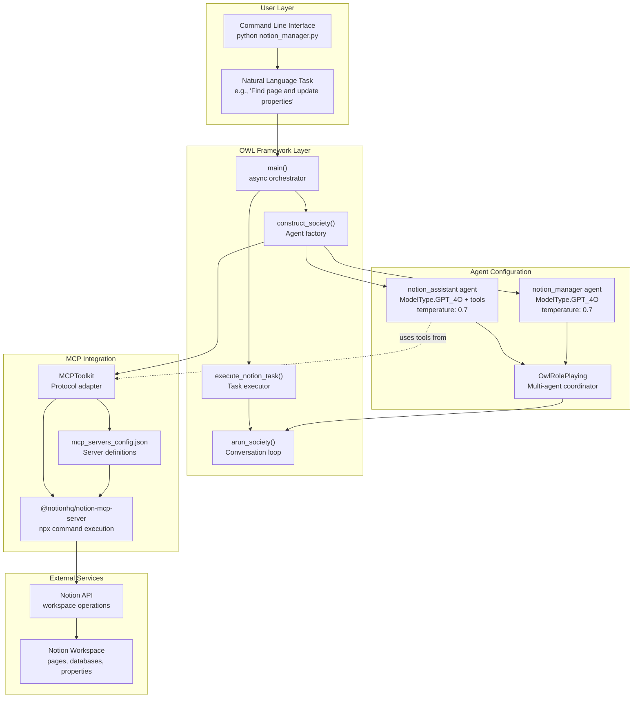
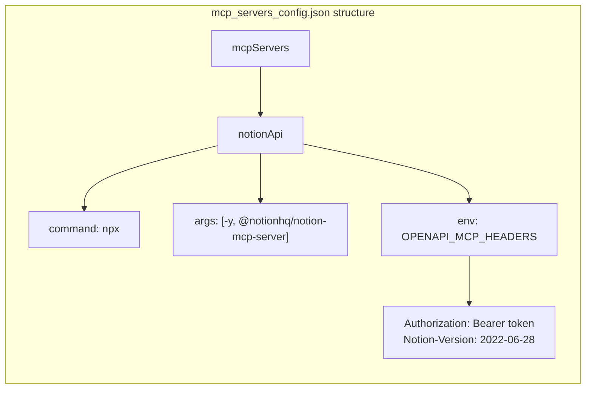
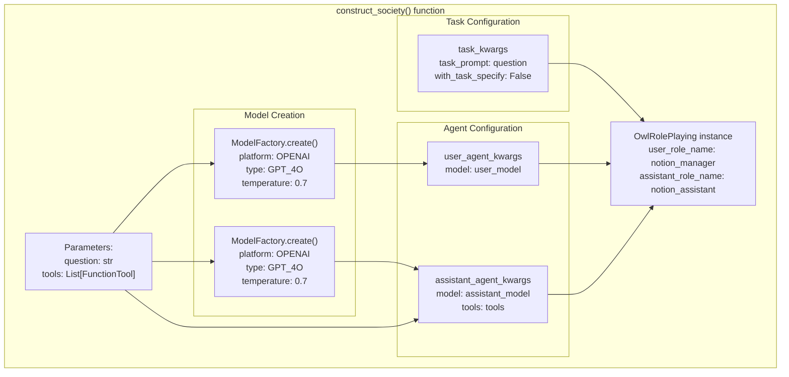
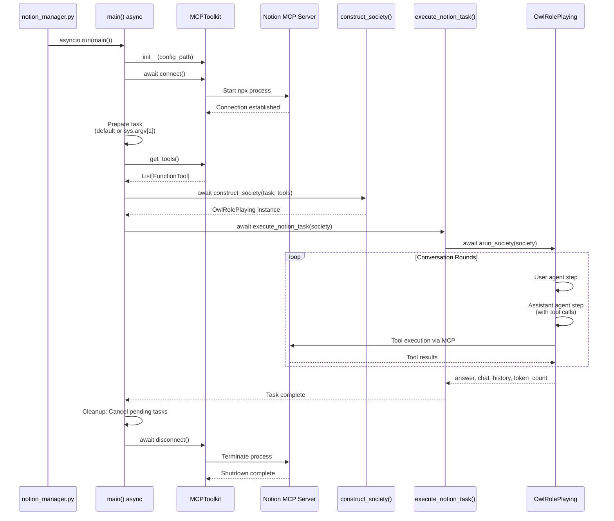
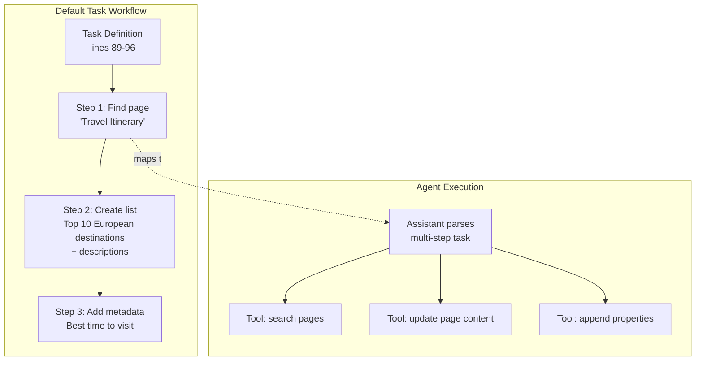
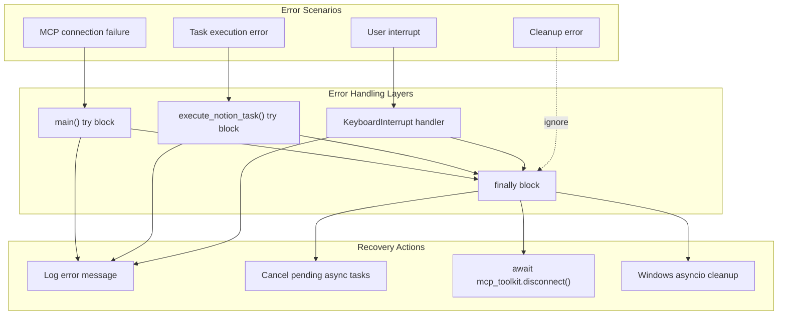

<!-- source: DeepWiki mcp.deepwiki.com · repo camel-ai/owl · extra page Notion Workspace Management · fetched 2026-10-29 -->

# Notion Workspace Management

<details>
<summary>Relevant source files</summary>

The following files were used as context for generating this wiki page:

- [community_usecase/Notion-MCP/README.md](community_usecase/Notion-MCP/README.md)
- [community_usecase/Notion-MCP/mcp_servers_config.json](community_usecase/Notion-MCP/mcp_servers_config.json)
- [community_usecase/Notion-MCP/notion_manager.py](community_usecase/Notion-MCP/notion_manager.py)

</details>


This document describes the Notion workspace management use case, which demonstrates automated interaction with Notion workspaces through AI agents using the Model Context Protocol (MCP). This implementation enables programmatic operations on Notion pages, databases, and properties without direct API calls, leveraging OWL's multi-agent architecture and the official Notion MCP server.

For general MCP toolkit documentation, see [MCP Toolkit](#5.2). For other MCP integration examples, see [MCP Integration Examples](#8.2).

## Purpose and Scope

The Notion workspace management implementation provides:
- Automated page search and retrieval
- Dynamic property updates on existing pages
- Comment addition and collaboration features
- New page creation with structured content
- Database queries and content extraction

The system abstracts Notion API complexity through the MCP protocol, allowing natural language task descriptions to drive workspace operations.

**Sources:** [community_usecase/Notion-MCP/README.md:1-95]()

## System Architecture

The Notion integration follows OWL's standard MCP integration pattern with specialized configuration for Notion's API requirements.



**Architecture Notes:**
- `construct_society()` at [community_usecase/Notion-MCP/notion_manager.py:23-62]() creates the agent pair with identical GPT-4o models
- Both agents use `temperature: 0.7` for balanced creativity and consistency
- `MCPToolkit` connects via `npx` command to the Node.js-based Notion MCP server
- Tools are injected into the assistant agent's `tools` parameter
- `arun_society()` manages the conversation loop until task completion

**Sources:** [community_usecase/Notion-MCP/notion_manager.py:1-137]()

## Configuration Setup

### MCP Server Configuration

The `mcp_servers_config.json` file defines the Notion server connection parameters:



**Configuration Structure:**

| Field | Value | Purpose |
|-------|-------|---------|
| `command` | `"npx"` | Node.js package executor |
| `args[0]` | `"-y"` | Auto-confirm package installation |
| `args[1]` | `"@notionhq/notion-mcp-server"` | Official Notion MCP server package |
| `env.OPENAPI_MCP_HEADERS` | JSON string with `Authorization` and `Notion-Version` | API authentication headers |

**Critical Setup Steps:**

1. **Install Node.js package globally:**
   ```bash
   npm install -g @notionhq/notion-mcp-server@latest
   ```

2. **Create Notion integration:**
   - Navigate to https://www.notion.so/profile/integrations
   - Create new integration and copy token
   - Replace `ntn_****` in config with actual token at [community_usecase/Notion-MCP/mcp_servers_config.json:7]()

3. **Connect pages to integration:**
   - Open target Notion page
   - Click "..." menu → "Add connections" → Select integration
   - Repeat for all pages/databases requiring access

**Sources:** [community_usecase/Notion-MCP/mcp_servers_config.json:1-11](), [community_usecase/Notion-MCP/README.md:28-46]()

## Implementation Details

### Society Construction

The `construct_society()` function at [community_usecase/Notion-MCP/notion_manager.py:23-62]() implements the factory pattern for agent creation:



**Key Implementation Details:**

- **Model Configuration:** Both roles use identical `GPT_4O` models with `temperature: 0.7` [community_usecase/Notion-MCP/notion_manager.py:29-42]()
- **Tool Injection:** Only the assistant agent receives tools via `assistant_agent_kwargs["tools"]` [community_usecase/Notion-MCP/notion_manager.py:48]()
- **Task Specification:** `with_task_specify: False` disables automatic task reformulation [community_usecase/Notion-MCP/notion_manager.py:53]()
- **Role Naming:** Custom role names `notion_manager` and `notion_assistant` provide semantic context [community_usecase/Notion-MCP/notion_manager.py:58-60]()

**Sources:** [community_usecase/Notion-MCP/notion_manager.py:23-62]()

### Async Execution Flow

The main execution pipeline coordinates MCP connection lifecycle, task execution, and cleanup:



**Execution Steps:**

1. **MCP Connection:** `await mcp_toolkit.connect()` at [community_usecase/Notion-MCP/notion_manager.py:86]() establishes connection
2. **Tool Retrieval:** `mcp_toolkit.get_tools()` at [community_usecase/Notion-MCP/notion_manager.py:101]() extracts available operations
3. **Society Construction:** `await construct_society(task, tools)` at [community_usecase/Notion-MCP/notion_manager.py:102]() creates agent system
4. **Task Execution:** `await execute_notion_task(society)` at [community_usecase/Notion-MCP/notion_manager.py:104]() runs conversation loop
5. **Result Extraction:** Unpacks `answer, chat_history, token_count` tuple at [community_usecase/Notion-MCP/notion_manager.py:69-70]()
6. **Cleanup:** Cancels async tasks at [community_usecase/Notion-MCP/notion_manager.py:112-118]() and disconnects MCP at [community_usecase/Notion-MCP/notion_manager.py:121]()

**Sources:** [community_usecase/Notion-MCP/notion_manager.py:80-125]()

## Task Definition and Execution

### Default Task Example

The script includes a multi-step task demonstrating typical Notion operations:



**Task Structure:**

The default task at [community_usecase/Notion-MCP/notion_manager.py:89-96]() demonstrates:
- **Page identification** by title string matching
- **Content creation** with structured data (list format)
- **Metadata enrichment** with additional properties
- **Multi-step coordination** requiring sequential tool calls

**Custom Task Execution:**

Users can override the default task via command line:
```bash
python notion_manager.py "Your custom Notion task here"
```

This is handled at [community_usecase/Notion-MCP/notion_manager.py:98]() via `sys.argv[1]`.

**Sources:** [community_usecase/Notion-MCP/notion_manager.py:89-99]()

## Supported Notion Operations

The Notion MCP server exposes the following capabilities through `MCPToolkit`:

| Operation Category | Operations | Use Cases |
|-------------------|------------|-----------|
| **Search & Retrieval** | Search pages by title/content<br/>Read page content<br/>Retrieve database records | Locate specific pages<br/>Extract existing data<br/>Query structured databases |
| **Content Modification** | Update page properties<br/>Append content blocks<br/>Replace sections | Modify metadata<br/>Add new content<br/>Edit existing text |
| **Collaboration** | Add comments<br/>Mention users<br/>Track changes | Team coordination<br/>Review workflows<br/>Audit trails |
| **Creation** | Create new pages<br/>Create database entries<br/>Duplicate templates | Generate documentation<br/>Populate databases<br/>Clone structures |
| **Database Operations** | Query databases<br/>Filter records<br/>Sort results | Extract analytics<br/>Generate reports<br/>Data aggregation |

**Access Permissions:**

All operations respect Notion's permission model. The integration token must have explicit access to each page/database, configured through the "Add connections" interface described at [community_usecase/Notion-MCP/README.md:39-43]().

**Sources:** [community_usecase/Notion-MCP/README.md:66-75]()

## Error Handling and Cleanup

### Exception Management

The implementation includes multi-layer error handling:



**Error Handling Implementation:**

1. **Connection Errors:** Caught in main try block at [community_usecase/Notion-MCP/notion_manager.py:106-108]()
   - Logs connection failure details
   - Re-raises exception for proper exit

2. **Task Execution Errors:** Handled in `execute_notion_task()` at [community_usecase/Notion-MCP/notion_manager.py:76-78]()
   - Captures exceptions during `arun_society()` call
   - Logs error with task context
   - Re-raises for upstream handling

3. **Cleanup Errors:** Safely ignored in finally block at [community_usecase/Notion-MCP/notion_manager.py:120-124]()
   - Disconnection failures are logged but not fatal
   - Allows script to exit cleanly even if server is unresponsive

4. **Async Task Cleanup:** Implemented at [community_usecase/Notion-MCP/notion_manager.py:112-118]()
   - Cancels all pending tasks except current
   - Awaits cancellation with `CancelledError` handling
   - Prevents asyncio warnings on exit

**Platform-Specific Handling:**

Windows requires special cleanup at [community_usecase/Notion-MCP/notion_manager.py:132-136]():
```python
if sys.platform == 'win32':
    try:
        import asyncio.windows_events
        asyncio.windows_events._overlapped = None
    except (ImportError, AttributeError):
        pass
```

This prevents `RuntimeError: Event loop is closed` on Windows platforms.

**Sources:** [community_usecase/Notion-MCP/notion_manager.py:64-137](), [community_usecase/Notion-MCP/README.md:85-91]()

## Logging Configuration

The implementation uses CAMEL's logging framework with file output:

```python
set_log_file("notion_mcp.log")
logger = get_logger(__name__)
```

**Log Output Locations:**
- File: `notion_mcp.log` at [community_usecase/Notion-MCP/notion_manager.py:17]()
- Console: Standard output with info-level messages

**Logged Events:**
- MCP server connection status at [community_usecase/Notion-MCP/notion_manager.py:85,87]()
- Task description at [community_usecase/Notion-MCP/notion_manager.py:99]()
- Task results (answer, token count) at [community_usecase/Notion-MCP/notion_manager.py:71-74]()
- Error messages at [community_usecase/Notion-MCP/notion_manager.py:77,107]()
- Cleanup status at [community_usecase/Notion-MCP/notion_manager.py:111,122]()
- Keyboard interrupt notifications at [community_usecase/Notion-MCP/notion_manager.py:130]()

**Sources:** [community_usecase/Notion-MCP/notion_manager.py:16-18]()

## Troubleshooting Guide

| Issue | Diagnostic Steps | Resolution |
|-------|-----------------|------------|
| **Connection Failure** | Check token format<br/>Verify Node.js installation<br/>Test `npx` availability | Regenerate Notion token<br/>Install Node.js 16+<br/>Run `npm install -g @notionhq/notion-mcp-server@latest` |
| **Permission Denied** | Verify page connections<br/>Check integration scope<br/>Review Notion workspace settings | Add integration to each page via "..." menu<br/>Ensure integration has required capabilities |
| **API Version Mismatch** | Check `Notion-Version` in config<br/>Review Notion API changelog | Update version in `mcp_servers_config.json` at [community_usecase/Notion-MCP/mcp_servers_config.json:7]()<br/>Current: `2022-06-28` |
| **Task Execution Timeout** | Review task complexity<br/>Check network connectivity<br/>Examine token limits | Simplify multi-step tasks<br/>Verify API quotas<br/>Increase model `max_tokens` |
| **Windows Event Loop Error** | Check Python version<br/>Verify asyncio behavior | Apply Windows-specific cleanup at [community_usecase/Notion-MCP/notion_manager.py:132-136]() |

**Common Error Messages:**

- `"Error during task execution"`: Task execution failed at [community_usecase/Notion-MCP/notion_manager.py:77]()
  - Check `notion_mcp.log` for detailed error trace
  - Verify all required pages are connected to integration

- `"Cleanup error (can be ignored)"`: Non-fatal disconnection issue at [community_usecase/Notion-MCP/notion_manager.py:124]()
  - Safe to ignore if task completed successfully
  - Indicates MCP server already terminated

- `"Received keyboard interrupt"`: User-initiated shutdown at [community_usecase/Notion-MCP/notion_manager.py:130]()
  - Graceful shutdown triggered
  - Cleanup proceeds normally

**Sources:** [community_usecase/Notion-MCP/README.md:77-84]()

---

