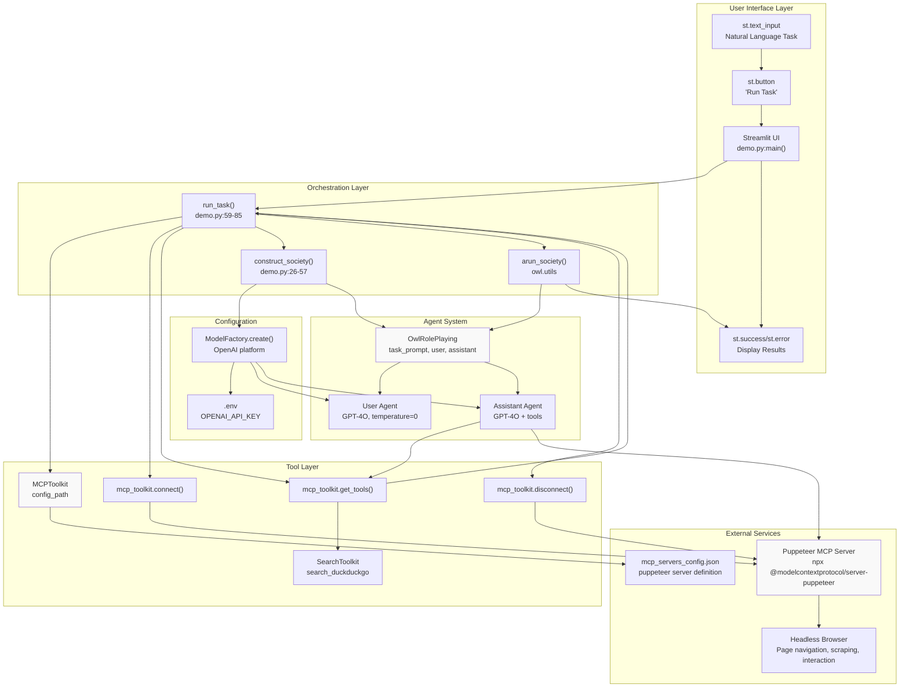
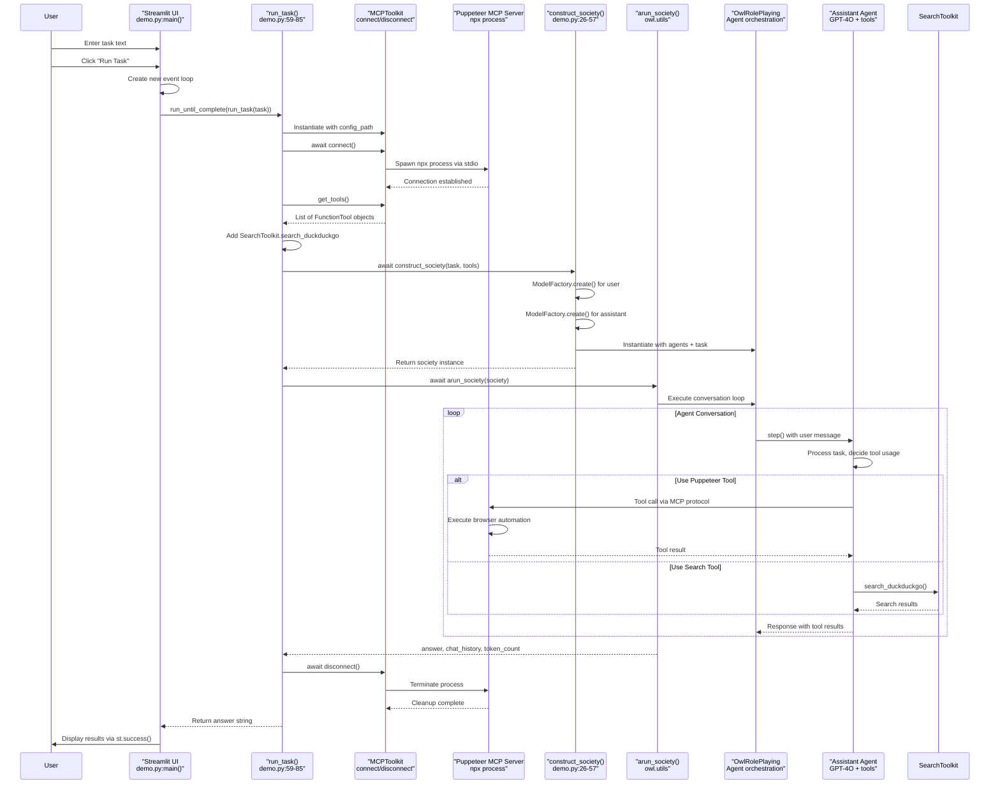
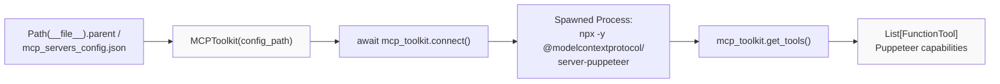

<!-- source: DeepWiki mcp.deepwiki.com · repo camel-ai/owl · extra page Puppeteer Browser Automation · fetched 2026-10-29 -->

# Puppeteer Browser Automation

<details>
<summary>Relevant source files</summary>

The following files were used as context for generating this wiki page:

- [community_usecase/Puppeteer MCP/README.md](community_usecase/Puppeteer MCP/README.md)
- [community_usecase/Puppeteer MCP/demo.py](community_usecase/Puppeteer MCP/demo.py)
- [community_usecase/Puppeteer MCP/mcp_servers_config.json](community_usecase/Puppeteer MCP/mcp_servers_config.json)
- [community_usecase/Puppeteer MCP/requirements.txt](community_usecase/Puppeteer MCP/requirements.txt)

</details>


## Purpose and Scope

This document describes the Puppeteer MCP integration example, a Streamlit-based demonstration application that uses the Model Context Protocol (MCP) to enable natural language-driven browser automation via the Puppeteer MCP server. This example showcases how to build user-facing applications on top of OWL's multi-agent framework with external service integration.

For general information about MCP toolkit integration, see [MCP Toolkit](#5.2). For OWL's native browser automation using Playwright, see [Browser & Search Toolkits](#5.3). For other MCP integration patterns, see [Qwen with MCP](#8.2.1) and [Notion Workspace Management](#8.2.3).

## Overview

The Puppeteer Browser Automation example is a community-contributed use case demonstrating integration between:
- **Streamlit** for the web-based user interface
- **OwlRolePlaying** for multi-agent task orchestration
- **MCPToolkit** for connecting to the Puppeteer MCP server
- **Puppeteer MCP server** (`@modelcontextprotocol/server-puppeteer`) for browser automation

Unlike OWL's native `BrowserToolkit` which uses Playwright directly, this example delegates browser automation to an external MCP server, illustrating the extensibility pattern for integrating third-party services.

**Sources:** [community_usecase/Puppeteer MCP/README.md:1-116]()

## Application Architecture



**Sources:** [community_usecase/Puppeteer MCP/demo.py:1-113](), [community_usecase/Puppeteer MCP/README.md:1-116]()

## Configuration Files

### MCP Server Configuration

The application requires an MCP server configuration file defining the Puppeteer server connection details.

| File | Purpose | Key Contents |
|------|---------|--------------|
| `mcp_servers_config.json` | MCP server definitions | Puppeteer server command and arguments |
| `.env` | API key storage | `OPENAI_API_KEY` for model access |
| `requirements.txt` | Python dependencies | `streamlit`, `camel-ai["all"]`, `python-dotenv` |

**mcp_servers_config.json Structure:**

```json
{
  "mcpServers": {
    "puppeteer": {
      "command": "npx",
      "args": ["-y", "@modelcontextprotocol/server-puppeteer"]
    }
  }
}
```

The `command` field specifies the executable (`npx`) and `args` provides the package name. The `-y` flag auto-confirms npm package execution. When `MCPToolkit` connects, it spawns this process and communicates via the MCP protocol.

**Sources:** [community_usecase/Puppeteer MCP/mcp_servers_config.json:1-8](), [community_usecase/Puppeteer MCP/README.md:52-72]()

### Environment Configuration

The application uses `python-dotenv` to load environment variables:

```python
from dotenv import load_dotenv
load_dotenv()
```

Required environment variable:
- `OPENAI_API_KEY`: Authentication for OpenAI API calls

**Sources:** [community_usecase/Puppeteer MCP/demo.py:6-23](), [community_usecase/Puppeteer MCP/README.md:54-58]()

## Execution Flow



**Sources:** [community_usecase/Puppeteer MCP/demo.py:59-109]()

## Key Components

### main() Function

The entry point creates the Streamlit user interface with a text input and button.

```python
def main():
    st.title("OWL X Puppeteer MCP Server")
    task = st.text_input("Enter your task", value="Please find...")
    if st.button("Run Task"):
        # Event loop management for async execution
        new_loop = asyncio.new_event_loop()
        asyncio.set_event_loop(new_loop)
        result = new_loop.run_until_complete(run_task(task))
        new_loop.close()
        st.success("Task completed!")
        st.write(result)
```

**Key characteristics:**
- Creates a fresh event loop per task execution [demo.py:100]()
- Uses `asyncio.WindowsProactorEventLoopPolicy()` on Windows for compatibility [demo.py:21-22]()
- Handles exceptions with `st.error()` and traceback display [demo.py:103-105]()
- Provides a default task example demonstrating Puppeteer capabilities [demo.py:91]()

**Sources:** [community_usecase/Puppeteer MCP/demo.py:87-112]()

### construct_society() Function

This async function instantiates the multi-agent system with specific model and tool configurations.

**Model Configuration:**

| Role | Platform | Model Type | Temperature | Purpose |
|------|----------|-----------|-------------|---------|
| User Agent | OpenAI | GPT-4O | 0 | Deterministic instruction generation |
| Assistant Agent | OpenAI | GPT-4O | 0 | Deterministic tool usage and responses |

Both agents use `temperature=0` for consistent, reproducible behavior—critical for automation tasks where creativity is less important than reliability.

**Agent Configuration:**

```python
user_agent_kwargs = {"model": models["user"]}
assistant_agent_kwargs = {"model": models["assistant"], "tools": tools}
```

The assistant agent receives the tools list (Puppeteer MCP tools + SearchToolkit), while the user agent operates without tools.

**Task Configuration:**

```python
task_kwargs = {
    "task_prompt": task,
    "with_task_specify": False,
}
```

Setting `with_task_specify=False` disables automatic task refinement, executing the user's prompt directly.

**Sources:** [community_usecase/Puppeteer MCP/demo.py:26-57]()

### run_task() Function

The core orchestration function manages the complete lifecycle of task execution.

**Connection Management:**

```python
config_path = Path(__file__).parent / "mcp_servers_config.json"
mcp_toolkit = MCPToolkit(config_path=str(config_path))

await mcp_toolkit.connect()
# ... task execution ...
await mcp_toolkit.disconnect()
```

The function ensures proper cleanup even on exceptions using a `try-finally` block [demo.py:67-84]().

**Tool Aggregation:**

```python
tools = [*mcp_toolkit.get_tools(), SearchToolkit().search_duckduckgo]
```

This combines:
1. All tools exposed by the Puppeteer MCP server (unpacked with `*`)
2. The DuckDuckGo search function from `SearchToolkit`

The spread operator pattern allows flexible tool composition from multiple sources.

**Error Handling:**

```python
except Exception as e:
    import traceback
    st.error(f"An error occurred: {e}")
    st.text(traceback.format_exc())
```

Errors are captured and displayed in the Streamlit UI with full tracebacks for debugging [demo.py:76-79]().

**Sources:** [community_usecase/Puppeteer MCP/demo.py:59-85]()

## Tool Integration Pattern

### MCPToolkit Initialization



The `MCPToolkit` reads the configuration file to determine which MCP servers to connect to. Each server is spawned as a subprocess, and the toolkit communicates with it via stdio using the MCP protocol. The `get_tools()` method queries the connected server for its available tools and wraps them as `FunctionTool` objects that OWL agents can invoke.

**Sources:** [community_usecase/Puppeteer MCP/demo.py:64-73]()

### Tool Usage by Assistant Agent

During task execution, when the assistant agent decides to use a tool, the flow is:

1. **Agent Decision**: GPT-4O model determines tool call is needed based on task requirements
2. **Tool Call**: Agent invokes the tool with structured parameters
3. **MCP Protocol**: `MCPToolkit` translates the call into MCP protocol format
4. **Puppeteer Execution**: The Puppeteer MCP server executes browser automation
5. **Result Return**: Browser results are returned through MCP protocol back to the agent
6. **Continuation**: Agent processes results and continues conversation

This pattern abstracts away the complexity of browser automation, allowing agents to interact with web content through natural language.

**Sources:** [community_usecase/Puppeteer MCP/demo.py:26-85](), [community_usecase/Puppeteer MCP/README.md:9-13]()

## Comparison with Native BrowserToolkit

| Aspect | Puppeteer MCP Example | Native BrowserToolkit |
|--------|----------------------|----------------------|
| **Technology** | Puppeteer via MCP | Playwright direct integration |
| **Process Model** | External subprocess (npx) | In-process Python library |
| **Configuration** | `mcp_servers_config.json` | Direct instantiation in code |
| **Platform Support** | Node.js required | Python-native |
| **Extensibility** | Can use any MCP server | Limited to Playwright |
| **Use Case** | Community example, external tool integration | Production OWL feature |
| **Model Requirements** | User + Assistant models | User + Assistant + Browsing + Planning models |
| **Location** | [community_usecase/Puppeteer MCP/]() | [owl/toolkits/browser_toolkit.py]() |

The Puppeteer MCP example demonstrates the **meta-toolkit pattern**: using MCP to integrate external automation tools without modifying OWL's core. This is valuable for:
- Prototyping with services not yet integrated into OWL
- Using organization-specific internal tools via MCP
- Experimenting with alternative browser automation libraries
- Keeping the core framework lean while supporting diverse use cases

**Sources:** [community_usecase/Puppeteer MCP/README.md:1-116]()

## Example Use Cases

The default task demonstrates multi-step web automation:

```
"Please find the top articles from dev.to this week and go to each 
article and then summarize it. Please use MCP given to you"
```

This task requires:
1. **Navigation**: Visit dev.to website
2. **Content Extraction**: Identify top articles for the week
3. **Iteration**: Navigate to each article URL
4. **Scraping**: Extract article content from each page
5. **Analysis**: Summarize each article
6. **Synthesis**: Compile summaries into final answer

Other suitable tasks for this pattern:
- Competitive analysis by scraping multiple websites
- Automated form filling and submission
- Website monitoring and change detection
- Multi-page data aggregation workflows
- Screenshot capture for visual verification

**Sources:** [community_usecase/Puppeteer MCP/demo.py:91](), [community_usecase/Puppeteer MCP/README.md:83]()

## Prerequisites and Dependencies

### System Requirements

| Component | Requirement | Purpose |
|-----------|-------------|---------|
| Python | >=3.10, <3.13 | Runtime for Streamlit and OWL |
| Node.js + npm | Latest stable | Required for Puppeteer MCP server |
| OPENAI_API_KEY | Valid API key | Model access for GPT-4O |

### Python Dependencies

- `streamlit`: Web application framework
- `camel-ai["all"]`: OWL framework with all optional dependencies
- `python-dotenv`: Environment variable management

The `["all"]` extras specification ensures all toolkit dependencies are installed, including those needed for `MCPToolkit` and `SearchToolkit`.

**Sources:** [community_usecase/Puppeteer MCP/requirements.txt:1-3](), [community_usecase/Puppeteer MCP/README.md:16-24]()

## Logging and Debugging

The application configures comprehensive logging:

```python
import logging
logging.basicConfig(level=logging.DEBUG)

from camel.logger import set_log_level
set_log_level(level="DEBUG")
```

This enables:
- **Python standard logging**: Captures application-level events [demo.py:18]()
- **CAMEL framework logging**: Tracks agent decisions and tool calls [demo.py:24]()
- **Connection diagnostics**: Logs MCP server connection lifecycle [demo.py:68-70]()

Debug output helps troubleshoot:
- MCP server connection failures
- Tool call parameter formatting issues
- Agent conversation flow
- Model API errors

**Sources:** [community_usecase/Puppeteer MCP/demo.py:16-24]()

## Customization Points

The application can be customized by modifying:

1. **Model Selection** [demo.py:30-40](): Change `ModelType` or `ModelPlatformType` to use different models
2. **Temperature Settings** [demo.py:34, 39](): Adjust for more creative vs. deterministic behavior
3. **Tool Combination** [demo.py:73](): Add or remove toolkits to change agent capabilities
4. **Task Prompt Structure** [demo.py:46](): Enable `with_task_specify=True` for automatic task refinement
5. **Agent Roles** [demo.py:52-55](): Customize role names for domain-specific applications
6. **MCP Servers** [mcp_servers_config.json:1-8](): Add additional MCP servers for more capabilities

**Sources:** [community_usecase/Puppeteer MCP/demo.py:26-57](), [community_usecase/Puppeteer MCP/README.md:87-92]()

---

