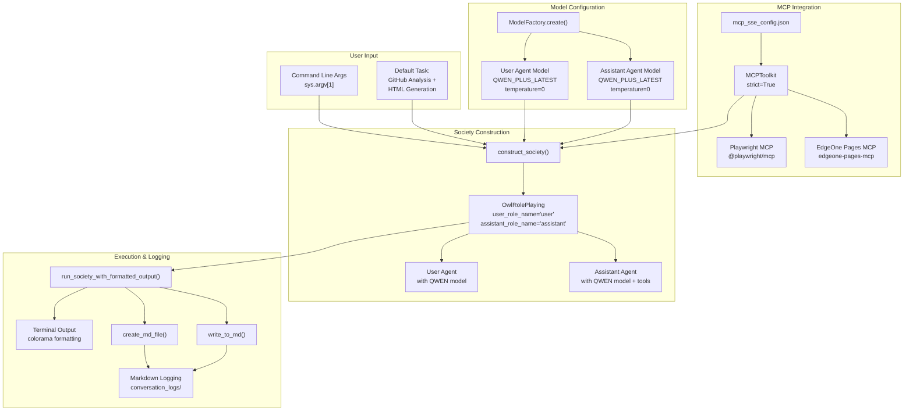
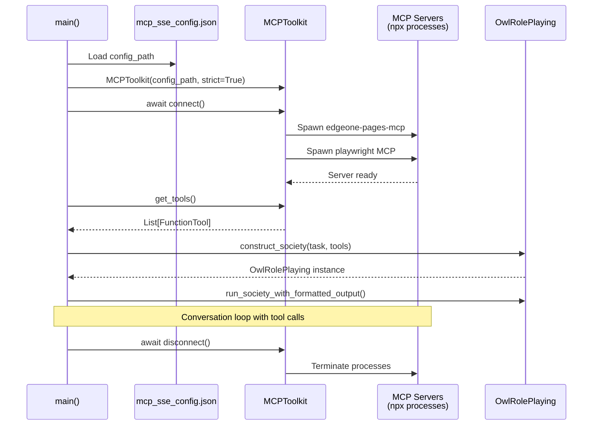
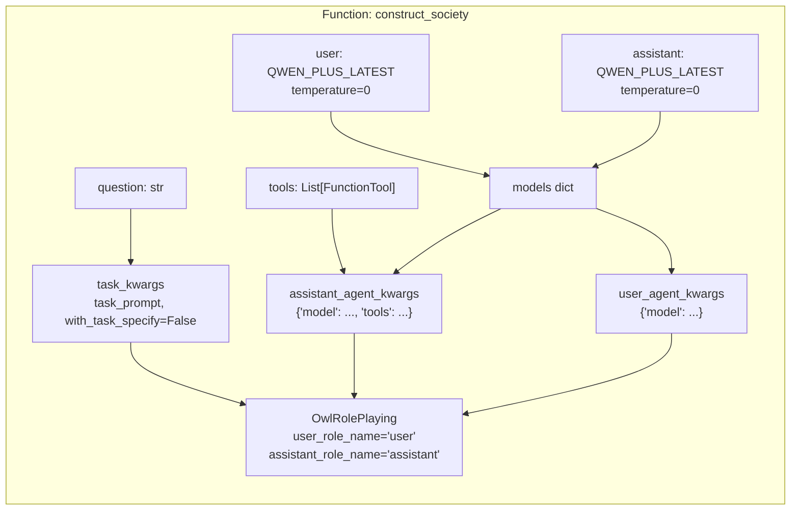
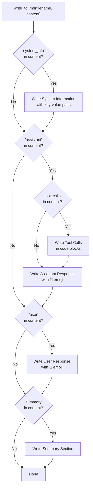
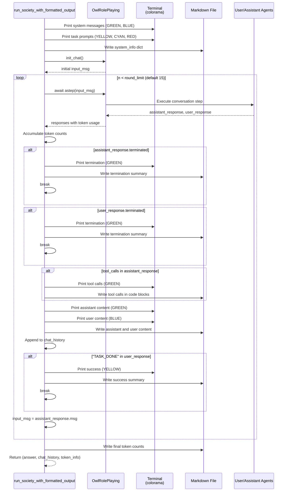
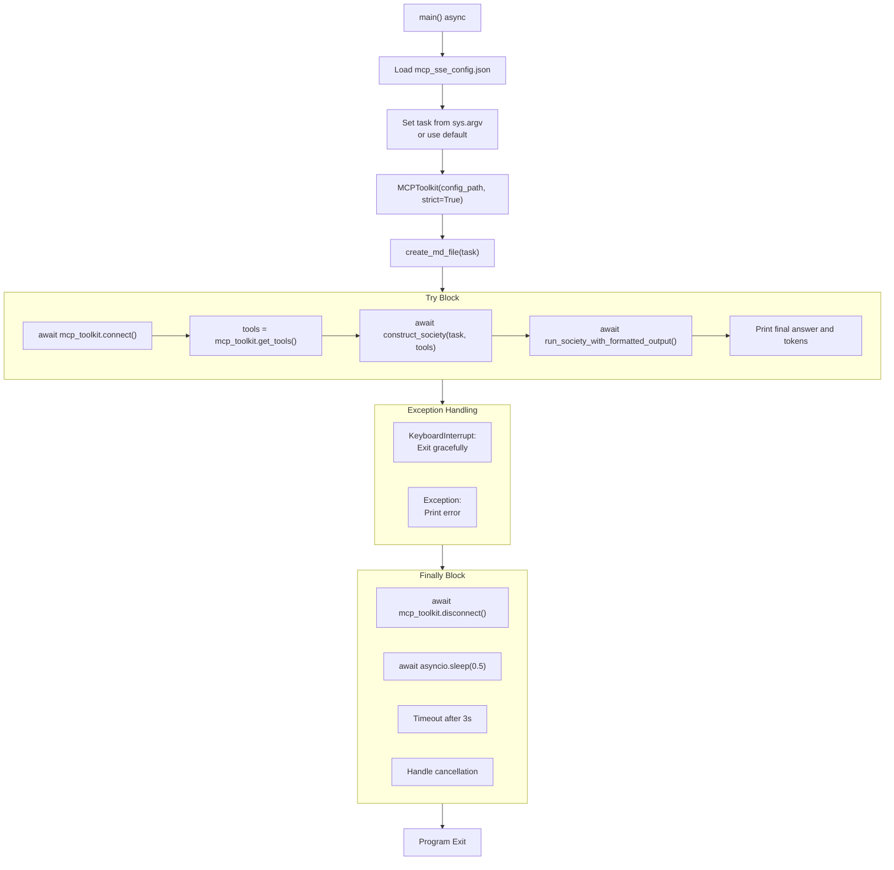

<!-- source: DeepWiki mcp.deepwiki.com · repo camel-ai/owl · extra page Qwen with MCP · fetched 2026-10-29 -->

# Qwen with MCP

<details>
<summary>Relevant source files</summary>

The following files were used as context for generating this wiki page:

- [community_usecase/qwen3_mcp/mcp_sse_config.json](community_usecase/qwen3_mcp/mcp_sse_config.json)
- [community_usecase/qwen3_mcp/run_mcp_qwen3.py](community_usecase/qwen3_mcp/run_mcp_qwen3.py)

</details>


This page documents the Qwen-MCP integration example located in `community_usecase/qwen3_mcp/`, which demonstrates using Alibaba's Qwen models with the Model Context Protocol (MCP) toolkit for browser automation and web deployment tasks. This example showcases structured conversation logging to markdown files and formatted terminal output.

For general MCP toolkit architecture and configuration, see [MCP Toolkit](#5.2). For other MCP integration examples including Puppeteer and Notion, see [Puppeteer Browser Automation](#8.2.2) and [Notion Workspace Management](#8.2.3). For Qwen model platform configuration, see [Chinese LLM Platforms](#6.4).

**Sources:** [community_usecase/qwen3_mcp/run_mcp_qwen3.py:1-331]()

## Purpose and Capabilities

The Qwen-MCP example demonstrates:

- **Qwen Model Integration**: Using `ModelPlatformType.QWEN` with `ModelType.QWEN_PLUS_LATEST` for both user and assistant agents
- **MCP Server Connection**: Connecting to Playwright and EdgeOne Pages MCP servers for browser automation and deployment
- **Structured Logging**: Automatic export of conversations to timestamped markdown files
- **Terminal Formatting**: Color-coded output using `colorama` for better readability
- **Async Execution**: Full async/await pattern for MCP toolkit operations

**Sources:** [community_usecase/qwen3_mcp/run_mcp_qwen3.py:40-84](), [community_usecase/qwen3_mcp/run_mcp_qwen3.py:264-330]()

## System Architecture



**Diagram: Qwen-MCP System Component Flow**

This diagram shows how the Qwen-MCP example integrates model configuration, MCP toolkit initialization, society construction, and dual-output logging (terminal + markdown).

**Sources:** [community_usecase/qwen3_mcp/run_mcp_qwen3.py:40-84](), [community_usecase/qwen3_mcp/run_mcp_qwen3.py:264-330]()

## MCP Server Configuration

The MCP servers are defined in `mcp_sse_config.json` with a standard structure:

| Server Name | Command | Arguments | Purpose |
|------------|---------|-----------|---------|
| `edgeone-pages-mcp-server` | `npx` | `["edgeone-pages-mcp"]` | Web deployment and hosting services |
| `playwright` | `npx` | `["@playwright/mcp@latest"]` | Browser automation for web scraping and interaction |

The configuration follows the MCP SSE (Server-Sent Events) protocol structure. Each server is spawned as a subprocess using `npx`, which executes the corresponding Node.js packages.

**Sources:** [community_usecase/qwen3_mcp/mcp_sse_config.json:1-14]()

### Configuration Loading and Connection



**Diagram: MCP Toolkit Lifecycle in Qwen Example**

The `MCPToolkit` is initialized with `strict=True`, which enforces type checking on tool parameters. Connection is asynchronous and must complete before tools can be retrieved.

**Sources:** [community_usecase/qwen3_mcp/run_mcp_qwen3.py:264-330]()

## Society Construction Function

The `construct_society` function creates an `OwlRolePlaying` instance with Qwen models and MCP tools:



**Diagram: construct_society Function Flow**

Key configuration details:

- **User Agent**: Uses Qwen Plus with temperature 0 (deterministic), no tools
- **Assistant Agent**: Uses Qwen Plus with temperature 0 (deterministic), receives all MCP tools
- **Task Configuration**: Sets `with_task_specify=False` to use the raw task prompt without modification

**Sources:** [community_usecase/qwen3_mcp/run_mcp_qwen3.py:40-84]()

### Model Configuration Details

Both agents use identical model configurations:

| Parameter | Value | Purpose |
|-----------|-------|---------|
| `model_platform` | `ModelPlatformType.QWEN` | Specifies Alibaba Qwen platform |
| `model_type` | `ModelType.QWEN_PLUS_LATEST` | Uses latest Qwen Plus model version |
| `temperature` | `0` | Deterministic output for reproducibility |

The temperature setting of 0 is important for consistent behavior across multiple runs, which is valuable for debugging and validation.

**Sources:** [community_usecase/qwen3_mcp/run_mcp_qwen3.py:53-64]()

## Markdown Logging System

The example implements a sophisticated logging system that exports conversations to markdown files with timestamps and structured formatting.

### File Creation

The `create_md_file` function generates timestamped markdown files:

| Component | Implementation | Example |
|-----------|---------------|---------|
| **Timestamp Format** | `%Y%m%d_%H%M%S` | `20240315_143022` |
| **Task Shortening** | First 30 chars, replace spaces/slashes | `Visit_the_Qwen3_GitHub_rep` |
| **Directory** | `conversation_logs/` | Auto-created if missing |
| **Filename Pattern** | `conversation_{timestamp}_{task_short}.md` | `conversation_20240315_143022_Visit_the_Qwen3.md` |

The file is initialized with:
- H1 header with full task description
- Generation timestamp
- Task details section
- Empty conversation section

**Sources:** [community_usecase/qwen3_mcp/run_mcp_qwen3.py:87-113]()

### Content Writing

The `write_to_md` function handles different content types:



**Diagram: Markdown Content Writing Logic**

Content types handled:

1. **System Information**: Configuration and prompts (written once at start)
2. **Tool Calls**: Function calls with parameters in code blocks
3. **Assistant Messages**: AI responses with tool call context
4. **User Messages**: User agent guidance and feedback
5. **Summary**: Task completion or termination information

**Sources:** [community_usecase/qwen3_mcp/run_mcp_qwen3.py:116-144]()

## Execution Flow with Formatted Output

The `run_society_with_formatted_output` function orchestrates the conversation loop with dual output streams.



**Diagram: Conversation Loop with Dual Output**

**Sources:** [community_usecase/qwen3_mcp/run_mcp_qwen3.py:146-261]()

### Terminal Color Scheme

The colorama library provides colored output for different message types:

| Color | Message Type | Usage |
|-------|-------------|-------|
| `Fore.GREEN` | Assistant messages, tool calls, success | AI responses and system success |
| `Fore.BLUE` | User messages, system info | User agent responses |
| `Fore.YELLOW` | Task prompts, warnings, completion | Important information |
| `Fore.CYAN` | Specified prompts, metadata | Secondary information |
| `Fore.RED` | Final task prompt, errors | Critical information |

**Sources:** [community_usecase/qwen3_mcp/run_mcp_qwen3.py:157-162](), [community_usecase/qwen3_mcp/run_mcp_qwen3.py:222-232]()

### Token Tracking

Token usage is accumulated across all conversation rounds:

```python
# Tracked metrics
overall_completion_token_count += (
    assistant_response.info["usage"].get("completion_tokens", 0) +
    user_response.info["usage"].get("completion_tokens", 0)
)
overall_prompt_token_count += (
    assistant_response.info["usage"].get("prompt_tokens", 0) +
    user_response.info["usage"].get("prompt_tokens", 0)
)
```

The final token information includes:
- `completion_token_count`: Total tokens generated
- `prompt_token_count`: Total tokens in prompts

**Sources:** [community_usecase/qwen3_mcp/run_mcp_qwen3.py:185-195]()

## Main Execution and Error Handling

The `main` function demonstrates robust async execution with proper cleanup:



**Diagram: Main Function Error Handling Flow**

### Exception Handling Strategy

The example implements three-tier exception handling:

1. **KeyboardInterrupt**: Graceful shutdown on Ctrl+C
2. **General Exceptions**: Error logging with traceback
3. **Finally Block**: Guaranteed cleanup with timeout protection

The disconnect operation includes:
- `asyncio.wait_for` with 3-second timeout
- `asyncio.shield` to prevent cancellation during cleanup
- Fallback handling for `TimeoutError` and `CancelledError`
- 0.5-second sleep to allow async tasks to complete

**Sources:** [community_usecase/qwen3_mcp/run_mcp_qwen3.py:304-327]()

## Default Task Example

The default task demonstrates complex multi-step automation:

```
Visit the Qwen3 GitHub repository, summarize the introduction of the repository.
Write a comprehensive HTML documentation site with the following features:
- A clear introduction to Qwen3
- Well-organized sections of the technical documentation
- Practical code examples
- A visually appealing purple technology theme (e.g. modern, clean, purple-accented design)
Finally, deploy the HTML site and open it in the browser.
```

This task exercises:
- **Playwright MCP**: GitHub repository access and browser control
- **EdgeOne Pages MCP**: HTML deployment and hosting
- **Multi-step reasoning**: Repository analysis → HTML generation → deployment → browser opening
- **Creative output**: Custom styling and design requirements

**Sources:** [community_usecase/qwen3_mcp/run_mcp_qwen3.py:269-277]()

## Usage Examples

### Running with Default Task

```bash
python community_usecase/qwen3_mcp/run_mcp_qwen3.py
```

This executes the GitHub documentation generation task.

### Running with Custom Task

```bash
python community_usecase/qwen3_mcp/run_mcp_qwen3.py "Search for recent AI papers on arXiv and create a summary webpage"
```

The command-line argument overrides the default task.

### Environment Requirements

Required environment variables (loaded from `.env`):

| Variable | Purpose | Required For |
|----------|---------|--------------|
| `QWEN_API_KEY` | Qwen API authentication | Model calls |

Required system dependencies:

| Dependency | Purpose | Installation |
|-----------|---------|--------------|
| Node.js + npm | npx command for MCP servers | System package manager |
| Playwright browsers | Browser automation | `npx playwright install` |

**Sources:** [community_usecase/qwen3_mcp/run_mcp_qwen3.py:35-37](), [community_usecase/qwen3_mcp/run_mcp_qwen3.py:280-281]()

## Output Structure

### Terminal Output Format

The terminal displays color-coded information in this order:

1. **System Messages** (Green/Blue): Agent system prompts
2. **Task Prompts** (Yellow/Cyan/Red): Original, specified, and final task descriptions
3. **Markdown Path** (Cyan): Location of conversation log file
4. **Connection Status** (Green): MCP server connection confirmation
5. **Conversation Loop**:
   - Assistant messages (Green) with tool calls
   - User messages (Blue) with guidance
6. **Final Results** (Green): Answer and token counts
7. **Log Location** (Cyan): Confirmation of saved conversation

### Markdown Output Structure

Generated markdown files follow this structure:

```markdown
# Agent Conversation: {task}

*Generated on: {timestamp}*

## Task Details

**Task:** {full task description}

## Conversation

### System Information

**AI Assistant System Message:** {system_msg}
**AI User System Message:** {system_msg}
...

### 🤖 Assistant

**Tool Calls:**

```
{tool_call_record}
```

{assistant_content}

### 👤 User

{user_content}

...

## Summary

{completion_message}

**completion_token_count:** {count}
**prompt_token_count:** {count}
```

**Sources:** [community_usecase/qwen3_mcp/run_mcp_qwen3.py:87-144]()

## Key Differences from Other MCP Examples

This Qwen-MCP example differs from other MCP integration examples in several ways:

| Feature | Qwen Example | Puppeteer Example | Notion Example |
|---------|-------------|-------------------|----------------|
| **Model Platform** | Qwen (Chinese LLM) | Various | Various |
| **Conversation Logging** | Markdown files with timestamps | Varies | Varies |
| **Terminal Formatting** | colorama with color coding | Standard output | Standard output |
| **MCP Servers** | EdgeOne Pages + Playwright | Puppeteer | Notion API |
| **Use Case Focus** | Web dev + deployment | Browser automation | Workspace management |
| **Model Temperature** | 0 (deterministic) | Varies | Varies |

The emphasis on structured logging and formatted output makes this example particularly useful for debugging and documentation purposes.

**Sources:** [community_usecase/qwen3_mcp/run_mcp_qwen3.py:1-331]()

---

