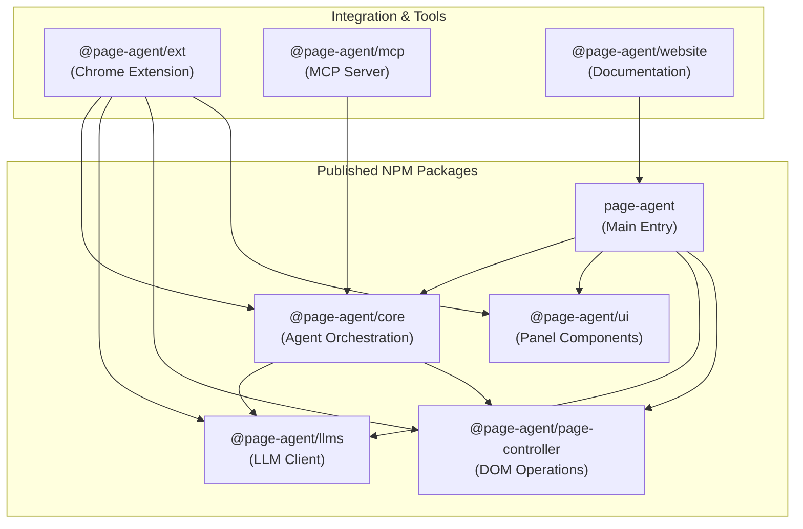
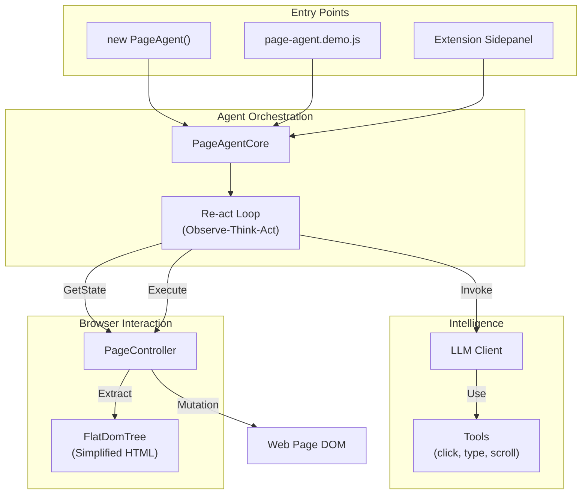

<!-- source: DeepWiki mcp.deepwiki.com · repo alibaba/page-agent · page 1 Overview · fetched 2026-10-29 -->

# Overview

Relevant source files

The following files were used as context for generating this wiki page:

- [.gitignore](.gitignore)
- [AGENTS.md](AGENTS.md)
- [CLAUDE.md](CLAUDE.md)
- [CONTRIBUTING.md](CONTRIBUTING.md)
- [README.md](README.md)
- [docs/README-zh.md](docs/README-zh.md)
- [package-lock.json](package-lock.json)
- [package.json](package.json)
- [packages/website/src/constants.ts](packages/website/src/constants.ts)

This document provides a high-level introduction to the PageAgent system, its architecture, and organization. PageAgent is a client-side GUI agent framework that enables natural language control of web applications through text-based DOM manipulation. The system is organized as a TypeScript monorepo containing multiple npm packages, a Chrome extension, and an MCP server. [package.json:1-15]()

For detailed information about specific subsystems, see:
- [What is PageAgent](#1.1) — Project philosophy and approach
- [Key Features and Use Cases](#1.2) — Main capabilities and applications
- [System Architecture](#1.3) — High-level architecture and data flow

## Project Purpose and Scope

PageAgent is a **client-side web automation framework** powered by Large Language Models (LLMs). Unlike traditional browser automation tools that require server-side infrastructure or complex headless environments, PageAgent runs primarily within the webpage as JavaScript code. The system converts natural language commands into DOM operations through an iterative observe-think-act loop. [README.md:33-37]()

**Key Characteristics:**

| Aspect | Description |
|--------|-------------|
| **Execution Model** | Client-side JavaScript, runs in-page [README.md:34-35]() |
| **DOM Interaction** | Text-based representation, no screenshots or OCR [README.md:36-37]() |
| **LLM Integration** | Provider-agnostic, supports OpenAI-compatible APIs and local models [README.md:38-39]() |
| **Architecture Pattern** | Re-act loop (Observe-Think-Act) [README.md:109-118]() |
| **Deployment Options** | NPM package, CDN script, Chrome extension, MCP server [README.md:53-89]() |

**Out of Scope:**
- Server-side browser automation (Selenium/Playwright equivalents) [README.md:111]()
- Vision-only or screenshot-dependent models [README.md:36-37]()
- Mobile native app automation

Sources: [README.md:1-126](), [package.json:1-136]()

## Monorepo Package Structure

PageAgent is organized as a monorepo with eight workspace packages. Five packages are core libraries, while others provide integration layers for different environments. [package.json:6-15]()

### Package Dependency Graph

**Package Responsibilities:**

| Package | Workspace Name | Purpose |
|---------|----------------|---------|
| `packages/page-agent` | `page-agent` | Main entry point for web integration with UI [AGENTS.md:82-86]() |
| `packages/core` | `@page-agent/core` | Headless agent orchestration and Re-act loop [AGENTS.md:89-96]() |
| `packages/llms` | `@page-agent/llms` | LLM client with OpenAI-compatible support [AGENTS.md:98-104]() |
| `packages/page-controller` | `@page-agent/page-controller` | DOM operations and element interactions [AGENTS.md:106-113]() |
| `packages/ui` | `@page-agent/ui` | UI components like the agent Panel [AGENTS.md:54]() |
| `packages/extension` | `@page-agent/ext` | Chrome extension for multi-page tasks [AGENTS.md:42]() |
| `packages/mcp` | `@page-agent/mcp` | Model Context Protocol server for external control [package.json:12]() |
| `packages/website` | `@page-agent/website` | Documentation and interactive demos [AGENTS.md:40]() |

Sources: [package.json:1-15](), [AGENTS.md:7-16](), [README.md:33-49]()

## Core Architecture

The system operates through a layered architecture. The core agent logic orchestrates the execution flow, utilizing an LLM client for intelligence and a Page Controller for physical interaction with the browser environment.

### System Component Layers

Sources: [AGENTS.md:30-80](), [README.md:53-89](), [package.json:28-45]()

### Execution Cycle

The agent follows an iterative cycle:
1.  **Observe**: `PageController` extracts the current DOM state into a `FlatDomTree` and then into a simplified text format suitable for LLM consumption. [AGENTS.md:75-76]()
2.  **Think**: The `LLM` client processes the state and historical context to decide on the next step. [AGENTS.md:77]()
3.  **Act**: The chosen tool (e.g., `click`, `type`) is executed via `PageController` on the live DOM using indexed operations. [AGENTS.md:78-79]()

For a detailed breakdown of the internal logic, see [System Architecture](#1.3).

## Deployment Models

PageAgent supports three primary deployment strategies to accommodate different technical requirements:

| Deployment | Target Users | Use Case |
|------------|-------------|--------------|
| **CDN Script** | Quick Demos | Testing PageAgent on any site via a single `<script>` tag. [README.md:53-70]() |
| **NPM Package** | SaaS Developers | Building a native AI Copilot inside an existing web application. [README.md:72-89]() |
| **Chrome Extension** | Power Users | Performing tasks that span across multiple browser tabs. [README.md:40, 48]() |

Additionally, the **MCP Server** allows external AI clients (like Claude Desktop or Cursor) to control the browser through the PageAgent infrastructure. [README.md:41, 49]()

Sources: [README.md:33-89](), [packages/website/src/constants.ts:1-11]()

## Technology Stack

- **Language**: TypeScript (Monorepo with npm workspaces) [package.json:6, 65]()
- **Build System**: Vite for libraries and website [package.json:68]()
- **UI Framework**: React [package.json:55]()
- **Styling**: Tailwind CSS [package.json:52]()
- **Version Management**: Custom `sync-version.js` script [package.json:36]()

Sources: [package.json:1-136]()

---

