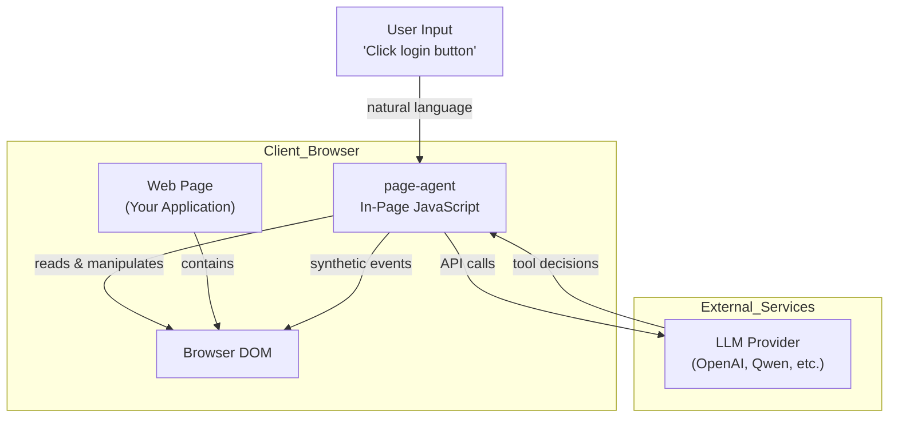
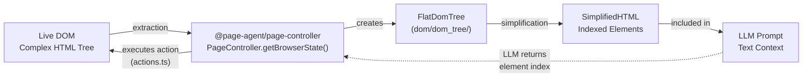
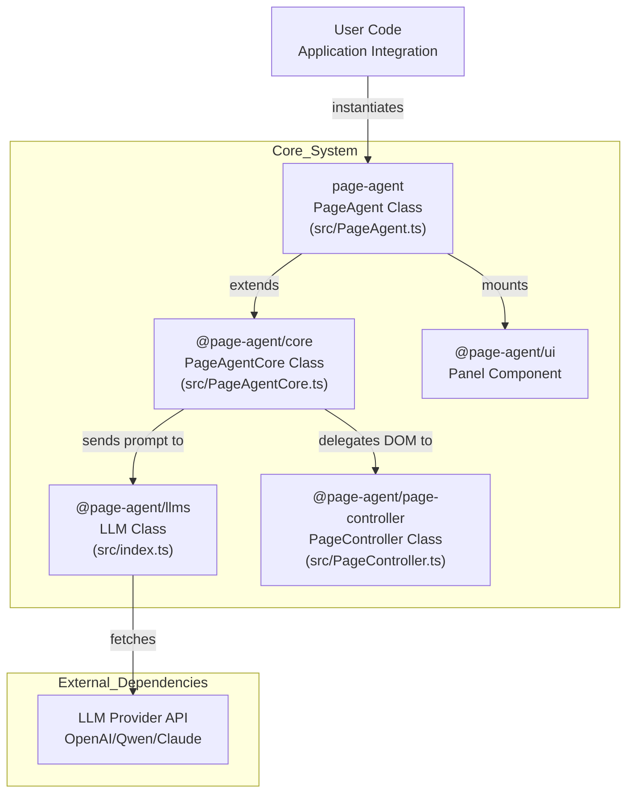
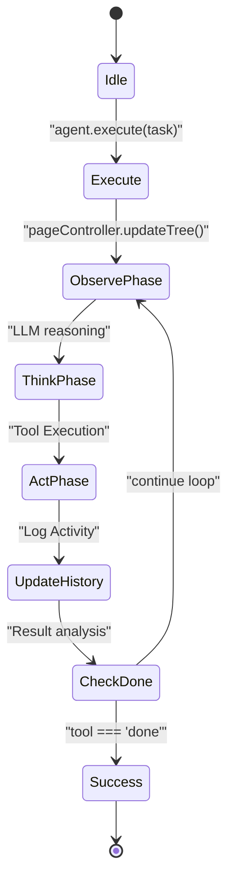

<!-- source: DeepWiki mcp.deepwiki.com · repo alibaba/page-agent · page 1.1 What is PageAgent · fetched 2026-10-29 -->

# What is PageAgent

<details>
<summary>Relevant source files</summary>

The following files were used as context for generating this wiki page:

- [.gitignore](.gitignore)
- [AGENTS.md](AGENTS.md)
- [CLAUDE.md](CLAUDE.md)
- [CONTRIBUTING.md](CONTRIBUTING.md)
- [README.md](README.md)
- [docs/README-zh.md](docs/README-zh.md)
- [packages/website/src/constants.ts](packages/website/src/constants.ts)

</details>


## Purpose and Scope

This document introduces PageAgent as a client-side GUI agent system for web automation. It explains the text-based DOM manipulation approach, core architectural components, and key differentiators from traditional automation tools. PageAgent is designed specifically for **client-side web enhancement**, prioritizing ease of integration within existing web applications over server-side automation [README.md:110-112]().

## Core Concept: Text-Based GUI Agent

PageAgent is a **client-side GUI agent** that enables natural language control of web interfaces through text-based DOM manipulation. Unlike server-side automation tools or screenshot-based agents, PageAgent operates entirely within the browser's JavaScript runtime, interacting directly with the Document Object Model (DOM) [README.md:33-37]().

The system converts web page structure into simplified textual representations that Large Language Models (LLMs) can understand, then executes actions by dispatching synthetic DOM events. This approach eliminates the need for visual processing, headless browsers, or server-side infrastructure [README.md:33-37]().

### Deployment Context



**Sources:** [README.md:31-41](), [docs/README-zh.md:31-40]()

## Key Characteristics

### In-Page JavaScript Execution

PageAgent runs as standard JavaScript code within the web page context. Installation options include:

| Method | Integration | Use Case |
|--------|-------------|----------|
| CDN Script | `<script src="...">` | Quick testing, technical evaluation [README.md:53-62]() |
| NPM Package | `import { PageAgent }` | Production SaaS applications [README.md:72-89]() |
| Chrome Extension | Browser addon | Multi-page tasks across tabs [README.md:40]() |

The `PageAgent` class in `packages/page-agent/src/PageAgent.ts` serves as the main entry point for programmatic integration, extending the headless `PageAgentCore` [AGENTS.md:84-86]().

**Sources:** [README.md:53-89](), [packages/website/src/constants.ts:1-11](), [AGENTS.md:84-86]()

### Text-Based DOM Manipulation

The system converts interactive elements into indexed textual representations rather than processing screenshots. This "No screenshots" approach means no multi-modal LLMs or special visual permissions are required [README.md:36-37]().

### DOM Pipeline

1.  **DOM Extraction**: The live DOM is converted into a `FlatDomTree` via the engine in `packages/page-controller/src/dom/dom_tree/` [AGENTS.md:75]().
2.  **Dehydration**: The DOM tree is simplified into text for the LLM [AGENTS.md:76]().
3.  **LLM Processing**: The AI returns action plans based on indexed elements [AGENTS.md:77]().
4.  **Indexed Operations**: The agent calls `PageController` methods (e.g., `clickElement`) using the element index [AGENTS.md:78]().



**Example Output:**
```html
[42] <button id="login">Login</button>
[43] <input type="text" placeholder="Username">
```

**Sources:** [README.md:36-37](), [AGENTS.md:73-78](), [AGENTS.md:108-113]()

### Bring Your Own LLM

PageAgent supports any OpenAI-compatible LLM provider. The integration provides:

*   **OpenAI-compatible API client** via `OpenAIClient.ts` [AGENTS.md:104]().
*   **Model-specific support** for Qwen, Claude, GPT, and local models like Ollama [README.md:38-39]().
*   **Mental Model**: Implements a reflection-before-action approach defined in the `LLM` class [AGENTS.md:102]().

**Sources:** [README.md:38-39](), [README.md:81-89](), [AGENTS.md:98-105]()

## Architecture Overview

### Component Hierarchy

The system is organized as a monorepo with clear module boundaries [AGENTS.md:49-56]().



**Sources:** [AGENTS.md:32-45](), [AGENTS.md:51-56](), [AGENTS.md:82-113]()

### Re-act Execution Model

PageAgent implements a reasoning-action loop. The `PageAgentCore` manages the lifecycle, while specific tools in `packages/core/src/tools/` interact with the `PageController` [AGENTS.md:93-94]().

1.  **Observe Phase**: Current page state is extracted via `pageController.updateTree()` [AGENTS.md:63]().
2.  **Think Phase**: System sends state + history to LLM for reasoning.
3.  **Act Phase**: Selected tool executes a DOM action like `clickElement(index)` or `inputText(index, text)` [AGENTS.md:64-65]().



**Sources:** [AGENTS.md:57-71](), [AGENTS.md:93-94](), [AGENTS.md:117-121]()

## How It Differs from Traditional Automation

| Aspect | PageAgent | Selenium/Playwright | Screenshot-Based Agents |
| :--- | :--- | :--- | :--- |
| **Execution Environment** | Client-side JavaScript [README.md:35]() | Server-side/Headless | Server-side + Vision API |
| **DOM Access** | Direct (in-page) [README.md:35]() | WebDriver protocol | OCR/Multi-modal LLM |
| **Integration** | Single script tag [README.md:53-62]() | Separate infrastructure | Heavy infrastructure |
| **Use Case** | SaaS Copilot/Accessibility [README.md:45-47]() | E2E Testing | General automation |

**Design Philosophy**: PageAgent avoids "heavy" dependencies and is built for **traceability and predictability** rather than just success rate [AGENTS.md:150-151]().

**Sources:** [README.md:33-49](), [README.md:109-112](), [AGENTS.md:150-152]()

---

