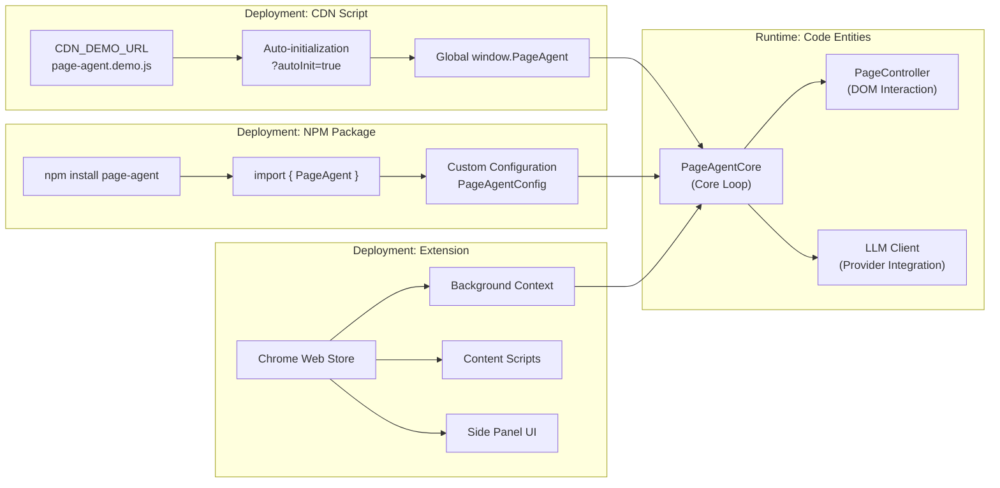
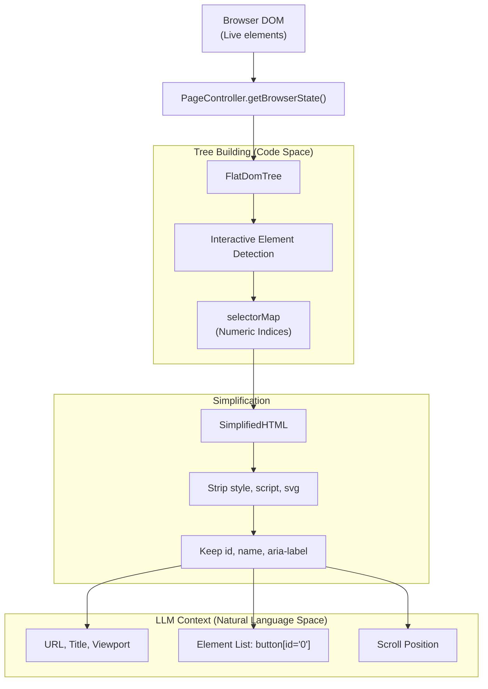
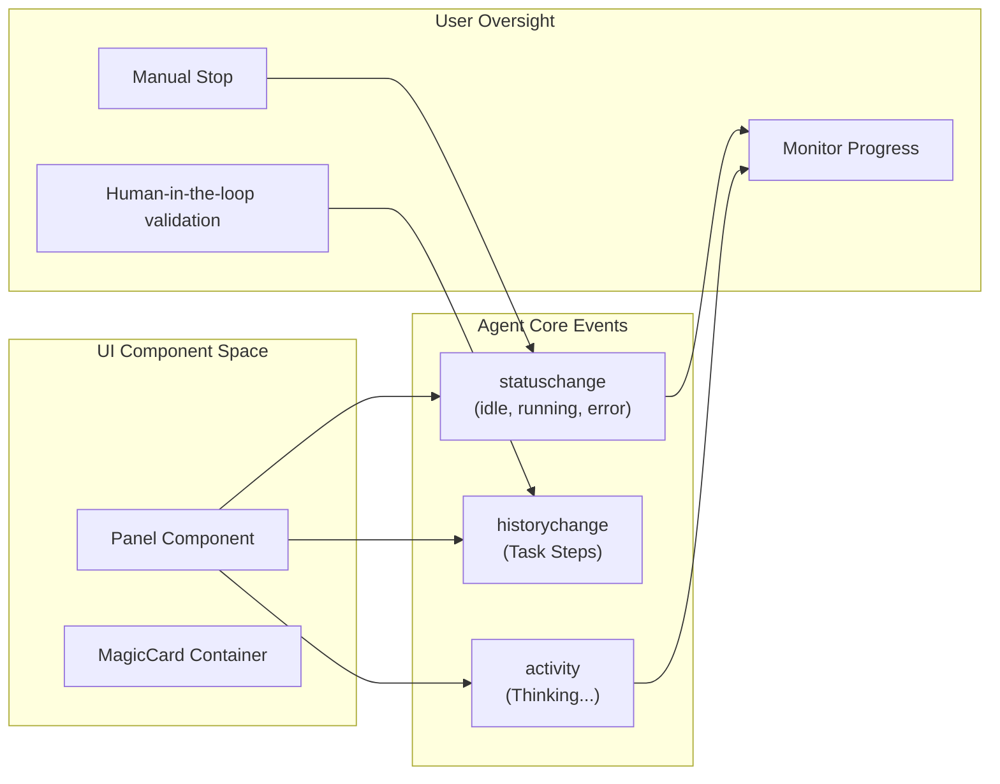

<!-- source: DeepWiki mcp.deepwiki.com · repo alibaba/page-agent · page 1.2 Key Features and Use Cases · fetched 2026-10-29 -->

# Key Features and Use Cases

Relevant source files

The following files were used as context for generating this wiki page:

- [README.md](README.md)
- [docs/README-zh.md](docs/README-zh.md)
- [packages/website/src/components/ui/magic-card.tsx](packages/website/src/components/ui/magic-card.tsx)
- [packages/website/src/components/ui/marquee.tsx](packages/website/src/components/ui/marquee.tsx)
- [packages/website/src/constants.ts](packages/website/src/constants.ts)
- [packages/website/src/pages/home/FeaturesSection.tsx](packages/website/src/pages/home/FeaturesSection.tsx)
- [packages/website/src/pages/home/ScenariosSection.tsx](packages/website/src/pages/home/ScenariosSection.tsx)

## Purpose and Scope

This document provides a detailed overview of PageAgent's key features and their practical applications. It explains the technical capabilities that distinguish PageAgent from traditional web automation tools—such as its in-page JavaScript execution and text-based DOM processing—and illustrates how these features enable specific use cases like SaaS Copilots, Smart Form Filling, and Accessibility enhancements.

---

## Core Features

### In-Page JavaScript Integration

PageAgent operates entirely within the browser context as client-side JavaScript, eliminating the need for server-side infrastructure, Python environments, or headless browser drivers like Playwright/Puppeteer [README.md:33-35]().

**Deployment Models:**

| Model | Package | Use Case | Complexity |
|-------|---------|----------|------------|
| CDN Script | `page-agent.demo.js` | Quick testing, demos | Minimal (one `<script>` tag) [README.md:53-62]() |
| NPM Package | `page-agent` | Production integration | Low (standard npm workflow) [README.md:72-79]() |
| Browser Extension | `page-agent-ext` | Multi-page automation | Medium (Chrome extension APIs) [README.md:40-41]() |

The NPM package exports a `PageAgent` class that integrates the core logic with a built-in UI panel [README.md:77-85](). The demo CDN build includes auto-initialization logic that creates a global `PageAgent` instance with pre-configured LLM settings for immediate evaluation [README.md:63-65]().

**Deployment Architecture:**

**Sources:** [README.md:33-35](), [README.md:53-89](), [packages/website/src/constants.ts:1-5]()

---

### Text-Based DOM Manipulation

PageAgent uses a text-based approach to represent and interact with web pages, eliminating the need for screenshots or multimodal LLMs [README.md:36-37]().

**DOM Processing Data Flow:**

The system transforms the live DOM into a simplified structure. It assigns unique numeric IDs to interactive elements, allowing the LLM to target them precisely using tools like `click` or `type` without needing complex CSS selectors [README.md:36-37](). This process removes visual clutter while retaining critical accessibility markers [README.md:107-122]().

**Sources:** [README.md:36-37](), [README.md:107-122]()

---

### LLM Provider Flexibility

PageAgent supports any OpenAI-compatible API through its LLM integration layer, with optimizations for various providers [README.md:38-39]().

**Supported Providers and Models:**

| Provider | Model Examples | Configuration |
|----------|---------------|---------------|
| OpenAI | `gpt-4o`, `gpt-4o-mini` | `baseURL: https://api.openai.com/v1` |
| Qwen (Alibaba) | `qwen3.5-plus`, `qwen3.5-flash` | `baseURL: https://dashscope.aliyuncs.com/...` [README.md:81-83]() |
| Local (Ollama) | `qwen2.5`, `llama3.1` | Local deployment support [README.md:38-39]() |

The website demo specifically utilizes `qwen3.5-flash` for high-speed interactions [packages/website/src/constants.ts:8-9](). The `LLM_CLOUD` configuration in the website showcases the breadth of supported models, including Claude, Gemini, DeepSeek, and local providers like LM Studio [packages/website/src/pages/home/FeaturesSection.tsx:10-29]().

**Sources:** [README.md:38-39](), [README.md:81-85](), [packages/website/src/constants.ts:8-10](), [packages/website/src/pages/home/FeaturesSection.tsx:10-29]()

---

### Human-in-the-Loop Interface

PageAgent includes a visual panel for monitoring and controlling agent execution, facilitating user oversight and manual intervention [README.md:17-18]().

**Panel Interaction Flow:**

The UI utilizes a "Human-in-the-Loop" pattern where the agent can pause and wait for user confirmation or clarification during complex tasks [packages/website/src/pages/home/FeaturesSection.tsx:143-167]().

**Sources:** [packages/website/src/pages/home/FeaturesSection.tsx:133-167](), [README.md:17-18]()

---

## Use Cases

### SaaS AI Copilot
Ship an AI copilot in your product with minimal code and no backend rewrite [README.md:45]().
- **Implementation**: Instantiate `PageAgent` within your application code to handle product-specific tasks [packages/website/src/pages/home/ScenariosSection.tsx:34-53]().
- **Benefit**: Turn complex software features into natural language commands [docs/README-zh.md:44]().

### Smart Form Filling
Turn complex, multi-click workflows into a single natural language sentence [README.md:46]().
- **Application**: Perfect for ERP, CRM, and admin systems where users perform repetitive data entry [docs/README-zh.md:45]().
- **Example**: "Fill the expense report for Friday's trip" translates to a sequence of `input` and `click` actions [packages/website/src/pages/home/ScenariosSection.tsx:80-84]().

### Accessibility Enhancement
Make any web app accessible through natural language, removing barriers for users who struggle with complex UIs [README.md:47]().
- **Natural Language**: Voice commands replace manual navigation [packages/website/src/pages/home/ScenariosSection.tsx:128-129]().
- **Execution**: The agent interprets commands like "Click the submit button" and executes the corresponding DOM action [packages/website/src/pages/home/ScenariosSection.tsx:138-142]().

### Multi-page Agent & MCP
Extend automation across browser tabs or allow external clients to control the browser [README.md:48-49]().
- **Cross-Tab Tasks**: The optional Chrome extension allows the agent to coordinate actions across multiple open tabs [README.md:40]().
- **MCP Server**: Allows external AI tools (e.g., Claude Desktop, Cursor) to control the browser as a tool [README.md:41]().

**Sources:** [README.md:43-50](), [docs/README-zh.md:42-48](), [packages/website/src/pages/home/ScenariosSection.tsx:27-152]()

---

