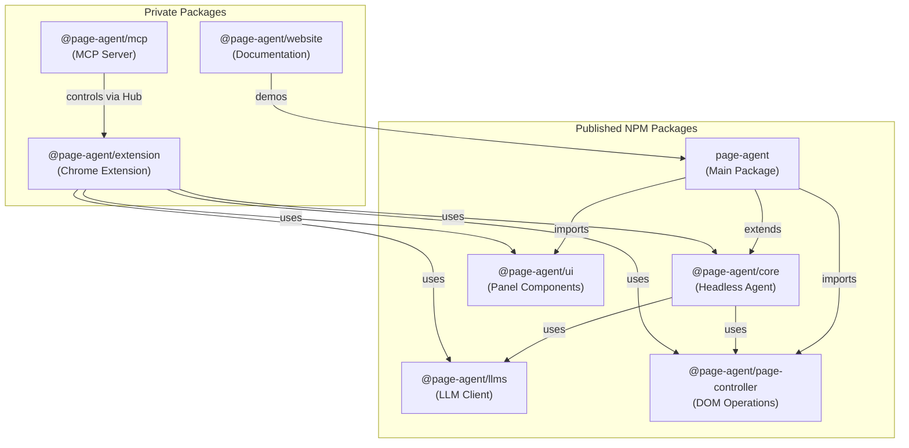
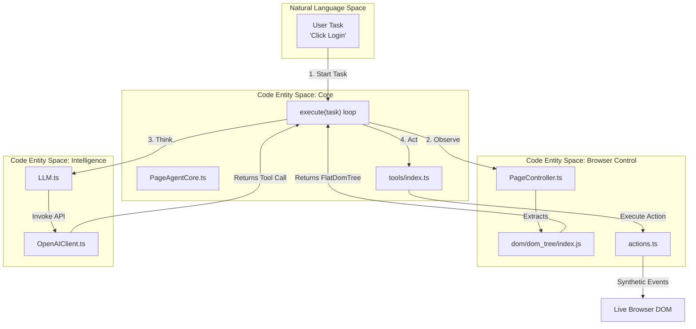
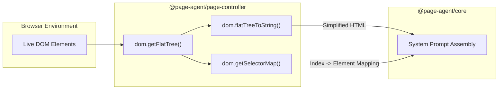
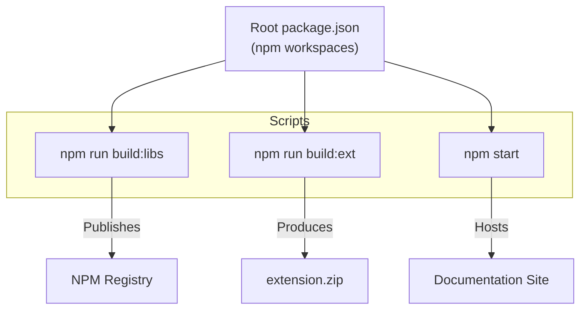

<!-- source: DeepWiki mcp.deepwiki.com · repo alibaba/page-agent · page 1.3 System Architecture · fetched 2026-10-29 -->

# System Architecture

Relevant source files

The following files were used as context for generating this wiki page:

- [.gitignore](.gitignore)
- [AGENTS.md](AGENTS.md)
- [CLAUDE.md](CLAUDE.md)
- [CONTRIBUTING.md](CONTRIBUTING.md)
- [packages/core/src/PageAgentCore.ts](packages/core/src/PageAgentCore.ts)
- [packages/core/src/utils/index.ts](packages/core/src/utils/index.ts)
- [packages/page-agent/src/PageAgent.ts](packages/page-agent/src/PageAgent.ts)
- [packages/page-controller/src/PageController.ts](packages/page-controller/src/PageController.ts)
- [packages/page-controller/src/actions.ts](packages/page-controller/src/actions.ts)
- [packages/page-controller/src/utils/index.ts](packages/page-controller/src/utils/index.ts)

## Purpose and Scope

This document describes the high-level system architecture of PageAgent, including the monorepo structure, package organization, runtime component interactions, and data flow. It provides a technical overview of how the packages work together to enable GUI automation through natural language processing.

For specific implementation details of individual packages, see:
- Core agent logic: [4.1 PageAgentCore and Re-act Loop]()
- DOM manipulation: [5.1 PageController Architecture]()
- LLM integration: [6.1 LLM Client Architecture]()
- Browser extension: [7.1 Extension Architecture]()

---

## Monorepo Package Structure

PageAgent is organized as an npm workspace monorepo containing several packages, divided into published libraries and private runtime packages.

### Package Organization

Title: Monorepo Workspace Relationships

**Sources:** [AGENTS.md:7-16](), [packages/page-agent/src/PageAgent.ts:5-7](), [packages/core/src/PageAgentCore.ts:6-7]()

### Package Responsibilities

| Package | NPM Name | Status | Purpose |
|---------|----------|--------|---------|
| **page-agent** | `page-agent` | Published | Main entry point with `PageAgent` class, includes UI panel integration [packages/page-agent/src/PageAgent.ts:13-29](). |
| **core** | `@page-agent/core` | Published | Headless `PageAgentCore` class with Re-act loop and tool system [packages/core/src/PageAgentCore.ts:61-204](). |
| **llms** | `@page-agent/llms` | Published | `LLM` client with retry logic and multi-provider support [packages/llms/src/index.ts:25-35](). |
| **page-controller** | `@page-agent/page-controller` | Published | `PageController` for DOM extraction and element interaction [packages/page-controller/src/PageController.ts:58-219](). |
| **ui** | `@page-agent/ui` | Published | `Panel` component for human-in-the-loop interaction [packages/ui/src/index.ts:1-10](). |
| **extension** | `@page-agent/extension` | Private | Chrome extension for multi-page automation [packages/extension/package.json:2-5](). |
| **mcp** | `@page-agent/mcp` | Private | Model Context Protocol server for external control via tools like Claude Desktop [AGENTS.md:16-16](). |
| **website** | `@page-agent/website` | Private | Documentation site and interactive demo environment [AGENTS.md:9-9](). |

---

## Runtime Architecture

At runtime, PageAgent orchestrates a loop where the core agent extracts DOM state through `PageController`, generates plans via `LLM`, and executes actions.

### Component Interaction and Data Flow

Title: Runtime Loop and Entity Mapping

**Sources:** [packages/core/src/PageAgentCore.ts:35-42](), [packages/page-controller/src/PageController.ts:129-165](), [packages/page-controller/src/actions.ts:64-126]()

### Core Classes and Methods

| Class | Key Method | Responsibility |
|-------|------------|----------------|
| `PageAgentCore` | `execute(task)` | Manages the Re-act loop (Observe-Think-Act) and maintains task `history` [packages/core/src/PageAgentCore.ts:210-223](). |
| `PageController` | `getBrowserState()` | Generates `BrowserState` including simplified HTML and viewport info [packages/page-controller/src/PageController.ts:129-165](). |
| `LLM` | `invoke()` | Handles LLM communication, schema validation, and retry logic [packages/llms/src/index.ts:117-132](). |
| `SimulatorMask` | `initMask()` | Provides a visual overlay to block user interaction during automation [packages/page-controller/src/PageController.ts:102-108](). |

---

## Data Flow: DOM to LLM

PageAgent uses a "text-based" approach where the DOM is simplified into a structure the LLM can easily parse.

Title: DOM Extraction Pipeline

**Sources:** [packages/page-controller/src/PageController.ts:174-219](), [packages/page-controller/src/dom/dom_tree/index.js:1-10]()

---

## Build and Distribution Architecture

The project uses a source-first monorepo strategy. Libraries are published to NPM, while the extension and website are deployed as standalone artifacts.

### Build Formats

| Target | Tooling | Format | File Path |
|--------|---------|--------|-----------|
| **NPM Library** | Vite / TS | ESM | `packages/*/dist/index.js` |
| **Browser Extension** | WXT | Chrome Zip | `packages/extension/.output/` |
| **CDN Demo** | Vite | IIFE | `packages/page-agent/dist/demo.iife.js` |

**Sources:** [AGENTS.md:32-34](), [packages/page-agent/package.json:10-20]()

### Build Pipeline

Title: Monorepo Build Flow

**Sources:** [AGENTS.md:20-28](), [package.json:28-40]()

---

