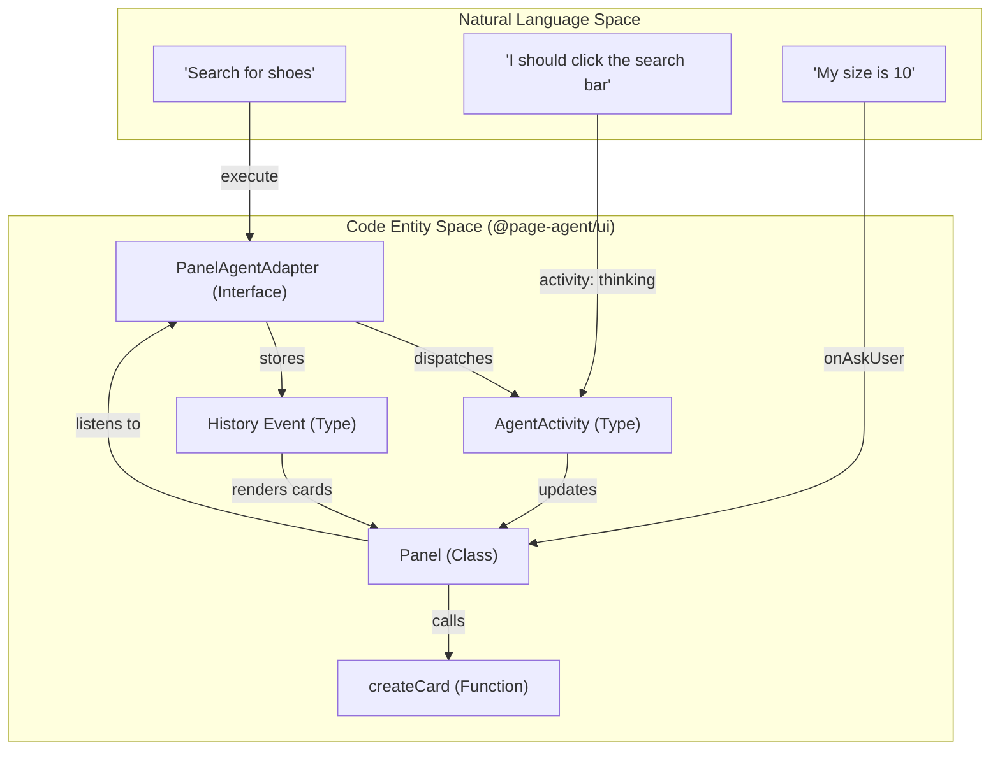
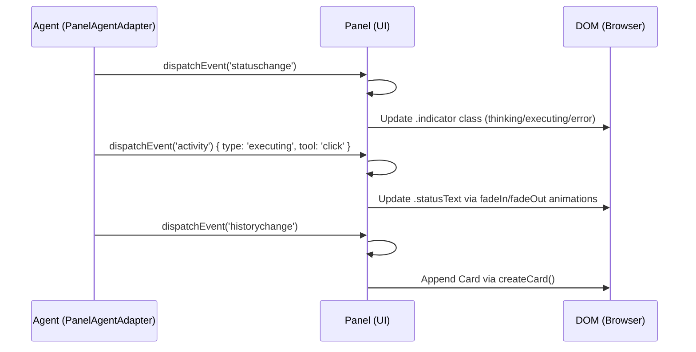
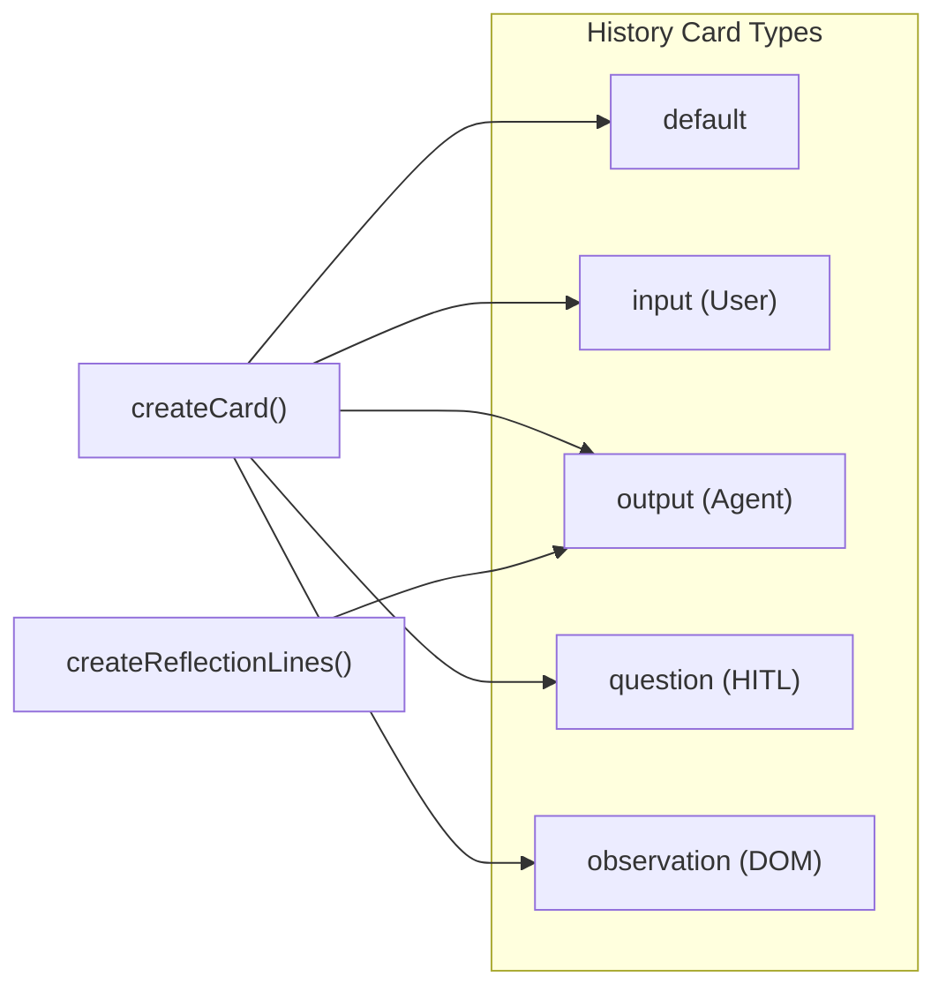

<!-- source: DeepWiki mcp.deepwiki.com · repo alibaba/page-agent · page 10 User Interface System · fetched 2026-10-29 -->

# User Interface System

Relevant source files

The following files were used as context for generating this wiki page:

- [packages/page-controller/package.json](packages/page-controller/package.json)
- [packages/ui/package.json](packages/ui/package.json)
- [packages/ui/src/i18n/locales.ts](packages/ui/src/i18n/locales.ts)
- [packages/ui/src/index.ts](packages/ui/src/index.ts)
- [packages/ui/src/panel/Panel.module.css](packages/ui/src/panel/Panel.module.css)
- [packages/ui/src/panel/cards.ts](packages/ui/src/panel/cards.ts)

The User Interface System provides the visual layer for PageAgent, enabling users to interact with the agent, monitor its reasoning process, and provide feedback through a Human-in-the-Loop (HITL) mechanism. The system is designed to be decoupled from the core agent logic through a specialized adapter interface.

## Overview

The UI system is primarily contained within the `@page-agent/ui` package [packages/ui/package.json:2-2](). It focuses on providing a lightweight, non-intrusive control panel that can be injected into any webpage. It utilizes a custom CSS module system for styling [packages/ui/src/panel/Panel.module.css:1-1]() and a vanilla TypeScript implementation for the core UI logic to minimize external dependencies.

| Component | Role | Source |
| :--- | :--- | :--- |
| `Panel` | The main class managing the UI lifecycle, DOM elements, and event subscriptions. | [packages/ui/src/panel/Panel.ts:30-30]() |
| `PanelAgentAdapter` | Interface defining the contract between the UI and any Agent implementation. | [packages/ui/src/panel/types.ts:30-76]() |
| `AgentActivity` | Type definition for transient, real-time feedback events (e.g., "thinking", "executing"). | [packages/ui/src/panel/types.ts:12-17]() |
| `I18n` | Handles multi-language support for UI strings and tool descriptions. | [packages/ui/src/i18n/locales.ts:1-123]() |

### System Relationships

The following diagram illustrates how the Natural Language Space (User Intent) bridges to the Code Entity Space (UI Components) through the `PanelAgentAdapter`.

Sources: [packages/ui/src/panel/types.ts:12-76](), [packages/ui/src/panel/Panel.ts:30-95](), [packages/ui/src/panel/cards.ts:18-33]()

## Panel Architecture

The `Panel` class manages a floating UI element (z-index: 2147483642) that displays the agent's status and history [packages/ui/src/panel/Panel.module.css:7-7](). It maintains a strict separation between **History** (persisted events) and **Activity** (transient state).

*   **History List**: Renders directly from `agent.history`. This is the single source of truth for completed actions and observations [packages/ui/src/panel/Panel.ts:24-27]().
*   **Header Bar**: Shows transient `AgentActivity` events, such as "Thinking..." or "Executing click...". These are not saved to history and provide immediate visual feedback [packages/ui/src/panel/Panel.ts:28-29]().
*   **Indicator System**: A visual dot that changes color and animation based on the current status (e.g., `.thinking` pulses blue, `.tool_executing` pulses purple) [packages/ui/src/panel/Panel.module.css:128-164]().

### Component Interaction

Sources: [packages/ui/src/panel/Panel.ts:99-169](), [packages/ui/src/panel/cards.ts:18-33](), [packages/ui/src/panel/Panel.module.css:178-244]()

## Key UI Components

### Panel Component
The main interactive container. It handles expanding/collapsing the history view, starting/stopping tasks, and processing user input via a dedicated input section. It uses a `PanelConfig` to determine language and post-task behavior [packages/ui/src/panel/Panel.ts:11-18]().
For details, see [Panel Component](#10.1).

### Human-in-the-Loop (HITL)
The UI facilitates interaction when the agent requires clarification or data from the user. This is handled via the `onAskUser` callback, which pauses the agent and prompts the user through the panel's input field [packages/ui/src/panel/Panel.ts:174-199](). It generates a temporary `question` type card to ensure the user sees the query in context [packages/ui/src/panel/Panel.ts:186-194]().
For details, see [Human-in-the-Loop Features](#10.2).

### Internationalization (i18n)
The UI supports multiple languages (currently English and Chinese) for all status messages, tool descriptions, and error prompts. The `I18n` class manages the `locales` object and provides a type-safe translation schema [packages/ui/src/i18n/locales.ts:97-123]().

| Feature | English (`en-US`) | Chinese (`zh-CN`) |
| :--- | :--- | :--- |
| Thinking Status | "Thinking..." | "正在思考..." |
| Task Completion | "Task completed" | "任务结束" |
| Tool: Clicking | "Clicking element [{{index}}]..." | "正在点击元素 [{{index}}]..." |
| Error: Not Found | "No interactive element found..." | "未找到索引为 {{index}} 的交互元素" |

Sources: [packages/ui/src/i18n/locales.ts:1-123]()

### Custom UI Integration
Developers can bypass the built-in `Panel` by implementing the `PanelAgentAdapter` or listening directly to `PageAgentCore` events. This allows for embedding agent status into existing dashboards or custom chat interfaces.
For details, see [Custom UI Integration](#10.3).

## Visual Representation

History events are rendered as "Cards" using utility functions that generate HTML strings with specific styles based on the event type (e.g., `input`, `output`, `question`, `observation`) [packages/ui/src/panel/cards.ts:8-33]().

Sources: [packages/ui/src/panel/cards.ts:8-15](), [packages/ui/src/panel/cards.ts:36-52]()

---

**Child Pages:**
- [Panel Component](#10.1) — Detailed documentation of the Panel class, its DOM structure, and the adapter pattern.
- [Human-in-the-Loop Features](#10.2) — Explanation of how the UI handles user questions and manual overrides.
- [Custom UI Integration](#10.3) — Guidance on building custom interfaces by consuming core agent events.

---

