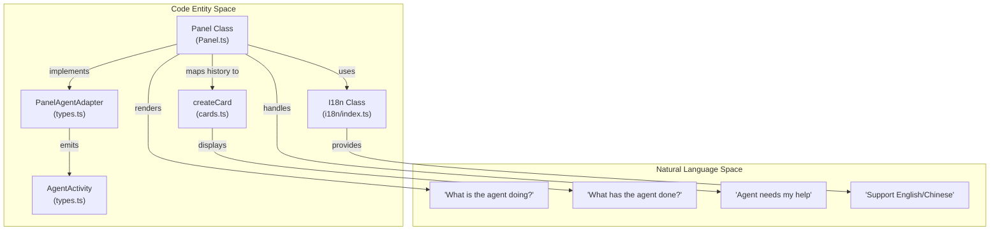
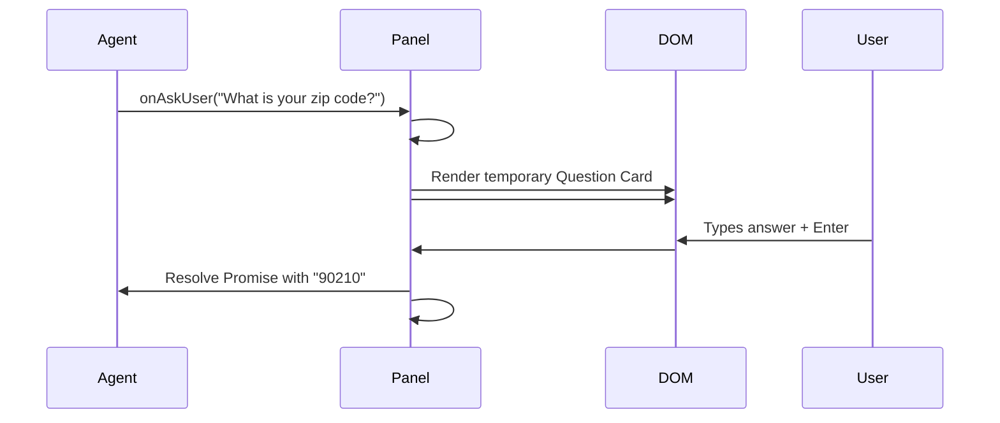

<!-- source: DeepWiki mcp.deepwiki.com · repo alibaba/page-agent · page 10.1 Panel Component · fetched 2026-10-29 -->

# Panel Component

Relevant source files

The following files were used as context for generating this wiki page:

- [packages/core/src/types.ts](packages/core/src/types.ts)
- [packages/ui/src/i18n/locales.ts](packages/ui/src/i18n/locales.ts)
- [packages/ui/src/index.ts](packages/ui/src/index.ts)
- [packages/ui/src/panel/Panel.module.css](packages/ui/src/panel/Panel.module.css)
- [packages/ui/src/panel/Panel.ts](packages/ui/src/panel/Panel.ts)
- [packages/ui/src/panel/cards.ts](packages/ui/src/panel/cards.ts)
- [packages/ui/src/panel/types.ts](packages/ui/src/panel/types.ts)

The Panel Component is the primary user interface for PageAgent, providing real-time visual feedback, execution history, and human-in-the-loop (HITL) interaction capabilities. It is implemented as a floating control panel that attaches to the host page's DOM, displaying agent status, historical steps, and providing controls for task execution.

## Architecture and Data Flow

The `Panel` class [packages/ui/src/panel/Panel.ts:30]() is decoupled from the core agent logic through the `PanelAgentAdapter` interface [packages/ui/src/panel/types.ts:30-81](). This allows the UI to work with any agent implementation that satisfies the interface requirements.

The component follows a dual-track data consistency model:
1.  **History List**: Renders directly from `agent.history`. This is the single source of truth for persisted historical events [packages/ui/src/panel/Panel.ts:24-27]().
2.  **Header Bar**: Displays `AgentActivity` events. These are transient, ephemeral states (like "Thinking" or "Executing") that provide immediate UI feedback but are not saved to history [packages/ui/src/panel/Panel.ts:28-29]().

### UI Integration Diagram

**Sources:** [packages/ui/src/panel/Panel.ts:23-30](), [packages/ui/src/panel/types.ts:12-81](), [packages/ui/src/panel/cards.ts:18-33]()

## Core Interfaces

### PanelAgentAdapter
The interface defines the contract between the UI and the underlying agent.

| Property/Method | Type | Description |
| :--- | :--- | :--- |
| `status` | `'idle' \| 'running' \| 'completed' \| 'error' \| 'stopped'` | Current state of the agent [packages/ui/src/panel/types.ts:32]() |
| `lastResult` | `{ success: boolean } \| null` | The outcome of the most recent execution [packages/ui/src/panel/types.ts:35]() |
| `history` | `readonly HistoricalEvent[]` | Persisted list of steps, observations, and errors [packages/ui/src/panel/types.ts:38-60]() |
| `task` | `string` | The current objective being pursued [packages/ui/src/panel/types.ts:63]() |
| `onAskUser` | `(question, options) => Promise<string>` | Hook for the agent to request user input via the UI [packages/ui/src/panel/types.ts:71]() |

### AgentActivity
Transient states used for real-time header updates [packages/ui/src/panel/types.ts:12-17]():
*   `thinking`: LLM is processing.
*   `executing`: A specific tool is being invoked.
*   `executed`: Tool execution finished (includes duration and output).
*   `retrying`: Automatic retry attempt in progress.
*   `error`: Immediate execution error message.

**Sources:** [packages/ui/src/panel/types.ts:1-81]()

## UI Components and Rendering

The Panel is composed of several functional sections managed via private class fields [packages/ui/src/panel/Panel.ts:31-38]().

### History Cards
The history section is populated using `createCard` [packages/ui/src/panel/cards.ts:18-33](). It supports multiple types of entries defined by `CardType` [packages/ui/src/panel/cards.ts:8]():
*   **Step**: Shows the agent's reflection (Goal, Memory, Next Goal) using `createReflectionLines` [packages/ui/src/panel/cards.ts:36-52]().
*   **Observation**: Displays the result of a tool execution or page state change.
*   **Question**: Displays HITL queries.
*   **Input/Output**: Specific cards for user answers and tool results.

### Status Indicators
The panel uses a color-coded indicator dot to represent the agent's internal state [packages/ui/src/panel/Panel.module.css:128-164]():

| Status | Color | Animation | CSS Class |
| :--- | :--- | :--- | :--- |
| Thinking | Blue | Pulse (0.8s) | `.thinking` |
| Executing | Purple | Pulse (0.6s) | `.tool_executing` |
| Retry | Yellow | Retry Pulse (1s) | `.retry` |
| Completed | Green | None | `.completed` |
| Error | Red | None | `.error` |

**Sources:** [packages/ui/src/panel/Panel.ts:100-132](), [packages/ui/src/panel/cards.ts:1-52](), [packages/ui/src/panel/Panel.module.css:128-164]()

## Human-in-the-Loop (HITL) Integration

The Panel provides a bridge for the agent to pause execution and request information from the user via the `#askUser` method [packages/ui/src/panel/Panel.ts:176-213]().

When `onAskUser` is triggered, the panel:
1.  Sets `#isWaitingForUserAnswer` to `true` [packages/ui/src/panel/Panel.ts:179]().
2.  Stores the promise `resolve` function in `#userAnswerResolver` [packages/ui/src/panel/Panel.ts:180]().
3.  Expands the history panel so the user can see the context [packages/ui/src/panel/Panel.ts:184]().
4.  Renders a temporary card with the question [packages/ui/src/panel/Panel.ts:188-196]().
5.  Listens to the `AbortSignal` to clean up if the task is stopped [packages/ui/src/panel/Panel.ts:201-211]().

**Sources:** [packages/ui/src/panel/Panel.ts:176-213](), [packages/ui/src/i18n/locales.ts:8]()

## Localization (I18n)

The Panel uses a centralized `I18n` class and localized definitions [packages/ui/src/i18n/locales.ts]() to support multiple languages (currently `en-US` and `zh-CN`).

*   **UI Strings**: Labels for buttons, placeholders, and status messages (e.g., `ui.panel.thinking`, `ui.panel.taskInput`) [packages/ui/src/i18n/locales.ts:4-19]().
*   **Tool Descriptions**: Dynamic text generation for tool actions (e.g., "Clicking element [{{index}}]...") [packages/ui/src/i18n/locales.ts:20-37]().
*   **Error Messages**: User-facing error descriptions [packages/ui/src/i18n/locales.ts:38-45]().

**Sources:** [packages/ui/src/i18n/locales.ts:1-123](), [packages/ui/src/panel/Panel.ts:68]()

## Visual Effects and Layout

The Panel uses a sophisticated CSS layout with blurred backgrounds and animations to signify activity.

*   **Background Animation**: Uses a linear gradient with the `mask-running` keyframe to create a "glowing border" effect when the agent is active [packages/ui/src/panel/Panel.module.css:39-96]().
*   **Responsive Design**: The width adjusts automatically for mobile viewports [packages/ui/src/panel/Panel.module.css:34-37]().
*   **History Expansion**: The history section uses `max-height` transitions and `backdrop-filter` for a modern overlay look [packages/ui/src/panel/Panel.module.css:246-295]().

**Sources:** [packages/ui/src/panel/Panel.module.css:1-330]()

## Lifecycle Management

The Panel tracks the agent's lifecycle via event listeners [packages/ui/src/panel/Panel.ts:84-87]():

1.  **Initialization**: Created with a `PanelAgentAdapter`. It starts hidden [packages/ui/src/panel/Panel.ts:94]().
2.  **Execution**: When the agent status changes to `running`, the panel calls `show()` and hides the input area [packages/ui/src/panel/Panel.ts:118-121]().
3.  **Action Button Morphing**: The action button changes from a stop icon (■) during execution to a close icon (X) when idle [packages/ui/src/panel/Panel.ts:109-115]().
4.  **Disposal**: When the agent is disposed, the panel calls `dispose()` to remove DOM elements and event listeners [packages/ui/src/panel/Panel.ts:54]().

**Sources:** [packages/ui/src/panel/Panel.ts:65-95](), [packages/ui/src/panel/Panel.ts:100-132]()

---

