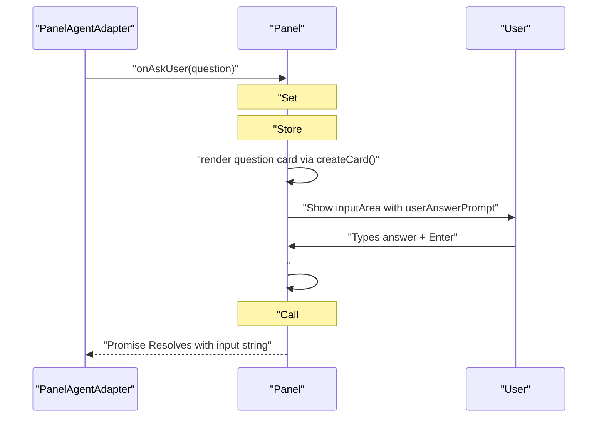
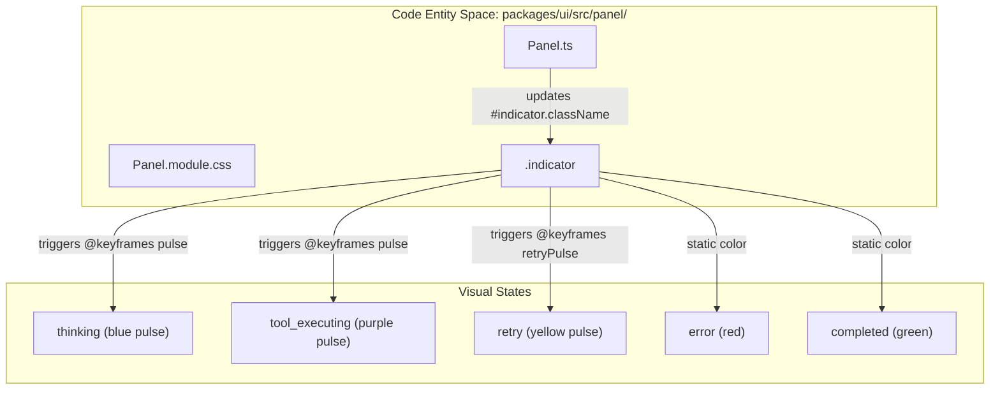

<!-- source: DeepWiki mcp.deepwiki.com · repo alibaba/page-agent · page 10.2 Human-in-the-Loop Features · fetched 2026-10-29 -->

# Human-in-the-Loop Features

Relevant source files

The following files were used as context for generating this wiki page:

- [packages/ui/src/i18n/index.ts](packages/ui/src/i18n/index.ts)
- [packages/ui/src/i18n/locales.ts](packages/ui/src/i18n/locales.ts)
- [packages/ui/src/index.ts](packages/ui/src/index.ts)
- [packages/ui/src/panel/Panel.module.css](packages/ui/src/panel/Panel.module.css)
- [packages/ui/src/panel/cards.ts](packages/ui/src/panel/cards.ts)

This page explains the interactive UI features, status display, and user oversight capabilities of PageAgent. These features enable users to interact with the agent during task execution, providing a "Human-in-the-Loop" (HITL) workflow that includes question-answer mechanisms, activity tracking, and historical session management.

## Overview

PageAgent provides three primary HITL interaction mechanisms coordinated via the `Panel` class (in `@page-agent/ui`) and the Side Panel (in `@page-agent/extension`):

1.  **Ask User Tool**: The agent can pause execution to request information from the user via the `ask_user` tool [packages/ui/src/i18n/locales.ts:26-26]().
2.  **Activity Monitoring**: Real-time feedback on "what the agent is doing right now" through transient activity events and status indicators [packages/ui/src/panel/Panel.module.css:121-164]().
3.  **Session History**: Persistence and management of past steps, allowing users to review reflections and tool results [packages/ui/src/panel/cards.ts:18-33]().

## Ask User Mechanism

The `ask_user` tool enables the agent to request information (e.g., a 2FA code or a missing preference) during execution. When invoked, it suspends the agent's Re-act loop until the user provides a response via the UI.

### Interaction Flow

The following diagram illustrates how the `ask_user` tool bridges the Natural Language Space (the user's answer) to the Code Entity Space (the Agent's execution loop).

**Title: Ask User Interaction Logic**

**Sources:** [packages/ui/src/panel/Panel.ts:174-199](), [packages/ui/src/panel/cards.ts:18-33](), [packages/ui/src/i18n/locales.ts:8-8]()

### Implementation Details

The `Panel` class implements `onAskUser` to handle the transition to a waiting state. It captures a resolver for a promise that the agent's tool execution is awaiting.

**Key State Variables in Panel:**

| Variable | Type | Purpose |
|----------|------|---------|
| `#isWaitingForUserAnswer` | `boolean` | Flag indicating the UI is in "Answer Mode" rather than "New Task Mode" [packages/ui/src/panel/Panel.ts:45-45](). |
| `#userAnswerResolver` | `Function` | The `resolve` function of the Promise returned to the agent [packages/ui/src/panel/Panel.ts:44-44](). |

When the user submits text, the `Panel` checks `#isWaitingForUserAnswer`. If true, it triggers the resolver and clears the waiting state [packages/ui/src/panel/Panel.ts:221-224]().

## Status Display and Feedback

The UI provides real-time feedback on the agent's internal state using localized strings and visual indicators.

### Localized Status Strings
The system uses an `I18n` class to fetch strings from `locales.ts` [packages/ui/src/i18n/index.ts:9-16]().

| Key | en-US Value | Purpose |
|-----|-------------|---------|
| `ui.panel.thinking` | "Thinking..." | Displayed when the LLM is processing [packages/ui/src/i18n/locales.ts:6-6](). |
| `ui.tools.executing` | "Executing {{toolName}}..." | Displayed during tool invocation [packages/ui/src/i18n/locales.ts:33-33](). |
| `ui.panel.taskCompleted`| "Task completed" | Final state success message [packages/ui/src/i18n/locales.ts:10-10](). |

### Visual Feedback System
PageAgent includes a sophisticated visual feedback system using CSS animations. When the agent is active, a status indicator dot changes color and animation style based on the activity.

**Title: Visual Status Architecture**

**Sources:** [packages/ui/src/panel/Panel.ts:143-169](), [packages/ui/src/panel/Panel.module.css:128-164]()

The `Panel` listens for `activity` events [packages/ui/src/panel/Panel.ts:143-143](). Transient activities like `thinking`, `executing`, and `retrying` update the `#indicator` element with specific CSS classes that trigger keyframe animations [packages/ui/src/panel/Panel.module.css:137-150]().

## History and Reflection Cards

The `Panel` renders a history of the agent's actions and internal reflections using specialized card components.

### Reflection Lines
The agent's internal reasoning (MacroTool reflection) is parsed into human-readable lines using `createReflectionLines` [packages/ui/src/panel/cards.ts:36-52]().
*   **Evaluation**: Prefixed with `🔍` to show assessment of previous goals [packages/ui/src/panel/cards.ts:43-43]().
*   **Memory**: Prefixed with `💾` to show what information the agent is retaining [packages/ui/src/panel/cards.ts:46-46]().
*   **Next Goal**: Prefixed with `🎯` to show the immediate objective [packages/ui/src/panel/cards.ts:49-49]().

### Card Rendering
The `createCard` utility generates HTML for history items, supporting different types such as `input`, `output`, `question`, and `observation` [packages/ui/src/panel/cards.ts:8-18]().
*   **Iconography**: Each card includes a status icon (e.g., `⌨️` for input, `🖱️` for click) [packages/ui/src/i18n/locales.ts:28-32]().
*   **Security**: All content is passed through `escapeHtml` to prevent XSS when rendering LLM-generated text or DOM content [packages/ui/src/panel/cards.ts:4-22]().

## Stop and Termination

The termination flow ensures that the agent stops immediately.
1.  **User Action**: User clicks the "Stop" button in the Panel header [packages/ui/src/panel/Panel.ts:110-110]().
2.  **Termination**: The UI calls the `adapter.stop()` method [packages/ui/src/panel/Panel.ts:111-111]().
3.  **Cleanup**: The UI resets the status text to "Task terminated" and updates the visual indicator [packages/ui/src/i18n/locales.ts:9-9]().

## Internationalization (i18n)

The HITL features rely on the `I18n` utility to support `en-US` and `zh-CN` [packages/ui/src/i18n/locales.ts:117-123]().
*   **Type Safety**: The `TranslationKey` type is generated from the base schema to ensure all requested keys exist [packages/ui/src/i18n/locales.ts:105-112]().
*   **Interpolation**: Supports dynamic values like `{{index}}` for element indices or `{{toolName}}` for current actions using a regex-based `interpolate` method [packages/ui/src/i18n/index.ts:36-41]().

**Sources:** [packages/ui/src/i18n/index.ts:1-46](), [packages/ui/src/i18n/locales.ts:1-123](), [packages/ui/src/panel/Panel.ts:1-250](), [packages/ui/src/panel/cards.ts:1-52]()

---

