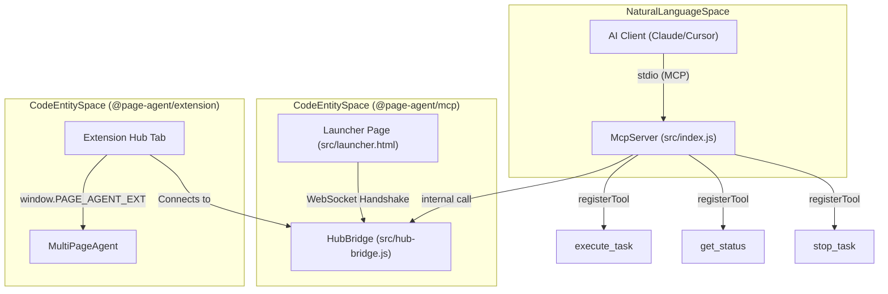
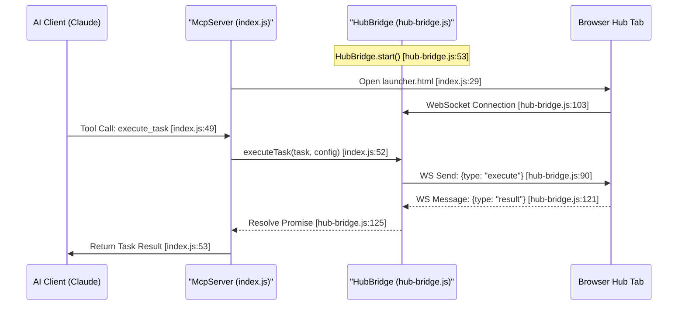

<!-- source: DeepWiki mcp.deepwiki.com · repo alibaba/page-agent · page 11 MCP Server Integration · fetched 2026-10-29 -->

# MCP Server Integration

Relevant source files

The following files were used as context for generating this wiki page:

- [packages/mcp/package.json](packages/mcp/package.json)
- [packages/mcp/src/index.js](packages/mcp/src/index.js)

The `@page-agent/mcp` package enables external AI agent clients (such as Claude Desktop, GitHub Copilot, or Cursor) to control the browser by implementing the **Model Context Protocol (MCP)**. It acts as a bridge between the standard MCP stdio interface and the Page Agent Chrome extension.

## Overview

The MCP server allows users to provide natural language instructions to their local AI assistants, which then utilize the Page Agent extension to perform browser automation tasks. The server manages a local HTTP and WebSocket bridge to communicate with a "Hub" tab in the browser, which in turn orchestrates the `MultiPageAgent`.

### System Context Diagram

The following diagram illustrates how the MCP server bridges the "Natural Language Space" of an AI client to the "Code Entity Space" of the Page Agent system.

Sources: [packages/mcp/src/index.js:33-96](), [packages/mcp/src/hub-bridge.js:16-50]()

---

## MCP Server Architecture

The integration relies on a multi-step handshake to establish a secure link between the Node.js process and the browser extension.

1.  **Process Startup**: The AI client starts the MCP server via `stdio` using the binary defined in `package.json` [packages/mcp/package.json:6-8]() which executes `src/index.js` [packages/mcp/src/index.js:1-3]().
2.  **Bridge Initialization**: The `HubBridge` class starts an HTTP server and a `WebSocketServer` on a local port (default `38401`) [packages/mcp/src/hub-bridge.js:38-69]().
3.  **Browser Trigger**: The server automatically opens a `launcher.html` page in the default browser using platform-specific commands like `open` or `start` [packages/mcp/src/index.js:26-31]().
4.  **Extension Handshake**: The launcher page uses the hardcoded `EXT_ID` [packages/mcp/src/hub-bridge.js:7]() to signal the Page Agent extension to open a **Hub Tab**.
5.  **Persistent Connection**: The Hub Tab connects back to the `HubBridge` via WebSocket, allowing the MCP server to proxy `execute_task` commands directly to the extension [packages/mcp/src/hub-bridge.js:103-138]().

For details on the transport mechanisms and the launcher lifecycle, see [MCP Server Architecture](#11.1).

---

## MCP Tools and Configuration

The server exposes three primary tools to the AI client, allowing it to start, monitor, and cancel browser tasks.

### Registered Tools

| Tool Name | Input Schema | Description |
| :--- | :--- | :--- |
| `execute_task` | `{ task: string }` | Executes a natural language task. This is a blocking operation that returns the final result [packages/mcp/src/index.js:37-70](). |
| `get_status` | None | Returns the connection state (`connected`) and whether the agent is currently `busy` [packages/mcp/src/index.js:72-85](). |
| `stop_task` | None | Sends a stop signal to the Hub to abort the current automation [packages/mcp/src/index.js:87-96](). |

### Environment Configuration

The server is configured via environment variables, which are parsed in `index.js` [packages/mcp/src/index.js:11-20]() and passed to the extension during task execution.

| Variable | Description |
| :--- | :--- |
| `LLM_BASE_URL` | The API endpoint for the LLM that the *extension* will use [packages/mcp/src/index.js:17](). |
| `LLM_API_KEY` | The API key for the LLM [packages/mcp/src/index.js:19](). |
| `LLM_MODEL_NAME` | The specific model identifier (e.g., `gpt-4o`) [packages/mcp/src/index.js:18](). |
| `PORT` | The port for the local HTTP/WS bridge (default: `38401`) [packages/mcp/src/index.js:12](). |

For detailed setup instructions for Claude Desktop, Cursor, and Copilot, see [MCP Tools and Configuration](#11.2).

---

## Technical Details

### HubBridge Class
The `HubBridge` class in `packages/mcp/src/hub-bridge.js` is the core coordinator. It maintains the `#pendingTask` state [packages/mcp/src/hub-bridge.js:35]() to ensure only one task runs at a time and handles the serialization of results from the browser back to the MCP `stdio` stream via the `executeTask` method [packages/mcp/src/hub-bridge.js:84-92]().

### Connection State Flow
The following sequence diagram tracks the interaction between the `McpServer` and the `HubBridge` during a task execution.

Sources: [packages/mcp/src/index.js:21-69](), [packages/mcp/src/hub-bridge.js:84-138]()

---

