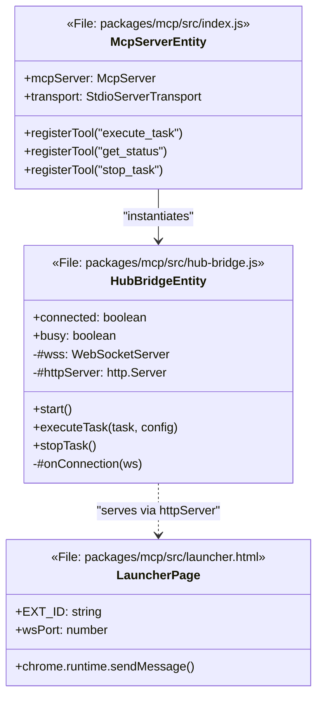

<!-- source: DeepWiki mcp.deepwiki.com · repo alibaba/page-agent · page 11.1 MCP Server Architecture · fetched 2026-10-29 -->

# MCP Server Architecture

<details>
<summary>Relevant source files</summary>

The following files were used as context for generating this wiki page:

- [packages/mcp/src/hub-bridge.js](packages/mcp/src/hub-bridge.js)
- [packages/mcp/src/index.js](packages/mcp/src/index.js)
- [packages/mcp/src/launcher.html](packages/mcp/src/launcher.html)
- [packages/website/src/components/Header.tsx](packages/website/src/components/Header.tsx)
- [packages/website/src/pages/home/OneMoreThingSection.tsx](packages/website/src/pages/home/OneMoreThingSection.tsx)

</details>


The `@page-agent/mcp` package implements a Model Context Protocol (MCP) server that allows external AI clients (such as Claude Desktop, Cursor, or GitHub Copilot) to control the user's browser via the PageAgent Chrome extension. It acts as a bridge between the standard MCP `stdio` transport used by AI clients and the WebSocket-based communication required to interact with the browser extension's Hub tab.

## High-Level Architecture

The MCP server architecture consists of three primary layers: the **MCP Interface** (handling tool definitions and stdio), the **Hub Bridge** (managing local HTTP/WebSocket servers), and the **Launcher Page** (facilitating the connection to the Chrome extension).

### System Data Flow

The following diagram illustrates how a request from an AI client travels through the MCP server to the browser extension.

**Diagram: MCP Request Flow**
```mermaid
graph TD
    subgraph "AIClientSpace" ["AI Client Space (e.g. Claude Desktop)"]
        [Client]
    end

    subgraph "MCPServerProcess" ["MCP Server Process (Node.js)"]
        [McpServer] -- "calls executeTask()" --> [HubBridge]
    end

    subgraph "BrowserSpace" ["Browser Space"]
        [LauncherPage] -- "chrome.runtime.sendMessage" --> [ExtensionHub]
        [ExtensionHub] -- "Internal Message" --> [MultiPageAgent]
        
        [HubBridge] -- "WebSocket (JSON)" --> [ExtensionHub]
    end

    [Client] -- "JSON-RPC (stdio)" --> [McpServer]
```
Sources: [packages/mcp/src/index.js:33-100](), [packages/mcp/src/hub-bridge.js:16-21](), [packages/mcp/src/launcher.html:228-238]()

## Key Components

### 1. MCP Server (stdio)
The entry point of the package uses the `@modelcontextprotocol/sdk` to establish a `StdioServerTransport` [packages/mcp/src/index.js:98-99](). This allows the server to run as a sidecar process for AI IDEs. It registers three primary tools:
*   `execute_task`: Forwards a natural language task and optional LLM configuration (sourced from environment variables like `LLM_BASE_URL`) to the browser [packages/mcp/src/index.js:37-70]().
*   `get_status`: Returns the `connected` (WebSocket status) and `busy` (pending task status) state of the hub [packages/mcp/src/index.js:72-85]().
*   `stop_task`: Sends a signal to the hub to abort the current automation task [packages/mcp/src/index.js:87-96]().

### 2. HubBridge (HTTP + WebSocket)
The `HubBridge` class manages the local infrastructure required to talk to the browser. It starts an `http.Server` (defaulting to port `38401`) and a `WebSocketServer` [packages/mcp/src/hub-bridge.js:38-50]().

*   **HTTP Server**: Serves the `launcher.html` template, injecting the `EXT_ID`, `STORE_URL`, and `wsPort` [packages/mcp/src/hub-bridge.js:40-47]().
*   **WebSocket Server**: Maintains a persistent connection with the hub. It handles message types `result` and `error` to resolve or reject pending tasks [packages/mcp/src/hub-bridge.js:112-128]().
*   **Task Management**: The `executeTask` method returns a Promise that resolves when the hub sends a `result` message, bridging the asynchronous agent with the synchronous MCP tool call [packages/mcp/src/hub-bridge.js:84-92]().

### 3. Launcher Page (`launcher.html`)
Because Node.js processes cannot directly access Chrome Extension APIs due to security boundaries, the MCP server utilizes a "Launcher Page" as a proxy.

1.  When the MCP server starts, it uses `child_process.exec` to open `http://localhost:PORT` in the default browser [packages/mcp/src/index.js:27-31]().
2.  The Launcher Page checks for the presence of the extension via `chrome.runtime.sendMessage` [packages/mcp/src/launcher.html:229-235]().
3.  It triggers the extension to open the **Hub Tab** using the `OPEN_HUB` message type, passing the `wsPort` so the hub knows where to connect [packages/mcp/src/launcher.html:232]().
4.  The Hub Tab connects back to the `HubBridge` via WebSocket to receive commands [packages/mcp/src/hub-bridge.js:48-49]().

## Code Entity Mapping

The following diagram maps the logical architecture to specific classes and files within the `@page-agent/mcp` package.

**Diagram: Code Entity Association**

Sources: [packages/mcp/src/index.js:23-35](), [packages/mcp/src/hub-bridge.js:21-50](), [packages/mcp/src/launcher.html:200-201]()

## Execution Lifecycle

| Step | Action | Implementation Detail |
| :--- | :--- | :--- |
| **1. Initialization** | MCP Server starts via `node index.js` | [packages/mcp/src/index.js:1-13]() |
| **2. Bridge Start** | `HubBridge` starts HTTP/WS server on `PORT` | [packages/mcp/src/hub-bridge.js:53-69]() |
| **3. Browser Link** | `exec` command opens launcher in default browser | [packages/mcp/src/index.js:27-31]() |
| **4. Hub Connection** | `launcher.html` triggers extension to open hub tab | [packages/mcp/src/launcher.html:232-235]() |
| **5. Tool Call** | AI Client sends `execute_task` via stdio | [packages/mcp/src/index.js:37-48]() |
| **6. Task Forwarding** | `hub.executeTask` sends JSON payload over WebSocket | [packages/mcp/src/hub-bridge.js:90]() |
| **7. Completion** | Hub sends `result` message; `HubBridge` resolves promise | [packages/mcp/src/hub-bridge.js:121-123]() |

Sources: [packages/mcp/src/index.js:1-100](), [packages/mcp/src/hub-bridge.js:1-139](), [packages/mcp/src/launcher.html:198-242]()

---

