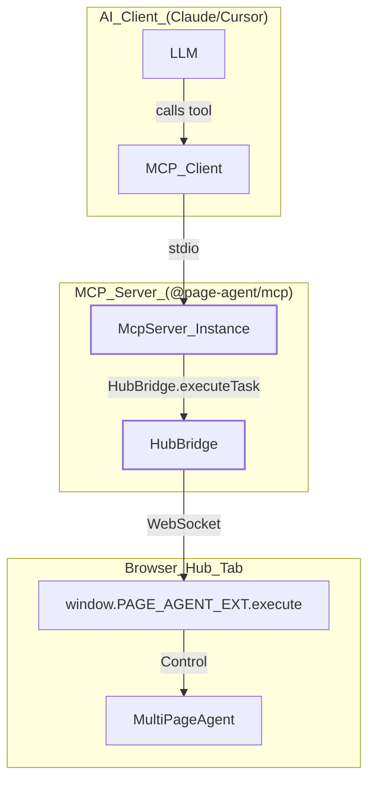

<!-- source: DeepWiki mcp.deepwiki.com · repo alibaba/page-agent · page 11.2 MCP Tools and Configuration · fetched 2026-10-29 -->

# MCP Tools and Configuration

<details>
<summary>Relevant source files</summary>

The following files were used as context for generating this wiki page:

- [packages/mcp/package.json](packages/mcp/package.json)
- [packages/website/src/components/LanguageSwitcher.tsx](packages/website/src/components/LanguageSwitcher.tsx)
- [packages/website/src/components/ThemeSwitcher.tsx](packages/website/src/components/ThemeSwitcher.tsx)
- [packages/website/src/pages/docs/features/mcp-server/page.tsx](packages/website/src/pages/docs/features/mcp-server/page.tsx)
- [packages/website/src/pages/docs/introduction/troubleshooting/page.tsx](packages/website/src/pages/docs/introduction/troubleshooting/page.tsx)

</details>


The `@page-agent/mcp` package implements a Model Context Protocol (MCP) server that allows external AI clients—such as Claude Desktop, Cursor, and GitHub Copilot—to control the user's browser via the PageAgent Chrome extension. It acts as a bridge between the MCP stdio transport and the extension's WebSocket-based Hub.

### Overview of MCP Integration
The MCP server exposes a set of tools to the LLM, which the LLM can invoke to perform web automation tasks. When a tool is called, the MCP server communicates with a "Hub" tab in the browser (managed by the extension) to execute the request.

**MCP Tool Execution Data Flow**


Sources: [packages/mcp/package.json:12-17](), [packages/website/src/pages/docs/features/mcp-server/page.tsx:58-66]()

---

## MCP Tools Reference

The server provides three primary tools to manage the lifecycle of a browser task. These tools are registered with the MCP SDK to be discoverable by clients.

### 1. `execute_task`
This is the primary entry point for automation. It sends a natural language instruction to the PageAgent extension.

| Parameter | Type | Description |
| :--- | :--- | :--- |
| `task` | `string` | Task description. Give specific instructions for the task. Steps preferable. |

*   **Behavior**: This is a blocking operation that waits for the agent to complete the task in the browser. [packages/website/src/pages/docs/features/mcp-server/page.tsx:28-29]()
*   **Implementation**: It utilizes an `llmConfig` derived from environment variables to instruct the `MultiPageAgent` inside the extension.

### 2. `get_status`
Retrieves the current state of the bridge and extension connectivity.

*   **Returns**: An object containing `{ connected: boolean, busy: boolean }`.
*   **Purpose**: Allows the client to verify if the Hub tab is active and if an agent is already running a task.

### 3. `stop_task`
Immediately terminates the current execution loop within the browser extension.

Sources: [packages/mcp/package.json:30-34](), [packages/website/src/pages/docs/features/mcp-server/page.tsx:28-29]()

---

## Environment Variables and Configuration

The MCP server reads configuration from environment variables. These are typically defined in the configuration file of the MCP client (e.g., `claude_desktop_config.json`).

| Variable | Requirement | Description |
| :--- | :--- | :--- |
| `LLM_BASE_URL` | Optional | The base URL for the LLM provider (e.g., OpenAI-compatible endpoint). |
| `LLM_API_KEY` | Optional | The API key for the LLM that the browser agent will use. |
| `LLM_MODEL_NAME` | Optional | The model identifier (e.g., `gpt-4o`, `qwen-max`). |
| `PORT` | Optional | The port for the bridge HTTP and WebSocket server (defaults to `38401`). |

**Note:** These variables allow the MCP server to pass credentials and model preferences to the extension's `MultiPageAgent` so it can perform the "Think" part of the Re-act loop.

Sources: [packages/website/src/pages/docs/features/mcp-server/page.tsx:39-43]()

---

## Client Setup

To use PageAgent with local AI clients, you must configure them to launch the MCP server using `npx`.

### Claude Desktop Configuration
Add the following to your `claude_desktop_config.json` (typically located in `~/Library/Application Support/Claude/` on macOS):

```json
{
  "mcpServers": {
    "page-agent": {
      "command": "npx",
      "args": ["-y", "@page-agent/mcp"],
      "env": {
        "LLM_BASE_URL": "https://api.openai.com/v1",
        "LLM_API_KEY": "sk-xxx",
        "LLM_MODEL_NAME": "gpt-4o"
      }
    }
  }
}
```

### Cursor and Copilot
For Cursor or Copilot, use the same format in their respective MCP settings panels. When the server starts:
1. It initializes a local server on the specified `PORT`.
2. It opens a **Launcher page** in the default browser. [packages/website/src/pages/docs/features/mcp-server/page.tsx:62-63]()
3. The launcher page triggers the extension to open a **Hub tab** (`hub.html`). [packages/website/src/pages/docs/features/mcp-server/page.tsx:63-64]()
4. The Hub tab establishes a WebSocket connection back to the Node.js process. [packages/website/src/pages/docs/features/mcp-server/page.tsx:63-65]()

Sources: [packages/website/src/pages/docs/features/mcp-server/page.tsx:20-49](), [packages/website/src/pages/docs/features/mcp-server/page.tsx:62-66]()

---

## Implementation Details

The MCP server is a Node.js application (ESM) that utilizes the `@modelcontextprotocol/sdk`. [packages/mcp/package.json:5-7](), [packages/mcp/package.json:31-31]()

### Server Architecture
The server implements a bridge between the standard input/output (used by MCP clients) and the browser extension.

**Code Entity Relationship**

```mermaid
classDiagram
    class "McpServer" {
        <<@modelcontextprotocol/sdk>>
        +registerTool()
        +connect()
    }
    class "index.js" {
        <<Entry Point>>
        +CLI_Logic
        +Launcher_Opener
    }
    class "hub-bridge.js" {
        <<Bridge>>
        +HTTPServer
        +WebSocketBridge
    }
    class "HubTab" {
        <<Browser Context>>
        +window.PAGE_AGENT_EXT
        +WebSocketClient
    }

    "index.js" ..> "McpServer" : "initializes"
    "index.js" ..> "hub-bridge.js" : "uses"
    "hub-bridge.js" -- "WebSocket" : "HubTab"
    
    note for "hub-bridge.js" "Manages communication between\nNode.js and Browser Hub tab"
```

### Key Components
1. **`index.js`**: The CLI entry point. It handles the MCP lifecycle (stdio) and parses environment variables. [packages/mcp/package.json:7-7]()
2. **`@modelcontextprotocol/sdk`**: Used to implement the MCP server protocol. [packages/mcp/package.json:31-31]()
3. **`ws`**: Handles the WebSocket communication between the Node.js server and the browser Hub. [packages/mcp/package.json:32-32]()
4. **`zod`**: Input parameters for tools like `execute_task` are validated using `zod` to ensure the LLM provides the correct schema. [packages/mcp/package.json:33-33]()
5. **The Hub**: The control center for communication between Page Agent Ext and external callers. [packages/website/src/pages/docs/features/mcp-server/page.tsx:53-60]()

Sources: [packages/mcp/package.json:30-34](), [packages/website/src/pages/docs/features/mcp-server/page.tsx:53-67]()

---

