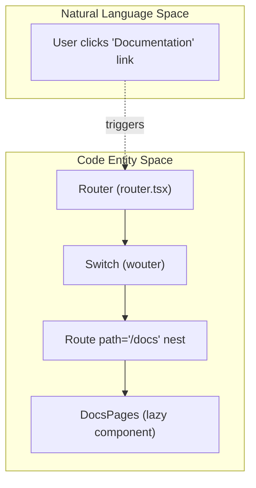
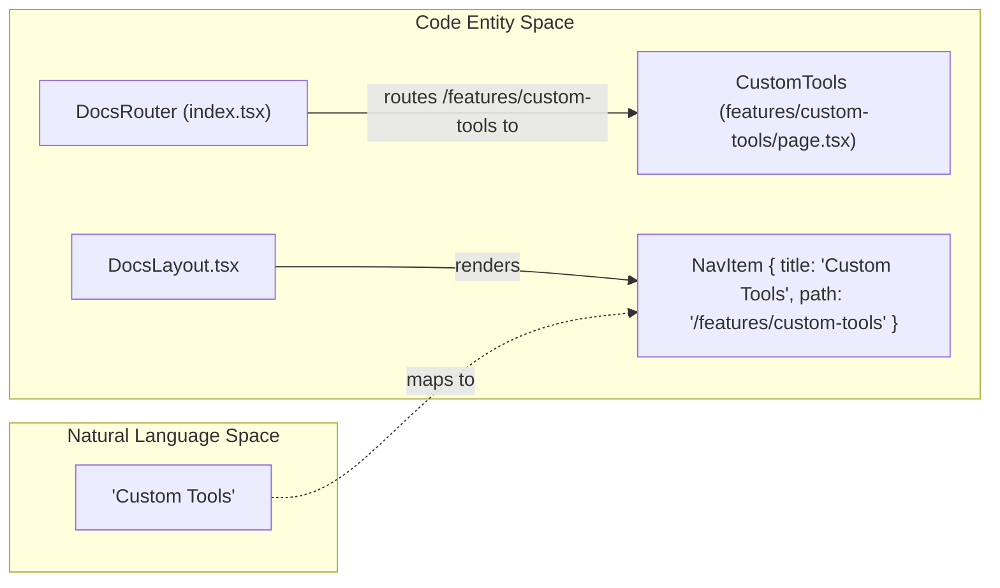

<!-- source: DeepWiki mcp.deepwiki.com · repo alibaba/page-agent · page 12 Website and Documentation · fetched 2026-10-29 -->

# Website and Documentation

<details>
<summary>Relevant source files</summary>

The following files were used as context for generating this wiki page:

- [packages/extension/package.json](packages/extension/package.json)
- [packages/website/package.json](packages/website/package.json)
- [packages/website/src/pages/docs/Layout.tsx](packages/website/src/pages/docs/Layout.tsx)
- [packages/website/src/pages/docs/index.tsx](packages/website/src/pages/docs/index.tsx)
- [packages/website/src/router.tsx](packages/website/src/router.tsx)

</details>


The `@page-agent/website` package provides a React-based single-page application (SPA) that serves as the public-facing documentation site and demo platform for PageAgent. Built with Vite and Tailwind CSS [packages/website/package.json:7-8,30](), it is hosted on GitHub Pages.

This page provides a high-level overview of the website's structure and features. For details, see:
- [Website Architecture](#12.1) — React SPA structure, router configuration, and build process.
- [Documentation System](#12.2) — Docs layout, navigation structure, and content organization.
- [Static Hosting and Deployment](#12.3) — SPA routes plugin, static hosting strategy, and CDN distribution.

## Package Structure

The website package is located at `packages/website` and follows a modern React application structure [packages/website/package.json:2-5](). It utilizes a variety of UI libraries including Radix UI, Motion, and Lucide React to provide a polished user experience [packages/website/package.json:12-22]().

```
packages/website/
├── src/
│   ├── pages/
│   │   ├── home/              # Landing page with interactive demo
│   │   └── docs/              # Documentation pages and layout
│   ├── components/            # Shared UI components (Header, Footer, etc.)
│   ├── i18n/                  # Internationalization context
│   ├── router.tsx             # Top-level routing logic
│   └── main.tsx               # Application entry point
├── index.html                 # HTML template
└── package.json
```

**Sources:** [packages/website/package.json:1-34]()

## Core Routing and Navigation

The website uses `wouter` for lightweight client-side routing [packages/website/package.json:32](). The documentation section is lazily loaded and prefetched during idle time using `requestIdleCallback` to optimize performance [packages/website/src/router.tsx:8-9, 20-27]().

### Navigation Flow



The `router.tsx` handles the primary application paths, including the home page and nested documentation routes [packages/website/src/router.tsx:34-57](). A `ScrollToTop` component ensures the viewport resets on navigation [packages/website/src/router.tsx:11-17]().

**Sources:** [packages/website/src/router.tsx:1-73]()

## Documentation System Structure

The documentation system is organized into three main categories: Introduction, Features, and Advanced [packages/website/src/pages/docs/Layout.tsx:29-69](). It uses a `DocsLayout` component to provide a consistent sidebar and main content area [packages/website/src/pages/docs/Layout.tsx:23]().

### Documentation Content Mapping



The `DocsRouter` in `packages/website/src/pages/docs/index.tsx` maps specific URL paths to their respective page components, such as `PageAgentCoreDocs` or `ChromeExtension` [packages/website/src/pages/docs/index.tsx:6-12, 101-105, 79-83](). For more details on content organization, see [Documentation System](#12.2).

**Sources:** [packages/website/src/pages/docs/Layout.tsx:28-69](), [packages/website/src/pages/docs/index.tsx:33-130]()

## Internationalization (i18n)

The documentation supports English and Chinese (Simplified). The `DocsLayout` component utilizes the `useLanguage` hook to toggle navigation titles between languages [packages/website/src/pages/docs/Layout.tsx:24, 30-66](). It also manages the browser tab title via `useDocumentTitle` based on the active section [packages/website/src/pages/docs/Layout.tsx:71-75]().

**Sources:** [packages/website/src/pages/docs/Layout.tsx:24-75]()

## Build and Static Hosting

The website is built using the `build:website` script [packages/website/package.json:8](). Because it is a Single Page Application (SPA), it requires specific handling for nested routes on static hosts. For details on how the build process handles these routes and generates the static distribution, see [Static Hosting and Deployment](#12.3).

**Sources:** [packages/website/package.json:1-10]()

---

