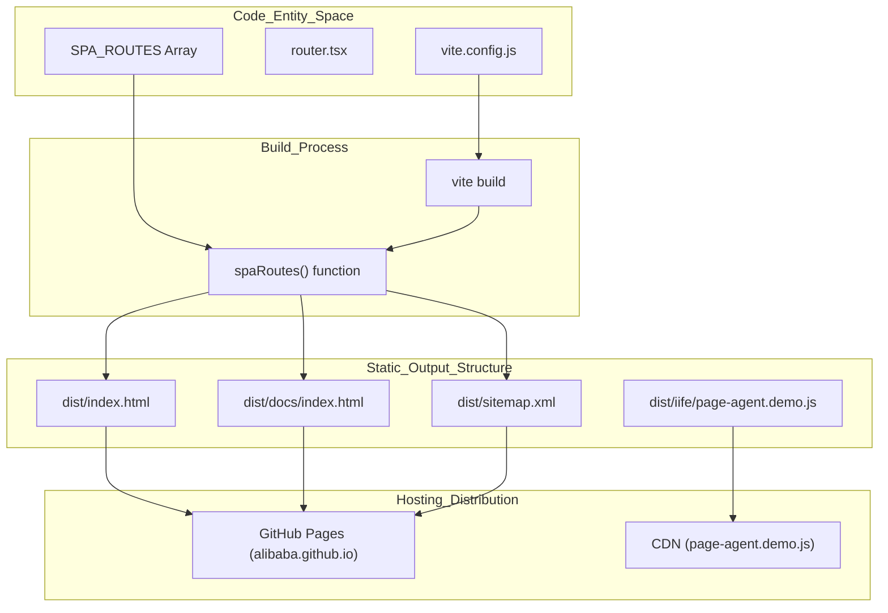
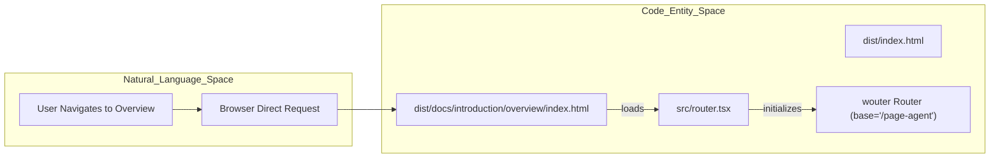

<!-- source: DeepWiki mcp.deepwiki.com · repo alibaba/page-agent · page 12.3 Static Hosting and Deployment · fetched 2026-10-29 -->

# Static Hosting and Deployment

<details>
<summary>Relevant source files</summary>

The following files were used as context for generating this wiki page:

- [packages/page-agent/vite.iife.config.js](packages/page-agent/vite.iife.config.js)
- [packages/website/AGENTS.md](packages/website/AGENTS.md)
- [packages/website/public/robots.txt](packages/website/public/robots.txt)
- [packages/website/src/lib/useDocumentTitle.ts](packages/website/src/lib/useDocumentTitle.ts)
- [packages/website/src/pages/home/index.tsx](packages/website/src/pages/home/index.tsx)
- [packages/website/vite.config.js](packages/website/vite.config.js)

</details>


## Purpose and Scope

This document explains the static hosting strategy for the PageAgent website package, including the Single Page Application (SPA) routing solution, build configuration, and deployment process. The website serves as both documentation and a demo platform, deployed to GitHub Pages and distributed via CDN.

For information about the website architecture and React components, see [12.1](). For documentation content organization, see [12.2]().

---

## The Static Hosting Challenge

The PageAgent website is a React Single Page Application (SPA) that uses client-side routing via the `wouter` library. This architecture creates a specific challenge for static hosting environments like GitHub Pages, where direct navigation to sub-routes (e.g., `/page-agent/docs/introduction/overview`) results in 404 errors because these paths don't correspond to actual HTML files on the server.

**The Problem:**
- Client accesses `https://alibaba.github.io/page-agent/docs/introduction/overview`
- Static server looks for `/docs/introduction/overview/index.html`
- File doesn't exist → 404 error
- Client-side router never initializes

**The Solution:**
A custom Vite plugin `spaRoutes()` copies `index.html` to every route directory during the build process, allowing the server to serve the SPA entry point regardless of which route is accessed directly [packages/website/vite.config.js:42-53]().

Sources: [packages/website/vite.config.js:18-53](), [packages/website/AGENTS.md:81-90]()

---

## Build and Deployment Architecture



**Diagram: Build and Deployment Flow**

Sources: [packages/website/vite.config.js:19-69](), [packages/page-agent/vite.iife.config.js:23-30]()

---

## The spaRoutes() Vite Plugin

The `spaRoutes()` plugin is a custom Vite plugin that runs during the `closeBundle` lifecycle hook to duplicate `index.html` into all SPA route directories and generate a `sitemap.xml` [packages/website/vite.config.js:42-69]().

### Plugin Implementation

[packages/website/vite.config.js:42-69]() defines the plugin:

```javascript
function spaRoutes() {
	return {
		name: 'spa-routes',
		closeBundle() {
			const dist = resolve(__dirname, 'dist')
			const src = join(dist, 'index.html')
			for (const route of SPA_ROUTES) {
				const dir = join(dist, route)
				mkdirSync(dir, { recursive: true })
				copyFileSync(src, join(dir, 'index.html'))
			}
			// ... sitemap generation logic ...
		},
	}
}
```

### How It Works

| Step | Action | Purpose |
|------|--------|---------|
| 1 | Vite completes normal build | Generates `dist/index.html` and bundled assets |
| 2 | `closeBundle()` hook fires | Plugin executes after main build [packages/website/vite.config.js:45]() |
| 3 | Read root `index.html` | Source template for all routes [packages/website/vite.config.js:47]() |
| 4 | Iterate `SPA_ROUTES` array | Process each configured route [packages/website/vite.config.js:48]() |
| 5 | Create directory structure | `mkdirSync(..., { recursive: true })` [packages/website/vite.config.js:50]() |
| 6 | Copy `index.html` to route | Enables direct route access [packages/website/vite.config.js:51]() |
| 7 | Generate `sitemap.xml` | SEO optimization for all routes [packages/website/vite.config.js:55-65]() |

Sources: [packages/website/vite.config.js:42-69]()

---

## SPA_ROUTES Configuration

The `SPA_ROUTES` array [packages/website/vite.config.js:19-38]() defines all routes that require static HTML files for direct access:

```javascript
const SPA_ROUTES = [
	'docs',
	'docs/introduction/overview',
	'docs/introduction/quick-start',
	'docs/introduction/limitations',
	'docs/introduction/troubleshooting',
	'docs/features/custom-tools',
	'docs/features/data-masking',
	'docs/features/custom-instructions',
	'docs/features/models',
	'docs/features/local-llms',
	'docs/features/chrome-extension',
	'docs/features/mcp-server',
	'docs/features/third-party-agent',
	'docs/advanced/page-agent',
	'docs/advanced/page-agent-core',
	'docs/advanced/page-controller',
	'docs/advanced/custom-ui',
	'docs/advanced/security-permissions',
]
```

### Route Mapping



**Diagram: Route to File Mapping**

Sources: [packages/website/vite.config.js:19-38](), [packages/website/AGENTS.md:81-90]()

---

## Build Configuration

### Base Path Configuration

[packages/website/vite.config.js:73]() sets the base path for GitHub Pages deployment:

```javascript
export default defineConfig(({ mode }) => ({
	base: '/page-agent/',
	// ...
}))
```

This ensures all asset URLs are prefixed with `/page-agent/`, matching the GitHub Pages subdirectory structure at `https://alibaba.github.io/page-agent/` [packages/website/vite.config.js:40]().

### Build Optimizations

| Configuration | Location | Purpose |
|---------------|----------|---------|
| **Manual Chunks** | [packages/website/vite.config.js:85-89]() | Separate vendor bundle for `react`, `react-dom`, and `wouter` |
| **CSS Code Split** | [packages/website/vite.config.js:78]() | Split CSS into separate files |
| **Chunk Size Limit** | [packages/website/vite.config.js:77]() | Set to 2000kb to accommodate large documentation components |
| **Rollup Warnings** | [packages/website/vite.config.js:80-83]() | Suppress `EVAL` warnings during bundling |

Sources: [packages/website/vite.config.js:72-92]()

---

## CDN Distribution

In addition to the documentation website, PageAgent provides a standalone IIFE (Immediately Invoked Function Expression) bundle for CDN distribution. This allows users to inject PageAgent into any webpage via a `<script>` tag or bookmarklet.

### IIFE Build Configuration
The build is managed by `vite.iife.config.js` in the `page-agent` package [packages/page-agent/vite.iife.config.js:17-49]().

- **Entry Point**: `src/demo.ts` [packages/page-agent/vite.iife.config.js:25]()
- **Format**: `iife` [packages/page-agent/vite.iife.config.js:28]()
- **Output Name**: `PageAgent` [packages/page-agent/vite.iife.config.js:26]()
- **CSS Handling**: Uses `cssInjectedByJsPlugin` to bundle styles directly into the JavaScript file [packages/page-agent/vite.iife.config.js:19]().

### Environment Injection
LLM credentials and model names are injected into the IIFE bundle during build time if provided in the `.env` file [packages/page-agent/vite.iife.config.js:44-48]().

Sources: [packages/page-agent/vite.iife.config.js:1-50]()

---

## Environment Variables and Versioning

During the website build process, several environment variables are defined to be used within the application:

| Variable | Source | Purpose |
|----------|--------|---------|
| `import.meta.env.VERSION` | `page-agent/package.json` | Displays the current agent version [packages/website/vite.config.js:104]() |
| `import.meta.env.LLM_MODEL_NAME` | `.env` | Default model for the demo [packages/website/vite.config.js:100]() |
| `import.meta.env.LLM_API_KEY` | `.env` | API key for the demo (dev mode) [packages/website/vite.config.js:101]() |
| `import.meta.env.LLM_BASE_URL` | `.env` | Proxy or provider URL [packages/website/vite.config.js:102]() |

The `VERSION` is specifically read from the sibling package `package.json` to ensure consistency across the monorepo [packages/website/vite.config.js:11-13]().

Sources: [packages/website/vite.config.js:11-13](), [packages/website/vite.config.js:98-105]()

---

