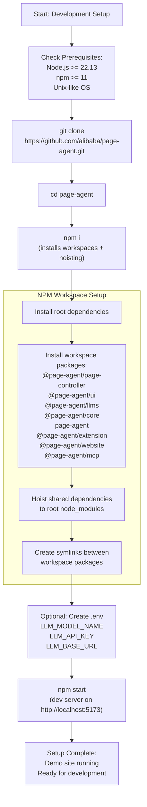
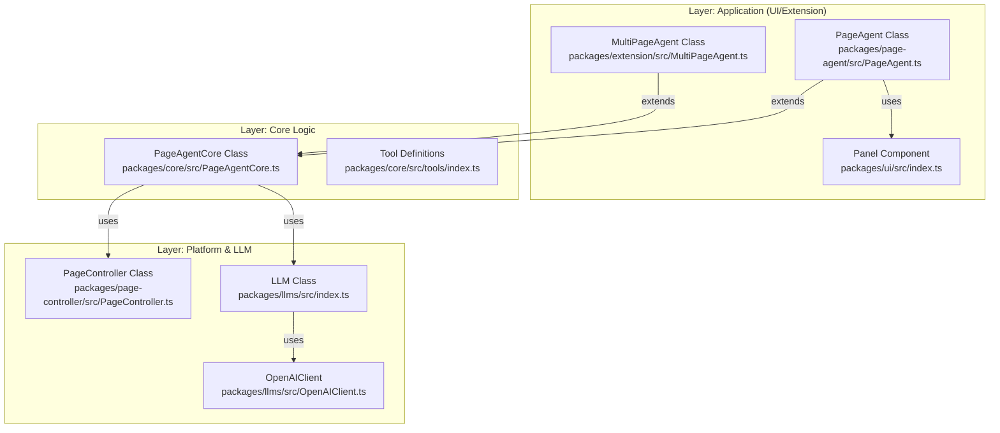

<!-- source: DeepWiki mcp.deepwiki.com · repo alibaba/page-agent · page 13.1 Development Setup · fetched 2026-10-29 -->

# Development Setup

<details>
<summary>Relevant source files</summary>

The following files were used as context for generating this wiki page:

- [.gitignore](.gitignore)
- [AGENTS.md](AGENTS.md)
- [CLAUDE.md](CLAUDE.md)
- [CONTRIBUTING.md](CONTRIBUTING.md)
- [docs/developer-guide.md](docs/developer-guide.md)
- [packages/mcp/README.md](packages/mcp/README.md)
- [packages/website/src/pages/home/HeroSection.tsx](packages/website/src/pages/home/HeroSection.tsx)

</details>


This document provides instructions for setting up a local development environment to contribute to the PageAgent project. It covers system prerequisites, repository cloning, dependency installation, monorepo workspace configuration, and verification steps.

## Purpose and Scope

This page guides contributors through the initial setup required to:
- Clone the repository and install dependencies using npm workspaces.
- Understand the monorepo structure and TypeScript project references.
- Configure the development environment for LLM testing via `.env` files.
- Verify the setup by running the development server and building libraries.

The setup process establishes the foundation for all subsequent development activities.

## Prerequisites

The PageAgent development environment requires specific system configurations and tooling.

### System Requirements

| Requirement | Specification |
|:---|:---|
| **Operating System** | macOS, Linux, or Windows with WSL [docs/developer-guide.md:12]() |
| **Node.js** | `^22.13 || >=24` [docs/developer-guide.md:13]() |
| **npm** | `>= 11` [docs/developer-guide.md:13]() |
| **Editor** | IDE with TypeScript, ESLint, and Prettier support [docs/developer-guide.md:14]() |

The codebase requires a Unix-like environment. Windows users must use Windows Subsystem for Linux (WSL) rather than native Windows [docs/developer-guide.md:12]().

### Editor Configuration

The development environment requires three critical tooling integrations:

1.  **ESLint**: Linting must work correctly as un-linted code will fail CI checks [docs/developer-guide.md:15]().
2.  **Prettier**: Code formatting must be configured and functional [docs/developer-guide.md:15]().
3.  **Commitlint**: Commit messages must follow conventional commit format [docs/developer-guide.md:15]().

**Sources:** [docs/developer-guide.md:11-16](), [CONTRIBUTING.md:18-26]()

## Installation Flow

The following diagram illustrates the complete setup process from repository cloning through verification:

**Installation Process Overview**


**Sources:** [AGENTS.md:5-27](), [docs/developer-guide.md:11-23](), [CONTRIBUTING.md:1-47]()

### Basic Installation Commands

```bash
# Clone the repository
git clone https://github.com/alibaba/page-agent.git
cd page-agent

# Install all dependencies
npm i # Or npm ci to preserve lockfile

# Start development server
npm start
```

The `npm i` command at the repository root triggers the npm workspaces installation process, which installs dependencies for all packages and creates symlinks between internal packages [AGENTS.md:33-35]().

**Sources:** [AGENTS.md:20-21](), [docs/developer-guide.md:19-23]()

## Monorepo Workspace Architecture

PageAgent uses a source-first monorepo architecture based on native npm workspaces. Library `package.json` exports point to `src/*.ts` during development to allow for live updates [AGENTS.md:33-34]().

### Workspace Topology

The monorepo contains several workspace packages defined in the root configuration [AGENTS.md:37-45]():

| Package | Directory | npm Name | Purpose |
|:---|:---|:---|:---|
| **Core** | `packages/core/` | `@page-agent/core` | Core agent logic (headless) [AGENTS.md:38]() |
| **Page Agent** | `packages/page-agent/` | `page-agent` | Main entry with UI + controller [AGENTS.md:39]() |
| **Website** | `packages/website/` | `@page-agent/website` | React docs and landing page [AGENTS.md:40]() |
| **LLMs** | `packages/llms/` | `@page-agent/llms` | LLM client and retry logic [AGENTS.md:41]() |
| **Extension** | `packages/extension/` | (extension) | Browser extension (WXT + React) [AGENTS.md:42]() |
| **Page Controller** | `packages/page-controller/` | `@page-agent/page-controller` | DOM operations and visual feedback [AGENTS.md:43]() |
| **UI** | `packages/ui/` | `@page-agent/ui` | Panel and i18n components [AGENTS.md:44]() |
| **MCP** | `packages/mcp/` | `@page-agent/mcp` | MCP server for browser control [docs/developer-guide.md:32]() |

### Code Entity Space Mapping

The following diagram maps high-level system components to their specific code entities and file paths.

**System Architecture to Code Mapping**


**Sources:** [AGENTS.md:50-71](), [AGENTS.md:81-113]()

## TypeScript Configuration

The monorepo uses TypeScript project references and Vite aliases to enable incremental builds and enforce module boundaries [docs/developer-guide.md:43]().

### Module Resolution Strategy

| Mode | Strategy | Purpose |
|:---|:---|:---|
| **Development** | Source Exports | Direct source access via `package.json` pointing to `src/*.ts` [AGENTS.md:34]() |
| **Publishing** | `publishConfig` | Scripts promote `dist/` paths to top-level during publish [AGENTS.md:34]() |

**Sources:** [AGENTS.md:31-46](), [docs/developer-guide.md:43]()

## LLM API Configuration

The development server requires LLM credentials for testing agent functionality. These should be placed in a `.env` file at the repository root [docs/developer-guide.md:51-53]().

### Environment Variables

Configuration is handled via `.env` files. Key variables include:

- `LLM_MODEL_NAME`: The model to use (e.g., `gpt-4o`, `qwen-max`) [docs/developer-guide.md:56]().
- `LLM_API_KEY`: Your provider API key [docs/developer-guide.md:57]().
- `LLM_BASE_URL`: The endpoint for the LLM provider [docs/developer-guide.md:58]().

### Local Development (Ollama)

For local development with Ollama (tested on qwen3:14b), set the following in `.env` [docs/developer-guide.md:61-67]():
- `LLM_BASE_URL="http://localhost:11434/v1"`
- `LLM_API_KEY="NA"`
- `LLM_MODEL_NAME="qwen3:14b"`

**Sources:** [docs/developer-guide.md:51-72]()

## Common Development Commands

| Command | Description |
|:---|:---|
| `npm start` | Start website dev server [AGENTS.md:21]() |
| `npm run build` | Build all packages [AGENTS.md:22]() |
| `npm run build:libs` | Build all library packages (`core`, `llms`, etc.) [AGENTS.md:23]() |
| `npm run build:ext` | Build and zip the browser extension [AGENTS.md:24]() |
| `npm run typecheck` | Run TypeScript type checking across all packages [AGENTS.md:25]() |
| `npm run test` | Run unit tests across all workspaces [AGENTS.md:26]() |
| `npm run dev:ext` | Start extension development mode (WXT) [docs/developer-guide.md:77]() |
| `npm run dev:demo` | Serve IIFE script for testing on external sites [docs/developer-guide.md:88]() |

**Sources:** [AGENTS.md:18-28](), [docs/developer-guide.md:74-90]()

## Verification Checklist

After completing the installation, verify the setup:

- [ ] **Dependencies**: `npm i` completed without errors and `node_modules` is populated.
- [ ] **Dev Server**: `npm start` launches the website [docs/developer-guide.md:21]().
- [ ] **Library Build**: `npm run build:libs` successfully generates `dist` folders in library packages [AGENTS.md:23]().
- [ ] **Type Checking**: `npm run typecheck` passes without errors [AGENTS.md:25]().
- [ ] **Testing**: `npm test` passes for the core packages [AGENTS.md:26]().

**Sources:** [AGENTS.md:18-28](), [docs/developer-guide.md:11-23]()

---

