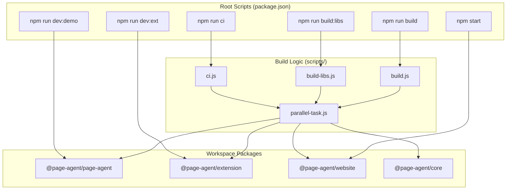
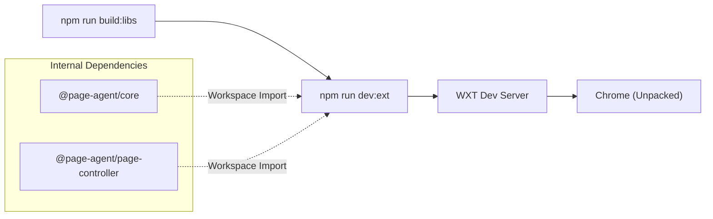
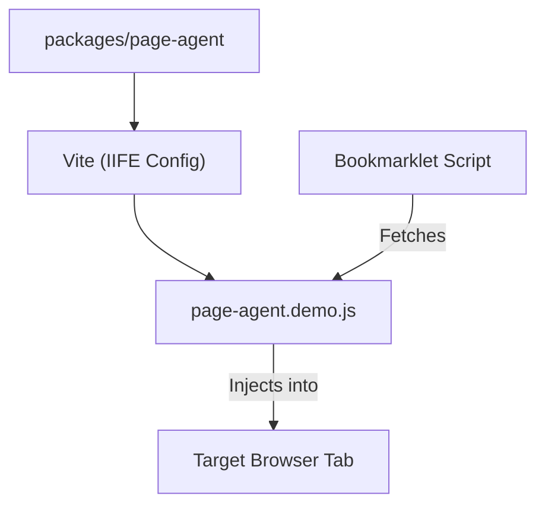
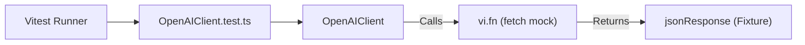
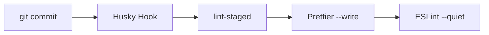

<!-- source: DeepWiki mcp.deepwiki.com · repo alibaba/page-agent · page 13.2 Development Workflows · fetched 2026-10-29 -->

# Development Workflows

<details>
<summary>Relevant source files</summary>

The following files were used as context for generating this wiki page:

- [package-lock.json](package-lock.json)
- [package.json](package.json)
- [packages/llms/src/OpenAIClient.test.ts](packages/llms/src/OpenAIClient.test.ts)
- [packages/llms/src/index.test.ts](packages/llms/src/index.test.ts)
- [scripts/build-libs.js](scripts/build-libs.js)
- [scripts/build.js](scripts/build.js)
- [scripts/ci.js](scripts/ci.js)
- [scripts/parallel-task.js](scripts/parallel-task.js)

</details>


This document describes the npm scripts, development server setups, build processes, and testing workflows used in the PageAgent monorepo. It covers day-to-day development tasks from starting dev servers to building production artifacts.

For initial project setup and installation, see [Development Setup](#13.1). For guidelines on adding new features and maintaining code quality, see [Adding Features](#13.3) and [Testing and Quality](#13.4).

## Available NPM Scripts

### Root-Level Commands

The root `package.json` defines workspace-level commands that orchestrate the entire monorepo:

| Script | Command | Purpose |
|--------|---------|---------|
| `npm start` | `npm run dev --workspace=@page-agent/website` | Start website development server |
| `npm run dev:ext` | `npm run dev -w @page-agent/ext` | Start extension development with hot reload (WXT) |
| `npm run dev:demo` | `npm run dev:demo --workspace=page-agent` | Build and serve IIFE demo script at http://localhost:5174 |
| `npm run build` | `node scripts/build.js` | Full build pipeline (cleanup + parallel build) |
| `npm run build:libs` | `node scripts/build-libs.js` | Build all library packages concurrently |
| `npm run build:website` | `npm run build:website --workspace=@page-agent/website` | Build website for static deployment |
| `npm run build:ext` | `npm run zip -w @page-agent/ext` | Build and package extension as .zip |
| `npm run version` | `node scripts/sync-version.js` | Synchronize version across all packages |
| `npm run typecheck` | `tsc --noEmit -p tsconfig.typecheck.json ...` | Run TypeScript type checking across the repo |
| `npm run test` | `npm test --workspaces --if-present` | Run Vitest suites across all packages |
| `npm run lint` | `eslint .` | Run ESLint on entire monorepo |
| `npm run cleanup` | `rm -rf packages/*/dist && rm -rf packages/*/.output` | Remove all build artifacts |
| `npm run prepare` | `husky || true` | Install git hooks |

**Sources:** [package.json:28-44]()

### Script Orchestration Architecture

The root scripts use `parallel-task.js` to execute workspace commands efficiently. The `parallelTask` function handles task concurrency, timeouts (default 30s, overridden to 120s for builds), and captures output for reporting.

**Monorepo Script Orchestration**


**Sources:** [package.json:28-35](), [scripts/build.js:28-45](), [scripts/build-libs.js:17-25](), [scripts/parallel-task.js:11-15](), [scripts/ci.js:39-49]()

## Website Development Workflow

### Starting the Development Server

The website serves dual purposes: documentation/landing page and live testing environment for the agent.

```bash
npm start
# Runs the 'dev' script in packages/website
```

The website development server uses:
- Vite with hot module replacement (HMR) [package.json:68]().
- TailwindCSS via `@tailwindcss/vite` plugin [package.json:52]().
- React with Vite plugin for fast refresh [package.json:55]().

### Environment Variables for LLM Testing

The project uses `dotenv` [package.json:58]() to manage environment variables. Create a `.env` file in the repository root to configure LLM providers for the local environment.

**Sources:** [package.json:29,52,55,58,68]()

## Extension Development Workflow

### Prerequisites

The extension requires pre-built libraries since it imports from workspace packages.

```bash
# Build all libraries first
npm run build:libs

# Start extension development
npm run dev:ext
```

### Development Process

The extension uses WXT (Web Extension Tools) for development. The `dev:ext` script targets the `@page-agent/ext` workspace [package.json:30]().

**Extension Development Data Flow**


**Workflow steps:**
1. **Initial build**: Run `npm run build:libs` to compile all workspace dependencies using `scripts/build-libs.js`.
2. **Start WXT**: Run `npm run dev:ext`.
3. **Load in Chrome**: Load the generated `.output/chrome-mv3` directory as an unpacked extension.
4. **Make changes**: The WXT server will hot-reload the extension when source files change.

**Sources:** [package.json:30,35](), [scripts/build-libs.js:17-25]()

## Demo/IIFE Development Workflow

### Purpose

The IIFE (Immediately Invoked Function Expression) build creates a standalone script for testing PageAgent on any website via bookmarklet or CDN distribution.

### Development Server

```bash
npm run dev:demo
# Runs 'dev:demo' in packages/page-agent
```

This command triggers the demo build in the `page-agent` package [package.json:31](), typically serving the bundle locally for injection into browser sessions.

**IIFE Injection Flow**


**Sources:** [package.json:31]()

## Build Workflows

### Library Build Pipeline

The `build:libs` command uses `scripts/build-libs.js` to read the workspace list from the root `package.json` and filters for packages containing a `build` script [scripts/build-libs.js:17-23](). It uses `parallelTask` to execute them concurrently with a 120-second timeout [scripts/build-libs.js:25]().

### Full Build Process

The `npm run build` command triggers `scripts/build.js`, which performs the following steps:
1. **Cleanup**: Runs `npm run cleanup` to clear previous artifacts [scripts/build.js:24]().
2. **Parallel Build**: Executes builds for all workspace libraries, the website, and the extension zip process concurrently using `parallelTask` [scripts/build.js:28-45]().

**Sources:** [scripts/build.js:1-46](), [scripts/build-libs.js:1-25](), [scripts/parallel-task.js:11-15]()

## Testing and CI Workflow

### CI Script

The `scripts/ci.js` script is used to verify the repository state before commits or during GitHub Actions. It executes the following checks in sequence or parallel:

1.  **Commitlint**: Validates commit messages (skipped on the `main` branch) [scripts/ci.js:32-37]().
2.  **Parallel Checks**: Runs `lint`, `format`, `typecheck`, and `test` concurrently [scripts/ci.js:41-49]().
3.  **Build**: Verifies that the full build pipeline succeeds [scripts/ci.js:52-56]().

### Test Execution

Unit and integration tests are managed via `vitest` [package.json:45](). Tests are written using standard BDD patterns (`describe`, `it`, `expect`) and often utilize `vi.fn()` for mocking LLM responses or browser APIs.

**Test Data Flow (LLM Example)**


**Sources:** [scripts/ci.js:1-57](), [packages/llms/src/OpenAIClient.test.ts:1-22](), [packages/llms/src/index.test.ts:20-29]()

## Code Quality Workflows

### Linting and Formatting

The project uses ESLint and Prettier to maintain code standards.

**Pre-commit Lifecycle**


**Lint-staged configuration:**
- `*.{js,ts,cjs,cts,mjs,mts}`: Runs `prettier --write` then `eslint --quiet` [package.json:76-79]().
- `*.{jsx,tsx}`: Runs `prettier --write` then `eslint --quiet` [package.json:80-83]().
- `*.css`: Runs `prettier --write` [package.json:84-86]().
- `*.md`: Runs `prettier --write` [package.json:87-89]().

### Formatting Standards
- **Single Quotes**: Enabled [package.json:103]().
- **No Semicolons**: Enabled [package.json:104]().
- **Tabs**: Used for indentation [package.json:105]().
- **Import Sorting**: Handled by `@trivago/prettier-plugin-sort-imports` [package.json:108-117]().

**Sources:** [package.json:75-135]()

## Version Management

### Synchronizing Versions

PageAgent uses a `sync-version.js` script to ensure all packages in the monorepo stay on the same version [package.json:36](). This is triggered during the `version` lifecycle of npm to maintain consistency across `@page-agent/core`, `@page-agent/llms`, etc.

**Sources:** [package.json:36](), [package.json:4-15]()

---

